# API 参考

<cite>
**本文引用的文件**   
- [main.dart](file://lib/main.dart)
- [pubspec.yaml](file://pubspec.yaml)
- [supabase_service.dart](file://lib/core/services/supabase_service.dart)
- [supabase_auth_service.dart](file://lib/core/services/supabase_auth_service.dart)
- [remote_podcast_datasource.dart](file://lib/data/datasources/remote_podcast_datasource.dart)
- [rss_parser_service.dart](file://lib/data/services/rss_parser_service.dart)
- [itunes_search_service.dart](file://lib/data/services/itunes_search_service.dart)
- [remote_sync_datasource.dart](file://lib/data/datasources/remote_sync_datasource.dart)
- [run.sh](file://run.sh)
</cite>

## 目录
1. [简介](#简介)
2. [项目结构](#项目结构)
3. [核心组件](#核心组件)
4. [架构总览](#架构总览)
5. [详细组件分析](#详细组件分析)
6. [依赖分析](#依赖分析)
7. [性能考虑](#性能考虑)
8. [故障排查指南](#故障排查指南)
9. [结论](#结论)
10. [附录](#附录)

## 简介
本 API 参考面向 TinyCast 应用的对外接口与内部服务，覆盖以下方面：
- RESTful API（通过 Supabase 客户端访问）
- RSS/ITunes 外部数据源（HTTP 请求与解析）
- 本地 Isar 数据库与音频播放服务（作为应用内“服务”的边界）
- 多窗口 IPC（桌面端窗口间参数传递）
- 认证与安全（Supabase OAuth、环境变量配置）
- 错误处理、速率限制、版本信息与调试建议

TinyCast 是一个跨平台播客应用，支持 macOS/Windows/Linux 桌面与移动端。网络层主要使用 Dio，云端同步与认证基于 Supabase Flutter SDK，RSS 订阅解析由自研解析器完成，并可选增强 iTunes 元数据。

## 项目结构
- lib/main.dart：应用入口、平台分支、窗口初始化、环境配置注入
- lib/core/services/*：Supabase 客户端封装、认证服务
- lib/data/datasources/*：远程数据源（RSS、iTunes、Supabase）
- lib/data/services/*：RSS 解析、iTunes 搜索、下载与播放器等
- pubspec.yaml：依赖声明（Dio、Supabase、Isar、Riverpod 等）
- run.sh：运行脚本，注入 Supabase 环境变量

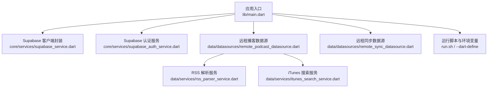

**图表来源** 
- [main.dart:106-194](file://lib/main.dart#L106-L194)
- [supabase_service.dart:1-55](file://lib/core/services/supabase_service.dart#L1-L55)
- [supabase_auth_service.dart:1-39](file://lib/core/services/supabase_auth_service.dart#L1-L39)
- [remote_podcast_datasource.dart:1-345](file://lib/data/datasources/remote_podcast_datasource.dart#L1-L345)
- [rss_parser_service.dart:1-459](file://lib/data/services/rss_parser_service.dart#L1-L459)
- [itunes_search_service.dart:1-317](file://lib/data/services/itunes_search_service.dart#L1-L317)
- [remote_sync_datasource.dart:1-392](file://lib/data/datasources/remote_sync_datasource.dart#L1-L392)
- [run.sh:1-65](file://run.sh#L1-L65)

**章节来源**
- [main.dart:106-194](file://lib/main.dart#L106-L194)
- [pubspec.yaml:1-196](file://pubspec.yaml#L1-L196)
- [run.sh:1-65](file://run.sh#L1-L65)

## 核心组件
- SupabaseService：单例封装 Supabase 初始化与客户端获取，提供 Provider 暴露给 Riverpod
- SupabaseAuthService：封装 Google OAuth 登录与登出，管理回调 URL
- RemotePodcastDataSource：从 RSS 获取播客与节目列表，失败时尝试从 HTML 页面提取真实 RSS 链接，并异步增强 iTunes 信息
- RssParserService：拉取并解析 RSS XML，提取 Podcast/Episode 实体，含重试、反爬虫检测与多种时间格式解析
- ITunesSearchService：调用 iTunes Search API，按国家区域顺序重试，返回结构化结果
- RemoteSyncDataSource：封装 Supabase 表操作（upsert/fetch/delete），用于播客、节目、订阅、播放历史、收藏、队列等数据的云同步

**章节来源**
- [supabase_service.dart:1-55](file://lib/core/services/supabase_service.dart#L1-L55)
- [supabase_auth_service.dart:1-39](file://lib/core/services/supabase_auth_service.dart#L1-L39)
- [remote_podcast_datasource.dart:1-345](file://lib/data/datasources/remote_podcast_datasource.dart#L1-L345)
- [rss_parser_service.dart:1-459](file://lib/data/services/rss_parser_service.dart#L1-L459)
- [itunes_search_service.dart:1-317](file://lib/data/services/itunes_search_service.dart#L1-L317)
- [remote_sync_datasource.dart:1-392](file://lib/data/datasources/remote_sync_datasource.dart#L1-L392)

## 架构总览
应用启动流程：
- 根据平台选择移动端或桌面端入口
- 初始化 Isar、AudioPlayer、日志、Supabase（若配置有效）
- 注册生命周期观察者，启动定时刷新任务
- 渲染主界面或设置/订阅/详情子窗口

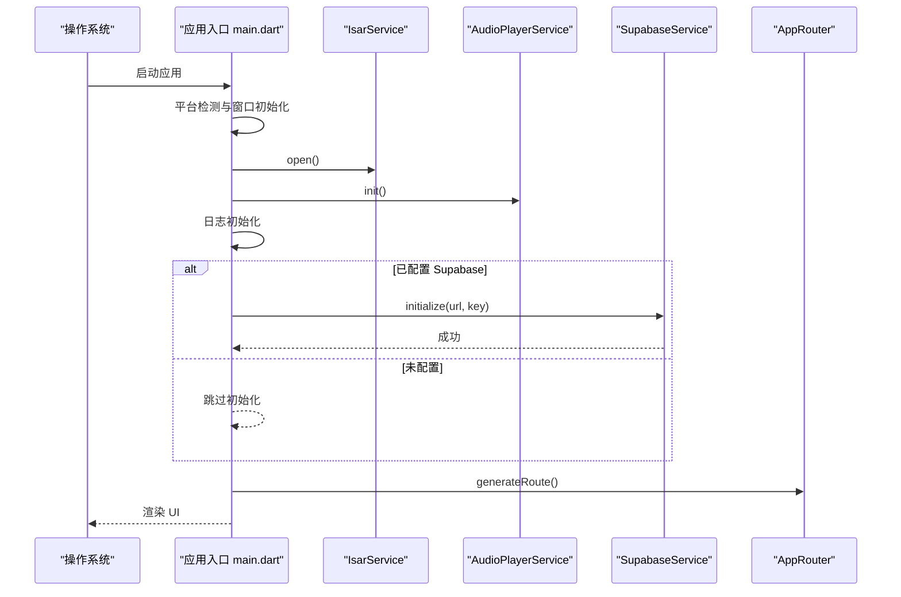

**图表来源** 
- [main.dart:106-194](file://lib/main.dart#L106-L194)

## 详细组件分析

### Supabase 客户端与服务
- 职责：统一初始化 Supabase 客户端，提供线程安全的 client 访问；在 Riverpod 中暴露 supabaseClientProvider
- 关键方法：initialize(supabaseUrl, supabaseAnonKey)、client、isInitialized
- 安全：凭据通过编译时环境变量注入，避免硬编码

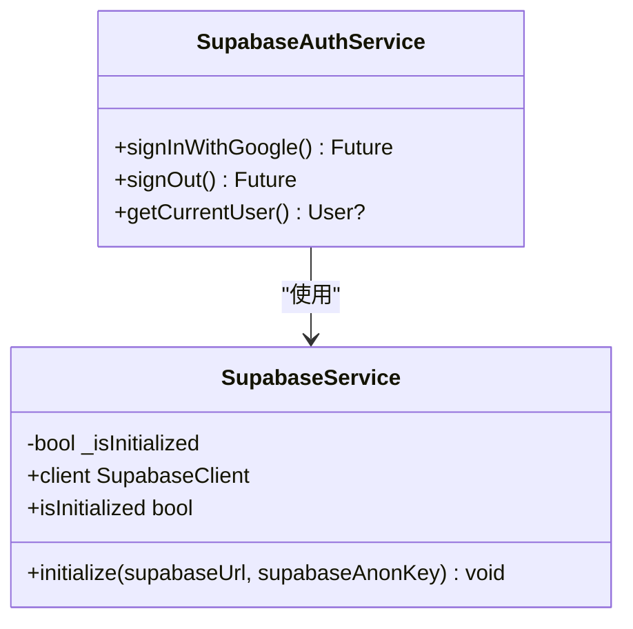

**图表来源** 
- [supabase_service.dart:1-55](file://lib/core/services/supabase_service.dart#L1-L55)
- [supabase_auth_service.dart:1-39](file://lib/core/services/supabase_auth_service.dart#L1-L39)

**章节来源**
- [supabase_service.dart:1-55](file://lib/core/services/supabase_service.dart#L1-L55)
- [supabase_auth_service.dart:1-39](file://lib/core/services/supabase_auth_service.dart#L1-L39)

### Supabase 认证（OAuth）
- 登录：使用 Google OAuth，回调 URL 为 io.supabase.tinycast://login-callback/
- 登出：调用 signOut
- 当前用户：currentUser

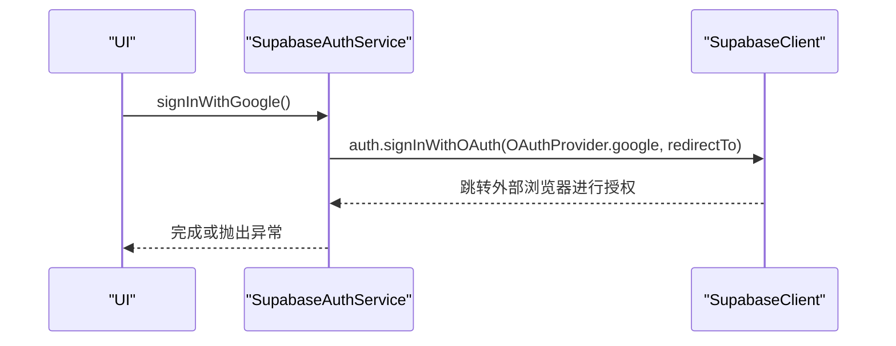

**图表来源** 
- [supabase_auth_service.dart:13-24](file://lib/core/services/supabase_auth_service.dart#L13-L24)

**章节来源**
- [supabase_auth_service.dart:1-39](file://lib/core/services/supabase_auth_service.dart#L1-L39)

### 远程播客数据源（RSS + HTML 回退 + iTunes 增强）
- 功能：
  - 从 RSS 获取 Podcast 与 Episode 列表
  - 当服务器返回 HTML 或 XML 解析失败时，尝试从网页中提取真实 RSS 链接
  - 异步调用 iTunes 搜索以补充封面、流派、国家等信息
- 关键方法：getPodcastFromRss(rssUrl)、validateRssUrl(rssUrl)
- 错误处理：区分网络错误、HTML 响应、XML 解析失败、验证码挑战

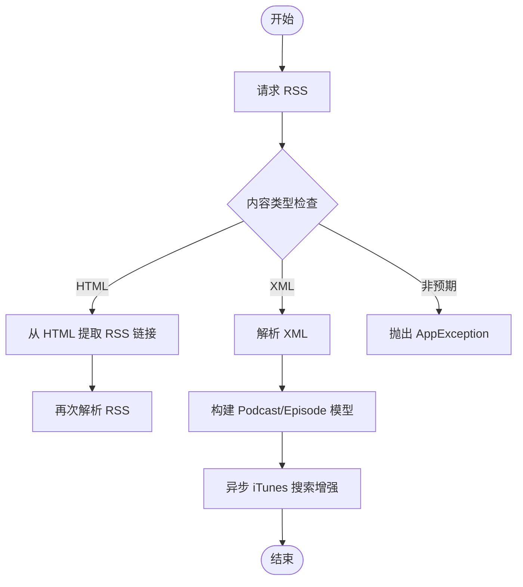

**图表来源** 
- [remote_podcast_datasource.dart:35-115](file://lib/data/datasources/remote_podcast_datasource.dart#L35-L115)
- [rss_parser_service.dart:40-128](file://lib/data/services/rss_parser_service.dart#L40-L128)

**章节来源**
- [remote_podcast_datasource.dart:1-345](file://lib/data/datasources/remote_podcast_datasource.dart#L1-L345)
- [rss_parser_service.dart:1-459](file://lib/data/services/rss_parser_service.dart#L1-L459)

### RSS 解析服务
- 功能：拉取 RSS XML，校验状态码与 Content-Type，检测反爬虫挑战，解析频道与条目，生成 Podcast/Episode 实体
- 特性：
  - 重试机制（指数退避）
  - 支持 RFC822 与 ISO8601 日期解析
  - 自动处理缺失 GUID 的情况（基于 audioUrl 生成稳定标识）
  - 识别 HTML 响应并触发上层回退逻辑

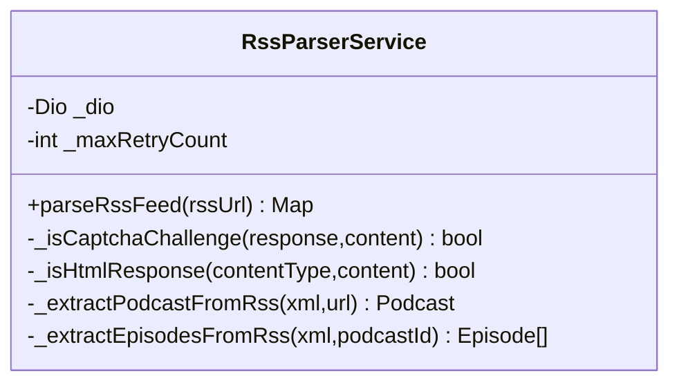

**图表来源** 
- [rss_parser_service.dart:16-128](file://lib/data/services/rss_parser_service.dart#L16-L128)

**章节来源**
- [rss_parser_service.dart:1-459](file://lib/data/services/rss_parser_service.dart#L1-L459)

### iTunes 搜索服务
- 功能：按关键词或 feedUrl 精确查找播客，返回包含封面、流派、国家、发布日期等完整元数据的结果
- 策略：按国家区域顺序重试，提升命中率
- 数据结构：ITunesSearchResult（collectionId、artworkUrl600、genres、country 等）

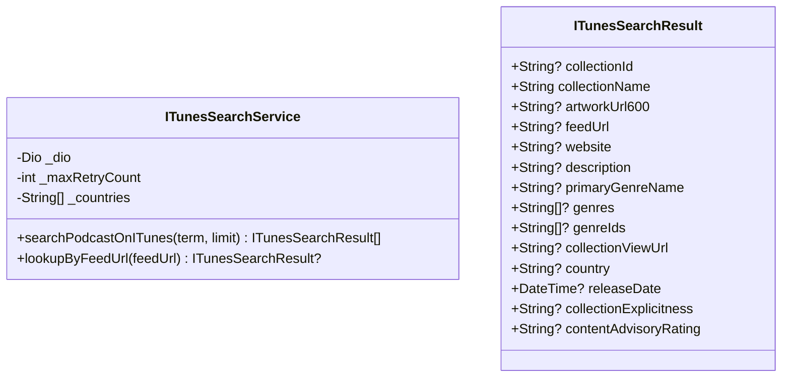

**图表来源** 
- [itunes_search_service.dart:106-317](file://lib/data/services/itunes_search_service.dart#L106-L317)
- [itunes_search_service.dart:12-101](file://lib/data/services/itunes_search_service.dart#L12-L101)

**章节来源**
- [itunes_search_service.dart:1-317](file://lib/data/services/itunes_search_service.dart#L1-L317)

### 远程同步数据源（Supabase 表操作）
- 能力：对 podcasts、episodes、user_podcast_subscriptions、playback_history、favorites、queue_items 等表执行 upsert/fetch/delete
- 约束：
  - 所有写操作需确保用户已登录（_ensureUserId）
  - 批量 upsert 指定冲突键（如 itunes_id、guid+podcast_id、user_id+episode_id）
  - 查询支持按更新时间过滤（updated_at/last_update_time）

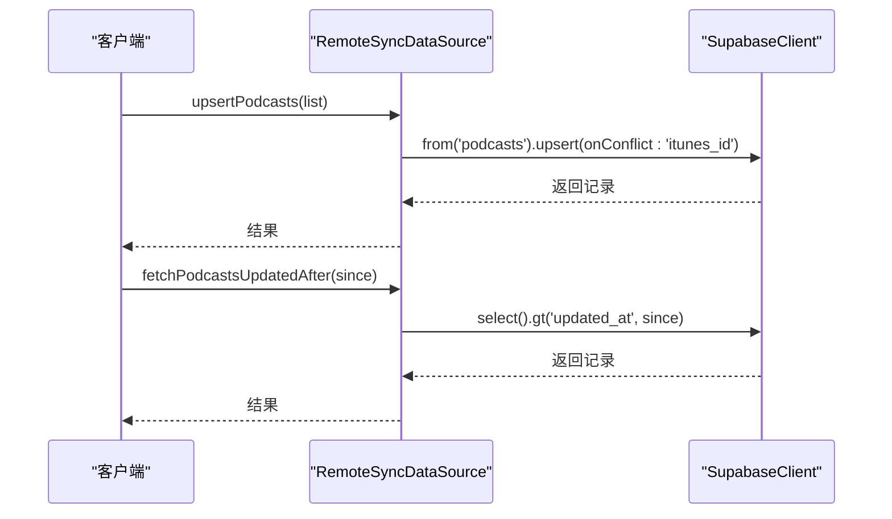

**图表来源** 
- [remote_sync_datasource.dart:17-55](file://lib/data/datasources/remote_sync_datasource.dart#L17-L55)
- [remote_sync_datasource.dart:78-116](file://lib/data/datasources/remote_sync_datasource.dart#L78-L116)

**章节来源**
- [remote_sync_datasource.dart:1-392](file://lib/data/datasources/remote_sync_datasource.dart#L1-L392)

### 多窗口 IPC（桌面端）
- 机制：通过 WindowController 创建新窗口并传递 WindowArguments（type、episode、podcast）
- 路由：根据 arguments.type 决定渲染主窗口、设置窗口、订阅窗口或节目详情窗口
- 注意：移动端跳过窗口系统初始化

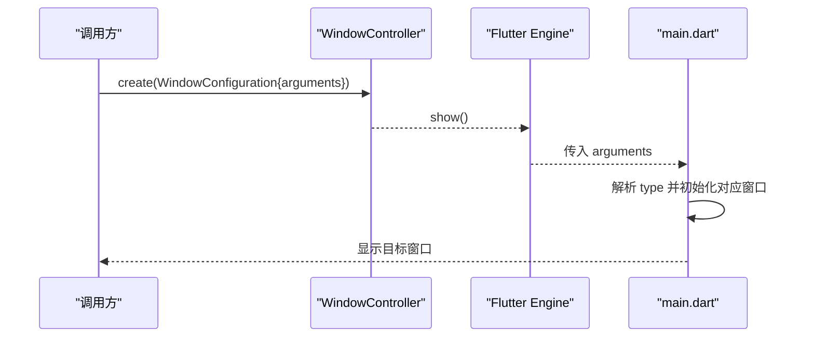

**图表来源** 
- [main.dart:23-39](file://lib/main.dart#L23-L39)
- [main.dart:128-176](file://lib/main.dart#L128-L176)

**章节来源**
- [main.dart:23-39](file://lib/main.dart#L23-L39)
- [main.dart:128-176](file://lib/main.dart#L128-L176)

## 依赖分析
- 网络层：Dio（HTTP/2 适配器）、connectivity_plus（网络状态）
- 云端：supabase_flutter（认证、数据库、存储）
- 本地存储：isar_community（高性能本地数据库）
- 状态管理：riverpod/flutter_riverpod
- 音频：just_audio/audio_service
- RSS/XML：rss_dart/xml
- 图片缓存：cached_network_image
- 加密与安全：crypto/flutter_secure_storage
- 国际化与格式化：intl
- HTML 处理：html/flutter_widget_from_html

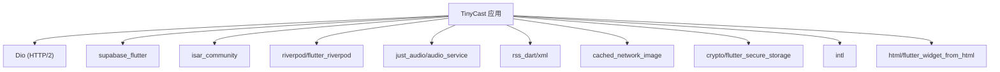

**图表来源** 
- [pubspec.yaml:18-144](file://pubspec.yaml#L18-L144)

**章节来源**
- [pubspec.yaml:1-196](file://pubspec.yaml#L1-L196)

## 性能考虑
- 网络请求
  - 合理设置连接/接收/发送超时（默认值来自 AppConstants）
  - 启用 HTTP/2 适配器减少握手开销
  - 对 RSS/iTunes 请求实施重试与退避
- 数据解析
  - RSS 解析采用流式读取与最小化对象分配
  - 对缺失 GUID 的节目使用稳定 ID 生成，避免重复
- 本地存储
  - Isar 索引优化（title、rssUrl、lastUpdated）
  - 批量 upsert 减少往返次数
- 图片与缓存
  - 使用 cached_network_image 缓存封面图
  - 按需加载大图（iTunes 600x600）
- 后台任务
  - FeedRefreshScheduler 在应用生命周期内调度刷新，避免频繁唤醒

[本节为通用指导，不直接分析具体文件]

## 故障排查指南
- RSS 解析失败
  - 检查 Content-Type 是否为 XML/RSS；若返回 HTML，确认是否触发回退逻辑
  - 检测反爬虫标志（sg-captcha、meta refresh），提示切换网络或稍后重试
- 网络错误
  - DioException 分类：连接超时、连接错误、HTTP 状态码错误
  - 查看日志中的原始错误与堆栈
- 认证问题
  - 确认 Supabase URL 与匿名 Key 已通过 --dart-define 注入
  - 检查 OAuth 回调 URL 是否在 Supabase Dashboard 中注册
- 同步失败
  - 确认用户已登录（_ensureUserId）
  - 检查表的冲突键与字段映射是否正确

**章节来源**
- [rss_parser_service.dart:101-128](file://lib/data/services/rss_parser_service.dart#L101-L128)
- [remote_podcast_datasource.dart:286-345](file://lib/data/datasources/remote_podcast_datasource.dart#L286-L345)
- [supabase_auth_service.dart:13-33](file://lib/core/services/supabase_auth_service.dart#L13-L33)
- [remote_sync_datasource.dart:9-13](file://lib/data/datasources/remote_sync_datasource.dart#L9-L13)

## 结论
TinyCast 的 API 体系围绕 Supabase 与 RSS/iTunes 数据源展开，结合本地 Isar 与音频服务形成完整的播客体验。通过清晰的数据源分层、健壮的错误处理与可插拔的网络配置，应用具备良好的可扩展性与稳定性。建议在集成第三方服务时遵循统一的错误分类与重试策略，并在生产环境中严格管理凭据与回调配置。

[本节为总结性内容，不直接分析具体文件]

## 附录

### 环境变量与运行命令
- 环境变量
  - SUPABASE_URL：Supabase 项目地址
  - SUPABASE_ANON_KEY：匿名密钥
- 运行脚本
  - 支持 iOS/Android/桌面平台自动选择设备
  - 通过 --dart-define 注入环境变量

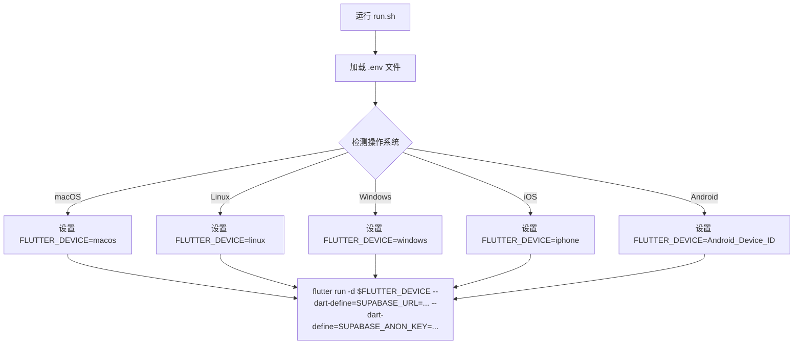

**图表来源** 
- [run.sh:1-65](file://run.sh#L1-L65)

**章节来源**
- [run.sh:1-65](file://run.sh#L1-L65)
- [main.dart:47-72](file://lib/main.dart#L47-L72)

### 常见用例与客户端实现指南
- 订阅播客
  - 调用 RemotePodcastDataSource.getPodcastFromRss(rssUrl)
  - 若返回 HTML，自动回退到 HTML 提取 RSS 链接
  - 异步增强 iTunes 元数据（封面、流派、国家）
- 搜索播客
  - 使用 ITunesSearchService.searchPodcastOnITunes(term, limit)
  - 按国家区域顺序重试，提高命中率
- 云同步
  - 使用 RemoteSyncDataSource.upsert* 系列方法进行批量写入
  - 使用 fetch*UpdatedAfter(since) 增量同步
- 认证
  - 调用 SupabaseAuthService.signInWithGoogle()
  - 确保回调 URL 已在 Supabase 中配置

[本节为概念性说明，不直接分析具体文件]

### 协议与消息格式要点
- HTTP 请求
  - RSS：Accept 包含 application/rss+xml、application/xml、text/xml
  - iTunes：Accept 为 application/json
  - Supabase：通过 SDK 封装，无需手动构造
- 数据帧/二进制
  - 音频播放通过 just_audio 与 audio_service，不涉及自定义二进制帧
- 实时交互
  - 当前未实现 WebSocket；如需实时同步，可在 Supabase 上启用 Realtime 并在 RemoteSyncDataSource 中扩展监听

[本节为概念性说明，不直接分析具体文件]

### 安全与权限
- 凭据管理
  - 通过 --dart-define 注入，避免硬编码
  - 使用 flutter_secure_storage 存储敏感信息（如 token）
- 平台权限
  - Android 私有目录无需额外权限
  - Linux/Windows 使用标准用户目录，无需特殊权限

**章节来源**
- [main.dart:47-72](file://lib/main.dart#L47-L72)
- [pubspec.yaml:100-106](file://pubspec.yaml#L100-L106)

### 版本与兼容性
- Dart SDK：^3.9.2
- 应用版本：1.0.0+1
- 关键依赖版本见 pubspec.yaml

**章节来源**
- [pubspec.yaml:1-196](file://pubspec.yaml#L1-L196)