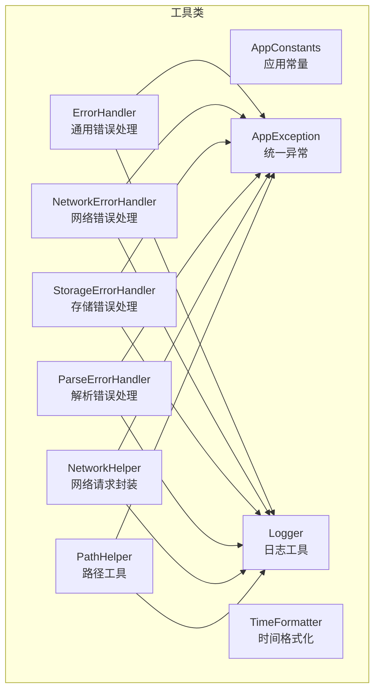
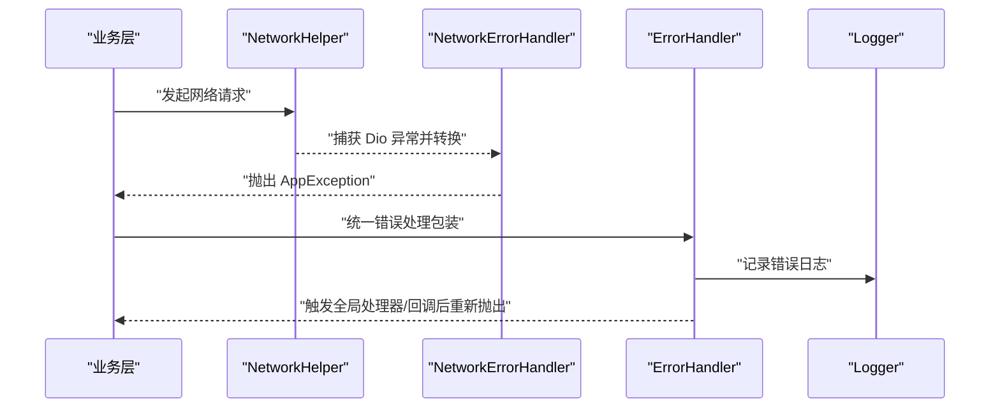
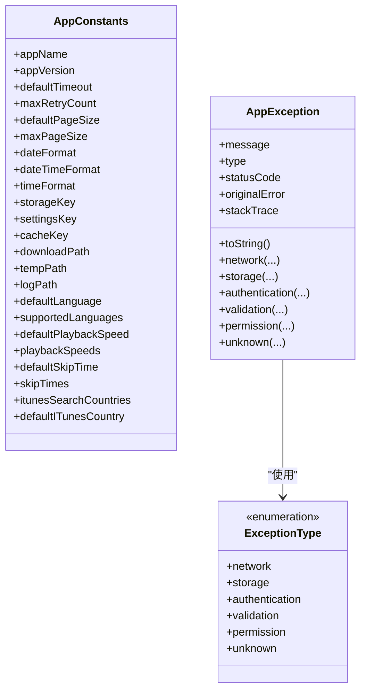
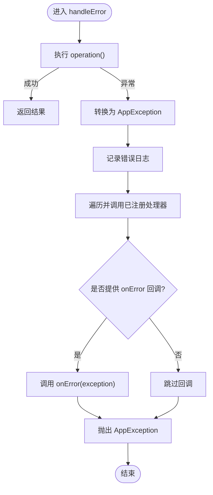
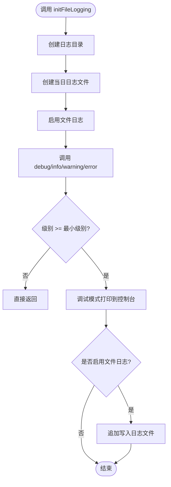
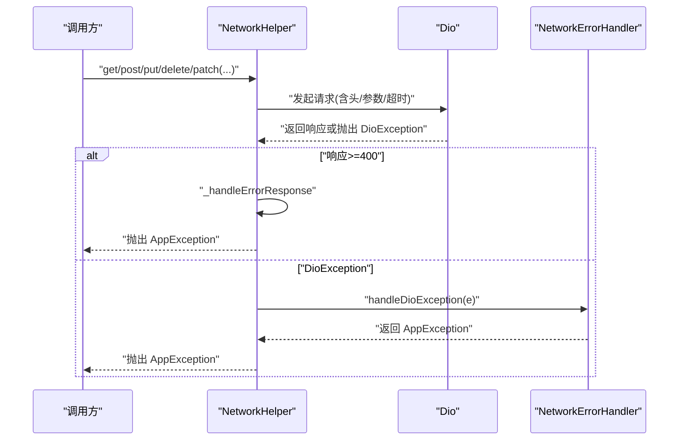
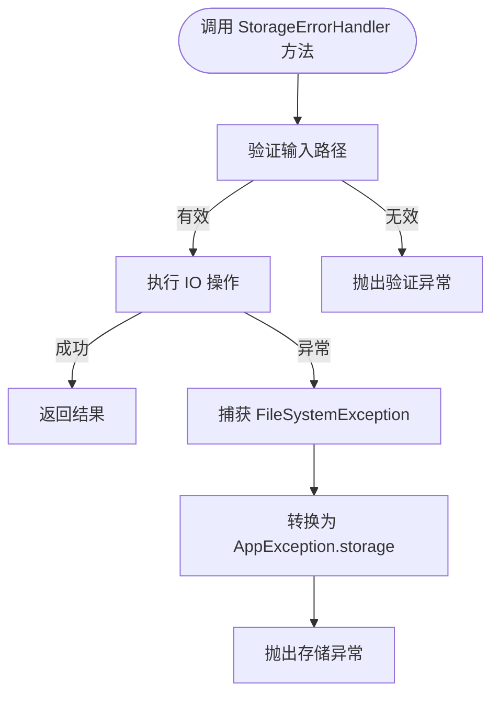
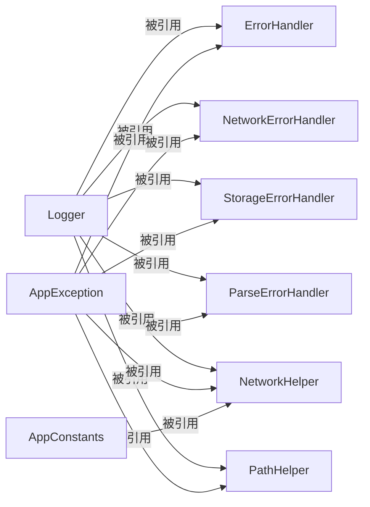

# 工具类 API

<cite>
**本文引用的文件**   
- [app_constants.dart](file://lib/core/utils/app_constants.dart)
- [app_exception.dart](file://lib/core/utils/app_exception.dart)
- [error_handler.dart](file://lib/core/utils/error_handler.dart)
- [logger.dart](file://lib/core/utils/logger.dart)
- [network_error_handler.dart](file://lib/core/utils/network_error_handler.dart)
- [storage_error_handler.dart](file://lib/core/utils/storage_error_handler.dart)
- [parse_error_handler.dart](file://lib/core/utils/parse_error_handler.dart)
- [network_helper.dart](file://lib/core/utils/network_helper.dart)
- [path_helper.dart](file://lib/core/utils/path_helper.dart)
- [time_formatter.dart](file://lib/core/utils/time_formatter.dart)
</cite>

## 目录
1. [简介](#简介)
2. [项目结构](#项目结构)
3. [核心组件](#核心组件)
4. [架构总览](#架构总览)
5. [详细组件分析](#详细组件分析)
6. [依赖关系分析](#依赖关系分析)
7. [性能考虑](#性能考虑)
8. [故障排查指南](#故障排查指南)
9. [结论](#结论)
10. [附录：使用示例与最佳实践](#附录使用示例与最佳实践)

## 简介
本文件为 TinyCast 应用的“工具类 API”提供完整文档，聚焦以下能力：
- 应用常量定义与分类（元数据、网络与分页、日期时间格式、存储键、路径、语言、播放选项等）
- 异常体系与错误码（统一异常类型、工厂方法、HTTP 状态码映射）
- 错误处理策略（通用错误处理器、网络/存储/解析三类专用处理器）
- 日志工具（级别配置、控制台与文件输出、初始化与开关）
- 实用工具（网络请求封装、路径操作、时间格式化）
- 扩展点与最佳实践（如何注册全局错误处理器、如何配置日志级别、如何在业务层正确使用工具类）

## 项目结构
工具类集中在 lib/core/utils 目录下，按职责划分：
- 常量与基础类型：app_constants.dart、app_exception.dart
- 错误处理：error_handler.dart、network_error_handler.dart、storage_error_handler.dart、parse_error_handler.dart
- 日志：logger.dart
- 网络：network_helper.dart
- 路径与时间：path_helper.dart、time_formatter.dart

图表来源
- [app_constants.dart:1-82](file://lib/core/utils/app_constants.dart#L1-L82)
- [app_exception.dart:1-148](file://lib/core/utils/app_exception.dart#L1-L148)
- [error_handler.dart:1-129](file://lib/core/utils/error_handler.dart#L1-L129)
- [logger.dart:1-139](file://lib/core/utils/logger.dart#L1-L139)
- [network_error_handler.dart:1-188](file://lib/core/utils/network_error_handler.dart#L1-L188)
- [storage_error_handler.dart:1-253](file://lib/core/utils/storage_error_handler.dart#L1-L253)
- [parse_error_handler.dart:1-145](file://lib/core/utils/parse_error_handler.dart#L1-L145)
- [network_helper.dart:1-487](file://lib/core/utils/network_helper.dart#L1-L487)
- [path_helper.dart:1-239](file://lib/core/utils/path_helper.dart#L1-L239)
- [time_formatter.dart:1-48](file://lib/core/utils/time_formatter.dart#L1-L48)

章节来源
- [app_constants.dart:1-82](file://lib/core/utils/app_constants.dart#L1-L82)
- [app_exception.dart:1-148](file://lib/core/utils/app_exception.dart#L1-L148)
- [error_handler.dart:1-129](file://lib/core/utils/error_handler.dart#L1-L129)
- [logger.dart:1-139](file://lib/core/utils/logger.dart#L1-L139)
- [network_error_handler.dart:1-188](file://lib/core/utils/network_error_handler.dart#L1-L188)
- [storage_error_handler.dart:1-253](file://lib/core/utils/storage_error_handler.dart#L1-L253)
- [parse_error_handler.dart:1-145](file://lib/core/utils/parse_error_handler.dart#L1-L145)
- [network_helper.dart:1-487](file://lib/core/utils/network_helper.dart#L1-L487)
- [path_helper.dart:1-239](file://lib/core/utils/path_helper.dart#L1-L239)
- [time_formatter.dart:1-48](file://lib/core/utils/time_formatter.dart#L1-L48)

## 核心组件
- AppConstants：集中管理应用级常量，包括应用名称、版本、默认超时、重试次数、分页大小、日期时间格式、持久化键、路径、语言、播放速度与跳过时长、iTunes 搜索国家代码等。
- AppException：统一异常模型，包含消息、类型枚举、HTTP 状态码、原始错误对象和堆栈；提供多种工厂方法快速构造不同场景的异常。
- ErrorHandler：统一错误处理入口，支持注册/注销全局错误处理器，将任意错误转换为 AppException，并调用已注册的处理器与可选回调。
- Logger：多级别日志工具，支持调试模式过滤、控制台输出与文件落盘，可按标签区分来源。
- NetworkErrorHandler：针对 Dio 异常的细化处理，按连接/发送/接收超时、证书、取消、未知错误等分类，并将 HTTP 状态码映射到具体异常类型。
- StorageErrorHandler：文件系统与 IO 异常的统一转换，包含路径校验、安全读写删、磁盘空间检查与临时文件清理等。
- ParseErrorHandler：XML/JSON/格式异常的统一转换，以及 RSS 订阅源、播客与节目数据的校验辅助。
- NetworkHelper：基于 Dio 的网络请求封装，提供 GET/POST/PUT/DELETE/PATCH、JSON 解析、文件上传下载、重试与超时控制、错误响应解析。
- PathHelper：跨平台路径操作（拼接、规范化、绝对/相对判断、存在性检查、创建/删除、列出文件/目录、文件大小与格式化）。
- TimeFormatter：相对时间展示规则（秒/分/小时/天/具体日期）。

章节来源
- [app_constants.dart:1-82](file://lib/core/utils/app_constants.dart#L1-L82)
- [app_exception.dart:1-148](file://lib/core/utils/app_exception.dart#L1-L148)
- [error_handler.dart:1-129](file://lib/core/utils/error_handler.dart#L1-L129)
- [logger.dart:1-139](file://lib/core/utils/logger.dart#L1-L139)
- [network_error_handler.dart:1-188](file://lib/core/utils/network_error_handler.dart#L1-L188)
- [storage_error_handler.dart:1-253](file://lib/core/utils/storage_error_handler.dart#L1-L253)
- [parse_error_handler.dart:1-145](file://lib/core/utils/parse_error_handler.dart#L1-L145)
- [network_helper.dart:1-487](file://lib/core/utils/network_helper.dart#L1-L487)
- [path_helper.dart:1-239](file://lib/core/utils/path_helper.dart#L1-L239)
- [time_formatter.dart:1-48](file://lib/core/utils/time_formatter.dart#L1-L48)

## 架构总览
工具类之间的协作关系如下：
- 业务层通过 NetworkHelper 发起请求，遇到 Dio 异常时由 NetworkErrorHandler 转换为 AppException。
- 存储相关操作通过 StorageErrorHandler 进行异常归一化。
- 解析相关操作通过 ParseErrorHandler 进行异常归一化。
- ErrorHandler 作为全局错误中枢，负责将任意错误转为 AppException，并触发已注册的处理器与回调。
- Logger 贯穿所有模块，用于记录关键信息与错误上下文。

图表来源
- [network_helper.dart:270-395](file://lib/core/utils/network_helper.dart#L270-L395)
- [network_error_handler.dart:10-60](file://lib/core/utils/network_error_handler.dart#L10-L60)
- [error_handler.dart:26-57](file://lib/core/utils/error_handler.dart#L26-L57)
- [logger.dart:83-87](file://lib/core/utils/logger.dart#L83-L87)

## 详细组件分析

### 常量与基础类型
- AppConstants
  - 用途：集中管理应用元数据、网络与分页、日期时间格式、存储键、路径、语言、播放选项、iTunes 搜索国家代码等。
  - 关键点：私有构造函数防止实例化；所有字段均为静态常量，便于全局访问与一致性维护。
- AppException
  - 用途：统一异常模型，承载消息、类型、HTTP 状态码、原始错误与堆栈。
  - 关键点：提供 network/storage/authentication/validation/permission/unknown 等工厂方法；toString 输出友好信息。

图表来源
- [app_constants.dart:1-82](file://lib/core/utils/app_constants.dart#L1-L82)
- [app_exception.dart:1-148](file://lib/core/utils/app_exception.dart#L1-L148)

章节来源
- [app_constants.dart:1-82](file://lib/core/utils/app_constants.dart#L1-L82)
- [app_exception.dart:1-148](file://lib/core/utils/app_exception.dart#L1-L148)

### 错误处理策略
- ErrorHandler
  - 作用：统一捕获异步错误，转换为 AppException，记录日志，调用已注册的全局处理器，最后抛出异常。
  - 扩展点：register/unregister 错误处理器；handleError 包裹异步操作；getUserFriendlyMessage 生成用户友好提示。
- NetworkErrorHandler
  - 作用：将 Dio 异常细分为连接/发送/接收超时、证书、取消、未知错误等，并按 HTTP 状态码映射到具体异常类型。
  - 能力：withRetry 带重试的请求封装；withTimeout 带超时的请求封装；isConnected 占位实现可扩展。
- StorageErrorHandler
  - 作用：将 FileSystemException/IOException 转换为 AppException，并提供路径校验、安全读写删、磁盘空间检查、临时文件清理等。
- ParseErrorHandler
  - 作用：将 XML/JSON/FormatException 转换为 AppException，并提供 RSS URL、播客与节目数据的校验方法。

图表来源
- [error_handler.dart:26-57](file://lib/core/utils/error_handler.dart#L26-L57)
- [error_handler.dart:59-100](file://lib/core/utils/error_handler.dart#L59-L100)
- [error_handler.dart:102-118](file://lib/core/utils/error_handler.dart#L102-L118)

章节来源
- [error_handler.dart:1-129](file://lib/core/utils/error_handler.dart#L1-L129)
- [network_error_handler.dart:1-188](file://lib/core/utils/network_error_handler.dart#L1-L188)
- [storage_error_handler.dart:1-253](file://lib/core/utils/storage_error_handler.dart#L1-L253)
- [parse_error_handler.dart:1-145](file://lib/core/utils/parse_error_handler.dart#L1-L145)

### 日志工具
- Logger
  - 级别：debug/info/warning/error，默认最小级别在调试模式下为 info，否则为 error。
  - 输出：控制台输出（调试模式）与文件落盘（需初始化）。
  - 初始化：initFileLogging 可指定日志目录，默认写入应用支持目录，按日期命名日志文件。
  - 配置：setMinLevel 调整最小级别；_fileLoggingEnabled 控制文件写入开关。

图表来源
- [logger.dart:41-65](file://lib/core/utils/logger.dart#L41-L65)
- [logger.dart:67-87](file://lib/core/utils/logger.dart#L67-L87)
- [logger.dart:89-117](file://lib/core/utils/logger.dart#L89-L117)
- [logger.dart:119-137](file://lib/core/utils/logger.dart#L119-L137)

章节来源
- [logger.dart:1-139](file://lib/core/utils/logger.dart#L1-L139)

### 网络工具
- NetworkHelper
  - 功能：GET/POST/PUT/DELETE/PATCH、JSON 解析、文件上传下载、重试与超时、错误响应解析、便捷判断是否为网络/认证错误。
  - 配置：setBaseUrl、setTimeout、setMaxRetryCount、setDefaultHeaders。
  - 内部流程：_request 统一处理请求构建、编码、重试、错误响应转换。
- NetworkErrorHandler
  - 功能：Dio 异常分类、HTTP 状态码映射、重试与超时封装。

图表来源
- [network_helper.dart:270-395](file://lib/core/utils/network_helper.dart#L270-L395)
- [network_helper.dart:416-453](file://lib/core/utils/network_helper.dart#L416-L453)
- [network_error_handler.dart:10-60](file://lib/core/utils/network_error_handler.dart#L10-L60)

章节来源
- [network_helper.dart:1-487](file://lib/core/utils/network_helper.dart#L1-L487)
- [network_error_handler.dart:1-188](file://lib/core/utils/network_error_handler.dart#L1-L188)

### 存储与路径工具
- StorageErrorHandler
  - 功能：FileSystemException/IOException 转 AppException；路径校验；安全读写删；磁盘空间检查；临时文件清理；文件大小获取。
- PathHelper
  - 功能：路径拼接/规范化/绝对/相对判断；存在性与类型判断；创建/删除目录；列出文件/子目录；文件大小与格式化。

图表来源
- [storage_error_handler.dart:52-74](file://lib/core/utils/storage_error_handler.dart#L52-L74)
- [storage_error_handler.dart:98-117](file://lib/core/utils/storage_error_handler.dart#L98-L117)
- [path_helper.dart:85-105](file://lib/core/utils/path_helper.dart#L85-L105)

章节来源
- [storage_error_handler.dart:1-253](file://lib/core/utils/storage_error_handler.dart#L1-L253)
- [path_helper.dart:1-239](file://lib/core/utils/path_helper.dart#L1-L239)

### 解析工具
- ParseErrorHandler
  - 功能：XML/JSON/FormatException 转 AppException；RSS URL、播客与节目数据校验；安全解析 XML/JSON；必需/可选元素提取与校验。

章节来源
- [parse_error_handler.dart:1-145](file://lib/core/utils/parse_error_handler.dart#L1-L145)

### 时间格式化
- TimeFormatter
  - 功能：将发布时间转换为相对时间字符串（秒/分/小时/天/具体日期），便于 UI 展示。

章节来源
- [time_formatter.dart:1-48](file://lib/core/utils/time_formatter.dart#L1-L48)

## 依赖关系分析
- 低耦合高内聚：每个工具类专注单一职责，通过 AppException 统一异常契约，避免上层感知底层差异。
- 外部依赖：Dio（网络）、path（路径）、intl（时间格式化）、xml（XML 解析）。
- 循环依赖：未发现循环导入；Logger 被广泛引用但无反向依赖。

图表来源
- [logger.dart:1-139](file://lib/core/utils/logger.dart#L1-L139)
- [error_handler.dart:1-129](file://lib/core/utils/error_handler.dart#L1-L129)
- [network_error_handler.dart:1-188](file://lib/core/utils/network_error_handler.dart#L1-L188)
- [storage_error_handler.dart:1-253](file://lib/core/utils/storage_error_handler.dart#L1-L253)
- [parse_error_handler.dart:1-145](file://lib/core/utils/parse_error_handler.dart#L1-L145)
- [network_helper.dart:1-487](file://lib/core/utils/network_helper.dart#L1-L487)
- [path_helper.dart:1-239](file://lib/core/utils/path_helper.dart#L1-L239)
- [app_exception.dart:1-148](file://lib/core/utils/app_exception.dart#L1-L148)
- [app_constants.dart:1-82](file://lib/core/utils/app_constants.dart#L1-L82)

章节来源
- [logger.dart:1-139](file://lib/core/utils/logger.dart#L1-L139)
- [error_handler.dart:1-129](file://lib/core/utils/error_handler.dart#L1-L129)
- [network_error_handler.dart:1-188](file://lib/core/utils/network_error_handler.dart#L1-L188)
- [storage_error_handler.dart:1-253](file://lib/core/utils/storage_error_handler.dart#L1-L253)
- [parse_error_handler.dart:1-145](file://lib/core/utils/parse_error_handler.dart#L1-L145)
- [network_helper.dart:1-487](file://lib/core/utils/network_helper.dart#L1-L487)
- [path_helper.dart:1-239](file://lib/core/utils/path_helper.dart#L1-L239)
- [app_exception.dart:1-148](file://lib/core/utils/app_exception.dart#L1-L148)
- [app_constants.dart:1-82](file://lib/core/utils/app_constants.dart#L1-L82)

## 性能考虑
- 日志开销：文件写入可能成为瓶颈，建议在发布环境仅开启必要级别，按需关闭文件日志。
- 网络重试：默认最大重试次数来自 AppConstants.maxRetryCount，建议根据接口幂等性与用户体验合理设置。
- 超时控制：NetworkHelper.setTimeout 应结合后端响应时间与网络状况调优，避免过长等待影响交互。
- 文件 I/O：批量操作（如清理临时文件）应避免在主线程阻塞，必要时拆分任务或使用后台队列。

## 故障排查指南
- 网络请求失败
  - 现象：抛出 AppException.network，可能携带 statusCode 与 originalError。
  - 排查：检查 NetworkHelper 的 baseUrl、headers、timeout；查看 NetworkErrorHandler 的分类逻辑；确认服务端状态码与错误体字段。
  - 参考：[network_helper.dart:270-395](file://lib/core/utils/network_helper.dart#L270-L395)、[network_error_handler.dart:10-60](file://lib/core/utils/network_error_handler.dart#L10-L60)
- 存储操作失败
  - 现象：抛出 AppException.storage 或 permission。
  - 排查：使用 StorageErrorHandler.validateFilePath/validateDirectoryPath 预检；检查权限与磁盘空间；查看日志中的 OS 错误码。
  - 参考：[storage_error_handler.dart:52-74](file://lib/core/utils/storage_error_handler.dart#L52-L74)
- 解析失败
  - 现象：抛出 AppException.validation，携带 FormatException/XmlException。
  - 排查：使用 ParseErrorHandler.validateRssFeed/validatePodcastData/validateEpisodeData；确保 JSON/XML 结构与字段名一致。
  - 参考：[parse_error_handler.dart:33-62](file://lib/core/utils/parse_error_handler.dart#L33-L62)
- 日志缺失或无法落盘
  - 现象：未看到文件日志或控制台无输出。
  - 排查：确认 Logger.initFileLogging 已调用；检查 _minLevel 设置；确认目标目录可写。
  - 参考：[logger.dart:41-65](file://lib/core/utils/logger.dart#L41-L65)

章节来源
- [network_helper.dart:270-395](file://lib/core/utils/network_helper.dart#L270-L395)
- [network_error_handler.dart:10-60](file://lib/core/utils/network_error_handler.dart#L10-L60)
- [storage_error_handler.dart:52-74](file://lib/core/utils/storage_error_handler.dart#L52-L74)
- [parse_error_handler.dart:33-62](file://lib/core/utils/parse_error_handler.dart#L33-L62)
- [logger.dart:41-65](file://lib/core/utils/logger.dart#L41-L65)

## 结论
TinyCast 的工具类 API 以 AppException 为核心，配合 ErrorHandler 与领域专用处理器（网络/存储/解析），形成统一的错误治理体系；Logger 提供一致的日志能力；NetworkHelper、PathHelper、TimeFormatter 则覆盖常用基础设施需求。通过合理的配置与扩展点，可在保证稳定性的同时提升开发效率与可维护性。

## 附录：使用示例与最佳实践
- 初始化日志
  - 在应用启动时调用 Logger.initFileLogging，并根据环境设置最小级别。
  - 参考：[logger.dart:41-65](file://lib/core/utils/logger.dart#L41-L65)
- 注册全局错误处理器
  - 在应用入口处注册 ErrorHandler.registerErrorHandler，集中处理 UI 提示、埋点上报等。
  - 参考：[error_handler.dart:16-24](file://lib/core/utils/error_handler.dart#L16-L24)
- 网络请求封装
  - 使用 NetworkHelper.get/postJson 等方法，并通过 withRetry/withTimeout 增强健壮性。
  - 参考：[network_helper.dart:146-180](file://lib/core/utils/network_helper.dart#L146-L180)、[network_error_handler.dart:138-171](file://lib/core/utils/network_error_handler.dart#L138-L171)
- 存储安全操作
  - 优先使用 StorageErrorHandler 的安全方法与校验函数，避免裸 IO 调用。
  - 参考：[storage_error_handler.dart:98-117](file://lib/core/utils/storage_error_handler.dart#L98-L117)
- 数据校验
  - 使用 ParseErrorHandler.validate* 系列方法进行前置校验，减少运行时异常。
  - 参考：[parse_error_handler.dart:33-77](file://lib/core/utils/parse_error_handler.dart#L33-L77)
- 路径与时间展示
  - 使用 PathHelper 进行跨平台路径操作；使用 TimeFormatter.formatTimeAgo 展示相对时间。
  - 参考：[path_helper.dart:25-38](file://lib/core/utils/path_helper.dart#L25-L38)、[time_formatter.dart:20-46](file://lib/core/utils/time_formatter.dart#L20-L46)

章节来源
- [logger.dart:41-65](file://lib/core/utils/logger.dart#L41-L65)
- [error_handler.dart:16-24](file://lib/core/utils/error_handler.dart#L16-L24)
- [network_helper.dart:146-180](file://lib/core/utils/network_helper.dart#L146-L180)
- [network_error_handler.dart:138-171](file://lib/core/utils/network_error_handler.dart#L138-L171)
- [storage_error_handler.dart:98-117](file://lib/core/utils/storage_error_handler.dart#L98-L117)
- [parse_error_handler.dart:33-77](file://lib/core/utils/parse_error_handler.dart#L33-L77)
- [path_helper.dart:25-38](file://lib/core/utils/path_helper.dart#L25-L38)
- [time_formatter.dart:20-46](file://lib/core/utils/time_formatter.dart#L20-L46)