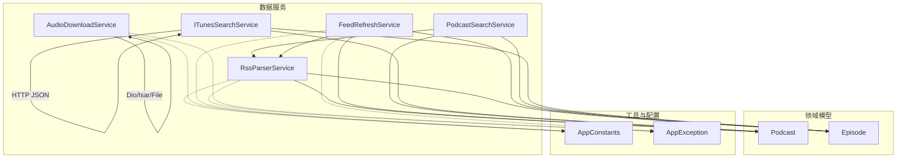
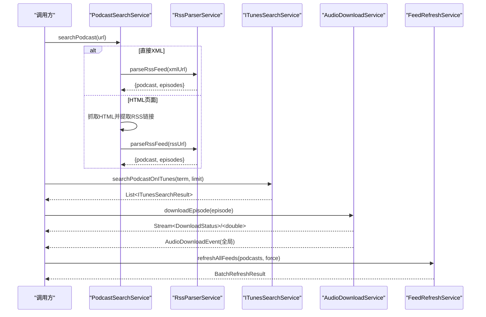
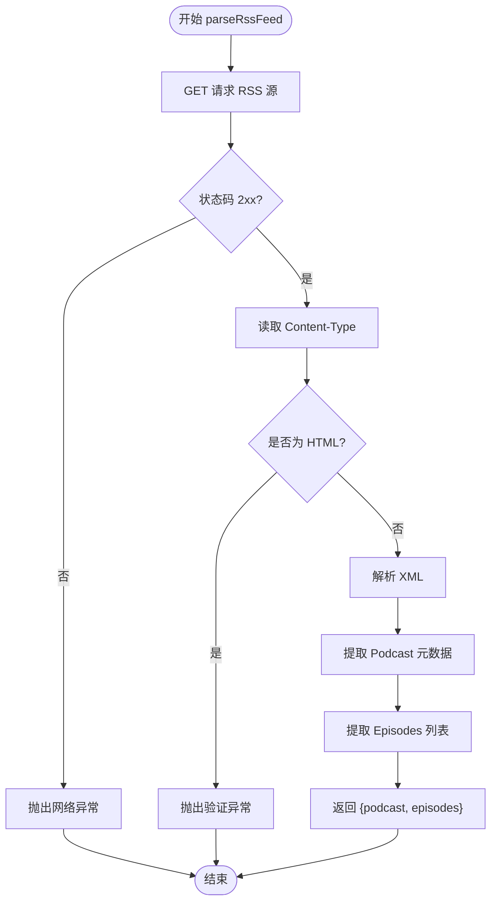
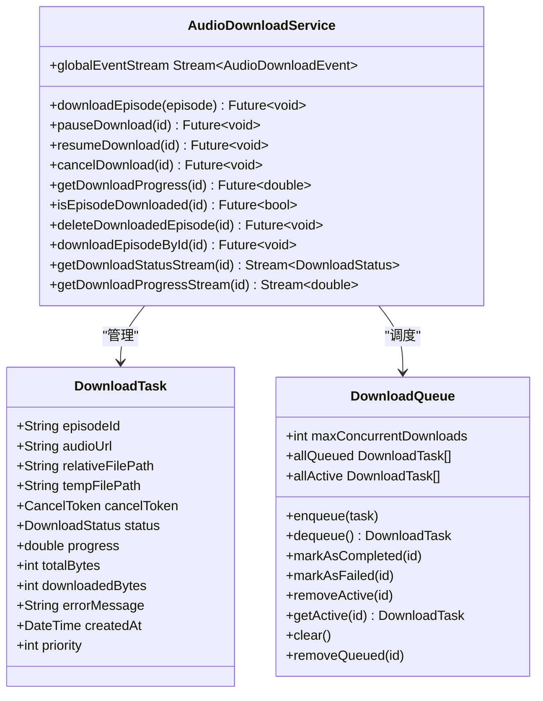
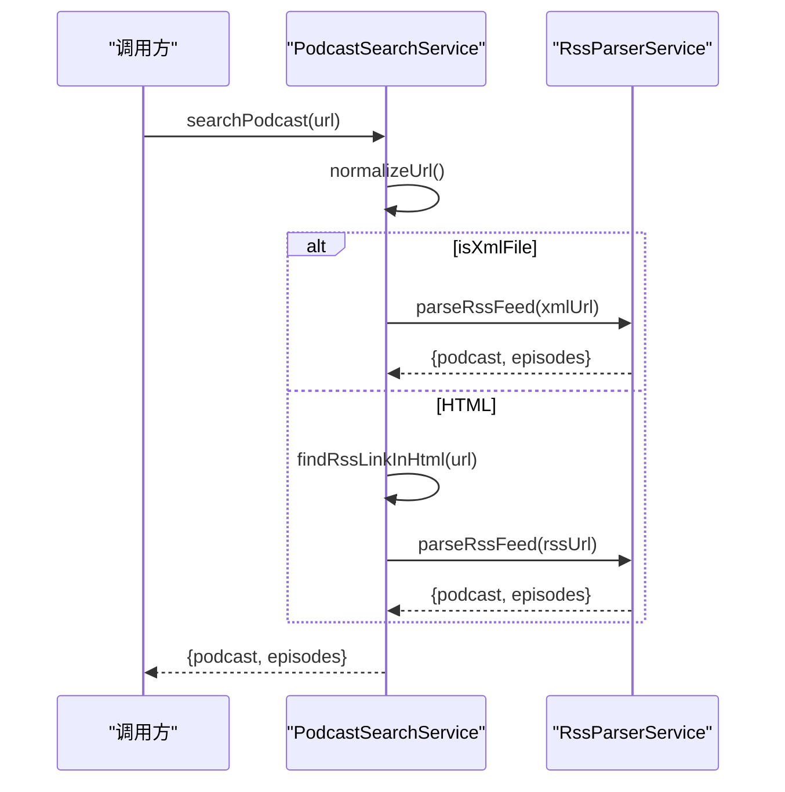
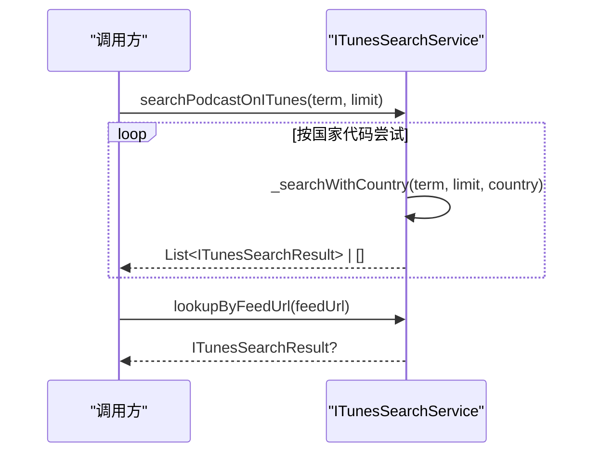
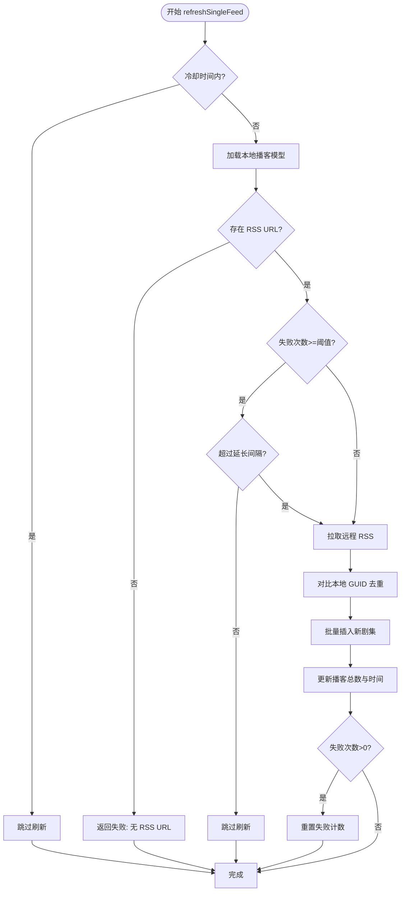
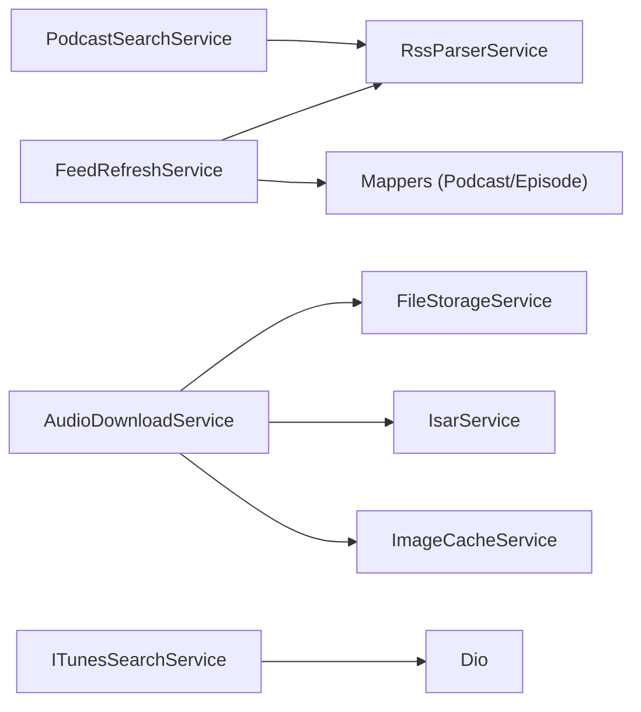

# 数据服务 API

<cite>
**本文引用的文件**   
- [rss_parser_service.dart](file://lib/data/services/rss_parser_service.dart)
- [audio_download_service.dart](file://lib/data/services/audio_download_service.dart)
- [podcast_search_service.dart](file://lib/data/services/podcast_search_service.dart)
- [itunes_search_service.dart](file://lib/data/services/itunes_search_service.dart)
- [feed_refresh_service.dart](file://lib/data/services/feed_refresh_service.dart)
- [podcast.dart](file://lib/domain/entities/podcast.dart)
- [episode.dart](file://lib/domain/entities/episode.dart)
- [app_constants.dart](file://lib/core/utils/app_constants.dart)
- [app_exception.dart](file://lib/core/utils/app_exception.dart)
</cite>

## 目录
1. [简介](#简介)
2. [项目结构](#项目结构)
3. [核心组件](#核心组件)
4. [架构总览](#架构总览)
5. [详细组件分析](#详细组件分析)
6. [依赖关系分析](#依赖关系分析)
7. [性能考量](#性能考量)
8. [故障排查指南](#故障排查指南)
9. [结论](#结论)
10. [附录](#附录)

## 简介
本文件为 TinyCast 应用的数据服务 API 提供完整文档，覆盖以下服务：
- RSS 解析服务：从 RSS/Atom XML 提取播客元数据与节目列表
- 音频下载服务：支持断点续传、并发队列、进度与状态事件
- 播客搜索服务：从 URL/域名自动发现并解析 RSS 源
- iTunes 搜索服务：通过 iTunes Search API 获取播客元数据与封面
- Feed 刷新服务：增量拉取新剧集、冷却与退化策略

每个服务均包含接口定义、输入参数、返回数据、异常处理、网络配置、缓存策略、数据转换逻辑以及使用示例与优化建议。

## 项目结构
数据服务位于 lib/data/services 下，领域模型在 lib/domain/entities，通用常量与异常在 lib/core/utils。各服务之间职责清晰：
- PodcastSearchService 负责入口发现（XML 或 HTML）
- RssParserService 专注 RSS/XML 解析
- ITunesSearchService 对接 iTunes 搜索
- AudioDownloadService 管理下载任务、并发与持久化
- FeedRefreshService 编排远程拉取与本地写入

图表来源
- [podcast_search_service.dart:1-208](file://lib/data/services/podcast_search_service.dart#L1-L208)
- [rss_parser_service.dart:1-459](file://lib/data/services/rss_parser_service.dart#L1-L459)
- [itunes_search_service.dart:1-317](file://lib/data/services/itunes_search_service.dart#L1-L317)
- [audio_download_service.dart:1-800](file://lib/data/services/audio_download_service.dart#L1-L800)
- [feed_refresh_service.dart:1-239](file://lib/data/services/feed_refresh_service.dart#L1-L239)
- [podcast.dart:1-74](file://lib/domain/entities/podcast.dart#L1-L74)
- [episode.dart:1-66](file://lib/domain/entities/episode.dart#L1-L66)
- [app_constants.dart:1-82](file://lib/core/utils/app_constants.dart#L1-L82)
- [app_exception.dart:1-148](file://lib/core/utils/app_exception.dart#L1-L148)

章节来源
- [podcast_search_service.dart:1-208](file://lib/data/services/podcast_search_service.dart#L1-L208)
- [rss_parser_service.dart:1-459](file://lib/data/services/rss_parser_service.dart#L1-L459)
- [itunes_search_service.dart:1-317](file://lib/data/services/itunes_search_service.dart#L1-L317)
- [audio_download_service.dart:1-800](file://lib/data/services/audio_download_service.dart#L1-L800)
- [feed_refresh_service.dart:1-239](file://lib/data/services/feed_refresh_service.dart#L1-L239)
- [podcast.dart:1-74](file://lib/domain/entities/podcast.dart#L1-L74)
- [episode.dart:1-66](file://lib/domain/entities/episode.dart#L1-L66)
- [app_constants.dart:1-82](file://lib/core/utils/app_constants.dart#L1-L82)
- [app_exception.dart:1-148](file://lib/core/utils/app_exception.dart#L1-L148)

## 核心组件
- RSS 解析服务（RssParserService）
  - 核心方法：parseRssFeed(rssUrl)
  - 输入：RSS 订阅源 URL
  - 返回：{podcast: Podcast, episodes: List<Episode>}
  - 异常：AppException.network / validation / unknown
  - 网络：Dio GET，超时由 AppConstants.defaultTimeout 控制；User-Agent 携带版本
  - 解析：xml/xml 库直接解析，兼容 iTunes/Dublin Core 命名空间
  - 容错：重试机制、反爬虫检测、HTML 响应回退提示
- 音频下载服务（AudioDownloadService）
  - 核心方法：downloadEpisode(episode)、pauseDownload、resumeDownload、cancelDownload、getDownloadProgress、isEpisodeDownloaded、deleteDownloadedEpisode
  - 输入：Episode 对象或 episodeId
  - 返回：状态流、进度流、布尔值等
  - 异常：DioException 与 AppException 统一处理
  - 网络：Dio.download，支持 Range 头实现断点续传
  - 并发：DownloadQueue 控制最大并发数（默认 3）
  - 存储：临时文件 + 最终重命名，Isar 更新下载状态
  - 事件：全局广播 AudioDownloadEvent，按 episodeId 的 StreamController 推送状态与进度
- 播客搜索服务（PodcastSearchService）
  - 核心方法：searchPodcast(url)
  - 输入：URL 或域名（自动补全 https://）
  - 返回：{podcast: Podcast, episodes: List<Episode>}
  - 流程：若为 .xml 则直解析；否则抓取 HTML 查找 RSS 链接再解析
  - 异常：AppException.validation / network / unknown
- iTunes 搜索服务（ITunesSearchService）
  - 核心方法：searchPodcastOnITunes(term, limit)、lookupByFeedUrl(feedUrl)
  - 输入：关键词/限制数量/Feed URL
  - 返回：List<ITunesSearchResult> 或 ITunesSearchResult?
  - 区域：按 AppConstants.itunesSearchCountries 顺序尝试
  - 异常：AppException.network / validation / unknown
- Feed 刷新服务（FeedRefreshService）
  - 核心方法：refreshSingleFeed(podcastId, force)、refreshAllFeeds(podcasts, force)
  - 输入：播客 ID 列表与是否强制刷新
  - 返回：FeedRefreshResult / BatchRefreshResult
  - 策略：冷却时间 5 分钟；失败次数达到阈值进入退化模式延长间隔；并发分块执行
  - 数据：增量比对 GUID，批量插入新剧集，更新总数与最后拉取时间

章节来源
- [rss_parser_service.dart:1-459](file://lib/data/services/rss_parser_service.dart#L1-L459)
- [audio_download_service.dart:1-800](file://lib/data/services/audio_download_service.dart#L1-L800)
- [podcast_search_service.dart:1-208](file://lib/data/services/podcast_search_service.dart#L1-L208)
- [itunes_search_service.dart:1-317](file://lib/data/services/itunes_search_service.dart#L1-L317)
- [feed_refresh_service.dart:1-239](file://lib/data/services/feed_refresh_service.dart#L1-L239)
- [podcast.dart:1-74](file://lib/domain/entities/podcast.dart#L1-L74)
- [episode.dart:1-66](file://lib/domain/entities/episode.dart#L1-L66)
- [app_constants.dart:1-82](file://lib/core/utils/app_constants.dart#L1-L82)
- [app_exception.dart:1-148](file://lib/core/utils/app_exception.dart#L1-L148)

## 架构总览
下图展示五大服务之间的调用关系与数据流向，包括网络请求、解析、存储与事件通知。

图表来源
- [podcast_search_service.dart:1-208](file://lib/data/services/podcast_search_service.dart#L1-L208)
- [rss_parser_service.dart:1-459](file://lib/data/services/rss_parser_service.dart#L1-L459)
- [itunes_search_service.dart:1-317](file://lib/data/services/itunes_search_service.dart#L1-L317)
- [audio_download_service.dart:1-800](file://lib/data/services/audio_download_service.dart#L1-L800)
- [feed_refresh_service.dart:1-239](file://lib/data/services/feed_refresh_service.dart#L1-L239)

## 详细组件分析

### RSS 解析服务（RssParserService）
- 核心方法
  - parseRssFeed(String rssUrl): 发起 HTTP GET，校验状态码与 Content-Type，解析 XML 生成 Podcast 与 Episode 列表
- 输入参数
  - rssUrl: RSS/Atom 订阅源地址
- 返回数据
  - Map<String, dynamic>: {podcast: Podcast, episodes: List<Episode>}
- 异常处理
  - DioException -> NetworkErrorHandler.handleDioException -> AppException.network
  - 空内容/HTML 响应 -> AppException.validation
  - 未知错误 -> AppException.unknown
- 网络配置
  - Dio 实例设置 connect/receive/send 超时（毫秒），User-Agent 包含应用版本
- 缓存策略
  - 无内置缓存；可在上层结合 Isar/内存缓存
- 数据转换逻辑
  - 解析 channel/item，支持 iTunes 与 Dublin Core 命名空间
  - 日期解析支持 RFC 822 与 ISO 8601
  - 时长解析支持 HH:mm:ss、mm:ss 或秒数
  - 显式标志解析 yes/true/1
  - 图片优先取 itunes:image href，其次 image url
  - 缺失 GUID 时基于 audioUrl 生成稳定标识 auto_guid:...

图表来源
- [rss_parser_service.dart:1-459](file://lib/data/services/rss_parser_service.dart#L1-L459)

章节来源
- [rss_parser_service.dart:1-459](file://lib/data/services/rss_parser_service.dart#L1-L459)
- [podcast.dart:1-74](file://lib/domain/entities/podcast.dart#L1-L74)
- [episode.dart:1-66](file://lib/domain/entities/episode.dart#L1-L66)
- [app_constants.dart:1-82](file://lib/core/utils/app_constants.dart#L1-L82)
- [app_exception.dart:1-148](file://lib/core/utils/app_exception.dart#L1-L148)

### 音频下载服务（AudioDownloadService）
- 核心方法
  - downloadEpisode(episode): 创建 DownloadTask，检查已存在文件，断点续传，写入 Isar，完成后保存封面图
  - pauseDownload/resumeDownload/cancelDownload: 暂停/恢复/取消下载
  - getDownloadProgress/isEpisodeDownloaded/deleteDownloadedEpisode: 查询进度/状态/删除文件
  - downloadEpisodeById(downloadEpisodeById(int)): 按 ID 下载，防重复并发
- 输入参数
  - episode: Episode 实体或 episodeId
- 返回数据
  - 状态流：Stream<DownloadStatus>
  - 进度流：Stream<double>
  - 全局事件：Stream<AudioDownloadEvent>
  - 布尔值：是否已下载
- 异常处理
  - DioException 区分 cancel/其他错误，映射到对应状态与日志
  - 文件/IO 异常记录并向上抛出
- 网络配置
  - Dio BaseOptions：connectTimeout=30s，receiveTimeout=30min，sendTimeout=10s，maxRedirects=5
  - 启用自动解压缩
- 缓存策略
  - 内存中维护 DownloadTask 与进度；完成/失败后落库
  - 临时文件 + 最终重命名保证原子性
- 数据转换逻辑
  - 将下载路径相对路径写入数据库
  - 封面图下载与缓存（ImageCacheService）
- 并发与队列
  - DownloadQueue 控制最大并发（默认 3）
  - _activeDownloads 集合防止同一 episode 重复下载

图表来源
- [audio_download_service.dart:1-800](file://lib/data/services/audio_download_service.dart#L1-L800)

章节来源
- [audio_download_service.dart:1-800](file://lib/data/services/audio_download_service.dart#L1-L800)
- [app_exception.dart:1-148](file://lib/core/utils/app_exception.dart#L1-L148)

### 播客搜索服务（PodcastSearchService）
- 核心方法
  - searchPodcast(String url): 标准化 URL，判断 XML 或 HTML，分别走解析或网页查找 RSS 链接
- 输入参数
  - url: 可直接为 RSS XML 或播客主页域名
- 返回数据
  - Map<String, dynamic>: {podcast: Podcast, episodes: List<Episode>}
- 异常处理
  - 未找到 RSS 链接 -> AppException.validation
  - 网络错误 -> AppException.network
  - 未知错误 -> AppException.unknown
- 网络配置
  - 抓取 HTML 时设置 Accept 与 User-Agent
- 数据转换逻辑
  - 复用 RssParserService 进行 XML 解析

图表来源
- [podcast_search_service.dart:1-208](file://lib/data/services/podcast_search_service.dart#L1-L208)
- [rss_parser_service.dart:1-459](file://lib/data/services/rss_parser_service.dart#L1-L459)

章节来源
- [podcast_search_service.dart:1-208](file://lib/data/services/podcast_search_service.dart#L1-L208)
- [rss_parser_service.dart:1-459](file://lib/data/services/rss_parser_service.dart#L1-L459)

### iTunes 搜索服务（ITunesSearchService）
- 核心方法
  - searchPodcastOnITunes({term, limit}): 多区域依次尝试，返回结果列表
  - lookupByFeedUrl(feedUrl): 精确匹配 feedUrl，返回单个结果
- 输入参数
  - term: 搜索关键词
  - limit: 返回数量限制
  - feedUrl: RSS 源地址
- 返回数据
  - List<ITunesSearchResult> 或 ITunesSearchResult?
- 异常处理
  - 网络错误 -> AppException.network
  - JSON 解析失败 -> AppException.validation
  - 未知错误 -> AppException.unknown
- 网络配置
  - Accept: application/json，User-Agent 包含版本
- 数据转换逻辑
  - ITunesSearchResult.fromJson 映射字段，releaseDate 解析为 DateTime

图表来源
- [itunes_search_service.dart:1-317](file://lib/data/services/itunes_search_service.dart#L1-L317)

章节来源
- [itunes_search_service.dart:1-317](file://lib/data/services/itunes_search_service.dart#L1-L317)
- [app_constants.dart:1-82](file://lib/core/utils/app_constants.dart#L1-L82)
- [app_exception.dart:1-148](file://lib/core/utils/app_exception.dart#L1-L148)

### Feed 刷新服务（FeedRefreshService）
- 核心方法
  - refreshSingleFeed(podcastId, force): 单播客刷新，含冷却与退化策略
  - refreshAllFeeds(podcasts, force): 批量刷新，分块并发
- 输入参数
  - podcastId: 播客 ID
  - podcasts: 播客列表
  - force: 是否强制刷新（忽略冷却）
- 返回数据
  - FeedRefreshResult: {podcastId, newEpisodesCount, success, error}
  - BatchRefreshResult: {totalNewEpisodes, successCount, failureCount, results}
- 异常处理
  - 捕获异常并记录失败次数，返回失败结果
- 网络配置
  - 通过 RemotePodcastDataSource.getPodcastFromRss 拉取 RSS
- 缓存策略
  - 内存中记录 lastRefreshTimes，冷却 5 分钟
  - 失败次数达阈值进入退化模式，延长刷新间隔
- 数据转换逻辑
  - PodcastMapper.toEntity -> EpisodeMapper.toModel -> 批量插入新剧集
  - 基于 GUID 去重，统计新增数量并更新总数

图表来源
- [feed_refresh_service.dart:1-239](file://lib/data/services/feed_refresh_service.dart#L1-L239)

章节来源
- [feed_refresh_service.dart:1-239](file://lib/data/services/feed_refresh_service.dart#L1-L239)
- [podcast.dart:1-74](file://lib/domain/entities/podcast.dart#L1-L74)
- [episode.dart:1-66](file://lib/domain/entities/episode.dart#L1-L66)

## 依赖关系分析
- 服务间耦合
  - PodcastSearchService 依赖 RssParserService
  - FeedRefreshService 依赖 Remote/Local 数据源与 Mapper
  - AudioDownloadService 依赖 FileStorageService、IsarService、ImageCacheService
  - ITunesSearchService 独立，仅依赖 Dio 与 AppConstants
- 外部依赖
  - Dio 用于 HTTP 请求
  - xml 库用于 RSS/Atom 解析
  - Isar 用于本地持久化
- 潜在循环依赖
  - 当前未发现循环依赖，服务职责边界清晰

图表来源
- [podcast_search_service.dart:1-208](file://lib/data/services/podcast_search_service.dart#L1-L208)
- [rss_parser_service.dart:1-459](file://lib/data/services/rss_parser_service.dart#L1-L459)
- [feed_refresh_service.dart:1-239](file://lib/data/services/feed_refresh_service.dart#L1-L239)
- [audio_download_service.dart:1-800](file://lib/data/services/audio_download_service.dart#L1-L800)
- [itunes_search_service.dart:1-317](file://lib/data/services/itunes_search_service.dart#L1-L317)

章节来源
- [podcast_search_service.dart:1-208](file://lib/data/services/podcast_search_service.dart#L1-L208)
- [rss_parser_service.dart:1-459](file://lib/data/services/rss_parser_service.dart#L1-L459)
- [feed_refresh_service.dart:1-239](file://lib/data/services/feed_refresh_service.dart#L1-L239)
- [audio_download_service.dart:1-800](file://lib/data/services/audio_download_service.dart#L1-L800)
- [itunes_search_service.dart:1-317](file://lib/data/services/itunes_search_service.dart#L1-L317)

## 性能考量
- 网络层
  - 合理设置超时与重试次数，避免频繁重试导致雪崩
  - 下载服务使用长超时（接收 30 分钟）适配大文件
- 解析层
  - XML 解析尽量轻量，避免重复解析；必要时在上层做缓存
- 下载层
  - 并发控制（默认 3）避免带宽拥塞
  - 断点续传减少重复传输
  - 进度回调节流（每 25% 打印日志）降低 I/O 压力
- 刷新层
  - 冷却与退化策略降低无效请求
  - 批量刷新分块并发，平衡吞吐与稳定性

[本节为通用指导，不直接分析具体文件]

## 故障排查指南
- 常见异常类型
  - AppException.network: 网络请求失败（超时、连接失败、状态码非 2xx）
  - AppException.validation: 输入校验失败（空内容、HTML 响应、JSON 解析失败）
  - AppException.storage: 存储相关错误（文件不存在、权限问题）
  - AppException.authentication: 认证失败
  - AppException.permission: 权限不足
  - AppException.unknown: 未知错误
- 定位步骤
  - 查看日志中的错误信息与堆栈跟踪
  - 检查网络状态与代理设置
  - 确认 RSS/HTML 可访问性与 Content-Type
  - 下载失败时检查临时文件与磁盘空间
- 恢复策略
  - 重试机制已在服务内实现，必要时调整重试次数与间隔
  - 对于反爬虫挑战，切换网络或使用备用 RSS 地址

章节来源
- [app_exception.dart:1-148](file://lib/core/utils/app_exception.dart#L1-L148)
- [rss_parser_service.dart:1-459](file://lib/data/services/rss_parser_service.dart#L1-L459)
- [audio_download_service.dart:1-800](file://lib/data/services/audio_download_service.dart#L1-L800)
- [podcast_search_service.dart:1-208](file://lib/data/services/podcast_search_service.dart#L1-L208)
- [itunes_search_service.dart:1-317](file://lib/data/services/itunes_search_service.dart#L1-L317)
- [feed_refresh_service.dart:1-239](file://lib/data/services/feed_refresh_service.dart#L1-L239)

## 结论
TinyCast 的数据服务 API 围绕 RSS 解析、播客搜索、iTunes 搜索、音频下载与 Feed 刷新五大能力构建，具备完善的异常处理、网络配置与并发控制。通过清晰的职责划分与稳定的数据模型，服务易于扩展与维护。建议在业务层结合缓存与重试策略，进一步提升鲁棒性与用户体验。

[本节为总结，不直接分析具体文件]

## 附录
- 使用示例（概念性说明）
  - RSS 解析：调用 parseRssFeed(rssUrl)，捕获 AppException 并提示用户
  - 播客搜索：调用 searchPodcast(url)，根据返回的 Podcast/Episodes 渲染界面
  - iTunes 搜索：调用 searchPodcastOnITunes(term, limit)，展示搜索结果与封面
  - 音频下载：调用 downloadEpisode(episode)，订阅状态与进度流，处理暂停/恢复/取消
  - Feed 刷新：调用 refreshAllFeeds(podcasts, force)，汇总结果并更新 UI
- 最佳实践
  - 对关键操作添加超时与重试
  - 合理使用 Stream 进行异步反馈
  - 避免重复下载与解析，利用 GUID 去重
  - 监控失败率，动态调整冷却与退化策略

[本节为补充信息，不直接分析具体文件]