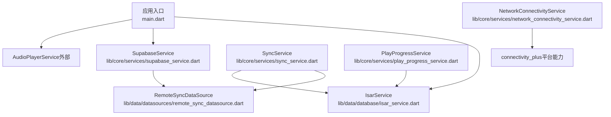
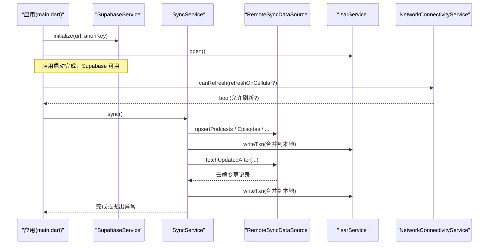
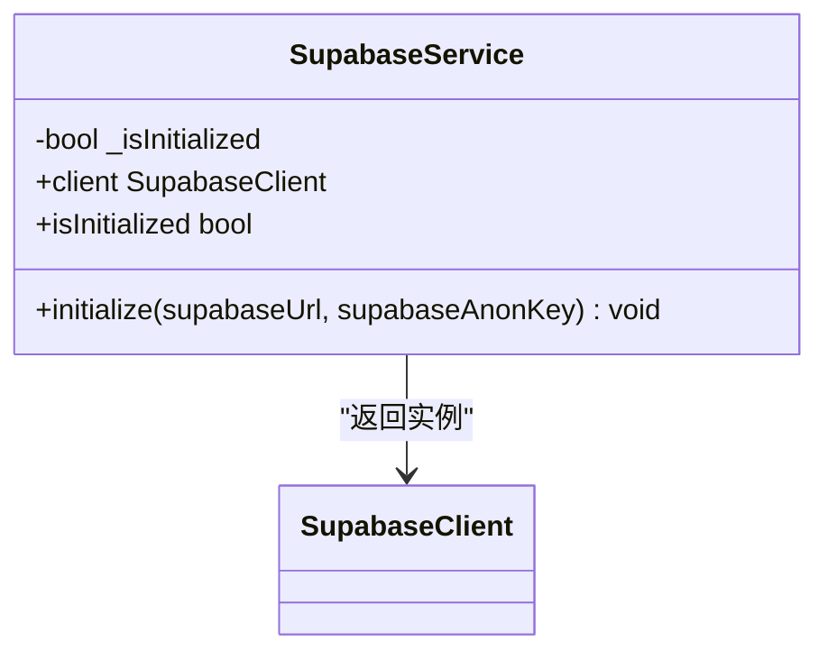
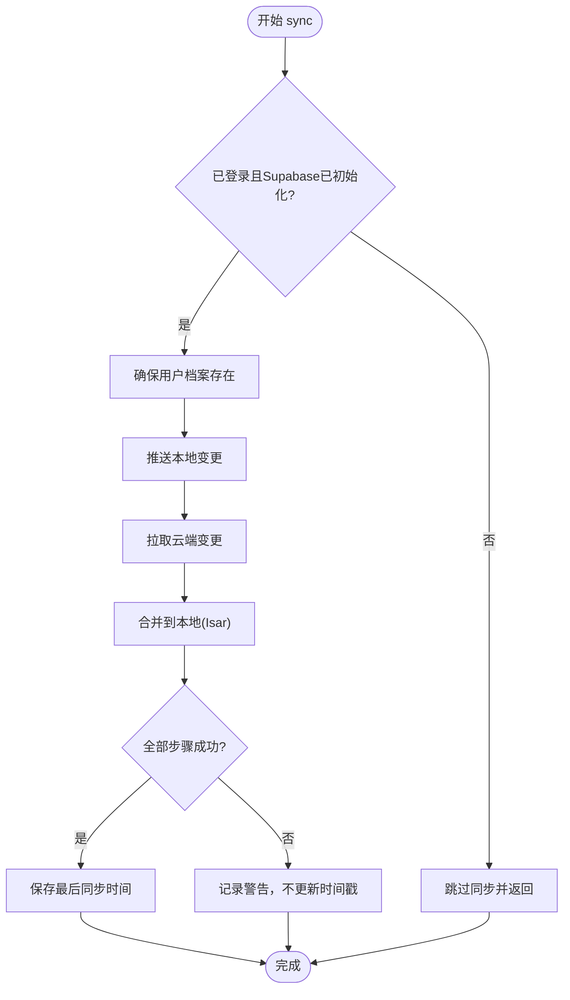
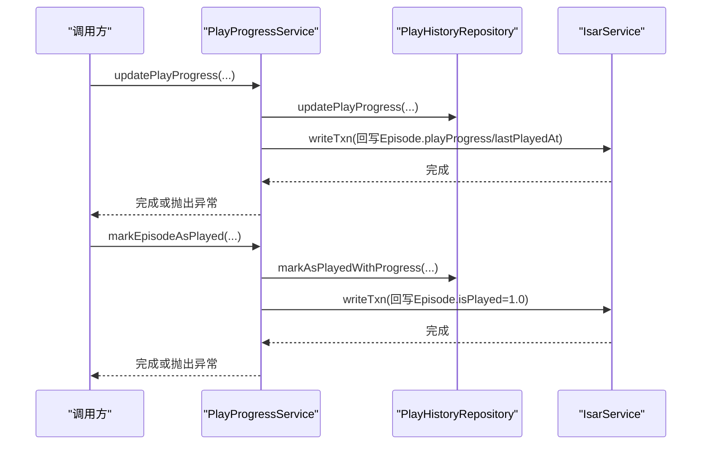
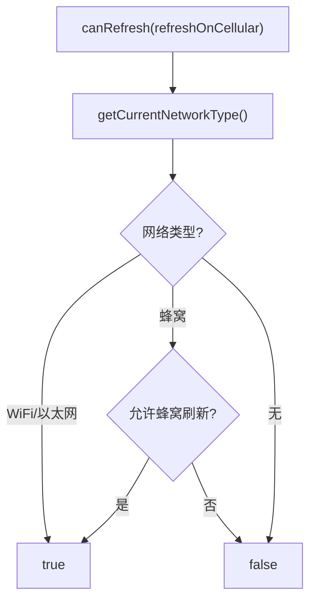
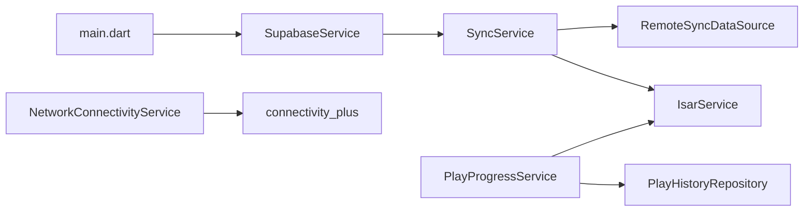

# 核心服务 API

<cite>
**本文引用的文件**   
- [lib/main.dart](file://lib/main.dart)
- [lib/core/services/supabase_service.dart](file://lib/core/services/supabase_service.dart)
- [lib/core/services/sync_service.dart](file://lib/core/services/sync_service.dart)
- [lib/core/services/play_progress_service.dart](file://lib/core/services/play_progress_service.dart)
- [lib/core/services/network_connectivity_service.dart](file://lib/core/services/network_connectivity_service.dart)
- [lib/data/datasources/remote_sync_datasource.dart](file://lib/data/datasources/remote_sync_datasource.dart)
- [lib/data/database/isar_service.dart](file://lib/data/database/isar_service.dart)
- [docs/supabase_setup.md](file://docs/supabase_setup.md)
</cite>

## 目录
1. [简介](#简介)
2. [项目结构](#项目结构)
3. [核心组件](#核心组件)
4. [架构总览](#架构总览)
5. [详细组件分析](#详细组件分析)
6. [依赖关系分析](#依赖关系分析)
7. [性能考量](#性能考量)
8. [故障排查指南](#故障排查指南)
9. [结论](#结论)
10. [附录：调用示例与最佳实践](#附录调用示例与最佳实践)

## 简介
本文件为 TinyCast 应用的核心服务 API 文档，聚焦以下服务的公共接口、初始化方式、参数配置、返回值类型、错误处理机制、异步操作与状态管理，以及服务间的依赖与生命周期管理：
- Supabase 服务：负责客户端初始化与访问
- 同步服务：实现本地 Isar 与云端 Supabase 的双向增量同步
- 播放进度服务：维护播放历史与 Episode 缓存的进度一致性
- 网络连接服务：检测网络类型并决定是否允许刷新

## 项目结构
核心服务位于 lib/core/services 下，数据源位于 lib/data/datasources，数据库入口在 lib/data/database。应用启动时通过 main.dart 统一初始化 Isar、音频播放器、日志与 Supabase。

图表来源
- [lib/main.dart:179-194](file://lib/main.dart#L179-L194)
- [lib/core/services/supabase_service.dart:18-32](file://lib/core/services/supabase_service.dart#L18-L32)
- [lib/core/services/sync_service.dart:37-54](file://lib/core/services/sync_service.dart#L37-L54)
- [lib/core/services/play_progress_service.dart:8-16](file://lib/core/services/play_progress_service.dart#L8-L16)
- [lib/core/services/network_connectivity_service.dart:6-14](file://lib/core/services/network_connectivity_service.dart#L6-L14)

章节来源
- [lib/main.dart:106-194](file://lib/main.dart#L106-L194)
- [docs/supabase_setup.md:1-131](file://docs/supabase_setup.md#L1-L131)

## 核心组件
- SupabaseService：单例封装 Supabase 初始化与客户端获取；提供 isInitialized 检查与 supabaseClientProvider Riverpod Provider。
- SyncService：编排“推送本地变更 → 拉取云端变更 → 合并到本地”的完整流程；支持首次全量与增量同步；记录最后同步时间；暴露 onProgressChanged 回调。
- PlayProgressService：更新播放进度与标记已播放，并同步回 Episode 缓存字段。
- NetworkConnectivityService：判断当前网络类型（WiFi/以太网/蜂窝/无），并提供 canRefresh 策略。

章节来源
- [lib/core/services/supabase_service.dart:8-54](file://lib/core/services/supabase_service.dart#L8-L54)
- [lib/core/services/sync_service.dart:37-113](file://lib/core/services/sync_service.dart#L37-L113)
- [lib/core/services/play_progress_service.dart:8-42](file://lib/core/services/play_progress_service.dart#L8-L42)
- [lib/core/services/network_connectivity_service.dart:6-62](file://lib/core/services/network_connectivity_service.dart#L6-L62)

## 架构总览
下图展示四个核心服务之间的交互关系与数据流向：应用启动时初始化 Supabase；同步服务依赖 RemoteSyncDataSource 与 Isar 进行双向同步；播放进度服务将进度写入 PlayHistory 并回写 Episode；网络服务为刷新与同步提供策略判断。

图表来源
- [lib/main.dart:179-194](file://lib/main.dart#L179-L194)
- [lib/core/services/supabase_service.dart:18-32](file://lib/core/services/supabase_service.dart#L18-L32)
- [lib/core/services/sync_service.dart:68-113](file://lib/core/services/sync_service.dart#L68-L113)
- [lib/core/services/network_connectivity_service.dart:49-61](file://lib/core/services/network_connectivity_service.dart#L49-L61)

## 详细组件分析

### Supabase 服务
- 职责
  - 初始化 Supabase 客户端（URL、匿名密钥）
  - 提供线程安全的 client 访问
  - 暴露 isInitialized 状态
  - 提供 Riverpod Provider 供 UI 层消费
- 初始化方法
  - initialize({supabaseUrl, supabaseAnonKey})
- 主要接口
  - client：返回 SupabaseClient，未初始化抛错
  - isInitialized：布尔值
- 参数与返回
  - initialize：两个必填字符串参数，返回 Future<void>
  - client：返回 SupabaseClient
- 错误处理
  - 未初始化访问 client 抛出 StateError
- 异步与状态
  - 初始化完成后设置内部标志位，避免重复初始化
- 使用位置
  - 应用启动时由 main.dart 调用
  - 通过 supabaseClientProvider 在 Riverpod 中注入

图表来源
- [lib/core/services/supabase_service.dart:8-47](file://lib/core/services/supabase_service.dart#L8-L47)

章节来源
- [lib/core/services/supabase_service.dart:8-54](file://lib/core/services/supabase_service.dart#L8-L54)
- [lib/main.dart:179-194](file://lib/main.dart#L179-L194)
- [docs/supabase_setup.md:77-101](file://docs/supabase_setup.md#L77-L101)

### 同步服务
- 职责
  - 编排本地→云端推送与云端→本地拉取
  - 首次全量同步与基于 updated_at 的增量同步
  - 冲突解决采用“最后写入胜出”
  - 维护 last_sync_timestamp 与同步进度回调
- 初始化与依赖
  - 构造可注入 RemoteSyncDataSource（默认使用远程实现）
  - 依赖 SupabaseService 获取用户身份
  - 依赖 IsarService 读写本地数据
- 主要接口
  - sync()：执行完整同步流程
  - getLastSyncTime()：读取上次同步时间
  - onProgressChanged：进度回调（每 N 条通知一次）
- 参数与返回
  - sync()：无参，Future<void>
  - getLastSyncTime()：Future<DateTime?>
- 错误处理
  - 各步骤使用 _safeStep 包裹，失败不中断整体流程但记录日志
  - 若所有步骤成功则推进 last_sync_timestamp，否则保留旧时间戳
- 异步与状态
  - 通过 SyncStatus 枚举与内部标志控制流程
  - 进度通过 SyncProgress 对象上报（totalItems、syncedItems、currentTable）

图表来源
- [lib/core/services/sync_service.dart:68-113](file://lib/core/services/sync_service.dart#L68-L113)
- [lib/core/services/sync_service.dart:148-186](file://lib/core/services/sync_service.dart#L148-L186)
- [lib/core/services/sync_service.dart:190-340](file://lib/core/services/sync_service.dart#L190-L340)

章节来源
- [lib/core/services/sync_service.dart:37-113](file://lib/core/services/sync_service.dart#L37-L113)
- [lib/core/services/sync_service.dart:148-186](file://lib/core/services/sync_service.dart#L148-L186)
- [lib/core/services/sync_service.dart:190-340](file://lib/core/services/sync_service.dart#L190-L340)
- [lib/data/datasources/remote_sync_datasource.dart](file://lib/data/datasources/remote_sync_datasource.dart)
- [lib/data/database/isar_service.dart](file://lib/data/database/isar_service.dart)

### 播放进度服务
- 职责
  - 更新播放进度（位置毫秒、比例）
  - 标记 episode 为已播放
  - 创建或更新 PlayHistory 记录
  - 同步回写 Episode 的 isPlayed 与 playProgress 缓存
- 主要接口
  - updatePlayProgress({episodeId, positionMs, progressRatio, episodeGuid?, episodeITunesId?})
  - markEpisodeAsPlayed({episodeId, episodeGuid?, episodeITunesId?, podcastGuid?, podcastITunesId?})
  - createOrUpdatePlayHistory({episode, positionMs, progressRatio})
- 参数与返回
  - 以上均为 Future<void>
- 错误处理
  - 捕获异常并记录日志，随后 rethrow 以便上层感知
- 异步与状态
  - 通过 PlayHistoryRepository 持久化
  - 通过 IsarService 事务回写 Episode 缓存

图表来源
- [lib/core/services/play_progress_service.dart:17-42](file://lib/core/services/play_progress_service.dart#L17-L42)
- [lib/core/services/play_progress_service.dart:44-70](file://lib/core/services/play_progress_service.dart#L44-L70)
- [lib/core/services/play_progress_service.dart:106-144](file://lib/core/services/play_progress_service.dart#L106-L144)

章节来源
- [lib/core/services/play_progress_service.dart:8-146](file://lib/core/services/play_progress_service.dart#L8-L146)

### 网络连接服务
- 职责
  - 检测当前网络类型（WiFi/以太网/蜂窝/无）
  - 提供 isWifi() 便捷判断
  - 提供 canRefresh(refreshOnCellular) 策略判断是否允许刷新
- 主要接口
  - getCurrentNetworkType()：Future<NetworkType>
  - isWifi()：Future<bool>
  - canRefresh(refreshOnCellular)：Future<bool>
- 错误处理
  - 底层查询异常时记录日志并返回 none 类型

图表来源
- [lib/core/services/network_connectivity_service.dart:49-61](file://lib/core/services/network_connectivity_service.dart#L49-L61)

章节来源
- [lib/core/services/network_connectivity_service.dart:6-62](file://lib/core/services/network_connectivity_service.dart#L6-L62)

## 依赖关系分析
- SupabaseService：被 main.dart 初始化；被 SyncService 用于鉴权与用户信息；被 Riverpod Provider 暴露。
- SyncService：依赖 RemoteSyncDataSource（云端 API）、IsarService（本地存储）、SupabaseService（用户身份）。
- PlayProgressService：依赖 PlayHistoryRepository（持久化）、IsarService（回写 Episode 缓存）。
- NetworkConnectivityService：依赖 connectivity_plus 插件。

图表来源
- [lib/main.dart:179-194](file://lib/main.dart#L179-L194)
- [lib/core/services/sync_service.dart:37-54](file://lib/core/services/sync_service.dart#L37-L54)
- [lib/core/services/play_progress_service.dart:8-16](file://lib/core/services/play_progress_service.dart#L8-L16)
- [lib/core/services/network_connectivity_service.dart:6-14](file://lib/core/services/network_connectivity_service.dart#L6-L14)

章节来源
- [lib/core/services/sync_service.dart:37-54](file://lib/core/services/sync_service.dart#L37-L54)
- [lib/core/services/play_progress_service.dart:8-16](file://lib/core/services/play_progress_service.dart#L8-L16)
- [lib/core/services/network_connectivity_service.dart:6-14](file://lib/core/services/network_connectivity_service.dart#L6-L14)

## 性能考量
- 同步服务
  - 使用事务批量写入 Isar，减少 IO 开销
  - 每 N 条记录触发一次进度回调，降低 UI 压力
  - 增量同步基于 updated_at，避免全量拉取
- 播放进度服务
  - 通过 Repository 与 Isar 事务保证一致性
  - 仅对必要字段进行回写，避免冗余更新
- 网络服务
  - 快速判断网络类型，避免不必要的刷新请求

[本节为通用指导，无需代码来源]

## 故障排查指南
- Supabase 未初始化
  - 现象：访问 client 抛出 StateError
  - 排查：确认 main.dart 中已调用 initialize，并传入有效 URL 与 Anon Key
- 同步失败
  - 现象：sync() 抛出异常或未完成推进时间戳
  - 排查：查看日志中的 [SYNC] 前缀；检查 RemoteSyncDataSource 的网络与权限；确认用户已登录
- 播放进度不同步
  - 现象：Episode 的 isPlayed 或 playProgress 未更新
  - 排查：检查 PlayProgressService 的调用链与 Isar 事务是否成功；确认 Episode 是否存在
- 网络刷新被拒绝
  - 现象：canRefresh 返回 false
  - 排查：确认当前网络类型与 refreshOnCellular 配置

章节来源
- [lib/core/services/supabase_service.dart:35-43](file://lib/core/services/supabase_service.dart#L35-L43)
- [lib/core/services/sync_service.dart:68-113](file://lib/core/services/sync_service.dart#L68-L113)
- [lib/core/services/play_progress_service.dart:17-42](file://lib/core/services/play_progress_service.dart#L17-L42)
- [lib/core/services/network_connectivity_service.dart:49-61](file://lib/core/services/network_connectivity_service.dart#L49-L61)

## 结论
TinyCast 的核心服务围绕 Supabase、同步、播放进度与网络连接四大模块构建，形成清晰的职责边界与稳定的生命周期管理。通过增量同步、事务写入与网络策略，系统在跨平台环境下具备高可用性与良好用户体验。建议在生产环境严格校验环境变量与权限策略，并在关键路径添加监控与告警。

[本节为总结性内容，无需代码来源]

## 附录：调用示例与最佳实践
- 初始化顺序
  - 先打开 Isar，再初始化 Supabase，最后运行业务逻辑
  - 参考：_initializeApp 中顺序调用
- Supabase 配置
  - 开发建议使用 .env，发布使用 --dart-define
  - 参考：docs/supabase_setup.md 的环境变量说明
- 同步调用
  - 在登录后触发 sync()，监听 onProgressChanged 更新 UI
  - 失败时重试或提示用户检查网络与登录状态
- 播放进度
  - 播放过程中周期性调用 updatePlayProgress
  - 播放结束或切换时调用 markEpisodeAsPlayed
- 网络策略
  - 在刷新前调用 canRefresh(refreshOnCellular)，根据结果决定是否发起请求

章节来源
- [lib/main.dart:179-194](file://lib/main.dart#L179-L194)
- [docs/supabase_setup.md:23-75](file://docs/supabase_setup.md#L23-L75)
- [lib/core/services/sync_service.dart:68-113](file://lib/core/services/sync_service.dart#L68-L113)
- [lib/core/services/play_progress_service.dart:17-70](file://lib/core/services/play_progress_service.dart#L17-L70)
- [lib/core/services/network_connectivity_service.dart:49-61](file://lib/core/services/network_connectivity_service.dart#L49-L61)