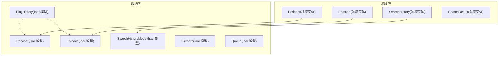
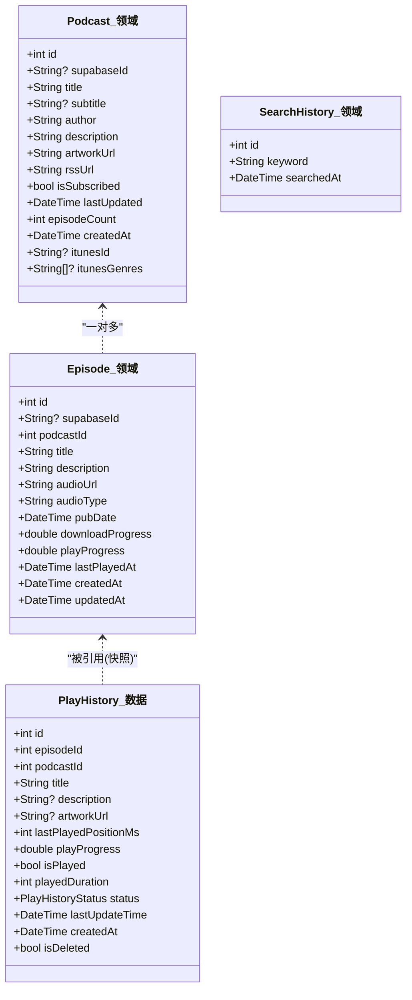
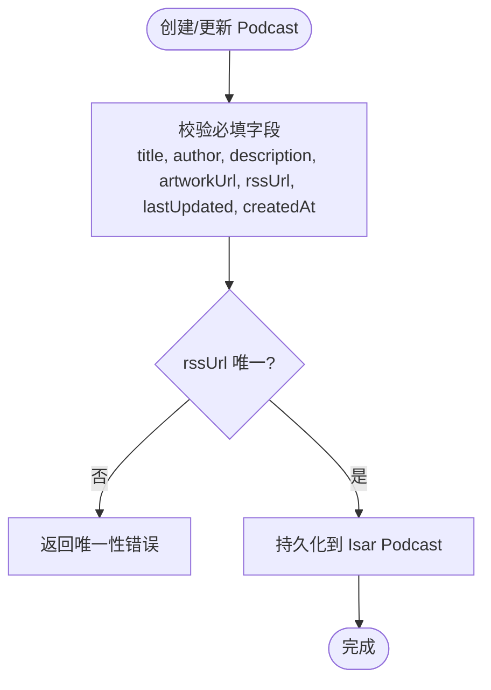
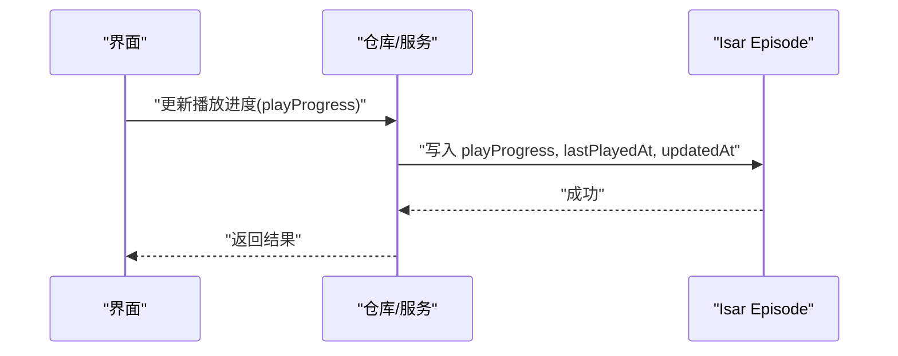
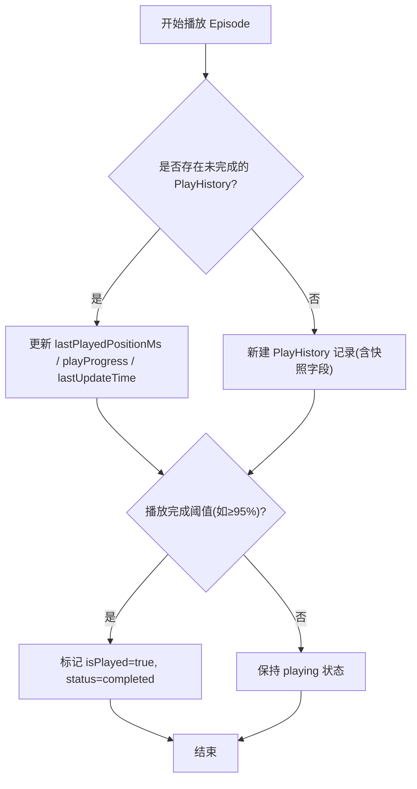
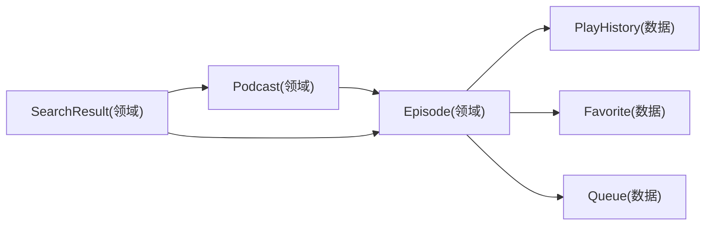

# 领域实体 API

<cite>
**本文引用的文件**   
- [podcast.dart](file://lib/domain/entities/podcast.dart)
- [episode.dart](file://lib/domain/entities/episode.dart)
- [search_history.dart](file://lib/domain/entities/search_history.dart)
- [search_result.dart](file://lib/domain/entities/search_result.dart)
- [play_history_model.dart](file://lib/data/models/play_history_model.dart)
- [podcast_model.dart](file://lib/data/models/podcast_model.dart)
- [episode_model.dart](file://lib/data/models/episode_model.dart)
- [search_history_model.dart](file://lib/data/models/search_history_model.dart)
- [favorite_model.dart](file://lib/data/models/favorite_model.dart)
- [queue_model.dart](file://lib/data/models/queue_model.dart)
- [database.md](file://docs/database.md)
</cite>

## 目录
1. [简介](#简介)
2. [项目结构](#项目结构)
3. [核心组件](#核心组件)
4. [架构总览](#架构总览)
5. [详细组件分析](#详细组件分析)
6. [依赖关系分析](#依赖关系分析)
7. [性能考虑](#性能考虑)
8. [故障排查指南](#故障排查指南)
9. [结论](#结论)
10. [附录](#附录)

## 简介
本文件为 TinyCast 应用的“领域实体 API”提供权威文档，聚焦业务实体类的结构定义、字段说明与数据验证规则。重点覆盖 Podcast、Episode、PlayHistory 等核心实体，阐明实体间的关联关系、数据约束与业务规则，并提供创建、更新、查询的示例路径，以及序列化、反序列化和持久化接口说明。同时给出版本兼容性与迁移策略建议，帮助开发者在演进中保持向后兼容与数据一致性。

## 项目结构
TinyCast 采用分层架构：
- 领域层（domain/entities）：纯业务实体，无持久化细节
- 数据层（data/models）：Isar 数据库模型，标注索引、枚举映射等
- 文档（docs）：数据库与同步相关说明

图表来源 
- [podcast.dart:1-74](file://lib/domain/entities/podcast.dart#L1-L74)
- [episode.dart:1-66](file://lib/domain/entities/episode.dart#L1-L66)
- [search_history.dart:1-12](file://lib/domain/entities/search_history.dart#L1-L12)
- [search_result.dart:1-17](file://lib/domain/entities/search_result.dart#L1-L17)
- [play_history_model.dart:1-51](file://lib/data/models/play_history_model.dart#L1-L51)
- [podcast_model.dart:1-78](file://lib/data/models/podcast_model.dart#L1-L78)
- [episode_model.dart:1-67](file://lib/data/models/episode_model.dart#L1-L67)
- [search_history_model.dart:1-14](file://lib/data/models/search_history_model.dart#L1-L14)
- [favorite_model.dart:1-20](file://lib/data/models/favorite_model.dart#L1-L20)
- [queue_model.dart:1-29](file://lib/data/models/queue_model.dart#L1-L29)

章节来源
- [podcast.dart:1-74](file://lib/domain/entities/podcast.dart#L1-L74)
- [episode.dart:1-66](file://lib/domain/entities/episode.dart#L1-L66)
- [search_history.dart:1-12](file://lib/domain/entities/search_history.dart#L1-L12)
- [search_result.dart:1-17](file://lib/domain/entities/search_result.dart#L1-L17)
- [play_history_model.dart:1-51](file://lib/data/models/play_history_model.dart#L1-L51)
- [podcast_model.dart:1-78](file://lib/data/models/podcast_model.dart#L1-L78)
- [episode_model.dart:1-67](file://lib/data/models/episode_model.dart#L1-L67)
- [search_history_model.dart:1-14](file://lib/data/models/search_history_model.dart#L1-L14)
- [favorite_model.dart:1-20](file://lib/data/models/favorite_model.dart#L1-L20)
- [queue_model.dart:1-29](file://lib/data/models/queue_model.dart#L1-L29)

## 核心组件
本节概述各实体的职责与关键属性，便于快速定位与理解。

- Podcast（播客）
  - 作用：描述一个播客的基本信息与订阅状态
  - 关键字段：id、title、author、description、artworkUrl、rssUrl、isSubscribed、lastUpdated、episodeCount、itunes* 系列扩展字段
  - 约束：rssUrl 唯一；时间戳 lastUpdated、createdAt；布尔 isExplicit、isSubscribed
- Episode（剧集）
  - 作用：描述单集音频内容与播放状态
  - 关键字段：id、podcastId、title、description、audioUrl、audioType、pubDate、duration、artworkUrl、isPlayed/isDownloaded/isFavorite、downloadProgress/playProgress、lastPlayedAt、itunes* 扩展字段
  - 约束：podcastId 外键语义；时间戳 pubDate、createdAt、updatedAt；进度范围 0.0-1.0
- PlayHistory（播放历史）
  - 作用：记录每集的播放轨迹与完成状态，支持软删除与快照字段
  - 关键字段：episodeId、podcastId、title/description/artworkUrl（快照）、lastPlayedPositionMs、playProgress、isPlayed、playedDuration、status、lastUpdateTime、createdAt、isDeleted
  - 约束：status 枚举（playing/completed/skipped）；lastUpdateTime 索引；软删除 isDeleted
- SearchHistory（搜索历史）
  - 作用：记录用户搜索关键词与时间
  - 关键字段：id、keyword、searchedAt
- SearchResult（搜索结果聚合）
  - 作用：聚合 Podcast 与 Episode 列表，提供 isEmpty/isNotEmpty 便捷判断

章节来源
- [podcast.dart:1-74](file://lib/domain/entities/podcast.dart#L1-L74)
- [episode.dart:1-66](file://lib/domain/entities/episode.dart#L1-L66)
- [play_history_model.dart:1-51](file://lib/data/models/play_history_model.dart#L1-L51)
- [search_history.dart:1-12](file://lib/domain/entities/search_history.dart#L1-L12)
- [search_result.dart:1-17](file://lib/domain/entities/search_result.dart#L1-L17)

## 架构总览
领域实体与数据模型的对应关系如下：
- 领域 Podcast ↔ Isar Podcast
- 领域 Episode ↔ Isar Episode
- 领域 SearchHistory ↔ Isar SearchHistoryModel
- PlayHistory 仅存在于数据层，用于播放历史追踪

图表来源 
- [podcast.dart:1-74](file://lib/domain/entities/podcast.dart#L1-L74)
- [episode.dart:1-66](file://lib/domain/entities/episode.dart#L1-L66)
- [play_history_model.dart:1-51](file://lib/data/models/play_history_model.dart#L1-L51)
- [search_history.dart:1-12](file://lib/domain/entities/search_history.dart#L1-L12)

## 详细组件分析

### Podcast（播客）
- 领域实体（lib/domain/entities/podcast.dart）
  - 主要属性：标识、标题、作者、描述、封面、RSS、网站、语言、版权、分类、关键词、是否成人内容、所有者信息、更新时间、剧集数、订阅状态、本地封面路径、创建时间、iTunes 扩展字段
  - 默认值：isExplicit=false；episodeCount=0；isSubscribed=false；refreshFailedCount=0
  - 用途：展示播客详情、订阅管理、刷新统计
- 数据模型（lib/data/models/podcast_model.dart）
  - 索引：title、rssUrl(unique)、lastUpdated
  - 字段差异：相比领域实体缺少 artworkPath；增加 createdAt 初始化；保留 iTunes 扩展字段

章节来源
- [podcast.dart:1-74](file://lib/domain/entities/podcast.dart#L1-L74)
- [podcast_model.dart:1-78](file://lib/data/models/podcast_model.dart#L1-L78)

### Episode（剧集）
- 领域实体（lib/domain/entities/episode.dart）
  - 主要属性：标识、所属播客、标题、描述、链接、GUID、作者、发布时间、音频地址与类型、时长、封面、是否成人内容、播放/下载/收藏状态、下载路径、封面路径、下载进度、播放进度、最后播放时间、创建/更新时间、iTunes 扩展字段
  - 默认值：audioType='audio/mpeg'；isExplicit=false；isPlayed=false；isDownloaded=false；isFavorite=false；downloadProgress=0.0；playProgress=0.0
  - 用途：播放控制、下载管理、收藏与播放状态维护
- 数据模型（lib/data/models/episode_model.dart）
  - 索引：podcastId、pubDate
  - 字段差异：与领域实体基本一致，包含播放与下载相关字段

章节来源
- [episode.dart:1-66](file://lib/domain/entities/episode.dart#L1-L66)
- [episode_model.dart:1-67](file://lib/data/models/episode_model.dart#L1-L67)

### PlayHistory（播放历史）
- 数据模型（lib/data/models/play_history_model.dart）
  - 主要属性：episodeId、podcastId、标题/描述/封面快照、播放位置毫秒、播放进度、是否完成、累计时长、状态枚举、最后更新时间、创建时间、软删除标记
  - 索引：episodeId、podcastId、lastUpdateTime
  - 枚举：PlayHistoryStatus{playing, completed, skipped}
  - 用途：历史记录展示、MiniPlayer 恢复、统计分析
- 数据约束与规则（参考 docs/database.md）
  - 优先通过 episodeITunesId/episodeGuid 匹配，再回退到 episodeId
  - 软删除使用 isDeleted=true，不物理删除
  - 自动保存策略：定时或事件触发（如进度变化≥5%）

章节来源
- [play_history_model.dart:1-51](file://lib/data/models/play_history_model.dart#L1-L51)
- [database.md:205-234](file://docs/database.md#L205-L234)

### SearchHistory（搜索历史）
- 领域实体（lib/domain/entities/search_history.dart）
  - 字段：id、keyword、searchedAt
- 数据模型（lib/data/models/search_history_model.dart）
  - 字段：id、keyword、searchedAt（索引）
- 用途：记录并展示最近搜索词，支持按时间排序

章节来源
- [search_history.dart:1-12](file://lib/domain/entities/search_history.dart#L1-L12)
- [search_history_model.dart:1-14](file://lib/data/models/search_history_model.dart#L1-L14)

### SearchResult（搜索结果聚合）
- 领域实体（lib/domain/entities/search_result.dart）
  - 字段：podcasts、episodes
  - 方法：isEmpty、isNotEmpty
- 用途：统一返回搜索结果集合，简化调用方逻辑

章节来源
- [search_result.dart:1-17](file://lib/domain/entities/search_result.dart#L1-L17)

### 其他数据模型（Favorite、Queue）
- Favorite（收藏）
  - 字段：id、supabaseId、episodeId、episodeGuid、episodeITunesId、createdAt
  - 用途：收藏剧集，支持跨设备同步 ID
- Queue（播放队列）
  - 字段：id、supabaseId、episodeId、episodeGuid、episodeITunesId、podcastId、podcastGuid、podcastITunesId、position、addedAt
  - 用途：管理播放顺序与位置

章节来源
- [favorite_model.dart:1-20](file://lib/data/models/favorite_model.dart#L1-L20)
- [queue_model.dart:1-29](file://lib/data/models/queue_model.dart#L1-L29)

## 依赖关系分析
- 领域实体之间：
  - Episode 引用 Podcast（通过 podcastId）
  - SearchResult 聚合 Podcast 与 Episode
- 数据模型之间：
  - PlayHistory 引用 Episode/Podcast（通过 episodeId/podcastId 及 fallback 字段）
  - Favorite/Queue 引用 Episode/Podcast（通过 id/guid/iTunesId）

图表来源 
- [podcast.dart:1-74](file://lib/domain/entities/podcast.dart#L1-L74)
- [episode.dart:1-66](file://lib/domain/entities/episode.dart#L1-L66)
- [play_history_model.dart:1-51](file://lib/data/models/play_history_model.dart#L1-L51)
- [favorite_model.dart:1-20](file://lib/data/models/favorite_model.dart#L1-L20)
- [queue_model.dart:1-29](file://lib/data/models/queue_model.dart#L1-L29)
- [search_result.dart:1-17](file://lib/domain/entities/search_result.dart#L1-L17)

## 性能考虑
- 索引优化
  - Podcast：title、rssUrl(unique)、lastUpdated
  - Episode：podcastId、pubDate
  - PlayHistory：episodeId、podcastId、lastUpdateTime
- 查询策略
  - PlayHistory 优先使用 episodeITunesId/episodeGuid 匹配，再回退到 episodeId，减少跨表关联开销
- 存储策略
  - PlayHistory 快照字段避免级联删除影响显示
  - 软删除 isDeleted 替代物理删除，提升查询稳定性
- 写入频率
  - 播放进度自动保存需节流（如每10秒或≥5%变化），避免频繁 I/O

[本节为通用指导，无需具体文件引用]

## 故障排查指南
- 唯一性冲突
  - rssUrl 重复导致插入失败，检查数据源去重逻辑
- 关联失效
  - Episode 被删除后，PlayHistory 仍可通过快照字段显示；若需清理，可基于 isDeleted 标记进行批量处理
- 进度不一致
  - 确认自动保存触发条件与定时器是否正常；检查 lastUpdateTime 是否及时更新
- 枚举解析异常
  - 旧数据可能包含未知枚举值，需在反序列化时提供默认值与降级策略

章节来源
- [database.md:494-501](file://docs/database.md#L494-L501)

## 结论
TinyCast 的领域实体设计清晰、职责明确，配合 Isar 数据模型实现了高效的本地持久化与查询。PlayHistory 的快照与软删除机制保障了用户体验与数据稳定性。建议在后续迭代中继续完善枚举与字段的兼容性处理，确保向前与向后兼容。

[本节为总结，无需具体文件引用]

## 附录

### 实体字段与约束速览
- Podcast（领域）
  - 必填：id、title、author、description、artworkUrl、rssUrl、lastUpdated、createdAt
  - 可选：subtitle、websiteUrl、language、copyright、categories、keywords、ownerName、ownerEmail、artworkPath、itunes* 系列
  - 约束：rssUrl 唯一；布尔 isExplicit；计数 episodeCount
- Episode（领域）
  - 必填：id、podcastId、title、description、audioUrl、pubDate、createdAt、updatedAt
  - 可选：link、guid、author、duration、artworkUrl、itunes* 系列
  - 约束：进度范围 0.0-1.0；布尔 isExplicit/isPlayed/isDownloaded/isFavorite
- PlayHistory（数据）
  - 必填：episodeId、podcastId、title、lastUpdateTime、createdAt
  - 可选：supabaseId、episodeGuid、episodeITunesId、podcastGuid、podcastITunesId、description、artworkUrl、lastPlayedPositionMs、playProgress、isPlayed、playedDuration、status、isDeleted
  - 约束：status 枚举；lastUpdateTime 索引；软删除 isDeleted

章节来源
- [podcast.dart:1-74](file://lib/domain/entities/podcast.dart#L1-L74)
- [episode.dart:1-66](file://lib/domain/entities/episode.dart#L1-L66)
- [play_history_model.dart:1-51](file://lib/data/models/play_history_model.dart#L1-L51)

### 创建、更新、查询示例（路径指引）
- 创建 Podcast
  - 领域构造：[podcast.dart:37-72](file://lib/domain/entities/podcast.dart#L37-L72)
  - 数据模型写入：[podcast_model.dart:1-78](file://lib/data/models/podcast_model.dart#L1-L78)
- 更新 Episode 播放进度
  - 领域属性：[episode.dart:21-25](file://lib/domain/entities/episode.dart#L21-L25)
  - 数据模型字段：[episode_model.dart:45-53](file://lib/data/models/episode_model.dart#L45-L53)
- 查询 PlayHistory 已完成记录
  - 数据模型与索引：[play_history_model.dart:13-46](file://lib/data/models/play_history_model.dart#L13-L46)
  - 查询策略参考：[database.md:236-239](file://docs/database.md#L236-L239)

### 序列化与反序列化
- AppSettings（配置实体）提供 toJson/fromJson 与 copyWith，可作为其他实体序列化参考
  - 路径：[app_settings.dart:138-174](file://lib/domain/entities/app_settings.dart#L138-L174)
- Isar 模型由 build_runner 生成 .g.dart 文件，负责序列化/反序列化与索引映射

章节来源
- [app_settings.dart:138-174](file://lib/domain/entities/app_settings.dart#L138-L174)

### 版本兼容性与迁移策略
- 枚举兼容
  - 对未知枚举值提供默认值与降级逻辑（参考 AppSettings 的解析方法）
- 字段兼容
  - 新增字段设置合理默认值；读取时允许 null 并提供回退
- 关联兼容
  - PlayHistory 优先使用 episodeITunesId/episodeGuid，再回退到 episodeId，保证历史数据可用
- 软删除
  - 使用 isDeleted 标记而非物理删除，便于恢复与审计

章节来源
- [database.md:236-239](file://docs/database.md#L236-L239)
- [database.md:494-501](file://docs/database.md#L494-L501)