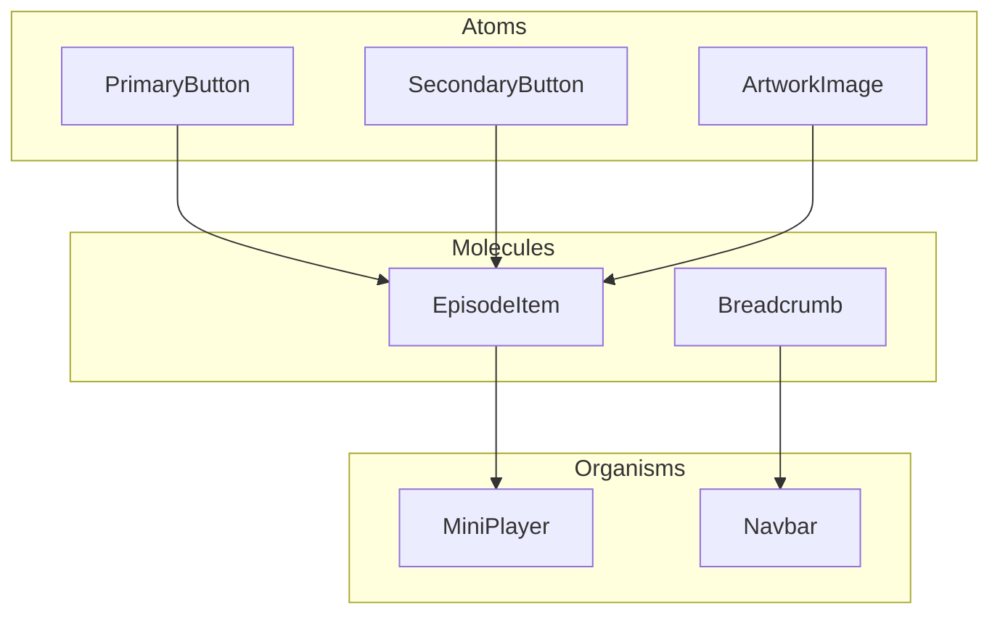
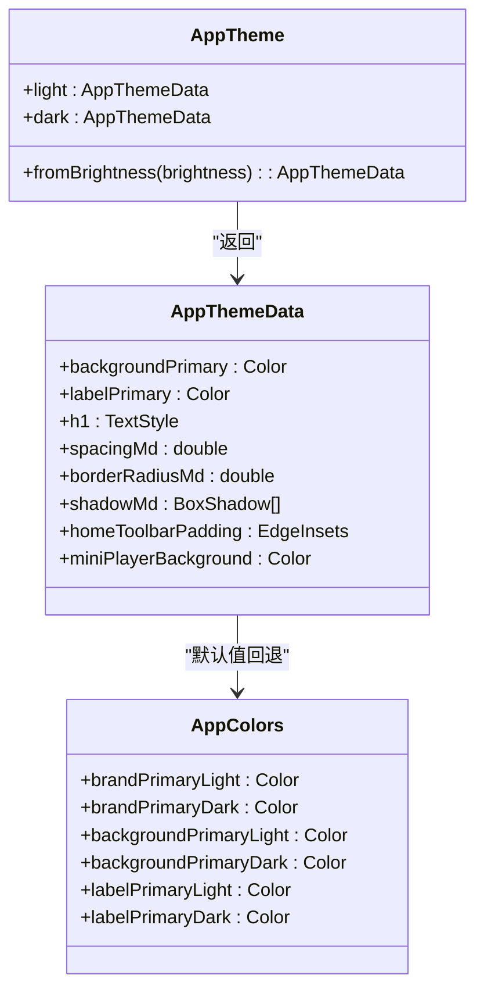
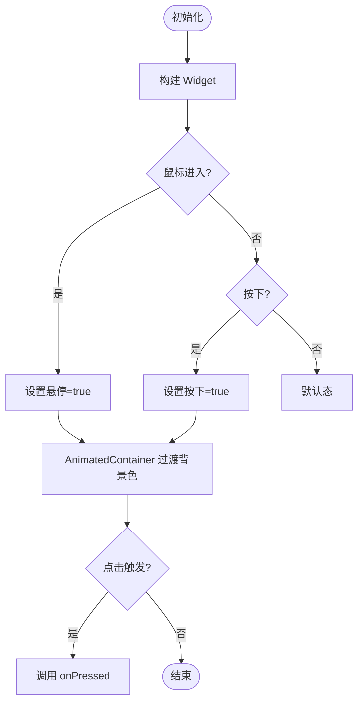
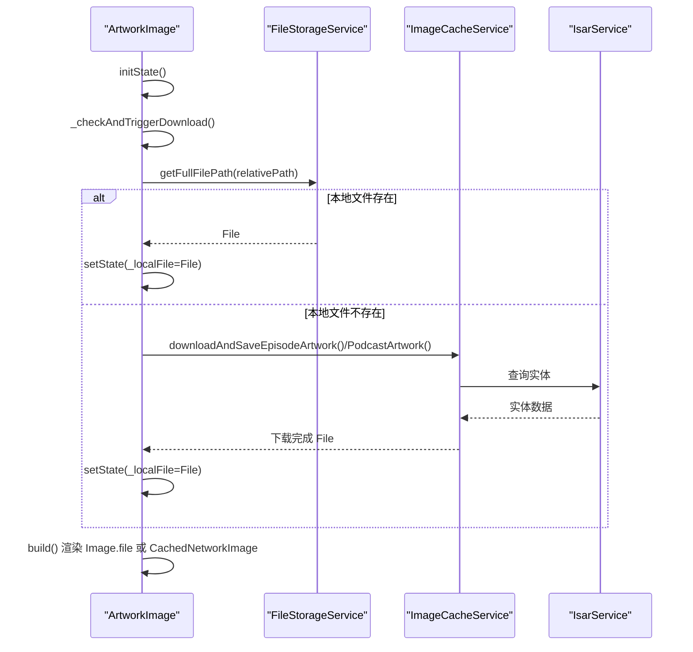
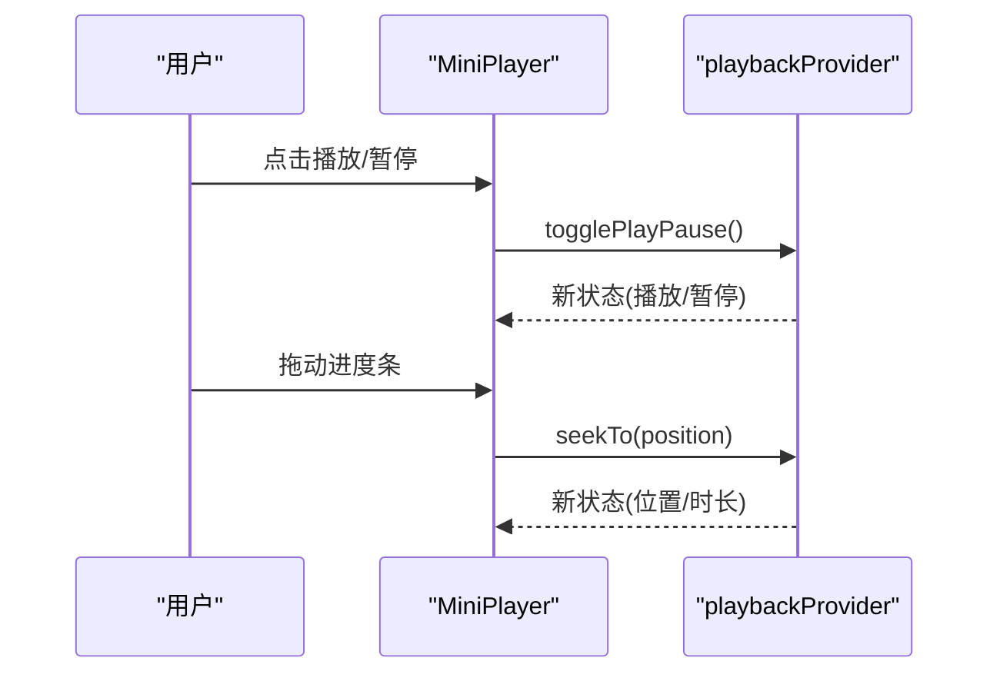
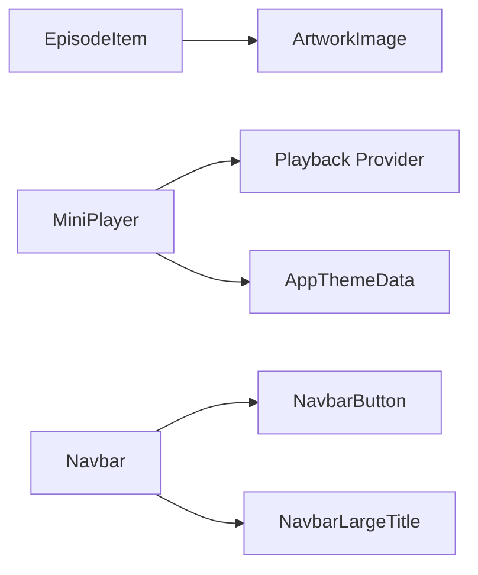

# UI 组件架构

<cite>
**本文引用的文件**   
- [README.md](file://README.md)
- [app_theme.dart](file://lib/core/theme/app_theme.dart)
- [app_colors.dart](file://lib/core/theme/app_colors.dart)
- [theme_data.dart](file://lib/core/theme/theme_data.dart)
- [primary_button.dart](file://lib/presentation/widgets/atoms/buttons/primary_button.dart)
- [secondary_button.dart](file://lib/presentation/widgets/atoms/buttons/secondary_button.dart)
- [artwork_image.dart](file://lib/presentation/widgets/atoms/artwork_image/artwork_image.dart)
- [episode_item.dart](file://lib/presentation/widgets/molecules/episode_item/episode_item.dart)
- [breadcrumb.dart](file://lib/presentation/widgets/molecules/breadcrumb/breadcrumb.dart)
- [mini_player.dart](file://lib/presentation/widgets/organisms/mini_player/mini_player.dart)
- [navbar.dart](file://lib/presentation/widgets/organisms/navbar/navbar.dart)
- [overview.md](file://docs/theme/overview.md)
</cite>

## 目录
1. [简介](#简介)
2. [项目结构](#项目结构)
3. [核心组件](#核心组件)
4. [架构总览](#架构总览)
5. [详细组件分析](#详细组件分析)
6. [依赖关系分析](#依赖关系分析)
7. [性能与优化](#性能与优化)
8. [故障排查指南](#故障排查指南)
9. [结论](#结论)
10. [附录：使用示例与最佳实践](#附录使用示例与最佳实践)

## 简介
本文件面向 TinyCast 的 UI 组件架构，围绕原子设计模式（Atoms、Molecules、Organisms）进行系统化说明。文档覆盖组件层次结构、视觉外观、交互行为、属性/事件/插槽约定、响应式与无障碍建议、状态与动画、样式与主题扩展、跨浏览器兼容性与性能优化，以及组件组合与集成方式。读者可据此快速理解并正确使用现有组件，同时为后续扩展提供一致的设计规范。

## 项目结构
TinyCast 的 UI 组件位于 presentation/widgets 下，按原子设计分层组织：
- atoms（原子）：最小粒度的 UI 元素，如按钮、图片、单选/复选等
- molecules（分子）：由原子组合而成的复合控件，如剧集条目、面包屑导航
- organisms（有机体）：更复杂的业务级组件，如迷你播放器、导航栏、侧边栏、分段控制器等

图表来源 
- [primary_button.dart:1-128](file://lib/presentation/widgets/atoms/buttons/primary_button.dart#L1-L128)
- [secondary_button.dart:1-133](file://lib/presentation/widgets/atoms/buttons/secondary_button.dart#L1-L133)
- [artwork_image.dart:1-291](file://lib/presentation/widgets/atoms/artwork_image/artwork_image.dart#L1-L291)
- [episode_item.dart:1-128](file://lib/presentation/widgets/molecules/episode_item/episode_item.dart#L1-L128)
- [breadcrumb.dart:1-16](file://lib/presentation/widgets/molecules/breadcrumb/breadcrumb.dart#L1-L16)
- [mini_player.dart:1-54](file://lib/presentation/widgets/organisms/mini_player/mini_player.dart#L1-L54)
- [navbar.dart:1-38](file://lib/presentation/widgets/organisms/navbar/navbar.dart#L1-L38)

章节来源
- [README.md:1-6](file://README.md#L1-L6)

## 核心组件
本节对关键 UI 组件进行概览性说明，涵盖职责、输入输出、交互与状态要点。

- PrimaryButton（主按钮）
  - 职责：提供高可见性的主要操作入口
  - 输入：标签文本、点击回调、文字样式、字号、内边距、圆角、宽度
  - 交互：悬停与按下态切换，带动画过渡
  - 状态：内部维护悬停/按下布尔状态
  - 主题：颜色与样式可通过主题系统或传入样式覆盖

- SecondaryButton（次按钮）
  - 职责：提供次要操作的轻量按钮
  - 输入：同主按钮
  - 交互：悬停/按下态切换，带动画过渡
  - 状态：内部维护悬停/按下布尔状态

- ArtworkImage（封面图）
  - 职责：统一加载与展示节目/剧集封面图，支持本地缓存与网络回退
  - 输入：本地路径、网络 URL、实体对象（Episode/Podcast）、尺寸、适配方式、圆角、占位与错误组件
  - 行为：优先本地文件；不存在则触发后台下载；失败回退到网络或占位
  - 状态：本地文件引用、检查中标志、是否已触发下载

- EpisodeItem（剧集条目）
  - 职责：展示单集信息，包含封面、标题、时长、播放控制等
  - 输入：Episode 实体、是否显示分隔线、是否显示封面、播放/点击回调、是否显示移除队列、是否使用播客封面
  - 行为：根据配置选择使用剧集或播客封面；格式化时长；可选分隔线

- Breadcrumb（面包屑）
  - 职责：水平排列多个导航项
  - 输入：BreadcrumbItem 列表

- MiniPlayer（迷你播放器）
  - 职责：常驻底部播放控制条，聚合剧集信息、控制按钮与进度条
  - 输入：通过 Riverpod 订阅播放状态
  - 行为：播放/暂停、前进/后退、拖动进度

- Navbar（导航栏）
  - 职责：页面顶部标题与动作按钮容器
  - 输入：标题、动作图标、点击回调

章节来源
- [primary_button.dart:1-128](file://lib/presentation/widgets/atoms/buttons/primary_button.dart#L1-L128)
- [secondary_button.dart:1-133](file://lib/presentation/widgets/atoms/buttons/secondary_button.dart#L1-L133)
- [artwork_image.dart:1-291](file://lib/presentation/widgets/atoms/artwork_image/artwork_image.dart#L1-L291)
- [episode_item.dart:1-128](file://lib/presentation/widgets/molecules/episode_item/episode_item.dart#L1-L128)
- [breadcrumb.dart:1-16](file://lib/presentation/widgets/molecules/breadcrumb/breadcrumb.dart#L1-L16)
- [mini_player.dart:1-54](file://lib/presentation/widgets/organisms/mini_player/mini_player.dart#L1-L54)
- [navbar.dart:1-38](file://lib/presentation/widgets/organisms/navbar/navbar.dart#L1-L38)

## 架构总览
TinyCast 的主题与样式体系独立于 Material ThemeData，采用自定义 AppTheme/AppThemeData 访问设计令牌（颜色、文字样式、间距、圆角、阴影），并通过 HOCON 配置文件驱动运行时主题。组件层通过统一的 theme 接口获取样式，保证一致的视觉语言。

图表来源 
- [app_theme.dart:1-21](file://lib/core/theme/app_theme.dart#L1-L21)
- [theme_data.dart:1-800](file://lib/core/theme/theme_data.dart#L1-L800)
- [app_colors.dart:1-48](file://lib/core/theme/app_colors.dart#L1-L48)

章节来源
- [overview.md:1-154](file://docs/theme/overview.md#L1-L154)
- [app_theme.dart:1-21](file://lib/core/theme/app_theme.dart#L1-L21)
- [theme_data.dart:1-800](file://lib/core/theme/theme_data.dart#L1-L800)
- [app_colors.dart:1-48](file://lib/core/theme/app_colors.dart#L1-L48)

## 详细组件分析

### Atoms：PrimaryButton
- 视觉外观
  - 圆角矩形背景，居中文本，默认深色背景与白色文字
  - 悬停与按下态有背景色变化
- 行为与交互
  - 鼠标进入/离开更新悬停状态
  - 按下/抬起/取消更新按下状态
  - 点击触发回调
- 属性（Props）
  - label: 文本
  - onPressed: 点击回调
  - labelStyle: 文字样式（可选）
  - fontSize: 字号
  - horizontalPadding / verticalPadding: 内边距
  - borderRadius: 圆角
  - width: 宽度
- 事件
  - onTap -> onPressed
- 状态与动画
  - _isHovering/_isPressed 布尔状态
  - AnimatedContainer 实现悬停过渡（200ms），离开时立即切换避免闪烁
- 无障碍
  - 使用 MouseRegion 与 GestureDetector 提供明确的点击区域与光标反馈
- 主题与样式
  - 颜色硬编码在当前实现中，可通过传入 labelStyle 覆盖文字样式
- 使用示例（路径）
  - [primary_button.dart:1-128](file://lib/presentation/widgets/atoms/buttons/primary_button.dart#L1-L128)

图表来源 
- [primary_button.dart:1-128](file://lib/presentation/widgets/atoms/buttons/primary_button.dart#L1-L128)

章节来源
- [primary_button.dart:1-128](file://lib/presentation/widgets/atoms/buttons/primary_button.dart#L1-L128)

### Atoms：SecondaryButton
- 视觉外观
  - 浅色背景、深色文字，圆角矩形
- 行为与交互
  - 悬停/按下态切换，带过渡动画
- 属性（Props）
  - label, onPressed, labelStyle, fontSize, horizontalPadding, verticalPadding, borderRadius, width
- 事件
  - onTap -> onPressed
- 状态与动画
  - 内部悬停/按下状态，AnimatedContainer 过渡
- 无障碍
  - 明确点击区域与光标样式
- 主题与样式
  - 颜色硬编码，可通过 labelStyle 覆盖文字样式
- 使用示例（路径）
  - [secondary_button.dart:1-133](file://lib/presentation/widgets/atoms/buttons/secondary_button.dart#L1-L133)

章节来源
- [secondary_button.dart:1-133](file://lib/presentation/widgets/atoms/buttons/secondary_button.dart#L1-L133)

### Atoms：ArtworkImage
- 视觉外观
  - 支持 BoxFit、圆角裁剪、占位与错误占位图
- 行为与交互
  - 优先本地文件；若不存在则触发后台下载；失败回退网络或占位
- 属性（Props）
  - artworkPath, artworkUrl, episode, podcast, width, height, fit, borderRadius, placeholder, errorWidget
  - 构造器：fromEpisode、fromPodcast
- 事件
  - 无直接用户事件，内部异步完成更新 UI
- 状态与动画
  - _localFile 本地文件引用
  - _isCheckingLocal 检查中标志
  - _downloadTriggered 防止重复触发下载
- 数据流
  - 初始化/更新时检查本地文件 -> 存在则渲染 -> 否则触发后台下载 -> 完成后 setState 更新
- 无障碍
  - 占位与错误图确保可读性
- 主题与样式
  - 圆角与尺寸由 props 控制
- 使用示例（路径）
  - [artwork_image.dart:1-291](file://lib/presentation/widgets/atoms/artwork_image/artwork_image.dart#L1-L291)

图表来源 
- [artwork_image.dart:1-291](file://lib/presentation/widgets/atoms/artwork_image/artwork_image.dart#L1-L291)

章节来源
- [artwork_image.dart:1-291](file://lib/presentation/widgets/atoms/artwork_image/artwork_image.dart#L1-L291)

### Molecules：EpisodeItem
- 视觉外观
  - 左侧封面图（可切换为播客封面），右侧标题/描述/时长，可选分隔线
- 行为与交互
  - 点击播放、点击整行跳转、从队列移除（可选）
- 属性（Props）
  - episode, showDivider, showCover, onPlayPressed, onEpisodeTap, showRemoveFromQueue, onRemoveFromQueue, usePodcastArtwork
- 事件
  - onPlayPressed, onEpisodeTap, onRemoveFromQueue
- 状态与动画
  - 无内部状态，纯展示型 ConsumerWidget
- 主题与样式
  - 通过子组件与主题系统应用样式
- 使用示例（路径）
  - [episode_item.dart:1-128](file://lib/presentation/widgets/molecules/episode_item/episode_item.dart#L1-L128)

章节来源
- [episode_item.dart:1-128](file://lib/presentation/widgets/molecules/episode_item/episode_item.dart#L1-L128)

### Molecules：Breadcrumb
- 视觉外观
  - 水平排列的导航项集合
- 行为与交互
  - 无内置交互，由 BreadcrumbItem 决定
- 属性（Props）
  - items: List<BreadcrumbItem>
- 使用示例（路径）
  - [breadcrumb.dart:1-16](file://lib/presentation/widgets/molecules/breadcrumb/breadcrumb.dart#L1-L16)

章节来源
- [breadcrumb.dart:1-16](file://lib/presentation/widgets/molecules/breadcrumb/breadcrumb.dart#L1-L16)

### Organisms：MiniPlayer
- 视觉外观
  - 聚合剧集信息、控制按钮、进度条，背景与间距受主题控制
- 行为与交互
  - 播放/暂停、前进/后退、拖动进度
- 属性（Props）
  - 无显式 props，通过 Riverpod 订阅 playbackProvider
- 事件
  - 通过 provider.notifier 调用 seekTo、togglePlayPause、seekForward、seekBackward
- 状态与动画
  - 外部状态（playbackProvider）驱动 UI 刷新
- 主题与样式
  - 背景、内边距等来自 AppThemeData
- 使用示例（路径）
  - [mini_player.dart:1-54](file://lib/presentation/widgets/organisms/mini_player/mini_player.dart#L1-L54)

图表来源 
- [mini_player.dart:1-54](file://lib/presentation/widgets/organisms/mini_player/mini_player.dart#L1-L54)

章节来源
- [mini_player.dart:1-54](file://lib/presentation/widgets/organisms/mini_player/mini_player.dart#L1-L54)

### Organisms：Navbar
- 视觉外观
  - 标题与右侧动作按钮的水平布局
- 行为与交互
  - 点击动作按钮触发回调
- 属性（Props）
  - title, actionIcon, onActionTap
- 使用示例（路径）
  - [navbar.dart:1-38](file://lib/presentation/widgets/organisms/navbar/navbar.dart#L1-L38)

章节来源
- [navbar.dart:1-38](file://lib/presentation/widgets/organisms/navbar/navbar.dart#L1-L38)

## 依赖关系分析
- 组件间依赖
  - EpisodeItem 依赖 ArtworkImage（封面图）
  - MiniPlayer 依赖播放状态提供者（Riverpod）
  - Navbar 依赖基础按钮与大标题组件
- 主题依赖
  - MiniPlayer 通过 AppThemeData 获取背景与间距
  - 所有组件可通过 AppTheme 获取颜色与文字样式

图表来源 
- [episode_item.dart:1-128](file://lib/presentation/widgets/molecules/episode_item/episode_item.dart#L1-L128)
- [mini_player.dart:1-54](file://lib/presentation/widgets/organisms/mini_player/mini_player.dart#L1-L54)
- [navbar.dart:1-38](file://lib/presentation/widgets/organisms/navbar/navbar.dart#L1-L38)
- [theme_data.dart:1-800](file://lib/core/theme/theme_data.dart#L1-L800)

章节来源
- [episode_item.dart:1-128](file://lib/presentation/widgets/molecules/episode_item/episode_item.dart#L1-L128)
- [mini_player.dart:1-54](file://lib/presentation/widgets/organisms/mini_player/mini_player.dart#L1-L54)
- [navbar.dart:1-38](file://lib/presentation/widgets/organisms/navbar/navbar.dart#L1-L38)
- [theme_data.dart:1-800](file://lib/core/theme/theme_data.dart#L1-L800)

## 性能与优化
- 图片加载
  - ArtworkImage 优先本地文件，减少网络请求；后台下载避免阻塞 UI；失败回退网络或占位图
  - 使用缓存服务与数据库查询，降低重复 IO
- 动画与重绘
  - 按钮使用 AnimatedContainer，仅在悬停时启用过渡，离开时 Duration.zero 避免闪烁
- 主题解析
  - 默认走 HOCON 解析并缓存；编译时常量模式（AppColors，需开启 useHardcoded）性能最优
- 响应式与多端
  - 通过 MediaQuery.platformBrightnessOf 切换明暗主题；布局尺寸与间距由主题集中管理
- 无障碍
  - 明确的点击区域、光标样式、占位与错误图保障可用性

[本节为通用指导，不直接分析具体文件]

## 故障排查指南
- 封面图无法显示
  - 检查本地路径是否存在；确认后台下载是否触发；查看网络回退与错误占位图
  - 参考实现路径：[artwork_image.dart:1-291](file://lib/presentation/widgets/atoms/artwork_image/artwork_image.dart#L1-L291)
- 按钮无点击反馈
  - 确认 onPressed 是否正确绑定；检查手势识别与遮罩层是否拦截事件
  - 参考实现路径：[primary_button.dart:1-128](file://lib/presentation/widgets/atoms/buttons/primary_button.dart#L1-L128), [secondary_button.dart:1-133](file://lib/presentation/widgets/atoms/buttons/secondary_button.dart#L1-L133)
- 迷你播放器状态不同步
  - 确认 playbackProvider 状态更新；检查 seek/play 调用是否正确
  - 参考实现路径：[mini_player.dart:1-54](file://lib/presentation/widgets/organisms/mini_player/mini_player.dart#L1-L54)
- 主题颜色未生效
  - 确认 AppTheme.fromBrightness 调用与当前亮度；检查 HOCON 配置是否加载成功
  - 参考实现路径：[app_theme.dart:1-21](file://lib/core/theme/app_theme.dart#L1-L21), [theme_data.dart:1-800](file://lib/core/theme/theme_data.dart#L1-L800)

章节来源
- [artwork_image.dart:1-291](file://lib/presentation/widgets/atoms/artwork_image/artwork_image.dart#L1-L291)
- [primary_button.dart:1-128](file://lib/presentation/widgets/atoms/buttons/primary_button.dart#L1-L128)
- [secondary_button.dart:1-133](file://lib/presentation/widgets/atoms/buttons/secondary_button.dart#L1-L133)
- [mini_player.dart:1-54](file://lib/presentation/widgets/organisms/mini_player/mini_player.dart#L1-L54)
- [app_theme.dart:1-21](file://lib/core/theme/app_theme.dart#L1-L21)
- [theme_data.dart:1-800](file://lib/core/theme/theme_data.dart#L1-L800)

## 结论
TinyCast 的 UI 组件以原子设计模式清晰分层，配合独立的主题系统，实现了高度可复用、可定制且性能友好的界面能力。Atmos 提供基础控件，Molecules 组合业务片段，Organisms 承载复杂交互。通过统一的 AppTheme/AppThemeData 访问设计令牌，保证了视觉一致性；结合本地缓存、按需动画与 Riverpod 状态管理，提升了用户体验与性能。

[本节为总结，不直接分析具体文件]

## 附录：使用示例与最佳实践
- 使用主题
  - 通过 AppTheme.fromBrightness(context) 获取主题，再使用 theme.backgroundPrimary、theme.h1 等
  - 参考路径：[app_theme.dart:1-21](file://lib/core/theme/app_theme.dart#L1-L21), [theme_data.dart:1-800](file://lib/core/theme/theme_data.dart#L1-L800)
- 使用按钮
  - PrimaryButton/SecondaryButton 传入 label 与 onPressed，必要时覆盖 labelStyle
  - 参考路径：[primary_button.dart:1-128](file://lib/presentation/widgets/atoms/buttons/primary_button.dart#L1-L128), [secondary_button.dart:1-133](file://lib/presentation/widgets/atoms/buttons/secondary_button.dart#L1-L133)
- 使用封面图
  - 优先传入 episode/podcast 实体，组件自动处理本地/网络/占位逻辑
  - 参考路径：[artwork_image.dart:1-291](file://lib/presentation/widgets/atoms/artwork_image/artwork_image.dart#L1-L291)
- 组合剧集条目
  - EpisodeItem 封装封面与信息展示，支持多种开关选项
  - 参考路径：[episode_item.dart:1-128](file://lib/presentation/widgets/molecules/episode_item/episode_item.dart#L1-L128)
- 集成迷你播放器
  - 在页面底部嵌入 MiniPlayer，通过 Riverpod 同步播放状态
  - 参考路径：[mini_player.dart:1-54](file://lib/presentation/widgets/organisms/mini_player/mini_player.dart#L1-L54)
- 主题与样式扩展
  - 使用 HOCON 配置文件定义颜色与排版，或通过 AppColors/AppTextStyles 常量扩展
  - 参考路径：[overview.md:1-154](file://docs/theme/overview.md#L1-L154)

章节来源
- [app_theme.dart:1-21](file://lib/core/theme/app_theme.dart#L1-L21)
- [theme_data.dart:1-800](file://lib/core/theme/theme_data.dart#L1-L800)
- [primary_button.dart:1-128](file://lib/presentation/widgets/atoms/buttons/primary_button.dart#L1-L128)
- [secondary_button.dart:1-133](file://lib/presentation/widgets/atoms/buttons/secondary_button.dart#L1-L133)
- [artwork_image.dart:1-291](file://lib/presentation/widgets/atoms/artwork_image/artwork_image.dart#L1-L291)
- [episode_item.dart:1-128](file://lib/presentation/widgets/molecules/episode_item/episode_item.dart#L1-L128)
- [mini_player.dart:1-54](file://lib/presentation/widgets/organisms/mini_player/mini_player.dart#L1-L54)
- [overview.md:1-154](file://docs/theme/overview.md#L1-L154)