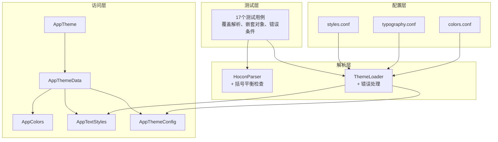
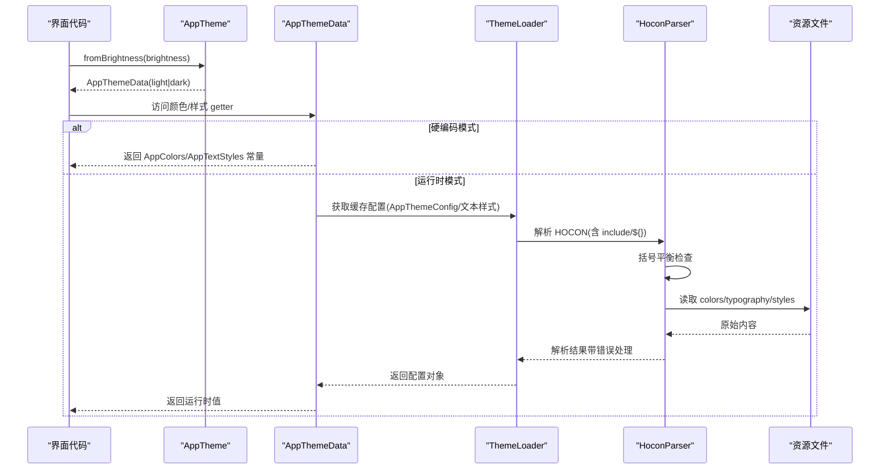
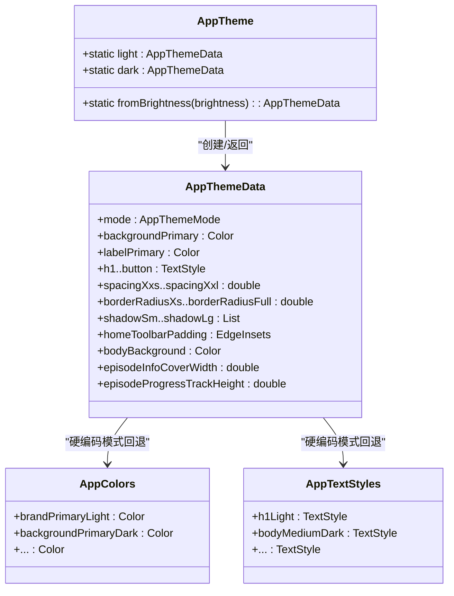
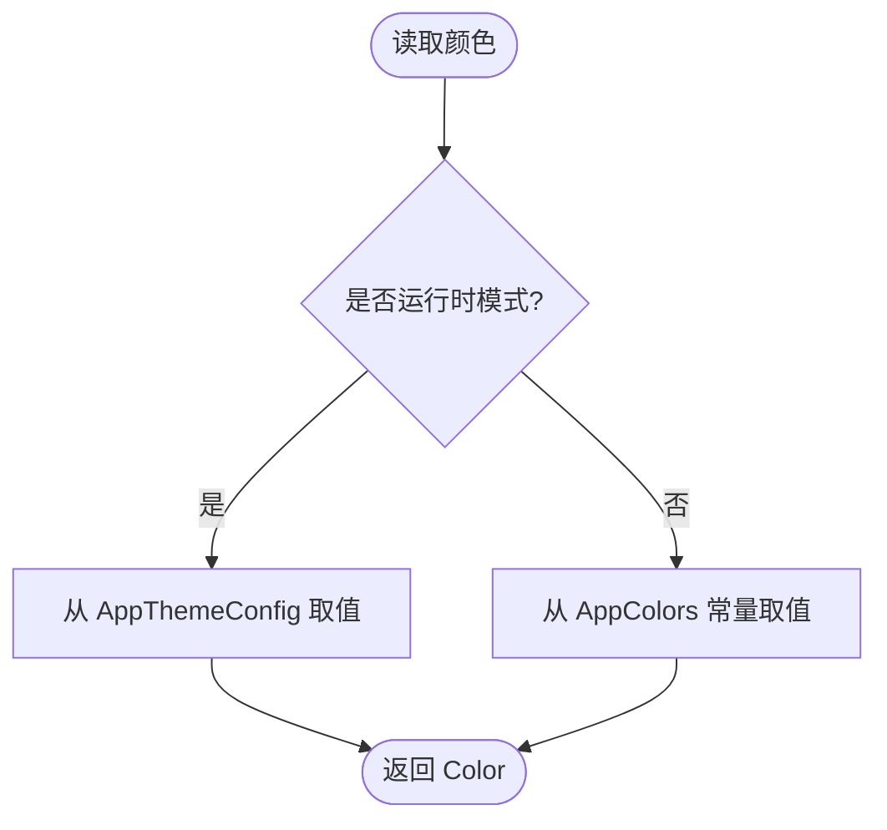
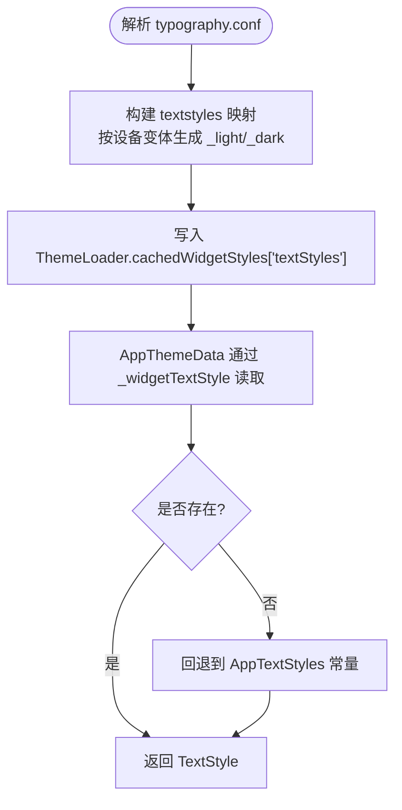
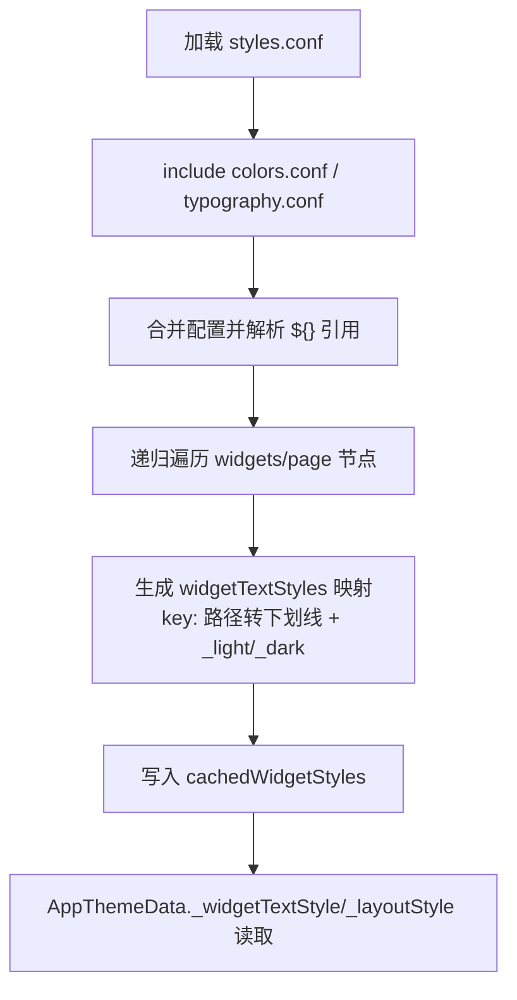
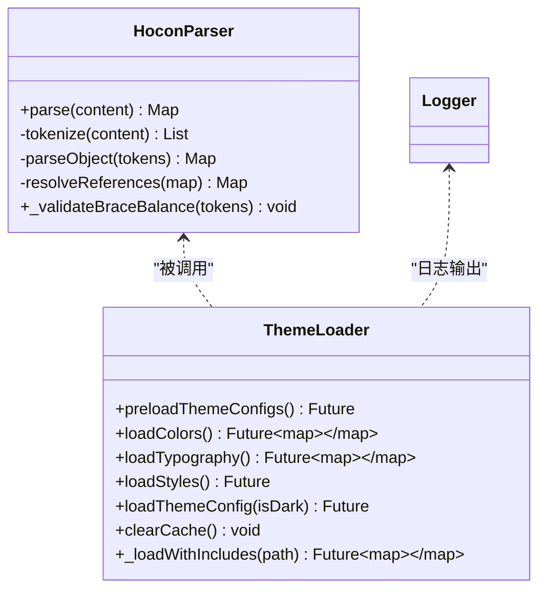
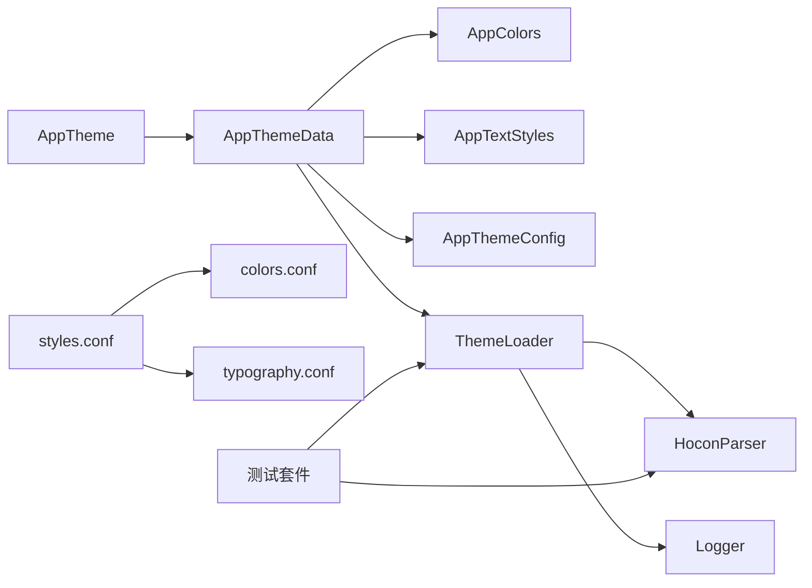

基于我对代码的分析，我现在可以更新主题系统的文档。主要变更包括：

1. **增强的主题加载器**：添加了括号平衡检查和改进的错误可见性
2. **HOCON配置验证**：在解析过程中进行语法验证
3. **全面的测试覆盖**：包含17个测试用例，涵盖解析、嵌套对象和错误条件

让我更新文档：

<cite>
**本文引用的文件**   
- [assets/themes/colors.conf](file://assets/themes/colors.conf)
- [assets/themes/styles.conf](file://assets/themes/styles.conf)
- [assets/themes/typography.conf](file://assets/themes/typography.conf)
- [lib/core/theme/app_theme.dart](file://lib/core/theme/app_theme.dart)
- [lib/core/theme/app_colors.dart](file://lib/core/theme/app_colors.dart)
- [lib/core/theme/app_text_styles.dart](file://lib/core/theme/app_text_styles.dart)
- [lib/core/theme/theme_data.dart](file://lib/core/theme/theme_data.dart)
- [lib/core/theme/theme_loader.dart](file://lib/core/theme/theme_loader.dart)
- [lib/core/theme/app_theme_config.dart](file://lib/core/theme/app_theme_config.dart)
- [lib/core/theme/theme_source_flag.dart](file://lib/core/theme/theme_source_flag.dart)
- [lib/core/utils/logger.dart](file://lib/core/utils/logger.dart)
- [test/core/theme/theme_loader_test.dart](file://test/core/theme/theme_loader_test.dart)
- [docs/theme/overview.md](file://docs/theme/overview.md)
- [docs/theme/colors.md](file://docs/theme/colors.md)
- [docs/theme/typography.md](file://docs/theme/typography.md)
</cite>

## 更新摘要
**所做更改**   
- 更新了主题加载器的错误处理和验证机制
- 新增了HOCON配置的括号平衡检查功能
- 增强了错误可见性和调试信息输出
- 添加了全面的测试覆盖（17个测试用例）
- 改进了include链的错误处理机制

## 目录
1. [简介](#简介)
2. [项目结构](#项目结构)
3. [核心组件](#核心组件)
4. [架构总览](#架构总览)
5. [详细组件分析](#详细组件分析)
6. [依赖关系分析](#依赖关系分析)
7. [性能考量](#性能考量)
8. [故障排查指南](#故障排查指南)
9. [结论](#结论)
10. [附录](#附录)

## 简介
本文件为 TinyCast 的主题系统提供完整、深入的技术文档，涵盖主题配置、颜色系统、样式规范与字体排版的实现方式。重点说明 AppTheme 类的结构与配置选项、浅色/深色模式切换机制；记录 colors.conf、styles.conf、typography.conf 等配置文件的作用与格式；并提供自定义主题、新增颜色变量、修改样式规则的使用示例。同时覆盖主题的热重载、动态切换与持久化存储策略，并给出最佳实践与性能优化建议。

**最新更新**：主题加载器现已增强错误可见性、HOCON配置验证、括号平衡检查和全面的测试覆盖，确保配置文件的正确性和系统的稳定性。

## 项目结构
TinyCast 的主题系统由"配置层（HOCON）+ 解析层 + Dart 访问层"组成：
- 配置层：assets/themes 下的 .conf 文件定义颜色、排版与组件样式
- 解析层：内置 HOCON 解析器与加载器，支持 include、引用替换、缓存、括号平衡检查
- 访问层：AppTheme/AppThemeData/AppColors/AppTextStyles 等统一暴露设计令牌

**图表来源**
- [assets/themes/colors.conf:1-106](file://assets/themes/colors.conf#L1-L106)
- [assets/themes/typography.conf:1-136](file://assets/themes/typography.conf#L1-L136)
- [assets/themes/styles.conf:1-262](file://assets/themes/styles.conf#L1-L262)
- [lib/core/theme/theme_loader.dart:12-295](file://lib/core/theme/theme_loader.dart#L12-L295)
- [lib/core/theme/theme_loader.dart:319-684](file://lib/core/theme/theme_loader.dart#L319-L684)
- [lib/core/theme/app_theme.dart:1-21](file://lib/core/theme/app_theme.dart#L1-L21)
- [lib/core/theme/theme_data.dart:48-807](file://lib/core/theme/theme_data.dart#L48-L807)
- [lib/core/theme/app_colors.dart:1-48](file://lib/core/theme/app_colors.dart#L1-L48)
- [lib/core/theme/app_text_styles.dart:1-200](file://lib/core/theme/app_text_styles.dart#L1-L200)
- [lib/core/theme/app_theme_config.dart:1-200](file://lib/core/theme/app_theme_config.dart#L1-L200)
- [test/core/theme/theme_loader_test.dart:1-243](file://test/core/theme/theme_loader_test.dart#L1-L243)

章节来源
- [docs/theme/overview.md:1-154](file://docs/theme/overview.md#L1-L154)

## 核心组件
- AppTheme：静态入口，按 Brightness 返回 AppThemeData（light/dark），内部通过 ThemeSource.useHardcoded 控制是否走硬编码或运行时解析路径
- AppThemeData：主题数据类，封装颜色、文字样式、间距、圆角、阴影与组件布局属性；在"硬编码模式"下直接返回常量，在"运行时模式"下从 ThemeLoader 缓存的配置中读取
- AppColors：编译时常量颜色集合，命名遵循 {调色板}{颜色名}{主题} 的驼峰规则
- AppTextStyles：编译时常量 TextStyle 集合，包含 h1/h2/h3/body/caption/button 等，Light/Dark 双变体
- ThemeLoader/HoconParser：轻量 HOCON 解析器与加载器，支持 include、${} 引用、注释、嵌套对象，预加载并缓存 colors/typography/styles，生成 AppThemeConfig 和文本样式映射，**新增括号平衡检查和改进的错误处理**
- AppThemeConfig：运行时主题配置对象，承载 colors.conf 解析后的颜色值，供 AppThemeData 在运行时模式下使用
- Logger：统一的日志工具，支持多种日志级别和文件输出

**更新**：ThemeLoader 现在具备更强的错误处理能力，包括括号平衡验证、详细的错误信息和改进的调试输出。

章节来源
- [lib/core/theme/app_theme.dart:1-21](file://lib/core/theme/app_theme.dart#L1-L21)
- [lib/core/theme/theme_data.dart:48-807](file://lib/core/theme/theme_data.dart#L48-L807)
- [lib/core/theme/app_colors.dart:1-48](file://lib/core/theme/app_colors.dart#L1-L48)
- [lib/core/theme/app_text_styles.dart:1-200](file://lib/core/theme/app_text_styles.dart#L1-L200)
- [lib/core/theme/theme_loader.dart:12-295](file://lib/core/theme/theme_loader.dart#L12-L295)
- [lib/core/theme/theme_loader.dart:319-684](file://lib/core/theme/theme_loader.dart#L319-L684)
- [lib/core/theme/app_theme_config.dart:1-200](file://lib/core/theme/app_theme_config.dart#L1-L200)
- [lib/core/utils/logger.dart:1-139](file://lib/core/utils/logger.dart#L1-L139)

## 架构总览
主题系统采用"配置驱动 + 双模式访问"的架构：
- 配置驱动：所有视觉设计令牌来源于 assets/themes/*.conf，便于集中维护与扩展
- 双模式访问：
  - 编译时常量模式（ThemeSource.useHardcoded = true 时）：零运行时开销，Widget 树可 const 优化
  - 运行时解析模式（默认，useHardcoded = false）：启动时由 ThemeLoader 预加载并缓存 HOCON，运行期不监听文件

**更新**：解析过程现在包含严格的语法验证和错误处理，确保配置文件的正确性。

**图表来源**
- [lib/core/theme/app_theme.dart:1-21](file://lib/core/theme/app_theme.dart#L1-L21)
- [lib/core/theme/theme_data.dart:48-807](file://lib/core/theme/theme_data.dart#L48-L807)
- [lib/core/theme/theme_loader.dart:319-684](file://lib/core/theme/theme_loader.dart#L319-L684)
- [lib/core/theme/theme_loader.dart:12-295](file://lib/core/theme/theme_loader.dart#L12-L295)

## 详细组件分析

### AppTheme 与 AppThemeData
- AppTheme：提供 light/dark 静态访问与 fromBrightness 便捷方法；内部将 useHardcoded 标志传入 AppThemeData.fromSource
- AppThemeData：
  - 颜色 getter：优先从运行时配置（_isHocon）取值，否则回退到 AppColors 常量
  - 文字样式 getter：优先从 styles.conf 生成的 widgetTextStyles 取，其次 fallback 到 AppTextStyles 常量
  - 布局属性：解析 window_container.* 的 padding/background/radius 等，提供 homeToolbar/body/sidebar/content 等便捷属性
  - 组件样式：解析 widgets.* 按钮背景、内容色、进度条、封面尺寸等

**图表来源**
- [lib/core/theme/app_theme.dart:1-21](file://lib/core/theme/app_theme.dart#L1-L21)
- [lib/core/theme/theme_data.dart:48-807](file://lib/core/theme/theme_data.dart#L48-L807)
- [lib/core/theme/app_colors.dart:1-48](file://lib/core/theme/app_colors.dart#L1-L48)
- [lib/core/theme/app_text_styles.dart:1-200](file://lib/core/theme/app_text_styles.dart#L1-L200)

章节来源
- [lib/core/theme/app_theme.dart:1-21](file://lib/core/theme/app_theme.dart#L1-L21)
- [lib/core/theme/theme_data.dart:48-807](file://lib/core/theme/theme_data.dart#L48-L807)

### 颜色系统与 AppColors
- colors.conf 定义 palettes（brand/background/gray/label/overlay），每个颜色项包含 light/dark 两个十六进制值
- AppColors 以 const Color(0x...) 形式暴露，命名遵循 {调色板}{颜色名}{主题} 的驼峰规则
- AppThemeData 的颜色 getter 在运行时模式下从 AppThemeConfig 取值，硬编码模式下直接从 AppColors 取值

**图表来源**
- [assets/themes/colors.conf:1-106](file://assets/themes/colors.conf#L1-L106)
- [lib/core/theme/app_colors.dart:1-48](file://lib/core/theme/app_colors.dart#L1-L48)
- [lib/core/theme/theme_data.dart:110-181](file://lib/core/theme/theme_data.dart#L110-L181)

章节来源
- [docs/theme/colors.md:1-307](file://docs/theme/colors.md#L1-L307)
- [assets/themes/colors.conf:1-106](file://assets/themes/colors.conf#L1-L106)
- [lib/core/theme/app_colors.dart:1-48](file://lib/core/theme/app_colors.dart#L1-L48)

### 字体排版与 AppTextStyles
- typography.conf 定义 textstyles（h1/h2/h3/bodyLarge/bodyMedium/bodySmall/caption/button），支持 desktop/tablet/mobile 响应式变体
- AppTextStyles 提供 Light/Dark 两套 TextStyle 常量
- AppThemeData 的文字样式 getter 优先从 styles.conf 生成的 widgetTextStyles 取值，否则回退到 AppTextStyles

**图表来源**
- [assets/themes/typography.conf:1-136](file://assets/themes/typography.conf#L1-L136)
- [lib/core/theme/theme_loader.dart:374-460](file://lib/core/theme/theme_loader.dart#L374-L460)
- [lib/core/theme/theme_data.dart:182-251](file://lib/core/theme/theme_data.dart#L182-L251)

章节来源
- [docs/theme/typography.md:1-369](file://docs/theme/typography.md#L1-L369)
- [assets/themes/typography.conf:1-136](file://assets/themes/typography.conf#L1-L136)
- [lib/core/theme/app_text_styles.dart:1-200](file://lib/core/theme/app_text_styles.dart#L1-L200)

### 样式整合与 styles.conf
- styles.conf 通过 include 引入 colors.conf 与 typography.conf，并在 widgets/page/window_container/multi_window 等节点定义组件与页面样式
- ThemeLoader 解析 styles.conf，递归遍历 widgets/page 节点，生成 widgetTextStyles 映射（按路径点号转下划线，附加 _light/_dark）
- AppThemeData 通过 _layoutStyle 与 _parseTextStyle 等方法读取布局属性（padding/background/radius）、组件样式（按钮背景/内容色、进度条参数等）

**图表来源**
- [assets/themes/styles.conf:1-262](file://assets/themes/styles.conf#L1-L262)
- [lib/core/theme/theme_loader.dart:171-210](file://lib/core/theme/theme_loader.dart#L171-210)
- [lib/core/theme/theme_loader.dart:509-596](file://lib/core/theme/theme_loader.dart#L509-L596)
- [lib/core/theme/theme_data.dart:325-401](file://lib/core/theme/theme_data.dart#L325-L401)

章节来源
- [assets/themes/styles.conf:1-262](file://assets/themes/styles.conf#L1-L262)
- [lib/core/theme/theme_loader.dart:509-596](file://lib/core/theme/theme_loader.dart#L509-L596)
- [lib/core/theme/theme_data.dart:325-401](file://lib/core/theme/theme_data.dart#L325-L401)

### HOCON 解析器与加载器

**更新**：主题加载器现已增强错误处理和验证机制

- HoconParser：支持 # 与 // 注释、嵌套对象、点号路径、include、${} 引用；提供 tokenize/parseObject/resolveReferences 等核心方法，**新增括号平衡检查功能**
- ThemeLoader：负责加载 colors/typography/styles，构建 AppThemeConfig 与文本样式映射，提供 preloadThemeConfigs/loadThemeConfig/clearCache 等接口，**改进错误处理和调试输出**

**新增功能**：
- 括号平衡检查：在解析前验证花括号的配对情况，防止语法错误
- 改进的错误可见性：详细的错误消息和堆栈跟踪
- 增强的调试信息：关键步骤的详细日志输出
- 健壮的include链处理：更好的错误传播和处理

**图表来源**
- [lib/core/theme/theme_loader.dart:12-295](file://lib/core/theme/theme_loader.dart#L12-L295)
- [lib/core/theme/theme_loader.dart:319-684](file://lib/core/theme/theme_loader.dart#L319-L684)
- [lib/core/utils/logger.dart:1-139](file://lib/core/utils/logger.dart#L1-L139)

章节来源
- [lib/core/theme/theme_loader.dart:12-295](file://lib/core/theme/theme_loader.dart#L12-L295)
- [lib/core/theme/theme_loader.dart:319-684](file://lib/core/theme/theme_loader.dart#L319-L684)
- [lib/core/utils/logger.dart:1-139](file://lib/core/utils/logger.dart#L1-L139)

## 依赖关系分析
- AppTheme 依赖 AppThemeData 与 ThemeSource.useHardcoded
- AppThemeData 依赖 AppColors、AppTextStyles、AppThemeConfig、ThemeLoader
- ThemeLoader 依赖 HoconParser、Flutter rootBundle 和 Logger
- 配置文件依赖关系：styles.conf include colors.conf 与 typography.conf

**图表来源**
- [lib/core/theme/app_theme.dart:1-21](file://lib/core/theme/app_theme.dart#L1-L21)
- [lib/core/theme/theme_data.dart:48-807](file://lib/core/theme/theme_data.dart#L48-L807)
- [lib/core/theme/theme_loader.dart:319-684](file://lib/core/theme/theme_loader.dart#L319-L684)
- [assets/themes/styles.conf:1-262](file://assets/themes/styles.conf#L1-L262)
- [test/core/theme/theme_loader_test.dart:1-243](file://test/core/theme/theme_loader_test.dart#L1-L243)

章节来源
- [lib/core/theme/app_theme.dart:1-21](file://lib/core/theme/app_theme.dart#L1-L21)
- [lib/core/theme/theme_data.dart:48-807](file://lib/core/theme/theme_data.dart#L48-L807)
- [lib/core/theme/theme_loader.dart:319-684](file://lib/core/theme/theme_loader.dart#L319-L684)
- [assets/themes/styles.conf:1-262](file://assets/themes/styles.conf#L1-L262)

## 性能考量
- 编译时常量模式（需开启 useHardcoded）：AppThemeData 直接返回 AppColors/AppTextStyles 常量，避免运行时解析开销，利于 Widget 树 const 优化
- 运行时模式：ThemeLoader 预加载并缓存 colors/typography/styles，减少重复 IO 与解析成本；必要时可通过 clearCache 刷新
- 颜色与样式解析：HoconParser 仅做必要解析与引用替换，避免过度计算；TextStyle 构建时尽量复用已有常量
- **新增优化**：括号平衡检查在解析早期执行，快速失败避免后续无效处理
- 建议：
  - 默认使用 HOCON 运行时模式；对性能极敏感的场景可开启 useHardcoded
  - 当前没有运行时热更新，修改 .conf 后需重新构建/重启
  - 合理组织 styles.conf，避免过深的嵌套导致解析耗时增加
  - 利用缓存机制减少重复解析开销

[本节为通用指导，不直接分析具体文件]

## 故障排查指南

**更新**：新增针对括号平衡和配置验证的故障排查指南

- 常见问题
  - include 路径错误：检查 styles.conf 中的 include 语句与相对路径
  - ${} 引用失败：确认引用路径存在且值为字符串
  - 颜色格式错误：确保使用 #AARRGGBB 或 0xARGB 整型
  - 文本样式未生效：核对 widgetTextStyles 键名是否与路径一致（点号转下划线，附加 _light/_dark）
  - **括号不平衡错误**：检查配置文件中花括号的配对情况，确保每个开括号都有对应的闭括号
  - **配置解析失败**：查看详细的错误日志，定位具体的解析问题

- 定位手段
  - 启用调试打印：ThemeLoader 内部有 debugPrint 输出关键步骤
  - 清理缓存：调用 ThemeLoader.clearCache() 后重新预加载
  - 校验配置：先单独解析 colors/typography，再逐步加入 styles.conf
  - **检查括号平衡**：使用提供的测试用例验证配置文件的语法正确性
  - **查看详细错误日志**：Logger 会输出详细的错误信息和堆栈跟踪

- **新增测试用例**：
  - 基础解析测试：验证基本键值对、嵌套对象、注释处理
  - 引用解析测试：验证 ${} 引用和嵌套路径引用
  - 错误处理测试：验证括号不平衡、未闭合括号等错误情况
  - Include链测试：验证多文件合并和引用解析

章节来源
- [lib/core/theme/theme_loader.dart:6-8](file://lib/core/theme/theme_loader.dart#L6-L8)
- [lib/core/theme/theme_loader.dart:676-683](file://lib/core/theme/theme_loader.dart#L676-L683)
- [test/core/theme/theme_loader_test.dart:141-198](file://test/core/theme/theme_loader_test.dart#L141-L198)

## 结论
TinyCast 的主题系统以 HOCON 配置为核心，结合轻量解析器与 Dart 访问层，实现了灵活、可扩展且高性能的主题管理。**最新的增强功能包括括号平衡检查、改进的错误处理和全面的测试覆盖**，确保了配置文件的正确性和系统的稳定性。通过 AppTheme/AppThemeData 的统一入口，开发者可以便捷地获取颜色、文字样式、间距与组件布局属性；同时支持编译时常量与运行时解析两种模式，兼顾性能与灵活性。配合 styles.conf 的组件级样式定义，可实现细粒度的外观定制与快速迭代。

**更新亮点**：
- 增强的错误可见性和调试能力
- 严格的配置验证和括号平衡检查
- 全面的测试覆盖确保系统可靠性
- 改进的include链错误处理机制

[本节为总结性内容，不直接分析具体文件]

## 附录

### 主题配置文件说明
- colors.conf：定义 palettes（brand/background/gray/label/overlay），每项包含 light/dark 两个十六进制值
- typography.conf：定义 textstyles（h1/h2/h3/bodyLarge/bodyMedium/bodySmall/caption/button），支持 desktop/tablet/mobile 响应式变体
- styles.conf：通过 include 引入 colors.conf 与 typography.conf，并在 widgets/page/window_container/multi_window 等节点定义组件与页面样式

章节来源
- [assets/themes/colors.conf:1-106](file://assets/themes/colors.conf#L1-L106)
- [assets/themes/typography.conf:1-136](file://assets/themes/typography.conf#L1-L136)
- [assets/themes/styles.conf:1-262](file://assets/themes/styles.conf#L1-L262)

### 使用示例：自定义主题与新增颜色
- 新增颜色
  - 在 colors.conf 中添加新调色板与颜色项（light/dark）
  - 在 AppColors 中补充对应 const Color 常量
  - 在 AppThemeData 中新增 getter（可选，用于自动跟随主题）
- 新增文字样式
  - 在 typography.conf 中新增 textstyles 条目（支持响应式变体）
  - 在 AppTextStyles 中补充 Light/Dark 两套 TextStyle
  - 在 AppThemeData 中新增对应 getter
- 修改组件样式
  - 在 styles.conf 的 widgets.* 节点调整 fontsize/fontweight/lineheight/letterspacing/color 等
  - 在 AppThemeData 中通过 _widgetTextStyle/_layoutStyle 读取

章节来源
- [docs/theme/colors.md:172-249](file://docs/theme/colors.md#L172-L249)
- [docs/theme/typography.md:262-323](file://docs/theme/typography.md#L262-L323)
- [assets/themes/styles.conf:1-262](file://assets/themes/styles.conf#L1-L262)

### 主题热重载、动态切换与持久化存储
- 热重载
  - 开发阶段可使用 Flutter 热重载刷新 UI；若修改了配置，需重启应用或调用 ThemeLoader.clearCache() 后重新预加载
- 动态切换
  - 当前实现：应用监听系统亮度变化，以 `AppTheme.fromBrightness` 重新构建 light/dark；没有用户手动切换入口
- 持久化存储
  - 当前仓库未包含用户主题偏好持久化逻辑；若要扩展，设置应存入 Isar 的 `AppSettingsModel`（而非 SharedPreferences），并在启动时读取

章节来源
- [lib/core/theme/theme_loader.dart:663-674](file://lib/core/theme/theme_loader.dart#L663-674)
- [lib/core/theme/app_theme.dart:1-21](file://lib/core/theme/app_theme.dart#L1-L21)
- [docs/theme/overview.md:118-126](file://docs/theme/overview.md#L118-L126)

### 最佳实践
- 始终通过 AppTheme/AppThemeData 访问设计令牌，避免硬编码颜色与样式
- 使用 const Color(0x...) 与 const TextStyle，最大化编译期优化
- 语义化命名颜色与样式，反映用途而非具体数值
- 优先使用 copyWith 微调样式，保持与设计系统的连贯性
- 默认使用 HOCON 运行时模式；如需零解析开销可切换硬编码模式
- **利用测试用例验证配置文件的正确性**
- **关注错误日志和调试输出，及时发现问题**

章节来源
- [docs/theme/colors.md:241-307](file://docs/theme/colors.md#L241-L307)
- [docs/theme/typography.md:326-369](file://docs/theme/typography.md#L326-L369)

### 新增：括号平衡检查和错误处理

**更新**：主题加载器现在包含强大的括号平衡检查和错误处理机制

- **括号平衡检查**：在解析前验证花括号的配对情况，防止语法错误
- **详细错误信息**：提供清晰的错误消息和堆栈跟踪
- **改进的调试输出**：关键步骤的详细日志输出
- **健壮的include链处理**：更好的错误传播和处理

**测试覆盖**：
- 17个测试用例覆盖各种场景
- 基础解析、嵌套对象、注释处理
- 引用解析和错误条件处理
- Include链和多文件合并

章节来源
- [lib/core/theme/theme_loader.dart:21-43](file://lib/core/theme/theme_loader.dart#L21-L43)
- [test/core/theme/theme_loader_test.dart:141-198](file://test/core/theme/theme_loader_test.dart#L141-L198)