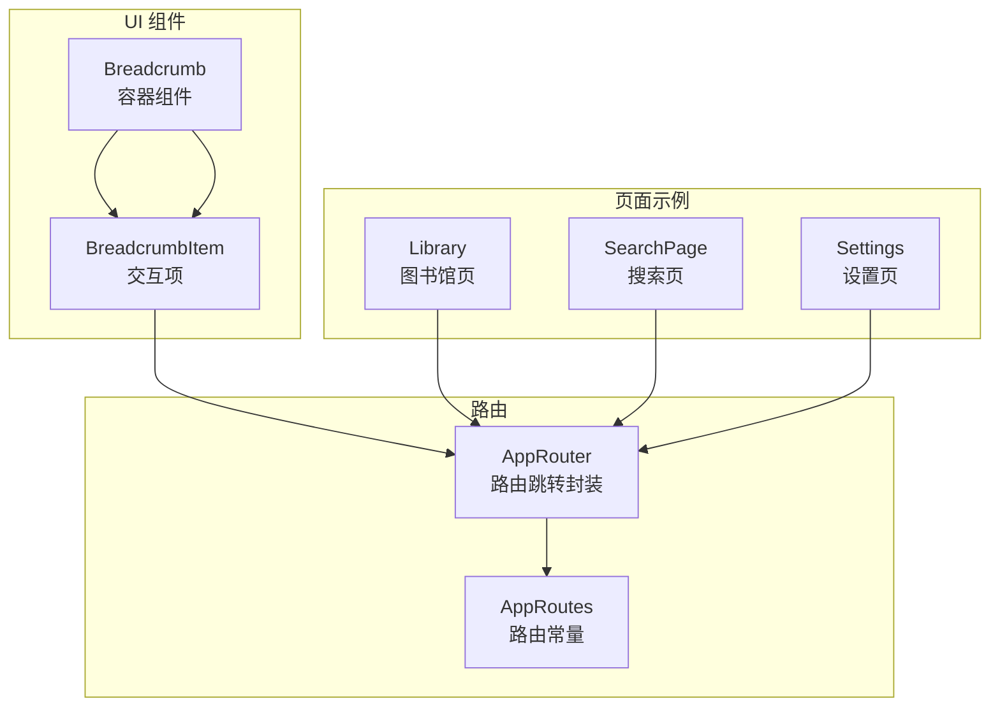
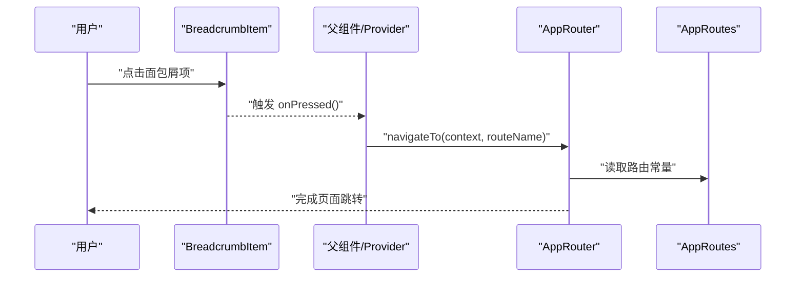
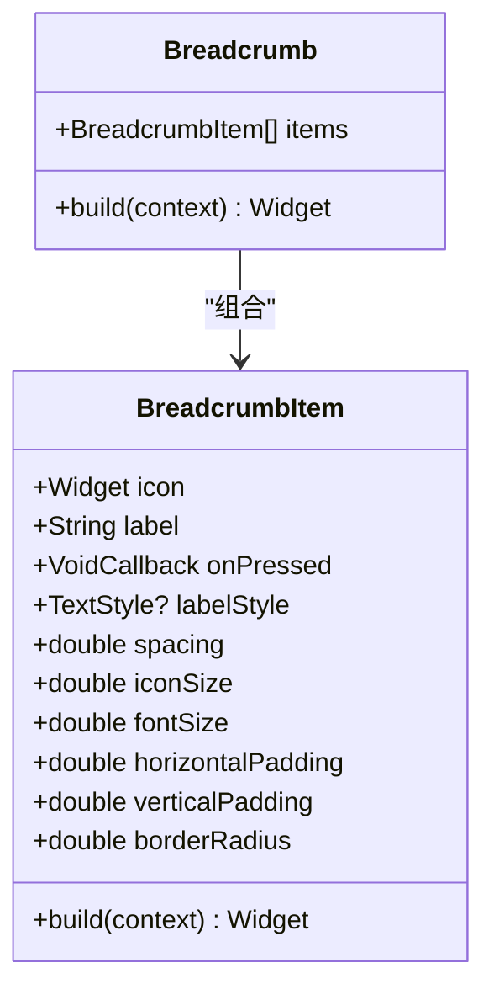
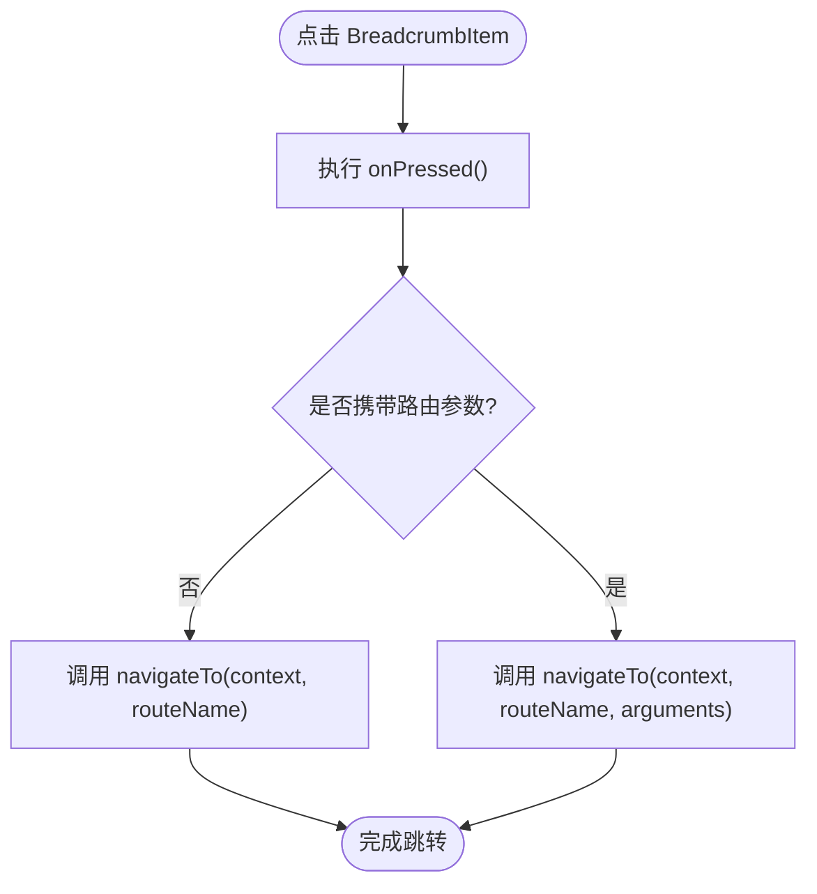
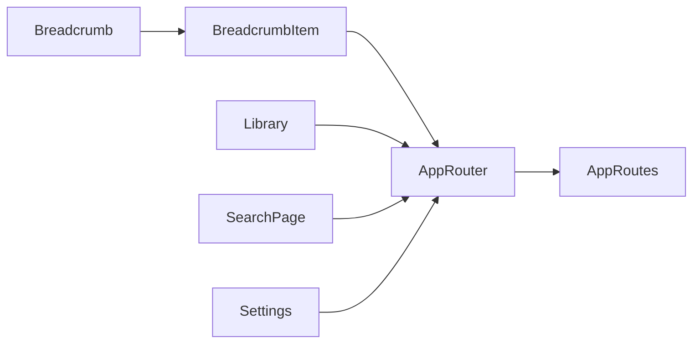

# Breadcrumb 组件

<cite>
**本文引用的文件**
- [breadcrumb.dart](file://lib/presentation/widgets/molecules/breadcrumb/breadcrumb.dart)
- [breadcrumb_item.dart](file://lib/presentation/widgets/molecules/breadcrumb/breadcrumb_item.dart)
- [app_routes.dart](file://lib/core/router/app_routes.dart)
- [app_router.dart](file://lib/core/router/app_router.dart)
- [library.dart](file://lib/presentation/features/library/library.dart)
- [search_page.dart](file://lib/presentation/features/search/search_page.dart)
- [settings.dart](file://lib/presentation/features/settings/settings.dart)
</cite>

## 目录
1. [简介](#简介)
2. [项目结构](#项目结构)
3. [核心组件](#核心组件)
4. [架构总览](#架构总览)
5. [详细组件分析](#详细组件分析)
6. [依赖关系分析](#依赖关系分析)
7. [性能与优化](#性能与优化)
8. [故障排查指南](#故障排查指南)
9. [结论](#结论)
10. [附录：使用示例与最佳实践](#附录使用示例与最佳实践)

## 简介
本文件为 Breadcrumb（面包屑导航）组件的完整技术文档。内容涵盖：
- 层级显示、路径导航与响应式布局策略
- Breadcrumb 与 BreadcrumbItem 的属性配置、样式定制
- 路由集成方式与事件处理
- 移动端适配与触摸优化建议
- 数据绑定机制、状态管理与性能优化策略
- 在不同页面层级中的使用示例与最佳实践

## 项目结构
Breadcrumb 组件位于原子设计分子层，便于在多个功能模块中复用：
- 容器组件：Breadcrumb（水平排列子项）
- 交互项：BreadcrumbItem（图标 + 文字 + 点击反馈）

图表来源
- [breadcrumb.dart:1-16](file://lib/presentation/widgets/molecules/breadcrumb/breadcrumb.dart#L1-L16)
- [breadcrumb_item.dart:1-151](file://lib/presentation/widgets/molecules/breadcrumb/breadcrumb_item.dart#L1-L151)
- [app_routes.dart:1-16](file://lib/core/router/app_routes.dart#L1-L16)
- [app_router.dart:1-187](file://lib/core/router/app_router.dart#L1-L187)

章节来源
- [breadcrumb.dart:1-16](file://lib/presentation/widgets/molecules/breadcrumb/breadcrumb.dart#L1-L16)
- [breadcrumb_item.dart:1-151](file://lib/presentation/widgets/molecules/breadcrumb/breadcrumb_item.dart#L1-L151)
- [app_routes.dart:1-16](file://lib/core/router/app_routes.dart#L1-L16)
- [app_router.dart:1-187](file://lib/core/router/app_router.dart#L1-L187)

## 核心组件
- Breadcrumb
  - 职责：接收一组 BreadcrumbItem，以水平行展示，作为面包屑容器。
  - 关键属性：items（列表），用于渲染每个可点击的面包屑项。
- BreadcrumbItem
  - 职责：单个面包屑项，包含左侧图标、右侧文字、点击回调与悬停/按下视觉反馈。
  - 关键属性：icon、label、onPressed、labelStyle、spacing、iconSize、fontSize、horizontalPadding、verticalPadding、borderRadius。

章节来源
- [breadcrumb.dart:1-16](file://lib/presentation/widgets/molecules/breadcrumb/breadcrumb.dart#L1-L16)
- [breadcrumb_item.dart:1-151](file://lib/presentation/widgets/molecules/breadcrumb/breadcrumb_item.dart#L1-L151)

## 架构总览
Breadcrumb 通过 BreadcrumbItem 暴露 onPressed 回调，由上层页面或 Provider 决定具体行为（如路由跳转）。路由常量集中管理于 AppRoutes，跳转逻辑封装于 AppRouter，保证一致性与可维护性。

图表来源
- [breadcrumb_item.dart:1-151](file://lib/presentation/widgets/molecules/breadcrumb/breadcrumb_item.dart#L1-L151)
- [app_router.dart:134-140](file://lib/core/router/app_router.dart#L134-L140)
- [app_routes.dart:1-16](file://lib/core/router/app_routes.dart#L1-L16)

## 详细组件分析

### Breadcrumb（容器）
- 实现要点
  - 使用 Row 将 items 水平排列，保持简洁与可扩展性。
  - 无内部状态，纯展示型组件，利于复用与测试。
- 扩展点
  - 可在外层包裹 Wrap/SingleChildScrollView 等以实现换行或横向滚动。
  - 可通过主题或外部样式控制间距与分隔符。

章节来源
- [breadcrumb.dart:1-16](file://lib/presentation/widgets/molecules/breadcrumb/breadcrumb.dart#L1-L16)

### BreadcrumbItem（交互项）
- 实现要点
  - 使用 MouseRegion 监听悬停，GestureDetector 处理点击与按下状态。
  - AnimatedContainer 提供背景色过渡动画，提升交互体验。
  - IconTheme 统一图标颜色与尺寸，确保视觉一致性。
- 交互反馈
  - 悬停：背景色变化，鼠标指针变为点击手势。
  - 按下：背景色加深，抬起后恢复。
- 可定制性
  - 文本样式 labelStyle、字号 fontSize、图标大小 iconSize、内边距与圆角均可配置。

图表来源
- [breadcrumb.dart:1-16](file://lib/presentation/widgets/molecules/breadcrumb/breadcrumb.dart#L1-L16)
- [breadcrumb_item.dart:1-151](file://lib/presentation/widgets/molecules/breadcrumb/breadcrumb_item.dart#L1-L151)

章节来源
- [breadcrumb_item.dart:1-151](file://lib/presentation/widgets/molecules/breadcrumb/breadcrumb_item.dart#L1-L151)

### 路由集成与事件处理
- 路由常量
  - AppRoutes 集中定义所有页面路径，避免硬编码字符串。
- 路由跳转
  - AppRouter.navigateTo 封装 Navigator.pushNamed，支持参数传递。
- 事件处理
  - BreadcrumbItem.onPressed 由调用方实现，通常调用 AppRouter.navigateTo 进行跳转。

图表来源
- [app_router.dart:134-140](file://lib/core/router/app_router.dart#L134-L140)
- [app_routes.dart:1-16](file://lib/core/router/app_routes.dart#L1-L16)

章节来源
- [app_router.dart:134-140](file://lib/core/router/app_router.dart#L134-L140)
- [app_routes.dart:1-16](file://lib/core/router/app_routes.dart#L1-L16)

### 响应式布局与移动端适配
- 当前实现
  - Breadcrumb 使用 Row 水平排列，未内置换行或滚动逻辑。
- 推荐方案
  - 外层包裹 SingleChildScrollView(scrollDirection: Axis.horizontal) 实现横向滚动。
  - 或使用 Wrap 自动换行，适应窄屏设备。
  - 针对移动端增大触控区域（padding）、提高点击热区与反馈强度。
  - 结合 MediaQuery 动态调整字体与图标尺寸。

[本节为通用指导，不直接分析具体文件]

### 数据绑定与状态管理
- 数据源
  - 面包屑项可由页面根据当前路由栈或业务上下文动态生成。
- 状态管理
  - 可使用 Riverpod Provider 维护面包屑数据与选中态，配合 ref.watch 更新 UI。
- 示例思路
  - 在 Library/Search/Settings 等页面中，根据当前 Tab/Page 构建 items 列表。

章节来源
- [library.dart:1-417](file://lib/presentation/features/library/library.dart#L1-L417)
- [search_page.dart:1-78](file://lib/presentation/features/search/search_page.dart#L1-L78)
- [settings.dart:1-60](file://lib/presentation/features/settings/settings.dart#L1-L60)

## 依赖关系分析
- 组件内聚
  - Breadcrumb 仅依赖 BreadcrumbItem，职责单一，耦合度低。
- 外部依赖
  - 路由相关依赖集中在 AppRoutes/AppRouter，便于统一维护。
- 潜在循环依赖
  - 组件与路由之间无循环引用，符合单向数据流。

图表来源
- [breadcrumb.dart:1-16](file://lib/presentation/widgets/molecules/breadcrumb/breadcrumb.dart#L1-L16)
- [breadcrumb_item.dart:1-151](file://lib/presentation/widgets/molecules/breadcrumb/breadcrumb_item.dart#L1-L151)
- [app_router.dart:1-187](file://lib/core/router/app_router.dart#L1-L187)
- [app_routes.dart:1-16](file://lib/core/router/app_routes.dart#L1-L16)
- [library.dart:1-417](file://lib/presentation/features/library/library.dart#L1-L417)
- [search_page.dart:1-78](file://lib/presentation/features/search/search_page.dart#L1-L78)
- [settings.dart:1-60](file://lib/presentation/features/settings/settings.dart#L1-L60)

章节来源
- [breadcrumb.dart:1-16](file://lib/presentation/widgets/molecules/breadcrumb/breadcrumb.dart#L1-L16)
- [breadcrumb_item.dart:1-151](file://lib/presentation/widgets/molecules/breadcrumb/breadcrumb_item.dart#L1-L151)
- [app_router.dart:1-187](file://lib/core/router/app_router.dart#L1-L187)
- [app_routes.dart:1-16](file://lib/core/router/app_routes.dart#L1-L16)

## 性能与优化
- 渲染性能
  - Breadcrumb 为无状态容器，开销极低；BreadcrumbItem 使用 AnimatedContainer 仅在状态变化时重绘。
- 交互优化
  - 合理设置 duration 与 Duration.zero，避免不必要的动画开销。
  - 使用 ValueKey/UniqueKey 为列表项稳定标识，减少重建。
- 内存与重建
  - 将 items 列表提升到 Provider 或页面级缓存，避免频繁重建。
  - 对长列表使用 ListView.builder 与分页加载。
- 可访问性
  - 为可点击项添加语义标签（Semantics），提升无障碍体验。

[本节为通用指导，不直接分析具体文件]

## 故障排查指南
- 常见问题
  - 点击无响应：检查 onPressed 是否正确传入并调用。
  - 样式错乱：确认 padding、fontSize、iconSize 与主题冲突。
  - 路由无效：核对 AppRoutes 常量与 AppRouter 路由映射。
- 调试建议
  - 在 onPressed 中打印日志，确认事件链路。
  - 使用 Flutter DevTools 观察 Widget 树与重建次数。
  - 针对移动端，检查触控区域与手势冲突。

章节来源
- [breadcrumb_item.dart:1-151](file://lib/presentation/widgets/molecules/breadcrumb/breadcrumb_item.dart#L1-L151)
- [app_router.dart:134-140](file://lib/core/router/app_router.dart#L134-L140)
- [app_routes.dart:1-16](file://lib/core/router/app_routes.dart#L1-L16)

## 结论
Breadcrumb 与 BreadcrumbItem 提供了轻量、可复用的面包屑导航能力。通过清晰的属性配置与事件回调，可与路由系统无缝集成。建议在容器外层增加横向滚动或换行以适应多端场景，并结合 Provider 管理数据与状态，以获得更好的性能与可维护性。

[本节为总结，不直接分析具体文件]

## 附录：使用示例与最佳实践
- 在 Library 页面中使用
  - 根据当前选中的分类或筛选条件，动态生成面包屑项，点击返回上一级或切换分类。
- 在 Search 页面中使用
  - 展示“首页 > 搜索”等层级，点击“首页”回到主页。
- 在 Settings 页面中使用
  - 展示“设置 > 通用/播放/云同步/缓存”等层级，点击上级返回。

章节来源
- [library.dart:1-417](file://lib/presentation/features/library/library.dart#L1-L417)
- [search_page.dart:1-78](file://lib/presentation/features/search/search_page.dart#L1-L78)
- [settings.dart:1-60](file://lib/presentation/features/settings/settings.dart#L1-L60)