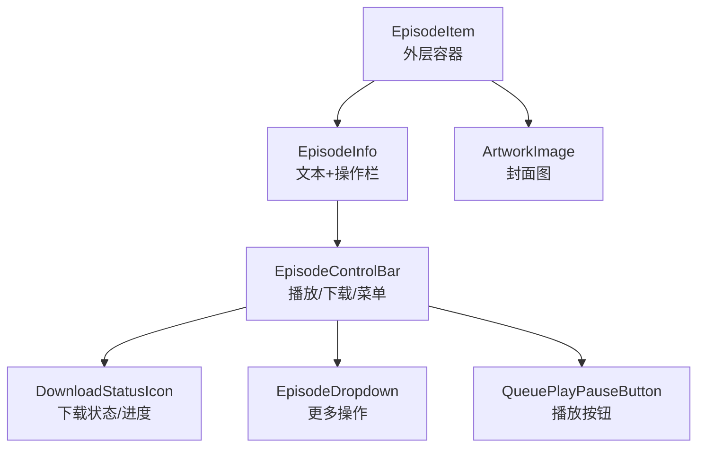
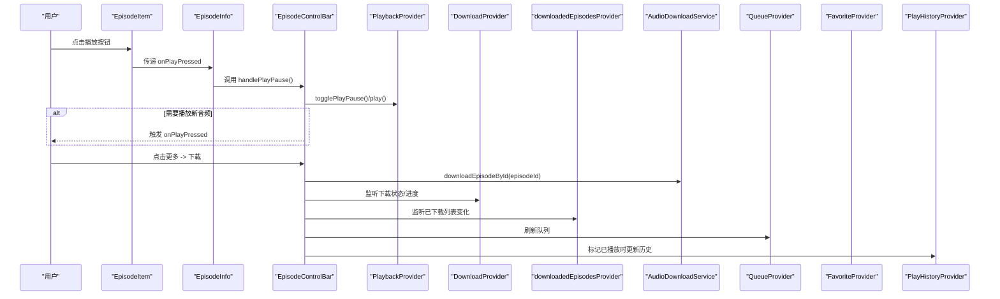
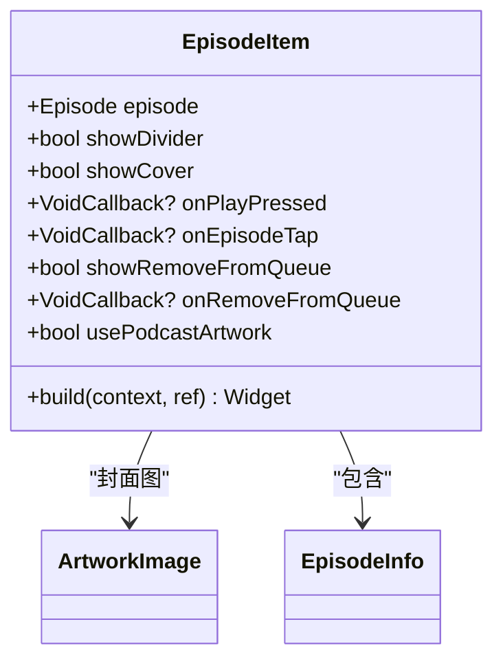
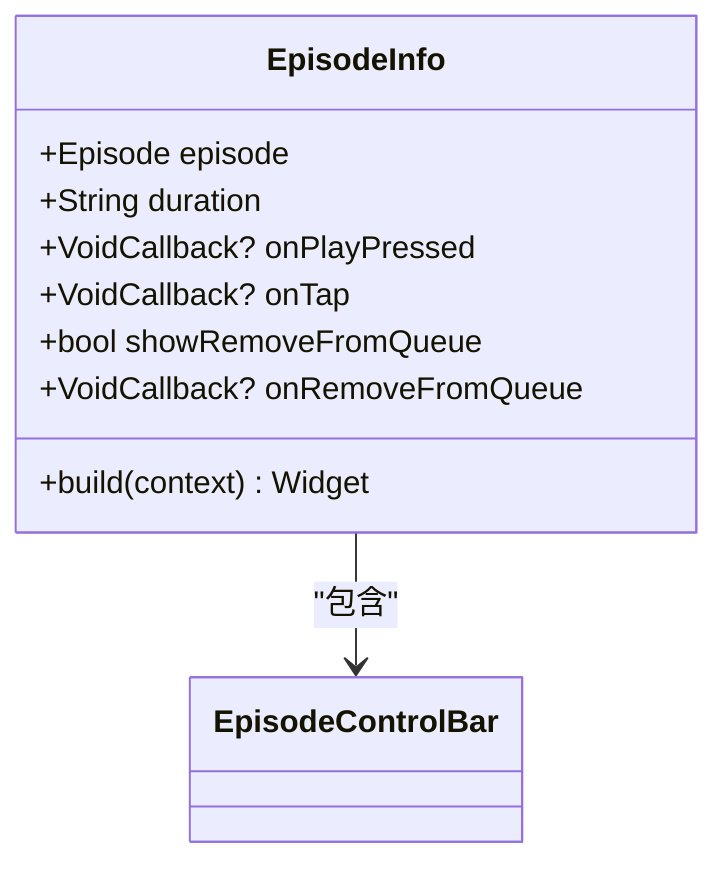
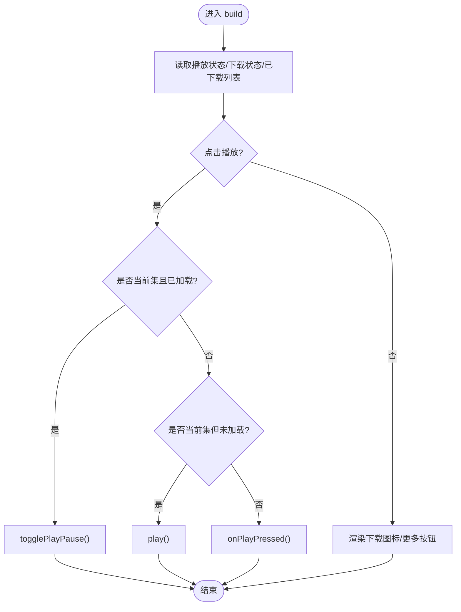
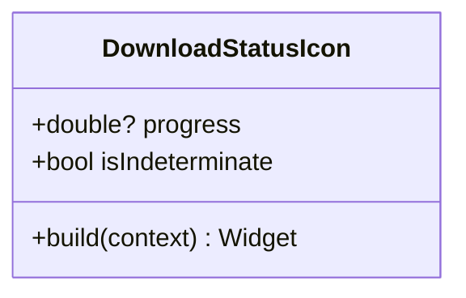
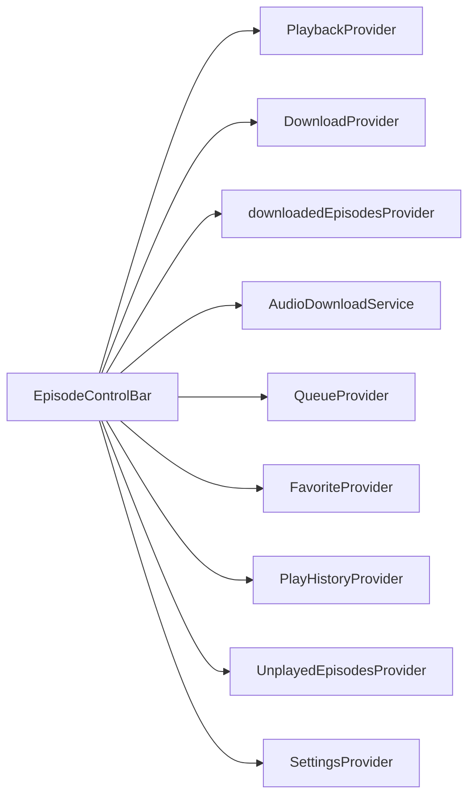

# EpisodeItem 组件

<cite>
**本文引用的文件**   
- [lib/presentation/widgets/molecules/episode_item/episode_item.dart](file://lib/presentation/widgets/molecules/episode_item/episode_item.dart)
- [lib/presentation/widgets/molecules/episode_item/episode_info.dart](file://lib/presentation/widgets/molecules/episode_item/episode_info.dart)
- [lib/presentation/widgets/molecules/episode_item/episode_control_bar.dart](file://lib/presentation/widgets/molecules/episode_item/episode_control_bar.dart)
- [lib/presentation/widgets/molecules/episode_item/download_status_icon.dart](file://lib/presentation/widgets/molecules/episode_item/download_status_icon.dart)
- [lib/domain/entities/episode.dart](file://lib/domain/entities/episode.dart)
- [lib/presentation/providers/playback_provider.dart](file://lib/presentation/providers/playback_provider.dart)
- [lib/presentation/providers/download_provider.dart](file://lib/presentation/providers/download_provider.dart)
- [lib/presentation/features/downloads/downloaded_episodes_provider.dart](file://lib/presentation/features/downloads/downloaded_episodes_provider.dart)
- [lib/data/services/audio_download_service.dart](file://lib/data/services/audio_download_service.dart)
- [lib/presentation/providers/podcast_provider.dart](file://lib/presentation/providers/podcast_provider.dart)
- [lib/presentation/providers/queue_provider.dart](file://lib/presentation/providers/queue_provider.dart)
- [lib/presentation/providers/favorite_provider.dart](file://lib/presentation/providers/favorite_provider.dart)
- [lib/presentation/providers/favorite_episodes_provider.dart](file://lib/presentation/providers/favorite_episodes_provider.dart)
- [lib/presentation/providers/play_history_provider.dart](file://lib/presentation/providers/play_history_provider.dart)
- [lib/presentation/providers/unplayed_episodes_provider.dart](file://lib/presentation/providers/unplayed_episodes_provider.dart)
- [lib/presentation/providers/settings_provider.dart](file://lib/presentation/providers/settings_provider.dart)
- [lib/core/utils/time_formatter.dart](file://lib/core/utils/time_formatter.dart)
- [lib/core/utils/html_tag_remove_utils.dart](file://lib/core/utils/html_tag_remove_utils.dart)
- [lib/presentation/widgets/atoms/artwork_image/artwork_image.dart](file://lib/presentation/widgets/atoms/artwork_image/artwork_image.dart)
- [lib/presentation/widgets/atoms/buttons/queue_play_pause_button.dart](file://lib/presentation/widgets/atoms/buttons/queue_play_pause_button.dart)
- [lib/presentation/widgets/organisms/dropdown/episode_dropdown.dart](file://lib/presentation/widgets/organisms/dropdown/episode_dropdown.dart)
</cite>

## 目录
1. [简介](#简介)
2. [项目结构](#项目结构)
3. [核心组件](#核心组件)
4. [架构总览](#架构总览)
5. [详细组件分析](#详细组件分析)
6. [依赖关系分析](#依赖关系分析)
7. [性能与列表优化](#性能与列表优化)
8. [使用示例与集成指南](#使用示例与集成指南)
9. [故障排查](#故障排查)
10. [结论](#结论)

## 简介
EpisodeItem 组件用于在列表中展示单个剧集项目的完整信息与控制能力，包括：
- 剧集基本信息（标题、发布时间、描述、时长）
- 封面图（优先播客封面，回退到剧集封面）
- 控制栏（播放/暂停、下载状态图标、更多操作菜单）
- 下载状态与进度（已下载、下载中、队列中）
- 播放操作（切换当前集播放、播放新音频、插播、添加到队列）
- 收藏与标记已播放等扩展操作

该组件基于 Riverpod 进行状态管理，与播放服务、下载服务、队列、历史记录、收藏等模块紧密集成，支持实时更新与用户交互。

## 项目结构
EpisodeItem 由多个子组件协同构成：
- EpisodeItem：外层容器，负责封面选择与布局
- EpisodeInfo：文本信息与操作栏的承载者
- EpisodeControlBar：播放控制、下载状态、更多菜单
- DownloadStatusIcon：下载状态与进度指示器

图表来源
- [lib/presentation/widgets/molecules/episode_item/episode_item.dart:30-65](file://lib/presentation/widgets/molecules/episode_item/episode_item.dart#L30-L65)
- [lib/presentation/widgets/molecules/episode_item/episode_info.dart:54-110](file://lib/presentation/widgets/molecules/episode_item/episode_info.dart#L54-L110)
- [lib/presentation/widgets/molecules/episode_item/episode_control_bar.dart:362-481](file://lib/presentation/widgets/molecules/episode_item/episode_control_bar.dart#L362-L481)
- [lib/presentation/widgets/molecules/episode_item/download_status_icon.dart:16-38](file://lib/presentation/widgets/molecules/episode_item/download_status_icon.dart#L16-L38)

章节来源
- [lib/presentation/widgets/molecules/episode_item/episode_item.dart:1-128](file://lib/presentation/widgets/molecules/episode_item/episode_item.dart#L1-L128)
- [lib/presentation/widgets/molecules/episode_item/episode_info.dart:1-112](file://lib/presentation/widgets/molecules/episode_item/episode_info.dart#L1-L112)
- [lib/presentation/widgets/molecules/episode_item/episode_control_bar.dart:1-483](file://lib/presentation/widgets/molecules/episode_item/episode_control_bar.dart#L1-L483)
- [lib/presentation/widgets/molecules/episode_item/download_status_icon.dart:1-39](file://lib/presentation/widgets/molecules/episode_item/download_status_icon.dart#L1-L39)

## 核心组件
- EpisodeItem
  - 职责：组合封面与 EpisodeInfo，根据配置决定是否显示分隔线、封面、移除队列项等
  - 关键属性：episode、showDivider、showCover、onPlayPressed、onEpisodeTap、showRemoveFromQueue、onRemoveFromQueue、usePodcastArtwork
  - 行为：封面优先使用播客封面，否则回退到剧集封面；格式化时长字符串
- EpisodeInfo
  - 职责：展示发布时间、标题、描述，并嵌入 EpisodeControlBar
  - 关键属性：episode、duration、onPlayPressed、onTap、showRemoveFromQueue、onRemoveFromQueue
  - 行为：标题 hover 下划线效果；描述 HTML 标签清理与截断
- EpisodeControlBar
  - 职责：播放/暂停、下载状态与进度、更多菜单（收藏、下载/移除下载、插播、加入队列、标记已播放、复制链接）
  - 关键属性：episodeId、episode、duration、onPlayPressed、link、isDownloaded、showRemoveFromQueue、onRemoveFromQueue
  - 行为：监听播放状态与下载状态，动态渲染下载图标；处理收藏联动下载、标记已播放刷新历史与未播放列表
- DownloadStatusIcon
  - 职责：展示已下载箭头或下载进度圆环
  - 关键属性：progress、isIndeterminate

章节来源
- [lib/presentation/widgets/molecules/episode_item/episode_item.dart:8-28](file://lib/presentation/widgets/molecules/episode_item/episode_item.dart#L8-L28)
- [lib/presentation/widgets/molecules/episode_item/episode_info.dart:13-44](file://lib/presentation/widgets/molecules/episode_item/episode_info.dart#L13-L44)
- [lib/presentation/widgets/molecules/episode_item/episode_control_bar.dart:23-47](file://lib/presentation/widgets/molecules/episode_item/episode_control_bar.dart#L23-L47)
- [lib/presentation/widgets/molecules/episode_item/download_status_icon.dart:4-13](file://lib/presentation/widgets/molecules/episode_item/download_status_icon.dart#L4-L13)

## 架构总览
EpisodeItem 通过 Riverpod 订阅播放、下载、已下载列表、收藏、队列、设置等状态，实现 UI 与业务逻辑解耦。

图表来源
- [lib/presentation/widgets/molecules/episode_item/episode_control_bar.dart:362-481](file://lib/presentation/widgets/molecules/episode_item/episode_control_bar.dart#L362-L481)
- [lib/presentation/providers/playback_provider.dart](file://lib/presentation/providers/playback_provider.dart)
- [lib/presentation/providers/download_provider.dart](file://lib/presentation/providers/download_provider.dart)
- [lib/presentation/features/downloads/downloaded_episodes_provider.dart](file://lib/presentation/features/downloads/downloaded_episodes_provider.dart)
- [lib/data/services/audio_download_service.dart](file://lib/data/services/audio_download_service.dart)
- [lib/presentation/providers/queue_provider.dart](file://lib/presentation/providers/queue_provider.dart)
- [lib/presentation/providers/favorite_provider.dart](file://lib/presentation/providers/favorite_provider.dart)
- [lib/presentation/providers/play_history_provider.dart](file://lib/presentation/providers/play_history_provider.dart)

## 详细组件分析

### EpisodeItem 组件
- 数据绑定
  - 接收 Episode 实体，根据 usePodcastArtwork 决定封面来源
  - 通过 podcastByIdProvider 获取播客封面，失败回退到剧集封面
- 交互处理
  - onPlayPressed 透传给 EpisodeInfo
  - onEpisodeTap 打开详情页
  - showRemoveFromQueue/onRemoveFromQueue 控制“从队列移除”
- 渲染细节
  - 封面尺寸固定，圆角统一
  - 可选分隔线

图表来源
- [lib/presentation/widgets/molecules/episode_item/episode_item.dart:8-28](file://lib/presentation/widgets/molecules/episode_item/episode_item.dart#L8-L28)
- [lib/presentation/widgets/atoms/artwork_image/artwork_image.dart](file://lib/presentation/widgets/atoms/artwork_image/artwork_image.dart)
- [lib/presentation/widgets/molecules/episode_item/episode_info.dart:13-44](file://lib/presentation/widgets/molecules/episode_item/episode_info.dart#L13-L44)

章节来源
- [lib/presentation/widgets/molecules/episode_item/episode_item.dart:30-127](file://lib/presentation/widgets/molecules/episode_item/episode_item.dart#L30-L127)

### EpisodeInfo 组件
- 数据绑定
  - 展示发布时间（TimeFormatter）、标题、HTML 清理后的描述
  - 将 isDownloaded 传递给 EpisodeControlBar
- 交互处理
  - 标题点击回调 onEpisodeTap
  - 播放按钮回调 onPlayPressed
- 渲染细节
  - 标题 hover 下划线效果
  - 描述最多三行，溢出省略

图表来源
- [lib/presentation/widgets/molecules/episode_item/episode_info.dart:13-44](file://lib/presentation/widgets/molecules/episode_item/episode_info.dart#L13-L44)
- [lib/presentation/widgets/molecules/episode_item/episode_control_bar.dart:23-47](file://lib/presentation/widgets/molecules/episode_item/episode_control_bar.dart#L23-L47)

章节来源
- [lib/presentation/widgets/molecules/episode_item/episode_info.dart:46-111](file://lib/presentation/widgets/molecules/episode_item/episode_info.dart#L46-L111)

### EpisodeControlBar 组件
- 数据绑定
  - 监听 playbackProvider 获取当前播放集与播放状态
  - 监听 downloadNotifierProvider 获取下载状态与进度
  - 监听 downloadedEpisodesProvider 动态判断是否已下载
- 交互处理
  - 播放/暂停：若为当前集且音频已加载则切换，否则尝试继续播放或播放新音频
  - 收藏切换：可联动自动下载（受设置控制）
  - 下载/移除下载：调用 AudioDownloadService，完成后刷新相关 Provider
  - 插播/加入队列：调用 QueueProvider
  - 标记已播放：写入 PlayHistory 并刷新未播放列表与历史
- 渲染细节
  - 下载图标：已下载显示箭头，下载中显示进度圆环
  - 更多菜单：Overlay 定位与边界检测

图表来源
- [lib/presentation/widgets/molecules/episode_item/episode_control_bar.dart:362-481](file://lib/presentation/widgets/molecules/episode_item/episode_control_bar.dart#L362-L481)

章节来源
- [lib/presentation/widgets/molecules/episode_item/episode_control_bar.dart:52-481](file://lib/presentation/widgets/molecules/episode_item/episode_control_bar.dart#L52-L481)

### DownloadStatusIcon 组件
- 数据绑定
  - progress 非空或 isIndeterminate 为真时显示进度圆环
  - 否则显示已下载的箭头图标
- 渲染细节
  - 进度圆环尺寸 12x12，strokeWidth=1.5，颜色灰色
  - 已下载图标背景浅灰圆角矩形

图表来源
- [lib/presentation/widgets/molecules/episode_item/download_status_icon.dart:4-13](file://lib/presentation/widgets/molecules/episode_item/download_status_icon.dart#L4-L13)

章节来源
- [lib/presentation/widgets/molecules/episode_item/download_status_icon.dart:16-38](file://lib/presentation/widgets/molecules/episode_item/download_status_icon.dart#L16-L38)

## 依赖关系分析
- 播放服务
  - playbackProvider：提供当前播放集、播放状态、播放控制方法
- 下载服务
  - downloadNotifierProvider：提供各 episode 的下载状态与进度
  - downloadedEpisodesProvider：已下载 episode 列表
  - AudioDownloadService：执行下载、删除下载、批量下载等操作
- 其他服务
  - queueProvider：队列插入、添加、移除
  - favoriteProvider/favoriteEpisodesProvider：收藏切换与刷新
  - playHistoryProvider：播放历史写入与刷新
  - unplayedEpisodesProvider：未播放列表刷新
  - settingsProvider：自动下载开关等设置

图表来源
- [lib/presentation/widgets/molecules/episode_item/episode_control_bar.dart:1-21](file://lib/presentation/widgets/molecules/episode_item/episode_control_bar.dart#L1-L21)

章节来源
- [lib/presentation/widgets/molecules/episode_item/episode_control_bar.dart:1-21](file://lib/presentation/widgets/molecules/episode_item/episode_control_bar.dart#L1-L21)

## 性能与列表优化
- 列表优化建议
  - 使用 ListView.builder 或 SliverList 配合 ItemExtent 减少重建
  - 对封面图使用缓存策略（如 ImageCache 或本地缩略图）
  - 避免在 build 中进行重计算，尽量将格式化结果缓存
- 虚拟滚动支持
  - 长列表建议使用 ListView.builder，按需构建条目
  - 结合 shrinkWrap=false 与物理滚动以获得最佳性能
- 状态更新优化
  - 使用 ConsumerWidget/ConsumerStatefulWidget 精确订阅所需 Provider
  - 避免在高频更新的 Provider（如下载进度）上触发整行重建，必要时拆分小部件或使用 ValueListenableBuilder

[本节为通用指导，不直接分析具体文件]

## 使用示例与集成指南
- 集成音频播放
  - 在 EpisodeItem 的 onPlayPressed 中调用播放服务（如 PlaybackProvider.play），传入 episode 的 audioUrl 与必要元数据
  - 确保播放前检查网络与权限
- 集成下载管理
  - 通过 EpisodeControlBar 的下载/移除下载回调调用 AudioDownloadService.instance.downloadEpisodeById/ deleteDownloadedEpisode
  - 监听 downloadNotifierProvider 与 downloadedEpisodesProvider 以同步 UI
- 状态更新与实时性
  - 下载完成时 invalidate downloadedEpisodesNotifierProvider，并刷新队列与未播放列表
  - 标记已播放后刷新 PlayHistory 与 UnplayedEpisodesProvider
- 用户交互处理
  - 收藏切换后可根据设置自动下载
  - 插播与加入队列通过 QueueProvider 操作
  - 更多菜单中的链接复制、标记已播放等操作均有对应回调

章节来源
- [lib/presentation/widgets/molecules/episode_item/episode_control_bar.dart:176-345](file://lib/presentation/widgets/molecules/episode_item/episode_control_bar.dart#L176-L345)
- [lib/data/services/audio_download_service.dart](file://lib/data/services/audio_download_service.dart)
- [lib/presentation/providers/queue_provider.dart](file://lib/presentation/providers/queue_provider.dart)
- [lib/presentation/providers/favorite_provider.dart](file://lib/presentation/providers/favorite_provider.dart)
- [lib/presentation/providers/play_history_provider.dart](file://lib/presentation/providers/play_history_provider.dart)
- [lib/presentation/providers/unplayed_episodes_provider.dart](file://lib/presentation/providers/unplayed_episodes_provider.dart)

## 故障排查
- 下载状态不同步
  - 检查 downloadNotifierProvider 与 downloadedEpisodesProvider 是否正确监听
  - 确认下载完成后是否 invalidate downloadedEpisodesNotifierProvider
- 播放按钮无响应
  - 校验 isCurrentEpisode 与 isAudioLoaded 条件
  - 确认 onPlayPressed 已正确传递并调用播放服务
- 更多菜单位置异常
  - 检查 Overlay 定位与边界检测逻辑
- Toast 提示未显示
  - 确保 mounted 检查与上下文可用

章节来源
- [lib/presentation/widgets/molecules/episode_item/episode_control_bar.dart:313-345](file://lib/presentation/widgets/molecules/episode_item/episode_control_bar.dart#L313-L345)
- [lib/presentation/widgets/molecules/episode_item/episode_control_bar.dart:362-481](file://lib/presentation/widgets/molecules/episode_item/episode_control_bar.dart#L362-L481)

## 结论
EpisodeItem 组件通过清晰的层次结构与 Riverpod 状态管理，实现了剧集信息的完整展示与丰富的控制能力。其与播放、下载、队列、收藏、历史等服务的集成确保了用户体验的一致性与实时性。在实际使用中，建议遵循列表优化与状态订阅的最佳实践，以获得更流畅的性能表现。