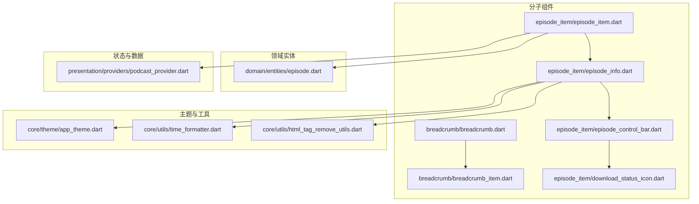
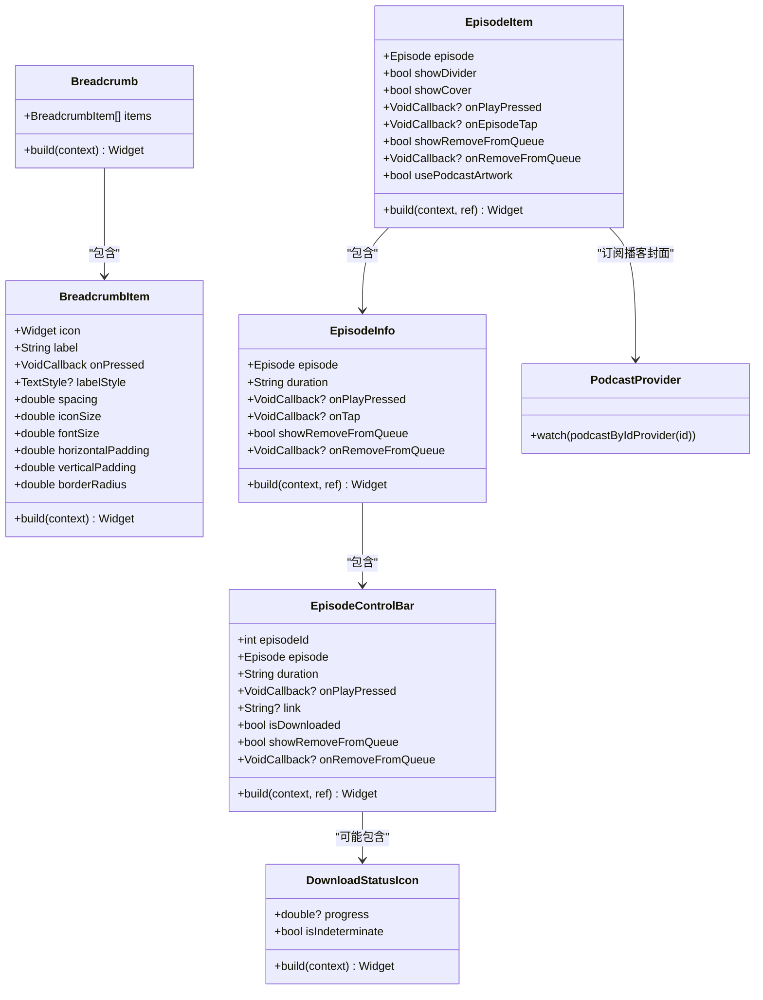
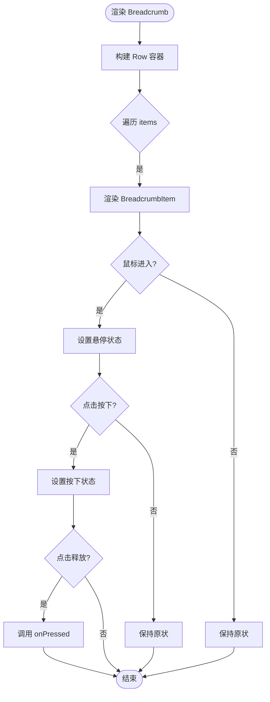
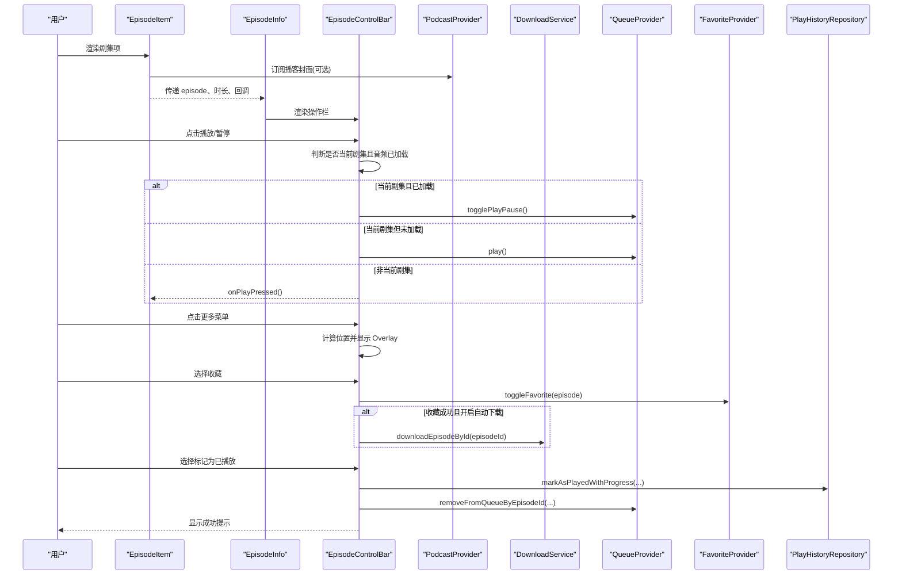
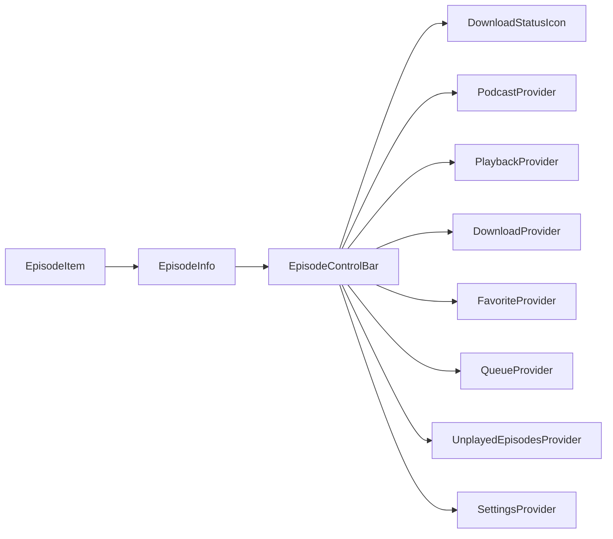

# 分子组件 (Molecules)

<cite>
**本文引用的文件**
- [lib/presentation/widgets/molecules/breadcrumb/breadcrumb.dart](file://lib/presentation/widgets/molecules/breadcrumb/breadcrumb.dart)
- [lib/presentation/widgets/molecules/breadcrumb/breadcrumb_item.dart](file://lib/presentation/widgets/molecules/breadcrumb/breadcrumb_item.dart)
- [lib/presentation/widgets/molecules/episode_item/episode_item.dart](file://lib/presentation/widgets/molecules/episode_item/episode_item.dart)
- [lib/presentation/widgets/molecules/episode_item/episode_info.dart](file://lib/presentation/widgets/molecules/episode_item/episode_info.dart)
- [lib/presentation/widgets/molecules/episode_item/episode_control_bar.dart](file://lib/presentation/widgets/molecules/episode_item/episode_control_bar.dart)
- [lib/presentation/widgets/molecules/episode_item/download_status_icon.dart](file://lib/presentation/widgets/molecules/episode_item/download_status_icon.dart)
- [lib/domain/entities/episode.dart](file://lib/domain/entities/episode.dart)
- [lib/presentation/providers/podcast_provider.dart](file://lib/presentation/providers/podcast_provider.dart)
- [lib/core/utils/time_formatter.dart](file://lib/core/utils/time_formatter.dart)
- [lib/core/utils/html_tag_remove_utils.dart](file://lib/core/utils/html_tag_remove_utils.dart)
- [lib/core/theme/app_theme.dart](file://lib/core/theme/app_theme.dart)
</cite>

## 目录
1. [简介](#简介)
2. [项目结构](#项目结构)
3. [核心组件](#核心组件)
4. [架构总览](#架构总览)
5. [详细组件分析](#详细组件分析)
6. [依赖关系分析](#依赖关系分析)
7. [性能考量](#性能考量)
8. [故障排查指南](#故障排查指南)
9. [结论](#结论)
10. [附录：使用示例与集成指南](#附录使用示例与集成指南)

## 简介
本文件聚焦于 TinyCast 的分子级 UI 组件，围绕由原子组件组合而成的复合组件 Breadcrumb（面包屑导航）与 EpisodeItem（剧集项目），系统阐述其内部结构、数据绑定、用户交互、属性接口、事件处理、状态管理、可定制性与扩展性，并提供完整的使用示例与集成指南，以及性能优化与最佳实践建议。

## 项目结构
分子组件位于 presentation/widgets/molecules 目录下，按功能模块划分：
- breadcrumb：面包屑导航
- episode_item：剧集项目展示与控制

图表来源
- [lib/presentation/widgets/molecules/breadcrumb/breadcrumb.dart:1-16](file://lib/presentation/widgets/molecules/breadcrumb/breadcrumb.dart#L1-L16)
- [lib/presentation/widgets/molecules/breadcrumb/breadcrumb_item.dart:1-151](file://lib/presentation/widgets/molecules/breadcrumb/breadcrumb_item.dart#L1-L151)
- [lib/presentation/widgets/molecules/episode_item/episode_item.dart:1-128](file://lib/presentation/widgets/molecules/episode_item/episode_item.dart#L1-L128)
- [lib/presentation/widgets/molecules/episode_item/episode_info.dart:1-112](file://lib/presentation/widgets/molecules/episode_item/episode_info.dart#L1-L112)
- [lib/presentation/widgets/molecules/episode_item/episode_control_bar.dart:1-483](file://lib/presentation/widgets/molecules/episode_item/episode_control_bar.dart#L1-L483)
- [lib/presentation/widgets/molecules/episode_item/download_status_icon.dart:1-39](file://lib/presentation/widgets/molecules/episode_item/download_status_icon.dart#L1-L39)
- [lib/domain/entities/episode.dart](file://lib/domain/entities/episode.dart)
- [lib/presentation/providers/podcast_provider.dart](file://lib/presentation/providers/podcast_provider.dart)
- [lib/core/theme/app_theme.dart](file://lib/core/theme/app_theme.dart)
- [lib/core/utils/time_formatter.dart](file://lib/core/utils/time_formatter.dart)
- [lib/core/utils/html_tag_remove_utils.dart](file://lib/core/utils/html_tag_remove_utils.dart)

章节来源
- [lib/presentation/widgets/molecules/breadcrumb/breadcrumb.dart:1-16](file://lib/presentation/widgets/molecules/breadcrumb/breadcrumb.dart#L1-L16)
- [lib/presentation/widgets/molecules/breadcrumb/breadcrumb_item.dart:1-151](file://lib/presentation/widgets/molecules/breadcrumb/breadcrumb_item.dart#L1-L151)
- [lib/presentation/widgets/molecules/episode_item/episode_item.dart:1-128](file://lib/presentation/widgets/molecules/episode_item/episode_item.dart#L1-L128)
- [lib/presentation/widgets/molecules/episode_item/episode_info.dart:1-112](file://lib/presentation/widgets/molecules/episode_item/episode_info.dart#L1-L112)
- [lib/presentation/widgets/molecules/episode_item/episode_control_bar.dart:1-483](file://lib/presentation/widgets/molecules/episode_item/episode_control_bar.dart#L1-L483)
- [lib/presentation/widgets/molecules/episode_item/download_status_icon.dart:1-39](file://lib/presentation/widgets/molecules/episode_item/download_status_icon.dart#L1-L39)

## 核心组件
- Breadcrumb（面包屑导航）
  - 作用：以水平行展示一组面包屑项，用于页面层级导航或筛选路径提示。
  - 输入：BreadcrumbItem 列表。
  - 行为：将子项横向排列，无额外布局逻辑。
  - 可定制性：通过 BreadcrumbItem 的属性控制图标、文字、间距、圆角、内边距、字体大小等。

- EpisodeItem（剧集项目）
  - 作用：展示单集信息（封面、标题、描述、时长、操作栏），支持播放、收藏、下载、加入队列、标记已播放等。
  - 输入：Episode 实体及多种布尔开关与回调。
  - 行为：根据 usePodcastArtwork 选择播客或剧集封面；格式化时长；渲染分隔线；委托 EpisodeInfo 显示文本与操作栏。
  - 状态管理：通过 Riverpod 订阅 podcast 状态、下载状态、播放状态、收藏状态、队列状态等。

章节来源
- [lib/presentation/widgets/molecules/breadcrumb/breadcrumb.dart:1-16](file://lib/presentation/widgets/molecules/breadcrumb/breadcrumb.dart#L1-L16)
- [lib/presentation/widgets/molecules/breadcrumb/breadcrumb_item.dart:1-151](file://lib/presentation/widgets/molecules/breadcrumb/breadcrumb_item.dart#L1-L151)
- [lib/presentation/widgets/molecules/episode_item/episode_item.dart:1-128](file://lib/presentation/widgets/molecules/episode_item/episode_item.dart#L1-L128)
- [lib/presentation/widgets/molecules/episode_item/episode_info.dart:1-112](file://lib/presentation/widgets/molecules/episode_item/episode_info.dart#L1-L112)
- [lib/presentation/widgets/molecules/episode_item/episode_control_bar.dart:1-483](file://lib/presentation/widgets/molecules/episode_item/episode_control_bar.dart#L1-L483)
- [lib/presentation/widgets/molecules/episode_item/download_status_icon.dart:1-39](file://lib/presentation/widgets/molecules/episode_item/download_status_icon.dart#L1-L39)

## 架构总览
下图展示了分子组件与其依赖的状态提供者、实体与工具之间的关系。

图表来源
- [lib/presentation/widgets/molecules/breadcrumb/breadcrumb.dart:1-16](file://lib/presentation/widgets/molecules/breadcrumb/breadcrumb.dart#L1-L16)
- [lib/presentation/widgets/molecules/breadcrumb/breadcrumb_item.dart:1-151](file://lib/presentation/widgets/molecules/breadcrumb/breadcrumb_item.dart#L1-L151)
- [lib/presentation/widgets/molecules/episode_item/episode_item.dart:1-128](file://lib/presentation/widgets/molecules/episode_item/episode_item.dart#L1-L128)
- [lib/presentation/widgets/molecules/episode_item/episode_info.dart:1-112](file://lib/presentation/widgets/molecules/episode_item/episode_info.dart#L1-L112)
- [lib/presentation/widgets/molecules/episode_item/episode_control_bar.dart:1-483](file://lib/presentation/widgets/molecules/episode_item/episode_control_bar.dart#L1-L483)
- [lib/presentation/widgets/molecules/episode_item/download_status_icon.dart:1-39](file://lib/presentation/widgets/molecules/episode_item/download_status_icon.dart#L1-L39)
- [lib/presentation/providers/podcast_provider.dart](file://lib/presentation/providers/podcast_provider.dart)

## 详细组件分析

### Breadcrumb（面包屑导航）
- 内部结构
  - Breadcrumb：无状态组件，接收 BreadcrumbItem 列表并横向排列。
  - BreadcrumbItem：有状态组件，维护悬停与按下状态，提供动画背景与内容颜色变化。
- 数据绑定
  - 仅展示型数据：icon、label、样式与尺寸参数。
- 用户交互
  - 鼠标悬停与点击反馈；点击触发 onPressed 回调。
- 属性接口
  - icon、label、onPressed、labelStyle、spacing、iconSize、fontSize、horizontalPadding、verticalPadding、borderRadius。
- 事件处理
  - MouseRegion 监听进入/离开；GestureDetector 监听按下/抬起/取消；AnimatedContainer 驱动背景色过渡。
- 状态管理
  - 本地状态 _isHovering、_isPressed 控制视觉反馈。
- 可定制性与扩展性
  - 通过样式与尺寸参数灵活定制外观；可扩展更多交互态（如禁用态）。

图表来源
- [lib/presentation/widgets/molecules/breadcrumb/breadcrumb.dart:1-16](file://lib/presentation/widgets/molecules/breadcrumb/breadcrumb.dart#L1-L16)
- [lib/presentation/widgets/molecules/breadcrumb/breadcrumb_item.dart:1-151](file://lib/presentation/widgets/molecules/breadcrumb/breadcrumb_item.dart#L1-L151)

章节来源
- [lib/presentation/widgets/molecules/breadcrumb/breadcrumb.dart:1-16](file://lib/presentation/widgets/molecules/breadcrumb/breadcrumb.dart#L1-L16)
- [lib/presentation/widgets/molecules/breadcrumb/breadcrumb_item.dart:1-151](file://lib/presentation/widgets/molecules/breadcrumb/breadcrumb_item.dart#L1-L151)

### EpisodeItem（剧集项目）
- 内部结构
  - EpisodeItem：ConsumerWidget，负责封面选择、时长格式化、分隔线渲染，委托 EpisodeInfo 展示详情与操作。
  - EpisodeInfo：ConsumerStatefulWidget，展示发布时间、标题、描述与 EpisodeControlBar。
  - EpisodeControlBar：复杂交互区，包含播放/暂停、下载状态、更多菜单（收藏、下载、加入队列、插播、标记已播放等）。
  - DownloadStatusIcon：下载进度或完成图标。
- 数据绑定
  - Episode 实体作为核心数据源；通过 podcastProvider 获取播客封面；时间格式化工具与 HTML 清理工具辅助展示。
- 用户交互
  - 播放/暂停切换、打开详情页、收藏切换、下载/移除下载、加入队列/插播、标记已播放、复制链接等。
- 属性接口
  - EpisodeItem：episode、showDivider、showCover、onPlayPressed、onEpisodeTap、showRemoveFromQueue、onRemoveFromQueue、usePodcastArtwork。
  - EpisodeInfo：episode、duration、onPlayPressed、onTap、showRemoveFromQueue、onRemoveFromQueue。
  - EpisodeControlBar：episodeId、episode、duration、onPlayPressed、link、isDownloaded、showRemoveFromQueue、onRemoveFromQueue。
  - DownloadStatusIcon：progress、isIndeterminate。
- 事件处理
  - 播放按钮根据当前播放状态决定切换或开始新音频；更多菜单通过 Overlay 定位显示；收藏联动下载策略；标记已播放更新多 Provider。
- 状态管理
  - 使用 Riverpod 订阅 playbackProvider、downloadNotifierProvider、favoriteProvider、queueNotifierProvider、unplayedEpisodesNotifierProvider、downloadedEpisodesProvider 等。
- 可定制性与扩展性
  - 通过布尔开关控制显示元素；回调函数解耦上层业务；主题与工具类统一风格与格式化。

图表来源
- [lib/presentation/widgets/molecules/episode_item/episode_item.dart:1-128](file://lib/presentation/widgets/molecules/episode_item/episode_item.dart#L1-L128)
- [lib/presentation/widgets/molecules/episode_item/episode_info.dart:1-112](file://lib/presentation/widgets/molecules/episode_item/episode_info.dart#L1-L112)
- [lib/presentation/widgets/molecules/episode_item/episode_control_bar.dart:1-483](file://lib/presentation/widgets/molecules/episode_item/episode_control_bar.dart#L1-L483)
- [lib/presentation/providers/podcast_provider.dart](file://lib/presentation/providers/podcast_provider.dart)

章节来源
- [lib/presentation/widgets/molecules/episode_item/episode_item.dart:1-128](file://lib/presentation/widgets/molecules/episode_item/episode_item.dart#L1-L128)
- [lib/presentation/widgets/molecules/episode_item/episode_info.dart:1-112](file://lib/presentation/widgets/molecules/episode_item/episode_info.dart#L1-L112)
- [lib/presentation/widgets/molecules/episode_item/episode_control_bar.dart:1-483](file://lib/presentation/widgets/molecules/episode_item/episode_control_bar.dart#L1-L483)
- [lib/presentation/widgets/molecules/episode_item/download_status_icon.dart:1-39](file://lib/presentation/widgets/molecules/episode_item/download_status_icon.dart#L1-L39)
- [lib/domain/entities/episode.dart](file://lib/domain/entities/episode.dart)
- [lib/presentation/providers/podcast_provider.dart](file://lib/presentation/providers/podcast_provider.dart)
- [lib/core/utils/time_formatter.dart](file://lib/core/utils/time_formatter.dart)
- [lib/core/utils/html_tag_remove_utils.dart](file://lib/core/utils/html_tag_remove_utils.dart)
- [lib/core/theme/app_theme.dart](file://lib/core/theme/app_theme.dart)

## 依赖关系分析
- 组件耦合
  - EpisodeItem 与 EpisodeInfo、EpisodeControlBar 强耦合（父子关系），但通过回调与布尔开关降低对外部逻辑的依赖。
  - EpisodeControlBar 依赖多个 Provider（播放、下载、收藏、队列、未播放列表、设置），属于“聚合层”，承担协调职责。
- 外部依赖
  - Riverpod 状态管理；Lucide 图标库；AudioDownloadService 下载服务；ToastUtils 提示工具；TimeFormatter、HtmlTagRemoveUtils、AppTheme 工具与主题。
- 潜在循环依赖
  - 组件之间单向依赖，未见循环导入；Provider 与 Repository 在更高层解耦。

图表来源
- [lib/presentation/widgets/molecules/episode_item/episode_item.dart:1-128](file://lib/presentation/widgets/molecules/episode_item/episode_item.dart#L1-L128)
- [lib/presentation/widgets/molecules/episode_item/episode_info.dart:1-112](file://lib/presentation/widgets/molecules/episode_item/episode_info.dart#L1-L112)
- [lib/presentation/widgets/molecules/episode_item/episode_control_bar.dart:1-483](file://lib/presentation/widgets/molecules/episode_item/episode_control_bar.dart#L1-L483)

章节来源
- [lib/presentation/widgets/molecules/episode_item/episode_control_bar.dart:1-483](file://lib/presentation/widgets/molecules/episode_item/episode_control_bar.dart#L1-L483)

## 性能考量
- 渲染优化
  - Breadcrumb 使用 StatelessWidget，避免不必要的重建。
  - EpisodeItem 使用 ConsumerWidget，按需订阅最小化状态变更范围。
  - EpisodeInfo 与 EpisodeControlBar 使用 ConsumerStatefulWidget，仅在相关 Provider 变化时重建。
- 状态订阅
  - 合理拆分订阅点，避免在单个组件中订阅过多全局状态导致频繁重建。
  - 使用 ref.listen 监听特定状态变化（如下载完成）进行局部刷新。
- 布局与绘制
  - 使用 SizedBox、Spacer 控制间距，减少嵌套层级。
  - 图片加载使用占位图与缓存策略（ArtworkImage），避免闪烁。
- 交互反馈
  - 使用 AnimatedContainer 实现平滑过渡，注意 duration 设置避免过度重绘。
- 内存管理
  - OverlayEntry 在 dispose 时正确移除，防止泄漏。

[本节为通用指导，不直接分析具体文件]

## 故障排查指南
- 播放按钮无效
  - 检查是否为当前剧集且音频已加载；确认 playbackProvider 状态与 currentEpisode 匹配。
  - 参考：播放/暂停逻辑与日志输出。
- 下载状态不同步
  - 确保 downloadedEpisodesProvider 被刷新；监听下载完成事件后刷新相关 Provider。
- 收藏后未自动下载
  - 检查 settingsProvider 中的下载偏好；确认已下载列表不包含该剧集。
- 标记已播放失败
  - 检查 PlayHistoryRepository 写入是否成功；确认后续刷新 completedHistoriesProvider 与 unplayedEpisodesNotifierProvider。
- 下拉菜单位置异常
  - 检查 RenderBox 坐标计算与屏幕边界检测；确认 Overlay 插入时机。

章节来源
- [lib/presentation/widgets/molecules/episode_item/episode_control_bar.dart:1-483](file://lib/presentation/widgets/molecules/episode_item/episode_control_bar.dart#L1-L483)

## 结论
Breadcrumb 与 EpisodeItem 作为分子组件，分别承担导航与剧集展示/控制职责。二者通过清晰的属性接口与回调机制与上层页面解耦，借助 Riverpod 实现细粒度状态管理，具备良好的可定制性与扩展性。遵循本文的性能优化与最佳实践，可在保证用户体验的同时提升稳定性与可维护性。

[本节为总结性内容，不直接分析具体文件]

## 附录：使用示例与集成指南
- Breadcrumb 使用
  - 构造 Breadcrumb 并传入 BreadcrumbItem 列表；每个项配置 icon、label、onPressed 与样式参数。
  - 适用于多级导航或筛选路径展示。
- EpisodeItem 使用
  - 传入 Episode 实体与必要的布尔开关；根据需要设置 onPlayPressed、onEpisodeTap、showRemoveFromQueue、onRemoveFromQueue、usePodcastArtwork。
  - 在上层页面中处理回调，例如跳转详情页、启动播放、从队列移除等。
- 集成要点
  - 确保 Provider 已在应用根节点注入（Riverpod）。
  - 主题与工具类需可用（AppTheme、TimeFormatter、HtmlTagRemoveUtils）。
  - 下载服务与 Toast 工具需在运行时可用。

[本节为概念性说明，不直接分析具体文件]