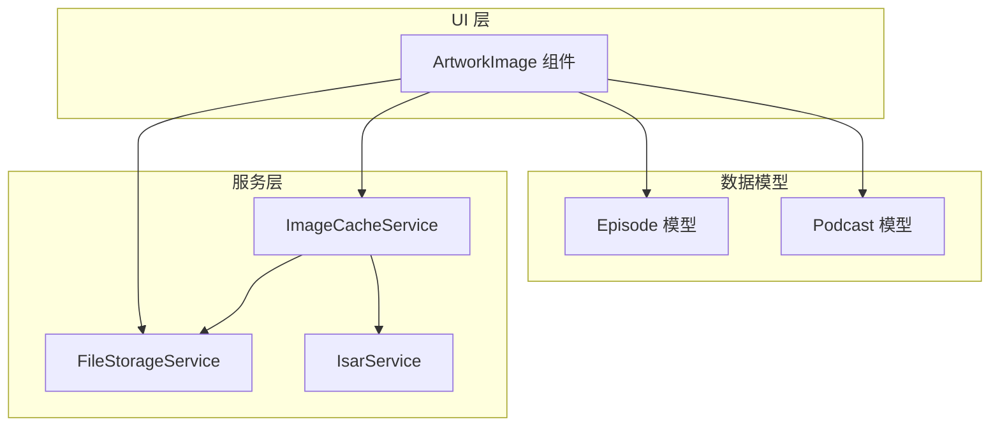
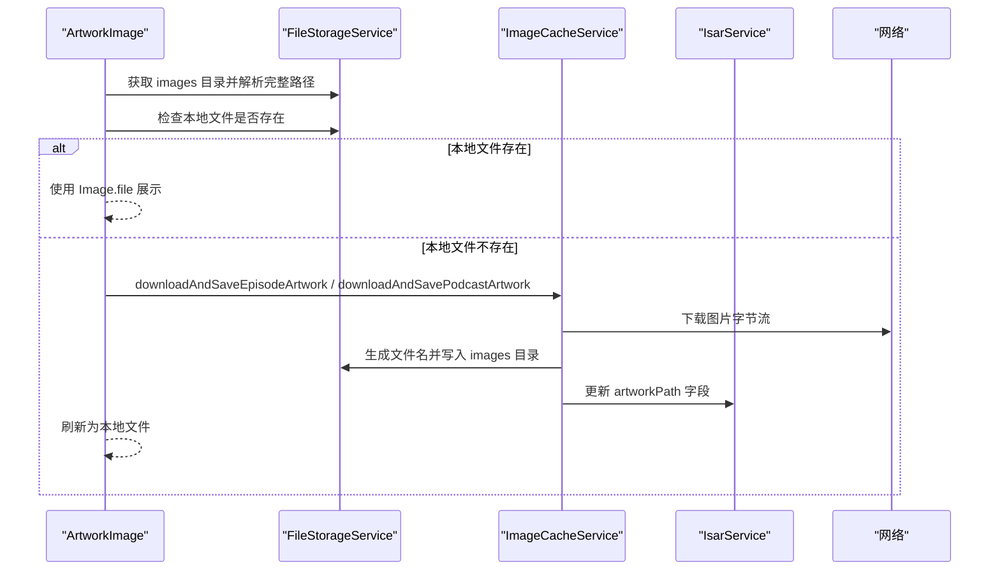
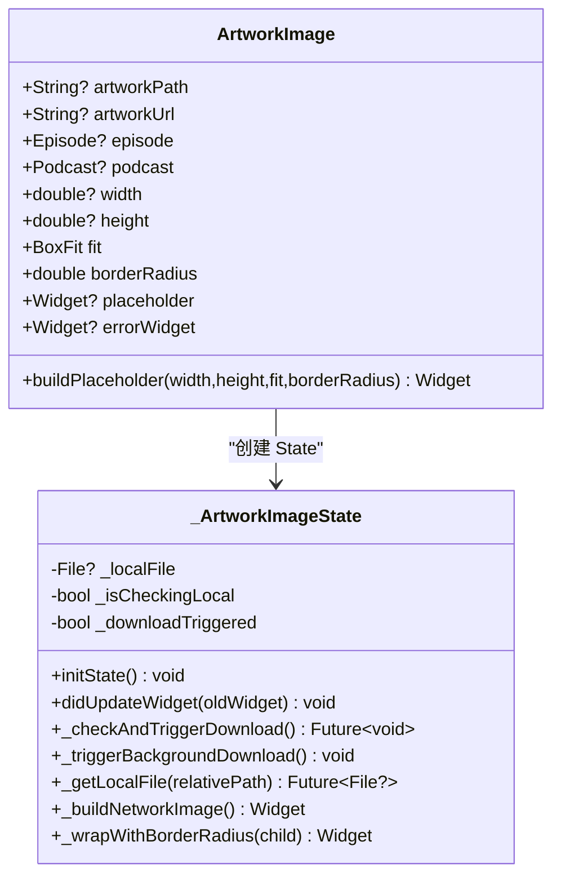
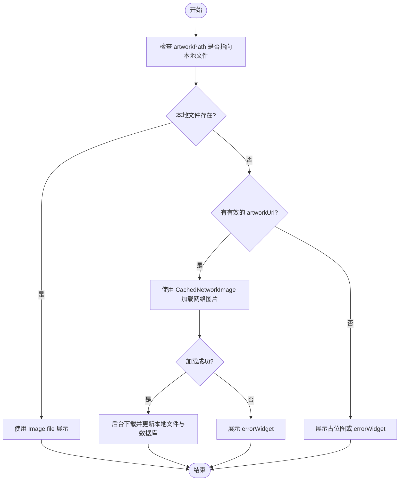
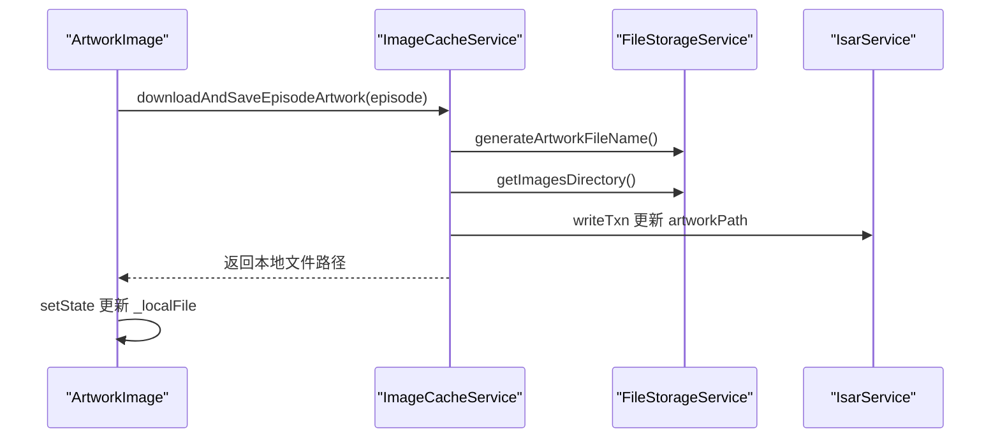
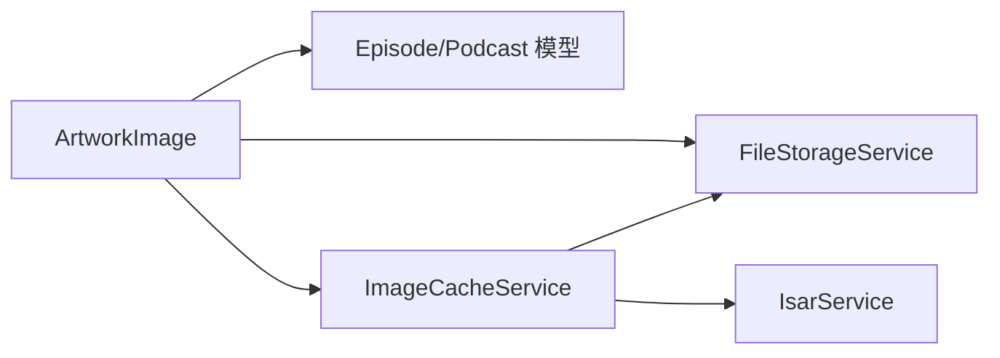

# ArtworkImage 组件

<cite>
**本文引用的文件**
- [artwork_image.dart](file://lib/presentation/widgets/atoms/artwork_image/artwork_image.dart)
- [artwork_image_test.dart](file://test/presentation/widgets/atoms/artwork_image_test.dart)
- [image_cache_service.dart](file://lib/data/services/image_cache_service.dart)
- [file_storage_service.dart](file://lib/data/services/file_storage_service.dart)
- [episode_model.dart](file://lib/data/models/episode_model.dart)
- [podcast_model.dart](file://lib/data/models/podcast_model.dart)
- [artwork_image.md](file://test/docs/lib/Presentation/widgets/atoms/artwork_image.md)
</cite>

## 目录
1. [简介](#简介)
2. [项目结构](#项目结构)
3. [核心组件](#核心组件)
4. [架构总览](#架构总览)
5. [详细组件分析](#详细组件分析)
6. [依赖关系分析](#依赖关系分析)
7. [性能与内存管理](#性能与内存管理)
8. [主题适配与深色模式](#主题适配与深色模式)
9. [使用示例](#使用示例)
10. [故障排查指南](#故障排查指南)
11. [结论](#结论)

## 简介
ArtworkImage 是用于展示播客或单集封面图的原子级 UI 组件。它实现了“本地优先”的图片加载策略：优先从本地缓存文件加载，不存在时回退到网络图片，并支持占位图与错误态展示；同时具备后台下载与持久化能力，将网络图片保存到本地并在数据库中记录路径，从而提升离线可用性与加载速度。

## 项目结构
- 组件实现位于 presentation 层，封装了本地文件检查、网络加载、占位与错误处理、圆角裁剪等 UI 逻辑。
- 数据模型（Episode、Podcast）包含 artworkPath 字段，用于存储本地相对路径。
- 服务层提供文件存储与图片缓存能力，负责下载、保存、路径生成与数据库更新。

**图表来源**
- [artwork_image.dart:14-91](file://lib/presentation/widgets/atoms/artwork_image/artwork_image.dart#L14-L91)
- [episode_model.dart:33-44](file://lib/data/models/episode_model.dart#L33-L44)
- [podcast_model.dart:20-55](file://lib/data/models/podcast_model.dart#L20-L55)
- [file_storage_service.dart:96-124](file://lib/data/services/file_storage_service.dart#L96-L124)
- [image_cache_service.dart:122-223](file://lib/data/services/image_cache_service.dart#L122-L223)

**章节来源**
- [artwork_image.dart:14-91](file://lib/presentation/widgets/atoms/artwork_image/artwork_image.dart#L14-L91)
- [artwork_image.md:1-193](file://test/docs/lib/Presentation/widgets/atoms/artwork_image.md#L1-L193)

## 核心组件
- 构造函数与工厂构造
  - 默认构造函数：直接传入 artworkPath、artworkUrl 等参数。
  - fromEpisode：从 Episode 实体自动提取 artworkPath 与 artworkUrl。
  - fromPodcast：从 Podcast 实体自动提取 artworkPath 与 artworkUrl。
- 关键属性
  - artworkPath：本地相对路径，优先级最高。
  - artworkUrl：网络图片 URL。
  - episode/podcast：用于后台下载与数据库更新。
  - width/height/fit：尺寸与填充模式。
  - borderRadius：圆角半径，大于 0 时使用 ClipRRect 包裹。
  - placeholder/errorWidget：自定义加载中与失败态组件。
- 静态方法
  - buildPlaceholder：构建可复用的占位图 Widget，支持尺寸、填充与圆角。

**章节来源**
- [artwork_image.dart:28-87](file://lib/presentation/widgets/atoms/artwork_image/artwork_image.dart#L28-L87)
- [artwork_image.md:28-42](file://test/docs/lib/Presentation/widgets/atoms/artwork_image.md#L28-L42)

## 架构总览
ArtworkImage 通过“本地优先 + 网络回退 + 后台缓存”的三级策略保障显示体验与性能：
- 首次渲染：检查本地文件是否存在，存在则直接展示；否则进入网络加载流程。
- 网络加载：使用 CachedNetworkImage 进行加载，支持自定义 placeholder 与 errorWidget。
- 后台下载：在合适时机触发下载并保存到本地，更新数据库中的 artworkPath，以便后续优先本地加载。

**图表来源**
- [artwork_image.dart:145-234](file://lib/presentation/widgets/atoms/artwork_image/artwork_image.dart#L145-L234)
- [image_cache_service.dart:122-223](file://lib/data/services/image_cache_service.dart#L122-L223)
- [file_storage_service.dart:288-320](file://lib/data/services/file_storage_service.dart#L288-L320)

## 详细组件分析

### 组件类与状态管理
- State 变量
  - _localFile：当前本地文件引用。
  - _isCheckingLocal：并发保护标志，防止重复检查本地文件。
  - _downloadTriggered：防重复下载标志，确保同一实例仅触发一次后台下载。
- 生命周期
  - initState：初始化后执行本地检查与可能的后台下载。
  - didUpdateWidget：当 artworkPath 或 artworkUrl 变化时重置状态并重新检查。
- 渲染逻辑
  - 优先使用 Image.file 展示本地文件。
  - 本地失败或不存在时，使用 CachedNetworkImage 加载网络图片。
  - 无有效 URL 或网络失败时，展示占位图或自定义 errorWidget。
  - 所有输出均支持 borderRadius 裁剪。

**图表来源**
- [artwork_image.dart:14-91](file://lib/presentation/widgets/atoms/artwork_image/artwork_image.dart#L14-L91)
- [artwork_image.dart:93-113](file://lib/presentation/widgets/atoms/artwork_image/artwork_image.dart#L93-L113)
- [artwork_image.dart:145-234](file://lib/presentation/widgets/atoms/artwork_image/artwork_image.dart#L145-L234)

**章节来源**
- [artwork_image.dart:93-113](file://lib/presentation/widgets/atoms/artwork_image/artwork_image.dart#L93-L113)
- [artwork_image.dart:145-234](file://lib/presentation/widgets/atoms/artwork_image/artwork_image.dart#L145-L234)
- [artwork_image.dart:237-275](file://lib/presentation/widgets/atoms/artwork_image/artwork_image.dart#L237-L275)

### 图片加载优先级流程图

**图表来源**
- [artwork_image.dart:237-275](file://lib/presentation/widgets/atoms/artwork_image/artwork_image.dart#L237-L275)
- [artwork_image.md:115-144](file://test/docs/lib/Presentation/widgets/atoms/artwork_image.md#L115-L144)

**章节来源**
- [artwork_image.md:115-144](file://test/docs/lib/Presentation/widgets/atoms/artwork_image.md#L115-L144)

### 后台下载与缓存流程
- 触发条件：本地文件不存在且存在有效的 artworkUrl。
- 下载目标：根据传入的 episode 或 podcast 对象选择对应下载方法。
- 保存策略：使用 UUID v4 生成文件名，保存到 images 目录。
- 数据库更新：成功后更新 artworkPath 字段，便于下次优先本地加载。
- 并发保护：_downloadTriggered 防止重复触发；_isCheckingLocal 防止并发检查。

**图表来源**
- [image_cache_service.dart:122-223](file://lib/data/services/image_cache_service.dart#L122-L223)
- [file_storage_service.dart:288-320](file://lib/data/services/file_storage_service.dart#L288-L320)
- [artwork_image.dart:180-234](file://lib/presentation/widgets/atoms/artwork_image/artwork_image.dart#L180-L234)

**章节来源**
- [image_cache_service.dart:122-223](file://lib/data/services/image_cache_service.dart#L122-L223)
- [file_storage_service.dart:288-320](file://lib/data/services/file_storage_service.dart#L288-L320)
- [artwork_image.dart:180-234](file://lib/presentation/widgets/atoms/artwork_image/artwork_image.dart#L180-L234)

### 占位符与错误处理
- 默认占位图：SVG 资源 image_placeholder.svg。
- 自定义占位图：placeholder 参数覆盖加载中显示。
- 错误态：errorWidget 参数覆盖失败显示。
- 无有效 URL：直接展示占位图或自定义 errorWidget。

**章节来源**
- [artwork_image.dart:115-133](file://lib/presentation/widgets/atoms/artwork_image/artwork_image.dart#L115-L133)
- [artwork_image.dart:254-275](file://lib/presentation/widgets/atoms/artwork_image/artwork_image.dart#L254-L275)

### 圆角裁剪与尺寸控制
- borderRadius > 0：使用 ClipRRect 包裹输出内容（包括网络图片、本地文件与占位图）。
- width/height/fit：统一传递给底层 Image/CachedNetworkImage/SvgPicture。

**章节来源**
- [artwork_image.dart:135-143](file://lib/presentation/widgets/atoms/artwork_image/artwork_image.dart#L135-L143)
- [artwork_image.dart:68-87](file://lib/presentation/widgets/atoms/artwork_image/artwork_image.dart#L68-L87)

## 依赖关系分析
- 组件依赖
  - Flutter 基础库：Material、SvgPicture、CachedNetworkImage。
  - 领域模型：Episode、Podcast（含 artworkPath 与 artworkUrl）。
  - 服务层：FileStorageService（路径与文件名）、ImageCacheService（下载与缓存）、IsarService（数据库事务）。
- 耦合与内聚
  - ArtworkImage 高内聚地封装了 UI 与加载策略，低耦合地依赖服务接口。
  - 服务层职责清晰：文件存储、网络下载、数据库更新分离。

**图表来源**
- [artwork_image.dart:1-13](file://lib/presentation/widgets/atoms/artwork_image/artwork_image.dart#L1-L13)
- [episode_model.dart:33-44](file://lib/data/models/episode_model.dart#L33-L44)
- [podcast_model.dart:20-55](file://lib/data/models/podcast_model.dart#L20-L55)
- [file_storage_service.dart:96-124](file://lib/data/services/file_storage_service.dart#L96-L124)
- [image_cache_service.dart:10-20](file://lib/data/services/image_cache_service.dart#L10-L20)

**章节来源**
- [artwork_image.dart:1-13](file://lib/presentation/widgets/atoms/artwork_image/artwork_image.dart#L1-L13)
- [file_storage_service.dart:96-124](file://lib/data/services/file_storage_service.dart#L96-L124)
- [image_cache_service.dart:10-20](file://lib/data/services/image_cache_service.dart#L10-L20)

## 性能与内存管理
- 本地优先减少网络请求与解码开销。
- 使用 CachedNetworkImage 内置缓存机制，避免重复下载。
- 后台下载不阻塞 UI，使用 Future.microtask 异步执行。
- 并发保护避免重复检查与下载，降低 CPU 与 I/O 压力。
- 建议优化
  - 合理设置 width/height，避免大图解码导致内存峰值。
  - 列表中使用缩略图尺寸，详情页面再加载大图。
  - 定期清理缓存目录，释放磁盘空间。

[本节为通用指导，无需源码引用]

## 主题适配与深色模式
- 占位图与错误态使用 SVG 资源，可通过主题颜色或样式进行适配。
- 建议在 placeholder/errorWidget 中结合 Theme.of(context) 动态选择颜色或背景。
- 圆角与尺寸不受主题影响，但可在上层容器应用主题色边框或阴影。

[本节为通用指导，无需源码引用]

## 使用示例
- 网络图片
  - 传入 artworkUrl，组件将使用 CachedNetworkImage 加载，支持 placeholder 与 errorWidget。
- 本地资源
  - 若已存在 artworkPath 且文件存在，组件将直接使用 Image.file 展示。
- 从实体构造
  - fromEpisode/fromPodcast：自动提取 artworkPath 与 artworkUrl，适合列表项快速绑定。
- 占位图复用
  - 使用 ArtworkImage.buildPlaceholder 构建骨架屏或统一占位组件。

**章节来源**
- [artwork_image.dart:28-87](file://lib/presentation/widgets/atoms/artwork_image/artwork_image.dart#L28-L87)
- [artwork_image.md:145-164](file://test/docs/lib/Presentation/widgets/atoms/artwork_image.md#L145-L164)

## 故障排查指南
- 常见问题
  - 本地文件路径无效：检查 FileStorageService.getFullFilePath 是否正确拼接。
  - 网络加载失败：确认 artworkUrl 有效，查看网络状态与服务器响应码。
  - 重复下载：检查 _downloadTriggered 是否被正确重置与判断。
  - 数据库更新失败：确认 IsarService 事务正常，日志中查看具体异常。
- 调试建议
  - 启用详细日志，关注下载耗时、文件大小与状态码。
  - 在 didUpdateWidget 中验证属性变化是否触发状态重置。
  - 使用测试用例验证不同场景下的渲染结果。

**章节来源**
- [artwork_image.dart:145-234](file://lib/presentation/widgets/atoms/artwork_image/artwork_image.dart#L145-L234)
- [image_cache_service.dart:199-223](file://lib/data/services/image_cache_service.dart#L199-L223)
- [artwork_image_test.dart:672-797](file://test/presentation/widgets/atoms/artwork_image_test.dart#L672-L797)

## 结论
ArtworkImage 组件以“本地优先”为核心策略，结合网络回退与后台缓存，提供了稳定高效的封面图展示能力。其清晰的属性设计、完善的错误处理与良好的性能优化，使其成为播客与单集封面展示的理想选择。通过合理的尺寸控制与主题适配，可进一步提升用户体验与系统稳定性。