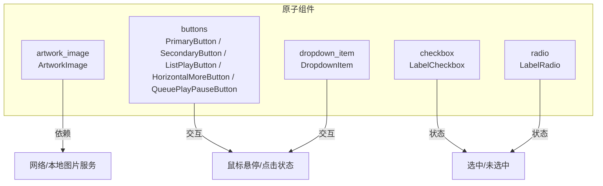
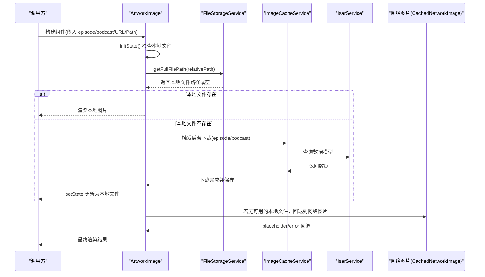
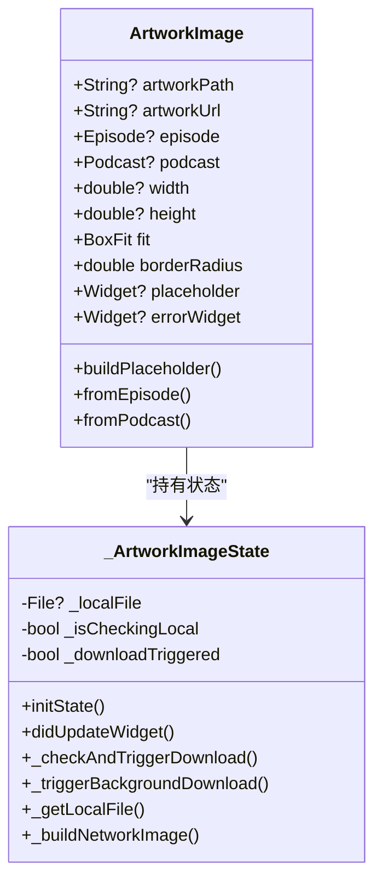
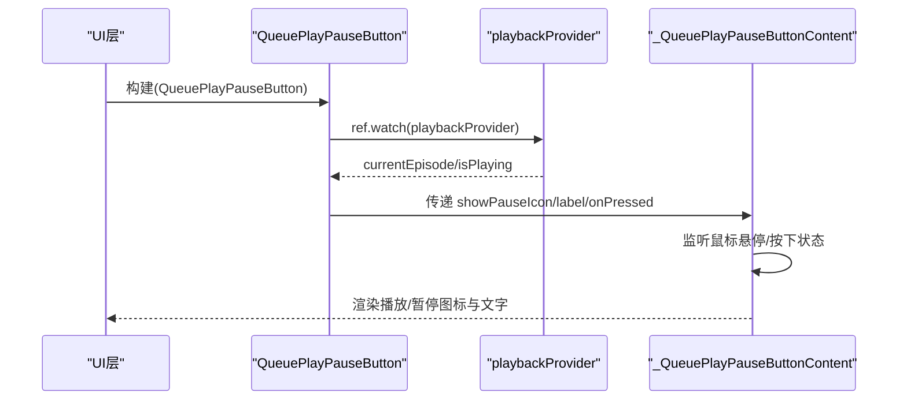
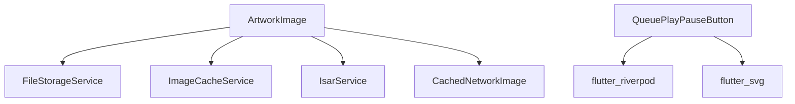

# 原子组件 (Atoms)

<cite>
**本文引用的文件**
- [artwork_image.dart](file://lib/presentation/widgets/atoms/artwork_image/artwork_image.dart)
- [primary_button.dart](file://lib/presentation/widgets/atoms/buttons/primary_button.dart)
- [secondary_button.dart](file://lib/presentation/widgets/atoms/buttons/secondary_button.dart)
- [list_play_button.dart](file://lib/presentation/features/library/library_episode_item/library_episode_play_button.dart)
- [horizontal_more_button.dart](file://lib/presentation/widgets/atoms/buttons/horizontal_more_button.dart)
- [queue_play_pause_button.dart](file://lib/presentation/widgets/atoms/buttons/queue_play_pause_button.dart)
- [label_checkbox.dart](file://lib/presentation/widgets/atoms/checkbox/label_checkbox.dart)
- [label_radio.dart](file://lib/presentation/widgets/atoms/radio/label_radio.dart)
- [dropdown_item.dart](file://lib/presentation/widgets/atoms/dropdown_item/dropdown_item.dart)
</cite>

## 目录
1. [简介](#简介)
2. [项目结构](#项目结构)
3. [核心组件](#核心组件)
4. [架构总览](#架构总览)
5. [详细组件分析](#详细组件分析)
6. [依赖分析](#依赖分析)
7. [性能考虑](#性能考虑)
8. [故障排查指南](#故障排查指南)
9. [结论](#结论)
10. [附录：使用示例与最佳实践](#附录使用示例与最佳实践)

## 简介
本文件为 TinyCast 的原子组件（Atoms）提供系统化文档，覆盖以下基础组件：封面图片 ArtworkImage、多种按钮（PrimaryButton、SecondaryButton、ListPlayButton、HorizontalMoreButton、QueuePlayPauseButton）、选择器（LabelCheckbox、LabelRadio）以及下拉项 DropdownItem。文档包含每个组件的功能说明、属性（props）、事件回调、样式定制选项、状态管理、错误处理与加载状态、无障碍支持与响应式设计建议，并提供完整的使用示例路径以便快速上手。

## 项目结构
原子组件统一位于 presentation/widgets/atoms 目录下，按功能划分子目录：
- artwork_image：封面图展示与本地缓存策略
- buttons：各类按钮（主按钮、次按钮、列表播放按钮、更多操作按钮、队列播放暂停按钮）
- checkbox：复选框 LabelCheckbox
- radio：单选框 LabelRadio
- dropdown_item：下拉菜单项 DropdownItem

图表来源
- [artwork_image.dart:1-291](file://lib/presentation/widgets/atoms/artwork_image/artwork_image.dart#L1-L291)
- [primary_button.dart:1-128](file://lib/presentation/widgets/atoms/buttons/primary_button.dart#L1-L128)
- [secondary_button.dart:1-133](file://lib/presentation/widgets/atoms/buttons/secondary_button.dart#L1-L133)
- [list_play_button.dart:1-151](file://lib/presentation/features/library/library_episode_item/library_episode_play_button.dart#L1-L151)
- [horizontal_more_button.dart:1-82](file://lib/presentation/widgets/atoms/buttons/horizontal_more_button.dart#L1-L82)
- [queue_play_pause_button.dart:1-116](file://lib/presentation/widgets/atoms/buttons/queue_play_pause_button.dart#L1-L116)
- [label_checkbox.dart:1-145](file://lib/presentation/widgets/atoms/checkbox/label_checkbox.dart#L1-L145)
- [label_radio.dart:1-151](file://lib/presentation/widgets/atoms/radio/label_radio.dart#L1-L151)
- [dropdown_item.dart:1-160](file://lib/presentation/widgets/atoms/dropdown_item/dropdown_item.dart#L1-L160)

章节来源
- [artwork_image.dart:1-291](file://lib/presentation/widgets/atoms/artwork_image/artwork_image.dart#L1-L291)
- [primary_button.dart:1-128](file://lib/presentation/widgets/atoms/buttons/primary_button.dart#L1-L128)
- [secondary_button.dart:1-133](file://lib/presentation/widgets/atoms/buttons/secondary_button.dart#L1-L133)
- [list_play_button.dart:1-151](file://lib/presentation/features/library/library_episode_item/library_episode_play_button.dart#L1-L151)
- [horizontal_more_button.dart:1-82](file://lib/presentation/widgets/atoms/buttons/horizontal_more_button.dart#L1-L82)
- [queue_play_pause_button.dart:1-116](file://lib/presentation/widgets/atoms/buttons/queue_play_pause_button.dart#L1-L116)
- [label_checkbox.dart:1-145](file://lib/presentation/widgets/atoms/checkbox/label_checkbox.dart#L1-L145)
- [label_radio.dart:1-151](file://lib/presentation/widgets/atoms/radio/label_radio.dart#L1-L151)
- [dropdown_item.dart:1-160](file://lib/presentation/widgets/atoms/dropdown_item/dropdown_item.dart#L1-L160)

## 核心组件
- ArtworkImage：智能封面图组件，优先显示本地缓存文件，不存在则回退到网络图片；支持圆角、占位图、错误图、尺寸与适配模式等。
- PrimaryButton：主按钮，深色主题风格，支持悬停/按下动画与文字样式定制。
- SecondaryButton：次按钮，浅色主题风格，支持悬停/按下动画与文字样式定制。
- ListPlayButton：列表内播放按钮，左侧图标+右侧文字布局，支持间距、图标大小、字号等。
- HorizontalMoreButton：单图标圆形按钮，用于“更多”操作，支持内容颜色与图标大小。
- QueuePlayPauseButton：队列播放/暂停按钮，根据当前播放状态动态切换图标，集成播放器状态。
- LabelCheckbox：带标签的复选框，支持选中/未选中切换与悬停反馈。
- LabelRadio：带标签的单选框，支持选中切换与悬停反馈。
- DropdownItem：下拉菜单项，支持可选图标、文本、点击回调与内容颜色。

章节来源
- [artwork_image.dart:14-91](file://lib/presentation/widgets/atoms/artwork_image/artwork_image.dart#L14-L91)
- [primary_button.dart:3-42](file://lib/presentation/widgets/atoms/buttons/primary_button.dart#L3-L42)
- [secondary_button.dart:8-47](file://lib/presentation/widgets/atoms/buttons/secondary_button.dart#L8-L47)
- [list_play_button.dart:8-55](file://lib/presentation/features/library/library_episode_item/library_episode_play_button.dart#L8-L55)
- [horizontal_more_button.dart:7-30](file://lib/presentation/widgets/atoms/buttons/horizontal_more_button.dart#L7-L30)
- [queue_play_pause_button.dart:6-33](file://lib/presentation/widgets/atoms/buttons/queue_play_pause_button.dart#L6-L33)
- [label_checkbox.dart:16-37](file://lib/presentation/widgets/atoms/checkbox/label_checkbox.dart#L16-L37)
- [label_radio.dart:14-35](file://lib/presentation/widgets/atoms/radio/label_radio.dart#L14-L35)
- [dropdown_item.dart:3-30](file://lib/presentation/widgets/atoms/dropdown_item/dropdown_item.dart#L3-L30)

## 架构总览
ArtworkImage 作为图片展示的核心，采用“本地优先 + 网络回退”的策略，结合后台下载任务更新 UI。其他按钮与选择器组件通过统一的交互模式（MouseRegion + GestureDetector + AnimatedContainer）实现一致的视觉反馈。

图表来源
- [artwork_image.dart:99-113](file://lib/presentation/widgets/atoms/artwork_image/artwork_image.dart#L99-L113)
- [artwork_image.dart:145-178](file://lib/presentation/widgets/atoms/artwork_image/artwork_image.dart#L145-L178)
- [artwork_image.dart:180-234](file://lib/presentation/widgets/atoms/artwork_image/artwork_image.dart#L180-L234)
- [artwork_image.dart:236-275](file://lib/presentation/widgets/atoms/artwork_image/artwork_image.dart#L236-L275)

## 详细组件分析

### ArtworkImage（封面图片）
- 功能概述
  - 优先显示本地缓存的封面图，不存在时回退到网络图片。
  - 支持从 Episode 或 Podcast 对象自动获取 URL 并触发后台下载。
  - 提供占位图与错误图自定义能力，支持圆角裁剪。
- 关键属性（Props）
  - artworkPath：本地相对路径（可选）
  - artworkUrl：网络图片地址（可选）
  - episode：Episode 实体（可选）
  - podcast：Podcast 实体（可选）
  - width、height：宽高（可选）
  - fit： BoxFit，默认 cover
  - borderRadius：圆角半径（默认 0）
  - placeholder：自定义占位 Widget
  - errorWidget：自定义错误 Widget
- 事件回调
  - 无直接对外回调；内部通过 setState 更新本地文件后刷新 UI。
- 样式定制
  - 通过 width/height/fit/borderRadius 控制尺寸与形状。
  - 通过 placeholder/errorWidget 替换默认 SVG 占位与错误图。
- 状态管理与加载
  - 内部维护 _localFile、_isCheckingLocal、_downloadTriggered 三个状态。
  - initState 中检查本地文件；didUpdateWidget 监听属性变化重置状态并重新检查。
  - 后台下载在 Future.microtask 中执行，避免阻塞 UI。
- 错误处理
  - 本地文件读取失败时记录日志并回退网络图片。
  - 网络图片加载失败时返回 errorWidget。
- 无障碍与响应式
  - 建议使用语义化包装（如 Semantics）为图片添加描述信息。
  - 在不同屏幕尺寸下通过 width/height 自适应。

图表来源
- [artwork_image.dart:14-91](file://lib/presentation/widgets/atoms/artwork_image/artwork_image.dart#L14-L91)
- [artwork_image.dart:93-113](file://lib/presentation/widgets/atoms/artwork_image/artwork_image.dart#L93-L113)
- [artwork_image.dart:145-178](file://lib/presentation/widgets/atoms/artwork_image/artwork_image.dart#L145-L178)
- [artwork_image.dart:180-234](file://lib/presentation/widgets/atoms/artwork_image/artwork_image.dart#L180-L234)
- [artwork_image.dart:236-275](file://lib/presentation/widgets/atoms/artwork_image/artwork_image.dart#L236-L275)

章节来源
- [artwork_image.dart:14-91](file://lib/presentation/widgets/atoms/artwork_image/artwork_image.dart#L14-L91)
- [artwork_image.dart:99-113](file://lib/presentation/widgets/atoms/artwork_image/artwork_image.dart#L99-L113)
- [artwork_image.dart:145-178](file://lib/presentation/widgets/atoms/artwork_image/artwork_image.dart#L145-L178)
- [artwork_image.dart:180-234](file://lib/presentation/widgets/atoms/artwork_image/artwork_image.dart#L180-L234)
- [artwork_image.dart:236-275](file://lib/presentation/widgets/atoms/artwork_image/artwork_image.dart#L236-L275)

### PrimaryButton（主按钮）
- 功能概述
  - 深色主题主按钮，支持悬停/按下动画与文字样式定制。
- 关键属性（Props）
  - label：按钮文字（必填）
  - onPressed：点击回调（必填）
  - labelStyle：文字样式（可选）
  - fontSize：字号（默认 12）
  - horizontalPadding、verticalPadding：内边距（默认 16/6）
  - borderRadius：圆角（默认 16）
  - width：宽度（默认 80）
- 事件回调
  - onPressed：点击触发
- 样式定制
  - 通过 labelStyle 覆盖默认 TextStyle。
  - 通过 width/borderRadius 调整外观。
- 状态管理
  - 内部维护 _isHovering/_isPressed 状态，AnimatedContainer 驱动背景色过渡。
- 无障碍与响应式
  - 使用 MouseRegion 与 SystemMouseCursors.click 提升桌面端体验。
  - 移动端可通过触控手势正常触发。

章节来源
- [primary_button.dart:3-42](file://lib/presentation/widgets/atoms/buttons/primary_button.dart#L3-L42)
- [primary_button.dart:44-128](file://lib/presentation/widgets/atoms/buttons/primary_button.dart#L44-L128)

### SecondaryButton（次按钮）
- 功能概述
  - 浅色主题次按钮，交互与 PrimaryButton 类似但配色不同。
- 关键属性（Props）
  - label、onPressed、labelStyle、fontSize、horizontalPadding、verticalPadding、borderRadius、width（同 PrimaryButton）
- 事件回调
  - onPressed：点击触发
- 样式定制
  - 通过 labelStyle 覆盖默认样式。
- 状态管理
  - 内部维护 _isHovering/_isPressed 状态，背景色随状态变化。

章节来源
- [secondary_button.dart:8-47](file://lib/presentation/widgets/atoms/buttons/secondary_button.dart#L8-L47)
- [secondary_button.dart:49-133](file://lib/presentation/widgets/atoms/buttons/secondary_button.dart#L49-L133)

### ListPlayButton（列表播放按钮）
- 功能概述
  - 左侧图标 + 右侧文字的按钮，常用于列表项中的播放操作。
- 关键属性（Props）
  - icon：左侧图标（必填）
  - label：右侧文字（必填）
  - onPressed：点击回调（必填）
  - labelStyle：文字样式（可选）
  - spacing：图标与文字间距（默认 6.0）
  - iconSize：图标大小（默认 10）
  - fontSize：字号（默认 10）
  - horizontalPadding、verticalPadding：内边距（默认 8/4）
  - borderRadius：圆角（默认 10）
- 事件回调
  - onPressed：点击触发
- 样式定制
  - 通过 labelStyle、iconSize、spacing 等参数灵活定制。
- 状态管理
  - 内部维护 _isHovering/_isPressed 状态，背景色与内容颜色随状态变化。

章节来源
- [list_play_button.dart:8-55](file://lib/presentation/features/library/library_episode_item/library_episode_play_button.dart#L8-L55)
- [list_play_button.dart:57-151](file://lib/presentation/features/library/library_episode_item/library_episode_play_button.dart#L57-L151)

### HorizontalMoreButton（更多操作按钮）
- 功能概述
  - 圆形单图标按钮，适用于“更多”、“删除”等操作。
- 关键属性（Props）
  - icon：图标（必填）
  - onPressed：点击回调（必填）
  - iconSize：图标大小（默认 12）
  - contentColor：内容颜色（默认 0xD9000000）
- 事件回调
  - onPressed：点击触发
- 样式定制
  - 通过 iconSize、contentColor 调整外观。
- 状态管理
  - 内部维护 _isHovering/_isPressed 状态，背景色透明/浅灰/深灰切换。

章节来源
- [horizontal_more_button.dart:7-30](file://lib/presentation/widgets/atoms/buttons/horizontal_more_button.dart#L7-L30)
- [horizontal_more_button.dart:32-82](file://lib/presentation/widgets/atoms/buttons/horizontal_more_button.dart#L32-L82)

### QueuePlayPauseButton（队列播放暂停按钮）
- 功能概述
  - 根据当前播放状态动态显示播放/暂停图标，并与播放器状态同步。
- 关键属性（Props）
  - episodeId：当前剧集 ID（必填）
  - label：按钮文字（必填）
  - onPressed：点击回调（必填）
- 事件回调
  - onPressed：点击触发（通常由上层处理播放逻辑）
- 样式定制
  - 内部固定样式，如需扩展可修改 _QueuePlayPauseButtonContent。
- 状态管理
  - 通过 ConsumerWidget 订阅 playbackProvider，计算 showPauseIcon。
  - 内部维护 _isHovering/_isPressed 状态。

图表来源
- [queue_play_pause_button.dart:6-33](file://lib/presentation/widgets/atoms/buttons/queue_play_pause_button.dart#L6-L33)
- [queue_play_pause_button.dart:35-116](file://lib/presentation/widgets/atoms/buttons/queue_play_pause_button.dart#L35-L116)

章节来源
- [queue_play_pause_button.dart:6-33](file://lib/presentation/widgets/atoms/buttons/queue_play_pause_button.dart#L6-L33)
- [queue_play_pause_button.dart:35-116](file://lib/presentation/widgets/atoms/buttons/queue_play_pause_button.dart#L35-L116)

### LabelCheckbox（复选框）
- 功能概述
  - 带标签的复选框，支持选中/未选中切换与悬停反馈。
- 关键属性（Props）
  - value：是否选中（必填）
  - label：标签文本（必填）
  - onChanged：状态改变回调（必填）
- 事件回调
  - onChanged：传入新的选中状态（true/false）
- 样式定制
  - 边框颜色、选中背景、勾选图标颜色均为内置样式。
- 状态管理
  - 内部维护 _isHovering 状态，AnimatedContainer 驱动边框与背景过渡。

章节来源
- [label_checkbox.dart:16-37](file://lib/presentation/widgets/atoms/checkbox/label_checkbox.dart#L16-L37)
- [label_checkbox.dart:39-145](file://lib/presentation/widgets/atoms/checkbox/label_checkbox.dart#L39-L145)

### LabelRadio（单选框）
- 功能概述
  - 带标签的单选框，支持选中切换与悬停反馈。
- 关键属性（Props）
  - value：是否选中（必填）
  - label：标签文本（必填）
  - onChanged：状态改变回调（必填）
- 事件回调
  - onChanged：点击时设置为 true（单选场景应由上层保证互斥）
- 样式定制
  - 边框颜色、内部圆点颜色为内置样式。
- 状态管理
  - 内部维护 _isHovering 状态，AnimatedContainer 驱动边框与圆点过渡。

章节来源
- [label_radio.dart:14-35](file://lib/presentation/widgets/atoms/radio/label_radio.dart#L14-L35)
- [label_radio.dart:37-151](file://lib/presentation/widgets/atoms/radio/label_radio.dart#L37-L151)

### DropdownItem（下拉项）
- 功能概述
  - 下拉菜单项，支持可选图标与文本，点击触发回调。
- 关键属性（Props）
  - icon：可选图标（可选）
  - text：文本（必填）
  - onPressed：点击回调（必填）
  - iconSize：图标大小（默认 12）
  - contentColor：内容颜色（默认 0xD9000000）
- 事件回调
  - onPressed：点击触发
- 样式定制
  - 通过 iconSize、contentColor 调整外观。
- 状态管理
  - 内部维护 _isHovering/_isPressed 状态，背景色透明/浅灰/深灰切换。

章节来源
- [dropdown_item.dart:3-30](file://lib/presentation/widgets/atoms/dropdown_item/dropdown_item.dart#L3-L30)
- [dropdown_item.dart:32-160](file://lib/presentation/widgets/atoms/dropdown_item/dropdown_item.dart#L32-L160)

## 依赖分析
- ArtworkImage 依赖：
  - FileStorageService：解析本地文件路径
  - ImageCacheService：触发封面图下载与保存
  - IsarService：查询 episode/podcast 数据模型
  - CachedNetworkImage：网络图片加载与缓存
- QueuePlayPauseButton 依赖：
  - flutter_riverpod：消费 playbackProvider 状态
  - flutter_svg：SVG 图标资源

图表来源
- [artwork_image.dart:1-12](file://lib/presentation/widgets/atoms/artwork_image/artwork_image.dart#L1-L12)
- [queue_play_pause_button.dart:1-5](file://lib/presentation/widgets/atoms/buttons/queue_play_pause_button.dart#L1-L5)

章节来源
- [artwork_image.dart:1-12](file://lib/presentation/widgets/atoms/artwork_image/artwork_image.dart#L1-L12)
- [queue_play_pause_button.dart:1-5](file://lib/presentation/widgets/atoms/buttons/queue_play_pause_button.dart#L1-L5)

## 性能考虑
- ArtworkImage
  - 本地优先策略减少网络请求与带宽消耗。
  - 后台下载使用 Future.microtask 避免阻塞 UI。
  - 使用 CachedNetworkImage 进行网络图片缓存。
- 按钮与选择器
  - 使用 AnimatedContainer 与最小化 setState 范围，确保流畅过渡。
  - 合理设置 padding/size 以减少重绘区域。
- 通用建议
  - 避免在 build 中进行昂贵计算，必要时使用 memoization。
  - 对长列表中的原子组件使用 const 构造以提升性能。

## 故障排查指南
- ArtworkImage 无法显示封面图
  - 检查 artworkPath 是否为空或无效路径。
  - 确认 artworkUrl 是否存在且可访问。
  - 查看日志输出定位本地文件读取或网络加载失败原因。
- QueuePlayPauseButton 图标不切换
  - 确认 playbackProvider 状态是否正确更新。
  - 检查 episodeId 是否与当前播放剧集一致。
- 按钮点击无响应
  - 确认 onPressed 已正确绑定。
  - 检查是否有外层组件拦截了手势。

章节来源
- [artwork_image.dart:145-178](file://lib/presentation/widgets/atoms/artwork_image/artwork_image.dart#L145-L178)
- [artwork_image.dart:236-275](file://lib/presentation/widgets/atoms/artwork_image/artwork_image.dart#L236-L275)
- [queue_play_pause_button.dart:19-33](file://lib/presentation/widgets/atoms/buttons/queue_play_pause_button.dart#L19-L33)

## 结论
TinyCast 的原子组件以简洁、一致的设计原则为基础，提供了丰富的交互与样式定制能力。ArtworkImage 的智能加载策略显著提升了用户体验与性能；按钮与选择器组件通过统一的交互模式确保了跨平台一致性。建议在业务层结合语义化与无障碍规范，进一步提升可访问性与可用性。

## 附录：使用示例与最佳实践
- ArtworkImage
  - 使用 fromEpisode/fromPodcast 构造函数简化初始化。
  - 提供 placeholder/errorWidget 以增强容错性。
  - 示例路径参考：[artwork_image_test.dart](file://test/presentation/widgets/atoms/artwork_image_test.dart)
- PrimaryButton/SecondaryButton
  - 通过 labelStyle 定制文字样式，width/borderRadius 调整外观。
  - 示例路径参考：各按钮文件中的 const 构造用法。
- ListPlayButton
  - 适合列表项内的播放操作，合理设置 spacing/iconSize。
  - 示例路径参考：各按钮文件中的 Row 布局。
- HorizontalMoreButton
  - 用于“更多”操作，注意 contentColor 与主题匹配。
  - 示例路径参考：各按钮文件中的 IconTheme 使用。
- QueuePlayPauseButton
  - 确保 episodeId 与当前播放剧集一致，观察 playbackProvider 状态。
  - 示例路径参考：各按钮文件中的 ref.watch 使用。
- LabelCheckbox/LabelRadio
  - 在表单中使用 value/onChanged 管理状态，确保单选互斥由上层保证。
  - 示例路径参考：各选择器文件中的 AnimatedContainer 使用。
- DropdownItem
  - 作为下拉菜单项，配合父级容器管理展开/收起状态。
  - 示例路径参考：各按钮文件中的 Row 布局。

章节来源
- [artwork_image_test.dart:1-200](file://test/presentation/widgets/atoms/artwork_image_test.dart#L1-L200)
- [primary_button.dart:28-38](file://lib/presentation/widgets/atoms/buttons/primary_button.dart#L28-L38)
- [secondary_button.dart:33-43](file://lib/presentation/widgets/atoms/buttons/secondary_button.dart#L33-L43)
- [list_play_button.dart:39-51](file://lib/presentation/features/library/library_episode_item/library_episode_play_button.dart#L39-L51)
- [horizontal_more_button.dart:20-26](file://lib/presentation/widgets/atoms/buttons/horizontal_more_button.dart#L20-L26)
- [queue_play_pause_button.dart:11-16](file://lib/presentation/widgets/atoms/buttons/queue_play_pause_button.dart#L11-L16)
- [label_checkbox.dart:28-33](file://lib/presentation/widgets/atoms/checkbox/label_checkbox.dart#L28-L33)
- [label_radio.dart:26-31](file://lib/presentation/widgets/atoms/radio/label_radio.dart#L26-L31)
- [dropdown_item.dart:19-26](file://lib/presentation/widgets/atoms/dropdown_item/dropdown_item.dart#L19-L26)