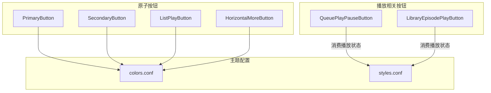
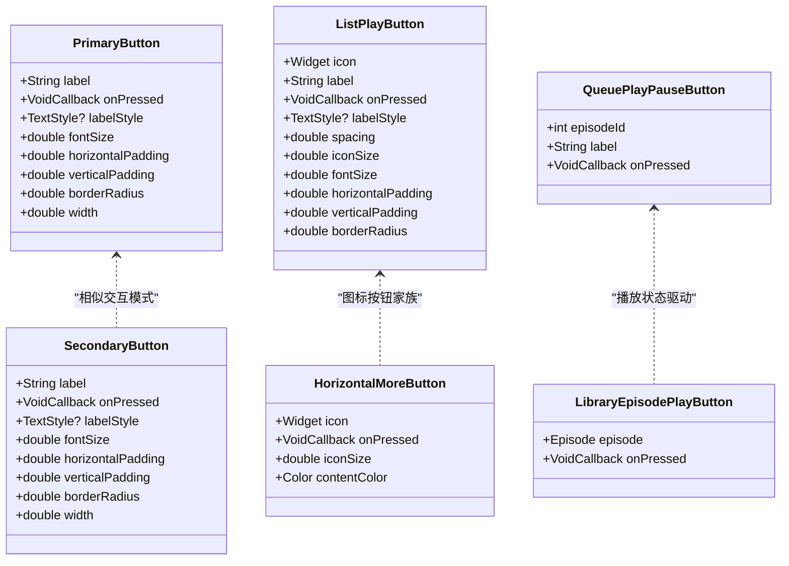
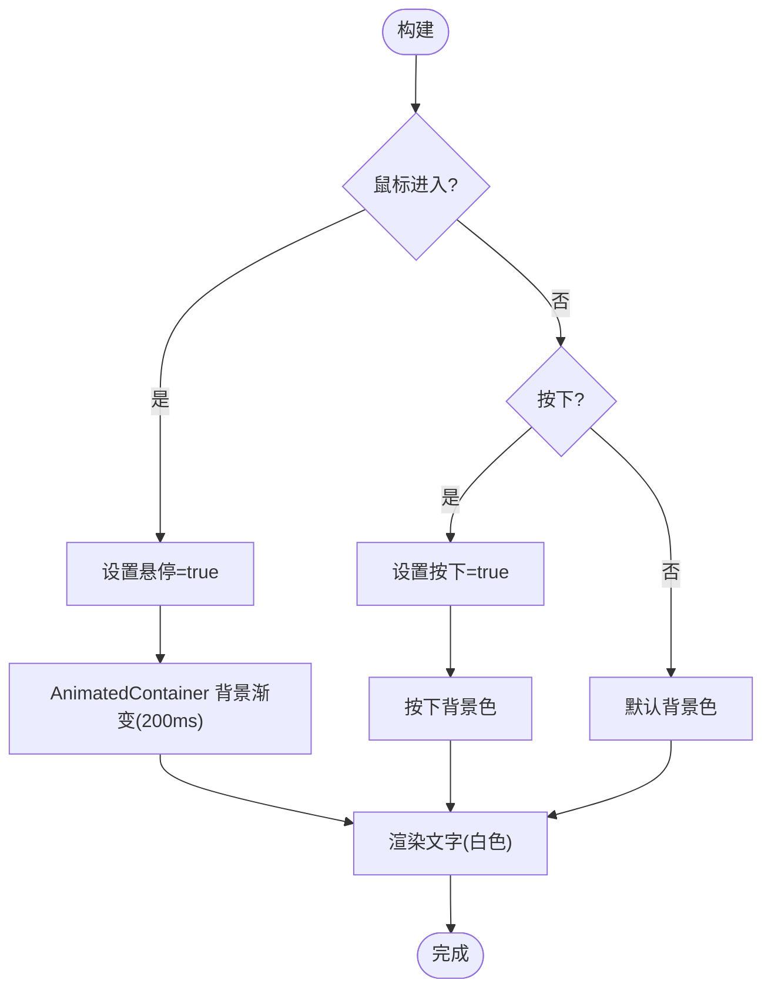
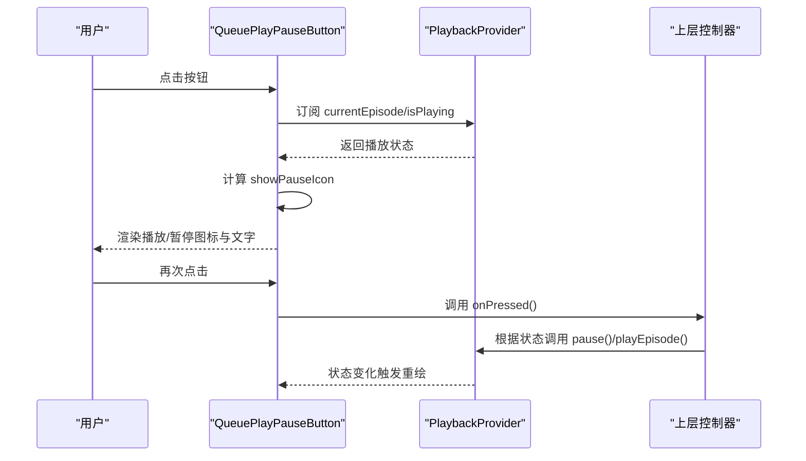
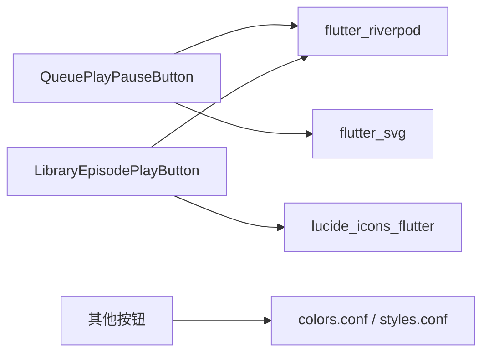

# 按钮组件

<cite>
**本文引用的文件**   
- [primary_button.dart](file://lib/presentation/widgets/atoms/buttons/primary_button.dart)
- [secondary_button.dart](file://lib/presentation/widgets/atoms/buttons/secondary_button.dart)
- [list_play_button.dart](file://lib/presentation/widgets/atoms/buttons/list_play_button.dart)
- [horizontal_more_button.dart](file://lib/presentation/widgets/atoms/buttons/horizontal_more_button.dart)
- [queue_play_pause_button.dart](file://lib/presentation/widgets/atoms/buttons/queue_play_pause_button.dart)
- [library_episode_play_button.dart](file://lib/presentation/features/library/library_episode_item/library_episode_play_button.dart)
- [library_show_more_button.dart](file://lib/presentation/features/library/library_list_item/library_show_more_button.dart)
- [colors.conf](file://assets/themes/colors.conf)
- [styles.conf](file://assets/themes/styles.conf)
</cite>

## 目录
1. [简介](#简介)
2. [项目结构](#项目结构)
3. [核心组件](#核心组件)
4. [架构总览](#架构总览)
5. [详细组件分析](#详细组件分析)
6. [依赖关系分析](#依赖关系分析)
7. [性能与可访问性](#性能与可访问性)
8. [故障排查指南](#故障排查指南)
9. [结论](#结论)
10. [附录：使用示例与最佳实践](#附录使用示例与最佳实践)

## 简介
本文件为 TinyCast 项目中所有“按钮组件”的权威文档，覆盖 PrimaryButton、SecondaryButton、ListPlayButton、HorizontalMoreButton、QueuePlayPauseButton 等。内容包含：
- 功能与用途说明
- 属性、样式、状态与交互行为
- 尺寸变体、颜色主题与禁用态处理建议
- 点击反馈与动画效果
- 播放相关按钮的特殊功能与状态管理
- 在不同场景下的选择建议与使用示例

## 项目结构
按钮组件统一位于 atoms 层，便于在多处复用；播放相关的专用按钮（如队列播放暂停）通过 Riverpod 消费全局播放状态，实现跨列表项的状态隔离与联动。

图表来源
- [primary_button.dart:1-128](file://lib/presentation/widgets/atoms/buttons/primary_button.dart#L1-L128)
- [secondary_button.dart:1-133](file://lib/presentation/widgets/atoms/buttons/secondary_button.dart#L1-L133)
- [list_play_button.dart:1-151](file://lib/presentation/widgets/atoms/buttons/list_play_button.dart#L1-L151)
- [horizontal_more_button.dart:1-82](file://lib/presentation/widgets/atoms/buttons/horizontal_more_button.dart#L1-L82)
- [queue_play_pause_button.dart:1-116](file://lib/presentation/widgets/atoms/buttons/queue_play_pause_button.dart#L1-L116)
- [library_episode_play_button.dart:1-89](file://lib/presentation/features/library/library_episode_item/library_episode_play_button.dart#L1-L89)
- [colors.conf:1-106](file://assets/themes/colors.conf#L1-L106)
- [styles.conf:1-262](file://assets/themes/styles.conf#L1-L262)

章节来源
- [primary_button.dart:1-128](file://lib/presentation/widgets/atoms/buttons/primary_button.dart#L1-L128)
- [secondary_button.dart:1-133](file://lib/presentation/widgets/atoms/buttons/secondary_button.dart#L1-L133)
- [list_play_button.dart:1-151](file://lib/presentation/widgets/atoms/buttons/list_play_button.dart#L1-L151)
- [horizontal_more_button.dart:1-82](file://lib/presentation/widgets/atoms/buttons/horizontal_more_button.dart#L1-L82)
- [queue_play_pause_button.dart:1-116](file://lib/presentation/widgets/atoms/buttons/queue_play_pause_button.dart#L1-L116)
- [library_episode_play_button.dart:1-89](file://lib/presentation/features/library/library_episode_item/library_episode_play_button.dart#L1-L89)
- [colors.conf:1-106](file://assets/themes/colors.conf#L1-L106)
- [styles.conf:1-262](file://assets/themes/styles.conf#L1-L262)

## 核心组件
本节对每个按钮进行概览式说明，后续章节将深入展开。

- PrimaryButton：强调型主按钮，适合主要操作（如“开始播放”、“确认”）。默认深色背景、白色文字，支持自定义尺寸与圆角。
- SecondaryButton：次要按钮，适合辅助操作（如“取消”、“更多”）。默认浅色背景、深色文字，交互反馈与主按钮一致。
- ListPlayButton：列表内常用“图标+文字”的播放/操作按钮，常用于条目行内的快捷操作。
- HorizontalMoreButton：单图标圆形按钮，用于“更多选项”、“删除”等轻量操作。
- QueuePlayPauseButton：队列播放专用按钮，根据当前播放项与播放状态动态切换“播放/暂停”图标，并触发对应控制逻辑。

章节来源
- [primary_button.dart:1-128](file://lib/presentation/widgets/atoms/buttons/primary_button.dart#L1-L128)
- [secondary_button.dart:1-133](file://lib/presentation/widgets/atoms/buttons/secondary_button.dart#L1-L133)
- [list_play_button.dart:1-151](file://lib/presentation/widgets/atoms/buttons/list_play_button.dart#L1-L151)
- [horizontal_more_button.dart:1-82](file://lib/presentation/widgets/atoms/buttons/horizontal_more_button.dart#L1-L82)
- [queue_play_pause_button.dart:1-116](file://lib/presentation/widgets/atoms/buttons/queue_play_pause_button.dart#L1-L116)

## 架构总览
按钮组件遵循统一的交互模式：MouseRegion + GestureDetector + AnimatedContainer，提供悬停与按下状态的平滑过渡。播放类按钮通过 Riverpod 订阅全局播放状态，确保多列表项状态独立且同步。

图表来源
- [primary_button.dart:1-128](file://lib/presentation/widgets/atoms/buttons/primary_button.dart#L1-L128)
- [secondary_button.dart:1-133](file://lib/presentation/widgets/atoms/buttons/secondary_button.dart#L1-L133)
- [list_play_button.dart:1-151](file://lib/presentation/widgets/atoms/buttons/list_play_button.dart#L1-L151)
- [horizontal_more_button.dart:1-82](file://lib/presentation/widgets/atoms/buttons/horizontal_more_button.dart#L1-L82)
- [queue_play_pause_button.dart:1-116](file://lib/presentation/widgets/atoms/buttons/queue_play_pause_button.dart#L1-L116)
- [library_episode_play_button.dart:1-89](file://lib/presentation/features/library/library_episode_item/library_episode_play_button.dart#L1-L89)

## 详细组件分析

### PrimaryButton（主按钮）
- 功能与用途
  - 强调型主操作按钮，适用于页面级或重要流程中的关键动作。
- 属性
  - label：按钮文本
  - onPressed：点击回调
  - labelStyle：可选文字样式
  - fontSize：文字大小（默认 12）
  - horizontalPadding / verticalPadding：内边距（默认 16/6）
  - borderRadius：圆角（默认 16）
  - width：宽度（默认 80）
- 样式与状态
  - 背景色：按下更暗、悬停次之、默认较深
  - 文字颜色：默认白色
  - 鼠标指针：click
- 交互与动画
  - 悬停进入时 200ms 渐变，离开立即切换避免闪烁
  - 按下/抬起/取消均更新内部状态
- 尺寸变体
  - 通过 width、padding、fontSize、borderRadius 组合出不同尺寸
- 颜色主题
  - 当前硬编码深色主题；可与 colors.conf 的主题色体系对齐以支持明暗主题
- 禁用态
  - 当前未内置 disabled；可通过外层容器或包装器实现视觉与交互禁用

图表来源
- [primary_button.dart:44-128](file://lib/presentation/widgets/atoms/buttons/primary_button.dart#L44-L128)

章节来源
- [primary_button.dart:1-128](file://lib/presentation/widgets/atoms/buttons/primary_button.dart#L1-L128)

### SecondaryButton（次要按钮）
- 功能与用途
  - 辅助操作按钮，适合非关键路径的动作（如“取消”、“重置”）。
- 属性
  - 与 PrimaryButton 基本一致（label、onPressed、labelStyle、fontSize、padding、borderRadius、width）
- 样式与状态
  - 背景色：按下更深灰、悬停浅灰、默认浅灰
  - 文字颜色：默认黑色
- 交互与动画
  - 与 PrimaryButton 一致的悬停/按下反馈与 200ms 动画
- 尺寸变体
  - 同主按钮，通过参数调整
- 颜色主题
  - 当前硬编码浅色主题；建议接入 colors.conf 的 label/background 调色板
- 禁用态
  - 未内置 disabled；需外部封装

章节来源
- [secondary_button.dart:1-133](file://lib/presentation/widgets/atoms/buttons/secondary_button.dart#L1-L133)

### ListPlayButton（列表播放按钮）
- 功能与用途
  - 列表项中常见的“图标+文字”按钮，适合快速播放、收藏、分享等操作。
- 属性
  - icon：左侧图标 Widget
  - label：右侧文字
  - onPressed：点击回调
  - labelStyle：文字样式
  - spacing：图标与文字间距（默认 6）
  - iconSize：图标大小（默认 10）
  - fontSize：文字大小（默认 10）
  - horizontalPadding / verticalPadding：内边距（默认 8/4）
  - borderRadius：圆角（默认 10）
- 样式与状态
  - 背景色：按下更深灰、悬停浅灰、默认浅灰
  - 内容颜色：默认黑色
- 交互与动画
  - 悬停/按下状态切换，200ms 背景渐变
- 尺寸变体
  - 通过 iconSize、fontSize、padding、borderRadius 组合
- 颜色主题
  - 当前硬编码浅色主题；建议接入 colors.conf 的 label/background
- 禁用态
  - 未内置 disabled；需外部封装

章节来源
- [list_play_button.dart:1-151](file://lib/presentation/widgets/atoms/buttons/list_play_button.dart#L1-L151)

### HorizontalMoreButton（水平更多按钮）
- 功能与用途
  - 单图标圆形按钮，用于“更多选项”、“删除”等轻量操作。
- 属性
  - icon：图标 Widget
  - onPressed：点击回调
  - iconSize：图标大小（默认 12）
  - contentColor：内容颜色（默认半透明黑）
- 样式与状态
  - 背景色：按下深灰、悬停浅灰、默认透明
  - 圆角：50（圆形）
- 交互与动画
  - 悬停/按下状态切换，200ms 背景渐变
- 尺寸变体
  - 通过 iconSize、padding 控制
- 颜色主题
  - 当前硬编码浅色主题；建议接入 colors.conf 的 gray/overlay 调色板
- 禁用态
  - 未内置 disabled；需外部封装

章节来源
- [horizontal_more_button.dart:1-82](file://lib/presentation/widgets/atoms/buttons/horizontal_more_button.dart#L1-L82)

### QueuePlayPauseButton（队列播放/暂停按钮）
- 功能与用途
  - 队列列表中针对某一条目的播放/暂停按钮。若该条目是当前播放项：
    - 正在播放：显示“暂停”图标
    - 已暂停：显示“播放”图标
  - 若非当前播放项：始终显示“播放”图标
- 属性
  - episodeId：条目唯一标识
  - label：按钮文字
  - onPressed：点击回调（由上层决定调用 play/pause）
- 状态与数据流
  - 通过 ConsumerWidget 订阅 playbackProvider，读取 currentEpisode 与 isPlaying
  - 计算 showPauseIcon = (currentEpisodeId == episodeId && isPlaying)
- 样式与状态
  - 背景色：按下深灰、悬停浅灰、默认浅灰
  - 图标：SVG 播放/暂停，固定黑色
- 交互与动画
  - 悬停/按下状态切换，200ms 背景渐变
- 尺寸变体
  - 通过 padding、fontSize、iconSize 控制
- 颜色主题
  - 当前硬编码浅色主题；建议接入 colors.conf 的 label/background
- 禁用态
  - 未内置 disabled；需外部封装

图表来源
- [queue_play_pause_button.dart:1-116](file://lib/presentation/widgets/atoms/buttons/queue_play_pause_button.dart#L1-L116)

章节来源
- [queue_play_pause_button.dart:1-116](file://lib/presentation/widgets/atoms/buttons/queue_play_pause_button.dart#L1-L116)

### LibraryEpisodePlayButton（库播放按钮）
- 功能与用途
  - 库列表中的播放/暂停按钮，逻辑与队列按钮类似，但基于 Episode 对象判断是否正在播放。
- 属性
  - episode：条目实体
  - onPressed：点击回调
- 状态与数据流
  - 订阅 playbackProvider，比较 currentEpisode.id 与 episode.id，结合 isPlaying 决定图标
- 样式与状态
  - 背景色：按下深灰、悬停浅灰、默认透明
  - 图标：Lucide 播放/暂停，固定颜色
- 交互与动画
  - 悬停/按下状态切换，200ms 背景渐变
- 尺寸变体
  - 通过 padding、iconSize 控制
- 颜色主题
  - 当前硬编码浅色主题；建议接入 colors.conf
- 禁用态
  - 未内置 disabled；需外部封装

章节来源
- [library_episode_play_button.dart:1-89](file://lib/presentation/features/library/library_episode_item/library_episode_play_button.dart#L1-L89)

## 依赖关系分析
- 组件耦合
  - 基础按钮（Primary/Secondary/List/HorizontalMore）相互独立，仅共享相似的交互模式
  - 播放类按钮（QueuePlayPauseButton、LibraryEpisodePlayButton）依赖 Riverpod 的 playbackProvider
- 外部依赖
  - flutter_riverpod：状态订阅
  - flutter_svg：SVG 图标资源
  - lucide_icons_flutter：库播放按钮图标
- 主题配置
  - colors.conf 与 styles.conf 定义了品牌色、背景、标签、控件样式等，可作为未来统一主题化的依据

图表来源
- [queue_play_pause_button.dart:1-116](file://lib/presentation/widgets/atoms/buttons/queue_play_pause_button.dart#L1-L116)
- [library_episode_play_button.dart:1-89](file://lib/presentation/features/library/library_episode_item/library_episode_play_button.dart#L1-L89)
- [colors.conf:1-106](file://assets/themes/colors.conf#L1-L106)
- [styles.conf:1-262](file://assets/themes/styles.conf#L1-L262)

章节来源
- [queue_play_pause_button.dart:1-116](file://lib/presentation/widgets/atoms/buttons/queue_play_pause_button.dart#L1-L116)
- [library_episode_play_button.dart:1-89](file://lib/presentation/features/library/library_episode_item/library_episode_play_button.dart#L1-L89)
- [colors.conf:1-106](file://assets/themes/colors.conf#L1-L106)
- [styles.conf:1-262](file://assets/themes/styles.conf#L1-L262)

## 性能与可访问性
- 性能
  - 所有按钮使用 AnimatedContainer 做背景色过渡，悬停 200ms 动画，离开时 Duration.zero 避免闪烁
  - 播放类按钮通过 ConsumerWidget 精准订阅状态，减少不必要的重建
- 可访问性
  - 鼠标指针统一为 click，提升桌面端可用性
  - 建议补充语义化标签（如 Semantics/A11y），并为键盘导航提供焦点与回车触发
- 无障碍与对比度
  - 当前颜色硬编码，建议接入 colors.conf 的 label/background 以确保明暗主题下对比度达标

[本节为通用指导，不直接分析具体文件]

## 故障排查指南
- 播放图标不切换
  - 检查 playbackProvider 是否正确订阅，episodeId 是否与当前播放项一致
  - 确认上层 onPressed 回调正确调用 play/pause
- 悬停/按下无反馈
  - 确认 MouseRegion 与 GestureDetector 包裹顺序正确
  - 检查父级是否拦截了手势事件
- 主题不一致
  - 当前按钮颜色硬编码，建议统一从 colors.conf/styles.conf 注入
- 禁用态无效
  - 当前未内置 disabled，需在外部封装或使用包装器实现

章节来源
- [queue_play_pause_button.dart:1-116](file://lib/presentation/widgets/atoms/buttons/queue_play_pause_button.dart#L1-L116)
- [library_episode_play_button.dart:1-89](file://lib/presentation/features/library/library_episode_item/library_episode_play_button.dart#L1-L89)
- [colors.conf:1-106](file://assets/themes/colors.conf#L1-L106)
- [styles.conf:1-262](file://assets/themes/styles.conf#L1-L262)

## 结论
- PrimaryButton/SecondaryButton/ListPlayButton/HorizontalMoreButton 提供了统一的交互范式与灵活的样式定制能力
- QueuePlayPauseButton/LibraryEpisodePlayButton 通过状态驱动实现了播放控制的直观反馈
- 当前颜色与主题硬编码，建议逐步接入 colors.conf/styles.conf 以实现主题化与一致性
- 建议补充禁用态、键盘可达性与无障碍标签，提升整体可访问性

[本节为总结，不直接分析具体文件]

## 附录：使用示例与最佳实践
- 何时选择哪个按钮
  - 主操作（确认、开始）：PrimaryButton
  - 辅助操作（取消、重置）：SecondaryButton
  - 列表项快捷操作（播放、收藏）：ListPlayButton
  - 轻量操作（更多、删除）：HorizontalMoreButton
  - 队列播放控制：QueuePlayPauseButton
  - 库播放控制：LibraryEpisodePlayButton
- 尺寸与样式
  - 通过 width、padding、fontSize、borderRadius、iconSize 组合出不同尺寸
  - 保持同一页面的按钮风格一致，避免混用过多尺寸
- 颜色与主题
  - 建议从 colors.conf 的 palettes.label/background/gray 取值，保证明暗主题一致性
- 禁用态处理
  - 当前未内置 disabled，可在外层使用 Opacity/GestureDetector 禁用交互，并配合提示文案
- 播放相关注意事项
  - 确保 episodeId/currentEpisode 匹配，避免误触
  - 上层回调应幂等，防止重复触发

章节来源
- [primary_button.dart:1-128](file://lib/presentation/widgets/atoms/buttons/primary_button.dart#L1-L128)
- [secondary_button.dart:1-133](file://lib/presentation/widgets/atoms/buttons/secondary_button.dart#L1-L133)
- [list_play_button.dart:1-151](file://lib/presentation/widgets/atoms/buttons/list_play_button.dart#L1-L151)
- [horizontal_more_button.dart:1-82](file://lib/presentation/widgets/atoms/buttons/horizontal_more_button.dart#L1-L82)
- [queue_play_pause_button.dart:1-116](file://lib/presentation/widgets/atoms/buttons/queue_play_pause_button.dart#L1-L116)
- [library_episode_play_button.dart:1-89](file://lib/presentation/features/library/library_episode_item/library_episode_play_button.dart#L1-L89)
- [colors.conf:1-106](file://assets/themes/colors.conf#L1-L106)
- [styles.conf:1-262](file://assets/themes/styles.conf#L1-L262)