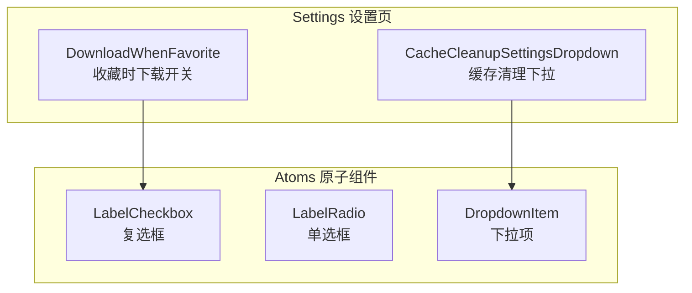
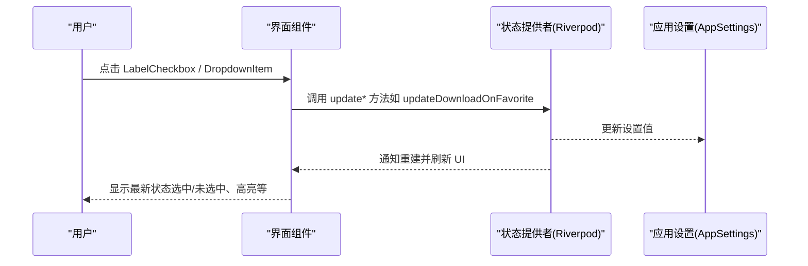
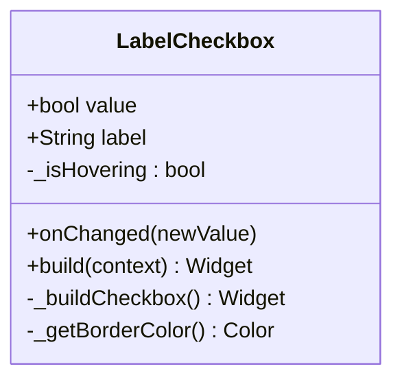
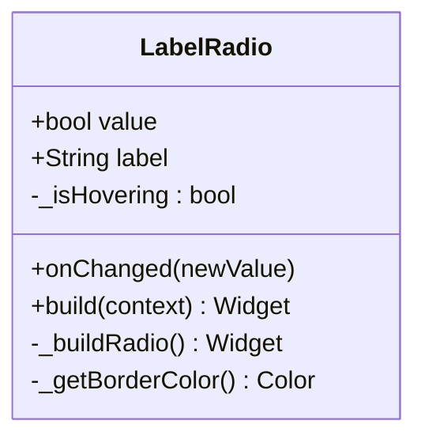
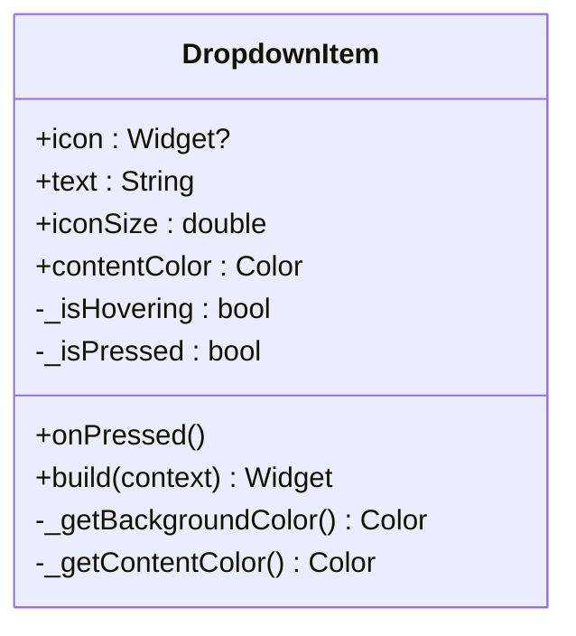
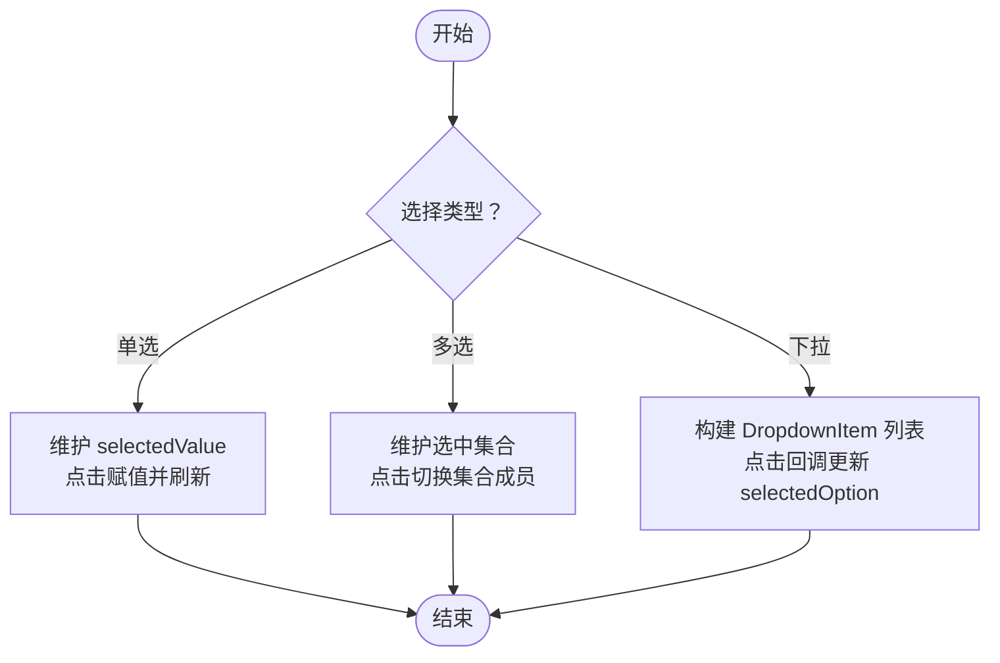
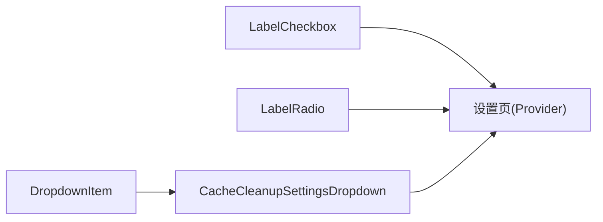

# 选择器组件

<cite>
**本文引用的文件**   
- [label_checkbox.dart](file://lib/presentation/widgets/atoms/checkbox/label_checkbox.dart)
- [label_radio.dart](file://lib/presentation/widgets/atoms/radio/label_radio.dart)
- [dropdown_item.dart](file://lib/presentation/widgets/atoms/dropdown_item/dropdown_item.dart)
- [cache_cleanup_dropdown.dart](file://lib/presentation/features/settings/cache_settings/cache_cleanup_dropdown.dart)
- [download_when_favorite.dart](file://lib/presentation/features/settings/general_settings/download_settings/download_when_favorite.dart)
</cite>

## 目录
1. [简介](#简介)
2. [项目结构](#项目结构)
3. [核心组件](#核心组件)
4. [架构总览](#架构总览)
5. [详细组件分析](#详细组件分析)
6. [依赖关系分析](#依赖关系分析)
7. [性能考量](#性能考量)
8. [故障排查指南](#故障排查指南)
9. [结论](#结论)
10. [附录](#附录)

## 简介
本文件为选择器相关组件的完整文档，覆盖 LabelCheckbox、LabelRadio、DropdownItem 等选择类组件的功能说明、属性配置、状态管理、事件处理与使用示例。内容包含：
- 单选、多选与下拉选择的实现方式
- 标签显示、图标使用与自定义样式
- 键盘导航与无障碍支持建议
- 表单集成与数据绑定模式（基于 Riverpod）

## 项目结构
选择器组件位于 presentation 层的 atoms 子模块中，具体路径如下：
- 复选框：lib/presentation/widgets/atoms/checkbox/label_checkbox.dart
- 单选框：lib/presentation/widgets/atoms/radio/label_radio.dart
- 下拉项：lib/presentation/widgets/atoms/dropdown_item/dropdown_item.dart

典型使用场景在设置页中，例如缓存清理下拉菜单与收藏时自动下载开关。

**图表来源** 
- [label_checkbox.dart:1-145](file://lib/presentation/widgets/atoms/checkbox/label_checkbox.dart#L1-L145)
- [label_radio.dart:1-151](file://lib/presentation/widgets/atoms/radio/label_radio.dart#L1-L151)
- [dropdown_item.dart:1-160](file://lib/presentation/widgets/atoms/dropdown_item/dropdown_item.dart#L1-L160)
- [cache_cleanup_dropdown.dart:1-99](file://lib/presentation/features/settings/cache_settings/cache_cleanup_dropdown.dart#L1-L99)
- [download_when_favorite.dart:1-27](file://lib/presentation/features/settings/general_settings/download_settings/download_when_favorite.dart#L1-L27)

**章节来源**
- [label_checkbox.dart:1-145](file://lib/presentation/widgets/atoms/checkbox/label_checkbox.dart#L1-L145)
- [label_radio.dart:1-151](file://lib/presentation/widgets/atoms/radio/label_radio.dart#L1-L151)
- [dropdown_item.dart:1-160](file://lib/presentation/widgets/atoms/dropdown_item/dropdown_item.dart#L1-L160)
- [cache_cleanup_dropdown.dart:1-99](file://lib/presentation/features/settings/cache_settings/cache_cleanup_dropdown.dart#L1-L99)
- [download_when_favorite.dart:1-27](file://lib/presentation/features/settings/general_settings/download_settings/download_when_favorite.dart#L1-L27)

## 核心组件
本节对三个核心选择组件进行概览性说明，包括职责、关键属性、交互行为与视觉反馈。

- LabelCheckbox（复选框）
  - 功能：展示可点击的复选框与文本标签，支持选中/未选中切换；悬停与按下提供视觉反馈；选中时内部显示勾选图标。
  - 关键属性：value（是否选中）、label（文本标签）、onChanged（状态变化回调）。
  - 状态管理：内部维护 _isHovering 用于悬停效果；选中态通过外部 value 控制。
  - 事件处理：点击触发 onChanged，传入新的布尔值。
  - 样式要点：边框颜色随状态变化；选中时背景变黑、文字加粗。

- LabelRadio（单选框）
  - 功能：展示可点击的单选框与文本标签，支持选中/未选中切换；悬停与选中态有视觉反馈；选中时内部显示圆点。
  - 关键属性：value（是否选中）、label（文本标签）、onChanged（状态变化回调）。
  - 状态管理：内部维护 _isHovering；选中态由外部 value 控制。
  - 事件处理：点击将状态设置为 true（通常配合父级单选组状态管理）。
  - 样式要点：圆形边框；选中时边框颜色加深。

- DropdownItem（下拉项）
  - 功能：在下拉菜单中展示一个选项，支持图标与文字组合；具备悬停与按下状态的背景色过渡动画。
  - 关键属性：icon（可选图标）、text（文字）、onPressed（点击回调）、iconSize（图标大小）、contentColor（内容颜色）。
  - 状态管理：内部维护 _isHovering 与 _isPressed，驱动背景与内容颜色变化。
  - 事件处理：点击触发 onPressed；按下/抬起过程更新视觉状态。
  - 样式要点：圆角背景；图标与文字间距固定；默认透明背景，悬停/按下渐变色。

**章节来源**
- [label_checkbox.dart:16-37](file://lib/presentation/widgets/atoms/checkbox/label_checkbox.dart#L16-L37)
- [label_radio.dart:14-35](file://lib/presentation/widgets/atoms/radio/label_radio.dart#L14-L35)
- [dropdown_item.dart:3-30](file://lib/presentation/widgets/atoms/dropdown_item/dropdown_item.dart#L3-L30)

## 架构总览
选择器组件采用“原子组件 + 页面组合”的模式：
- 原子组件负责基础交互与样式（LabelCheckbox、LabelRadio、DropdownItem）。
- 页面或业务组件组合原子组件形成更复杂的控件（如 CacheCleanupSettingsDropdown）。
- 数据流通过回调（onChanged/onPressed）与状态提供者（Riverpod）完成双向绑定。

[此图为概念流程，不直接映射到具体源码文件]

## 详细组件分析

### LabelCheckbox 复选框
- 设计目标：简洁的复选框与标签组合，强调选中态与悬停态的视觉反馈。
- 属性与类型：
  - value: bool（受控状态）
  - label: String（文本标签）
  - onChanged: ValueChanged<bool>（状态变更回调）
- 状态与交互：
  - 内部 _isHovering 控制悬停效果。
  - 点击通过 GestureDetector 触发 onChanged，传入取反后的新值。
- 样式细节：
  - 边框颜色优先级：选中 > 悬停 > 默认。
  - 选中时背景黑色、内部白色勾选图标；文字加粗。
- 使用示例（参考路径）：
  - 设置页中的“收藏时下载”开关：[download_when_favorite.dart:18-24](file://lib/presentation/features/settings/general_settings/download_settings/download_when_favorite.dart#L18-L24)

**图表来源** 
- [label_checkbox.dart:16-37](file://lib/presentation/widgets/atoms/checkbox/label_checkbox.dart#L16-L37)
- [label_checkbox.dart:39-97](file://lib/presentation/widgets/atoms/checkbox/label_checkbox.dart#L39-L97)
- [label_checkbox.dart:99-143](file://lib/presentation/widgets/atoms/checkbox/label_checkbox.dart#L99-L143)

**章节来源**
- [label_checkbox.dart:16-37](file://lib/presentation/widgets/atoms/checkbox/label_checkbox.dart#L16-L37)
- [label_checkbox.dart:39-97](file://lib/presentation/widgets/atoms/checkbox/label_checkbox.dart#L39-L97)
- [label_checkbox.dart:99-143](file://lib/presentation/widgets/atoms/checkbox/label_checkbox.dart#L99-L143)
- [download_when_favorite.dart:18-24](file://lib/presentation/features/settings/general_settings/download_settings/download_when_favorite.dart#L18-L24)

### LabelRadio 单选框
- 设计目标：标准的单选框与标签组合，强调选中态与悬停态的视觉反馈。
- 属性与类型：
  - value: bool（受控状态）
  - label: String（文本标签）
  - onChanged: ValueChanged<bool>（状态变更回调）
- 状态与交互：
  - 内部 _isHovering 控制悬停效果。
  - 点击通过 GestureDetector 触发 onChanged(true)，通常由父级单选组统一维护选中项。
- 样式细节：
  - 圆形边框；选中时边框颜色加深，内部显示实心圆点。
- 使用示例（参考路径）：
  - 可在设置页中与其他单选组件组合使用（本项目中未见直接示例，但用法与 LabelCheckbox 一致）。

**图表来源** 
- [label_radio.dart:14-35](file://lib/presentation/widgets/atoms/radio/label_radio.dart#L14-L35)
- [label_radio.dart:37-95](file://lib/presentation/widgets/atoms/radio/label_radio.dart#L37-L95)
- [label_radio.dart:97-149](file://lib/presentation/widgets/atoms/radio/label_radio.dart#L97-L149)

**章节来源**
- [label_radio.dart:14-35](file://lib/presentation/widgets/atoms/radio/label_radio.dart#L14-L35)
- [label_radio.dart:37-95](file://lib/presentation/widgets/atoms/radio/label_radio.dart#L37-L95)
- [label_radio.dart:97-149](file://lib/presentation/widgets/atoms/radio/label_radio.dart#L97-L149)

### DropdownItem 下拉项
- 设计目标：用于下拉菜单中的单项选择，支持图标与文字组合，具备悬停与按下状态的背景色过渡。
- 属性与类型：
  - icon: Widget?（可选图标）
  - text: String（文字）
  - onPressed: VoidCallback（点击回调）
  - iconSize: double（图标大小，默认 12）
  - contentColor: Color（内容颜色，默认 0xD9000000）
- 状态与交互：
  - 内部 _isHovering 与 _isPressed 控制背景与内容颜色。
  - 点击触发 onPressed；按下/抬起过程更新视觉状态。
- 样式细节：
  - 圆角背景；图标与文字间距固定；默认透明背景，悬停浅灰、按下深灰。
- 使用示例（参考路径）：
  - 缓存清理下拉菜单：[cache_cleanup_dropdown.dart:55-85](file://lib/presentation/features/settings/cache_settings/cache_cleanup_dropdown.dart#L55-L85)

**图表来源** 
- [dropdown_item.dart:3-30](file://lib/presentation/widgets/atoms/dropdown_item/dropdown_item.dart#L3-L30)
- [dropdown_item.dart:32-139](file://lib/presentation/widgets/atoms/dropdown_item/dropdown_item.dart#L32-L139)
- [dropdown_item.dart:141-158](file://lib/presentation/widgets/atoms/dropdown_item/dropdown_item.dart#L141-L158)

**章节来源**
- [dropdown_item.dart:3-30](file://lib/presentation/widgets/atoms/dropdown_item/dropdown_item.dart#L3-L30)
- [dropdown_item.dart:32-139](file://lib/presentation/widgets/atoms/dropdown_item/dropdown_item.dart#L32-L139)
- [dropdown_item.dart:141-158](file://lib/presentation/widgets/atoms/dropdown_item/dropdown_item.dart#L141-L158)
- [cache_cleanup_dropdown.dart:55-85](file://lib/presentation/features/settings/cache_settings/cache_cleanup_dropdown.dart#L55-L85)

### 使用示例与最佳实践

#### 单选（Radio）
- 典型用法：在父级组件维护 selectedValue，多个 LabelRadio 共享同一 selectedValue，点击时将对应值赋给 selectedValue。
- 关键点：确保只有一个 LabelRadio 的 value 为 true；其他为 false。

#### 多选（Checkbox）
- 典型用法：在父级组件维护 List<bool> 或 Set<T> 表示选中集合，每个 LabelCheckbox 的 value 对应集合中的成员状态。
- 关键点：onChanged 中更新集合状态，避免重复或遗漏。

#### 下拉选择（DropdownItem）
- 典型用法：使用 DropdownItem 构建下拉菜单项，结合外部容器（如 CacheCleanupSettingsDropdown）管理选中项与图标显示。
- 关键点：根据 selectedOption 动态显示 check 图标；点击后调用 onOptionSelected 与 onItemSelected。

[此图为概念流程，不直接映射到具体源码文件]

**章节来源**
- [cache_cleanup_dropdown.dart:15-98](file://lib/presentation/features/settings/cache_settings/cache_cleanup_dropdown.dart#L15-L98)
- [download_when_favorite.dart:11-26](file://lib/presentation/features/settings/general_settings/download_settings/download_when_favorite.dart#L11-L26)

## 依赖关系分析
- LabelCheckbox、LabelRadio、DropdownItem 均为独立原子组件，无内部复杂依赖。
- 页面层通过回调与状态提供者（Riverpod）与组件交互，形成松耦合的数据流。
- 下拉项 DropdownItem 被 CacheCleanupSettingsDropdown 组合使用，体现“原子 + 组合”的设计。

**图表来源** 
- [label_checkbox.dart:16-37](file://lib/presentation/widgets/atoms/checkbox/label_checkbox.dart#L16-L37)
- [label_radio.dart:14-35](file://lib/presentation/widgets/atoms/radio/label_radio.dart#L14-L35)
- [dropdown_item.dart:3-30](file://lib/presentation/widgets/atoms/dropdown_item/dropdown_item.dart#L3-L30)
- [cache_cleanup_dropdown.dart:15-98](file://lib/presentation/features/settings/cache_settings/cache_cleanup_dropdown.dart#L15-L98)

**章节来源**
- [label_checkbox.dart:16-37](file://lib/presentation/widgets/atoms/checkbox/label_checkbox.dart#L16-L37)
- [label_radio.dart:14-35](file://lib/presentation/widgets/atoms/radio/label_radio.dart#L14-L35)
- [dropdown_item.dart:3-30](file://lib/presentation/widgets/atoms/dropdown_item/dropdown_item.dart#L3-L30)
- [cache_cleanup_dropdown.dart:15-98](file://lib/presentation/features/settings/cache_settings/cache_cleanup_dropdown.dart#L15-L98)

## 性能考量
- 动画与重绘：
  - LabelCheckbox/LabelRadio/DropdownItem 均使用 AnimatedContainer 实现悬停/按下状态的平滑过渡，注意避免频繁 setState 导致不必要的重绘。
- 布局优化：
  - Row 使用 MainAxisSize.min 自适应宽度，减少多余布局计算。
- 状态最小化：
  - 仅维护必要的交互状态（_isHovering/_isPressed），选中状态由外部 value 控制，降低组件内部复杂度。

[本节为通用指导，不直接分析具体文件]

## 故障排查指南
- 点击无效
  - 检查是否包裹了手势检测（GestureDetector/MouseRegion），确认 onTap/onPressed 是否正确传递。
  - 参考路径：[dropdown_item.dart:57-68](file://lib/presentation/widgets/atoms/dropdown_item/dropdown_item.dart#L57-L68)
- 状态不同步
  - 确保外部 value 与回调 onChanged/onPressed 正确联动，避免只改内部状态而不更新外部。
  - 参考路径：[label_checkbox.dart:54](file://lib/presentation/widgets/atoms/checkbox/label_checkbox.dart#L54)、[label_radio.dart:52](file://lib/presentation/widgets/atoms/radio/label_radio.dart#L52)
- 样式异常
  - 检查边框颜色逻辑与状态优先级（选中 > 悬停 > 默认），确认颜色常量与透明度。
  - 参考路径：[label_checkbox.dart:136-143](file://lib/presentation/widgets/atoms/checkbox/label_checkbox.dart#L136-L143)、[label_radio.dart:142-149](file://lib/presentation/widgets/atoms/radio/label_radio.dart#L142-L149)

**章节来源**
- [dropdown_item.dart:57-68](file://lib/presentation/widgets/atoms/dropdown_item/dropdown_item.dart#L57-L68)
- [label_checkbox.dart:54](file://lib/presentation/widgets/atoms/checkbox/label_checkbox.dart#L54)
- [label_radio.dart:52](file://lib/presentation/widgets/atoms/radio/label_radio.dart#L52)
- [label_checkbox.dart:136-143](file://lib/presentation/widgets/atoms/checkbox/label_checkbox.dart#L136-L143)
- [label_radio.dart:142-149](file://lib/presentation/widgets/atoms/radio/label_radio.dart#L142-L149)

## 结论
LabelCheckbox、LabelRadio、DropdownItem 提供了清晰的选择器能力，适合在设置页与表单中使用。通过受控状态与回调机制，可与 Riverpod 等状态管理方案无缝集成。建议在项目中遵循“原子组件 + 组合”的原则，保持组件职责单一、样式可控、交互直观。

[本节为总结，不直接分析具体文件]

## 附录

### 属性配置速查表
- LabelCheckbox
  - value: bool
  - label: String
  - onChanged: ValueChanged<bool>
- LabelRadio
  - value: bool
  - label: String
  - onChanged: ValueChanged<bool>
- DropdownItem
  - icon: Widget?
  - text: String
  - onPressed: VoidCallback
  - iconSize: double（默认 12）
  - contentColor: Color（默认 0xD9000000）

**章节来源**
- [label_checkbox.dart:16-37](file://lib/presentation/widgets/atoms/checkbox/label_checkbox.dart#L16-L37)
- [label_radio.dart:14-35](file://lib/presentation/widgets/atoms/radio/label_radio.dart#L14-L35)
- [dropdown_item.dart:3-30](file://lib/presentation/widgets/atoms/dropdown_item/dropdown_item.dart#L3-L30)

### 键盘导航与无障碍支持建议
- 当前实现主要依赖 MouseRegion/GestureDetector，未内置焦点管理与语义信息。
- 建议：
  - 使用 FocusableActionDetector 或 Focus 节点管理焦点，支持 Tab/Shift+Tab 导航。
  - 添加 Semantics 描述（如“复选框：已选中/未选中”、“单选框：已选中/未选中”、“下拉项：文本”）。
  - 为可操作元素提供 aria-like 的语义标签，提升屏幕阅读器体验。

[本节为通用指导，不直接分析具体文件]

### 表单集成与数据绑定模式
- 使用 Riverpod 的 ConsumerWidget 或 StateNotifier 管理设置状态。
- LabelCheckbox 的 onChanged 直接调用 provider 的更新方法（如 updateDownloadOnFavorite）。
- DropdownItem 的 onPressed 触发 onOptionSelected 回调，由上层组件更新 selectedOption。

**章节来源**
- [download_when_favorite.dart:11-26](file://lib/presentation/features/settings/general_settings/download_settings/download_when_favorite.dart#L11-L26)
- [cache_cleanup_dropdown.dart:15-98](file://lib/presentation/features/settings/cache_settings/cache_cleanup_dropdown.dart#L15-L98)