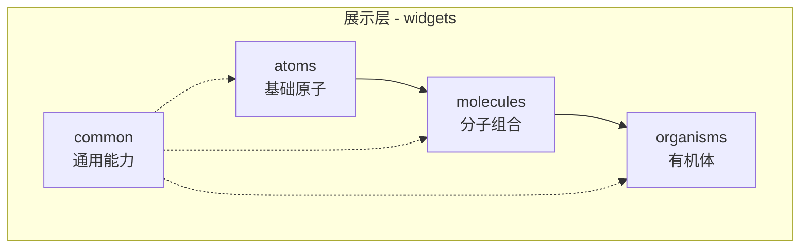
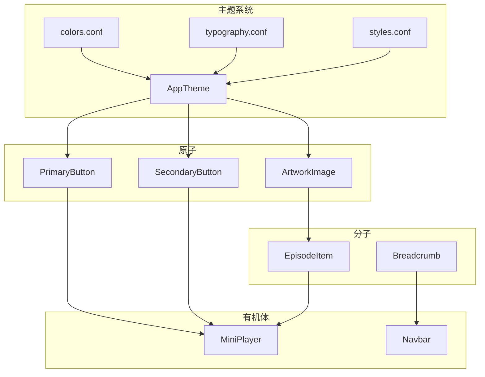
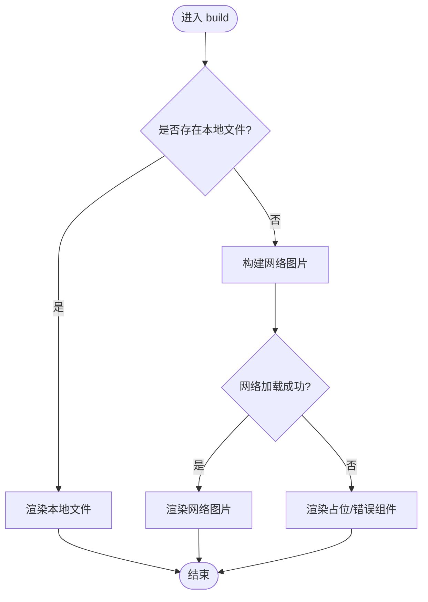
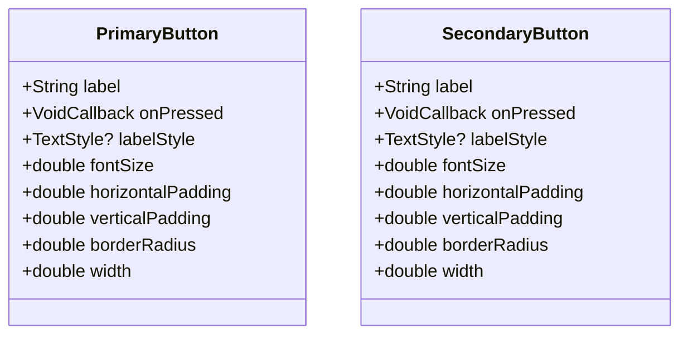
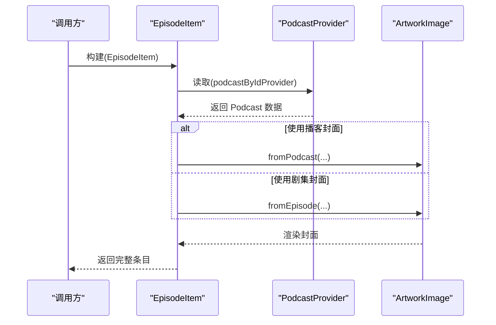
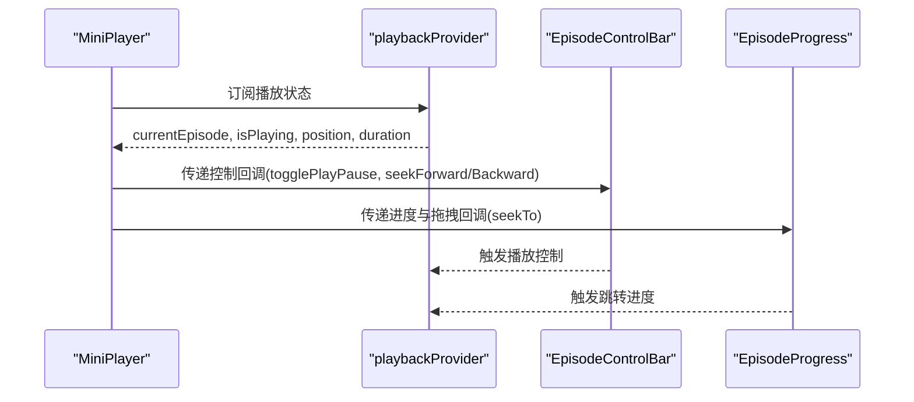
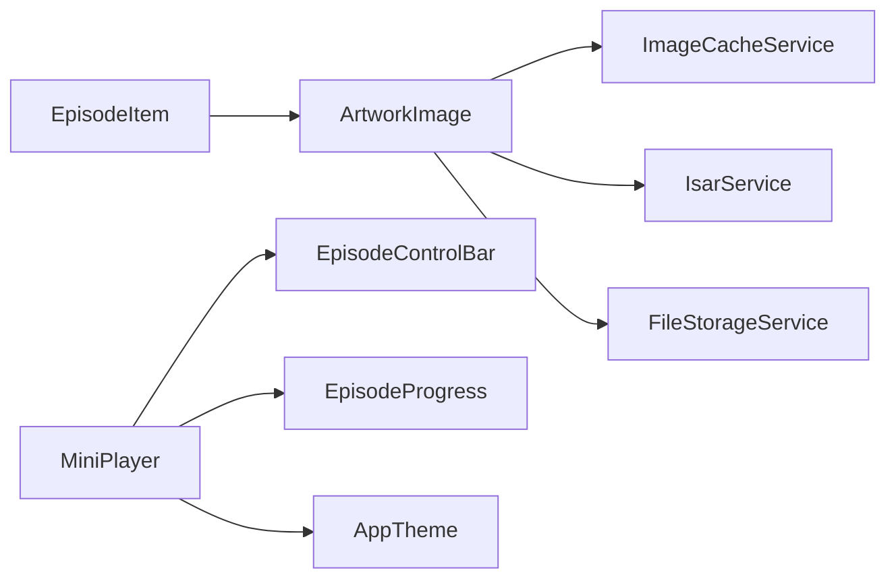

# 原子设计模式

<cite>
**本文引用的文件**
- [lib/presentation/widgets/atoms/artwork_image/artwork_image.dart](file://lib/presentation/widgets/atoms/artwork_image/artwork_image.dart)
- [lib/presentation/widgets/atoms/buttons/primary_button.dart](file://lib/presentation/widgets/atoms/buttons/primary_button.dart)
- [lib/presentation/widgets/atoms/buttons/secondary_button.dart](file://lib/presentation/widgets/atoms/buttons/secondary_button.dart)
- [lib/presentation/widgets/molecules/episode_item/episode_item.dart](file://lib/presentation/widgets/molecules/episode_item/episode_item.dart)
- [lib/presentation/widgets/molecules/breadcrumb/breadcrumb.dart](file://lib/presentation/widgets/molecules/breadcrumb/breadcrumb.dart)
- [lib/presentation/widgets/organisms/mini_player/mini_player.dart](file://lib/presentation/widgets/organisms/mini_player/mini_player.dart)
- [lib/presentation/widgets/organisms/navbar/navbar.dart](file://lib/presentation/widgets/organisms/navbar/navbar.dart)
- [assets/themes/colors.conf](file://assets/themes/colors.conf)
- [assets/themes/styles.conf](file://assets/themes/styles.conf)
- [assets/themes/typography.conf](file://assets/themes/typography.conf)
- [lib/core/theme/app_theme.dart](file://lib/core/theme/app_theme.dart)
</cite>

## 目录
1. [简介](#简介)
2. [项目结构](#项目结构)
3. [核心组件](#核心组件)
4. [架构总览](#架构总览)
5. [详细组件分析](#详细组件分析)
6. [依赖关系分析](#依赖关系分析)
7. [性能考量](#性能考量)
8. [故障排查指南](#故障排查指南)
9. [结论](#结论)
10. [附录](#附录)

## 简介
本文件为 TinyCast 的原子设计模式提供系统化文档，围绕“原子、分子、有机体”三层设计理念与实现原则展开，说明如何构建可复用、可组合的基础 UI 组件，并给出命名约定、文件组织与使用规范。同时记录主题系统如何与原子组件集成以支持动态样式和自定义，并提供性能优化建议与最佳实践指导。

## 项目结构
TinyCast 在 presentation 层采用按层级划分的 widgets 目录：
- atoms：最小粒度的 UI 单元（按钮、图片、选择控件等）
- molecules：由原子组合而成的复合组件（如剧集条目、面包屑）
- organisms：更复杂的业务级组件（迷你播放器、导航栏等）
- common：通用对话框、错误提示等公共能力

图表来源
- [lib/presentation/widgets/atoms/artwork_image/artwork_image.dart:1-291](file://lib/presentation/widgets/atoms/artwork_image/artwork_image.dart#L1-L291)
- [lib/presentation/widgets/molecules/episode_item/episode_item.dart:1-128](file://lib/presentation/widgets/molecules/episode_item/episode_item.dart#L1-L128)
- [lib/presentation/widgets/organisms/mini_player/mini_player.dart:1-54](file://lib/presentation/widgets/organisms/mini_player/mini_player.dart#L1-L54)

章节来源
- [lib/presentation/widgets/atoms/artwork_image/artwork_image.dart:1-291](file://lib/presentation/widgets/atoms/artwork_image/artwork_image.dart#L1-L291)
- [lib/presentation/widgets/molecules/episode_item/episode_item.dart:1-128](file://lib/presentation/widgets/molecules/episode_item/episode_item.dart#L1-L128)
- [lib/presentation/widgets/organisms/mini_player/mini_player.dart:1-54](file://lib/presentation/widgets/organisms/mini_player/mini_player.dart#L1-L54)

## 核心组件
- 原子层
  - ArtworkImage：封面图显示与本地缓存优先加载，支持占位与错误回退
  - PrimaryButton / SecondaryButton：主/次按钮，具备悬停与按下状态反馈
- 分子层
  - EpisodeItem：剧集条目，组合封面图与信息区
  - Breadcrumb：面包屑导航，聚合多个项
- 有机体层
  - MiniPlayer：迷你播放器，整合信息、控制条与进度条
  - Navbar：顶部导航，聚合标题与操作按钮

章节来源
- [lib/presentation/widgets/atoms/artwork_image/artwork_image.dart:1-291](file://lib/presentation/widgets/atoms/artwork_image/artwork_image.dart#L1-L291)
- [lib/presentation/widgets/atoms/buttons/primary_button.dart:1-128](file://lib/presentation/widgets/atoms/buttons/primary_button.dart#L1-L128)
- [lib/presentation/widgets/atoms/buttons/secondary_button.dart:1-133](file://lib/presentation/widgets/atoms/buttons/secondary_button.dart#L1-L133)
- [lib/presentation/widgets/molecules/episode_item/episode_item.dart:1-128](file://lib/presentation/widgets/molecules/episode_item/episode_item.dart#L1-L128)
- [lib/presentation/widgets/molecules/breadcrumb/breadcrumb.dart:1-16](file://lib/presentation/widgets/molecules/breadcrumb/breadcrumb.dart#L1-L16)
- [lib/presentation/widgets/organisms/mini_player/mini_player.dart:1-54](file://lib/presentation/widgets/organisms/mini_player/mini_player.dart#L1-L54)
- [lib/presentation/widgets/organisms/navbar/navbar.dart:1-38](file://lib/presentation/widgets/organisms/navbar/navbar.dart#L1-L38)

## 架构总览
原子设计在 TinyCast 中的分层协作如下：
- 原子负责单一职责与高内聚（如图片加载、按钮交互）
- 分子通过组合原子形成稳定 UI 片段（如剧集条目）
- 有机体编排分子与原子，承载页面级或功能块行为（如迷你播放器）
- 主题系统通过 AppTheme 与 HOCON 配置驱动颜色、排版与样式，贯穿各层

图表来源
- [assets/themes/colors.conf:1-106](file://assets/themes/colors.conf#L1-L106)
- [assets/themes/typography.conf:1-136](file://assets/themes/typography.conf#L1-L136)
- [assets/themes/styles.conf:1-262](file://assets/themes/styles.conf#L1-L262)
- [lib/core/theme/app_theme.dart:1-200](file://lib/core/theme/app_theme.dart#L1-L200)
- [lib/presentation/widgets/atoms/artwork_image/artwork_image.dart:1-291](file://lib/presentation/widgets/atoms/artwork_image/artwork_image.dart#L1-L291)
- [lib/presentation/widgets/atoms/buttons/primary_button.dart:1-128](file://lib/presentation/widgets/atoms/buttons/primary_button.dart#L1-L128)
- [lib/presentation/widgets/atoms/buttons/secondary_button.dart:1-133](file://lib/presentation/widgets/atoms/buttons/secondary_button.dart#L1-L133)
- [lib/presentation/widgets/molecules/episode_item/episode_item.dart:1-128](file://lib/presentation/widgets/molecules/episode_item/episode_item.dart#L1-L128)
- [lib/presentation/widgets/organisms/mini_player/mini_player.dart:1-54](file://lib/presentation/widgets/organisms/mini_player/mini_player.dart#L1-L54)
- [lib/presentation/widgets/organisms/navbar/navbar.dart:1-38](file://lib/presentation/widgets/organisms/navbar/navbar.dart#L1-L38)

## 详细组件分析

### 原子：ArtworkImage（封面图）
- 职责
  - 优先本地文件显示，不存在则网络加载
  - 支持占位与错误回退
  - 支持圆角与尺寸参数
- 关键流程
  - 初始化时检查本地文件，若存在直接渲染
  - 若缺失，触发后台下载并更新 UI
  - 网络加载失败时回退到占位/错误组件
- 数据流
  - 从 episode/podcast 实体获取 artworkUrl
  - 通过存储服务与数据库服务定位与下载资源
- 复杂度
  - 时间复杂度：O(1) 渲染决策；IO 异步不影响主线程
  - 空间复杂度：仅持有当前文件引用与少量状态

图表来源
- [lib/presentation/widgets/atoms/artwork_image/artwork_image.dart:1-291](file://lib/presentation/widgets/atoms/artwork_image/artwork_image.dart#L1-L291)

章节来源
- [lib/presentation/widgets/atoms/artwork_image/artwork_image.dart:1-291](file://lib/presentation/widgets/atoms/artwork_image/artwork_image.dart#L1-L291)

### 原子：PrimaryButton / SecondaryButton（按钮）
- 职责
  - 提供主/次两种按钮样式
  - 支持悬停与按下状态的视觉反馈
  - 可定制文字样式、尺寸与圆角
- 交互逻辑
  - 使用 MouseRegion 监听悬停
  - 使用 GestureDetector 处理点击与按下状态
  - 使用 AnimatedContainer 平滑过渡背景色
- 主题集成
  - 当前硬编码颜色，建议后续接入 AppTheme 与 styles.conf 的颜色变量

图表来源
- [lib/presentation/widgets/atoms/buttons/primary_button.dart:1-128](file://lib/presentation/widgets/atoms/buttons/primary_button.dart#L1-L128)
- [lib/presentation/widgets/atoms/buttons/secondary_button.dart:1-133](file://lib/presentation/widgets/atoms/buttons/secondary_button.dart#L1-L133)

章节来源
- [lib/presentation/widgets/atoms/buttons/primary_button.dart:1-128](file://lib/presentation/widgets/atoms/buttons/primary_button.dart#L1-L128)
- [lib/presentation/widgets/atoms/buttons/secondary_button.dart:1-133](file://lib/presentation/widgets/atoms/buttons/secondary_button.dart#L1-L133)

### 分子：EpisodeItem（剧集条目）
- 职责
  - 组合封面图与信息区，支持可选分隔线
  - 根据 usePodcastArtwork 决定使用播客或剧集封面
  - 格式化时长并暴露播放与点击回调
- 组合方式
  - 使用 ArtworkImage 作为封面
  - 使用 EpisodeInfo（同分子）展示标题、描述等信息
- 状态管理
  - 通过 ConsumerWidget 订阅 podcast 提供者，按需渲染

图表来源
- [lib/presentation/widgets/molecules/episode_item/episode_item.dart:1-128](file://lib/presentation/widgets/molecules/episode_item/episode_item.dart#L1-L128)
- [lib/presentation/widgets/atoms/artwork_image/artwork_image.dart:1-291](file://lib/presentation/widgets/atoms/artwork_image/artwork_image.dart#L1-L291)

章节来源
- [lib/presentation/widgets/molecules/episode_item/episode_item.dart:1-128](file://lib/presentation/widgets/molecules/episode_item/episode_item.dart#L1-L128)

### 分子：Breadcrumb（面包屑）
- 职责
  - 水平排列多个 BreadcrumbItem
  - 保持简洁无状态，便于组合
- 使用场景
  - 页面导航路径展示

章节来源
- [lib/presentation/widgets/molecules/breadcrumb/breadcrumb.dart:1-16](file://lib/presentation/widgets/molecules/breadcrumb/breadcrumb.dart#L1-L16)

### 有机体：MiniPlayer（迷你播放器）
- 职责
  - 聚合剧集信息、控制条与进度条
  - 响应播放状态变化，驱动 seek/play/pause 等操作
- 主题集成
  - 通过 AppTheme.fromBrightness 获取亮度适配的主题色与间距
- 状态管理
  - 使用 playbackProvider 订阅播放状态与动作

图表来源
- [lib/presentation/widgets/organisms/mini_player/mini_player.dart:1-54](file://lib/presentation/widgets/organisms/mini_player/mini_player.dart#L1-L54)
- [lib/core/theme/app_theme.dart:1-200](file://lib/core/theme/app_theme.dart#L1-L200)

章节来源
- [lib/presentation/widgets/organisms/mini_player/mini_player.dart:1-54](file://lib/presentation/widgets/organisms/mini_player/mini_player.dart#L1-L54)

### 有机体：Navbar（导航栏）
- 职责
  - 聚合大标题与右侧操作按钮
  - 使用 SafeArea 保证布局安全
- 组合方式
  - 使用 NavbarLargeTitle 与 NavbarButton 原子/子组件

章节来源
- [lib/presentation/widgets/organisms/navbar/navbar.dart:1-38](file://lib/presentation/widgets/organisms/navbar/navbar.dart#L1-L38)

## 依赖关系分析
- 组件耦合
  - 分子层依赖原子层（EpisodeItem → ArtworkImage）
  - 有机体层依赖分子与原子（MiniPlayer → EpisodeControlBar/EpisodeProgress）
- 主题依赖
  - AppTheme 统一输出颜色与样式，供有机体层直接使用
  - 原子层目前部分硬编码颜色，建议逐步迁移至主题
- 外部依赖
  - ArtworkImage 依赖 ImageCacheService、IsarService、FileStorageService 进行资源管理与缓存

图表来源
- [lib/presentation/widgets/molecules/episode_item/episode_item.dart:1-128](file://lib/presentation/widgets/molecules/episode_item/episode_item.dart#L1-L128)
- [lib/presentation/widgets/atoms/artwork_image/artwork_image.dart:1-291](file://lib/presentation/widgets/atoms/artwork_image/artwork_image.dart#L1-L291)
- [lib/presentation/widgets/organisms/mini_player/mini_player.dart:1-54](file://lib/presentation/widgets/organisms/mini_player/mini_player.dart#L1-L54)
- [lib/core/theme/app_theme.dart:1-200](file://lib/core/theme/app_theme.dart#L1-L200)

章节来源
- [lib/presentation/widgets/molecules/episode_item/episode_item.dart:1-128](file://lib/presentation/widgets/molecules/episode_item/episode_item.dart#L1-L128)
- [lib/presentation/widgets/atoms/artwork_image/artwork_image.dart:1-291](file://lib/presentation/widgets/atoms/artwork_image/artwork_image.dart#L1-L291)
- [lib/presentation/widgets/organisms/mini_player/mini_player.dart:1-54](file://lib/presentation/widgets/organisms/mini_player/mini_player.dart#L1-L54)
- [lib/core/theme/app_theme.dart:1-200](file://lib/core/theme/app_theme.dart#L1-L200)

## 性能考量
- 图片加载
  - 优先本地文件，避免重复网络请求
  - 使用缓存服务与数据库查询减少 IO 开销
  - 占位与错误回退提升首屏体验
- 状态更新
  - 仅在必要时机 setState，避免频繁重建
  - 使用 ConsumerWidget 精准订阅状态变化
- 动画与交互
  - 使用 AnimatedContainer 控制过渡时长，避免闪烁
  - 鼠标事件与手势分离，降低不必要的重绘
- 主题与样式
  - 将颜色与字号集中到主题配置，减少硬编码
  - 通过 HOCON 配置驱动样式，便于运行时切换

[本节为通用指导，不直接分析具体文件]

## 故障排查指南
- 封面图无法显示
  - 检查本地文件路径与存在性
  - 确认 artworkUrl 是否有效
  - 查看后台下载日志与错误回退
- 按钮交互异常
  - 检查 MouseRegion 与 GestureDetector 的事件冲突
  - 确认 onPressed 回调是否正确绑定
- 主题未生效
  - 确认 AppTheme.fromBrightness 调用位置
  - 检查 styles.conf 中对应键值是否被引用

章节来源
- [lib/presentation/widgets/atoms/artwork_image/artwork_image.dart:1-291](file://lib/presentation/widgets/atoms/artwork_image/artwork_image.dart#L1-L291)
- [lib/presentation/widgets/atoms/buttons/primary_button.dart:1-128](file://lib/presentation/widgets/atoms/buttons/primary_button.dart#L1-L128)
- [lib/presentation/widgets/atoms/buttons/secondary_button.dart:1-133](file://lib/presentation/widgets/atoms/buttons/secondary_button.dart#L1-L133)
- [lib/presentation/widgets/organisms/mini_player/mini_player.dart:1-54](file://lib/presentation/widgets/organisms/mini_player/mini_player.dart#L1-L54)

## 结论
TinyCast 的原子设计模式通过清晰的层次划分与职责边界，实现了高内聚、低耦合的可复用 UI 体系。原子层聚焦基础能力，分子层组合稳定片段，有机体层编排复杂功能。主题系统与 HOCON 配置为样式一致性提供了坚实基础。建议在后续迭代中进一步将原子层样式统一到主题系统，完善状态管理与性能监控，持续提升可维护性与用户体验。

[本节为总结性内容，不直接分析具体文件]

## 附录

### 命名约定与文件组织
- 原子
  - 文件名以小写+下划线命名，如 primary_button.dart
  - 类名使用帕斯卡命名，如 PrimaryButton
- 分子
  - 以功能语义命名，如 episode_item.dart
- 有机体
  - 以业务模块命名，如 mini_player.dart
- 主题
  - colors.conf、typography.conf、styles.conf 分别定义颜色、字体与样式

章节来源
- [lib/presentation/widgets/atoms/buttons/primary_button.dart:1-128](file://lib/presentation/widgets/atoms/buttons/primary_button.dart#L1-L128)
- [lib/presentation/widgets/molecules/episode_item/episode_item.dart:1-128](file://lib/presentation/widgets/molecules/episode_item/episode_item.dart#L1-L128)
- [lib/presentation/widgets/organisms/mini_player/mini_player.dart:1-54](file://lib/presentation/widgets/organisms/mini_player/mini_player.dart#L1-L54)
- [assets/themes/colors.conf:1-106](file://assets/themes/colors.conf#L1-L106)
- [assets/themes/typography.conf:1-136](file://assets/themes/typography.conf#L1-L136)
- [assets/themes/styles.conf:1-262](file://assets/themes/styles.conf#L1-L262)

### 使用规范与示例路径
- 使用 ArtworkImage
  - 从剧集对象：参考 [lib/presentation/widgets/atoms/artwork_image/artwork_image.dart:42-53](file://lib/presentation/widgets/atoms/artwork_image/artwork_image.dart#L42-L53)
  - 从播客对象：参考 [lib/presentation/widgets/atoms/artwork_image/artwork_image.dart:55-66](file://lib/presentation/widgets/atoms/artwork_image/artwork_image.dart#L55-L66)
- 使用 EpisodeItem
  - 传入 Episode 与回调：参考 [lib/presentation/widgets/molecules/episode_item/episode_item.dart:18-28](file://lib/presentation/widgets/molecules/episode_item/episode_item.dart#L18-L28)
- 使用 MiniPlayer
  - 订阅播放状态与控制：参考 [lib/presentation/widgets/organisms/mini_player/mini_player.dart:14-48](file://lib/presentation/widgets/organisms/mini_player/mini_player.dart#L14-L48)

章节来源
- [lib/presentation/widgets/atoms/artwork_image/artwork_image.dart:42-66](file://lib/presentation/widgets/atoms/artwork_image/artwork_image.dart#L42-L66)
- [lib/presentation/widgets/molecules/episode_item/episode_item.dart:18-28](file://lib/presentation/widgets/molecules/episode_item/episode_item.dart#L18-L28)
- [lib/presentation/widgets/organisms/mini_player/mini_player.dart:14-48](file://lib/presentation/widgets/organisms/mini_player/mini_player.dart#L14-L48)