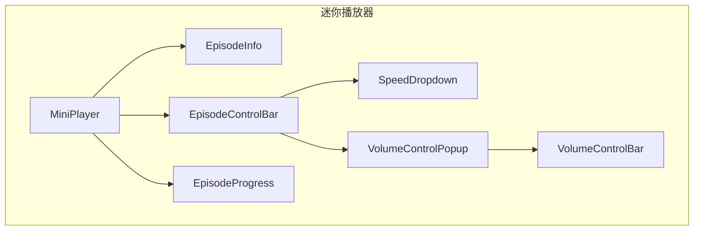
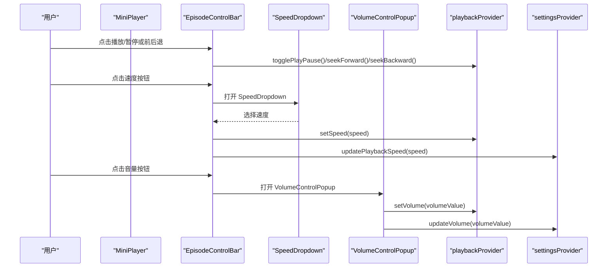
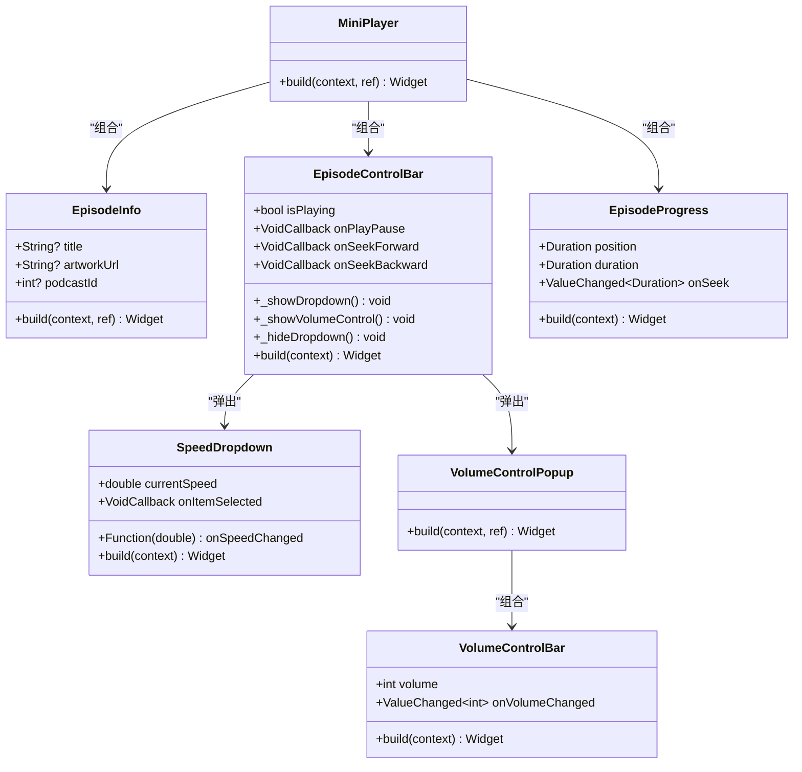
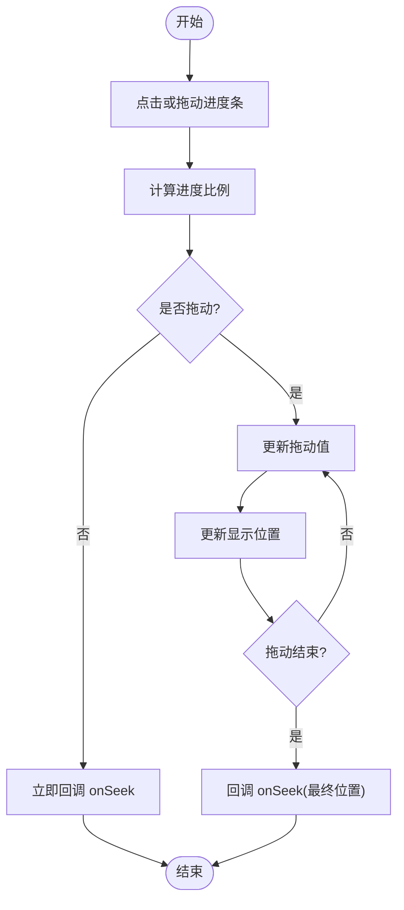
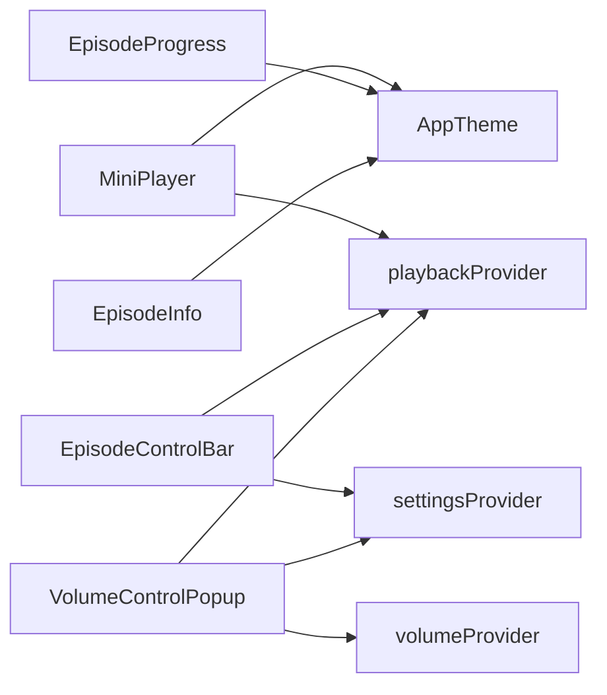

# MiniPlayer 迷你播放器

<cite>
**本文引用的文件**   
- [mini_player.dart](file://lib/presentation/widgets/organisms/mini_player/mini_player.dart)
- [episode_control_bar.dart](file://lib/presentation/widgets/organisms/mini_player/episode_control_bar/episode_control_bar.dart)
- [volume_control_bar.dart](file://lib/presentation/widgets/organisms/mini_player/volume_control_bar/volume_control_bar.dart)
- [volume_control_popup.dart](file://lib/presentation/widgets/organisms/mini_player/volume_control_bar/volume_control_popup.dart)
- [episode_info.dart](file://lib/presentation/widgets/organisms/mini_player/episode_info.dart)
- [episode_progress.dart](file://lib/presentation/widgets/organisms/mini_player/episode_progress.dart)
- [speed_dropdown.dart](file://lib/presentation/widgets/organisms/mini_player/speed_dropdown.dart)
</cite>

## 目录
1. [简介](#简介)
2. [项目结构](#项目结构)
3. [核心组件](#核心组件)
4. [架构总览](#架构总览)
5. [详细组件分析](#详细组件分析)
6. [依赖关系分析](#依赖关系分析)
7. [性能考量](#性能考量)
8. [故障排查指南](#故障排查指南)
9. [结论](#结论)
10. [附录：使用示例与最佳实践](#附录使用示例与最佳实践)

## 简介
MiniPlayer 是应用中的迷你播放器，提供播放控制、进度条、音量调节、播放速度设置和剧集信息显示等核心功能。它由多个子组件协作完成：EpisodeInfo（剧集信息）、EpisodeControlBar（剧集控制栏）、EpisodeProgress（剧集进度）以及 SpeedDropdown（速度下拉菜单），并通过 Overlay 弹出 VolumeControlPopup（音量控制弹窗）实现音量调节。该组件通过 Riverpod 状态管理，与 playbackProvider、settingsProvider 等 Provider 集成，实现播放状态的实时更新和用户交互响应。

## 项目结构
MiniPlayer 及其子组件位于 presentation 层的 widgets/organisms/mini_player 目录下，采用按功能划分的组织方式。主入口为 MiniPlayer，内部组合 EpisodeInfo、EpisodeControlBar、EpisodeProgress；EpisodeControlBar 进一步组合播放控制按钮、速度下拉菜单和音量控制弹窗。

图表来源 
- [mini_player.dart:1-54](file://lib/presentation/widgets/organisms/mini_player/mini_player.dart#L1-L54)
- [episode_control_bar.dart:1-315](file://lib/presentation/widgets/organisms/mini_player/episode_control_bar/episode_control_bar.dart#L1-L315)
- [volume_control_bar.dart:1-238](file://lib/presentation/widgets/organisms/mini_player/volume_control_bar/volume_control_bar.dart#L1-L238)
- [volume_control_popup.dart:1-24](file://lib/presentation/widgets/organisms/mini_player/volume_control_bar/volume_control_popup.dart#L1-L24)
- [episode_info.dart:1-71](file://lib/presentation/widgets/organisms/mini_player/episode_info.dart#L1-L71)
- [episode_progress.dart:1-288](file://lib/presentation/widgets/organisms/mini_player/episode_progress.dart#L1-L288)
- [speed_dropdown.dart:1-63](file://lib/presentation/widgets/organisms/mini_player/speed_dropdown.dart#L1-L63)

章节来源
- [mini_player.dart:1-54](file://lib/presentation/widgets/organisms/mini_player/mini_player.dart#L1-L54)

## 核心组件
- MiniPlayer：聚合剧集信息、控制栏与进度条，订阅 playbackProvider 获取当前剧集、播放状态、当前位置与时长，并转发用户操作到 playbackProvider.notifier。
- EpisodeInfo：显示封面图、剧集标题与播客标题，支持异步加载播客信息。
- EpisodeControlBar：包含播放速度、后退/前进、播放/暂停、音量控制按钮；使用 Overlay 展示 SpeedDropdown 与 VolumeControlPopup，确保同一时间仅显示一个弹出窗口。
- EpisodeProgress：自定义绘制进度轨道与拖动手柄，支持点击与拖动跳转播放位置，并在拖动时实时反馈。
- SpeedDropdown：列出可选播放速度，选中项高亮，选择后回调更新速度与持久化设置。
- VolumeControlPopup + VolumeControlBar：弹出式音量控制，监听 volumeProvider，调用 playbackProvider.setVolume 与 settingsProvider.updateVolume。

章节来源
- [mini_player.dart:1-54](file://lib/presentation/widgets/organisms/mini_player/mini_player.dart#L1-L54)
- [episode_info.dart:1-71](file://lib/presentation/widgets/organisms/mini_player/episode_info.dart#L1-L71)
- [episode_control_bar.dart:1-315](file://lib/presentation/widgets/organisms/mini_player/episode_control_bar/episode_control_bar.dart#L1-L315)
- [episode_progress.dart:1-288](file://lib/presentation/widgets/organisms/mini_player/episode_progress.dart#L1-L288)
- [speed_dropdown.dart:1-63](file://lib/presentation/widgets/organisms/mini_player/speed_dropdown.dart#L1-L63)
- [volume_control_popup.dart:1-24](file://lib/presentation/widgets/organisms/mini_player/volume_control_bar/volume_control_popup.dart#L1-L24)
- [volume_control_bar.dart:1-238](file://lib/presentation/widgets/organisms/mini_player/volume_control_bar/volume_control_bar.dart#L1-L238)

## 架构总览
MiniPlayer 以 ConsumerWidget/ConsumerStatefulWidget 形式消费 Riverpod 状态，将 UI 与业务逻辑解耦。播放相关状态集中在 playbackProvider，设置（如速度与音量）在 settingsProvider 中持久化。UI 层通过 ref.watch 订阅状态变化，ref.read(notifier).xxx 触发状态变更。Overlay 用于弹出菜单与音量控制，避免层级冲突。

图表来源 
- [episode_control_bar.dart:1-315](file://lib/presentation/widgets/organisms/mini_player/episode_control_bar/episode_control_bar.dart#L1-L315)
- [speed_dropdown.dart:1-63](file://lib/presentation/widgets/organisms/mini_player/speed_dropdown.dart#L1-L63)
- [volume_control_popup.dart:1-24](file://lib/presentation/widgets/organisms/mini_player/volume_control_bar/volume_control_popup.dart#L1-L24)

## 详细组件分析

### MiniPlayer
- 职责：组合 EpisodeInfo、EpisodeControlBar、EpisodeProgress；读取 playbackProvider 的 currentEpisode、isPlaying、currentPosition、duration；转发 onSeek/onPlayPause/onSeekForward/onSeekBackward 到 playbackProvider.notifier。
- 主题：根据平台亮度选择 AppTheme，设置背景色与内边距。
- 事件流：用户交互直接调用 provider notifier，不持有本地播放状态，保证单一数据源。

章节来源
- [mini_player.dart:1-54](file://lib/presentation/widgets/organisms/mini_player/mini_player.dart#L1-L54)

### EpisodeInfo
- 属性：title、artworkUrl、podcastId。
- 行为：根据 podcastId 异步加载播客信息，显示播客标题；若为空则显示默认文案。
- 样式：使用 AppTheme 提供的尺寸与文本样式，封面图使用 ArtworkImage 组件。

章节来源
- [episode_info.dart:1-71](file://lib/presentation/widgets/organisms/mini_player/episode_info.dart#L1-L71)

### EpisodeControlBar
- 属性：isPlaying、onPlayPause、onSeekForward、onSeekBackward。
- 行为：
  - 播放速度：点击按钮计算位置并显示 SpeedDropdown，选择后更新 playbackProvider 的速度并持久化到 settingsProvider。
  - 音量控制：点击按钮计算位置并显示 VolumeControlPopup，内部通过 VolumeControlBar 调整音量。
  - 播放控制：后退/前进/播放暂停按钮分别调用对应回调。
- 弹出窗口管理：使用静态变量跟踪当前 OverlayEntry，确保同时仅显示一个弹出窗口；点击遮罩层关闭。

章节来源
- [episode_control_bar.dart:1-315](file://lib/presentation/widgets/organisms/mini_player/episode_control_bar/episode_control_bar.dart#L1-L315)

### EpisodeProgress
- 属性：position、duration、onSeek、颜色与尺寸参数。
- 行为：
  - 计算进度比例，支持点击与水平拖动调整播放位置。
  - 拖动过程中实时更新显示位置，结束拖动时回调 onSeek。
  - 自定义绘制进度轨道与拖动手柄，悬停或拖动时显示手柄。
- 时间格式化：自动判断是否超过一小时，输出 mm:ss 或 hh:mm:ss。

章节来源
- [episode_progress.dart:1-288](file://lib/presentation/widgets/organisms/mini_player/episode_progress.dart#L1-L288)

### SpeedDropdown
- 属性：currentSpeed、onSpeedChanged、onItemSelected。
- 行为：渲染固定速度选项列表，选中项显示勾选图标；选择后回调 onSpeedChanged 并关闭下拉菜单。

章节来源
- [speed_dropdown.dart:1-63](file://lib/presentation/widgets/organisms/mini_player/speed_dropdown.dart#L1-L63)

### VolumeControlPopup 与 VolumeControlBar
- VolumeControlPopup：订阅 volumeProvider，将 0~1 的值转换为 0~100 传给 VolumeControlBar；回调时转换回 0~1 并调用 playbackProvider.setVolume 与 settingsProvider.updateVolume。
- VolumeControlBar：自定义绘制进度轨道与拖动手柄，支持点击与拖动调整音量，实时回调 onVolumeChanged。

章节来源
- [volume_control_popup.dart:1-24](file://lib/presentation/widgets/organisms/mini_player/volume_control_bar/volume_control_popup.dart#L1-L24)
- [volume_control_bar.dart:1-238](file://lib/presentation/widgets/organisms/mini_player/volume_control_bar/volume_control_bar.dart#L1-L238)

#### 类图（代码级关系）

图表来源 
- [mini_player.dart:1-54](file://lib/presentation/widgets/organisms/mini_player/mini_player.dart#L1-L54)
- [episode_control_bar.dart:1-315](file://lib/presentation/widgets/organisms/mini_player/episode_control_bar/episode_control_bar.dart#L1-L315)
- [episode_progress.dart:1-288](file://lib/presentation/widgets/organisms/mini_player/episode_progress.dart#L1-L288)
- [speed_dropdown.dart:1-63](file://lib/presentation/widgets/organisms/mini_player/speed_dropdown.dart#L1-L63)
- [volume_control_popup.dart:1-24](file://lib/presentation/widgets/organisms/mini_player/volume_control_bar/volume_control_popup.dart#L1-L24)
- [volume_control_bar.dart:1-238](file://lib/presentation/widgets/organisms/mini_player/volume_control_bar/volume_control_bar.dart#L1-L238)

#### 进度条交互流程图

图表来源 
- [episode_progress.dart:1-288](file://lib/presentation/widgets/organisms/mini_player/episode_progress.dart#L1-L288)

## 依赖关系分析
- 状态管理：MiniPlayer 与子组件通过 flutter_riverpod 消费 playbackProvider、settingsProvider、volumeProvider 等。
- 外部依赖：lucide_icons_flutter 提供图标；ArtworkImage 用于封面图；AppTheme 提供主题样式。
- 耦合度：UI 与状态分离良好，组件间通过回调与 Provider 通信，避免直接引用复杂对象。

图表来源 
- [mini_player.dart:1-54](file://lib/presentation/widgets/organisms/mini_player/mini_player.dart#L1-L54)
- [episode_control_bar.dart:1-315](file://lib/presentation/widgets/organisms/mini_player/episode_control_bar/episode_control_bar.dart#L1-L315)
- [volume_control_popup.dart:1-24](file://lib/presentation/widgets/organisms/mini_player/volume_control_bar/volume_control_popup.dart#L1-L24)
- [episode_progress.dart:1-288](file://lib/presentation/widgets/organisms/mini_player/episode_progress.dart#L1-L288)
- [episode_info.dart:1-71](file://lib/presentation/widgets/organisms/mini_player/episode_info.dart#L1-L71)

章节来源
- [mini_player.dart:1-54](file://lib/presentation/widgets/organisms/mini_player/mini_player.dart#L1-L54)
- [episode_control_bar.dart:1-315](file://lib/presentation/widgets/organisms/mini_player/episode_control_bar/episode_control_bar.dart#L1-L315)
- [volume_control_popup.dart:1-24](file://lib/presentation/widgets/organisms/mini_player/volume_control_bar/volume_control_popup.dart#L1-L24)
- [episode_progress.dart:1-288](file://lib/presentation/widgets/organisms/mini_player/episode_progress.dart#L1-L288)
- [episode_info.dart:1-71](file://lib/presentation/widgets/organisms/mini_player/episode_info.dart#L1-L71)

## 性能考量
- 自定义绘制：EpisodeProgress 与 VolumeControlBar 使用 CustomPainter 绘制轨道与手柄，减少 Material 组件开销，提升渲染效率。
- 状态订阅：通过 ref.watch 精确订阅所需字段，避免不必要的重建。
- 弹出窗口管理：EpisodeControlBar 使用静态变量跟踪 OverlayEntry，防止内存泄漏与重复显示。
- 手势处理：仅在需要时更新局部状态（如 _isDragging、_dragValue），降低重绘范围。

[本节为通用指导，无需特定文件引用]

## 故障排查指南
- 弹出窗口重叠或无法关闭：检查 EpisodeControlBar 的 _currentDropdownOverlay 是否正确清理；确认遮罩层 GestureDetector 的 onTap 能触发 _hideDropdown。
- 进度条拖动不生效：确认 _trackKey 已正确绑定到 SizedBox；检查 onHorizontalDragStart/Update/End 是否调用 _getTrackRenderBox 并计算 localPosition。
- 音量无变化：确认 VolumeControlPopup 的 onVolumeChanged 回调将 0~100 转换为 0~1 并调用 playbackProvider.setVolume；检查 settingsProvider.updateVolume 是否被调用。
- 速度选择不生效：确认 SpeedDropdown 的 onSpeedChanged 回调传入正确的 speed 值，且 EpisodeControlBar 调用 playbackProvider.setSpeed 与 settingsProvider.updatePlaybackSpeed。

章节来源
- [episode_control_bar.dart:1-315](file://lib/presentation/widgets/organisms/mini_player/episode_control_bar/episode_control_bar.dart#L1-L315)
- [episode_progress.dart:1-288](file://lib/presentation/widgets/organisms/mini_player/episode_progress.dart#L1-L288)
- [volume_control_popup.dart:1-24](file://lib/presentation/widgets/organisms/mini_player/volume_control_bar/volume_control_popup.dart#L1-L24)
- [speed_dropdown.dart:1-63](file://lib/presentation/widgets/organisms/mini_player/speed_dropdown.dart#L1-L63)

## 结论
MiniPlayer 通过清晰的组件拆分与 Riverpod 状态管理，实现了完整的迷你播放器功能。其自定义绘制与 Overlay 弹出机制保证了良好的用户体验与性能表现。建议在实际集成中确保 playbackProvider 与 settingsProvider 的正确配置，以实现后台播放、锁屏控制与通知栏集成的完整体验。

[本节为总结性内容，无需特定文件引用]

## 附录：使用示例与最佳实践
- 集成音频播放服务：
  - 在 MiniPlayer 中通过 ref.read(playbackProvider.notifier).togglePlayPause()/seekTo()/setSpeed()/setVolume() 控制播放。
  - 使用 ref.watch(playbackProvider) 获取 currentEpisode、isPlaying、currentPosition、duration 以驱动 UI。
- 实时更新播放状态：
  - 确保 playbackProvider 在播放状态变化时发出更新，使 MiniPlayer 与子组件自动刷新。
- 处理用户交互：
  - EpisodeControlBar 的回调应直接调用 provider notifier，避免在组件内维护播放状态。
  - EpisodeProgress 与 VolumeControlBar 的 onSeek/onVolumeChanged 回调需转换为 Duration/0~1 数值并调用相应方法。
- 后台播放、锁屏控制与通知栏集成：
  - 在 playbackProvider 中集成系统媒体会话（如 Android MediaSession、iOS AVAudioSession），确保锁屏控件与通知栏显示正常。
  - 在 settingsProvider 中持久化速度与音量，以便应用重启后恢复。
- 手势与动画优化：
  - 使用 MouseRegion 与 GestureDetector 提供即时反馈；CustomPainter 绘制减少布局开销。
  - 弹出窗口计算位置时考虑屏幕边界，避免超出可视区域。

[本节为通用指导，无需特定文件引用]