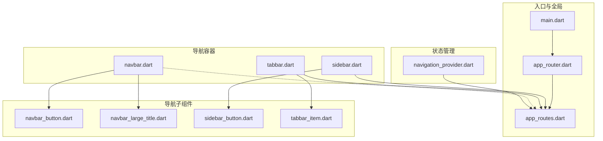
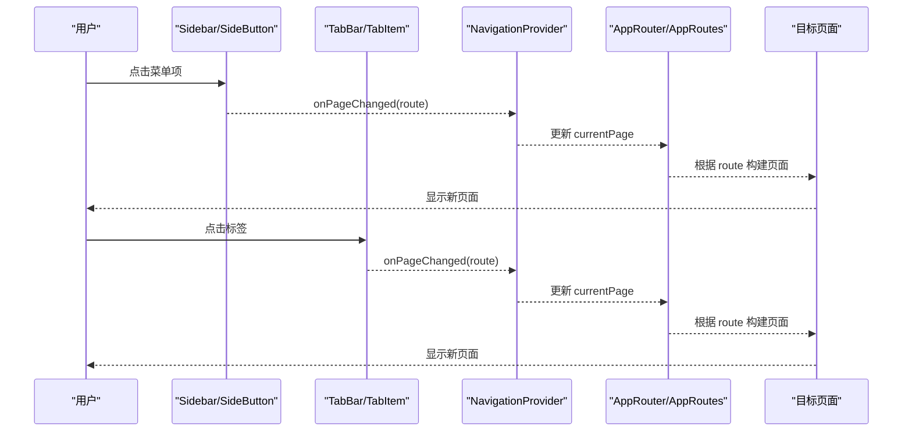
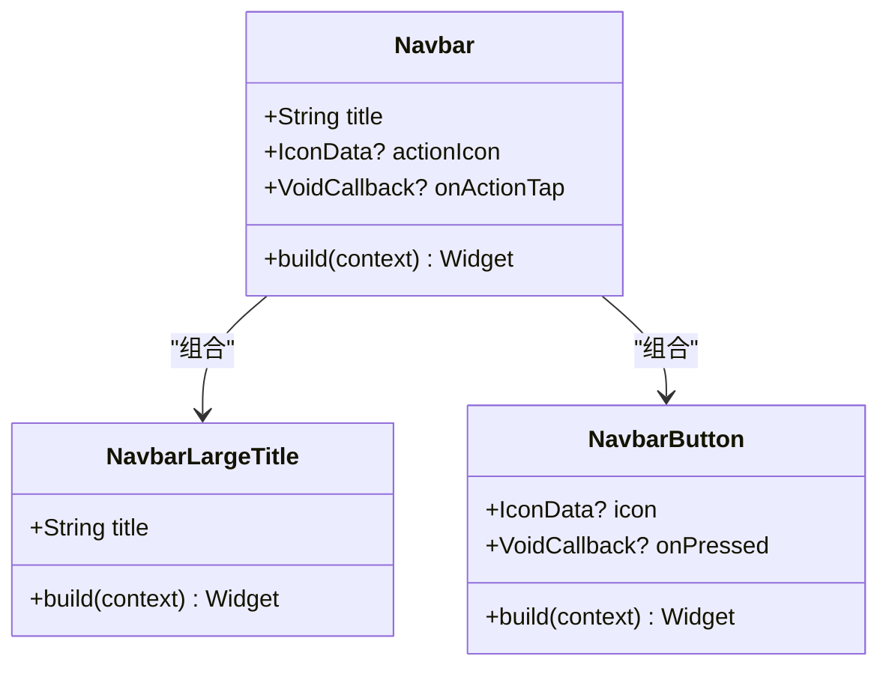
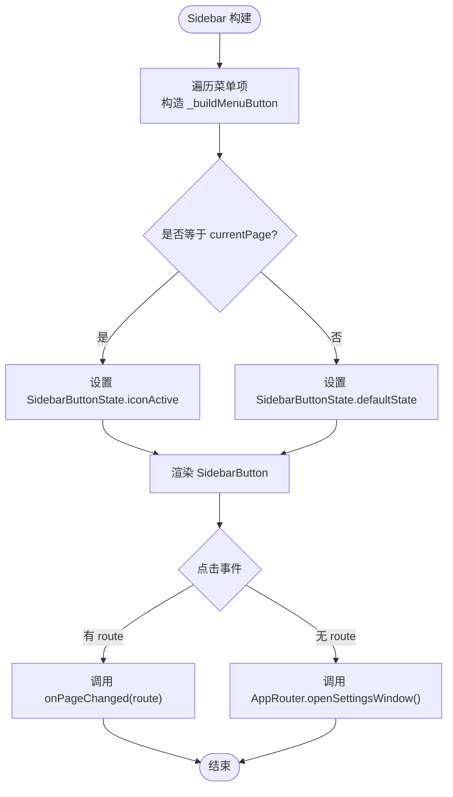
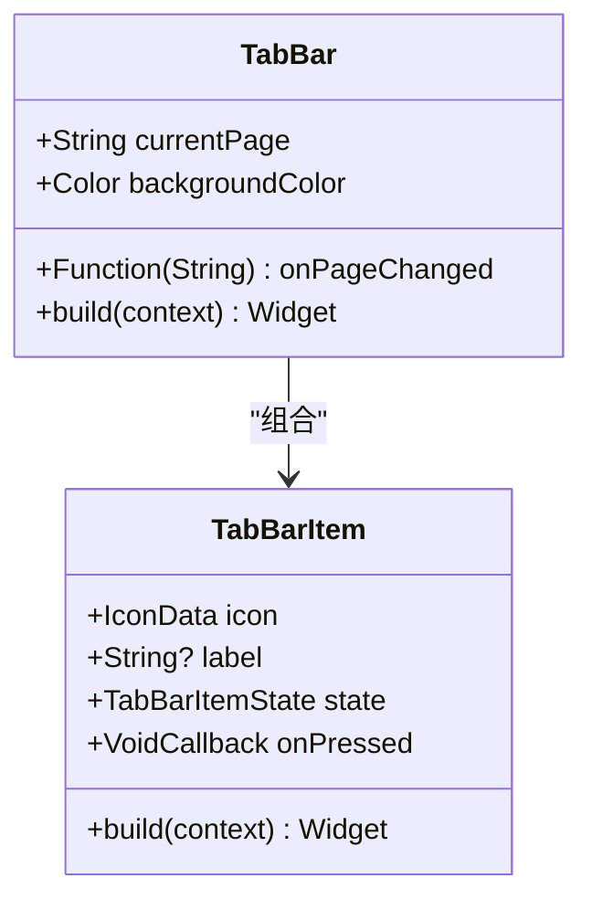
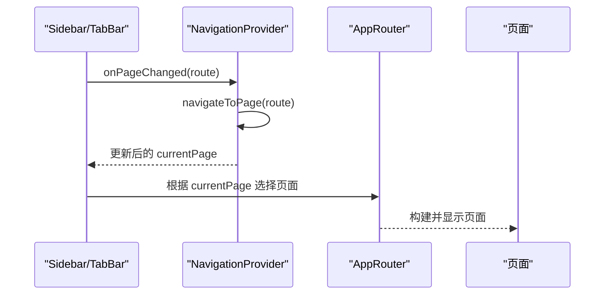
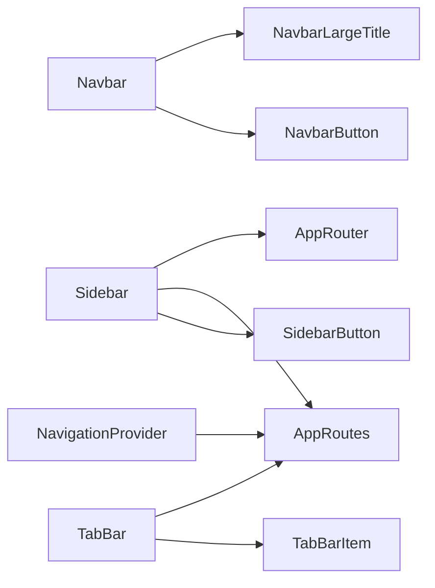

# 导航组件

<cite>
**本文引用的文件**   
- [lib/presentation/widgets/organisms/navbar/navbar.dart](file://lib/presentation/widgets/organisms/navbar/navbar.dart)
- [lib/presentation/widgets/organisms/navbar/navbar_button.dart](file://lib/presentation/widgets/organisms/navbar/navbar_button.dart)
- [lib/presentation/widgets/organisms/navbar/navbar_large_title.dart](file://lib/presentation/widgets/organisms/navbar/navbar_large_title.dart)
- [lib/presentation/widgets/organisms/sidebar/sidebar.dart](file://lib/presentation/widgets/organisms/sidebar/sidebar.dart)
- [lib/presentation/widgets/organisms/sidebar/sidebar_button.dart](file://lib/presentation/widgets/organisms/sidebar/sidebar_button.dart)
- [lib/presentation/widgets/organisms/tabbar/tabbar.dart](file://lib/presentation/widgets/organisms/tabbar/tabbar.dart)
- [lib/presentation/widgets/organisms/tabbar/tabbar_item.dart](file://lib/presentation/widgets/organisms/tabbar/tabbar_item.dart)
- [lib/presentation/providers/navigation_provider.dart](file://lib/presentation/providers/navigation_provider.dart)
- [lib/core/router/app_routes.dart](file://lib/core/router/app_routes.dart)
- [lib/core/router/app_router.dart](file://lib/core/router/app_router.dart)
- [lib/main.dart](file://lib/main.dart)
</cite>

## 目录
1. [简介](#简介)
2. [项目结构](#项目结构)
3. [核心组件](#核心组件)
4. [架构总览](#架构总览)
5. [详细组件分析](#详细组件分析)
6. [依赖关系分析](#依赖关系分析)
7. [性能与体验优化](#性能与体验优化)
8. [故障排查指南](#故障排查指南)
9. [结论](#结论)
10. [附录：使用示例与最佳实践](#附录使用示例与最佳实践)

## 简介
本文件聚焦于应用的导航体系，涵盖 Navbar（导航栏）、Sidebar（侧边栏）、TabBar（标签栏）三大导航容器及其子组件 navbar_button、navbar_large_title、sidebar_button、tabbar_item。文档将说明各组件的职责、属性配置、路由集成方式、状态管理策略，以及响应式布局与多端适配要点，并给出动画与交互反馈的实现思路与优化建议。

## 项目结构
导航相关代码主要分布在 presentation 层的 widgets/organisms 与 providers 层，路由常量与路由生成集中在 core/router。入口 main.dart 负责在不同平台初始化应用窗口与 ProviderScope，为导航提供运行环境。

图表来源 
- [lib/main.dart:106-176](file://lib/main.dart#L106-L176)
- [lib/core/router/app_router.dart:20-132](file://lib/core/router/app_router.dart#L20-L132)
- [lib/core/router/app_routes.dart:1-16](file://lib/core/router/app_routes.dart#L1-L16)
- [lib/presentation/widgets/organisms/navbar/navbar.dart:5-37](file://lib/presentation/widgets/organisms/navbar/navbar.dart#L5-L37)
- [lib/presentation/widgets/organisms/sidebar/sidebar.dart:8-146](file://lib/presentation/widgets/organisms/sidebar/sidebar.dart#L8-L146)
- [lib/presentation/widgets/organisms/tabbar/tabbar.dart:8-83](file://lib/presentation/widgets/organisms/tabbar/tabbar.dart#L8-L83)
- [lib/presentation/providers/navigation_provider.dart:62-115](file://lib/presentation/providers/navigation_provider.dart#L62-L115)

章节来源
- [lib/main.dart:106-176](file://lib/main.dart#L106-L176)
- [lib/core/router/app_routes.dart:1-16](file://lib/core/router/app_routes.dart#L1-L16)
- [lib/core/router/app_router.dart:20-132](file://lib/core/router/app_router.dart#L20-L132)

## 核心组件
- Navbar（导航栏）
  - 职责：页面顶部标题与操作按钮的展示区，组合大标题与右侧按钮。
  - 关键属性：title、actionIcon、onActionTap。
  - 子组件：NavbarLargeTitle（大标题文本）、NavbarButton（圆形图标按钮）。
  - 布局：SafeArea + Row，两端对齐。

- Sidebar（侧边栏）
  - 职责：桌面端左侧固定宽度菜单，支持多条目切换页面。
  - 关键属性：currentPage、onPageChanged、backgroundColor。
  - 子组件：SidebarButton（带悬停/按下/选中状态的按钮）。
  - 路由：通过 AppRoutes 常量与 AppRouter 进行页面跳转或打开独立窗口（如设置）。

- TabBar（底部标签栏）
  - 职责：移动端底部标签切换，当前实现包含 Queue 与 Library 两个标签。
  - 关键属性：currentPage、onPageChanged、backgroundColor。
  - 子组件：TabBarItem（图标+可选文字，active/default 两种状态）。
  - 路由：通过 AppRoutes 常量与 onPageChanged 回调驱动上层路由切换。

- 状态管理（NavigationProvider）
  - NavigationState：维护 currentPage 与 detailStack（详情页栈）。
  - NavigationNotifier：提供 navigateToPage、showPodcastDetail、showEpisodeDetail、goBack、clearDetail 等方法。
  - 暴露 Provider：currentPageProvider、currentDetailProvider、hasDetailProvider。

章节来源
- [lib/presentation/widgets/organisms/navbar/navbar.dart:5-37](file://lib/presentation/widgets/organisms/navbar/navbar.dart#L5-L37)
- [lib/presentation/widgets/organisms/navbar/navbar_button.dart:3-25](file://lib/presentation/widgets/organisms/navbar/navbar_button.dart#L3-L25)
- [lib/presentation/widgets/organisms/navbar/navbar_large_title.dart:3-19](file://lib/presentation/widgets/organisms/navbar/navbar_large_title.dart#L3-L19)
- [lib/presentation/widgets/organisms/sidebar/sidebar.dart:8-146](file://lib/presentation/widgets/organisms/sidebar/sidebar.dart#L8-L146)
- [lib/presentation/widgets/organisms/sidebar/sidebar_button.dart:10-127](file://lib/presentation/widgets/organisms/sidebar/sidebar_button.dart#L10-L127)
- [lib/presentation/widgets/organisms/tabbar/tabbar.dart:8-83](file://lib/presentation/widgets/organisms/tabbar/tabbar.dart#L8-L83)
- [lib/presentation/widgets/organisms/tabbar/tabbar_item.dart:10-71](file://lib/presentation/widgets/organisms/tabbar/tabbar_item.dart#L10-L71)
- [lib/presentation/providers/navigation_provider.dart:37-115](file://lib/presentation/providers/navigation_provider.dart#L37-L115)

## 架构总览
导航由“容器组件 + 子组件 + 路由常量 + 路由生成器 + 状态管理”构成。Sidebar/TabBar 通过 currentPage 与 onPageChanged 向上汇报状态变化；Navbar 仅负责展示与事件透传。AppRouter 集中处理页面构建与参数解析；NavigationProvider 管理详情页栈与当前页。

图表来源 
- [lib/presentation/widgets/organisms/sidebar/sidebar.dart:122-145](file://lib/presentation/widgets/organisms/sidebar/sidebar.dart#L122-L145)
- [lib/presentation/widgets/organisms/tabbar/tabbar.dart:62-82](file://lib/presentation/widgets/organisms/tabbar/tabbar.dart#L62-L82)
- [lib/presentation/providers/navigation_provider.dart:70-75](file://lib/presentation/providers/navigation_provider.dart#L70-L75)
- [lib/core/router/app_router.dart:21-132](file://lib/core/router/app_router.dart#L21-L132)
- [lib/core/router/app_routes.dart:1-16](file://lib/core/router/app_routes.dart#L1-L16)

## 详细组件分析

### Navbar（导航栏）
- 结构与职责
  - 使用 SafeArea 包裹，内部 Row 左右分布：左侧为大标题，右侧为操作按钮。
  - 不直接参与路由，仅透传 onActionTap。
- 属性与行为
  - title：字符串标题。
  - actionIcon：可选图标，未提供时隐藏按钮。
  - onActionTap：点击回调，通常用于返回、刷新或打开抽屉等。
- 子组件
  - NavbarLargeTitle：粗体大字号标题文本。
  - NavbarButton：圆形背景按钮，点击触发回调。
- 响应式与主题
  - 颜色硬编码，建议接入主题系统以支持深色模式。
- 动画与交互
  - 当前无过渡动画，可考虑在父级使用 AnimatedSwitcher 或 Hero 做页面切换增强。

图表来源 
- [lib/presentation/widgets/organisms/navbar/navbar.dart:5-37](file://lib/presentation/widgets/organisms/navbar/navbar.dart#L5-L37)
- [lib/presentation/widgets/organisms/navbar/navbar_large_title.dart:3-19](file://lib/presentation/widgets/organisms/navbar/navbar_large_title.dart#L3-L19)
- [lib/presentation/widgets/organisms/navbar/navbar_button.dart:3-25](file://lib/presentation/widgets/organisms/navbar/navbar_button.dart#L3-L25)

章节来源
- [lib/presentation/widgets/organisms/navbar/navbar.dart:5-37](file://lib/presentation/widgets/organisms/navbar/navbar.dart#L5-L37)
- [lib/presentation/widgets/organisms/navbar/navbar_button.dart:3-25](file://lib/presentation/widgets/organisms/navbar/navbar_button.dart#L3-L25)
- [lib/presentation/widgets/organisms/navbar/navbar_large_title.dart:3-19](file://lib/presentation/widgets/organisms/navbar/navbar_large_title.dart#L3-L19)

### Sidebar（侧边栏）
- 结构与职责
  - 固定宽度垂直列，包含多个菜单项与一条分隔线。
  - 每个菜单项通过 SidebarButton 渲染，并根据 currentPage 决定 active 状态。
- 属性与行为
  - currentPage：当前激活的路由路径。
  - onPageChanged：回调通知上层切换页面。
  - backgroundColor：背景色，默认白色。
- 路由集成
  - 使用 AppRoutes 常量作为路由标识。
  - 部分按钮（如设置）调用 AppRouter.openSettingsWindow() 打开独立窗口。
- 交互与动画
  - SidebarButton 使用 MouseRegion 与 GestureDetector 实现悬停、按下、选中状态切换，配合 AnimatedContainer 平滑过渡。

图表来源 
- [lib/presentation/widgets/organisms/sidebar/sidebar.dart:122-145](file://lib/presentation/widgets/organisms/sidebar/sidebar.dart#L122-L145)
- [lib/core/router/app_router.dart:171-185](file://lib/core/router/app_router.dart#L171-L185)
- [lib/core/router/app_routes.dart:1-16](file://lib/core/router/app_routes.dart#L1-L16)

章节来源
- [lib/presentation/widgets/organisms/sidebar/sidebar.dart:8-146](file://lib/presentation/widgets/organisms/sidebar/sidebar.dart#L8-L146)
- [lib/presentation/widgets/organisms/sidebar/sidebar_button.dart:10-127](file://lib/presentation/widgets/organisms/sidebar/sidebar_button.dart#L10-L127)
- [lib/core/router/app_router.dart:171-185](file://lib/core/router/app_router.dart#L171-L185)
- [lib/core/router/app_routes.dart:1-16](file://lib/core/router/app_routes.dart#L1-L16)

### TabBar（底部标签栏）
- 结构与职责
  - 底部 ColoredBox + SafeArea，内部 Row 均分两个 TabBarItem。
  - 通过 currentPage 与 TabBarItemState.active 控制高亮。
- 属性与行为
  - currentPage：当前激活的路由路径。
  - onPageChanged：回调通知上层切换页面。
  - backgroundColor：背景色。
- 路由集成
  - 使用 AppRoutes 常量作为路由标识，点击后调用 onPageChanged。
- 交互与动画
  - TabBarItem 根据 active/default 状态改变内容与背景色，简洁直观。

图表来源 
- [lib/presentation/widgets/organisms/tabbar/tabbar.dart:8-83](file://lib/presentation/widgets/organisms/tabbar/tabbar.dart#L8-L83)
- [lib/presentation/widgets/organisms/tabbar/tabbar_item.dart:10-71](file://lib/presentation/widgets/organisms/tabbar/tabbar_item.dart#L10-L71)

章节来源
- [lib/presentation/widgets/organisms/tabbar/tabbar.dart:8-83](file://lib/presentation/widgets/organisms/tabbar/tabbar.dart#L8-L83)
- [lib/presentation/widgets/organisms/tabbar/tabbar_item.dart:10-71](file://lib/presentation/widgets/organisms/tabbar/tabbar_item.dart#L10-L71)
- [lib/core/router/app_routes.dart:1-16](file://lib/core/router/app_routes.dart#L1-L16)

### 子组件细节

#### navbar_button（导航按钮）
- 功能：圆形背景按钮，承载图标与点击回调。
- 属性：icon、onPressed。
- 交互：GestureDetector 监听 onTap。
- 样式：圆角与内边距，颜色硬编码。

章节来源
- [lib/presentation/widgets/organisms/navbar/navbar_button.dart:3-25](file://lib/presentation/widgets/organisms/navbar/navbar_button.dart#L3-L25)

#### navbar_large_title（大标题导航）
- 功能：展示页面大标题。
- 属性：title。
- 样式：粗体、较大字号、黑色。

章节来源
- [lib/presentation/widgets/organisms/navbar/navbar_large_title.dart:3-19](file://lib/presentation/widgets/organisms/navbar/navbar_large_title.dart#L3-L19)

#### sidebar_button（侧边栏按钮）
- 功能：侧边栏菜单项，支持图标与可选文字。
- 属性：icon、label、state、onPressed。
- 状态：defaultState、iconActive。
- 交互：MouseRegion 悬停、GestureDetector 按下/抬起/取消/点击。
- 动画：AnimatedContainer 平滑过渡背景色。

章节来源
- [lib/presentation/widgets/organisms/sidebar/sidebar_button.dart:10-127](file://lib/presentation/widgets/organisms/sidebar/sidebar_button.dart#L10-L127)

#### tabbar_item（标签项）
- 功能：底部标签按钮，图标+可选文字。
- 属性：icon、label、state、onPressed。
- 状态：active、defaultState。
- 样式：根据状态切换内容与背景色。

章节来源
- [lib/presentation/widgets/organisms/tabbar/tabbar_item.dart:10-71](file://lib/presentation/widgets/organisms/tabbar/tabbar_item.dart#L10-L71)

### 路由与状态管理集成
- 路由常量：AppRoutes 集中定义所有页面路径。
- 路由生成：AppRouter.generateRoute 根据 name 构建页面，支持参数传递（如 Podcast/Episode 详情）。
- 导航状态：NavigationProvider 维护 currentPage 与 detailStack，提供导航与回退方法。
- 典型流程：Sidebar/TabBar 点击 → onPageChanged → NavigationProvider.navigateToPage → 更新 currentPage → AppRouter 构建页面。

图表来源 
- [lib/presentation/providers/navigation_provider.dart:70-75](file://lib/presentation/providers/navigation_provider.dart#L70-L75)
- [lib/core/router/app_router.dart:21-132](file://lib/core/router/app_router.dart#L21-L132)
- [lib/core/router/app_routes.dart:1-16](file://lib/core/router/app_routes.dart#L1-L16)

章节来源
- [lib/core/router/app_routes.dart:1-16](file://lib/core/router/app_routes.dart#L1-L16)
- [lib/core/router/app_router.dart:21-132](file://lib/core/router/app_router.dart#L21-L132)
- [lib/presentation/providers/navigation_provider.dart:62-115](file://lib/presentation/providers/navigation_provider.dart#L62-L115)

## 依赖关系分析
- 组件耦合
  - Navbar 低耦合，仅依赖子组件与主题样式。
  - Sidebar/TabBar 依赖 AppRoutes 常量与外部回调，保持松耦合。
  - SidebarButton/TabBarItem 为纯展示与交互组件，无业务逻辑。
- 外部依赖
  - AppRouter 依赖 Flutter Navigator 与多窗口能力（desktop_multi_window）。
  - NavigationProvider 依赖 Riverpod 的状态管理。
- 潜在循环依赖
  - 当前未发现循环导入；路由与状态分离清晰。

图表来源 
- [lib/presentation/widgets/organisms/navbar/navbar.dart:5-37](file://lib/presentation/widgets/organisms/navbar/navbar.dart#L5-L37)
- [lib/presentation/widgets/organisms/sidebar/sidebar.dart:8-146](file://lib/presentation/widgets/organisms/sidebar/sidebar.dart#L8-L146)
- [lib/presentation/widgets/organisms/tabbar/tabbar.dart:8-83](file://lib/presentation/widgets/organisms/tabbar/tabbar.dart#L8-L83)
- [lib/core/router/app_routes.dart:1-16](file://lib/core/router/app_routes.dart#L1-L16)
- [lib/core/router/app_router.dart:21-132](file://lib/core/router/app_router.dart#L21-L132)
- [lib/presentation/providers/navigation_provider.dart:62-115](file://lib/presentation/providers/navigation_provider.dart#L62-L115)

章节来源
- [lib/core/router/app_routes.dart:1-16](file://lib/core/router/app_routes.dart#L1-L16)
- [lib/core/router/app_router.dart:21-132](file://lib/core/router/app_router.dart#L21-L132)
- [lib/presentation/providers/navigation_provider.dart:62-115](file://lib/presentation/providers/navigation_provider.dart#L62-L115)

## 性能与体验优化
- 渲染性能
  - 导航容器与子组件均为 StatelessWidget，避免不必要的重建。
  - SidebarButton 使用 AnimatedContainer 仅在状态变化时动画，减少开销。
- 路由性能
  - AppRouter 使用 PageRouteBuilder 且 transitionDuration 为零，适合快速切换。
  - 建议在复杂页面中使用 IndexedStack 或 KeepAlive 缓存已访问页面（按需）。
- 主题与样式
  - 当前多处颜色硬编码，建议统一接入主题系统，支持深色模式与品牌定制。
- 响应式与多端适配
  - 桌面端：Sidebar 固定宽度，适合宽屏；可考虑展开/收起面板。
  - 移动端：TabBar 底部标签，注意 SafeArea 与触摸区域大小。
  - 平板/横屏：可结合断点切换为侧边栏+内容区的布局。
- 动画与交互反馈
  - 可在页面切换处添加淡入/滑入过渡，提升流畅感。
  - 按钮点击增加短暂缩放或阴影变化，强化反馈。

[本节为通用指导，无需引用具体文件]

## 故障排查指南
- 路由无法跳转
  - 检查 AppRoutes 常量是否正确传入。
  - 确认 AppRouter.generateRoute 中对应 case 存在。
  - 若需参数，确保 settings.arguments 类型匹配。
- 状态不同步
  - 检查 NavigationProvider 的 navigateToPage 是否被调用。
  - 确认 currentPageProvider 是否被正确订阅。
- 样式异常
  - 颜色硬编码导致主题不一致，建议替换为主题变量。
  - SafeArea 设置不当可能导致内容贴边或被遮挡。
- 多窗口问题
  - 设置/订阅窗口通过 AppRouter.open*Window 打开，确认 WindowController 可用。

章节来源
- [lib/core/router/app_router.dart:21-132](file://lib/core/router/app_router.dart#L21-L132)
- [lib/presentation/providers/navigation_provider.dart:70-75](file://lib/presentation/providers/navigation_provider.dart#L70-L75)
- [lib/core/router/app_router.dart:171-185](file://lib/core/router/app_router.dart#L171-L185)

## 结论
本项目导航体系清晰分层：Navbar 负责头部信息展示，Sidebar/TabBar 负责主导航切换，NavigationProvider 管理导航状态，AppRouter/AppRoutes 统一管理路由。当前实现满足基础导航需求，后续可围绕主题化、动画过渡、页面缓存与响应式布局进一步优化，以提升跨端一致性与用户体验。

[本节为总结性内容，无需引用具体文件]

## 附录：使用示例与最佳实践
- 在主页中组合导航
  - 桌面端：使用 Sidebar 作为左侧导航，右侧内容区根据 currentPage 切换页面。
  - 移动端：使用 TabBar 作为底部标签，结合 Navbar 展示页面标题与操作。
- 路由切换最佳实践
  - 统一通过 AppRoutes 常量管理路径，避免魔法字符串。
  - 使用 AppRouter 提供的 navigateTo/navigateToAndReplace 等方法简化跳转。
- 状态管理建议
  - 使用 NavigationProvider 的 navigateToPage 切换主页面，使用 showXxxDetail/goBack 管理详情页栈。
  - 在页面生命周期中清理无关状态，避免内存泄漏。
- 主题与样式
  - 将硬编码颜色替换为 Theme.of(context).colorScheme 等主题变量。
  - 为按钮与标签提供统一的 hover/pressed/active 状态样式。
- 动画与反馈
  - 在页面切换处使用 AnimatedSwitcher 或自定义过渡。
  - 为按钮点击添加短暂缩放或涟漪效果，提升交互反馈。

[本节为概念性指导，无需引用具体文件]