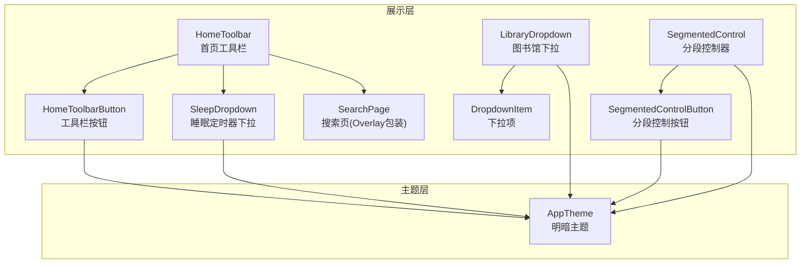
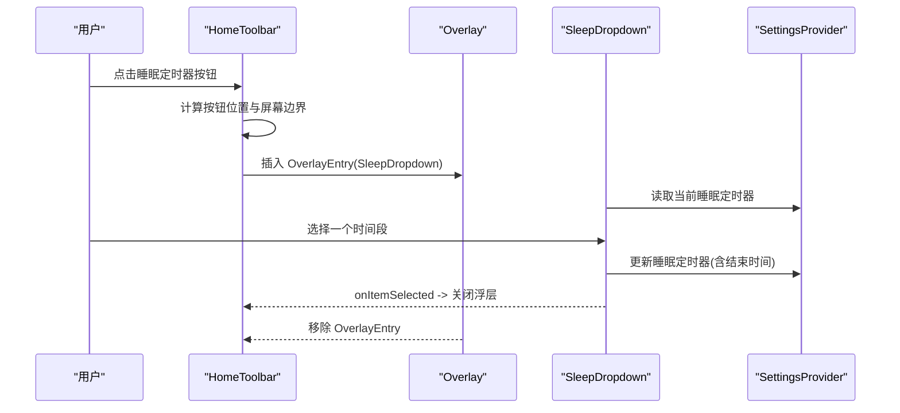
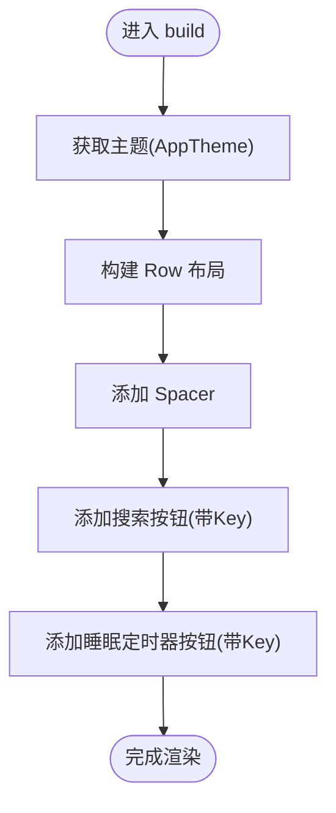
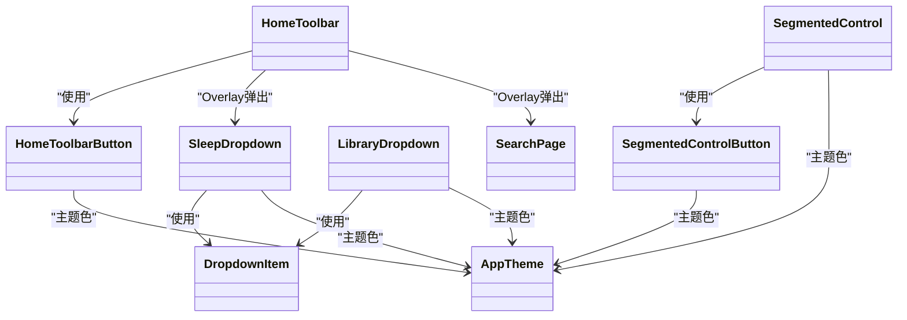
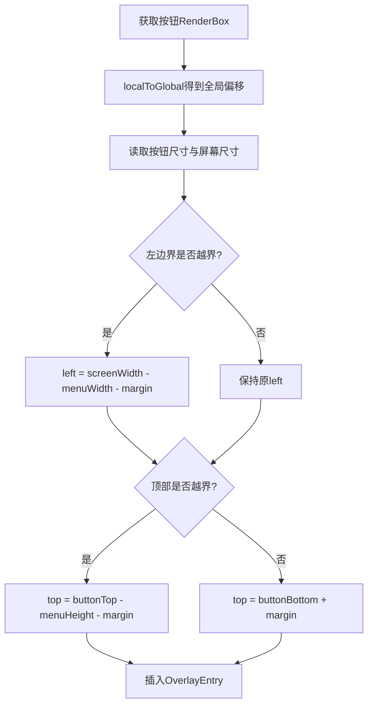

# 工具栏组件

<cite>
**本文引用的文件**
- [home_toolbar.dart](file://lib/presentation/widgets/organisms/home_toolbar/home_toolbar.dart)
- [home_toolbar_button.dart](file://lib/presentation/widgets/organisms/home_toolbar/home_toolbar_button.dart)
- [sleep_dropdown.dart](file://lib/presentation/widgets/organisms/home_toolbar/sleep_dropdown.dart)
- [library_dropdown.dart](file://lib/presentation/widgets/organisms/dropdown/library_dropdown.dart)
- [segmented_control.dart](file://lib/presentation/widgets/organisms/segmented_control/segmented_control.dart)
- [segmented_control_button.dart](file://lib/presentation/widgets/organisms/segmented_control/segmented_control_button.dart)
- [dropdown_item.dart](file://lib/presentation/widgets/atoms/dropdown_item/dropdown_item.dart)
- [search_page.dart](file://lib/presentation/features/search/search_page.dart)
- [app_theme.dart](file://lib/core/theme/app_theme.dart)
</cite>

## 目录
1. [简介](#简介)
2. [项目结构](#项目结构)
3. [核心组件](#核心组件)
4. [架构总览](#架构总览)
5. [详细组件分析](#详细组件分析)
6. [依赖关系分析](#依赖关系分析)
7. [性能考量](#性能考量)
8. [故障排查指南](#故障排查指南)
9. [结论](#结论)
10. [附录](#附录)

## 简介
本文件为工具栏相关组件的详细文档，覆盖以下能力与主题：
- HomeToolbar（首页工具栏）：底部常驻入口，集成搜索弹窗与睡眠定时器下拉菜单。
- Dropdown（下拉菜单）：通用下拉项与业务下拉（睡眠定时器、图书馆）。
- SegmentedControl（分段控制器）：轻量分段切换控件及按钮。
- 子组件：home_toolbar_button、sleep_dropdown、library_dropdown、segmented_control_button。
- 属性配置、事件处理、样式定制、定位算法、状态管理、响应式布局、触摸优化与键盘导航支持。
- 使用示例与最佳实践，帮助在不同页面中快速集成这些工具组件。

## 项目结构
工具栏组件位于 presentation 层，按“组织构件”和“原子构件”分层组织；主题在 core 层提供统一配色与明暗模式。

图表来源
- [home_toolbar.dart:1-236](file://lib/presentation/widgets/organisms/home_toolbar/home_toolbar.dart#L1-L236)
- [home_toolbar_button.dart:1-124](file://lib/presentation/widgets/organisms/home_toolbar/home_toolbar_button.dart#L1-L124)
- [sleep_dropdown.dart:1-125](file://lib/presentation/widgets/organisms/home_toolbar/sleep_dropdown.dart#L1-L125)
- [library_dropdown.dart:1-146](file://lib/presentation/widgets/organisms/dropdown/library_dropdown.dart#L1-L146)
- [segmented_control.dart:1-57](file://lib/presentation/widgets/organisms/segmented_control/segmented_control.dart#L1-L57)
- [segmented_control_button.dart:1-79](file://lib/presentation/widgets/organisms/segmented_control/segmented_control_button.dart#L1-L79)
- [dropdown_item.dart:1-160](file://lib/presentation/widgets/atoms/dropdown_item/dropdown_item.dart#L1-L160)
- [search_page.dart:1-78](file://lib/presentation/features/search/search_page.dart#L1-L78)
- [app_theme.dart:1-21](file://lib/core/theme/app_theme.dart#L1-L21)

章节来源
- [home_toolbar.dart:1-236](file://lib/presentation/widgets/organisms/home_toolbar/home_toolbar.dart#L1-L236)
- [app_theme.dart:1-21](file://lib/core/theme/app_theme.dart#L1-L21)

## 核心组件
- HomeToolbar：底部工具栏容器，负责渲染两个主要入口（搜索、睡眠定时器），并通过 Overlay 弹出对应面板。
- HomeToolbarButton：可复用工具栏按钮，支持图标或 SVG、悬停/按下态、主题色。
- SleepDropdown：睡眠定时器选择器，联动设置提供者更新当前定时选项。
- LibraryDropdown：节目库操作下拉菜单，包含查看详情、拷贝链接、取消关注、移除下载等。
- SegmentedControl：分段控制器，接收段数据与选中索引，内部渲染多个分段按钮。
- SegmentedControlButton：分段按钮，支持图标+文字、纯图标或纯文字三种形态。
- DropdownItem：通用下拉项，封装悬停/按下态与内容布局。

章节来源
- [home_toolbar.dart:1-236](file://lib/presentation/widgets/organisms/home_toolbar/home_toolbar.dart#L1-L236)
- [home_toolbar_button.dart:1-124](file://lib/presentation/widgets/organisms/home_toolbar/home_toolbar_button.dart#L1-L124)
- [sleep_dropdown.dart:1-125](file://lib/presentation/widgets/organisms/home_toolbar/sleep_dropdown.dart#L1-L125)
- [library_dropdown.dart:1-146](file://lib/presentation/widgets/organisms/dropdown/library_dropdown.dart#L1-L146)
- [segmented_control.dart:1-57](file://lib/presentation/widgets/organisms/segmented_control/segmented_control.dart#L1-L57)
- [segmented_control_button.dart:1-79](file://lib/presentation/widgets/organisms/segmented_control/segmented_control_button.dart#L1-L79)
- [dropdown_item.dart:1-160](file://lib/presentation/widgets/atoms/dropdown_item/dropdown_item.dart#L1-L160)

## 架构总览
HomeToolbar 作为入口，通过 OverlayEntry 将 SleepDropdown 或 SearchPage 以浮层形式插入到当前上下文之上。SleepDropdown 通过 Riverpod 的 settingsProvider 读写睡眠定时器状态；LibraryDropdown 暴露回调供上层执行具体业务逻辑；SegmentedControl 仅负责 UI 与选中态，由调用方维护 selectedIndex 并处理 onTap。

图表来源
- [home_toolbar.dart:26-77](file://lib/presentation/widgets/organisms/home_toolbar/home_toolbar.dart#L26-L77)
- [sleep_dropdown.dart:14-124](file://lib/presentation/widgets/organisms/home_toolbar/sleep_dropdown.dart#L14-L124)

章节来源
- [home_toolbar.dart:26-131](file://lib/presentation/widgets/organisms/home_toolbar/home_toolbar.dart#L26-L131)
- [sleep_dropdown.dart:14-124](file://lib/presentation/widgets/organisms/home_toolbar/sleep_dropdown.dart#L14-L124)

## 详细组件分析

### HomeToolbar（首页工具栏）
- 功能职责
  - 渲染底部工具栏，包含搜索与睡眠定时器入口。
  - 使用 Overlay 弹出 SleepDropdown 或 SearchPage。
  - 处理 ESC 键关闭搜索浮层。
- 关键行为
  - 定位算法：基于按钮 RenderBox 的 localToGlobal 坐标与尺寸，结合预估菜单宽高与屏幕尺寸，自动修正 left/top，确保不超出可视区域。
  - 浮层生命周期：show/hide 时维护 _currentDropdownOverlay，避免重复插入与内存泄漏。
  - 键盘交互：_SearchPageWrapper 监听 Escape 键关闭。
- 样式与主题
  - 背景与内边距来自 AppTheme 的 homeToolbarBackground 与 homeToolbarPadding。
- 使用要点
  - 为需要弹出浮层的按钮传入 GlobalKey，用于定位。
  - 通过 onPressed 触发显示逻辑。

图表来源
- [home_toolbar.dart:153-184](file://lib/presentation/widgets/organisms/home_toolbar/home_toolbar.dart#L153-L184)

章节来源
- [home_toolbar.dart:21-150](file://lib/presentation/widgets/organisms/home_toolbar/home_toolbar.dart#L21-L150)
- [home_toolbar.dart:153-184](file://lib/presentation/widgets/organisms/home_toolbar/home_toolbar.dart#L153-L184)
- [home_toolbar.dart:187-236](file://lib/presentation/widgets/organisms/home_toolbar/home_toolbar.dart#L187-L236)

### HomeToolbarButton（工具栏按钮）
- 属性
  - icon/svgPath：二选一，icon 为 Widget，svgPath 为资源路径。
  - svgSize：SVG 尺寸。
  - label：可选文本标签。
  - onPressed：点击回调。
- 交互与样式
  - MouseRegion + GestureDetector 实现悬停与按下态。
  - AnimatedContainer 过渡动画，背景色与内容色来自 AppTheme。
- 使用建议
  - 若需 SVG 图标，使用构造工厂 svg(...)。
  - 保持 icon/svgPath 唯一性，避免断言失败。

章节来源
- [home_toolbar_button.dart:6-124](file://lib/presentation/widgets/organisms/home_toolbar/home_toolbar_button.dart#L6-L124)
- [app_theme.dart:1-21](file://lib/core/theme/app_theme.dart#L1-L21)

### SleepDropdown（睡眠定时器下拉菜单）
- 功能
  - 展示多种定时选项，并在选择后更新设置提供者中的睡眠定时器。
- 状态管理
  - 通过 ref.watch(settingsProvider) 读取当前选项。
  - 通过 ref.read(settingsProvider.notifier).updateSleepTimer/clearSleepTimer 写入新值。
- 事件
  - onItemSelected：选择后通知父级关闭浮层。
- 使用示例
  - 在 HomeToolbar 中通过 Overlay 弹出，并传入 onItemSelected。

章节来源
- [sleep_dropdown.dart:8-124](file://lib/presentation/widgets/organisms/home_toolbar/sleep_dropdown.dart#L8-L124)

### LibraryDropdown（图书馆下拉菜单）
- 功能
  - 提供节目操作：查看详情、拷贝链接、取消关注、移除下载（条件显示）。
- 属性
  - onItemSelected：选择后回调（通常用于关闭菜单）。
  - onViewDetails/onCopyLinkSuccess/onUnfollow/onRemoveDownloads：各操作的回调。
  - rssUrl：用于拷贝链接。
  - hasDownloadedEpisodes：控制是否显示“移除下载”。
  - showViewDetails：控制是否显示“查看详情”。
- 事件处理
  - 拷贝链接：Clipboard.setData 后触发成功回调。
  - 取消关注/移除下载：调用对应回调。
- 使用示例
  - 在节目列表或详情页长按/点击更多按钮时弹出。

章节来源
- [library_dropdown.dart:10-146](file://lib/presentation/widgets/organisms/dropdown/library_dropdown.dart#L10-L146)

### SegmentedControl（分段控制器）
- 功能
  - 接收 segments 列表与 selectedIndex，渲染横向分段按钮组。
- 属性
  - segments：每个分段包含 label 与 icon。
  - selectedIndex：当前选中索引。
  - onTap：选中变更回调。
  - height：整体高度。
- 状态管理
  - 自身不持有状态，由外部维护 selectedIndex 并在 onTap 中更新。
- 使用示例
  - 在分类筛选、视图切换等场景中使用。

章节来源
- [segmented_control.dart:4-57](file://lib/presentation/widgets/organisms/segmented_control/segmented_control.dart#L4-L57)

### SegmentedControlButton（分段控制按钮）
- 功能
  - 渲染单个分段按钮，支持图标+文字、纯图标、纯文字三种形态。
- 属性
  - label/icon：可选。
  - isSelected：选中态。
  - onTap：点击回调（未选中时可用）。
- 样式
  - 选中态背景为白色，非选中透明；圆角与间距固定。

章节来源
- [segmented_control_button.dart:3-79](file://lib/presentation/widgets/organisms/segmented_control/segmented_control_button.dart#L3-L79)

### DropdownItem（下拉项）
- 功能
  - 通用下拉菜单项，封装悬停/按下态与图标+文字布局。
- 属性
  - icon/text/onPressed：必填 text 与回调，icon 可选。
  - iconSize/contentColor：图标大小与内容颜色。
- 交互
  - MouseRegion + GestureDetector 驱动背景色与内容色变化。

章节来源
- [dropdown_item.dart:3-160](file://lib/presentation/widgets/atoms/dropdown_item/dropdown_item.dart#L3-L160)

### SearchPage（搜索页浮层）
- 功能
  - 作为 HomeToolbar 的搜索浮层，包含输入框、历史与结果列表，以及可选的工具栏。
- 键盘支持
  - _SearchPageWrapper 监听 Escape 键关闭浮层。
- 使用示例
  - 在 HomeToolbar 中通过 Overlay 弹出，并传入 onClose。

章节来源
- [search_page.dart:10-78](file://lib/presentation/features/search/search_page.dart#L10-L78)
- [home_toolbar.dart:187-236](file://lib/presentation/widgets/organisms/home_toolbar/home_toolbar.dart#L187-L236)

## 依赖关系分析
- HomeToolbar 依赖 HomeToolbarButton、SleepDropdown、SearchPage。
- SleepDropdown 依赖 DropdownItem 与设置提供者（settingsProvider）。
- LibraryDropdown 依赖 DropdownItem。
- SegmentedControl 依赖 SegmentedControlButton。
- 所有组件通过 AppTheme 获取主题色与尺寸。

图表来源
- [home_toolbar.dart:1-236](file://lib/presentation/widgets/organisms/home_toolbar/home_toolbar.dart#L1-L236)
- [home_toolbar_button.dart:1-124](file://lib/presentation/widgets/organisms/home_toolbar/home_toolbar_button.dart#L1-L124)
- [sleep_dropdown.dart:1-125](file://lib/presentation/widgets/organisms/home_toolbar/sleep_dropdown.dart#L1-L125)
- [library_dropdown.dart:1-146](file://lib/presentation/widgets/organisms/dropdown/library_dropdown.dart#L1-L146)
- [segmented_control.dart:1-57](file://lib/presentation/widgets/organisms/segmented_control/segmented_control.dart#L1-L57)
- [segmented_control_button.dart:1-79](file://lib/presentation/widgets/organisms/segmented_control/segmented_control_button.dart#L1-L79)
- [dropdown_item.dart:1-160](file://lib/presentation/widgets/atoms/dropdown_item/dropdown_item.dart#L1-L160)
- [search_page.dart:1-78](file://lib/presentation/features/search/search_page.dart#L1-L78)
- [app_theme.dart:1-21](file://lib/core/theme/app_theme.dart#L1-L21)

章节来源
- [home_toolbar.dart:1-236](file://lib/presentation/widgets/organisms/home_toolbar/home_toolbar.dart#L1-L236)
- [app_theme.dart:1-21](file://lib/core/theme/app_theme.dart#L1-L21)

## 性能考量
- 浮层定位计算
  - 仅在打开时计算 RenderBox 与屏幕尺寸，避免频繁重建。
  - 预估菜单宽高可减少重排次数。
- 状态更新
  - SleepDropdown 通过 ConsumerWidget 订阅设置提供者，最小化重建范围。
- 手势与动画
  - AnimatedContainer 动画时长较短，降低掉帧风险。
- 内存管理
  - 关闭浮层时及时 remove OverlayEntry，防止残留。

[本节为通用指导，无需代码引用]

## 故障排查指南
- 浮层未正确显示或溢出屏幕
  - 检查按钮 Key 是否正确传递至 HomeToolbarButton。
  - 确认 MediaQuery 可用且屏幕尺寸有效。
- 浮层无法关闭
  - 检查 onItemSelected 是否被调用。
  - 确认 _SearchPageWrapper 的 FocusNode 与 ESC 事件绑定正常。
- 主题色异常
  - 确认 AppTheme.fromBrightness 返回正确的主题数据。
- 分段控制器无响应
  - 确保外部维护 selectedIndex 并在 onTap 中更新。
  - 检查 SegmentedControlButton 的 onTap 是否为空（选中态禁用）。

章节来源
- [home_toolbar.dart:26-150](file://lib/presentation/widgets/organisms/home_toolbar/home_toolbar.dart#L26-L150)
- [home_toolbar.dart:187-236](file://lib/presentation/widgets/organisms/home_toolbar/home_toolbar.dart#L187-L236)
- [segmented_control.dart:11-57](file://lib/presentation/widgets/organisms/segmented_control/segmented_control.dart#L11-L57)
- [segmented_control_button.dart:18-32](file://lib/presentation/widgets/organisms/segmented_control/segmented_control_button.dart#L18-L32)

## 结论
本套工具栏组件提供了统一的交互范式与主题体系，适合在首页、列表、详情等多场景复用。通过 Overlay 实现非侵入式浮层，配合清晰的属性与回调设计，便于在不同页面中灵活集成。建议在复杂场景中进一步抽象定位算法与状态管理，以提升可维护性与扩展性。

[本节为总结，无需代码引用]

## 附录

### 使用示例（不同页面集成）
- 在首页底部集成 HomeToolbar
  - 直接放入页面底部容器，确保按钮 Key 有效。
- 在节目卡片上集成 LibraryDropdown
  - 长按或点击更多按钮，计算卡片位置后以 Overlay 弹出。
- 在分类区域集成 SegmentedControl
  - 维护 selectedIndex，根据 onTap 刷新列表或视图。

[本节为概念性说明，无需代码引用]

### 定位算法（下拉菜单）

图表来源
- [home_toolbar.dart:26-77](file://lib/presentation/widgets/organisms/home_toolbar/home_toolbar.dart#L26-L77)

### 键盘导航支持
- 搜索浮层：FocusNode 监听 Escape 键关闭。
- 其他组件：默认遵循 Flutter 焦点规则，可在外层包裹 Focus 或 KeyboardListener 扩展。

章节来源
- [home_toolbar.dart:187-236](file://lib/presentation/widgets/organisms/home_toolbar/home_toolbar.dart#L187-L236)

### 触摸优化
- 使用 GestureDetector 捕获点击、按下、抬起与取消事件。
- 悬停态与按下态通过 MouseRegion 与 setState 驱动，保证视觉反馈一致。
- 浮层背景使用透明遮罩，点击空白处关闭。

章节来源
- [home_toolbar_button.dart:63-112](file://lib/presentation/widgets/organisms/home_toolbar/home_toolbar_button.dart#L63-L112)
- [dropdown_item.dart:46-138](file://lib/presentation/widgets/atoms/dropdown_item/dropdown_item.dart#L46-L138)
- [home_toolbar.dart:52-76](file://lib/presentation/widgets/organisms/home_toolbar/home_toolbar.dart#L52-L76)