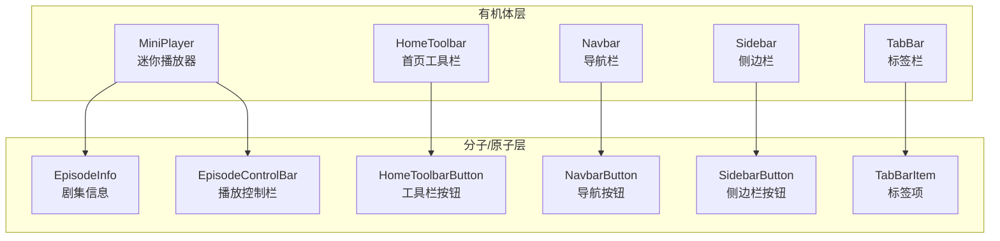
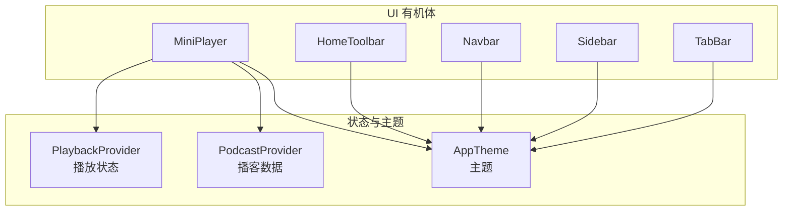
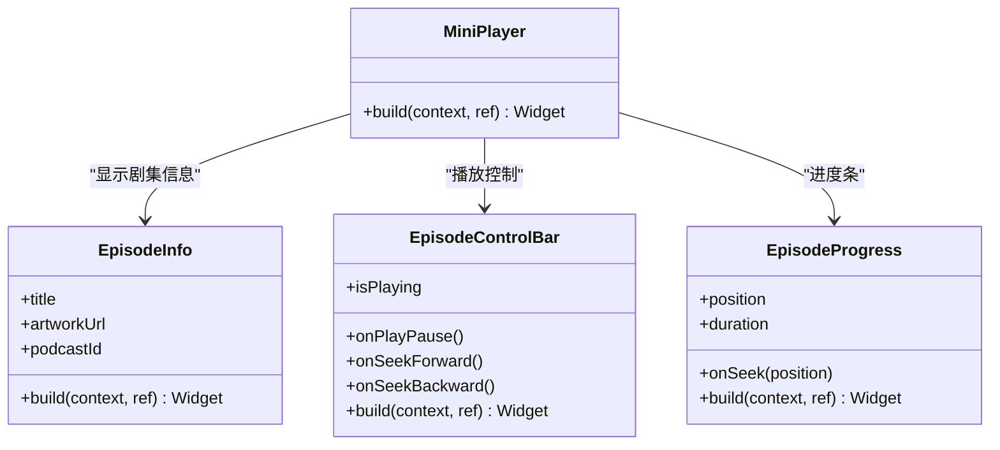
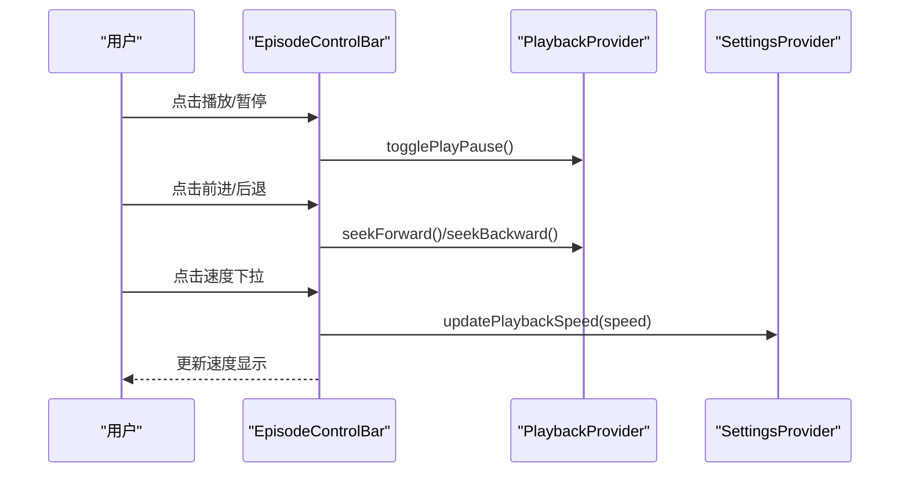
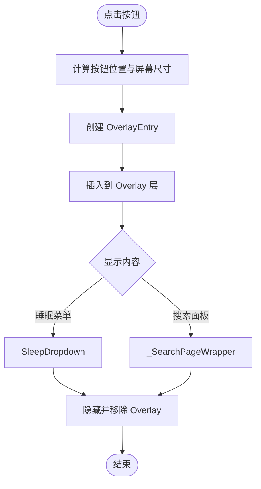
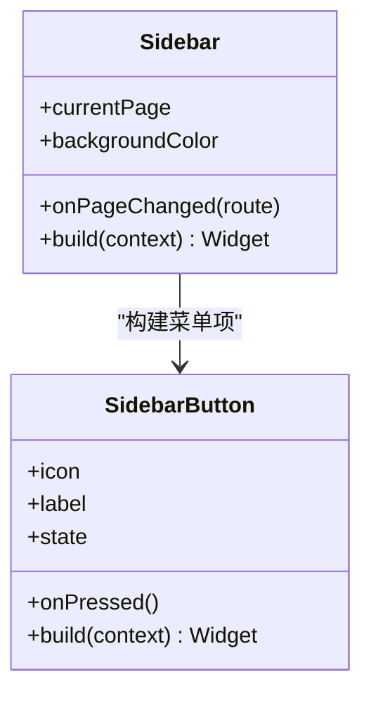
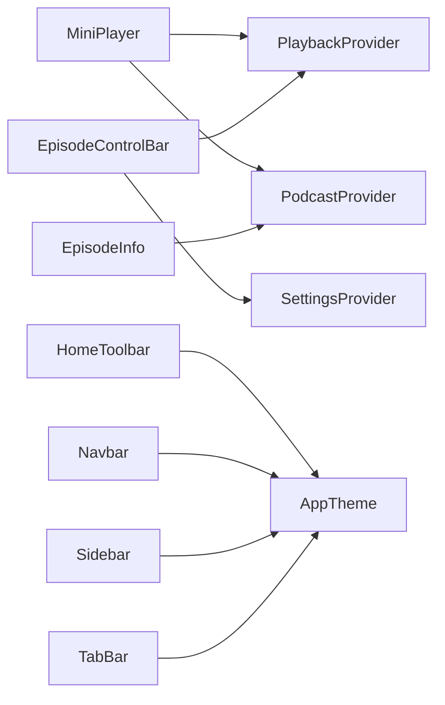

# 有机体组件 (Organisms)

<cite>
**本文引用的文件**   
- [mini_player.dart](file://lib/presentation/widgets/organisms/mini_player/mini_player.dart)
- [episode_info.dart](file://lib/presentation/widgets/organisms/mini_player/episode_info.dart)
- [episode_control_bar.dart](file://lib/presentation/widgets/organisms/mini_player/episode_control_bar/episode_control_bar.dart)
- [home_toolbar.dart](file://lib/presentation/widgets/organisms/home_toolbar/home_toolbar.dart)
- [home_toolbar_button.dart](file://lib/presentation/widgets/organisms/home_toolbar/home_toolbar_button.dart)
- [navbar.dart](file://lib/presentation/widgets/organisms/navbar/navbar.dart)
- [navbar_button.dart](file://lib/presentation/widgets/organisms/navbar/navbar_button.dart)
- [sidebar.dart](file://lib/presentation/widgets/organisms/sidebar/sidebar.dart)
- [sidebar_button.dart](file://lib/presentation/widgets/organisms/sidebar/sidebar_button.dart)
- [tabbar.dart](file://lib/presentation/widgets/organisms/tabbar/tabbar.dart)
- [tabbar_item.dart](file://lib/presentation/widgets/organisms/tabbar/tabbar_item.dart)
- [playback_provider.dart](file://lib/presentation/providers/playback_provider.dart)
- [podcast_provider.dart](file://lib/presentation/providers/podcast_provider.dart)
- [app_theme.dart](file://lib/core/theme/app_theme.dart)
</cite>

## 目录
1. [简介](#简介)
2. [项目结构](#项目结构)
3. [核心组件](#核心组件)
4. [架构总览](#架构总览)
5. [详细组件分析](#详细组件分析)
6. [依赖关系分析](#依赖关系分析)
7. [性能考量](#性能考量)
8. [故障排查指南](#故障排查指南)
9. [结论](#结论)
10. [附录：使用与集成示例](#附录使用与集成示例)

## 简介
本章节面向 TinyCast 的有机体（Organisms）层，聚焦由分子与原子组件组合而成的高级 UI 组件。文档覆盖 MiniPlayer（迷你播放器）、HomeToolbar（首页工具栏）、Navbar（导航栏）、Sidebar（侧边栏）、TabBar（标签栏）等复杂功能组件的整体架构、内部状态管理、事件系统、生命周期、配置选项、主题支持与响应式适配，并提供性能优化策略与最佳实践。

## 项目结构
有机体组件位于 presentation/widgets/organisms 目录下，按功能模块划分子目录，每个有机体通常包含若干子组件（分子/原子），并通过 Provider 进行跨组件状态共享。

**图表来源** 
- [mini_player.dart:1-54](file://lib/presentation/widgets/organisms/mini_player/mini_player.dart#L1-L54)
- [episode_info.dart:1-71](file://lib/presentation/widgets/organisms/mini_player/episode_info.dart#L1-L71)
- [episode_control_bar.dart:1-315](file://lib/presentation/widgets/organisms/mini_player/episode_control_bar/episode_control_bar.dart#L1-L315)
- [home_toolbar.dart:1-236](file://lib/presentation/widgets/organisms/home_toolbar/home_toolbar.dart#L1-L236)
- [home_toolbar_button.dart:1-124](file://lib/presentation/widgets/organisms/home_toolbar/home_toolbar_button.dart#L1-L124)
- [navbar.dart:1-38](file://lib/presentation/widgets/organisms/navbar/navbar.dart#L1-L38)
- [navbar_button.dart:1-26](file://lib/presentation/widgets/organisms/navbar/navbar_button.dart#L1-L26)
- [sidebar.dart:1-147](file://lib/presentation/widgets/organisms/sidebar/sidebar.dart#L1-L147)
- [sidebar_button.dart:1-128](file://lib/presentation/widgets/organisms/sidebar/sidebar_button.dart#L1-L128)
- [tabbar.dart:1-84](file://lib/presentation/widgets/organisms/tabbar/tabbar.dart#L1-L84)
- [tabbar_item.dart:1-72](file://lib/presentation/widgets/organisms/tabbar/tabbar_item.dart#L1-L72)

**章节来源**
- [mini_player.dart:1-54](file://lib/presentation/widgets/organisms/mini_player/mini_player.dart#L1-L54)
- [home_toolbar.dart:1-236](file://lib/presentation/widgets/organisms/home_toolbar/home_toolbar.dart#L1-L236)
- [navbar.dart:1-38](file://lib/presentation/widgets/organisms/navbar/navbar.dart#L1-L38)
- [sidebar.dart:1-147](file://lib/presentation/widgets/organisms/sidebar/sidebar.dart#L1-L147)
- [tabbar.dart:1-84](file://lib/presentation/widgets/organisms/tabbar/tabbar.dart#L1-L84)

## 核心组件
本节概述各有机体的职责边界与关键能力：
- MiniPlayer：聚合剧集信息、播放控制与进度条，订阅播放状态并驱动 UI 更新。
- HomeToolbar：提供搜索与定时关闭等快捷入口，通过 Overlay 弹出菜单。
- Navbar：页面级标题与操作按钮容器，支持右侧动作图标。
- Sidebar：桌面端左侧导航，维护当前页高亮并触发路由切换。
- TabBar：移动端底部标签导航，维护选中态并回调父级路由切换。

**章节来源**
- [mini_player.dart:1-54](file://lib/presentation/widgets/organisms/mini_player/mini_player.dart#L1-L54)
- [home_toolbar.dart:1-236](file://lib/presentation/widgets/organisms/home_toolbar/home_toolbar.dart#L1-L236)
- [navbar.dart:1-38](file://lib/presentation/widgets/organisms/navbar/navbar.dart#L1-L38)
- [sidebar.dart:1-147](file://lib/presentation/widgets/organisms/sidebar/sidebar.dart#L1-L147)
- [tabbar.dart:1-84](file://lib/presentation/widgets/organisms/tabbar/tabbar.dart#L1-L84)

## 架构总览
有机体层通过 Riverpod Provider 与主题系统进行解耦：播放相关状态集中在 playbackProvider，播客详情通过 podcastByIdProvider 获取，UI 样式由 AppTheme 根据亮度动态选择。

**图表来源** 
- [mini_player.dart:1-54](file://lib/presentation/widgets/organisms/mini_player/mini_player.dart#L1-L54)
- [episode_info.dart:1-71](file://lib/presentation/widgets/organisms/mini_player/episode_info.dart#L1-L71)
- [home_toolbar.dart:1-236](file://lib/presentation/widgets/organisms/home_toolbar/home_toolbar.dart#L1-L236)
- [navbar.dart:1-38](file://lib/presentation/widgets/organisms/navbar/navbar.dart#L1-L38)
- [sidebar.dart:1-147](file://lib/presentation/widgets/organisms/sidebar/sidebar.dart#L1-L147)
- [tabbar.dart:1-84](file://lib/presentation/widgets/organisms/tabbar/tabbar.dart#L1-L84)
- [playback_provider.dart](file://lib/presentation/providers/playback_provider.dart)
- [podcast_provider.dart](file://lib/presentation/providers/podcast_provider.dart)
- [app_theme.dart](file://lib/core/theme/app_theme.dart)

## 详细组件分析

### MiniPlayer（迷你播放器）
- 职责：展示当前剧集信息与基础播放控制，监听播放状态变化并渲染进度与控制按钮。
- 内部状态：通过 ConsumerWidget 订阅 playbackProvider，读取 currentEpisode、isPlaying、currentPosition、duration。
- 子组件：EpisodeInfo（剧集信息）、EpisodeControlBar（播放控制）、EpisodeProgress（进度条）。
- 事件系统：播放/暂停、快进/后退、跳转进度均通过 playbackProvider.notifier 调用。
- 主题：背景色、内边距、封面尺寸与圆角均来自 AppTheme。
- 生命周期：无额外资源释放；Overlay 由子控件自行管理。

**图表来源** 
- [mini_player.dart:1-54](file://lib/presentation/widgets/organisms/mini_player/mini_player.dart#L1-L54)
- [episode_info.dart:1-71](file://lib/presentation/widgets/organisms/mini_player/episode_info.dart#L1-L71)
- [episode_control_bar.dart:1-315](file://lib/presentation/widgets/organisms/mini_player/episode_control_bar/episode_control_bar.dart#L1-L315)

**章节来源**
- [mini_player.dart:1-54](file://lib/presentation/widgets/organisms/mini_player/mini_player.dart#L1-L54)
- [episode_info.dart:1-71](file://lib/presentation/widgets/organisms/mini_player/episode_info.dart#L1-L71)
- [episode_control_bar.dart:1-315](file://lib/presentation/widgets/organisms/mini_player/episode_control_bar/episode_control_bar.dart#L1-L315)

#### 播放控制序列（EpisodeControlBar）

**图表来源** 
- [episode_control_bar.dart:1-315](file://lib/presentation/widgets/organisms/mini_player/episode_control_bar/episode_control_bar.dart#L1-L315)
- [playback_provider.dart](file://lib/presentation/providers/playback_provider.dart)

### HomeToolbar（首页工具栏）
- 职责：提供“搜索”和“睡眠定时器”两个入口，通过 Overlay 弹出菜单或搜索面板。
- 内部状态：维护 _sleepButtonKey、_searchButtonKey 用于定位弹出位置；静态变量跟踪当前 OverlayEntry。
- 事件系统：点击按钮计算 RenderBox 坐标，插入 OverlayEntry；ESC 键关闭搜索面板。
- 主题：背景色、内边距来自 AppTheme。
- 生命周期：dispose 时清理 OverlayEntry，避免内存泄漏。

**图表来源** 
- [home_toolbar.dart:1-236](file://lib/presentation/widgets/organisms/home_toolbar/home_toolbar.dart#L1-L236)

**章节来源**
- [home_toolbar.dart:1-236](file://lib/presentation/widgets/organisms/home_toolbar/home_toolbar.dart#L1-L236)
- [home_toolbar_button.dart:1-124](file://lib/presentation/widgets/organisms/home_toolbar/home_toolbar_button.dart#L1-L124)

### Navbar（导航栏）
- 职责：承载页面标题与右侧动作按钮，使用 SafeArea 保证安全区域。
- 配置项：title（必填）、actionIcon（可选）、onActionTap（可选）。
- 子组件：NavbarLargeTitle、NavbarButton。
- 主题：默认白色背景与黑色图标，可通过上层主题覆盖。

**章节来源**
- [navbar.dart:1-38](file://lib/presentation/widgets/organisms/navbar/navbar.dart#L1-L38)
- [navbar_button.dart:1-26](file://lib/presentation/widgets/organisms/navbar/navbar_button.dart#L1-L26)

### Sidebar（侧边栏）
- 职责：桌面端左侧导航，维护 currentPage 高亮，点击后回调 onPageChanged 切换路由。
- 配置项：currentPage、onPageChanged、backgroundColor。
- 子组件：SidebarButton，支持悬停、按下与选中态视觉反馈。
- 集成点：部分入口直接打开设置窗口（如 Settings）。

**图表来源** 
- [sidebar.dart:1-147](file://lib/presentation/widgets/organisms/sidebar/sidebar.dart#L1-L147)
- [sidebar_button.dart:1-128](file://lib/presentation/widgets/organisms/sidebar/sidebar_button.dart#L1-L128)

**章节来源**
- [sidebar.dart:1-147](file://lib/presentation/widgets/organisms/sidebar/sidebar.dart#L1-L147)
- [sidebar_button.dart:1-128](file://lib/presentation/widgets/organisms/sidebar/sidebar_button.dart#L1-L128)

### TabBar（标签栏）
- 职责：移动端底部标签导航，维护选中态并回调 onPageChanged。
- 配置项：currentPage、onPageChanged、backgroundColor。
- 子组件：TabBarItem，支持 active/defaultState 两种状态。

**章节来源**
- [tabbar.dart:1-84](file://lib/presentation/widgets/organisms/tabbar/tabbar.dart#L1-L84)
- [tabbar_item.dart:1-72](file://lib/presentation/widgets/organisms/tabbar/tabbar_item.dart#L1-L72)

## 依赖关系分析
- 状态依赖：MiniPlayer 依赖 playbackProvider 与 podcastByIdProvider；EpisodeControlBar 同时读写 speed 与 settings。
- 主题依赖：所有有机体通过 AppTheme.fromBrightness 获取主题，确保明暗模式一致。
- 路由依赖：Sidebar/TabBar 通过回调通知上层路由切换；HomeToolbar 通过 Overlay 嵌入页面片段。

**图表来源** 
- [mini_player.dart:1-54](file://lib/presentation/widgets/organisms/mini_player/mini_player.dart#L1-L54)
- [episode_info.dart:1-71](file://lib/presentation/widgets/organisms/mini_player/episode_info.dart#L1-L71)
- [episode_control_bar.dart:1-315](file://lib/presentation/widgets/organisms/mini_player/episode_control_bar/episode_control_bar.dart#L1-L315)
- [home_toolbar.dart:1-236](file://lib/presentation/widgets/organisms/home_toolbar/home_toolbar.dart#L1-L236)
- [navbar.dart:1-38](file://lib/presentation/widgets/organisms/navbar/navbar.dart#L1-L38)
- [sidebar.dart:1-147](file://lib/presentation/widgets/organisms/sidebar/sidebar.dart#L1-L147)
- [tabbar.dart:1-84](file://lib/presentation/widgets/organisms/tabbar/tabbar.dart#L1-L84)
- [playback_provider.dart](file://lib/presentation/providers/playback_provider.dart)
- [podcast_provider.dart](file://lib/presentation/providers/podcast_provider.dart)
- [app_theme.dart](file://lib/core/theme/app_theme.dart)

**章节来源**
- [playback_provider.dart](file://lib/presentation/providers/playback_provider.dart)
- [podcast_provider.dart](file://lib/presentation/providers/podcast_provider.dart)
- [app_theme.dart](file://lib/core/theme/app_theme.dart)

## 性能考量
- 最小化重建：有机体尽量保持 StatelessWidget，必要时使用 ConsumerWidget 精准订阅 Provider，避免全量重建。
- Overlay 管理：HomeToolbar 与 EpisodeControlBar 使用静态变量跟踪当前 OverlayEntry，确保同一时间仅一个弹出层，并在 dispose 中清理，防止内存泄漏。
- 布局优化：使用 MainAxisSize.min 与合适的 Padding，减少不必要的测量与绘制。
- 主题访问：通过 AppTheme.fromBrightness 在 build 中按需获取，避免重复计算。
- 图片加载：EpisodeInfo 中的 ArtworkImage 应启用缓存与占位图，降低网络抖动影响。

[本节为通用指导，不直接分析具体文件]

## 故障排查指南
- Overlay 未显示或无法关闭：检查 _currentDropdownOverlay 是否被正确赋值与清理；确认 Overlay.of(context) 可用。
- 播放控制无效：确认 playbackProvider 已初始化且 onPlayPause/seekTo 等方法被正确调用。
- 主题颜色异常：检查 AppTheme.fromBrightness 传入的亮度是否与系统一致。
- 路由切换不生效：确认 Sidebar/TabBar 的 onPageChanged 回调是否被上层正确处理。

**章节来源**
- [home_toolbar.dart:1-236](file://lib/presentation/widgets/organisms/home_toolbar/home_toolbar.dart#L1-L236)
- [episode_control_bar.dart:1-315](file://lib/presentation/widgets/organisms/mini_player/episode_control_bar/episode_control_bar.dart#L1-L315)

## 结论
TinyCast 的有机体组件以清晰的职责边界与良好的状态/主题解耦为基础，结合 Overlay 与 Provider 实现了丰富的交互体验。遵循本文的配置、事件与生命周期规范，可在不同平台与主题下获得一致的响应式表现。建议在生产环境中持续监控 Overlay 生命周期与 Provider 订阅范围，以确保性能与稳定性。

[本节为总结性内容，不直接分析具体文件]

## 附录：使用与集成示例
- 在页面中嵌入 MiniPlayer：将 MiniPlayer 置于页面底部，确保 playbackProvider 已初始化。
- 集成 HomeToolbar：放置于主页底部，处理搜索与睡眠菜单的 Overlay 生命周期。
- 使用 Navbar：作为页面顶部标题栏，传入 title 与可选 actionIcon/onActionTap。
- 集成 Sidebar：在桌面端左侧固定宽度，维护 currentPage 并回调 onPageChanged。
- 集成 TabBar：在移动端底部，维护选中态并回调 onPageChanged。

[本节为概念性说明，不直接分析具体文件]