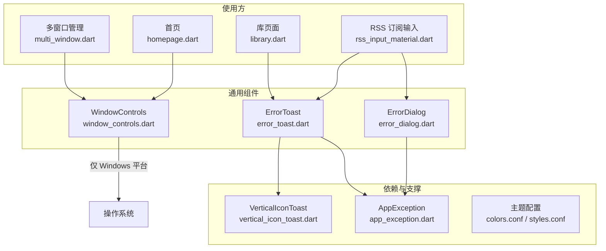
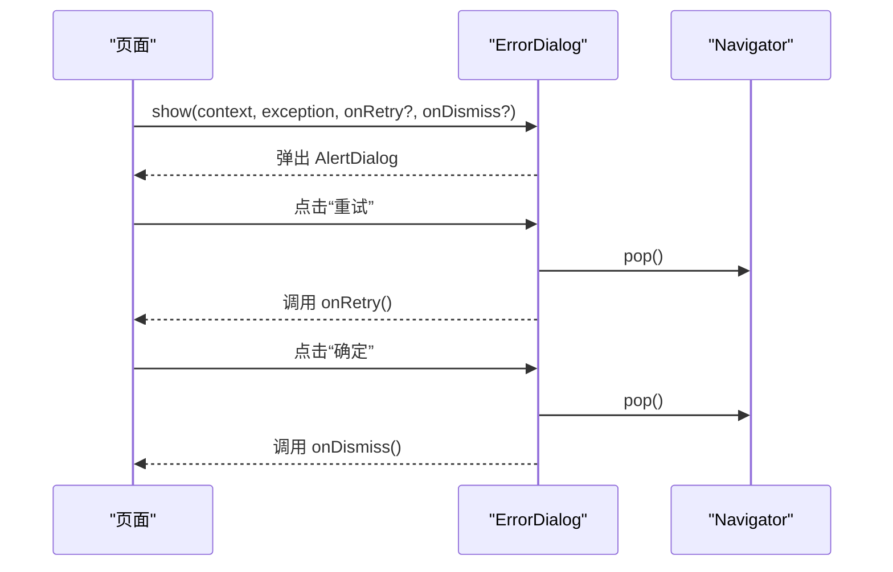
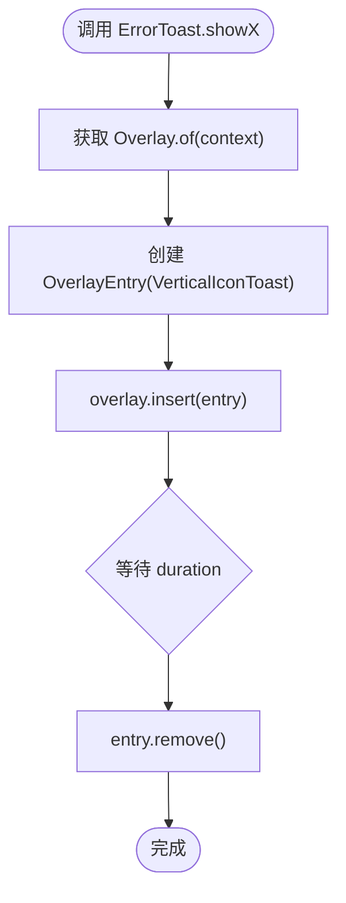
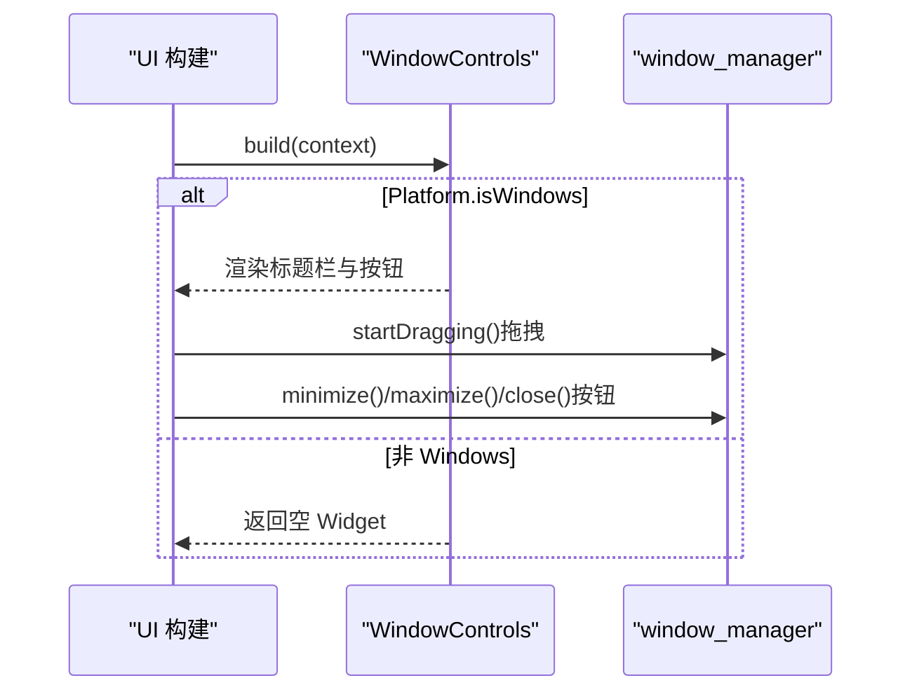
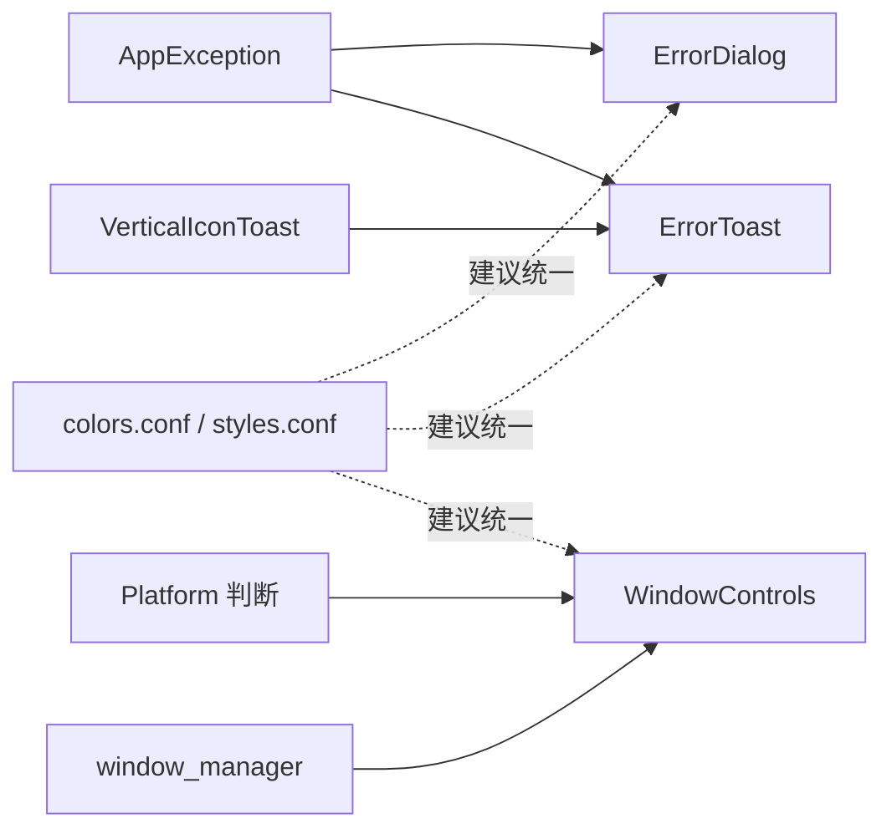

# 通用组件 (Common)

<cite>
**本文引用的文件**   
- [error_dialog.dart](file://lib/presentation/widgets/common/error_dialog.dart)
- [error_toast.dart](file://lib/presentation/widgets/common/error_toast.dart)
- [window_controls.dart](file://lib/presentation/widgets/common/window_controls.dart)
- [vertical_icon_toast.dart](file://lib/presentation/dialogs/toast/vertical_icon_toast.dart)
- [app_exception.dart](file://lib/core/utils/app_exception.dart)
- [colors.conf](file://assets/themes/colors.conf)
- [styles.conf](file://assets/themes/styles.conf)
- [multi_window.dart](file://lib/multi_window.dart)
- [homepage.dart](file://lib/presentation/features/home/homepage.dart)
- [library.dart](file://lib/presentation/features/library/library.dart)
- [rss_input_material.dart](file://lib/presentation/features/subscribe/subscribe_by_rss/rss_input_material.dart)
</cite>

## 目录
1. [简介](#简介)
2. [项目结构](#项目结构)
3. [核心组件](#核心组件)
4. [架构总览](#架构总览)
5. [详细组件分析](#详细组件分析)
6. [依赖关系分析](#依赖关系分析)
7. [性能考虑](#性能考虑)
8. [故障排查指南](#故障排查指南)
9. [结论](#结论)
10. [附录](#附录)

## 简介
本章节为 TinyCast 的通用组件文档，聚焦跨页面复用的基础 UI 与系统交互能力，包括：
- ErrorDialog（错误对话框）：用于展示结构化错误信息，支持重试、关闭等交互。
- ErrorToast（错误提示）：轻量级全局提示，覆盖 Overlay 层，适合快速反馈。
- WindowControls（窗口控制）：Windows 平台自定义标题栏，包含拖拽区域与最小化/最大化/关闭按钮。

这些组件提供统一的错误处理体验、一致的视觉风格，并适配多平台运行环境。

## 项目结构
通用组件位于 presentation/widgets/common 目录下，相关依赖包括异常模型、Toast 样式组件以及主题配置。使用示例分布在多窗口管理、首页、订阅页与库页面中。



图表来源
- [error_dialog.dart:1-438](file://lib/presentation/widgets/common/error_dialog.dart#L1-L438)
- [error_toast.dart:1-212](file://lib/presentation/widgets/common/error_toast.dart#L1-L212)
- [window_controls.dart:1-113](file://lib/presentation/widgets/common/window_controls.dart#L1-L113)
- [vertical_icon_toast.dart:1-63](file://lib/presentation/dialogs/toast/vertical_icon_toast.dart#L1-L63)
- [app_exception.dart:1-148](file://lib/core/utils/app_exception.dart#L1-L148)
- [colors.conf:1-106](file://assets/themes/colors.conf#L1-L106)
- [styles.conf:1-262](file://assets/themes/styles.conf#L1-L262)
- [multi_window.dart:336-437](file://lib/multi_window.dart#L336-L437)
- [homepage.dart:21](file://lib/presentation/features/home/homepage.dart#L21)
- [library.dart:75-95](file://lib/presentation/features/library/library.dart#L75-L95)
- [rss_input_material.dart:124-209](file://lib/presentation/features/subscribe/subscribe_by_rss/rss_input_material.dart#L124-L209)

章节来源
- [error_dialog.dart:1-438](file://lib/presentation/widgets/common/error_dialog.dart#L1-L438)
- [error_toast.dart:1-212](file://lib/presentation/widgets/common/error_toast.dart#L1-L212)
- [window_controls.dart:1-113](file://lib/presentation/widgets/common/window_controls.dart#L1-L113)
- [vertical_icon_toast.dart:1-63](file://lib/presentation/dialogs/toast/vertical_icon_toast.dart#L1-L63)
- [app_exception.dart:1-148](file://lib/core/utils/app_exception.dart#L1-L148)
- [colors.conf:1-106](file://assets/themes/colors.conf#L1-L106)
- [styles.conf:1-262](file://assets/themes/styles.conf#L1-L262)
- [multi_window.dart:336-437](file://lib/multi_window.dart#L336-L437)
- [homepage.dart:21](file://lib/presentation/features/home/homepage.dart#L21)
- [library.dart:75-95](file://lib/presentation/features/library/library.dart#L75-L95)
- [rss_input_material.dart:124-209](file://lib/presentation/features/subscribe/subscribe_by_rss/rss_input_material.dart#L124-L209)

## 核心组件
本节概述三大通用组件的职责、属性接口、事件回调与样式定制要点。

- ErrorDialog
  - 职责：以模态对话框形式展示错误详情，支持“重试”和“确定”操作。
  - 关键属性：异常对象、可选的重试回调、可选的关闭回调。
  - 行为：根据异常类型动态选择图标、颜色与标题；可显示状态码。
  - 静态方法：show(context, exception, onRetry?, onDismiss?) 直接弹出对话框。
  - 样式：圆角边框、标题行含图标与文本、内容区滚动、底部按钮布局。

- ErrorToast
  - 职责：在屏幕顶部以 Overlay 方式展示短消息提示，自动消失。
  - 关键方法：showError/showSuccess/showWarning/showNetworkError/showParseError/showStorageError/showValidationError/showException。
  - 参数：上下文、消息文本、持续时间；部分方法支持自定义消息。
  - 样式：基于 VerticalIconToast，固定尺寸容器、阴影与边框。

- WindowControls
  - 职责：Windows 平台自定义标题栏，支持拖拽移动窗口与窗口控制按钮。
  - 关键属性：leading（左侧控件）、title（标题文本）。
  - 行为：非 Windows 平台返回空 Widget；Windows 平台渲染标题栏与按钮。
  - 交互：点击最小化/最大化/关闭按钮调用 window_manager。

章节来源
- [error_dialog.dart:1-438](file://lib/presentation/widgets/common/error_dialog.dart#L1-L438)
- [error_toast.dart:1-212](file://lib/presentation/widgets/common/error_toast.dart#L1-L212)
- [window_controls.dart:1-113](file://lib/presentation/widgets/common/window_controls.dart#L1-L113)
- [vertical_icon_toast.dart:1-63](file://lib/presentation/dialogs/toast/vertical_icon_toast.dart#L1-L63)
- [app_exception.dart:1-148](file://lib/core/utils/app_exception.dart#L1-L148)

## 架构总览
下图展示了通用组件之间的依赖关系及与上层页面的集成方式。

```mermaid
classDiagram
class AppException {
+message : String
+type : ExceptionType
+statusCode : int?
+originalError : dynamic
+stackTrace : StackTrace?
+toString() String
+network(message, statusCode?, originalError?, stackTrace?) AppException
+storage(message, originalError?, stackTrace?) AppException
+authentication(message, statusCode?, originalError?, stackTrace?) AppException
+validation(message, originalError?, stackTrace?) AppException
+permission(message, originalError?, stackTrace?) AppException
+unknown(message, originalError?, stackTrace?) AppException
}
class ErrorDialog {
+exception : AppException
+onRetry : VoidCallback?
+onDismiss : VoidCallback?
+build(context) Widget
+show(context, exception, onRetry?, onDismiss?) Future~void~
}
class NetworkErrorDialog {
+message : String
+onRetry : VoidCallback?
+onDismiss : VoidCallback?
+build(context) Widget
+show(context, message?, onRetry?, onDismiss?) Future~void~
}
class ParseErrorDialog {
+message : String
+onRetry : VoidCallback?
+onDismiss : VoidCallback?
+build(context) Widget
+show(context, message?, onRetry?, onDismiss?) Future~void~
}
class StorageErrorDialog {
+message : String
+onRetry : VoidCallback?
+onDismiss : VoidCallback?
+build(context) Widget
+show(context, message?, onRetry?, onDismiss?) Future~void~
}
class ErrorToast {
+showError(context, message, duration) void
+showNetworkError(context, customMessage?, duration) void
+showParseError(context, customMessage?, duration) void
+showStorageError(context, customMessage?, duration) void
+showValidationError(context, customMessage?, duration) void
+showSuccess(context, message, duration) void
+showWarning(context, message, duration) void
+showException(context, exception, duration) void
}
class VerticalIconToast {
+icon : Widget
+iconSize : double
+text : String
+textSize : double
+build(context) Widget
}
class WindowControls {
+leading : Widget?
+title : String?
+build(context) Widget
}
ErrorDialog --> AppException : "使用"
NetworkErrorDialog --> ErrorDialog : "相似实现"
ParseErrorDialog --> ErrorDialog : "相似实现"
StorageErrorDialog --> ErrorDialog : "相似实现"
ErrorToast --> VerticalIconToast : "组合"
ErrorToast --> AppException : "路由到具体提示"
WindowControls -->|"仅 Windows"| OS : "平台判断"
```

图表来源
- [error_dialog.dart:1-438](file://lib/presentation/widgets/common/error_dialog.dart#L1-L438)
- [error_toast.dart:1-212](file://lib/presentation/widgets/common/error_toast.dart#L1-L212)
- [vertical_icon_toast.dart:1-63](file://lib/presentation/dialogs/toast/vertical_icon_toast.dart#L1-L63)
- [app_exception.dart:1-148](file://lib/core/utils/app_exception.dart#L1-L148)
- [window_controls.dart:1-113](file://lib/presentation/widgets/common/window_controls.dart#L1-L113)

## 详细组件分析

### ErrorDialog（错误对话框）
- 功能与场景
  - 适用于需要用户明确确认或重试的错误场景，如网络失败、存储异常、认证失败、验证错误、权限问题等。
  - 支持通过异常类型自动选择图标、颜色与标题，提升可读性。
- 属性接口
  - 必需：exception（AppException）
  - 可选：onRetry（重试回调）、onDismiss（关闭回调）
- 事件回调
  - onRetry：点击“重试”时触发，先关闭对话框再执行回调。
  - onDismiss：点击“确定”时触发，先关闭对话框再执行回调。
- 样式定制
  - 圆角边框、标题行图标+文本、内容区滚动、按钮颜色与字体权重。
- 使用示例路径
  - 在订阅输入页中调用 show(context, exception, onRetry?, onDismiss?)。



图表来源
- [error_dialog.dart:149-163](file://lib/presentation/widgets/common/error_dialog.dart#L149-L163)
- [error_dialog.dart:66-94](file://lib/presentation/widgets/common/error_dialog.dart#L66-L94)

章节来源
- [error_dialog.dart:1-438](file://lib/presentation/widgets/common/error_dialog.dart#L1-L438)
- [rss_input_material.dart:209](file://lib/presentation/features/subscribe/subscribe_by_rss/rss_input_material.dart#L209)

### ErrorToast（错误提示）
- 功能与场景
  - 适用于快速、非阻塞的反馈，如成功、警告、网络/解析/存储/验证错误等。
  - 通过 Overlay 插入提示，并在指定时长后自动移除。
- 方法接口
  - showError(context, message, duration)
  - showNetworkError(context, customMessage?, duration)
  - showParseError(context, customMessage?, duration)
  - showStorageError(context, customMessage?, duration)
  - showValidationError(context, customMessage?, duration)
  - showSuccess(context, message, duration)
  - showWarning(context, message, duration)
  - showException(context, exception, duration)
- 事件回调
  - 无显式回调，内部自动管理生命周期。
- 样式定制
  - 基于 VerticalIconToast，固定宽高、阴影、边框与图标/文字样式。
- 使用示例路径
  - 在库页面与订阅输入页中调用 showException、showSuccess、showValidationError。



图表来源
- [error_toast.dart:8-41](file://lib/presentation/widgets/common/error_toast.dart#L8-L41)
- [error_toast.dart:91-124](file://lib/presentation/widgets/common/error_toast.dart#L91-L124)
- [error_toast.dart:126-159](file://lib/presentation/widgets/common/error_toast.dart#L126-L159)
- [vertical_icon_toast.dart:1-63](file://lib/presentation/dialogs/toast/vertical_icon_toast.dart#L1-L63)

章节来源
- [error_toast.dart:1-212](file://lib/presentation/widgets/common/error_toast.dart#L1-L212)
- [library.dart:75-95](file://lib/presentation/features/library/library.dart#L75-L95)
- [rss_input_material.dart:124-156](file://lib/presentation/features/subscribe/subscribe_by_rss/rss_input_material.dart#L124-L156)

### WindowControls（窗口控制）
- 功能与场景
  - 仅在 Windows 平台显示自定义标题栏，包含拖拽区域与最小化/最大化/关闭按钮。
  - 其他平台返回空 Widget，保证跨平台一致性。
- 属性接口
  - leading（可选）：左侧自定义控件
  - title（可选）：标题文本
- 事件回调
  - 点击按钮调用 window_manager.minimize/maximize/close。
- 样式定制
  - 背景色、按钮悬停效果、关闭按钮特殊高亮。
- 使用示例路径
  - 在多窗口管理与首页中条件渲染 WindowControls(title: '...')。



图表来源
- [window_controls.dart:16-64](file://lib/presentation/widgets/common/window_controls.dart#L16-L64)
- [window_controls.dart:84-112](file://lib/presentation/widgets/common/window_controls.dart#L84-L112)

章节来源
- [window_controls.dart:1-113](file://lib/presentation/widgets/common/window_controls.dart#L1-L113)
- [multi_window.dart:336-437](file://lib/multi_window.dart#L336-L437)
- [homepage.dart:21](file://lib/presentation/features/home/homepage.dart#L21)

## 依赖关系分析
- ErrorDialog 依赖 AppException 的类型与消息，用于决定图标、颜色与标题。
- ErrorToast 依赖 VerticalIconToast 进行视觉呈现，并通过 AppException 路由到不同提示方法。
- WindowControls 依赖 platform 判断与 window_manager 插件进行窗口控制。
- 主题配置 colors.conf 与 styles.conf 定义了品牌色、背景、标签色、遮罩等，但当前通用组件未直接引用这些配置文件，如需统一主题，可在组件内替换硬编码颜色为从主题读取的值。



图表来源
- [app_exception.dart:1-148](file://lib/core/utils/app_exception.dart#L1-L148)
- [error_dialog.dart:1-438](file://lib/presentation/widgets/common/error_dialog.dart#L1-L438)
- [error_toast.dart:1-212](file://lib/presentation/widgets/common/error_toast.dart#L1-L212)
- [vertical_icon_toast.dart:1-63](file://lib/presentation/dialogs/toast/vertical_icon_toast.dart#L1-L63)
- [window_controls.dart:1-113](file://lib/presentation/widgets/common/window_controls.dart#L1-L113)
- [colors.conf:1-106](file://assets/themes/colors.conf#L1-L106)
- [styles.conf:1-262](file://assets/themes/styles.conf#L1-L262)

章节来源
- [app_exception.dart:1-148](file://lib/core/utils/app_exception.dart#L1-L148)
- [error_dialog.dart:1-438](file://lib/presentation/widgets/common/error_dialog.dart#L1-L438)
- [error_toast.dart:1-212](file://lib/presentation/widgets/common/error_toast.dart#L1-L212)
- [vertical_icon_toast.dart:1-63](file://lib/presentation/dialogs/toast/vertical_icon_toast.dart#L1-L63)
- [window_controls.dart:1-113](file://lib/presentation/widgets/common/window_controls.dart#L1-L113)
- [colors.conf:1-106](file://assets/themes/colors.conf#L1-L106)
- [styles.conf:1-262](file://assets/themes/styles.conf#L1-L262)

## 性能考虑
- ErrorDialog
  - 模态对话框会阻塞用户交互，频繁弹出可能影响用户体验。建议在错误发生频率较高时使用 ErrorToast 替代。
  - 避免在大量数据加载过程中重复弹出相同错误，可使用去抖或合并策略。
- ErrorToast
  - OverlayEntry 的生命周期由内部自动管理，注意短时间内多次调用可能导致提示叠加。可通过队列或节流控制。
  - 固定尺寸的 VerticalIconToast 在小屏设备上可能遮挡内容，需评估布局影响。
- WindowControls
  - 仅在 Windows 平台渲染，避免不必要的计算与绘制。
  - 按钮悬停状态使用 Stateful 组件，确保局部刷新，减少整体重建。

[本节为通用指导，不直接分析具体文件]

## 故障排查指南
- ErrorDialog 未显示或无法关闭
  - 检查传入的 BuildContext 是否有效，确保 showDialog 的 context 来自已挂载的 Widget。
  - 确认 onDismiss 回调未被意外拦截导致无法关闭。
- ErrorToast 不出现或立即消失
  - 检查 duration 设置是否过短。
  - 确认 Overlay.of(context) 能正确获取到 OverlayEntry。
- WindowControls 不生效
  - 确认运行平台为 Windows；非 Windows 平台将返回空 Widget。
  - 检查 window_manager 插件是否正确初始化。

章节来源
- [error_dialog.dart:149-163](file://lib/presentation/widgets/common/error_dialog.dart#L149-L163)
- [error_toast.dart:8-41](file://lib/presentation/widgets/common/error_toast.dart#L8-L41)
- [window_controls.dart:16-20](file://lib/presentation/widgets/common/window_controls.dart#L16-L20)

## 结论
ErrorDialog、ErrorToast 与 WindowControls 构成了 TinyCast 的通用交互基础，分别负责错误弹窗、轻量提示与窗口控制。它们通过清晰的属性接口与回调机制，便于在各页面复用与扩展。建议结合主题配置统一样式，并根据平台特性优化交互体验。

[本节为总结性内容，不直接分析具体文件]

## 附录
- 使用示例路径
  - 库页面：ErrorToast.showException(context, exception)
  - 订阅输入页：ErrorToast.showValidationError(context)、ErrorToast.showSuccess(context, '订阅成功！')、ErrorDialog.show(context, exception, onRetry?, onDismiss?)
  - 多窗口与首页：WindowControls(title: '...') 条件渲染

章节来源
- [library.dart:75-95](file://lib/presentation/features/library/library.dart#L75-L95)
- [rss_input_material.dart:124-156](file://lib/presentation/features/subscribe/subscribe_by_rss/rss_input_material.dart#L124-L156)
- [rss_input_material.dart:209](file://lib/presentation/features/subscribe/subscribe_by_rss/rss_input_material.dart#L209)
- [multi_window.dart:336-437](file://lib/multi_window.dart#L336-L437)
- [homepage.dart:21](file://lib/presentation/features/home/homepage.dart#L21)