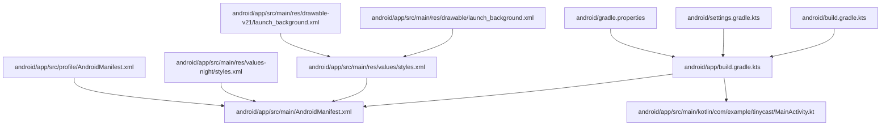
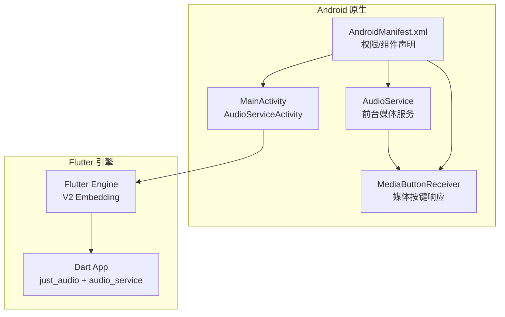
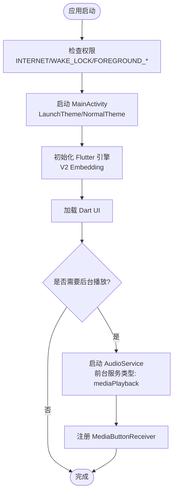
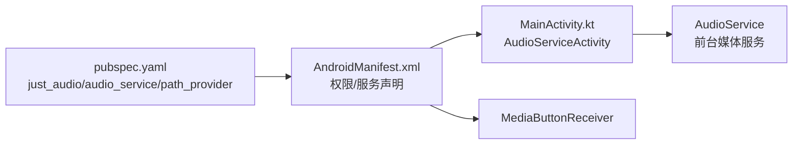
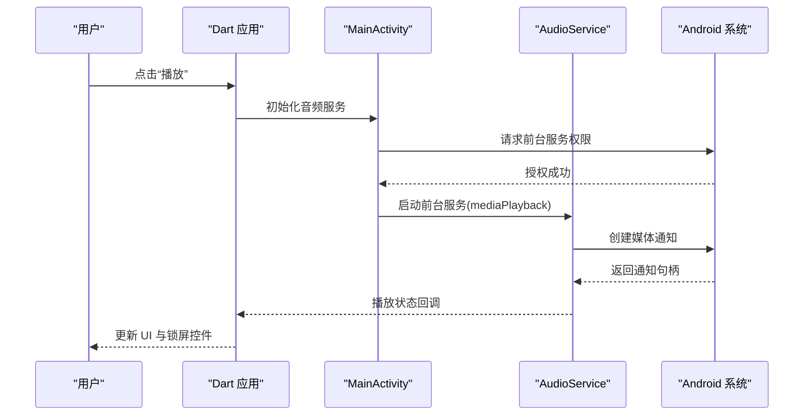

# Android 平台适配

<cite>
**本文引用的文件**   
- [AndroidManifest.xml](file://android/app/src/main/AndroidManifest.xml)
- [build.gradle.kts（应用模块）](file://android/app/build.gradle.kts)
- [MainActivity.kt](file://android/app/src/main/kotlin/com/example/tinycast/MainActivity.kt)
- [build.gradle.kts（项目根）](file://android/build.gradle.kts)
- [settings.gradle.kts](file://android/settings.gradle.kts)
- [gradle.properties](file://android/gradle.properties)
- [styles.xml](file://android/app/src/main/res/values/styles.xml)
- [styles.xml（夜间模式）](file://android/app/src/main/res/values-night/styles.xml)
- [launch_background.xml](file://android/app/src/main/res/drawable/launch_background.xml)
- [launch_background.xml（API 21+）](file://android/app/src/main/res/drawable-v21/launch_background.xml)
- [AndroidManifest.xml（profile）](file://android/app/src/profile/AndroidManifest.xml)
- [PLATFORM_PERMISSIONS.md](file://docs/PLATFORM_PERMISSIONS.md)
- [pubspec.yaml](file://pubspec.yaml)
</cite>

## 目录
1. [简介](#简介)
2. [项目结构](#项目结构)
3. [核心组件](#核心组件)
4. [架构总览](#架构总览)
5. [详细组件分析](#详细组件分析)
6. [依赖关系分析](#依赖关系分析)
7. [性能与构建优化](#性能与构建优化)
8. [权限申请流程与后台服务配置](#权限申请流程与后台服务配置)
9. [调试技巧与问题排查](#调试技巧与问题排查)
10. [签名与发布 APK/AAB](#签名与发布-apkaab)
11. [结论](#结论)

## 简介
本文件面向 Android 平台适配，围绕 Flutter 工程的 Android 端进行系统化说明。内容涵盖：
- AndroidManifest.xml 的权限、Activity/Service/Receiver 声明与查询能力
- Gradle 构建脚本（应用模块与项目根）与 settings/properties 配置
- MainActivity 主活动实现与音频服务集成
- 启动画面、主题样式与图标资源管理
- 权限申请流程、后台服务与通知系统集成
- 调试技巧、性能优化建议与签名发布指南

## 项目结构
Android 子工程位于 android/ 目录，关键路径如下：
- 应用清单与入口：android/app/src/main/AndroidManifest.xml
- 应用模块构建脚本：android/app/build.gradle.kts
- 主活动：android/app/src/main/kotlin/com/example/tinycast/MainActivity.kt
- 项目级构建脚本：android/build.gradle.kts
- 插件与版本管理：android/settings.gradle.kts、android/gradle.properties
- 资源与主题：android/app/src/main/res/values/styles.xml、values-night/styles.xml、drawable/launch_background.xml、drawable-v21/launch_background.xml
- Profile 环境清单：android/app/src/profile/AndroidManifest.xml

图表来源
- [build.gradle.kts（应用模块）:1-45](file://android/app/build.gradle.kts#L1-L45)
- [AndroidManifest.xml:1-65](file://android/app/src/main/AndroidManifest.xml#L1-L65)
- [MainActivity.kt:1-6](file://android/app/src/main/kotlin/com/example/tinycast/MainActivity.kt#L1-L6)
- [build.gradle.kts（项目根）:1-25](file://android/build.gradle.kts#L1-L25)
- [settings.gradle.kts:1-27](file://android/settings.gradle.kts#L1-L27)
- [gradle.properties:1-10](file://android/gradle.properties#L1-L10)
- [styles.xml:1-19](file://android/app/src/main/res/values/styles.xml#L1-L19)
- [styles.xml（夜间模式）:1-19](file://android/app/src/main/res/values-night/styles.xml#L1-L19)
- [launch_background.xml:1-13](file://android/app/src/main/res/drawable/launch_background.xml#L1-L13)
- [launch_background.xml（API 21+）:1-13](file://android/app/src/main/res/drawable-v21/launch_background.xml#L1-L13)
- [AndroidManifest.xml（profile）:1-8](file://android/app/src/profile/AndroidManifest.xml#L1-L8)

章节来源
- [build.gradle.kts（应用模块）:1-45](file://android/app/build.gradle.kts#L1-L45)
- [AndroidManifest.xml:1-65](file://android/app/src/main/AndroidManifest.xml#L1-L65)
- [MainActivity.kt:1-6](file://android/app/src/main/kotlin/com/example/tinycast/MainActivity.kt#L1-L6)
- [build.gradle.kts（项目根）:1-25](file://android/build.gradle.kts#L1-L25)
- [settings.gradle.kts:1-27](file://android/settings.gradle.kts#L1-L27)
- [gradle.properties:1-10](file://android/gradle.properties#L1-L10)
- [styles.xml:1-19](file://android/app/src/main/res/values/styles.xml#L1-L19)
- [styles.xml（夜间模式）:1-19](file://android/app/src/main/res/values-night/styles.xml#L1-L19)
- [launch_background.xml:1-13](file://android/app/src/main/res/drawable/launch_background.xml#L1-L13)
- [launch_background.xml（API 21+）:1-13](file://android/app/src/main/res/drawable-v21/launch_background.xml#L1-L13)
- [AndroidManifest.xml（profile）:1-8](file://android/app/src/profile/AndroidManifest.xml#L1-L8)

## 核心组件
- AndroidManifest.xml
  - 声明了网络、唤醒锁、前台服务等权限；注册了主 Activity、Flutter 嵌入元数据、音频服务与媒体按钮接收器；包含 text processing 的 queries 能力。
- build.gradle.kts（应用模块）
  - 使用 Kotlin DSL，设置命名空间、编译 SDK、NDK、Java/Kotlin 目标版本、默认配置（applicationId、minSdk/targetSdk、versionCode/versionName）、构建类型（release 当前使用 debug 签名）。
- MainActivity.kt
  - 继承 AudioServiceActivity，作为音频服务的宿主 Activity。
- 资源与主题
  - values/styles.xml 与 values-night/styles.xml 分别定义浅色/深色启动与正常主题；drawable/launch_background.xml 与 drawable-v21/launch_background.xml 定义启动背景。
- 构建系统
  - 项目根 build.gradle.kts 统一仓库与构建目录；settings.gradle.kts 管理插件与版本；gradle.properties 配置 JVM 参数与 AndroidX/Jetifier。

章节来源
- [AndroidManifest.xml:1-65](file://android/app/src/main/AndroidManifest.xml#L1-L65)
- [build.gradle.kts（应用模块）:1-45](file://android/app/build.gradle.kts#L1-L45)
- [MainActivity.kt:1-6](file://android/app/src/main/kotlin/com/example/tinycast/MainActivity.kt#L1-L6)
- [styles.xml:1-19](file://android/app/src/main/res/values/styles.xml#L1-L19)
- [styles.xml（夜间模式）:1-19](file://android/app/src/main/res/values-night/styles.xml#L1-L19)
- [launch_background.xml:1-13](file://android/app/src/main/res/drawable/launch_background.xml#L1-L13)
- [launch_background.xml（API 21+）:1-13](file://android/app/src/main/res/drawable-v21/launch_background.xml#L1-L13)
- [build.gradle.kts（项目根）:1-25](file://android/build.gradle.kts#L1-L25)
- [settings.gradle.kts:1-27](file://android/settings.gradle.kts#L1-L27)
- [gradle.properties:1-10](file://android/gradle.properties#L1-L10)

## 架构总览
Android 侧以 Flutter 引擎为核心，通过 V2 Embedding 将原生 Activity 与 Dart 层对接。音频播放由 audio_service 提供前台服务与媒体控制，MainActivity 作为宿主承载 UI。

图表来源
- [AndroidManifest.xml:1-65](file://android/app/src/main/AndroidManifest.xml#L1-L65)
- [MainActivity.kt:1-6](file://android/app/src/main/kotlin/com/example/tinycast/MainActivity.kt#L1-L6)
- [build.gradle.kts（应用模块）:1-45](file://android/app/build.gradle.kts#L1-L45)

## 详细组件分析

### AndroidManifest.xml 清单与权限
- 权限声明
  - 网络访问、唤醒锁、前台服务及媒体播放前台服务类型。
- 组件声明
  - MainActivity 为单顶模式、支持多配置变更、硬件加速、软键盘调整。
  - Flutter 嵌入元数据 v2。
  - AudioService 前台服务类型为 mediaPlayback，并声明 MediaBrowserService 意图。
  - MediaButtonReceiver 处理媒体按键事件。
- 查询能力
  - PROCESS_TEXT 文本处理查询，满足 Flutter 文本插件需求。

图表来源
- [AndroidManifest.xml:1-65](file://android/app/src/main/AndroidManifest.xml#L1-L65)

章节来源
- [AndroidManifest.xml:1-65](file://android/app/src/main/AndroidManifest.xml#L1-L65)

### 构建配置 build.gradle.kts（应用模块）
- 插件与语言
  - 启用 com.android.application、kotlin-android、dev.flutter.flutter-gradle-plugin。
- 编译选项
  - Java/Kotlin 目标版本 11；compileSdk/ndkVersion 由 Flutter 工具注入。
- 默认配置
  - applicationId、minSdk/targetSdk、versionCode/versionName 由 Flutter 工具或默认值提供。
- 构建类型
  - release 当前使用 debug 签名配置，便于快速验证。

章节来源
- [build.gradle.kts（应用模块）:1-45](file://android/app/build.gradle.kts#L1-L45)

### MainActivity.kt 主活动
- 继承 AudioServiceActivity，作为音频服务的前台宿主，简化与 audio_service 的集成。

章节来源
- [MainActivity.kt:1-6](file://android/app/src/main/kotlin/com/example/tinycast/MainActivity.kt#L1-L6)

### 资源与主题
- 启动画面
  - drawable/launch_background.xml 与 drawable-v21/launch_background.xml 分别定义浅色与 API 21+ 的背景。
- 主题样式
  - values/styles.xml 与 values-night/styles.xml 分别定义浅色/深色模式的 LaunchTheme 与 NormalTheme。
- 图标资源
  - mipmap-* 目录用于应用图标，AndroidManifest.xml 引用 @mipmap/ic_launcher。

章节来源
- [styles.xml:1-19](file://android/app/src/main/res/values/styles.xml#L1-L19)
- [styles.xml（夜间模式）:1-19](file://android/app/src/main/res/values-night/styles.xml#L1-L19)
- [launch_background.xml:1-13](file://android/app/src/main/res/drawable/launch_background.xml#L1-L13)
- [launch_background.xml（API 21+）:1-13](file://android/app/src/main/res/drawable-v21/launch_background.xml#L1-L13)
- [AndroidManifest.xml:1-65](file://android/app/src/main/AndroidManifest.xml#L1-L65)

### 项目级构建与设置
- 项目根 build.gradle.kts
  - 统一 google()/mavenCentral() 仓库；统一构建目录到根 build 下；clean 任务。
- settings.gradle.kts
  - 指定 Flutter SDK 路径、包含 Flutter tools gradle；声明 Android/Kotlin 插件版本；包含 :app 子项目。
- gradle.properties
  - 设置 JVM 堆大小、Metaspace、代码缓存等；启用 AndroidX 与 Jetifier；Gradle Daemon。

章节来源
- [build.gradle.kts（项目根）:1-25](file://android/build.gradle.kts#L1-L25)
- [settings.gradle.kts:1-27](file://android/settings.gradle.kts#L1-L27)
- [gradle.properties:1-10](file://android/gradle.properties#L1-L10)

## 依赖关系分析
- 插件与库
  - pubspec.yaml 中引入 just_audio、audio_service、path_provider、supabase_flutter 等，影响 Android 侧权限与服务配置。
- 原生依赖
  - audio_service 需要前台服务与媒体相关权限；just_audio 负责音频解码与播放。
- 构建依赖
  - Android Gradle Plugin 8.11.1、Kotlin 2.2.20；Flutter Gradle Plugin 1.0.0。

图表来源
- [pubspec.yaml:1-196](file://pubspec.yaml#L1-L196)
- [AndroidManifest.xml:1-65](file://android/app/src/main/AndroidManifest.xml#L1-L65)
- [MainActivity.kt:1-6](file://android/app/src/main/kotlin/com/example/tinycast/MainActivity.kt#L1-L6)

章节来源
- [pubspec.yaml:1-196](file://pubspec.yaml#L1-L196)
- [AndroidManifest.xml:1-65](file://android/app/src/main/AndroidManifest.xml#L1-L65)
- [MainActivity.kt:1-6](file://android/app/src/main/kotlin/com/example/tinycast/MainActivity.kt#L1-L6)

## 性能与构建优化
- Gradle 构建优化
  - 合理设置 org.gradle.jvmargs（堆、Metaspace、代码缓存），避免 OOM 与缓慢构建。
  - 启用 Gradle Daemon 提升增量构建速度。
  - 统一构建目录减少磁盘碎片化。
- Android 编译优化
  - 固定 Java/Kotlin 目标版本为 11，确保兼容性。
  - 使用 Flutter 提供的 compileSdk/ndkVersion 保持与引擎一致。
- 运行时优化
  - 使用前台服务类型 mediaPlayback，降低被系统回收概率。
  - 合理使用硬件加速与窗口软键盘调整策略，提升 UI 流畅度。

章节来源
- [gradle.properties:1-10](file://android/gradle.properties#L1-L10)
- [build.gradle.kts（应用模块）:1-45](file://android/app/build.gradle.kts#L1-L45)
- [AndroidManifest.xml:1-65](file://android/app/src/main/AndroidManifest.xml#L1-L65)

## 权限申请流程与后台服务配置
- 权限现状
  - 已声明 INTERNET、WAKE_LOCK、FOREGROUND_SERVICE、FOREGROUND_SERVICE_MEDIA_PLAYBACK。
  - 文档说明 path_provider 的应用沙盒目录无需额外存储权限。
- 运行时权限
  - 若未来需访问外部存储，需在运行时请求 READ_EXTERNAL_STORAGE/WRITE_EXTERNAL_STORAGE（Android 10+ 分区存储策略不同）。
- 后台服务
  - AudioService 以 mediaPlayback 类型运行，配合 MediaButtonReceiver 处理锁屏与耳机按键。
- 通知系统
  - audio_service 会在前台服务中显示媒体通知，可通过其 API 自定义通知内容与控件。

图表来源
- [AndroidManifest.xml:1-65](file://android/app/src/main/AndroidManifest.xml#L1-L65)
- [MainActivity.kt:1-6](file://android/app/src/main/kotlin/com/example/tinycast/MainActivity.kt#L1-L6)
- [PLATFORM_PERMISSIONS.md:1-133](file://docs/PLATFORM_PERMISSIONS.md#L1-L133)

章节来源
- [AndroidManifest.xml:1-65](file://android/app/src/main/AndroidManifest.xml#L1-L65)
- [PLATFORM_PERMISSIONS.md:1-133](file://docs/PLATFORM_PERMISSIONS.md#L1-L133)

## 调试技巧与问题排查
- 开发清单
  - profile/AndroidManifest.xml 已声明 INTERNET 权限，便于热重载与断点调试。
- 常见问题
  - 前台服务未显示：检查 FOREGROUND_SERVICE 与 FOREGROUND_SERVICE_MEDIA_PLAYBACK 权限是否声明。
  - 锁屏控制无效：确认 MediaButtonReceiver 已注册且 intent-filter 正确。
  - 启动画面异常：核对 LaunchTheme/NormalTheme 与 launch_background 资源引用。
- 日志与诊断
  - 使用 logcat 过滤 tag 与包名；结合 Flutter DevTools 观察 Dart 层状态。
  - 在 Gradle 构建失败时查看 .gradle 与 .kotlin/sessions 错误信息。

章节来源
- [AndroidManifest.xml（profile）:1-8](file://android/app/src/profile/AndroidManifest.xml#L1-L8)
- [AndroidManifest.xml:1-65](file://android/app/src/main/AndroidManifest.xml#L1-L65)
- [styles.xml:1-19](file://android/app/src/main/res/values/styles.xml#L1-L19)
- [launch_background.xml:1-13](file://android/app/src/main/res/drawable/launch_background.xml#L1-L13)

## 签名与发布 APK/AAB
- 当前状态
  - app/build.gradle.kts 的 release 构建类型使用 debug 签名配置，便于本地测试。
- 推荐步骤
  - 生成密钥库与密钥别名；在 gradle.properties 或独立 signingConfig 中配置签名信息。
  - 修改 release 构建类型指向正式签名配置。
  - 使用 flutter build apk 或 flutter build appbundle 生成产物。
  - 校验签名与版本信息（applicationId、versionCode、versionName）。
- 注意事项
  - 确保 AndroidManifest.xml 中的 applicationId 与签名一致。
  - 发布前清理无用资源与开启混淆/压缩（可选）。

章节来源
- [build.gradle.kts（应用模块）:1-45](file://android/app/build.gradle.kts#L1-L45)

## 结论
本项目 Android 侧基于 Flutter V2 Embedding，通过 audio_service 实现稳定的后台播放与媒体控制。清单与构建配置清晰，资源与主题覆盖深浅色模式。后续可按需扩展运行时权限、完善发布签名与构建优化，以获得更佳的稳定性与用户体验。