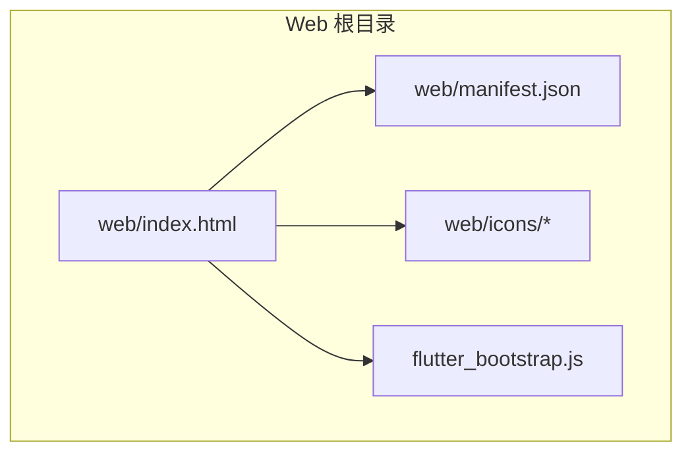
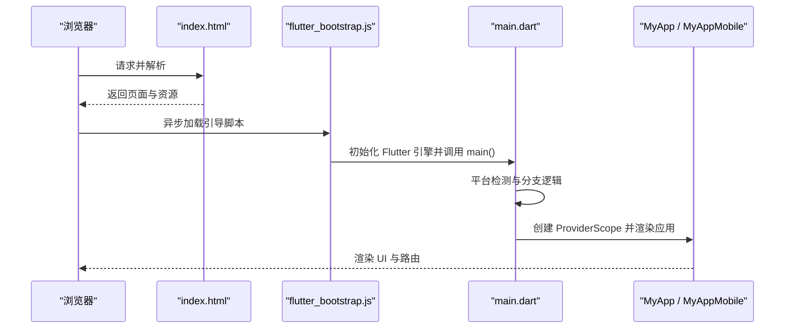
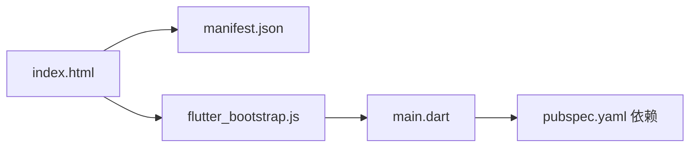

# Web 平台适配

<cite>
**本文引用的文件**   
- [web/index.html](file://web/index.html)
- [web/manifest.json](file://web/manifest.json)
- [pubspec.yaml](file://pubspec.yaml)
- [lib/main.dart](file://lib/main.dart)
- [README.md](file://README.md)
</cite>

## 目录
1. [简介](#简介)
2. [项目结构](#项目结构)
3. [核心组件](#核心组件)
4. [架构总览](#架构总览)
5. [详细组件分析](#详细组件分析)
6. [依赖分析](#依赖分析)
7. [性能考虑](#性能考虑)
8. [故障排查指南](#故障排查指南)
9. [结论](#结论)
10. [附录](#附录)

## 简介
本文件面向 Web 平台适配，系统化说明 TinyCast 在 Web 端的配置结构、入口与清单、图标资源、Web 特殊限制与兼容性、功能裁剪与降级策略、部署与 CDN 优化、调试与性能监控方法，以及 PWA 离线支持实现要点。文档以仓库现有代码为依据，提供可追溯的源码定位与图示，帮助读者快速落地 Web 构建与发布。

## 项目结构
Web 相关的关键文件位于 web 目录：
- index.html：Web 应用入口，定义基础路径、元信息、PWA 清单引用与 Flutter 引导脚本加载。
- manifest.json：PWA 应用清单，包含名称、启动页、显示模式、主题色、方向与图标集等。
- icons：PWA 图标资源目录（当前为空，需按清单要求补充）。

图表来源
- [web/index.html:1-39](file://web/index.html#L1-L39)
- [web/manifest.json:1-36](file://web/manifest.json#L1-L36)

章节来源
- [web/index.html:1-39](file://web/index.html#L1-L39)
- [web/manifest.json:1-36](file://web/manifest.json#L1-L36)

## 核心组件
- 入口 HTML
  - 设置 base href 占位符，供构建时替换为实际部署路径。
  - 声明字符集、兼容模式、描述、移动端与 iOS 相关 meta、favicon、标题与 PWA 清单链接。
  - 异步加载 flutter_bootstrap.js 启动 Flutter Web。
- 应用清单 manifest.json
  - name/short_name/start_url/display/background_color/theme_color/description/orientation/prefer_related_applications。
  - icons 数组定义多尺寸 PNG 与 maskable 用途，用于桌面快捷方式与应用图标。
- 图标资源
  - 清单中引用了 192x192、512x512 及 maskable 版本，需在 web/icons 下补齐对应文件以满足 PWA 安装与展示。

章节来源
- [web/index.html:1-39](file://web/index.html#L1-L39)
- [web/manifest.json:1-36](file://web/manifest.json#L1-L36)

## 架构总览
Flutter Web 运行时由浏览器加载 index.html，随后通过 flutter_bootstrap.js 初始化 Flutter 引擎并运行 Dart 代码。应用主入口 main.dart 根据平台分支选择不同 UI 与初始化流程；在 Web 端将走通用桌面/网页分支（非 iOS/Android），执行窗口工具初始化、主题预加载、服务初始化与路由渲染。

图表来源
- [web/index.html:1-39](file://web/index.html#L1-L39)
- [lib/main.dart:106-177](file://lib/main.dart#L106-L177)

章节来源
- [lib/main.dart:106-177](file://lib/main.dart#L106-L177)

## 详细组件分析

### 入口文件 index.html 分析
- 作用
  - 定义 base href 占位符，便于构建时注入部署路径。
  - 配置 meta 与 favicon，提升 SEO 与移动端体验。
  - 引用 manifest.json 启用 PWA 能力。
  - 引入 flutter_bootstrap.js 启动 Flutter Web。
- 关键点
  - base href 占位符会在构建时被替换为 --base-href 参数值。
  - 清单与图标路径相对 web 根目录。
  - 脚本使用 async 避免阻塞首屏渲染。

章节来源
- [web/index.html:1-39](file://web/index.html#L1-L39)

### 应用清单 manifest.json 分析
- 字段说明
  - name/short_name：应用名称与短名。
  - start_url：启动路径，通常设为 "."。
  - display：显示模式，standalone 表示全屏独立应用。
  - background_color/theme_color：背景与主题色。
  - description：应用描述。
  - orientation：屏幕方向偏好。
  - prefer_related_applications：是否优先推荐关联应用。
  - icons：多尺寸与 maskable 图标，满足安装与任务栏/桌面展示。
- 注意事项
  - 所有图标必须存在于 web/icons 目录且路径正确。
  - maskable 图标用于某些系统对“可遮罩”图标的要求。

章节来源
- [web/manifest.json:1-36](file://web/manifest.json#L1-L36)

### 图标资源配置
- 清单要求的图标
  - 192x192 PNG
  - 512x512 PNG
  - 192x192 maskable PNG
  - 512x512 maskable PNG
- 现状与建议
  - 当前 web/icons 目录为空，需补齐上述图标文件，否则 PWA 安装与图标展示可能失败或降级。
  - 建议使用矢量源生成多尺寸与 maskable 版本，确保清晰度与一致性。

章节来源
- [web/manifest.json:11-34](file://web/manifest.json#L11-L34)

### 应用入口与平台分支（main.dart）
- 平台检测
  - 针对 iOS/Android 分支直接初始化移动端 UI 与服务。
  - 其他平台（含 Web）进入通用分支，执行窗口工具初始化、主题预加载、服务初始化与路由渲染。
- 初始化流程
  - 打开 Isar 数据库、初始化音频播放器、日志、可选 Supabase 客户端。
  - 根据窗口参数决定渲染的主界面或子窗口应用。
- Web 影响
  - Web 端不会进入移动端分支，因此不执行移动端专属初始化。
  - 若存在仅移动端可用的插件或权限，应在业务层做条件判断与降级。

章节来源
- [lib/main.dart:106-177](file://lib/main.dart#L106-L177)
- [lib/main.dart:179-194](file://lib/main.dart#L179-L194)

### 依赖与 Web 相关特性（pubspec.yaml）
- 关键依赖
  - flutter_svg：SVG 渲染，Web 端可用。
  - just_audio/audio_service：音频播放与后台服务，Web 端行为受限于浏览器能力。
  - dio/connectivity_plus：网络请求与连接状态检测，Web 端可用。
  - shared_preferences/flutter_secure_storage：本地存储，Web 端基于浏览器存储机制。
  - supabase_flutter：云服务 SDK，Web 端可用。
- Web 注意事项
  - 部分原生插件在 Web 上不可用或需要 Web 实现包，需确认具体插件是否支持 Web。
  - 音频播放与后台服务在 Web 端可能受限，建议提供降级方案（如前台播放、无后台通知）。

章节来源
- [pubspec.yaml:18-144](file://pubspec.yaml#L18-L144)

## 依赖分析
- 入口依赖链
  - index.html 依赖 manifest.json 与 flutter_bootstrap.js。
  - flutter_bootstrap.js 负责加载 Flutter Web 运行时与编译产物。
  - main.dart 作为 Dart 入口，组织应用初始化与 UI 渲染。
- 外部依赖
  - 音视频、网络、存储、云服务、UI 库等均在 pubspec.yaml 中声明，构建时由 Flutter 工具处理平台差异。

图表来源
- [web/index.html:1-39](file://web/index.html#L1-L39)
- [web/manifest.json:1-36](file://web/manifest.json#L1-L36)
- [lib/main.dart:106-177](file://lib/main.dart#L106-L177)
- [pubspec.yaml:18-144](file://pubspec.yaml#L18-L144)

章节来源
- [web/index.html:1-39](file://web/index.html#L1-L39)
- [web/manifest.json:1-36](file://web/manifest.json#L1-L36)
- [lib/main.dart:106-177](file://lib/main.dart#L106-L177)
- [pubspec.yaml:18-144](file://pubspec.yaml#L18-L144)

## 性能考虑
- 首屏加载
  - 使用 CDN 缓存静态资源（HTML、JS、CSS、字体、图片）。
  - 启用 Gzip/Brotli 压缩与 HTTP/2。
  - 合理拆分资源，按需加载第三方库。
- 资源优化
  - 图片使用现代格式（WebP/AVIF），按需生成多分辨率。
  - SVG 图标内联以减少请求数。
  - 字体子集化与延迟加载。
- 缓存策略
  - HTML 使用短缓存或 no-cache，JS/CSS/图片使用长缓存并带内容哈希。
  - Service Worker 缓存关键资源与 API 响应（结合 PWA）。
- 运行时优化
  - 减少不必要的重绘与重建，合理使用 Riverpod 状态管理。
  - 懒加载页面与列表虚拟化。
  - 音频流式播放与缓冲控制。

[本节为通用指导，不直接分析具体文件]

## 故障排查指南
- 构建与部署
  - 检查 base href 是否正确替换，确保资源路径与部署路径一致。
  - 确认 manifest.json 路径与图标路径有效，浏览器控制台会提示缺失图标。
- 运行时问题
  - 浏览器控制台查看 JS 错误与资源 404。
  - 检查跨域（CORS）与 HTTPS 要求（PWA 通常需要 HTTPS）。
  - 音频播放与后台服务在 Web 端受限，确认降级逻辑是否生效。
- PWA 相关问题
  - 使用 Lighthouse 检测 PWA 指标（可安装性、离线缓存、清单完整性）。
  - 确认 service worker 注册与缓存命中情况。

章节来源
- [web/index.html:1-39](file://web/index.html#L1-L39)
- [web/manifest.json:1-36](file://web/manifest.json#L1-L36)

## 结论
TinyCast 的 Web 适配以标准 Flutter Web 工程为基础，入口与清单清晰，具备 PWA 基础能力。当前需补齐图标资源，并在业务层对 Web 端不支持的原生能力进行条件判断与降级。通过合理的部署与 CDN 策略、Service Worker 缓存与性能优化，可获得接近原生应用的 Web 体验。

[本节为总结，不直接分析具体文件]

## 附录

### Web 平台特殊限制与兼容性
- 文件系统与权限
  - Web 端无法直接访问本地文件系统，文件选择与下载需通过浏览器 API。
  - 后台任务与通知能力受限，音频后台服务可能不可用。
- 安全策略
  - 混合内容（HTTP 资源在 HTTPS 页面）会被阻止。
  - Cookie 与存储受 SameSite 与第三方限制影响。
- 浏览器差异
  - 不同浏览器对 Web Audio、Service Worker、Manifest 的支持略有差异，需测试覆盖主流浏览器。

[本节为通用指导，不直接分析具体文件]

### 功能裁剪与降级策略
- 音频播放
  - 若后台服务不可用，退化为前台播放，不提供锁屏控制与通知。
- 本地存储
  - 使用 shared_preferences 的 Web 实现（IndexedDB/LocalStorage），注意容量限制。
- 网络与离线
  - 使用 Service Worker 缓存关键资源与 API 响应，网络异常时回退到缓存数据。
- 插件可用性
  - 对仅移动端/桌面端可用的插件进行运行时检测与降级，保证核心功能可用。

[本节为通用指导，不直接分析具体文件]

### 部署配置与 CDN 优化
- 构建命令
  - 使用 flutter build web 生成静态资源，必要时传入 --base-href 指定部署路径。
- 服务器配置
  - 启用 gzip/brotli 压缩与 HTTP/2。
  - 设置正确的 MIME 类型与缓存头。
- CDN 策略
  - 将静态资源托管至 CDN，开启边缘缓存与自动压缩。
  - 使用内容哈希文件名，配合长缓存策略。

[本节为通用指导，不直接分析具体文件]

### 调试技巧与性能监控
- 浏览器开发者工具
  - Network 面板检查资源加载与缓存命中。
  - Performance 面板分析首屏与交互性能。
  - Application 面板检查 Manifest、Service Worker、缓存与存储。
- Lighthouse
  - 运行 PWA 与性能审计，修复可安装性与缓存问题。
- 日志与埋点
  - 在 main.dart 中初始化日志服务，记录关键事件与错误。
  - 上报性能指标（FCP、LCP、CLS）与用户行为。

[本节为通用指导，不直接分析具体文件]

### PWA 功能与离线支持
- 清单与图标
  - 完善 manifest.json 与图标资源，确保可安装性与图标展示。
- Service Worker
  - 注册 Service Worker，缓存关键资源与 API 响应。
  - 实现离线页面与数据回退策略。
- 更新策略
  - 监听更新事件，提示用户刷新或静默更新缓存。
- 测试验证
  - 使用 Lighthouse 与浏览器开发者工具验证 PWA 指标与离线能力。

[本节为通用指导，不直接分析具体文件]