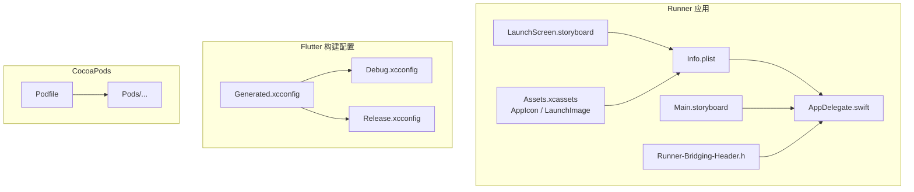
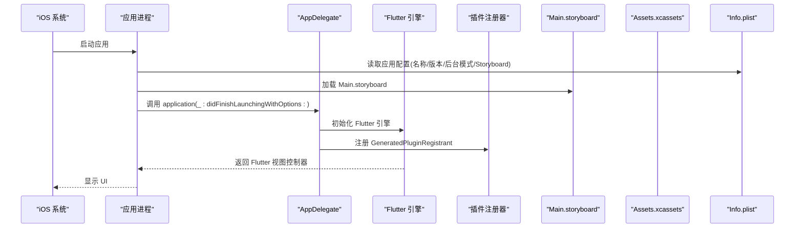
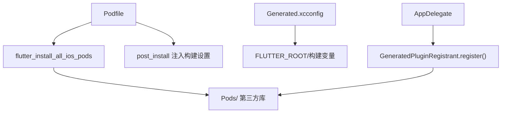

# iOS 平台适配

<cite>
**本文引用的文件**   
- [ios/Runner/Info.plist](file://ios/Runner/Info.plist)
- [ios/Runner/AppDelegate.swift](file://ios/Runner/AppDelegate.swift)
- [ios/Podfile](file://ios/Podfile)
- [ios/Runner/Base.lproj/LaunchScreen.storyboard](file://ios/Runner/Base.lproj/LaunchScreen.storyboard)
- [ios/Runner/Base.lproj/Main.storyboard](file://ios/Runner/Base.lproj/Main.storyboard)
- [ios/Runner/Assets.xcassets/AppIcon.appiconset/Contents.json](file://ios/Runner/Assets.xcassets/AppIcon.appiconset/Contents.json)
- [ios/Runner/Assets.xcassets/LaunchImage.imageset/Contents.json](file://ios/Runner/Assets.xcassets/LaunchImage.imageset/Contents.json)
- [ios/Flutter/Generated.xcconfig](file://ios/Flutter/Generated.xcconfig)
- [ios/Flutter/Debug.xcconfig](file://ios/Flutter/Debug.xcconfig)
- [ios/Flutter/Release.xcconfig](file://ios/Flutter/Release.xcconfig)
- [ios/Runner/Runner-Bridging-Header.h](file://ios/Runner/Runner-Bridging-Header.h)
</cite>

## 目录
1. [简介](#简介)
2. [项目结构](#项目结构)
3. [核心组件](#核心组件)
4. [架构总览](#架构总览)
5. [详细组件分析](#详细组件分析)
6. [依赖分析](#依赖分析)
7. [性能考虑](#性能考虑)
8. [故障排查指南](#故障排查指南)
9. [结论](#结论)
10. [附录](#附录)

## 简介
本文件面向在 Flutter 项目中为 iOS 平台进行适配与发布的开发者，系统梳理 iOS 工程的关键配置与资源管理，包括应用清单、应用代理、CocoaPods 依赖管理、启动画面与应用图标、权限与后台模式、通知服务集成、调试技巧、性能优化以及代码签名与 App Store 发布流程。内容基于仓库中现有 iOS 配置文件与资源进行说明，确保与实际代码一致。

## 项目结构
iOS 相关目录与关键文件如下：
- Runner 应用目标：包含 Info.plist、AppDelegate.swift、Storyboard、Assets 等
- Flutter 构建配置：Generated.xcconfig、Debug.xcconfig、Release.xcconfig
- CocoaPods 配置：Podfile、Pods 目录（第三方库）
- Bridging Header：用于 Swift 与插件桥接

图表来源
- [ios/Runner/Info.plist:1-76](file://ios/Runner/Info.plist#L1-L76)
- [ios/Runner/AppDelegate.swift:1-17](file://ios/Runner/AppDelegate.swift#L1-L17)
- [ios/Runner/Base.lproj/Main.storyboard:1-27](file://ios/Runner/Base.lproj/Main.storyboard#L1-L27)
- [ios/Runner/Base.lproj/LaunchScreen.storyboard:1-38](file://ios/Runner/Base.lproj/LaunchScreen.storyboard#L1-L38)
- [ios/Runner/Assets.xcassets/AppIcon.appiconset/Contents.json:1-123](file://ios/Runner/Assets.xcassets/AppIcon.appiconset/Contents.json#L1-L123)
- [ios/Runner/Assets.xcassets/LaunchImage.imageset/Contents.json:1-24](file://ios/Runner/Assets.xcassets/LaunchImage.imageset/Contents.json#L1-L24)
- [ios/Flutter/Generated.xcconfig:1-16](file://ios/Flutter/Generated.xcconfig#L1-L16)
- [ios/Flutter/Debug.xcconfig:1-3](file://ios/Flutter/Debug.xcconfig#L1-L3)
- [ios/Flutter/Release.xcconfig:1-3](file://ios/Flutter/Release.xcconfig#L1-L3)
- [ios/Podfile:1-44](file://ios/Podfile#L1-L44)

章节来源
- [ios/Runner/Info.plist:1-76](file://ios/Runner/Info.plist#L1-L76)
- [ios/Runner/AppDelegate.swift:1-17](file://ios/Runner/AppDelegate.swift#L1-L17)
- [ios/Podfile:1-44](file://ios/Podfile#L1-L44)
- [ios/Runner/Base.lproj/LaunchScreen.storyboard:1-38](file://ios/Runner/Base.lproj/LaunchScreen.storyboard#L1-L38)
- [ios/Runner/Base.lproj/Main.storyboard:1-27](file://ios/Runner/Base.lproj/Main.storyboard#L1-L27)
- [ios/Runner/Assets.xcassets/AppIcon.appiconset/Contents.json:1-123](file://ios/Runner/Assets.xcassets/AppIcon.appiconset/Contents.json#L1-L123)
- [ios/Runner/Assets.xcassets/LaunchImage.imageset/Contents.json:1-24](file://ios/Runner/Assets.xcassets/LaunchImage.imageset/Contents.json#L1-L24)
- [ios/Flutter/Generated.xcconfig:1-16](file://ios/Flutter/Generated.xcconfig#L1-L16)
- [ios/Flutter/Debug.xcconfig:1-3](file://ios/Flutter/Debug.xcconfig#L1-L3)
- [ios/Flutter/Release.xcconfig:1-3](file://ios/Flutter/Release.xcconfig#L1-L3)

## 核心组件
- Info.plist：应用元数据、界面方向、启动 Storyboard、后台模式、场景配置等
- AppDelegate.swift：应用生命周期入口，初始化 Flutter 引擎并注册插件
- Podfile：CocoaPods 依赖管理与 Flutter 插件安装脚本
- Storyboard：启动画面与主界面容器
- Assets：应用图标与启动图资源描述
- xcconfig：Flutter 构建参数与 Pods 集成设置
- Bridging Header：Swift 与插件头文件桥接

章节来源
- [ios/Runner/Info.plist:1-76](file://ios/Runner/Info.plist#L1-L76)
- [ios/Runner/AppDelegate.swift:1-17](file://ios/Runner/AppDelegate.swift#L1-L17)
- [ios/Podfile:1-44](file://ios/Podfile#L1-L44)
- [ios/Runner/Base.lproj/LaunchScreen.storyboard:1-38](file://ios/Runner/Base.lproj/LaunchScreen.storyboard#L1-L38)
- [ios/Runner/Base.lproj/Main.storyboard:1-27](file://ios/Runner/Base.lproj/Main.storyboard#L1-L27)
- [ios/Runner/Assets.xcassets/AppIcon.appiconset/Contents.json:1-123](file://ios/Runner/Assets.xcassets/AppIcon.appiconset/Contents.json#L1-L123)
- [ios/Runner/Assets.xcassets/LaunchImage.imageset/Contents.json:1-24](file://ios/Runner/Assets.xcassets/LaunchImage.imageset/Contents.json#L1-L24)
- [ios/Flutter/Generated.xcconfig:1-16](file://ios/Flutter/Generated.xcconfig#L1-L16)
- [ios/Flutter/Debug.xcconfig:1-3](file://ios/Flutter/Debug.xcconfig#L1-L3)
- [ios/Flutter/Release.xcconfig:1-3](file://ios/Flutter/Release.xcconfig#L1-L3)
- [ios/Runner/Runner-Bridging-Header.h:1-2](file://ios/Runner/Runner-Bridging-Header.h#L1-L2)

## 架构总览
下图展示 iOS 端从应用启动到 Flutter 引擎初始化的关键路径，以及资源与配置的关联关系。

图表来源
- [ios/Runner/AppDelegate.swift:1-17](file://ios/Runner/AppDelegate.swift#L1-L17)
- [ios/Runner/Base.lproj/Main.storyboard:1-27](file://ios/Runner/Base.lproj/Main.storyboard#L1-L27)
- [ios/Runner/Info.plist:1-76](file://ios/Runner/Info.plist#L1-L76)

## 详细组件分析

### Info.plist 应用配置
- 应用标识与版本：CFBundleIdentifier、CFBundleName、CFBundleShortVersionString、CFBundleVersion
- 显示名称：CFBundleDisplayName
- 运行环境：LSRequiresIPhoneOS、UIBackgroundModes（音频与后台拉取）
- 界面与场景：UIApplicationSceneManifest、UISceneConfigurations、UILaunchStoryboardName、UIMainStoryboardFile、UISupportedInterfaceOrientations
- 其他：CADisableMinimumFrameDurationOnPhone、UIApplicationSupportsIndirectInputEvents

建议与注意事项
- 如需启用推送通知或定位等能力，需在 Info.plist 添加对应权限键并在 Xcode 的 Capabilities 中开启相应功能
- 后台模式仅声明 audio 与 fetch，若需更多后台任务（如位置更新），请按需扩展 UIBackgroundModes

章节来源
- [ios/Runner/Info.plist:1-76](file://ios/Runner/Info.plist#L1-L76)

### AppDelegate.swift 应用代理
- 继承 FlutterAppDelegate 并实现 didInitializeImplicitFlutterEngine，完成插件注册
- 默认生命周期方法直接委托给父类，保持 Flutter 标准行为

最佳实践
- 如需接入第三方 SDK（如推送、统计、崩溃上报），可在 didFinishLaunchingWithOptions 中统一初始化
- 避免在此处执行耗时操作，以免影响启动速度

章节来源
- [ios/Runner/AppDelegate.swift:1-17](file://ios/Runner/AppDelegate.swift#L1-L17)

### Podfile 依赖管理
- 使用 flutter_install_all_ios_pods 自动安装 Flutter 插件依赖
- use_frameworks! 启用框架模式以兼容现代插件
- post_install 回调注入额外构建设置
- 禁用 CocoaPods 统计以减少构建延迟

常见问题
- 首次 pod install 前需执行 flutter pub get 生成 Generated.xcconfig
- 如遇网络问题，可配置镜像源或离线缓存

章节来源
- [ios/Podfile:1-44](file://ios/Podfile#L1-L44)

### 启动故事板与主界面
- LaunchScreen.storyboard：定义启动画面，引用 LaunchImage 资源
- Main.storyboard：承载 FlutterViewController，作为 Flutter 页面的宿主

维护要点
- 修改启动图时，同步更新 LaunchImage.imageset 中的多分辨率图片
- 如需自定义启动页动画或品牌元素，可在 LaunchScreen.storyboard 中调整布局

章节来源
- [ios/Runner/Base.lproj/LaunchScreen.storyboard:1-38](file://ios/Runner/Base.lproj/LaunchScreen.storyboard#L1-L38)
- [ios/Runner/Base.lproj/Main.storyboard:1-27](file://ios/Runner/Base.lproj/Main.storyboard#L1-L27)
- [ios/Runner/Assets.xcassets/LaunchImage.imageset/Contents.json:1-24](file://ios/Runner/Assets.xcassets/LaunchImage.imageset/Contents.json#L1-L24)

### 应用图标与资产目录
- AppIcon.appiconset：包含 iPhone/iPad/营销图标的多尺寸映射
- LaunchImage.imageset：启动图的多分辨率映射

规范建议
- 提供所有必需尺寸以避免运行时缩放失真
- 使用矢量或高分辨率素材保证清晰度

章节来源
- [ios/Runner/Assets.xcassets/AppIcon.appiconset/Contents.json:1-123](file://ios/Runner/Assets.xcassets/AppIcon.appiconset/Contents.json#L1-L123)
- [ios/Runner/Assets.xcassets/LaunchImage.imageset/Contents.json:1-24](file://ios/Runner/Assets.xcassets/LaunchImage.imageset/Contents.json#L1-L24)

### xcconfig 构建配置
- Generated.xcconfig：由 Flutter 自动生成，包含 FLUTTER_ROOT、构建目录、版本号、Dart 混淆与跟踪开关等
- Debug.xcconfig / Release.xcconfig：引入 Pods 生成的配置与 Generated.xcconfig

优化点
- 发布构建建议开启 DART_OBFUSATION=true 与合适的优化级别
- 模拟器与真机架构排除项已配置，避免不必要的编译

章节来源
- [ios/Flutter/Generated.xcconfig:1-16](file://ios/Flutter/Generated.xcconfig#L1-L16)
- [ios/Flutter/Debug.xcconfig:1-3](file://ios/Flutter/Debug.xcconfig#L1-L3)
- [ios/Flutter/Release.xcconfig:1-3](file://ios/Flutter/Release.xcconfig#L1-L3)

### Bridging Header 桥接
- Runner-Bridging-Header.h 引入 GeneratedPluginRegistrant.h，使 Swift 侧能访问插件注册器

注意
- 通常无需手动编辑，除非需要自定义桥接逻辑

章节来源
- [ios/Runner/Runner-Bridging-Header.h:1-2](file://ios/Runner/Runner-Bridging-Header.h#L1-L2)

## 依赖分析
- Podfile 通过 flutter_install_all_ios_pods 将 Flutter 插件映射到 Pods 目录
- Generated.xcconfig 提供 Flutter 根路径、构建目录、版本号等环境变量
- AppDelegate 在引擎初始化后调用插件注册器，完成第三方库集成

图表来源
- [ios/Podfile:1-44](file://ios/Podfile#L1-L44)
- [ios/Flutter/Generated.xcconfig:1-16](file://ios/Flutter/Generated.xcconfig#L1-L16)
- [ios/Runner/AppDelegate.swift:1-17](file://ios/Runner/AppDelegate.swift#L1-L17)

章节来源
- [ios/Podfile:1-44](file://ios/Podfile#L1-L44)
- [ios/Flutter/Generated.xcconfig:1-16](file://ios/Flutter/Generated.xcconfig#L1-L16)
- [ios/Runner/AppDelegate.swift:1-17](file://ios/Runner/AppDelegate.swift#L1-L17)

## 性能考虑
- 启动优化
  - 减少 didFinishLaunchingWithOptions 中的初始化工作
  - 精简启动图与 Storyboard 层级
- 构建优化
  - 发布构建开启 DART_OBFUSATION 与 Tree Shaking
  - 合理设置 EXCLUDED_ARCHS 避免无用架构编译
- 内存与渲染
  - 避免在主线程执行 IO 或网络请求
  - 合理使用图片资源与懒加载
- CocoaPods
  - 使用 use_frameworks! 提升兼容性
  - 禁用统计减少构建延迟

[本节为通用指导，不直接分析具体文件]

## 故障排查指南
- 无法找到 FLUTTER_ROOT 或 Generated.xcconfig
  - 先执行 flutter pub get，再重新 pod install
- 插件未生效
  - 检查 AppDelegate 是否调用了插件注册器
  - 确认 Podfile 中 use_frameworks! 与 flutter_install_all_ios_pods 存在
- 启动白屏或黑屏
  - 核对 UILaunchStoryboardName 与 UIMainStoryboardFile 指向正确
  - 检查 LaunchImage 资源是否存在且命名匹配
- 后台播放无效
  - 确认 UIBackgroundModes 包含 audio
  - 检查媒体会话与音频会话配置是否正确

章节来源
- [ios/Flutter/Generated.xcconfig:1-16](file://ios/Flutter/Generated.xcconfig#L1-L16)
- [ios/Podfile:1-44](file://ios/Podfile#L1-L44)
- [ios/Runner/AppDelegate.swift:1-17](file://ios/Runner/AppDelegate.swift#L1-L17)
- [ios/Runner/Base.lproj/LaunchScreen.storyboard:1-38](file://ios/Runner/Base.lproj/LaunchScreen.storyboard#L1-L38)
- [ios/Runner/Base.lproj/Main.storyboard:1-27](file://ios/Runner/Base.lproj/Main.storyboard#L1-L27)
- [ios/Runner/Assets.xcassets/LaunchImage.imageset/Contents.json:1-24](file://ios/Runner/Assets.xcassets/LaunchImage.imageset/Contents.json#L1-L24)
- [ios/Runner/Info.plist:1-76](file://ios/Runner/Info.plist#L1-L76)

## 结论
本项目 iOS 端采用标准的 Flutter 工程结构，通过 Info.plist、AppDelegate、Storyboard、Assets 与 xcconfig 协同完成应用配置与构建；借助 CocoaPods 与 Flutter 插件机制实现第三方库集成。遵循本文的配置与优化建议，可有效提升稳定性与性能，并为后续权限、后台模式与通知服务的扩展奠定基础。

[本节为总结性内容，不直接分析具体文件]

## 附录

### 权限配置（iOS）
- 常见权限键示例（按需添加到 Info.plist）
  - NSPhotoLibraryUsageDescription：相册访问
  - NSCameraUsageDescription：相机访问
  - NSMicrophoneUsageDescription：麦克风访问
  - NSLocationWhenInUseUsageDescription：定位（使用期间）
  - NSUserNotificationsUsageDescription：通知说明
- 操作步骤
  - 在 Xcode 的 Signing & Capabilities 中开启所需能力（如 Push Notifications、Background Modes）
  - 在 Info.plist 中添加对应的 Usage Description 键值

[本节为通用指导，不直接分析具体文件]

### 后台模式设置（iOS）
- 当前 UIBackgroundModes 包含 audio 与 fetch
- 如需位置更新，添加 location 并配置相应权限
- 音频后台播放需确保媒体会话与音频会话正确初始化

章节来源
- [ios/Runner/Info.plist:1-76](file://ios/Runner/Info.plist#L1-L76)

### 通知服务集成（iOS）
- 在 Xcode 中开启 Push Notifications 能力
- 在 AppDelegate 中处理 APNs 令牌与消息回调
- 如需本地通知，使用 UserNotifications 框架并申请授权

[本节为通用指导，不直接分析具体文件]

### 代码签名与发布到 App Store
- 准备证书与描述文件
  - 在 Apple Developer 创建 App ID、Provisioning Profile
  - 在 Xcode 中配置 Team 与 Bundle Identifier
- 构建与归档
  - 选择 Release 配置，Archive 生成 .ipa
- 上传与分发
  - 使用 Xcode Organizer 或 Transporter 上传至 App Store Connect
  - 填写版本信息、截图与隐私政策后提交审核

[本节为通用指导，不直接分析具体文件]