# 平台适配

<cite>
**本文引用的文件**   
- [README.md](file://README.md)
- [pubspec.yaml](file://pubspec.yaml)
- [main.dart](file://lib/main.dart)
- [multi_window.dart](file://lib/multi_window.dart)
- [window_utils.dart](file://lib/window_utils.dart)
- [window_utils_native.dart](file://lib/src/window_utils_native.dart)
- [AndroidManifest.xml](file://android/app/src/main/AndroidManifest.xml)
- [build.gradle.kts（Android）](file://android/app/build.gradle.kts)
- [Info.plist（iOS）](file://ios/Runner/Info.plist)
- [Podfile（iOS）](file://ios/Podfile)
- [Info.plist（macOS）](file://macos/Runner/Info.plist)
- [Podfile（macOS）](file://macos/Podfile)
- [CMakeLists.txt（Windows）](file://windows/CMakeLists.txt)
- [Runner.rc（Windows）](file://windows/runner/Runner.rc)
- [my_application.cc（Linux）](file://linux/runner/my_application.cc)
</cite>

## 目录
1. [简介](#简介)
2. [项目结构](#项目结构)
3. [核心组件](#核心组件)
4. [架构总览](#架构总览)
5. [详细组件分析](#详细组件分析)
6. [依赖分析](#依赖分析)
7. [性能考虑](#性能考虑)
8. [故障排查指南](#故障排查指南)
9. [结论](#结论)
10. [附录](#附录)

## 简介
本文件面向 TinyCast 的多平台适配，系统阐述跨平台开发策略与平台特定功能的实现方式。内容覆盖 Android、iOS、Windows、macOS、Linux 五大平台的适配方案，包括平台配置文件、权限设置、资源管理、构建与部署流程、平台抽象层设计与实现、平台 API 调用与系统集成、差异处理与最佳实践，以及各平台的性能优化建议与调试技巧。

## 项目结构
TinyCast 基于 Flutter 工程模板，包含多平台原生目录：android、ios、macos、windows、linux，以及共享 Dart 代码 lib。应用入口在 lib/main.dart，窗口管理与多窗口逻辑集中在 lib/multi_window.dart 与 lib/window_utils.dart（导出 src/window_utils_native.dart）。

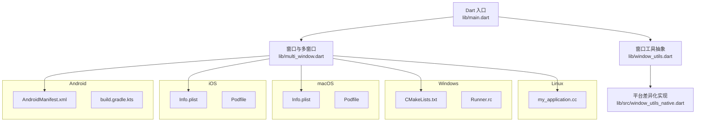

图表来源
- [main.dart:106-177](file://lib/main.dart#L106-L177)
- [multi_window.dart:184-303](file://lib/multi_window.dart#L184-L303)
- [window_utils.dart:1-6](file://lib/window_utils.dart#L1-L6)
- [window_utils_native.dart:1-125](file://lib/src/window_utils_native.dart#L1-L125)
- [AndroidManifest.xml:1-65](file://android/app/src/main/AndroidManifest.xml#L1-L65)
- [build.gradle.kts（Android）:1-45](file://android/app/build.gradle.kts#L1-L45)
- [Info.plist（iOS）:1-76](file://ios/Runner/Info.plist#L1-L76)
- [Podfile（iOS）:1-44](file://ios/Podfile#L1-L44)
- [Info.plist（macOS）:1-46](file://macos/Runner/Info.plist#L1-L46)
- [Podfile（macOS）:1-43](file://macos/Podfile#L1-L43)
- [CMakeLists.txt（Windows）:1-109](file://windows/CMakeLists.txt#L1-L109)
- [Runner.rc（Windows）:1-122](file://windows/runner/Runner.rc#L1-L122)
- [my_application.cc（Linux）:1-145](file://linux/runner/my_application.cc#L1-L145)

章节来源
- [README.md:1-6](file://README.md#L1-L6)
- [pubspec.yaml:1-196](file://pubspec.yaml#L1-L196)

## 核心组件
- 应用入口与生命周期
  - main.dart 负责根据平台选择移动端或桌面端启动路径；初始化数据库、音频服务、日志与可选的 Supabase；注册应用生命周期观察者以调度后台刷新任务。
- 多窗口与参数传递
  - multi_window.dart 定义 WindowArguments 序列化/反序列化，提供主窗口、设置窗口、订阅窗口、节目详情窗口的初始化与渲染。
- 窗口效果与全屏内容
  - window_utils.dart 暴露统一接口，src/window_utils_native.dart 实现 macOS、Windows 与回退策略，支持毛玻璃、透明背景、标题栏透明等。

章节来源
- [main.dart:106-194](file://lib/main.dart#L106-L194)
- [multi_window.dart:15-182](file://lib/multi_window.dart#L15-L182)
- [window_utils.dart:1-6](file://lib/window_utils.dart#L1-L6)
- [window_utils_native.dart:1-109](file://lib/src/window_utils_native.dart#L1-L109)

## 架构总览
下图展示从入口到平台抽象层的调用关系，以及各平台配置文件的参与点。

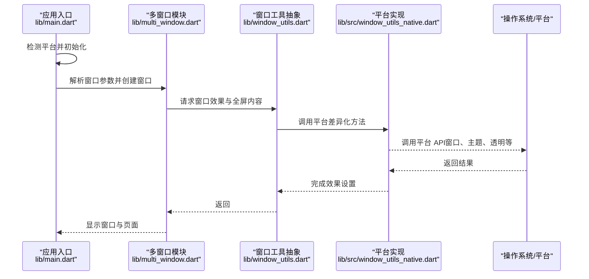

图表来源
- [main.dart:106-177](file://lib/main.dart#L106-L177)
- [multi_window.dart:184-303](file://lib/multi_window.dart#L184-L303)
- [window_utils.dart:1-6](file://lib/window_utils.dart#L1-L6)
- [window_utils_native.dart:1-109](file://lib/src/window_utils_native.dart#L1-L109)

## 详细组件分析

### 应用入口与平台分支（lib/main.dart）
- 平台分支：对 iOS/Android 走移动端启动流程，其他平台进入桌面端窗口初始化流程。
- 环境配置：通过编译时环境变量注入 Supabase 凭据，避免硬编码。
- 生命周期：注册 WidgetsBindingObserver，监听应用前后台状态，驱动 FeedRefreshScheduler。
- 多窗口路由：根据 WindowArguments.type 分发到不同窗口应用组件。

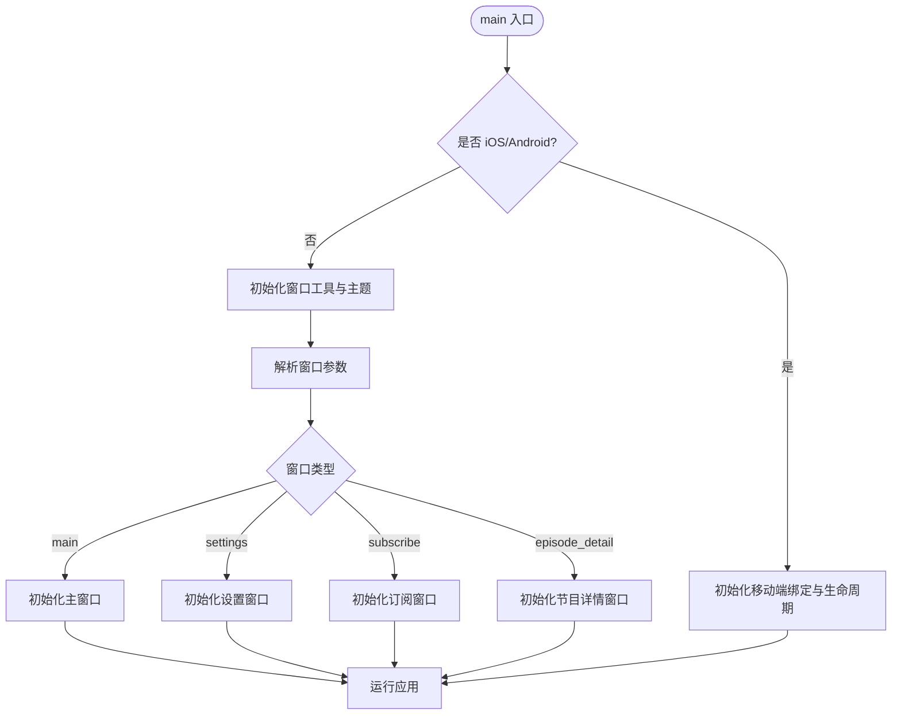

图表来源
- [main.dart:106-177](file://lib/main.dart#L106-L177)

章节来源
- [main.dart:106-194](file://lib/main.dart#L106-L194)

### 多窗口与参数序列化（lib/multi_window.dart）
- WindowArguments：统一封装窗口类型与业务数据（Episode、Podcast），并提供 JSON 序列化。
- parseArguments：安全反序列化，失败回退为默认主窗口。
- 窗口初始化：针对不同窗口设置尺寸、居中、隐藏标题栏、背景色与毛玻璃效果。

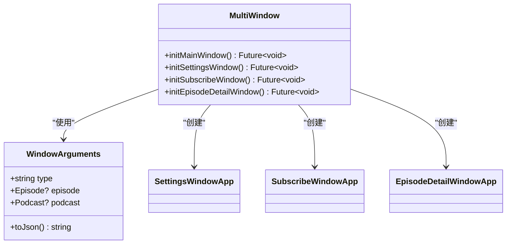

图表来源
- [multi_window.dart:15-182](file://lib/multi_window.dart#L15-L182)
- [multi_window.dart:184-303](file://lib/multi_window.dart#L184-L303)
- [multi_window.dart:309-453](file://lib/multi_window.dart#L309-L453)

章节来源
- [multi_window.dart:15-182](file://lib/multi_window.dart#L15-L182)
- [multi_window.dart:184-303](file://lib/multi_window.dart#L184-L303)
- [multi_window.dart:309-453](file://lib/multi_window.dart#L309-L453)

### 窗口工具抽象与平台实现（lib/window_utils.dart / lib/src/window_utils_native.dart）
- 抽象层：统一 expose initialize、applyFrostedGlassEffect、enableFullSizeContent 等方法。
- 平台实现：
  - macOS：侧边栏/窗口背景效果、透明标题栏、全屏内容视图。
  - Windows：Acrylic 毛玻璃效果，失败回退为纯色背景。
  - 其他平台：回退为纯色背景。
- 安全区域：TitlebarSafeAreaWrapper 仅在 macOS 生效。

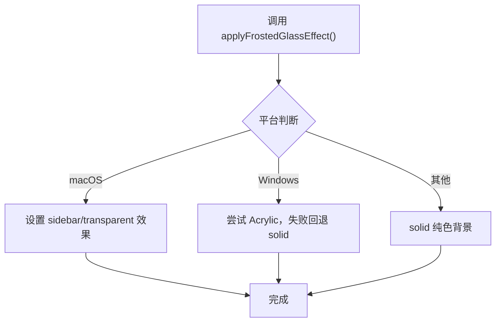

图表来源
- [window_utils_native.dart:11-49](file://lib/src/window_utils_native.dart#L11-L49)
- [window_utils.dart:1-6](file://lib/window_utils.dart#L1-L6)

章节来源
- [window_utils.dart:1-6](file://lib/window_utils.dart#L1-L6)
- [window_utils_native.dart:1-125](file://lib/src/window_utils_native.dart#L1-L125)

### Android 平台适配
- 清单与权限
  - 网络、前台服务、媒体播放、唤醒锁等权限声明。
  - AudioService 与 MediaButtonReceiver 注册，支持锁屏控制与通知栏控制。
- 构建配置
  - Gradle 插件与 Kotlin/Java 版本约束；minSdk/targetSdk/versionCode/name 由 Flutter 工具注入。
- 运行时行为
  - 移动端入口直接初始化 WidgetsFlutterBinding，不执行窗口相关逻辑。

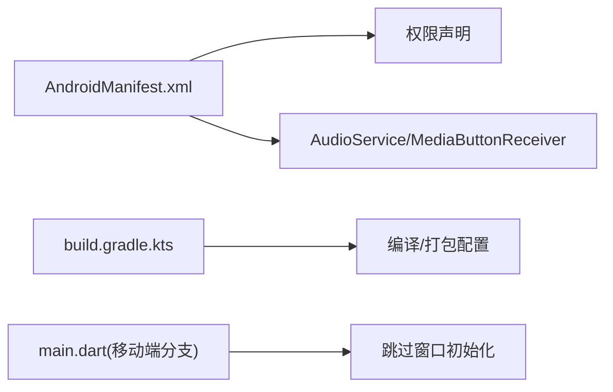

图表来源
- [AndroidManifest.xml:1-65](file://android/app/src/main/AndroidManifest.xml#L1-L65)
- [build.gradle.kts（Android）:1-45](file://android/app/build.gradle.kts#L1-L45)
- [main.dart:106-114](file://lib/main.dart#L106-L114)

章节来源
- [AndroidManifest.xml:1-65](file://android/app/src/main/AndroidManifest.xml#L1-L65)
- [build.gradle.kts（Android）:1-45](file://android/app/build.gradle.kts#L1-L45)
- [main.dart:106-114](file://lib/main.dart#L106-L114)

### iOS 平台适配
- Info.plist
  - 后台模式：audio、fetch。
  - 界面方向、Storyboard、SceneManifest 等基础配置。
- Podfile
  - CocoaPods 集成 Flutter iOS 插件与额外设置。

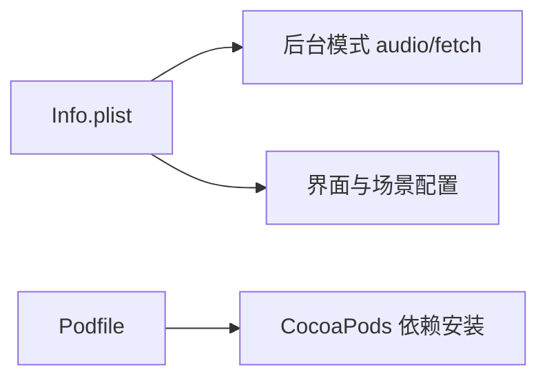

图表来源
- [Info.plist（iOS）:1-76](file://ios/Runner/Info.plist#L1-L76)
- [Podfile（iOS）:1-44](file://ios/Podfile#L1-L44)

章节来源
- [Info.plist（iOS）:1-76](file://ios/Runner/Info.plist#L1-L76)
- [Podfile（iOS）:1-44](file://ios/Podfile#L1-L44)

### macOS 平台适配
- Info.plist
  - URL Scheme 配置（用于回调等）。
- Podfile
  - CocoaPods 集成 Flutter macOS 插件。
- 窗口效果
  - 通过 flutter_acrylic 实现侧边栏/透明背景、标题栏透明、全屏内容视图。

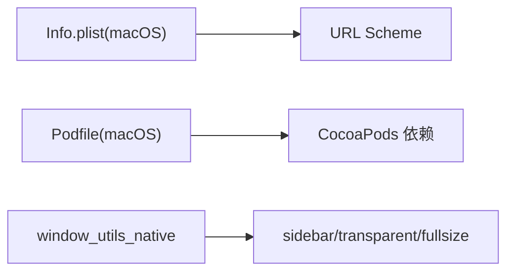

图表来源
- [Info.plist（macOS）:1-46](file://macos/Runner/Info.plist#L1-L46)
- [Podfile（macOS）:1-43](file://macos/Podfile#L1-L43)
- [window_utils_native.dart:22-28](file://lib/src/window_utils_native.dart#L22-L28)

章节来源
- [Info.plist（macOS）:1-46](file://macos/Runner/Info.plist#L1-L46)
- [Podfile（macOS）:1-43](file://macos/Podfile#L1-L43)
- [window_utils_native.dart:22-28](file://lib/src/window_utils_native.dart#L22-L28)

### Windows 平台适配
- CMakeLists.txt
  - 构建类型、Unicode、AOT 库安装、资源拷贝等。
- Runner.rc
  - 图标、版本信息与字符串资源。
- 窗口效果
  - Acrylic 毛玻璃效果，失败回退为纯色背景。

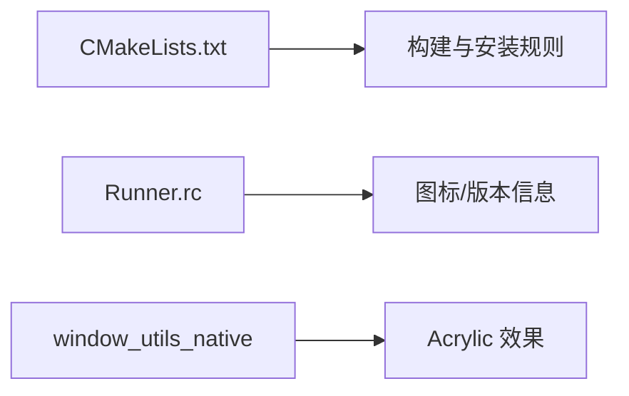

图表来源
- [CMakeLists.txt（Windows）:1-109](file://windows/CMakeLists.txt#L1-L109)
- [Runner.rc（Windows）:1-122](file://windows/runner/Runner.rc#L1-L122)
- [window_utils_native.dart:30-42](file://lib/src/window_utils_native.dart#L30-L42)

章节来源
- [CMakeLists.txt（Windows）:1-109](file://windows/CMakeLists.txt#L1-L109)
- [Runner.rc（Windows）:1-122](file://windows/runner/Runner.rc#L1-L122)
- [window_utils_native.dart:30-42](file://lib/src/window_utils_native.dart#L30-L42)

### Linux 平台适配
- my_application.cc
  - GTK 应用初始化、HeaderBar/传统标题栏自适应、窗口大小与背景色设置、插件注册。

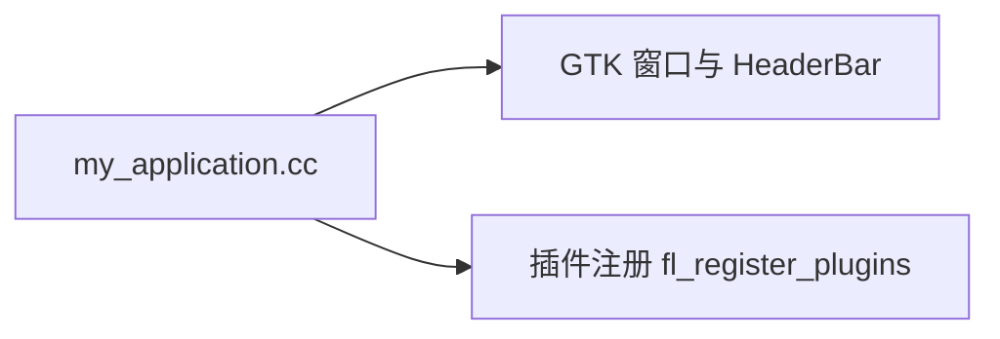

图表来源
- [my_application.cc（Linux）:1-145](file://linux/runner/my_application.cc#L1-L145)

章节来源
- [my_application.cc（Linux）:1-145](file://linux/runner/my_application.cc#L1-L145)

## 依赖分析
- 关键依赖（节选）
  - 窗口与多窗口：window_manager、desktop_multi_window
  - 音频：just_audio、audio_service
  - 本地存储：isar_community、shared_preferences
  - 网络：dio、connectivity_plus
  - 加密与安全：crypto、flutter_secure_storage
  - 云服务：supabase_flutter
  - 图片缓存：cached_network_image
  - HTML 渲染：html、flutter_widget_from_html
- 平台特定依赖
  - Android：Gradle/Kotlin/Java 11、AudioService
  - iOS/macOS：CocoaPods（Podfile）
  - Windows：CMake、Visual Studio 资源脚本
  - Linux：GTK/GDK

```mermaid
graph TB
Core["核心依赖<br/>pubspec.yaml"] --> UI["UI/图标/SVG"]
Core --> File["文件/路径/桌面窗口"]
Core --> DB["Isar/SharedPreferences"]
Core --> State["Riverpod"]
Core --> Audio["just_audio/audio_service"]
Core --> Net["dio/connectivity_plus"]
Core --> RSS["rss_dart/xml"]
Core --> Cache["cached_network_image"]
Core --> Crypto["crypto/flutter_secure_storage"]
Core --> Cloud["supabase_flutter"]
Core --> HTML["html/flutter_widget_from_html"]
Platform["平台构建"] --> Android["Android Gradle"]
Platform --> iOS["iOS CocoaPods"]
Platform --> macOS["macOS CocoaPods"]
Platform --> Windows["Windows CMake"]
Platform --> Linux["Linux GTK"]
```

图表来源
- [pubspec.yaml:1-196](file://pubspec.yaml#L1-L196)
- [build.gradle.kts（Android）:1-45](file://android/app/build.gradle.kts#L1-L45)
- [Podfile（iOS）:1-44](file://ios/Podfile#L1-L44)
- [Podfile（macOS）:1-43](file://macos/Podfile#L1-L43)
- [CMakeLists.txt（Windows）:1-109](file://windows/CMakeLists.txt#L1-L109)
- [my_application.cc（Linux）:1-145](file://linux/runner/my_application.cc#L1-L145)

章节来源
- [pubspec.yaml:1-196](file://pubspec.yaml#L1-L196)

## 性能考虑
- 音频播放
  - 使用 just_audio 与 audio_service 确保后台播放与系统媒体控制；合理设置缓冲与码率，减少首帧延迟。
- 本地数据库
  - Isar 适合轻量高并发读写；注意索引设计与查询优化，避免全表扫描。
- 图片与资源
  - 使用 cached_network_image 进行网络图片缓存；按需加载与占位图提升感知性能。
- 窗口与渲染
  - macOS 使用 sidebar/transparent 效果；Windows 优先 Acrylic，失败回退纯色；避免频繁切换效果。
- 网络请求
  - dio 启用 HTTP/2 适配器；合理设置超时与重试；结合 connectivity_plus 做网络状态响应。
- 生命周期与后台任务
  - 利用 WidgetsBindingObserver 在前后台切换时暂停/恢复后台刷新，降低 CPU/电量消耗。

[本节为通用指导，不直接分析具体文件]

## 故障排查指南
- Android
  - 检查 AndroidManifest.xml 中权限与服务声明是否正确；确认 Foreground Service 类型与最小 SDK 版本。
  - 构建问题：核对 Java/Kotlin 版本与 NDK 版本；清理 Gradle 缓存后重试。
- iOS
  - Info.plist 后台模式与界面配置；Podfile 依赖安装失败时检查 CocoaPods 与 Flutter 根路径。
- macOS
  - URL Scheme 配置是否正确；CocoaPods 依赖与 Xcode 签名配置。
- Windows
  - CMake 与 Visual Studio 工具链；Runner.rc 资源路径与版本信息；Acrylic 效果不可用时的回退。
- Linux
  - GTK/GDK 依赖是否满足；HeaderBar 与传统标题栏切换逻辑是否符合预期。
- 运行时
  - 窗口参数解析失败会回退到主窗口；检查 JSON 字段与时间格式。
  - Supabase 未配置时跳过初始化，不影响本地功能。

章节来源
- [AndroidManifest.xml:1-65](file://android/app/src/main/AndroidManifest.xml#L1-L65)
- [build.gradle.kts（Android）:1-45](file://android/app/build.gradle.kts#L1-L45)
- [Info.plist（iOS）:1-76](file://ios/Runner/Info.plist#L1-L76)
- [Podfile（iOS）:1-44](file://ios/Podfile#L1-L44)
- [Info.plist（macOS）:1-46](file://macos/Runner/Info.plist#L1-L46)
- [Podfile（macOS）:1-43](file://macos/Podfile#L1-L43)
- [CMakeLists.txt（Windows）:1-109](file://windows/CMakeLists.txt#L1-L109)
- [Runner.rc（Windows）:1-122](file://windows/runner/Runner.rc#L1-L122)
- [my_application.cc（Linux）:1-145](file://linux/runner/my_application.cc#L1-L145)
- [multi_window.dart:101-182](file://lib/multi_window.dart#L101-L182)
- [main.dart:179-194](file://lib/main.dart#L179-L194)

## 结论
TinyCast 通过统一的 Dart 入口与窗口抽象层，将平台差异收敛到 platform-specific 配置与实现文件中。Android/iOS 侧重移动端的音频服务与后台能力；Windows/macOS/Linux 侧重窗口效果与系统集成。借助 pubspec 依赖管理与各平台构建系统，实现了可维护、可扩展的跨平台适配方案。建议在后续迭代中持续完善平台特性检测与回退策略，强化错误边界与日志输出，以提升稳定性与可观测性。

[本节为总结性内容，不直接分析具体文件]

## 附录
- 构建与发布要点
  - Android：配置签名与版本；确保权限与服务声明完整。
  - iOS：更新 Info.plist 与 Podfile；证书与描述文件配置。
  - macOS：更新 Info.plist 与 Podfile；签名与公证。
  - Windows：CMake 构建产物与资源文件完整性；安装包生成。
  - Linux：GTK 依赖与环境；包管理器打包（如 AppImage/Flatpak）。
- 调试技巧
  - 使用 --dart-define 注入环境变量，避免硬编码敏感信息。
  - 针对窗口参数解析失败，打印原始参数以便定位。
  - 在平台原生层添加日志（Android Logcat、Xcode Console、Windows Event Viewer、Linux journalctl）。

[本节为补充说明，不直接分析具体文件]