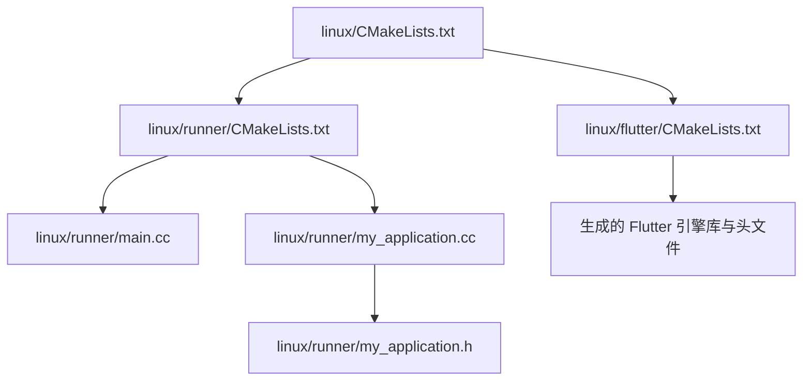
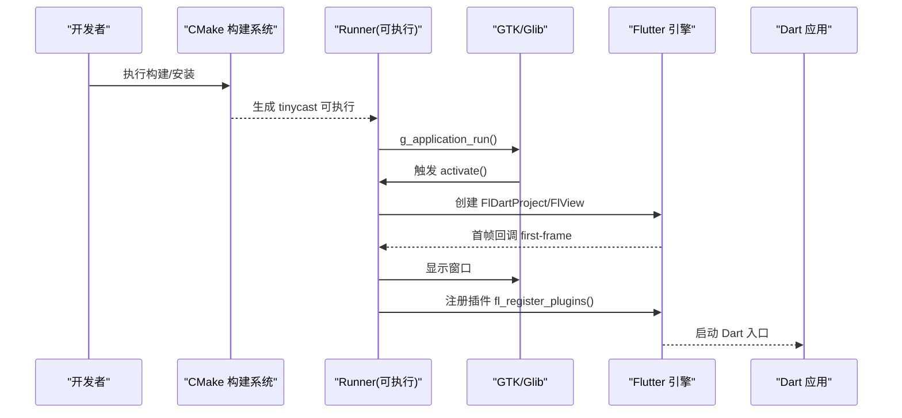
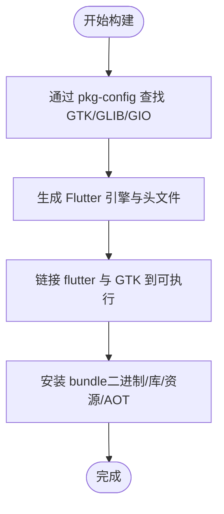
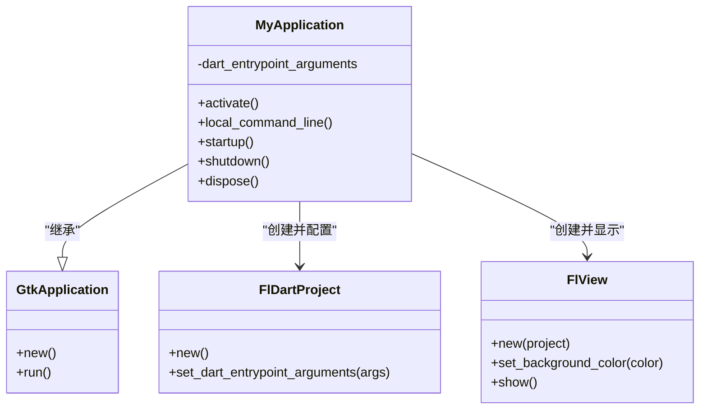
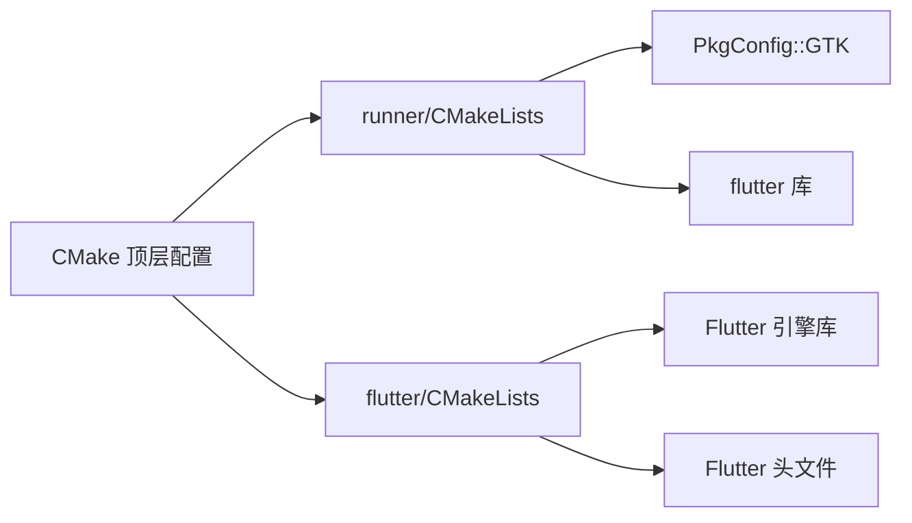

# Linux 平台适配

<cite>
**本文引用的文件**   
- [linux/CMakeLists.txt](file://linux/CMakeLists.txt)
- [linux/runner/CMakeLists.txt](file://linux/runner/CMakeLists.txt)
- [linux/runner/main.cc](file://linux/runner/main.cc)
- [linux/runner/my_application.cc](file://linux/runner/my_application.cc)
- [linux/runner/my_application.h](file://linux/runner/my_application.h)
- [linux/flutter/CMakeLists.txt](file://linux/flutter/CMakeLists.txt)
- [pubspec.yaml](file://pubspec.yaml)
- [run.sh](file://run.sh)
- [docs/PLATFORM_PERMISSIONS.md](file://docs/PLATFORM_PERMISSIONS.md)
</cite>

## 目录
1. [简介](#简介)
2. [项目结构](#项目结构)
3. [核心组件](#核心组件)
4. [架构总览](#架构总览)
5. [详细组件分析](#详细组件分析)
6. [依赖分析](#依赖分析)
7. [性能考虑](#性能考虑)
8. [故障排查指南](#故障排查指南)
9. [结论](#结论)
10. [附录](#附录)

## 简介
本文件面向在 Linux 平台上适配与发布 Flutter 应用的工程实践，围绕 CMake 构建系统、GTK 窗口集成、发行版兼容性、桌面环境集成、权限与会话管理、打包分发（AppImage/Snap/Flatpak）以及性能优化等方面提供系统化说明。本项目基于 Flutter 的 Linux 模板，使用 GTK+3 作为原生窗口后端，CMake 负责构建与安装流程。

## 项目结构
Linux 相关代码位于 linux 目录，采用分层组织：顶层 CMakeLists 定义应用元数据与安装规则；runner 子目录包含原生入口与窗口初始化逻辑；flutter 子目录由 Flutter 工具生成并管理 Flutter 引擎库与头文件。

图表来源
- [linux/CMakeLists.txt:1-129](file://linux/CMakeLists.txt#L1-L129)
- [linux/runner/CMakeLists.txt:1-27](file://linux/runner/CMakeLists.txt#L1-L27)
- [linux/runner/main.cc:1-7](file://linux/runner/main.cc#L1-L7)
- [linux/runner/my_application.cc:1-145](file://linux/runner/my_application.cc#L1-L145)
- [linux/runner/my_application.h:1-19](file://linux/runner/my_application.h#L1-L19)
- [linux/flutter/CMakeLists.txt:1-89](file://linux/flutter/CMakeLists.txt#L1-L89)

章节来源
- [linux/CMakeLists.txt:1-129](file://linux/CMakeLists.txt#L1-L129)
- [linux/runner/CMakeLists.txt:1-27](file://linux/runner/CMakeLists.txt#L1-L27)
- [linux/flutter/CMakeLists.txt:1-89](file://linux/flutter/CMakeLists.txt#L1-L89)

## 核心组件
- 构建系统（CMake）
  - 顶层 CMakeLists 设置二进制名、应用 ID、RPATH、构建类型、依赖查找（pkg-config）、Flutter 子目录引入、插件与资源安装等。
  - runner 层 CMakeLists 定义可执行目标、链接 flutter 与 GTK、注入 APPLICATION_ID 宏。
  - flutter 层 CMakeLists 由 Flutter 工具维护，负责生成引擎库、头文件与构建命令。
- 原生入口与窗口
  - main.cc 创建 MyApplication 实例并通过 GLib/GTK 运行事件循环。
  - my_application.cc 实现 GtkApplication 生命周期回调，创建窗口、选择标题栏样式、注册插件、设置背景色、显示视图等。
- 包配置与运行脚本
  - pubspec.yaml 声明依赖与 Flutter 资源。
  - run.sh 自动检测操作系统并选择目标平台，传入 Dart 环境变量后调用 flutter run。

章节来源
- [linux/CMakeLists.txt:1-129](file://linux/CMakeLists.txt#L1-L129)
- [linux/runner/CMakeLists.txt:1-27](file://linux/runner/CMakeLists.txt#L1-L27)
- [linux/runner/main.cc:1-7](file://linux/runner/main.cc#L1-L7)
- [linux/runner/my_application.cc:1-145](file://linux/runner/my_application.cc#L1-L145)
- [linux/runner/my_application.h:1-19](file://linux/runner/my_application.h#L1-L19)
- [linux/flutter/CMakeLists.txt:1-89](file://linux/flutter/CMakeLists.txt#L1-L89)
- [pubspec.yaml:1-196](file://pubspec.yaml#L1-L196)
- [run.sh:1-66](file://run.sh#L1-L66)

## 架构总览
下图展示 Linux 端从 CMake 构建到 GTK 窗口渲染的整体流程，包括 Flutter 引擎加载、插件注册与首帧显示时机。

图表来源
- [linux/runner/main.cc:1-7](file://linux/runner/main.cc#L1-L7)
- [linux/runner/my_application.cc:1-145](file://linux/runner/my_application.cc#L1-L145)
- [linux/flutter/CMakeLists.txt:1-89](file://linux/flutter/CMakeLists.txt#L1-L89)

## 详细组件分析

### CMake 构建系统与安装
- 顶层配置要点
  - 设置 C++ 标准、编译选项与优化开关。
  - 通过 pkg-config 查找 GTK/GLIB/GIO 等依赖。
  - 将 Flutter 引擎库、ICU 数据、AOT 库与插件动态库安装至 bundle。
  - 安装资源目录 flutter_assets 与 native assets。
- runner 配置要点
  - 定义可执行目标，链接 flutter 与 PkgConfig::GTK。
  - 注入 APPLICATION_ID 预处理器宏供运行时使用。
- flutter 配置要点
  - 生成 libflutter_linux_gtk.so 及头文件集合。
  - 通过 tool_backend.sh 驱动 Flutter 工具链产出产物。

图表来源
- [linux/CMakeLists.txt:1-129](file://linux/CMakeLists.txt#L1-L129)
- [linux/runner/CMakeLists.txt:1-27](file://linux/runner/CMakeLists.txt#L1-L27)
- [linux/flutter/CMakeLists.txt:1-89](file://linux/flutter/CMakeLists.txt#L1-L89)

章节来源
- [linux/CMakeLists.txt:1-129](file://linux/CMakeLists.txt#L1-L129)
- [linux/runner/CMakeLists.txt:1-27](file://linux/runner/CMakeLists.txt#L1-L27)
- [linux/flutter/CMakeLists.txt:1-89](file://linux/flutter/CMakeLists.txt#L1-L89)

### GTK 窗口系统集成与原生窗口管理
- 应用生命周期
  - main.cc 创建 MyApplication 并进入 GLib 事件循环。
  - my_application.cc 实现 activate/local_command_line/startup/shutdown/dispose 回调。
- 窗口与标题栏策略
  - 根据运行环境（X11/Wayland）与窗口管理器名称（如 GNOME Shell）决定使用 HeaderBar 或传统标题栏。
  - 设置默认窗口尺寸、背景色与焦点。
- 插件与 Flutter 视图
  - 创建 FlDartProject 并传递 Dart 入口参数。
  - 创建 FlView 并注册插件，等待首帧回调后显示窗口。

图表来源
- [linux/runner/my_application.h:1-19](file://linux/runner/my_application.h#L1-L19)
- [linux/runner/my_application.cc:1-145](file://linux/runner/my_application.cc#L1-L145)
- [linux/runner/main.cc:1-7](file://linux/runner/main.cc#L1-L7)

章节来源
- [linux/runner/my_application.cc:1-145](file://linux/runner/my_application.cc#L1-L145)
- [linux/runner/my_application.h:1-19](file://linux/runner/my_application.h#L1-L19)
- [linux/runner/main.cc:1-7](file://linux/runner/main.cc#L1-L7)

### 不同 Linux 发行版的兼容性
- 通用要求
  - 需要 CMake ≥ 3.13、GCC/Clang、pkg-config、GTK 3.x、GLib、GIO。
  - 建议安装开发包：gtk+-3.0、glib-2.0、gio-2.0 及其开发头文件。
- Ubuntu/Debian
  - 典型依赖：build-essential, cmake, pkg-config, libgtk-3-dev, libglib2.0-dev, libgio-2.0-dev。
- Fedora/RHEL
  - 典型依赖：gcc-c++, cmake, pkg-config, gtk3-devel, glib2-devel。
- Arch Linux
  - 典型依赖：base-devel, cmake, pkgconf, gtk3, glib2。
- Wayland/X11
  - 代码已根据 GDK_WINDOWING_X11 分支处理 WM 名称判断，Wayland 下通常可直接使用 HeaderBar。

章节来源
- [linux/CMakeLists.txt:1-129](file://linux/CMakeLists.txt#L1-L129)
- [linux/flutter/CMakeLists.txt:1-89](file://linux/flutter/CMakeLists.txt#L1-L89)
- [linux/runner/my_application.cc:1-145](file://linux/runner/my_application.cc#L1-L145)

### 桌面环境集成（GNOME/KDE）
- 菜单与图标
  - 通过 g_set_prgname(APPLICATION_ID) 使 GTK/DE 将进程与应用 .desktop 文件关联，提升菜单与任务栏集成效果。
- 通知与文件管理器
  - 当前未集成原生通知与文件管理器操作；如需扩展，可在 Flutter 侧使用对应插件并在 Linux 端桥接 DBus 接口。
- 主题与外观
  - 使用 GTK 主题与 HeaderBar 以契合 GNOME 风格；在非 GNOME 环境下回退到传统标题栏。

章节来源
- [linux/runner/my_application.cc:133-144](file://linux/runner/my_application.cc#L133-L144)
- [linux/runner/my_application.cc:24-77](file://linux/runner/my_application.cc#L24-L77)

### 权限管理、用户会话与系统服务
- 文件系统权限
  - 应用数据目录位于 ~/.local/share/tinycast/，无需额外权限。
- Snap/Flatpak 打包时的权限
  - 若未来采用 Snap，可能需要 home/personal-files 等 plugs。
  - 若采用 Flatpak，需在 manifest 中声明 filesystems=home;xdg-data。
- 系统服务
  - 当前未集成 systemd 服务；如需后台任务，可在 Linux 端通过 systemd user service 封装守护进程。

章节来源
- [docs/PLATFORM_PERMISSIONS.md:80-104](file://docs/PLATFORM_PERMISSIONS.md#L80-L104)

### 打包格式与分发策略
- AppImage
  - 优点：单文件、免安装、广泛兼容。
  - 步骤：构建 Release Bundle → 使用 linuxdeploy 或 appimagetool 打包为 AppImage → 签名与更新机制（可选）。
- Snap
  - 优点：自动更新、沙箱化、Ubuntu 生态友好。
  - 步骤：编写 snapcraft.yaml → 配置 plugs（home/personal-files 等）→ 构建与发布到 Snap Store。
- Flatpak
  - 优点：跨发行版、沙箱化、支持多仓库。
  - 步骤：编写 flatpak manifest → 配置文件系统权限 → 构建与发布到 Flathub。
- 分发建议
  - 优先提供 AppImage 与 Flatpak，兼顾无 root 权限与沙箱安全；对 Ubuntu 用户可提供 Snap。

[本节为概念性说明，不直接分析具体文件]

### 运行与调试脚本
- run.sh 自动识别操作系统并选择目标平台（macOS/Linux/Windows），从 .env 加载 Supabase 变量，调用 flutter run 启动调试。
- 在 Linux 上执行该脚本即可快速进入 Linux 调试模式。

章节来源
- [run.sh:1-66](file://run.sh#L1-L66)

## 依赖分析
- 构建期依赖
  - CMake、pkg-config、GTK 3.x、GLib、GIO。
- 运行期依赖
  - GTK 3.x、GLib、GIO、Flutter 引擎库与 ICU 数据。
- 插件与资源
  - 通过 generated_plugins.cmake 与 flutter_assemble 目标统一管理与安装。

图表来源
- [linux/CMakeLists.txt:1-129](file://linux/CMakeLists.txt#L1-L129)
- [linux/runner/CMakeLists.txt:1-27](file://linux/runner/CMakeLists.txt#L1-L27)
- [linux/flutter/CMakeLists.txt:1-89](file://linux/flutter/CMakeLists.txt#L1-L89)

章节来源
- [linux/CMakeLists.txt:1-129](file://linux/CMakeLists.txt#L1-L129)
- [linux/runner/CMakeLists.txt:1-27](file://linux/runner/CMakeLists.txt#L1-L27)
- [linux/flutter/CMakeLists.txt:1-89](file://linux/flutter/CMakeLists.txt#L1-L89)

## 性能考虑
- 构建与运行
  - 使用 Profile/Release 构建启用 -O3 与 NDEBUG，减少调试开销。
  - 合理设置 RPATH 避免运行时库解析失败。
- 内存与渲染
  - 首帧回调后再显示窗口，避免空帧闪烁。
  - 控制背景色与窗口大小，减少不必要的重绘。
- 插件与资源
  - 仅捆绑必要插件与 native assets，减小体积。
  - 使用 AOT 库（非 Debug）提升启动与运行性能。

章节来源
- [linux/CMakeLists.txt:30-47](file://linux/CMakeLists.txt#L30-L47)
- [linux/CMakeLists.txt:124-128](file://linux/CMakeLists.txt#L124-L128)
- [linux/runner/my_application.cc:69-77](file://linux/runner/my_application.cc#L69-L77)

## 故障排查指南
- 构建失败（找不到 GTK/GLIB/GIO）
  - 检查是否安装对应开发包与 pkg-config。
  - 确认 CMake 版本满足要求。
- 运行时缺少共享库
  - 检查 RPATH 与 bundle 安装路径是否正确。
  - 确保 libflutter_linux_gtk.so、ICU 数据与 AOT 库存在。
- 窗口样式异常
  - 检查 GDK_WINDOWING_X11 分支与 WM 名称判断逻辑。
- 权限问题
  - 确认应用数据目录可写；若使用 Snap/Flatpak，检查 plugs/filesystems 配置。

章节来源
- [linux/flutter/CMakeLists.txt:24-28](file://linux/flutter/CMakeLists.txt#L24-L28)
- [linux/CMakeLists.txt:16-27](file://linux/CMakeLists.txt#L16-L27)
- [linux/runner/my_application.cc:37-45](file://linux/runner/my_application.cc#L37-L45)
- [docs/PLATFORM_PERMISSIONS.md:80-104](file://docs/PLATFORM_PERMISSIONS.md#L80-L104)

## 结论
本项目在 Linux 平台基于 Flutter 模板与 GTK 实现了完整的构建、窗口与资源管理流程。通过 CMake 与 pkg-config 管理依赖，结合 GTK 的生命周期与窗口策略，能够在 GNOME/KDE 等主流桌面环境中获得良好体验。针对不同的发行版与打包方式，需按需补充依赖与权限配置。建议在正式发布时提供 AppImage/Flatpak/Snap 等多格式包，以满足不同用户的安装与更新需求。

## 附录
- 常用命令
  - 构建与运行：使用 run.sh 自动选择 Linux 平台并启动调试。
  - 构建 Release：设置 CMAKE_BUILD_TYPE=Release 后执行构建。
- 参考文件
  - 依赖与资源：pubspec.yaml
  - 权限说明：docs/PLATFORM_PERMISSIONS.md

章节来源
- [run.sh:1-66](file://run.sh#L1-L66)
- [pubspec.yaml:1-196](file://pubspec.yaml#L1-L196)
- [docs/PLATFORM_PERMISSIONS.md:80-104](file://docs/PLATFORM_PERMISSIONS.md#L80-L104)