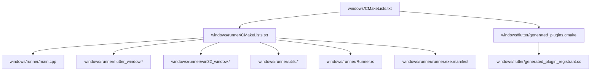
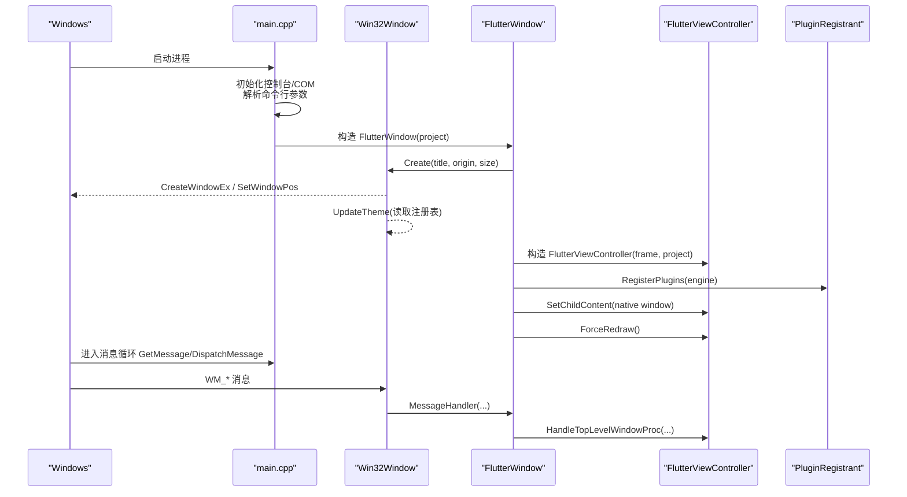
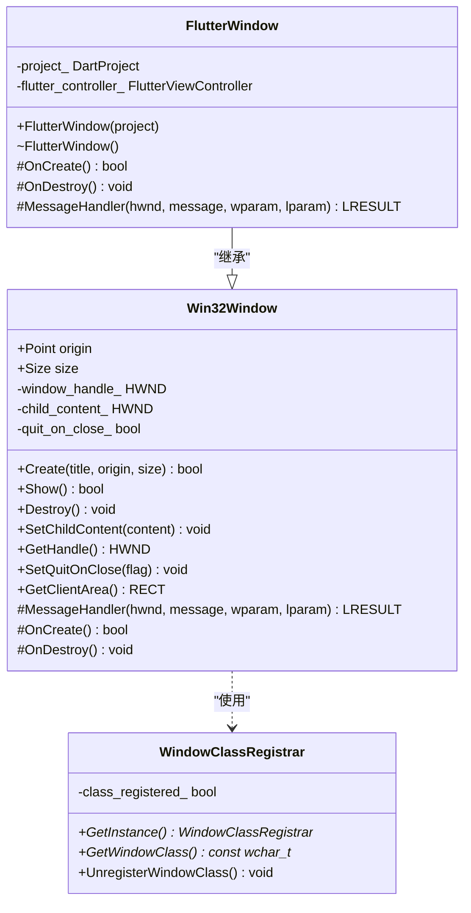
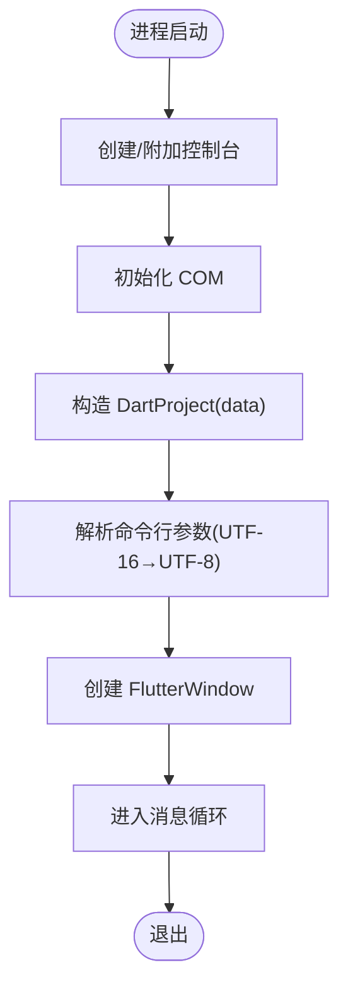
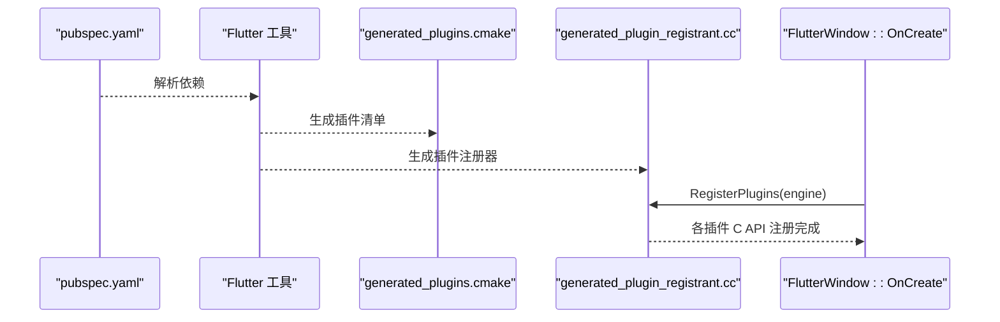
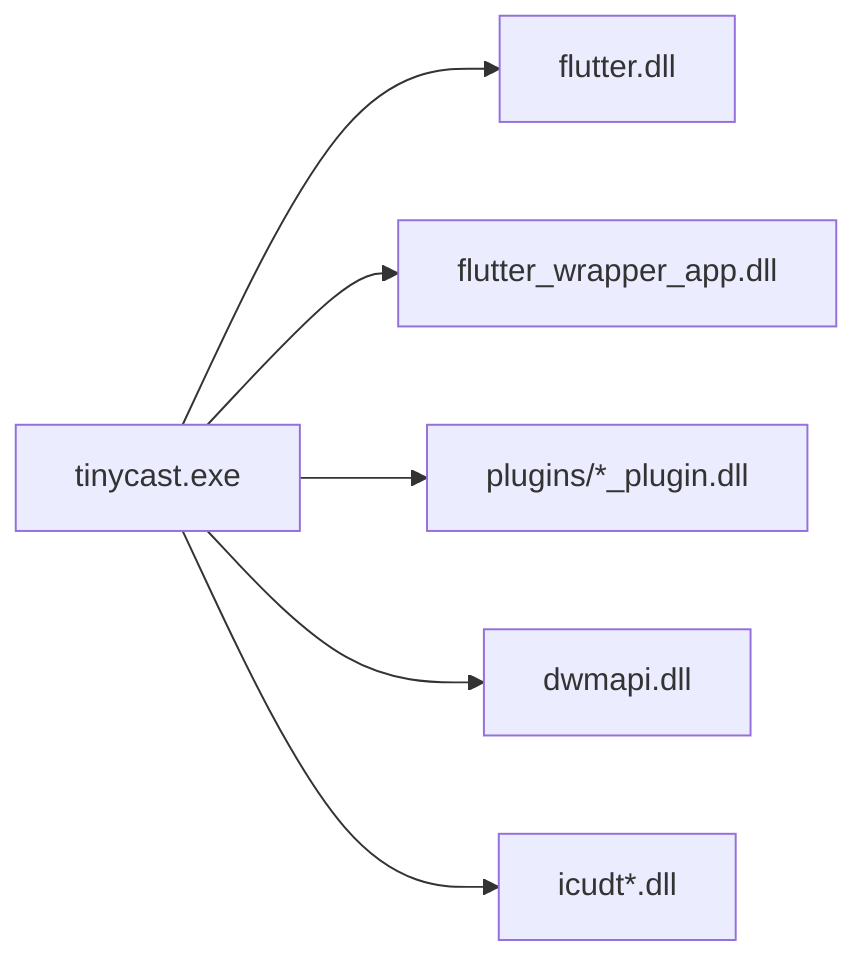

# Windows 平台适配

<cite>
**本文引用的文件**   
- [windows/CMakeLists.txt](file://windows/CMakeLists.txt)
- [windows/runner/CMakeLists.txt](file://windows/runner/CMakeLists.txt)
- [windows/runner/main.cpp](file://windows/runner/main.cpp)
- [windows/runner/flutter_window.h](file://windows/runner/flutter_window.h)
- [windows/runner/flutter_window.cpp](file://windows/runner/flutter_window.cpp)
- [windows/runner/win32_window.h](file://windows/runner/win32_window.h)
- [windows/runner/win32_window.cpp](file://windows/runner/win32_window.cpp)
- [windows/runner/utils.h](file://windows/runner/utils.h)
- [windows/runner/utils.cpp](file://windows/runner/utils.cpp)
- [windows/runner/Runner.rc](file://windows/runner/Runner.rc)
- [windows/runner/resource.h](file://windows/runner/resource.h)
- [windows/runner/runner.exe.manifest](file://windows/runner/runner.exe.manifest)
- [windows/flutter/generated_plugins.cmake](file://windows/flutter/generated_plugins.cmake)
- [windows/flutter/generated_plugin_registrant.cc](file://windows/flutter/generated_plugin_registrant.cc)
- [pubspec.yaml](file://pubspec.yaml)
</cite>

## 目录
1. [简介](#简介)
2. [项目结构](#项目结构)
3. [核心组件](#核心组件)
4. [架构总览](#架构总览)
5. [详细组件分析](#详细组件分析)
6. [依赖分析](#依赖分析)
7. [性能考虑](#性能考虑)
8. [故障排查指南](#故障排查指南)
9. [结论](#结论)
10. [附录：打包、签名与分发策略](#附录打包签名与分发策略)

## 简介
本文件面向在 Windows 平台上进行 Flutter 应用适配的开发者，系统梳理构建系统（CMake）、窗口管理实现、资源文件组织、插件注册机制以及 Windows 特有系统集成能力。文档同时给出打包、签名与分发的实践建议，帮助读者从零搭建并稳定维护 Windows 端工程。

## 项目结构
Windows 端代码位于 windows 目录，顶层 CMakeLists.txt 负责工程级配置与安装规则；runner 子目录包含可执行程序入口、窗口抽象与 Flutter 视图集成；flutter 子目录由 Flutter 工具生成插件清单与注册器。

图表来源
- [windows/CMakeLists.txt:1-109](file://windows/CMakeLists.txt#L1-L109)
- [windows/runner/CMakeLists.txt:1-41](file://windows/runner/CMakeLists.txt#L1-L41)
- [windows/flutter/generated_plugins.cmake:1-34](file://windows/flutter/generated_plugins.cmake#L1-L34)

章节来源
- [windows/CMakeLists.txt:1-109](file://windows/CMakeLists.txt#L1-L109)
- [windows/runner/CMakeLists.txt:1-41](file://windows/runner/CMakeLists.txt#L1-L41)

## 核心组件
- 构建系统与安装：顶层 CMake 定义编译模式、Unicode、标准库特性、链接库与安装目标；runner 层定义可执行体、预处理器宏、依赖库与 Flutter 组装依赖。
- 窗口与消息循环：Win32Window 封装 Win32 窗口创建、DPI 感知、主题同步与消息路由；FlutterWindow 在其上承载 Flutter 视图控制器并完成插件注册。
- 启动流程：main.cpp 初始化控制台/COM、构造 DartProject、解析命令行参数、创建窗口并进入消息循环。
- 资源与清单：Runner.rc 嵌入图标与版本信息；resource.h 提供资源 ID；manifest 声明 DPI 感知与兼容性。
- 插件注册：generated_plugins.cmake 汇总插件列表并添加子目录；generated_plugin_registrant.cc 调用各插件 C API 完成注册。

章节来源
- [windows/CMakeLists.txt:1-109](file://windows/CMakeLists.txt#L1-L109)
- [windows/runner/CMakeLists.txt:1-41](file://windows/runner/CMakeLists.txt#L1-L41)
- [windows/runner/main.cpp:1-44](file://windows/runner/main.cpp#L1-L44)
- [windows/runner/flutter_window.h:1-34](file://windows/runner/flutter_window.h#L1-L34)
- [windows/runner/flutter_window.cpp:1-72](file://windows/runner/flutter_window.cpp#L1-L72)
- [windows/runner/win32_window.h:1-103](file://windows/runner/win32_window.h#L1-L103)
- [windows/runner/win32_window.cpp:1-289](file://windows/runner/win32_window.cpp#L1-L289)
- [windows/runner/Runner.rc:1-122](file://windows/runner/Runner.rc#L1-L122)
- [windows/runner/resource.h:1-17](file://windows/runner/resource.h#L1-L17)
- [windows/runner/runner.exe.manifest:1-15](file://windows/runner/runner.exe.manifest#L1-L15)
- [windows/flutter/generated_plugins.cmake:1-34](file://windows/flutter/generated_plugins.cmake#L1-L34)
- [windows/flutter/generated_plugin_registrant.cc:1-39](file://windows/flutter/generated_plugin_registrant.cc#L1-L39)

## 架构总览
下图展示 Windows 端从进程启动到 Flutter 渲染的关键交互路径，包括窗口创建、Flutter 控制器初始化、插件注册与消息处理。

图表来源
- [windows/runner/main.cpp:1-44](file://windows/runner/main.cpp#L1-L44)
- [windows/runner/win32_window.cpp:123-174](file://windows/runner/win32_window.cpp#L123-L174)
- [windows/runner/flutter_window.cpp:12-40](file://windows/runner/flutter_window.cpp#L12-L40)
- [windows/flutter/generated_plugin_registrant.cc:19-38](file://windows/flutter/generated_plugin_registrant.cc#L19-L38)

## 详细组件分析

### 构建系统（CMake）与编译设置
- 顶层 CMakeLists.txt
  - 定义工程名、二进制名、多配置类型（Debug/Profile/Release）。
  - 启用 Unicode（UNICODE/_UNICODE），统一 C++17 标准与警告级别。
  - 引入 flutter 子目录与 runner 子目录，包含 generated_plugins.cmake。
  - 安装阶段将可执行体、ICU 数据、Flutter 库、插件库与 native_assets 复制到安装目录，并拷贝 flutter_assets 与 AOT 库（非 Debug）。
- runner/CMakeLists.txt
  - 定义可执行目标，源文件包含 main、窗口类、工具函数与资源脚本。
  - 注入 FLUTTER_VERSION_* 宏，禁用 NOMINMAX 避免与 STL 冲突。
  - 链接 flutter、flutter_wrapper_app 与 dwmapi.lib，添加 include 目录，依赖 flutter_assemble。

优化建议
- 若需自定义编译器选项，优先通过 target_compile_options/target_link_libraries 针对具体目标设置，避免全局污染插件。
- Profile 模式复用 Release 链接与编译标志，便于性能分析。

章节来源
- [windows/CMakeLists.txt:1-109](file://windows/CMakeLists.txt#L1-L109)
- [windows/runner/CMakeLists.txt:1-41](file://windows/runner/CMakeLists.txt#L1-L41)

### 窗口管理与消息循环（Win32Window 与 FlutterWindow）
- Win32Window
  - 单例 WindowClassRegistrar 负责窗口类注册与注销。
  - Create 根据 DPI 计算物理像素尺寸，CreateWindowEx 创建窗口，UpdateTheme 读取系统主题偏好并设置深色模式。
  - WndProc 将 WM_NCCREATE 时保存对象指针，后续消息转发至实例 MessageHandler。
  - MessageHandler 处理销毁、DPI 变化、尺寸调整、激活焦点与主题变更等。
- FlutterWindow
  - OnCreate 调用父类 OnCreate，获取客户区尺寸后构造 FlutterViewController，注册插件，设置子窗口内容，并在首帧回调中显示窗口。
  - MessageHandler 先交由 Flutter 引擎处理顶级窗口过程，再处理字体变更等特定消息。

图表来源
- [windows/runner/win32_window.h:1-103](file://windows/runner/win32_window.h#L1-L103)
- [windows/runner/win32_window.cpp:58-112](file://windows/runner/win32_window.cpp#L58-L112)
- [windows/runner/win32_window.cpp:123-174](file://windows/runner/win32_window.cpp#L123-L174)
- [windows/runner/flutter_window.h:1-34](file://windows/runner/flutter_window.h#L1-L34)
- [windows/runner/flutter_window.cpp:12-40](file://windows/runner/flutter_window.cpp#L12-L40)

章节来源
- [windows/runner/win32_window.h:1-103](file://windows/runner/win32_window.h#L1-L103)
- [windows/runner/win32_window.cpp:1-289](file://windows/runner/win32_window.cpp#L1-L289)
- [windows/runner/flutter_window.h:1-34](file://windows/runner/flutter_window.h#L1-L34)
- [windows/runner/flutter_window.cpp:1-72](file://windows/runner/flutter_window.cpp#L1-L72)

### 启动流程与命令行参数处理
- main.cpp
  - 附加或创建控制台用于调试输出。
  - 初始化 COM（APARTMENTTHREADED）。
  - 构造 DartProject（data 目录为资源根），解析 UTF-16 命令行参数为 UTF-8 向量。
  - 创建 FlutterWindow，设置退出行为，进入消息循环。
- utils.cpp/h
  - CreateAndAttachConsole：分配控制台并重定向 stdout/stderr。
  - GetCommandLineArguments：UTF-16 转 UTF-8 并过滤程序名。
  - Utf8FromUtf16：安全转换字符串。

图表来源
- [windows/runner/main.cpp:8-43](file://windows/runner/main.cpp#L8-L43)
- [windows/runner/utils.cpp:10-42](file://windows/runner/utils.cpp#L10-L42)

章节来源
- [windows/runner/main.cpp:1-44](file://windows/runner/main.cpp#L1-L44)
- [windows/runner/utils.h:1-20](file://windows/runner/utils.h#L1-L20)
- [windows/runner/utils.cpp:1-66](file://windows/runner/utils.cpp#L1-L66)

### 资源文件与清单
- Runner.rc
  - 包含 resource.h，定义应用程序图标资源 ID。
  - 嵌入 VS_VERSION_INFO 与 StringFileInfo，版本号来自 FLUTTER_VERSION_* 宏，默认回退到 1.0.0。
  - 指定 CompanyName、FileDescription、ProductVersion 等元数据。
- resource.h
  - 定义 IDI_APP_ICON 等资源标识符。
- runner.exe.manifest
  - 声明 PerMonitorV2 DPI 感知与支持的 Windows 版本。

章节来源
- [windows/runner/Runner.rc:1-122](file://windows/runner/Runner.rc#L1-L122)
- [windows/runner/resource.h:1-17](file://windows/runner/resource.h#L1-L17)
- [windows/runner/runner.exe.manifest:1-15](file://windows/runner/runner.exe.manifest#L1-L15)

### 插件注册机制与生成的插件处理
- generated_plugins.cmake
  - 维护 FLUTTER_PLUGIN_LIST 与 FLUTTER_FFI_PLUGIN_LIST。
  - 遍历插件列表，向 CMake 添加子目录并链接对应 _plugin 目标，收集 PLUGIN_BUNDLED_LIBRARIES。
- generated_plugin_registrant.cc
  - 包含各插件头文件，RegisterPlugins 函数按名称调用各插件 C API 注册方法。
- pubspec.yaml
  - 声明 Flutter 插件依赖（如 connectivity_plus、url_launcher_windows、window_manager、desktop_multi_window、flutter_acrylic、isar_community_flutter_libs、flutter_secure_storage_windows、screen_retriever_windows、app_links 等），这些依赖会被 Flutter 工具解析并生成上述文件。

图表来源
- [pubspec.yaml:18-144](file://pubspec.yaml#L18-L144)
- [windows/flutter/generated_plugins.cmake:1-34](file://windows/flutter/generated_plugins.cmake#L1-L34)
- [windows/flutter/generated_plugin_registrant.cc:19-38](file://windows/flutter/generated_plugin_registrant.cc#L19-L38)
- [windows/runner/flutter_window.cpp:27](file://windows/runner/flutter_window.cpp#L27-L27)

章节来源
- [windows/flutter/generated_plugins.cmake:1-34](file://windows/flutter/generated_plugins.cmake#L1-L34)
- [windows/flutter/generated_plugin_registrant.cc:1-39](file://windows/flutter/generated_plugin_registrant.cc#L1-L39)
- [pubspec.yaml:18-144](file://pubspec.yaml#L18-L144)

### Windows 特有功能集成
- 文件系统访问
  - 通过 path_provider 获取平台特定目录（缓存、文档等），结合 file_picker 选择本地文件。
  - 在 C++ 侧可通过 Win32 API（如 FindFirstFile/FindNextFile、CreateFile）直接操作文件系统。
- 注册表操作
  - win32_window.cpp 读取 HKCU 主题偏好以启用深色模式（AppsUseLightTheme）。
  - 如需持久化应用设置，可使用 RegSetValueEx/RegGetValue 等 API。
- 系统 API 调用
  - DWM 深色模式：DwmSetWindowAttribute(DWMWA_USE_IMMERSIVE_DARK_MODE)。
  - DPI 感知：PerMonitorV2 清单与 EnableNonClientDpiScaling 动态加载。
  - 其他常用 API：ShellExecute（打开 URL/文件）、SHGetFolderPath（特殊文件夹路径）、SystemParametersInfo（系统参数）等。

章节来源
- [windows/runner/win32_window.cpp:275-288](file://windows/runner/win32_window.cpp#L275-L288)
- [windows/runner/runner.exe.manifest:1-15](file://windows/runner/runner.exe.manifest#L1-L15)
- [pubspec.yaml:88-106](file://pubspec.yaml#L88-L106)

## 依赖分析
- 构建期依赖
  - CMake 3.14+，MSVC（Visual Studio 工具链），Windows SDK。
  - Flutter 引擎与 wrapper（flutter、flutter_wrapper_app）。
  - DWM API（dwmapi.lib）。
- 运行期依赖
  - Flutter ICU 数据、AOT 库（Profile/Release）、插件原生库与 native_assets。
- 插件依赖
  - 由 generated_plugins.cmake 自动链接，确保每个插件的 _plugin 目标被加入。

图表来源
- [windows/runner/CMakeLists.txt:35-36](file://windows/runner/CMakeLists.txt#L35-L36)
- [windows/CMakeLists.txt:75-108](file://windows/CMakeLists.txt#L75-L108)
- [windows/flutter/generated_plugins.cmake:23-28](file://windows/flutter/generated_plugins.cmake#L23-L28)

章节来源
- [windows/runner/CMakeLists.txt:1-41](file://windows/runner/CMakeLists.txt#L1-L41)
- [windows/CMakeLists.txt:1-109](file://windows/CMakeLists.txt#L1-L109)
- [windows/flutter/generated_plugins.cmake:1-34](file://windows/flutter/generated_plugins.cmake#L1-L34)

## 性能考虑
- 首帧优化
  - 在 OnCreate 中按客户区尺寸构造 FlutterViewController，避免不必要的表面重建。
  - ForceRedraw 确保首帧完成后正确显示窗口。
- DPI 与缩放
  - 使用 PerMonitorV2 清单与 DPI 感知 API，减少重绘与布局抖动。
- 资源拷贝
  - 安装阶段全量覆盖 flutter_assets，避免旧文件残留导致异常。
- 链接与符号
  - Profile/Release 复用 Release 链接标志，减小体积并提升性能。

[本节为通用指导，不直接分析具体文件]

## 故障排查指南
- 无法找到 Flutter 资源
  - 检查 data 目录是否存在且包含 flutter_assets；确认安装步骤已将 assets 复制到 data。
- 插件未生效
  - 确认 generated_plugins.cmake 已包含该插件；检查插件是否提供 Windows 支持；查看 RegisterPlugins 是否被调用。
- 窗口黑屏或无响应
  - 检查 FlutterViewController 初始化是否成功；确认 SetChildContent 与 ForceRedraw 调用顺序。
- DPI 异常
  - 确认 manifest 声明 PerMonitorV2；检查 EnableNonClientDpiScaling 是否可用。
- 主题不一致
  - 检查注册表 AppsUseLightTheme 值；确认 DwmSetWindowAttribute 调用成功。

章节来源
- [windows/CMakeLists.txt:96-108](file://windows/CMakeLists.txt#L96-L108)
- [windows/flutter/generated_plugins.cmake:23-28](file://windows/flutter/generated_plugins.cmake#L23-L28)
- [windows/runner/flutter_window.cpp:21-37](file://windows/runner/flutter_window.cpp#L21-L37)
- [windows/runner/runner.exe.manifest:1-15](file://windows/runner/runner.exe.manifest#L1-L15)
- [windows/runner/win32_window.cpp:275-288](file://windows/runner/win32_window.cpp#L275-L288)

## 结论
Windows 平台的 Flutter 适配围绕 CMake 构建、Win32 窗口抽象、Flutter 视图控制器与插件注册展开。通过清晰的层次划分与标准化流程，可在保证跨平台一致性的同时充分利用 Windows 原生能力。遵循本文的配置与实践建议，可快速搭建稳定、高性能的 Windows 桌面应用。

[本节为总结性内容，不直接分析具体文件]

## 附录：打包、签名与分发策略
- 构建产物
  - Debug：仅可执行体与必要运行时，适合开发调试。
  - Profile/Release：包含 AOT 库与优化后的二进制，适合发布。
- 打包建议
  - 使用 CMake install 将可执行体、Flutter 库、插件库与 native_assets 复制到同一目录。
  - 将 flutter_assets 完整复制到 data 目录，确保资源路径一致。
- 签名与认证
  - 使用 signtool 对 tinycast.exe 及关键 DLL 进行时间戳签名。
  - 建议使用企业证书或第三方 CA 证书，确保用户信任链。
- 分发渠道
  - 内部分发：ZIP/7z 压缩包，附带 README 与校验哈希。
  - 公开分发：MSIX 包（推荐，支持自动更新与权限声明）或 MSI 安装包。
  - 软件商店：Microsoft Store（需准备清单、图标、隐私声明等）。
- 自动化流水线
  - CI 中执行 flutter build windows --release，随后执行 CMake install，最后打包与签名。
  - 生成 SHA256 校验文件，便于完整性验证。

[本节为通用指导，不直接分析具体文件]