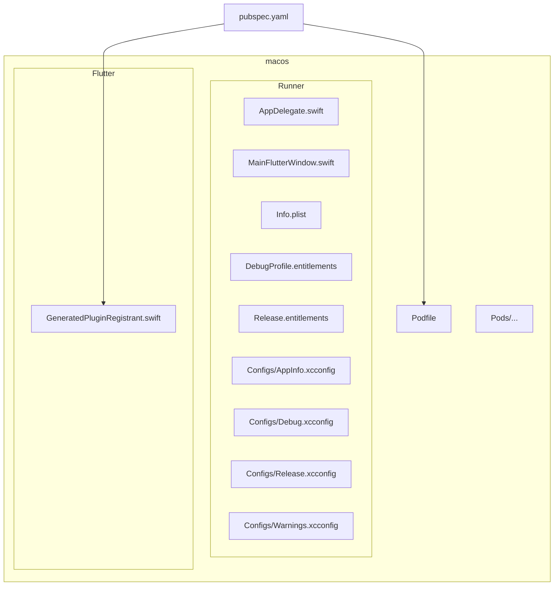
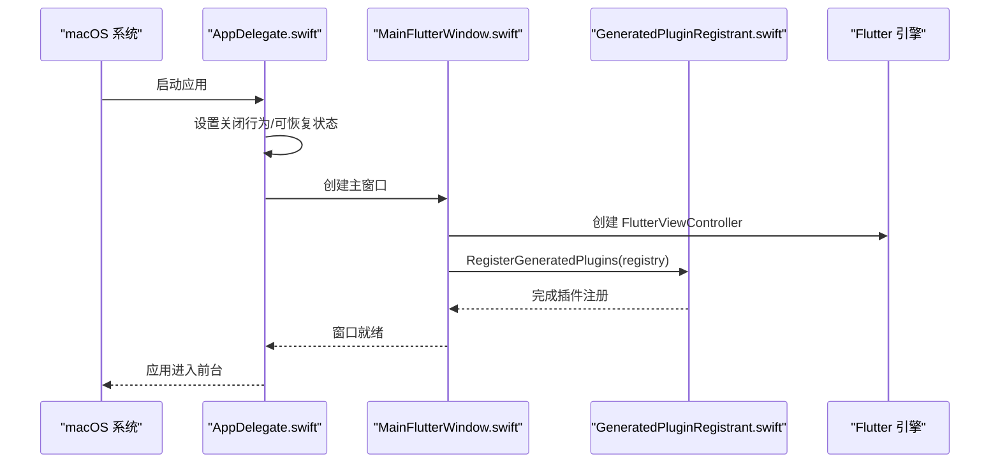
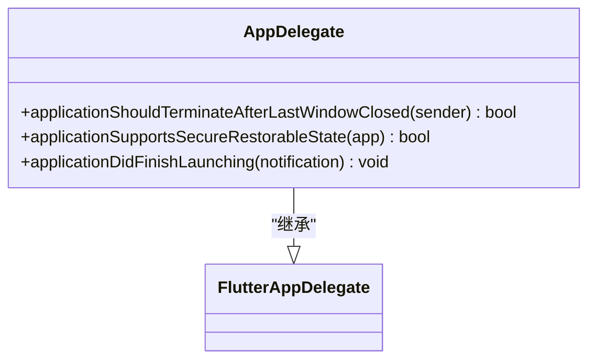
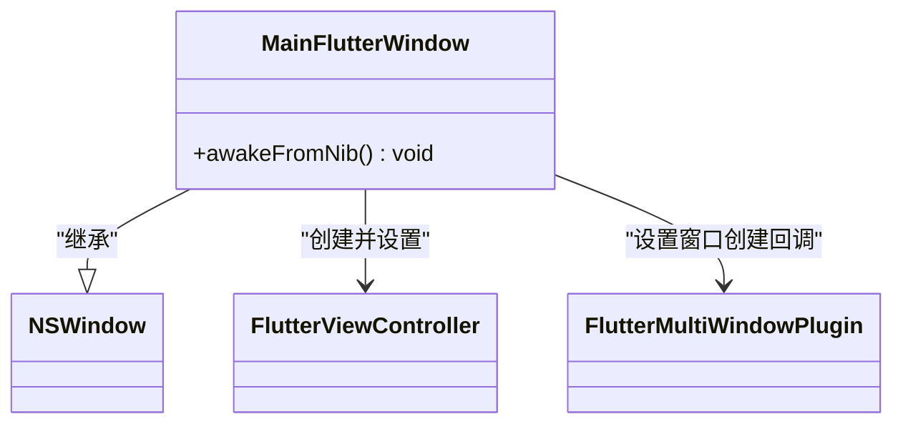
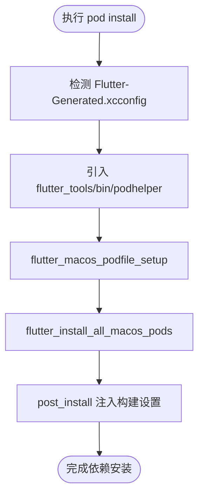
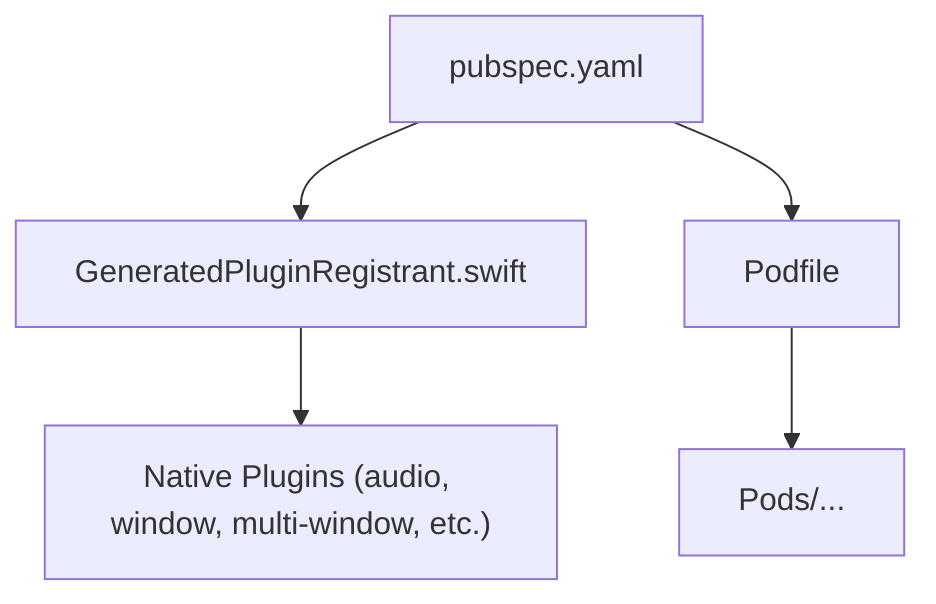

# macOS 平台适配

<cite>
**本文引用的文件**   
- [macos/Runner/AppDelegate.swift](file://macos/Runner/AppDelegate.swift)
- [macos/Runner/MainFlutterWindow.swift](file://macos/Runner/MainFlutterWindow.swift)
- [macos/Runner/Info.plist](file://macos/Runner/Info.plist)
- [macos/Podfile](file://macos/Podfile)
- [macos/Runner/Configs/AppInfo.xcconfig](file://macos/Runner/Configs/AppInfo.xcconfig)
- [macos/Runner/DebugProfile.entitlements](file://macos/Runner/DebugProfile.entitlements)
- [macos/Runner/Release.entitlements](file://macos/Runner/Release.entitlements)
- [macos/Runner/Configs/Debug.xcconfig](file://macos/Runner/Configs/Debug.xcconfig)
- [macos/Runner/Configs/Release.xcconfig](file://macos/Runner/Configs/Release.xcconfig)
- [macos/Runner/Configs/Warnings.xcconfig](file://macos/Runner/Configs/Warnings.xcconfig)
- [macos/Flutter/GeneratedPluginRegistrant.swift](file://macos/Flutter/GeneratedPluginRegistrant.swift)
- [pubspec.yaml](file://pubspec.yaml)
- [docs/PLATFORM_PERMISSIONS.md](file://docs/PLATFORM_PERMISSIONS.md)
</cite>

## 目录
1. [简介](#简介)
2. [项目结构](#项目结构)
3. [核心组件](#核心组件)
4. [架构总览](#架构总览)
5. [详细组件分析](#详细组件分析)
6. [依赖分析](#依赖分析)
7. [性能考虑](#性能考虑)
8. [故障排查指南](#故障排查指南)
9. [结论](#结论)
10. [附录](#附录)

## 简介
本文件面向在 macOS 平台上对 Flutter 应用进行原生适配与打包分发的开发者，系统梳理 Xcode 工程结构、配置项（Info.plist、权限、Bundle Identifier）、Swift 原生入口集成（AppDelegate.swift、MainFlutterWindow.swift）、CocoaPods 依赖管理（Podfile 与本地库集成），以及 macOS 特有功能（菜单栏、Dock、通知中心、Spotlight）的接入要点。同时给出沙盒模式下的文件系统访问与数据持久化策略，并提供打包、公证与 App Store 分发流程建议。

## 项目结构
macOS 目标由 Flutter 模板生成，位于 macos/ 目录，核心包括：
- Runner 工程：Xcode 应用目标，包含 Info.plist、Entitlements、xcconfig、Swift 启动代码等
- Flutter 子工程：Flutter 框架与插件注册生成文件
- Pods：CocoaPods 依赖管理产物

图表来源
- [macos/Runner/AppDelegate.swift:1-21](file://macos/Runner/AppDelegate.swift#L1-L21)
- [macos/Runner/MainFlutterWindow.swift:1-21](file://macos/Runner/MainFlutterWindow.swift#L1-L21)
- [macos/Runner/Info.plist:1-46](file://macos/Runner/Info.plist#L1-L46)
- [macos/Runner/Configs/AppInfo.xcconfig:1-15](file://macos/Runner/Configs/AppInfo.xcconfig#L1-L15)
- [macos/Runner/DebugProfile.entitlements:1-15](file://macos/Runner/DebugProfile.entitlements#L1-L15)
- [macos/Runner/Release.entitlements:1-11](file://macos/Runner/Release.entitlements#L1-L11)
- [macos/Runner/Configs/Debug.xcconfig:1-3](file://macos/Runner/Configs/Debug.xcconfig#L1-L3)
- [macos/Runner/Configs/Release.xcconfig:1-3](file://macos/Runner/Configs/Release.xcconfig#L1-L3)
- [macos/Runner/Configs/Warnings.xcconfig:1-14](file://macos/Runner/Configs/Warnings.xcconfig#L1-L14)
- [macos/Flutter/GeneratedPluginRegistrant.swift:1-49](file://macos/Flutter/GeneratedPluginRegistrant.swift#L1-L49)
- [macos/Podfile:1-43](file://macos/Podfile#L1-L43)
- [pubspec.yaml:1-196](file://pubspec.yaml#L1-L196)

章节来源
- [macos/Runner/Info.plist:1-46](file://macos/Runner/Info.plist#L1-L46)
- [macos/Runner/Configs/AppInfo.xcconfig:1-15](file://macos/Runner/Configs/AppInfo.xcconfig#L1-L15)
- [macos/Podfile:1-43](file://macos/Podfile#L1-L43)

## 核心组件
- AppDelegate.swift：应用生命周期与窗口行为控制，如关闭行为、可恢复状态、主窗口保存位置等
- MainFlutterWindow.swift：创建 FlutterViewController 并注册插件，支持多窗口回调
- Info.plist：应用元信息、URL Scheme、最低系统版本等
- xcconfig：构建变量（产品名称、Bundle ID、版权、警告级别）
- Entitlements：沙盒与能力开关（JIT、网络客户端/服务端）
- GeneratedPluginRegistrant.swift：自动生成的插件注册表，供 Swift 侧调用
- Podfile：CocoaPods 配置，定义平台、目标、Flutter 辅助脚本与 post_install 设置

章节来源
- [macos/Runner/AppDelegate.swift:1-21](file://macos/Runner/AppDelegate.swift#L1-L21)
- [macos/Runner/MainFlutterWindow.swift:1-21](file://macos/Runner/MainFlutterWindow.swift#L1-L21)
- [macos/Runner/Info.plist:1-46](file://macos/Runner/Info.plist#L1-L46)
- [macos/Runner/Configs/AppInfo.xcconfig:1-15](file://macos/Runner/Configs/AppInfo.xcconfig#L1-L15)
- [macos/Runner/DebugProfile.entitlements:1-15](file://macos/Runner/DebugProfile.entitlements#L1-L15)
- [macos/Runner/Release.entitlements:1-11](file://macos/Runner/Release.entitlements#L1-L11)
- [macos/Flutter/GeneratedPluginRegistrant.swift:1-49](file://macos/Flutter/Flutter/GeneratedPluginRegistrant.swift#L1-L49)
- [macos/Podfile:1-43](file://macos/Podfile#L1-L43)

## 架构总览
下图展示了 macOS 端从应用启动到 Flutter 引擎初始化与插件注册的完整链路，以及关键配置文件的作用域。

图表来源
- [macos/Runner/AppDelegate.swift:1-21](file://macos/Runner/AppDelegate.swift#L1-L21)
- [macos/Runner/MainFlutterWindow.swift:1-21](file://macos/Runner/MainFlutterWindow.swift#L1-L21)
- [macos/Flutter/GeneratedPluginRegistrant.swift:1-49](file://macos/Flutter/GeneratedPluginRegistrant.swift#L1-L49)

## 详细组件分析

### AppDelegate.swift：应用生命周期与窗口行为
- 作用：继承自 FlutterAppDelegate，覆盖应用关闭行为、安全可恢复状态、首次启动时为主窗口设置自动保存名称与关闭释放策略
- 关键点：
  - 应用关闭后退出行为
  - 支持 Secure Restorable State
  - 主窗口帧自动保存与生命周期控制

图表来源
- [macos/Runner/AppDelegate.swift:1-21](file://macos/Runner/AppDelegate.swift#L1-L21)

章节来源
- [macos/Runner/AppDelegate.swift:1-21](file://macos/Runner/AppDelegate.swift#L1-L21)

### MainFlutterWindow.swift：Flutter 窗口与插件注册
- 作用：创建 FlutterViewController，设置内容视图，注册插件；通过 desktop_multi_window 的多窗口回调为新增窗口注册插件
- 关键点：
  - awakeFromNib 中初始化 Flutter 控制器
  - RegisterGeneratedPlugins 统一注册插件
  - 多窗口回调确保每个窗口独立注册插件

图表来源
- [macos/Runner/MainFlutterWindow.swift:1-21](file://macos/Runner/MainFlutterWindow.swift#L1-L21)
- [macos/Flutter/GeneratedPluginRegistrant.swift:1-49](file://macos/Flutter/GeneratedPluginRegistrant.swift#L1-L49)

章节来源
- [macos/Runner/MainFlutterWindow.swift:1-21](file://macos/Runner/MainFlutterWindow.swift#L1-L21)
- [macos/Flutter/GeneratedPluginRegistrant.swift:1-49](file://macos/Flutter/GeneratedPluginRegistrant.swift#L1-L49)

### Info.plist：应用标识符与 URL Scheme
- 关键字段：
  - CFBundleIdentifier：Bundle 标识符（来自 xcconfig）
  - CFBundleName/CFBundleShortVersionString/CFBundleVersion：应用名与版本
  - LSMinimumSystemVersion：最低系统版本
  - CFBundleURLTypes：自定义 URL Scheme（用于深度链接或外部唤起）
- 建议：
  - Bundle Identifier 需与 Apple Developer 账号一致
  - URL Scheme 应与后端回调域名或业务约定保持一致

章节来源
- [macos/Runner/Info.plist:1-46](file://macos/Runner/Info.plist#L1-L46)
- [macos/Runner/Configs/AppInfo.xcconfig:1-15](file://macos/Runner/Configs/AppInfo.xcconfig#L1-L15)

### xcconfig：构建变量与警告策略
- AppInfo.xcconfig：定义 PRODUCT_NAME、PRODUCT_BUNDLE_IDENTIFIER、PRODUCT_COPYRIGHT
- Debug.xcconfig / Release.xcconfig：引入 Flutter 基础配置与警告策略
- Warnings.xcconfig：启用多项编译期检查，提升代码质量

章节来源
- [macos/Runner/Configs/AppInfo.xcconfig:1-15](file://macos/Runner/Configs/AppInfo.xcconfig#L1-L15)
- [macos/Runner/Configs/Debug.xcconfig:1-3](file://macos/Runner/Configs/Debug.xcconfig#L1-L3)
- [macos/Runner/Configs/Release.xcconfig:1-3](file://macos/Runner/Configs/Release.xcconfig#L1-L3)
- [macos/Runner/Configs/Warnings.xcconfig:1-14](file://macos/Runner/Configs/Warnings.xcconfig#L1-L14)

### Entitlements：沙盒与能力开关
- DebugProfile.entitlements：开启沙盒、JIT、网络客户端与服务端（便于调试）
- Release.entitlements：仅开启沙盒与网络客户端（生产最小权限）
- 注意：如需访问用户选择文件、下载目录等，需在对应目标添加相应 entitlements

章节来源
- [macos/Runner/DebugProfile.entitlements:1-15](file://macos/Runner/DebugProfile.entitlements#L1-L15)
- [macos/Runner/Release.entitlements:1-11](file://macos/Runner/Release.entitlements#L1-L11)
- [docs/PLATFORM_PERMISSIONS.md:30-60](file://docs/PLATFORM_PERMISSIONS.md#L30-L60)

### CocoaPods：依赖管理与本地库集成
- Podfile：
  - 指定平台 osx 10.15
  - 禁用 CocoaPods 统计以提升构建速度
  - 使用 flutter_macos_podfile_setup 与 flutter_install_all_macos_pods 自动化安装
  - post_install 注入额外构建设置
- 本地库集成：
  - 将 .podspec 放入 Pods/Local Podspecs 或通过 path 引用本地 pod
  - 在 target 'Runner' 下 use_frameworks! 以支持 Swift 模块
  - 运行 pod install 后，GeneratedPluginRegistrant.swift 会更新

图表来源
- [macos/Podfile:1-43](file://macos/Podfile#L1-L43)

章节来源
- [macos/Podfile:1-43](file://macos/Podfile#L1-L43)

### 插件注册与依赖关系
- GeneratedPluginRegistrant.swift 集中注册所有 macOS 插件，例如 audio_service、just_audio、connectivity_plus、desktop_multi_window、window_manager 等
- 这些插件由 pubspec.yaml 声明，经 Flutter 工具链生成对应的原生桥接代码

图表来源
- [pubspec.yaml:1-196](file://pubspec.yaml#L1-L196)
- [macos/Flutter/GeneratedPluginRegistrant.swift:1-49](file://macos/Flutter/GeneratedPluginRegistrant.swift#L1-L49)

章节来源
- [pubspec.yaml:1-196](file://pubspec.yaml#L1-L196)
- [macos/Flutter/GeneratedPluginRegistrant.swift:1-49](file://macos/Flutter/GeneratedPluginRegistrant.swift#L1-L49)

### macOS 特有功能接入要点
- 菜单栏集成：可通过 menu_bar 或原生 NSMenu 扩展，结合 window_manager 控制窗口显示/隐藏
- Dock 图标：默认由应用图标资源提供；可在运行时通过 NSApplication.shared.applicationIconImage 动态设置
- 通知中心：使用 UserNotifications.framework 发送本地/远程通知，需在 Info.plist 或代码中请求授权
- Spotlight 搜索：通过 NSMetadataQuery 索引应用数据，或在应用内实现自定义搜索面板
- 毛玻璃效果：可使用 macos_window_utils 或原生 NSVisualEffectView 实现

说明：上述能力属于通用实践指引，具体实现需结合项目需求与现有插件生态。

[本节为概念性说明，不直接分析具体文件]

### 沙盒模式下的文件系统访问与数据持久化
- 应用数据目录：path_provider 的 getApplicationSupportDirectory() 返回沙盒内目录，无需额外权限
- 当前权限：DebugProfile 与 Release 均启用沙盒；开发环境允许 JIT 与网络服务端口监听
- 如需访问沙盒外文件：根据场景添加相应 entitlements（如用户选择文件、下载目录读写）

章节来源
- [docs/PLATFORM_PERMISSIONS.md:30-60](file://docs/PLATFORM_PERMISSIONS.md#L30-L60)
- [macos/Runner/DebugProfile.entitlements:1-15](file://macos/Runner/DebugProfile.entitlements#L1-L15)
- [macos/Runner/Release.entitlements:1-11](file://macos/Runner/Release.entitlements#L1-L11)

### 打包、公证与 App Store 分发流程
- 签名与证书：在 Xcode 中配置 Signing & Capabilities，选择正确的 Team 与 Provisioning Profile
- 归档：使用 Product > Archive 生成 .app 包
- 导出：通过 Organizer 导出 .pkg 或 .dmg，或直接上传至 App Store Connect
- 公证：使用 xcrun altool 或 notarytool 对产物进行公证，确保 Gatekeeper 放行
- 分发：提交至 App Store Connect 审核并发布

[本节为通用流程说明，不直接分析具体文件]

## 依赖分析
- 顶层依赖：pubspec.yaml 声明了音频、数据库、网络、UI、桌面端窗口与多窗口等依赖
- 原生层：macos/Flutter/GeneratedPluginRegistrant.swift 汇总注册所有 macOS 插件
- 构建层：macos/Podfile 负责 CocoaPods 安装与 post_install 注入

图表来源
- [pubspec.yaml:1-196](file://pubspec.yaml#L1-L196)
- [macos/Flutter/GeneratedPluginRegistrant.swift:1-49](file://macos/Flutter/GeneratedPluginRegistrant.swift#L1-L49)
- [macos/Podfile:1-43](file://macos/Podfile#L1-L43)

章节来源
- [pubspec.yaml:1-196](file://pubspec.yaml#L1-L196)
- [macos/Flutter/GeneratedPluginRegistrant.swift:1-49](file://macos/Flutter/GeneratedPluginRegistrant.swift#L1-L49)
- [macos/Podfile:1-43](file://macos/Podfile#L1-L43)

## 性能考虑
- 构建性能：已禁用 CocoaPods 统计以减少网络 IO；保持 Flutter 与 CocoaPods 版本稳定
- 插件数量：按需启用插件，避免不必要的原生桥接开销
- 内存与窗口：多窗口场景下注意窗口资源释放与事件派发效率
- 日志与诊断：利用 Xcode Console 与 Flutter DevTools 定位卡顿与异常

[本节为通用指导，不直接分析具体文件]

## 故障排查指南
- 无法解析 FLUTTER_ROOT：确保先执行 flutter pub get，再运行 pod install
- 插件未生效：检查 GeneratedPluginRegistrant.swift 是否包含对应插件注册；确认 Podfile 的 target 与 use_frameworks!
- 权限不足：核对 Entitlements 是否包含所需能力；必要时在 Info.plist 添加权限描述
- 崩溃或无响应：查看 Xcode 控制台输出与 crash logs；逐步缩小问题范围至特定插件或窗口

章节来源
- [macos/Podfile:12-23](file://macos/Podfile#L12-L23)
- [macos/Flutter/GeneratedPluginRegistrant.swift:28-48](file://macos/Flutter/GeneratedPluginRegistrant.swift#L28-L48)
- [docs/PLATFORM_PERMISSIONS.md:30-60](file://docs/PLATFORM_PERMISSIONS.md#L30-L60)

## 结论
本项目在 macOS 端的工程结构清晰，Swift 原生入口与 Flutter 引擎集成完善，CocoaPods 依赖管理自动化程度高。通过合理的 Info.plist、xcconfig 与 Entitlements 配置，可满足大多数应用的权限与行为需求。对于 macOS 特有功能（菜单栏、Dock、通知、Spotlight），可按需接入原生能力或第三方插件。遵循沙盒最佳实践与打包分发流程，可保障应用在发布阶段的稳定性与合规性。

[本节为总结性内容，不直接分析具体文件]

## 附录
- 常用命令
  - flutter pub get
  - cd macos && pod install
  - xcodebuild archive -scheme Runner -configuration Release
- 参考文档
  - Apple 官方文档：App Sandbox、Code Signing、Notarization
  - Flutter macOS 平台指南：https://docs.flutter.dev/platform-integration/macos

[本节为补充信息，不直接分析具体文件]