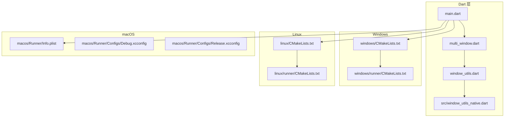
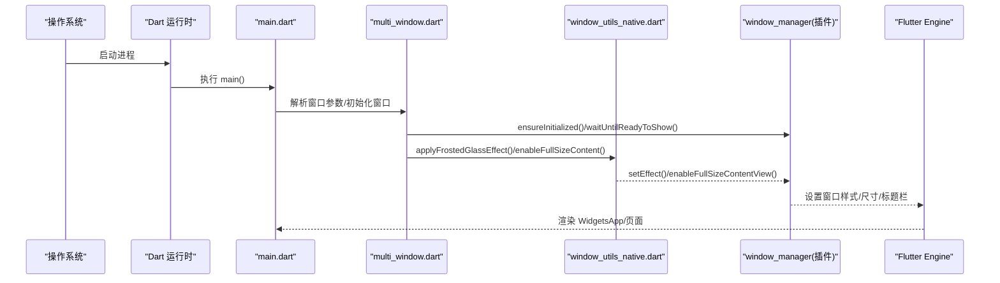
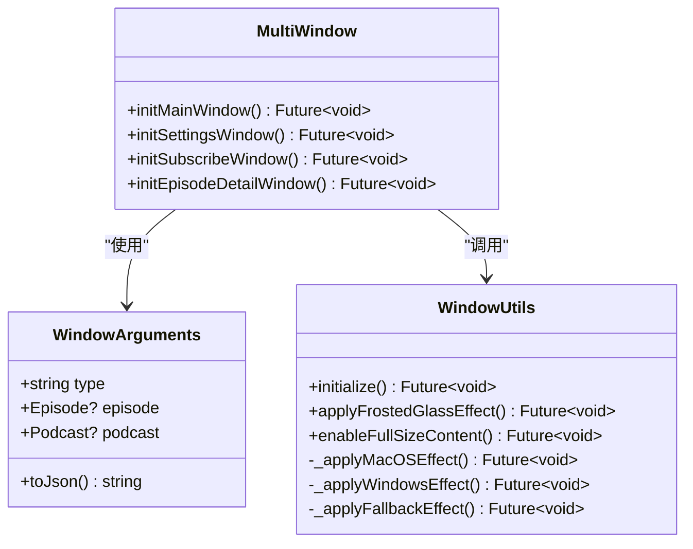
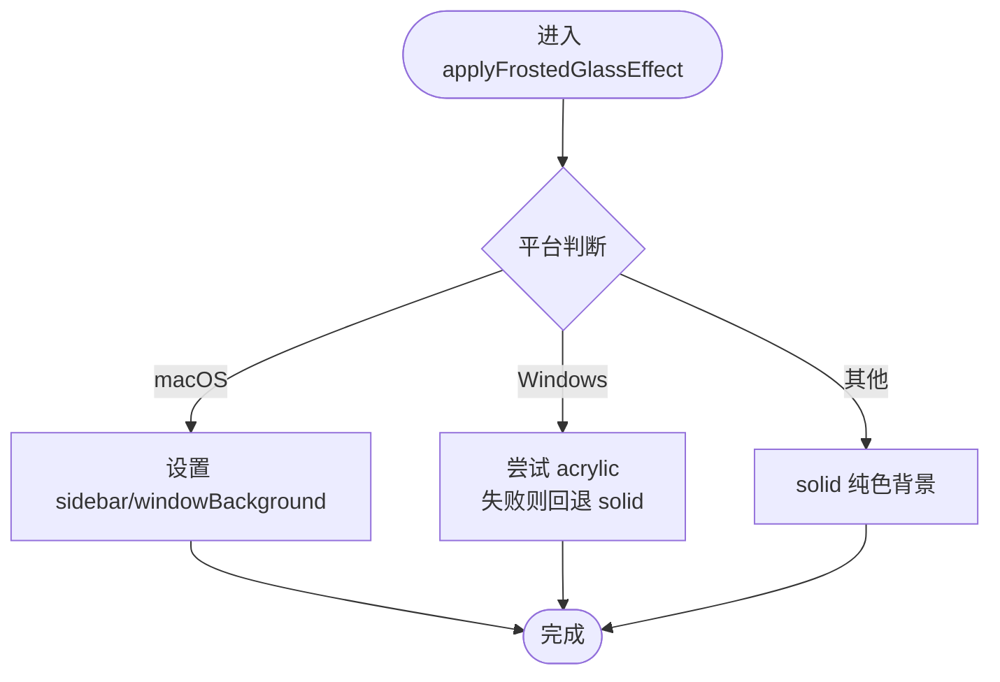
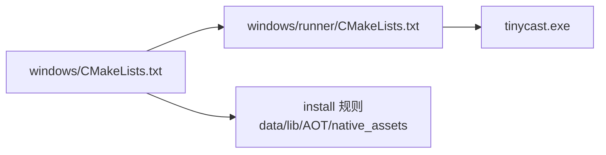
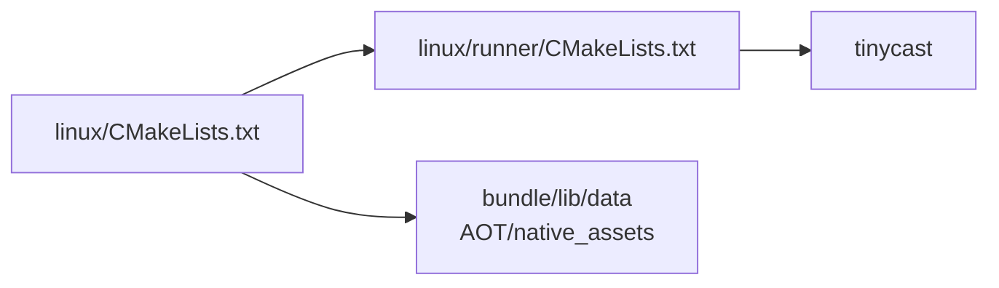
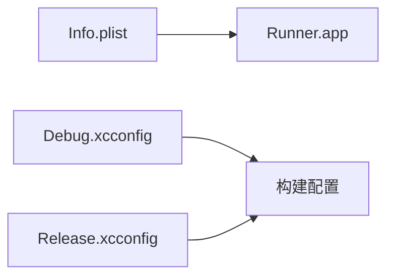
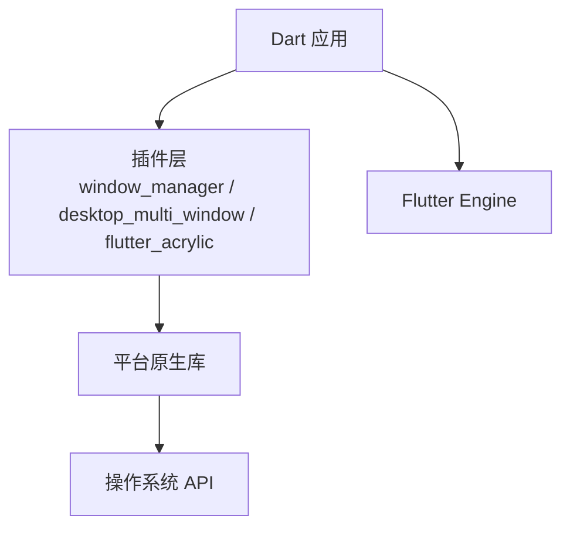

# 桌面平台适配

<cite>
**本文引用的文件**   
- [README.md](file://README.md)
- [pubspec.yaml](file://pubspec.yaml)
- [main.dart](file://lib/main.dart)
- [multi_window.dart](file://lib/multi_window.dart)
- [window_utils.dart](file://lib/window_utils.dart)
- [window_utils_native.dart](file://lib/src/window_utils_native.dart)
- [CMakeLists.txt（Windows）](file://windows/CMakeLists.txt)
- [CMakeLists.txt（Linux）](file://linux/CMakeLists.txt)
- [CMakeLists.txt（Windows runner）](file://windows/runner/CMakeLists.txt)
- [CMakeLists.txt（Linux runner）](file://linux/runner/CMakeLists.txt)
- [Info.plist（macOS）](file://macos/Runner/Info.plist)
- [Debug.xcconfig（macOS）](file://macos/Runner/Configs/Debug.xcconfig)
- [Release.xcconfig（macOS）](file://macos/Runner/Configs/Release.xcconfig)
</cite>

## 目录
1. [简介](#简介)
2. [项目结构](#项目结构)
3. [核心组件](#核心组件)
4. [架构总览](#架构总览)
5. [详细组件分析](#详细组件分析)
6. [依赖关系分析](#依赖关系分析)
7. [性能与内存管理](#性能与内存管理)
8. [故障排查指南](#故障排查指南)
9. [结论](#结论)
10. [附录：打包与分发策略](#附录打包与分发策略)

## 简介
本文件面向桌面端（Windows、macOS、Linux）的适配与工程化实践，围绕构建系统配置、窗口管理与多窗口、原生菜单与快捷键、文件系统访问、以及打包分发与性能优化进行系统化说明。本项目基于 Flutter 桌面支持，使用 CMake（Windows/Linux）与 Xcode（macOS）作为构建入口，并通过 window_manager、desktop_multi_window、flutter_acrylic 等插件实现跨平台窗口特效与多窗口能力。

## 项目结构
- Windows：顶层 CMakeLists.txt 定义项目与安装规则，runner/CMakeLists.txt 定义可执行目标与链接库。
- Linux：顶层 CMakeLists.txt 声明 GTK 依赖与安装路径，runner/CMakeLists.txt 定义可执行目标与链接库。
- macOS：Xcode 工程由 Runner 目录组织，Info.plist 描述应用元数据与 URL Scheme，xcconfig 管理编译配置。
- Dart 层：main.dart 负责启动与路由分支；multi_window.dart 管理多窗口参数与初始化；window_utils.dart 与 src/window_utils_native.dart 封装跨平台窗口特效与全屏内容区域。

图表来源 
- [CMakeLists.txt（Windows）:1-109](file://windows/CMakeLists.txt#L1-L109)
- [CMakeLists.txt（Windows runner）:1-41](file://windows/runner/CMakeLists.txt#L1-L41)
- [CMakeLists.txt（Linux）:1-129](file://linux/CMakeLists.txt#L1-L129)
- [CMakeLists.txt（Linux runner）:1-27](file://linux/runner/CMakeLists.txt#L1-L27)
- [Info.plist（macOS）:1-46](file://macos/Runner/Info.plist#L1-L46)
- [Debug.xcconfig（macOS）:1-3](file://macos/Runner/Configs/Debug.xcconfig#L1-L3)
- [Release.xcconfig（macOS）:1-3](file://macos/Runner/Configs/Release.xcconfig#L1-L3)
- [main.dart:106-177](file://lib/main.dart#L106-L177)
- [multi_window.dart:184-303](file://lib/multi_window.dart#L184-L303)
- [window_utils.dart:1-6](file://lib/window_utils.dart#L1-L6)
- [window_utils_native.dart:1-125](file://lib/src/window_utils_native.dart#L1-L125)

章节来源
- [README.md:1-6](file://README.md#L1-L6)
- [pubspec.yaml:1-196](file://pubspec.yaml#L1-L196)

## 核心组件
- 启动与路由分支：根据平台与窗口参数选择主窗口或子窗口应用根组件，并初始化数据库、音频服务、日志与可选云服务。
- 多窗口管理：通过 WindowController 创建/显示窗口，传递 JSON 参数解析为窗口类型与业务数据。
- 窗口特效与全屏内容：封装毛玻璃/亚克力效果、标题栏透明、全屏内容区域启用，按平台差异化处理。
- 构建系统：Windows/Linux 使用 CMake 管理依赖与安装；macOS 使用 Xcode 与 xcconfig 管理编译选项与资源。

章节来源
- [main.dart:106-194](file://lib/main.dart#L106-L194)
- [multi_window.dart:15-182](file://lib/multi_window.dart#L15-L182)
- [window_utils_native.dart:1-125](file://lib/src/window_utils_native.dart#L1-L125)

## 架构总览
下图展示从应用启动到窗口渲染的关键调用链，以及各平台构建系统的角色。

图表来源 
- [main.dart:106-177](file://lib/main.dart#L106-L177)
- [multi_window.dart:184-303](file://lib/multi_window.dart#L184-L303)
- [window_utils_native.dart:11-108](file://lib/src/window_utils_native.dart#L11-L108)

## 详细组件分析

### 窗口管理与多窗口
- 窗口参数模型：统一序列化/反序列化为 JSON，包含窗口类型与业务实体（如 Episode/Podcast）。
- 窗口初始化：各窗口类型（主窗口、设置、订阅、节目详情）分别配置尺寸、居中、隐藏标题栏、背景色与任务栏可见性。
- 多窗口创建：通过 WindowController.create 传入隐藏启动与参数，随后 show/focus。

图表来源 
- [multi_window.dart:15-182](file://lib/multi_window.dart#L15-L182)
- [multi_window.dart:184-303](file://lib/multi_window.dart#L184-L303)
- [window_utils_native.dart:1-125](file://lib/src/window_utils_native.dart#L1-L125)

章节来源
- [multi_window.dart:15-182](file://lib/multi_window.dart#L15-L182)
- [multi_window.dart:184-303](file://lib/multi_window.dart#L184-L303)
- [window_utils_native.dart:1-125](file://lib/src/window_utils_native.dart#L1-L125)

### 窗口特效与全屏内容
- 毛玻璃/亚克力：macOS 使用 sidebar/windowBackground 效果；Windows 优先 acrylic，回退 solid；其他平台回退 solid。
- 全屏内容区域：macOS 启用 full-size content view 并透明标题栏；Windows/Linux 通过隐藏标题栏与自定义控件实现。
- 透明背景：macOS 支持 transparent，其他平台回退纯色背景。

图表来源 
- [window_utils_native.dart:11-49](file://lib/src/window_utils_native.dart#L11-L49)

章节来源
- [window_utils_native.dart:11-108](file://lib/src/window_utils_native.dart#L11-L108)

### 构建系统配置

#### Windows（CMake）
- 顶层 CMakeLists.txt：定义二进制名称、构建类型（Debug/Profile/Release）、Unicode 宏、标准 C++ 特性、插件生成与安装规则（data/lib 目录、AOT 库、native assets）。
- runner/CMakeLists.txt：定义可执行目标、预处理器版本宏、禁用 NOMINMAX、链接 flutter 与 dwmapi.lib、添加依赖 flutter_assemble。

图表来源 
- [CMakeLists.txt（Windows）:1-109](file://windows/CMakeLists.txt#L1-L109)
- [CMakeLists.txt（Windows runner）:1-41](file://windows/runner/CMakeLists.txt#L1-L41)

章节来源
- [CMakeLists.txt（Windows）:1-109](file://windows/CMakeLists.txt#L1-L109)
- [CMakeLists.txt（Windows runner）:1-41](file://windows/runner/CMakeLists.txt#L1-L41)

#### Linux（CMake + GTK）
- 顶层 CMakeLists.txt：声明 GTK 依赖、RPATH、构建类型、插件生成、安装路径（bundle/lib/data）、AOT 库安装。
- runner/CMakeLists.txt：定义可执行目标、APPLICATION_ID 宏、链接 flutter 与 PkgConfig::GTK。

图表来源 
- [CMakeLists.txt（Linux）:1-129](file://linux/CMakeLists.txt#L1-L129)
- [CMakeLists.txt（Linux runner）:1-27](file://linux/runner/CMakeLists.txt#L1-L27)

章节来源
- [CMakeLists.txt（Linux）:1-129](file://linux/CMakeLists.txt#L1-L129)
- [CMakeLists.txt（Linux runner）:1-27](file://linux/runner/CMakeLists.txt#L1-L27)

#### macOS（Xcode + xcconfig）
- Info.plist：定义应用标识、可执行名、图标、最低系统版本、URL Scheme、主 nib 与主类。
- xcconfig：Debug/Release 配置引入 Flutter 基础配置与警告规则。

图表来源 
- [Info.plist（macOS）:1-46](file://macos/Runner/Info.plist#L1-L46)
- [Debug.xcconfig（macOS）:1-3](file://macos/Runner/Configs/Debug.xcconfig#L1-L3)
- [Release.xcconfig（macOS）:1-3](file://macos/Runner/Configs/Release.xcconfig#L1-L3)

章节来源
- [Info.plist（macOS）:1-46](file://macos/Runner/Info.plist#L1-L46)
- [Debug.xcconfig（macOS）:1-3](file://macos/Runner/Configs/Debug.xcconfig#L1-L3)
- [Release.xcconfig（macOS）:1-3](file://macos/Runner/Configs/Release.xcconfig#L1-L3)

### 文件系统访问与原生集成
- 路径与缓存：通过 path_provider 获取平台特定目录（文档/缓存），path 进行路径拼接与解析。
- 文件选择：file_picker 提供跨平台文件选择器，用于导入播客/音频文件。
- 安全存储：flutter_secure_storage 用于敏感信息（token/密码）的安全持久化。
- 主题与资源：assets/themes/*.conf 以 HOCON 格式加载主题配置，结合 ThemeLoader 在桌面端预加载。

章节来源
- [pubspec.yaml:86-106](file://pubspec.yaml#L86-L106)
- [main.dart:119-124](file://lib/main.dart#L119-L124)

### 原生菜单与快捷键支持
- 当前仓库未包含原生菜单与全局快捷键的实现代码。建议在各自平台侧扩展：
  - Windows：在 runner 中集成 Win32 菜单 API 或通过 window_manager 提供的菜单能力。
  - macOS：在 AppDelegate/SwiftUI 中注册 NSMenu 与热键。
  - Linux：在 my_application.cc 中注册 GTK MenuBar 与 Accelerator。
- 若需跨平台统一接口，可在 Dart 层抽象出菜单/快捷键服务，并在各平台 native 侧实现桥接。

[本节为概念性建议，不直接分析具体文件]

### 桌面端特有功能要点
- 窗口管理：隐藏标题栏、自定义控制条（Windows 下使用 WindowControls 组件）。
- 多窗口：主窗口与子窗口（设置、订阅、节目详情）独立生命周期与参数传递。
- 毛玻璃/亚克力：按平台选择最佳视觉效果，确保回退兼容。
- 全屏内容区域：macOS 启用 full-size content view，使自定义标题栏与内容无缝衔接。

章节来源
- [multi_window.dart:184-303](file://lib/multi_window.dart#L184-L303)
- [window_utils_native.dart:88-108](file://lib/src/window_utils_native.dart#L88-L108)

## 依赖关系分析
- 构建期依赖：
  - Windows：CMake、MSVC、dwmapi.lib、flutter_wrapper_app。
  - Linux：CMake、GTK+ 3.0（pkg-config）、flutter。
  - macOS：Xcode、FlutterMacOS、Pods（如有）。
- 运行期依赖：
  - window_manager、desktop_multi_window、flutter_acrylic 等插件动态加载。
  - Isar、just_audio、audio_service、dio、supabase_flutter 等业务依赖。

图表来源 
- [pubspec.yaml:35-44](file://pubspec.yaml#L35-L44)
- [CMakeLists.txt（Windows runner）:30-41](file://windows/runner/CMakeLists.txt#L30-L41)
- [CMakeLists.txt（Linux runner）:22-27](file://linux/runner/CMakeLists.txt#L22-L27)

章节来源
- [pubspec.yaml:35-44](file://pubspec.yaml#L35-L44)
- [CMakeLists.txt（Windows runner）:30-41](file://windows/runner/CMakeLists.txt#L30-L41)
- [CMakeLists.txt（Linux runner）:22-27](file://linux/runner/CMakeLists.txt#L22-L27)

## 性能与内存管理
- 构建优化：
  - Profile/Release 模式开启 O3/NDEBUG，减少调试开销。
  - AOT 库安装至 bundle/lib，提升启动与运行性能。
- 窗口渲染：
  - 避免频繁切换毛玻璃/亚克力效果，尽量在窗口初始化时一次性设置。
  - 合理使用透明背景与全屏内容区域，降低重绘成本。
- 资源管理：
  - 图片与媒体资源使用缓存（cached_network_image）与本地缓存目录。
  - 数据库连接与播放器服务在应用生命周期内复用，避免重复初始化。
- 事件与调度：
  - 使用生命周期观察者（WidgetsBindingObserver）在应用暂停/恢复时合理调度后台任务（如 Feed 刷新）。

章节来源
- [CMakeLists.txt（Linux）:42-47](file://linux/CMakeLists.txt#L42-L47)
- [CMakeLists.txt（Windows）:26-30](file://windows/CMakeLists.txt#L26-L30)
- [main.dart:74-104](file://lib/main.dart#L74-L104)

## 故障排查指南
- 窗口无法显示或黑屏：
  - 检查 windowManager.ensureInitialized 与 waitUntilReadyToShow 是否成功调用。
  - 确认毛玻璃/亚克力效果设置是否触发异常回退。
- 多窗口参数解析失败：
  - 检查 WindowArguments.toJson 与 parseArguments 的字段完整性与时区/日期格式。
- 构建失败（Linux/GTK）：
  - 确认已安装 GTK+ 3.0 开发包，且 pkg-config 可用。
- 构建失败（Windows/DWM）：
  - 确认 dwmapi.lib 链接正常，编译器支持 C++17。
- macOS 配置错误：
  - 检查 Info.plist 的 Bundle ID、URL Scheme 与最低系统版本。
  - 确认 xcconfig 正确引入 Flutter 基础配置。

章节来源
- [multi_window.dart:95-182](file://lib/multi_window.dart#L95-L182)
- [window_utils_native.dart:30-49](file://lib/src/window_utils_native.dart#L30-L49)
- [CMakeLists.txt（Linux）:54-58](file://linux/CMakeLists.txt#L54-L58)
- [CMakeLists.txt（Windows runner）:35-37](file://windows/runner/CMakeLists.txt#L35-L37)
- [Info.plist（macOS）:1-46](file://macos/Runner/Info.plist#L1-L46)

## 结论
本项目在桌面端实现了稳定的多窗口与窗口特效能力，构建系统覆盖 Windows/Linux/macOS 三大平台。通过分层清晰的 Dart 层与平台构建配置，既保证了跨平台一致性，又保留了平台专属优化空间。后续可在原生菜单、全局快捷键、系统托盘等方面按需扩展，以满足更丰富的桌面体验。

## 附录：打包与分发策略
- Windows：
  - 使用 CMake install 生成可执行与依赖（data/lib），配合第三方打包工具（如 Inno Setup、NSIS）生成安装包。
  - 非 Debug 构建会安装 AOT 库以提升性能。
- Linux：
  - 使用 CMake install 生成 bundle（bin/lib/data），可通过 AppImage、Flatpak、Snap 等格式分发。
  - 确保 GTK 依赖满足运行时需求。
- macOS：
  - 使用 Xcode Archive 生成 .app，再通过 codesign 与 notarytool 签名并提交审核。
  - 可使用 create-dmg 生成 dmg 安装包。

[本节为通用指导，不直接分析具体文件]