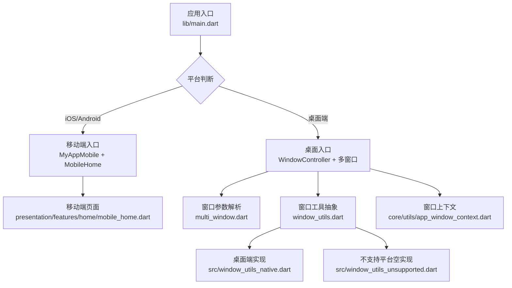
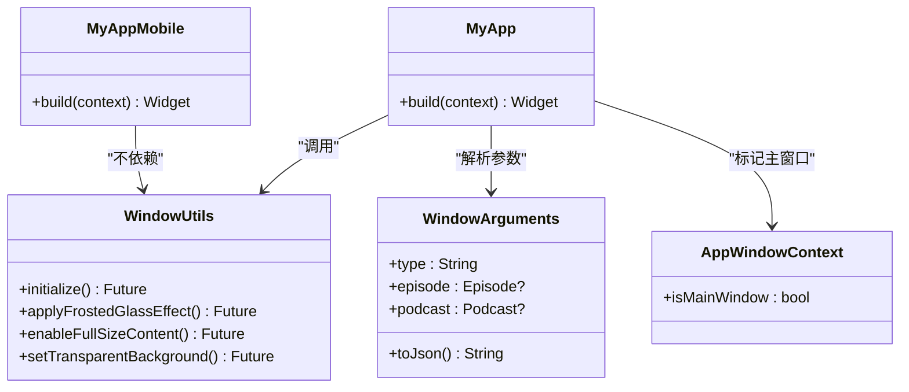
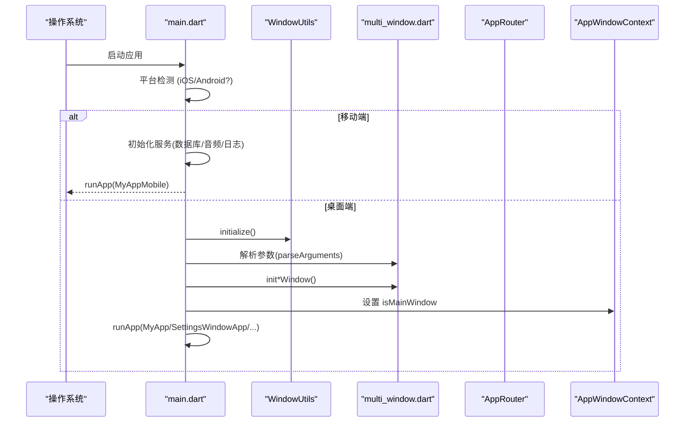
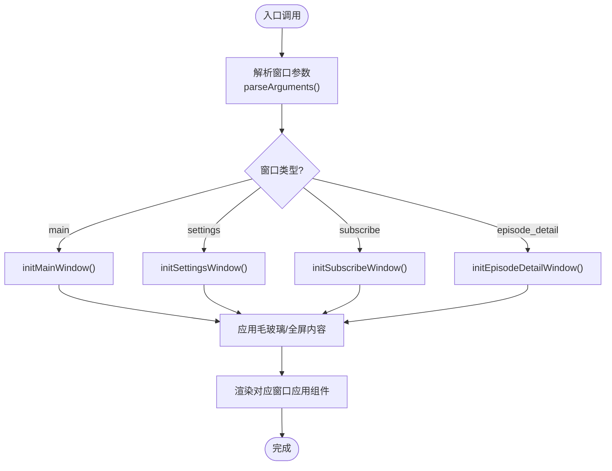
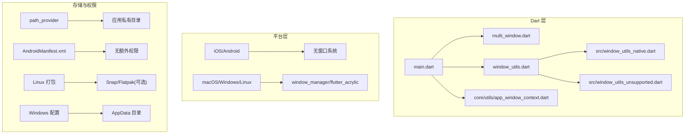

# 跨平台策略

<cite>
**本文引用的文件**   
- [README.md](file://README.md)
- [pubspec.yaml](file://pubspec.yaml)
- [main.dart](file://lib/main.dart)
- [multi_window.dart](file://lib/multi_window.dart)
- [window_utils.dart](file://lib/window_utils.dart)
- [window_utils_native.dart](file://lib/src/window_utils_native.dart)
- [window_utils_unsupported.dart](file://lib/src/window_utils_unsupported.dart)
- [mobile_home.dart](file://lib/presentation/features/home/mobile_home.dart)
- [app_window_context.dart](file://lib/core/utils/app_window_context.dart)
- [PLATFORM_PERMISSIONS.md](file://docs/PLATFORM_PERMISSIONS.md)
- [run.sh](file://run.sh)
</cite>

## 目录
1. [简介](#简介)
2. [项目结构](#项目结构)
3. [核心组件](#核心组件)
4. [架构总览](#架构总览)
5. [详细组件分析](#详细组件分析)
6. [依赖分析](#依赖分析)
7. [性能考虑](#性能考虑)
8. [故障排查指南](#故障排查指南)
9. [结论](#结论)
10. [附录](#附录)

## 简介
本文件面向 TinyCast 的跨平台开发策略，系统性阐述其跨平台架构设计、平台抽象层实现、条件编译与平台特定代码组织方式、共享与平台特定代码分离策略、平台检测与特性检测机制、跨平台 UI 适配最佳实践、差异与兼容性处理方案，以及跨平台测试策略与质量保证方法。TinyCast 基于 Flutter 构建，目标覆盖移动端（iOS/Android）与桌面端（macOS/Windows/Linux），在保持业务逻辑一致性的同时，对窗口系统、原生特效、权限与存储等差异进行统一抽象与隔离。

## 项目结构
- 入口与启动流程：应用根据运行平台选择不同入口与初始化路径，移动端直接渲染移动端首页，桌面端启用多窗口系统与窗口特效。
- 平台抽象层：通过导出文件与条件实现，将平台相关能力封装为统一接口，屏蔽底层差异。
- 多窗口管理：桌面端使用统一的窗口参数解析与窗口初始化函数，支持主窗口、设置窗口、订阅窗口与节目详情窗口。
- 主题与配置：支持运行时与编译时配置，包括 Supabase 凭据注入与主题来源开关。



**图示来源** 
- [main.dart:106-177](file://lib/main.dart#L106-L177)
- [multi_window.dart:18-93](file://lib/multi_window.dart#L18-L93)
- [window_utils.dart:1-6](file://lib/window_utils.dart#L1-L6)
- [window_utils_native.dart:1-125](file://lib/src/window_utils_native.dart#L1-L125)
- [window_utils_unsupported.dart:1-31](file://lib/src/window_utils_unsupported.dart#L1-L31)
- [mobile_home.dart:1-12](file://lib/presentation/features/home/mobile_home.dart#L1-L12)
- [app_window_context.dart:1-10](file://lib/core/utils/app_window_context.dart#L1-L10)

**章节来源**
- [README.md:1-6](file://README.md#L1-L6)
- [pubspec.yaml:1-196](file://pubspec.yaml#L1-L196)

## 核心组件
- 应用入口与平台分支：根据 Platform.isIOS / Platform.isAndroid 决定移动端或桌面端启动路径；桌面端加载窗口系统、主题与多窗口控制器。
- 窗口参数与多窗口：集中定义 WindowArguments 序列化/反序列化，统一解析窗口类型与数据，避免分散的条件判断。
- 窗口工具抽象：通过 window_utils.dart 暴露统一 API，实际实现按平台切换（native 或 unsupported）。
- 移动端首页：提供轻量级容器与内容区域，不包含桌面专属组件。
- 窗口上下文：标记当前是否为“主窗口”，用于控制后台任务与播放恢复等只在主窗口生效的逻辑。

**章节来源**
- [main.dart:106-177](file://lib/main.dart#L106-L177)
- [multi_window.dart:18-93](file://lib/multi_window.dart#L18-L93)
- [window_utils.dart:1-6](file://lib/window_utils.dart#L1-L6)
- [window_utils_native.dart:1-125](file://lib/src/window_utils_native.dart#L1-L125)
- [window_utils_unsupported.dart:1-31](file://lib/src/window_utils_unsupported.dart#L1-L31)
- [mobile_home.dart:1-12](file://lib/presentation/features/home/mobile_home.dart#L1-L12)
- [app_window_context.dart:1-10](file://lib/core/utils/app_window_context.dart#L1-L10)

## 架构总览
TinyCast 的跨平台架构以“共享 Dart 逻辑 + 平台抽象层 + 平台特定实现”为核心。入口层负责平台检测与路由，窗口管理层负责多窗口与窗口特效，UI 层按平台选择不同根组件。所有平台差异通过统一接口暴露，调用方无需关心具体平台实现。



**图示来源** 
- [main.dart:196-238](file://lib/main.dart#L196-L238)
- [main.dart:240-285](file://lib/main.dart#L240-L285)
- [multi_window.dart:18-93](file://lib/multi_window.dart#L18-L93)
- [window_utils.dart:1-6](file://lib/window_utils.dart#L1-L6)
- [app_window_context.dart:1-10](file://lib/core/utils/app_window_context.dart#L1-L10)

## 详细组件分析

### 入口与平台分支（main.dart）
- 平台检测：在 main() 中优先判断 iOS/Android，若是移动端则跳过桌面窗口系统初始化，直接运行移动端应用。
- 桌面端初始化：执行窗口工具初始化、主题预加载、Supabase 配置注入、窗口控制器获取与参数解析，再根据窗口类型运行对应应用。
- 生命周期观察：注册应用生命周期观察者，协调后台刷新调度器。



**图示来源** 
- [main.dart:106-177](file://lib/main.dart#L106-L177)
- [multi_window.dart:184-303](file://lib/multi_window.dart#L184-L303)
- [app_window_context.dart:1-10](file://lib/core/utils/app_window_context.dart#L1-L10)

**章节来源**
- [main.dart:106-177](file://lib/main.dart#L106-L177)
- [main.dart:179-194](file://lib/main.dart#L179-L194)

### 多窗口与参数解析（multi_window.dart）
- 窗口参数类：统一封装窗口类型与业务数据（Episode/Podcast），并提供 JSON 序列化/反序列化。
- 窗口初始化：各窗口初始化函数在移动端直接返回，桌面端配置窗口尺寸、标题栏样式与背景色，并应用毛玻璃效果与全屏内容。
- 窗口应用组件：每个窗口提供独立的 WidgetsApp 根组件，按需包含平台特定的标题栏控件。



**图示来源** 
- [multi_window.dart:95-182](file://lib/multi_window.dart#L95-L182)
- [multi_window.dart:184-303](file://lib/multi_window.dart#L184-L303)
- [multi_window.dart:309-453](file://lib/multi_window.dart#L309-L453)

**章节来源**
- [multi_window.dart:18-93](file://lib/multi_window.dart#L18-L93)
- [multi_window.dart:184-303](file://lib/multi_window.dart#L184-L303)
- [multi_window.dart:309-453](file://lib/multi_window.dart#L309-L453)

### 窗口工具抽象与平台实现（window_utils.dart, src/*）
- 抽象层：window_utils.dart 仅导出统一 API，隐藏平台差异。
- 桌面端实现：src/window_utils_native.dart 针对 macOS/Windows/Linux 分别实现毛玻璃、透明背景、全屏内容与标题栏透明等能力。
- 不支持平台实现：src/window_utils_unsupported.dart 提供空实现，确保在不支持的平台上也能编译通过且无副作用。

```mermaid
classDiagram
class WindowUtils_Abstract {
+initialize() Future<void>
+applyFrostedGlassEffect() Future<void>
+applySidebarFrostedEffect() Future<void>
+removeFrostedGlassEffect() Future<void>
+setTransparentBackground() Future<void>
+enableFullSizeContent() Future<void>
+disableFullSizeContent() Future<void>
+configureTransparentWindow() Future<void>
}
class WindowUtils_Native {
+initialize() async
+applyFrostedGlassEffect() async
+_applyMacOSEffect() async
+_applyWindowsEffect() async
+_applyFallbackEffect() async
+enableFullSizeContent() async
+disableFullSizeContent() async
}
class WindowUtils_Unsupported {
+initialize() async {}
+applyFrostedGlassEffect() async {}
+... 空实现 ...
}
WindowUtils_Abstract <|-- WindowUtils_Native : "实现"
WindowUtils_Abstract <|-- WindowUtils_Unsupported : "实现"
```

**图示来源** 
- [window_utils.dart:1-6](file://lib/window_utils.dart#L1-L6)
- [window_utils_native.dart:1-125](file://lib/src/window_utils_native.dart#L1-L125)
- [window_utils_unsupported.dart:1-31](file://lib/src/window_utils_unsupported.dart#L1-L31)

**章节来源**
- [window_utils.dart:1-6](file://lib/window_utils.dart#L1-L6)
- [window_utils_native.dart:1-125](file://lib/src/window_utils_native.dart#L1-L125)
- [window_utils_unsupported.dart:1-31](file://lib/src/window_utils_unsupported.dart#L1-L31)

### 移动端首页（mobile_home.dart）
- 轻量容器：仅提供背景色与内容区域，不包含桌面专属组件（如 WindowControls）。
- 与入口联动：由 main.dart 在移动端分支中作为首页渲染。

**章节来源**
- [mobile_home.dart:1-12](file://lib/presentation/features/home/mobile_home.dart#L1-L12)
- [main.dart:240-285](file://lib/main.dart#L240-L285)

### 窗口上下文（app_window_context.dart）
- 主窗口标记：用于区分主窗口与其他桌面子窗口，确保后台任务与播放状态恢复仅在主窗口生效。

**章节来源**
- [app_window_context.dart:1-10](file://lib/core/utils/app_window_context.dart#L1-L10)

## 依赖分析
- 平台检测与条件编译：
  - 运行时平台检测：使用 dart:io 的 Platform.* 常量进行分支控制。
  - 条件导出：通过 window_utils.dart 导出不同平台的实现，使调用方无需感知差异。
- 外部依赖：
  - 窗口管理与特效：window_manager、flutter_acrylic、desktop_multi_window。
  - 本地存储与数据库：path_provider、isar_community。
  - 网络与服务：dio、connectivity_plus、supabase_flutter。
  - 国际化与主题：intl、flutter_localizations、自定义主题加载器。
- 权限与存储：
  - Android/iOS：默认使用应用私有目录，无需额外存储权限。
  - Linux：标准用户目录，未使用 Snap/Flatpak 时无需特殊配置。
  - Windows：使用 AppData 目录，无需额外权限。



**图示来源** 
- [pubspec.yaml:1-196](file://pubspec.yaml#L1-L196)
- [PLATFORM_PERMISSIONS.md:65-116](file://docs/PLATFORM_PERMISSIONS.md#L65-L116)

**章节来源**
- [pubspec.yaml:1-196](file://pubspec.yaml#L1-L196)
- [PLATFORM_PERMISSIONS.md:65-116](file://docs/PLATFORM_PERMISSIONS.md#L65-L116)

## 性能考虑
- 启动优化：
  - 移动端跳过桌面窗口系统初始化，减少不必要的依赖加载。
  - 主题预加载仅在非硬编码模式下执行，避免冷启动开销。
- 窗口特效：
  - 毛玻璃效果在不同平台采用最优实现，失败时回退到纯色背景，保证稳定性。
- 资源与内存：
  - 多窗口场景下，每个窗口独立 ProviderScope，避免状态污染与重复初始化。
- 网络与缓存：
  - 使用 dio 与缓存库提升网络请求效率，结合 connectivity_plus 做网络状态感知。

[本节为通用指导，不直接分析具体文件]

## 故障排查指南
- 启动崩溃（桌面端）：
  - 检查 window_manager 与 flutter_acrylic 是否正确初始化。
  - 确认窗口参数解析成功，否则回退到主窗口类型。
- 毛玻璃效果无效：
  - macOS：确认 sidebar 效果可用。
  - Windows：acrylic 不可用时自动回退 solid。
- 移动端无法编译：
  - 确认 window_utils_unsupported.dart 的空实现在移动端生效。
  - 检查 multi_window.dart 中的平台守卫是否阻止了桌面 API 调用。
- 权限问题：
  - Android/iOS：使用应用私有目录，无需额外权限。
  - Linux：若使用 Snap/Flatpak，需添加相应 plugs/filesystems 配置。
  - Windows：AppData 目录默认可写，无需额外权限。

**章节来源**
- [window_utils_native.dart:30-49](file://lib/src/window_utils_native.dart#L30-L49)
- [PLATFORM_PERMISSIONS.md:65-116](file://docs/PLATFORM_PERMISSIONS.md#L65-L116)

## 结论
TinyCast 通过清晰的入口分支、统一的窗口工具抽象与条件导出机制，实现了移动端与桌面端的平滑兼容。平台检测与特性检测贯穿启动、窗口管理与 UI 渲染全流程，确保了功能一致性与体验一致性。未来可扩展更多平台（如 Web）仅需新增对应的条件实现与入口分支，保持核心逻辑不变。

[本节为总结性内容，不直接分析具体文件]

## 附录
- 跨平台测试策略：
  - 单元测试：针对窗口参数解析、平台检测分支与工具方法编写用例。
  - 集成测试：模拟不同平台环境，验证窗口初始化与特效应用。
  - 设备矩阵：覆盖 iOS/Android 真机与 macOS/Windows/Linux 桌面环境。
- 质量保证方法：
  - 静态分析：使用 flutter analyze 与 lint 规则约束代码质量。
  - 自动化构建：CI 中并行构建多平台产物，快速发现兼容性问题。
  - 发布前检查：核对权限配置、主题来源与 Supabase 凭据注入。

[本节为通用指导，不直接分析具体文件]