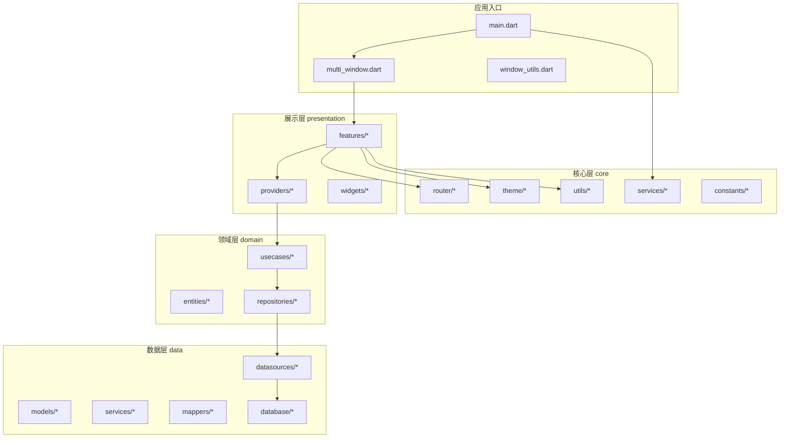
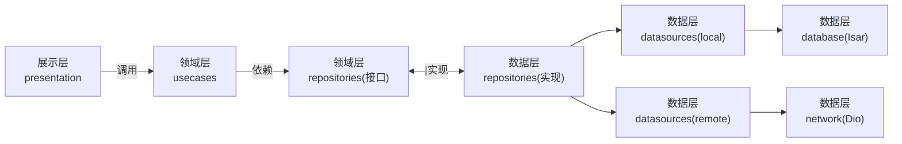
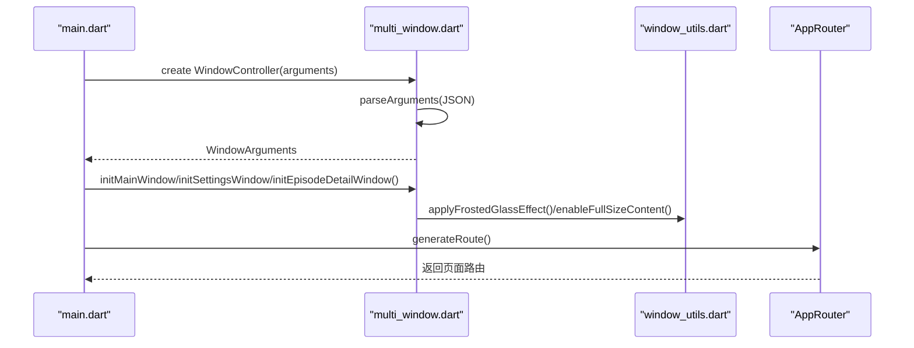

# 代码规范

<cite>
**本文引用的文件**
- [README.md](file://README.md)
- [analysis_options.yaml](file://analysis_options.yaml)
- [pubspec.yaml](file://pubspec.yaml)
- [main.dart](file://lib/main.dart)
- [multi_window.dart](file://lib/multi_window.dart)
- [window_utils.dart](file://lib/window_utils.dart)
- [ai-rules-for-flutter-and-dart.md](file://.agents/rules/ai-rules-for-flutter-and-dart.md)
- [cross-platform-compatibility.md](file://.agents/rules/cross-platform-compatibility.md)
</cite>

## 目录
1. [简介](#简介)
2. [项目结构](#项目结构)
3. [核心组件](#核心组件)
4. [架构总览](#架构总览)
5. [详细组件分析](#详细组件分析)
6. [依赖分析](#依赖分析)
7. [性能考虑](#性能考虑)
8. [故障排查指南](#故障排查指南)
9. [结论](#结论)
10. [附录](#附录)

## 简介
本规范面向 TinyCast 项目的开发与维护，统一 Dart 编码标准、Clean Architecture 分层实现、Riverpod 状态管理实践、跨平台兼容性注意事项，以及代码审查清单与质量检查工具使用方式。目标是让团队在命名、组织、注释、分层、状态管理与跨平台等方面保持一致性，提升可维护性与交付质量。

## 项目结构
TinyCast 采用 Clean Architecture 的分层组织：
- domain：实体、仓库接口、用例（纯业务逻辑）
- data：数据模型、数据源、仓库实现、服务（本地/远程、数据库、网络、解析等）
- presentation：页面、Provider、通用组件（UI 与交互）
- core：路由、主题、工具、全局服务（如 Supabase、日志、网络辅助等）
- 入口与多窗口：main.dart、multi_window.dart、window_utils.dart

图表来源
- [main.dart:106-177](file://lib/main.dart#L106-L177)
- [multi_window.dart:18-93](file://lib/multi_window.dart#L18-L93)
- [window_utils.dart:1-6](file://lib/window_utils.dart#L1-L6)

章节来源
- [pubspec.yaml:1-196](file://pubspec.yaml#L1-L196)
- [README.md:1-6](file://README.md#L1-L6)

## 核心组件
- 应用初始化与生命周期
  - 移动端与桌面端分支初始化；ProviderScope 包裹应用；注册生命周期观察者；启动定时任务；按需初始化 Isar、AudioPlayer、Logger、Supabase。
- 多窗口系统
  - WindowArguments 定义窗口类型与参数；parseArguments 解析 JSON；各 init*Window 函数负责窗口尺寸、标题栏样式、毛玻璃效果与全屏内容区域。
- 路由与主题
  - 通过 AppRouter.generateRoute 生成页面路由；文本样式与字体回退由主题配置提供。

章节来源
- [main.dart:106-194](file://lib/main.dart#L106-L194)
- [main.dart:196-285](file://lib/main.dart#L196-L285)
- [multi_window.dart:18-182](file://lib/multi_window.dart#L18-L182)
- [multi_window.dart:188-303](file://lib/multi_window.dart#L188-L303)
- [window_utils.dart:1-6](file://lib/window_utils.dart#L1-L6)

## 架构总览
TinyCast 遵循 Clean Architecture 三层职责划分：
- 展示层（presentation）：仅负责 UI 渲染与用户交互，通过 Riverpod Provider 订阅状态变化。
- 领域层（domain）：定义实体、仓库接口与用例，不包含外部依赖。
- 数据层（data）：实现仓库接口，聚合数据源（本地/远程），处理序列化与映射。

图表来源
- [pubspec.yaml:18-144](file://pubspec.yaml#L18-L144)

章节来源
- [pubspec.yaml:18-144](file://pubspec.yaml#L18-L144)

## 详细组件分析

### 命名约定与文件组织
- 命名
  - 类与枚举：PascalCase
  - 变量、函数、成员：camelCase
  - 文件：snake_case
- 文件组织
  - 按功能域划分 feature 目录；每个 feature 包含页面、Provider、组件子目录
  - 公共能力放入 core；数据相关放入 data；业务规则放入 domain
- 注释规范
  - 公共 API 使用 /// 文档注释，说明“为什么”而非“是什么”
  - 关键流程与边界条件需补充行内注释

章节来源
- [ai-rules-for-flutter-and-dart.md:57-72](file://.agents/rules/ai-rules-for-flutter-and-dart.md#L57-L72)
- [ai-rules-for-flutter-and-dart.md:195-204](file://.agents/rules/ai-rules-for-flutter-and-dart.md#L195-L204)

### Clean Architecture 分层实现规范
- domain
  - entities：不可变数据模型
  - repositories：仅声明接口，不实现
  - usecases：编排业务流程，组合多个 repository 方法
- data
  - models：与持久化或网络协议对齐的数据类（可使用 json_serializable）
  - datasources：封装具体存储/网络访问细节
  - repositories：实现 domain 的仓库接口，协调数据源
  - services：横切关注点（下载、播放、缓存、RSS 解析等）
- presentation
  - features：按页面/模块组织，包含页面、Provider、组件
  - providers：基于 Riverpod 的状态管理
  - widgets：原子/分子/有机体组件库

章节来源
- [pubspec.yaml:18-144](file://pubspec.yaml#L18-L144)

### Riverpod 状态管理最佳实践
- 使用 Notifier 模式（Riverpod 3.x）替代旧版 StateNotifier
- 所有 Provider 以 .dart 文件集中管理，按功能域分组
- 命名建议：xxxProvider / xxxNotifier
- 在 Widget 中使用 ConsumerWidget + ref.watch 读取状态
- 复杂状态变更封装在 Notifier 中，保持 UI 简洁

章节来源
- [ai-rules-for-flutter-and-dart.md:81-99](file://.agents/rules/ai-rules-for-flutter-and-dart.md#L81-L99)
- [ai-rules-for-flutter-and-dart.md:109-122](file://.agents/rules/ai-rules-for-flutter-and-dart.md#L109-L122)

### 跨平台兼容性注意事项
- 文件名与路径
  - 禁止 Windows 非法字符；控制路径长度；避免大小写不一致
- 换行符
  - 文本文件统一 LF；脚本文件按平台选择 CRLF
- IDE 临时文件
  - 忽略 .trae、.vscode、.cursor 等目录
- Flutter 多平台构建
  - macOS/Linux/Windows 分别运行命令；平台特定代码使用 Platform.* 判断

章节来源
- [cross-platform-compatibility.md:9-37](file://.agents/rules/cross-platform-compatibility.md#L9-L37)
- [cross-platform-compatibility.md:40-75](file://.agents/rules/cross-platform-compatibility.md#L40-L75)
- [cross-platform-compatibility.md:77-113](file://.agents/rules/cross-platform-compatibility.md#L77-L113)
- [cross-platform-compatibility.md:116-150](file://.agents/rules/cross-platform-compatibility.md#L116-L150)
- [cross-platform-compatibility.md:178-200](file://.agents/rules/cross-platform-compatibility.md#L178-L200)

### Android 与 iOS 特定处理
- 移动端入口分支：确保 WidgetsFlutterBinding 初始化；注册生命周期观察者；启动后台刷新调度器
- 音频服务与通知：通过 audio_service 提供锁屏控制与通知栏控制
- 权限与平台特性：根据平台差异进行条件编译或运行时判断

章节来源
- [main.dart:106-114](file://lib/main.dart#L106-L114)
- [pubspec.yaml:60-67](file://pubspec.yaml#L60-L67)

### 多窗口与窗口参数传递
- WindowArguments：统一窗口类型与数据载体（episode/podcast）
- parseArguments：JSON 反序列化为对象，失败时回退默认主窗口
- init*Window：统一窗口尺寸、标题栏隐藏、毛玻璃与全屏内容区域

图表来源
- [main.dart:28-39](file://lib/main.dart#L28-L39)
- [multi_window.dart:101-182](file://lib/multi_window.dart#L101-L182)
- [multi_window.dart:188-303](file://lib/multi_window.dart#L188-L303)
- [window_utils.dart:1-6](file://lib/window_utils.dart#L1-L6)

章节来源
- [multi_window.dart:18-93](file://lib/multi_window.dart#L18-L93)
- [multi_window.dart:101-182](file://lib/multi_window.dart#L101-L182)
- [multi_window.dart:188-303](file://lib/multi_window.dart#L188-L303)

### 主题与文本样式
- 支持 HOCON 配置文件加载与硬编码主题切换
- 文本样式统一通过 AppTextStyles 提供字体回退与基础样式
- 颜色与主题通过 core/theme 统一管理

章节来源
- [main.dart:119-124](file://lib/main.dart#L119-L124)
- [main.dart:223-228](file://lib/main.dart#L223-L228)

## 依赖分析
- 状态管理：riverpod、flutter_riverpod
- 数据库：isar_community、isar_community_flutter_libs
- 网络：dio、dio_http2_adapter、connectivity_plus
- 音频：just_audio、audio_service
- RSS/XML：rss_dart、xml
- 图片缓存：cached_network_image
- 安全与加密：crypto、flutter_secure_storage
- 国际化：intl
- HTML 处理：html、flutter_widget_from_html
- 原生交互：jni、jni_flutter
- 设置存储：shared_preferences
- 云服务：supabase_flutter、flutter_acrylic

```mermaid
graph TB
app["应用 tinycast"] --> riverpod["riverpod/flutter_riverpod"]
app --> isar["isar_community/isar_community_flutter_libs"]
app --> dio["dio/dio_http2_adapter"]
app --> just_audio["just_audio/audio_service"]
app --> rss["rss_dart/xml"]
app --> cache_img["cached_network_image"]
app --> crypto_sec["crypto/flutter_secure_storage"]
app --> intl_pkg["intl"]
app --> html_pkg["html/flutter_widget_from_html"]
app --> jni_pkg["jni/jni_flutter"]
app --> sp["shared_preferences"]
app --> supabase["supabase_flutter/flutter_acrylic"]
```

图表来源
- [pubspec.yaml:18-144](file://pubspec.yaml#L18-L144)

章节来源
- [pubspec.yaml:18-144](file://pubspec.yaml#L18-L144)

## 性能考虑
- 使用 const 构造函数减少重建
- 列表使用 ListView.builder 或 SliverList
- 耗时计算使用 compute() 或 Isolates
- build 方法避免阻塞操作（网络、IO）
- 合理拆分 Provider，避免过度监听导致频繁重建

章节来源
- [ai-rules-for-flutter-and-dart.md:64-79](file://.agents/rules/ai-rules-for-flutter-and-dart.md#L64-L79)

## 故障排查指南
- 静态分析与 Lint
  - 使用 flutter analyze；遵循 analysis_options.yaml 配置；启用 flutter_lints
- 常见错误定位
  - 检查 Provider 是否被正确包裹（ProviderScope）
  - 检查 Isar 数据库初始化顺序
  - 检查网络请求异常与重试策略
  - 检查多窗口参数解析失败的回退逻辑
- 日志与调试
  - 使用 dart:developer log 输出结构化日志
  - 开启文件日志便于离线问题复现

章节来源
- [analysis_options.yaml:1-36](file://analysis_options.yaml#L1-L36)
- [ai-rules-for-flutter-and-dart.md:57-63](file://.agents/rules/ai-rules-for-flutter-and-dart.md#L57-L63)
- [main.dart:179-194](file://lib/main.dart#L179-L194)

## 结论
本规范为 TinyCast 提供了从命名、文件组织、注释到分层架构、状态管理与跨平台的完整指导。遵循这些规范将显著提升代码可读性、可维护性与跨平台一致性。建议在团队内推广并纳入代码审查清单，持续优化与完善。

## 附录

### Dart 编码标准速查
- 命名：PascalCase 类、camelCase 成员、snake_case 文件
- 异步：优先 async/await；错误用 try-catch
- 日志：使用 dart:developer log，避免 print
- 空安全：Sound Null Safety，尽量避免 !
- 性能：const、ListView.builder、compute()

章节来源
- [ai-rules-for-flutter-and-dart.md:57-79](file://.agents/rules/ai-rules-for-flutter-and-dart.md#L57-L79)

### Clean Architecture 分层要点
- domain：实体、仓库接口、用例
- data：模型、数据源、仓库实现、服务
- presentation：页面、Provider、组件

章节来源
- [pubspec.yaml:18-144](file://pubspec.yaml#L18-L144)

### Riverpod 实践要点
- 使用 Notifier 模式（Riverpod 3.x）
- Provider 按功能域组织，命名清晰
- 在 Widget 中使用 ConsumerWidget + ref.watch

章节来源
- [ai-rules-for-flutter-and-dart.md:81-99](file://.agents/rules/ai-rules-for-flutter-and-dart.md#L81-L99)

### 跨平台检查清单
- 文件名不含非法字符；路径长度受控
- 文本文件 LF；脚本文件按平台选择 CRLF
- 忽略 IDE 临时文件
- 使用 Platform.* 进行平台判断

章节来源
- [cross-platform-compatibility.md:9-37](file://.agents/rules/cross-platform-compatibility.md#L9-L37)
- [cross-platform-compatibility.md:40-75](file://.agents/rules/cross-platform-compatibility.md#L40-L75)
- [cross-platform-compatibility.md:116-150](file://.agents/rules/cross-platform-compatibility.md#L116-L150)

### 代码审查清单
- 是否符合命名与文件组织规范
- 是否遵循 Clean Architecture 分层
- Provider 是否正确组织与命名
- 是否存在阻塞 build 的操作
- 是否处理了异常与边界情况
- 是否添加了必要的文档注释
- 是否通过 flutter analyze 且无警告

章节来源
- [analysis_options.yaml:1-36](file://analysis_options.yaml#L1-L36)
- [ai-rules-for-flutter-and-dart.md:195-204](file://.agents/rules/ai-rules-for-flutter-and-dart.md#L195-L204)