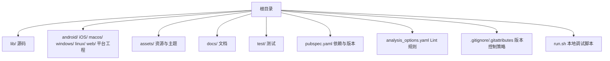
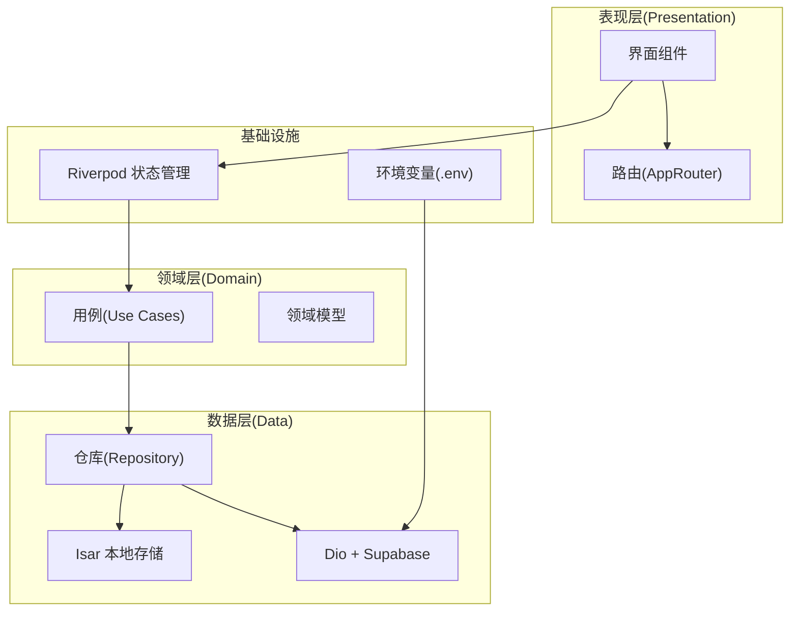
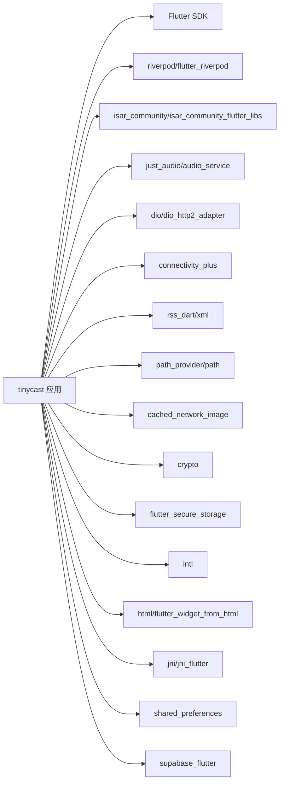

# 开发工作流

<cite>
**本文引用的文件**
- [README.md](file://README.md)
- [pubspec.yaml](file://pubspec.yaml)
- [analysis_options.yaml](file://analysis_options.yaml)
- [.gitignore](file://.gitignore)
- [.gitattributes](file://.gitattributes)
- [run.sh](file://run.sh)
- [.agents/rules/ai-rules-for-flutter-and-dart.md](file://.agents/rules/ai-rules-for-flutter-and-dart.md)
- [.agents/rules/cross-platform-compatibility.md](file://.agents/rules/cross-platform-compatibility.md)
- [.trae/rules/git-commit-message.md](file://.trae/rules/git-commit-message.md)
</cite>

## 目录
1. [简介](#简介)
2. [项目结构](#项目结构)
3. [核心组件](#核心组件)
4. [架构总览](#架构总览)
5. [详细组件分析](#详细组件分析)
6. [依赖分析](#依赖分析)
7. [性能考虑](#性能考虑)
8. [故障排查指南](#故障排查指南)
9. [结论](#结论)
10. [附录](#附录)

## 简介
本文件为 TinyCast（Flutter 播客应用）制定标准的开发工作流与协作规范，覆盖 Git 分支管理、提交规范、常用命令与脚本、代码审查流程、版本管理与发布流程，以及团队协作最佳实践。目标是让团队成员在跨平台（macOS/Linux/Windows）环境下高效协作，保证代码质量与可维护性。

## 项目结构
TinyCast 采用 Flutter 多端工程结构，包含 Android、iOS、macOS、Windows、Linux、Web 等目标平台，以及 Dart 源码、资源与文档。根目录关键配置包括：
- pubspec.yaml：应用元数据、依赖与构建配置
- analysis_options.yaml：Dart 静态分析与 Lint 规则
- .gitignore/.gitattributes：版本控制忽略与换行符策略
- run.sh：本地调试运行脚本（自动加载 .env 并注入 Supabase 参数）
- docs：项目文档与平台权限说明
- assets：图片、图标与主题配置文件

**章节来源**
- [README.md:1-6](file://README.md#L1-L6)
- [pubspec.yaml:1-196](file://pubspec.yaml#L1-L196)
- [analysis_options.yaml:1-36](file://analysis_options.yaml#L1-L36)
- [.gitignore:1-58](file://.gitignore#L1-L58)
- [.gitattributes:1-64](file://.gitattributes#L1-L64)
- [run.sh:1-66](file://run.sh#L1-L66)

## 核心组件
- 应用入口与版本：通过 pubspec.yaml 定义应用名、描述、版本号与 SDK 约束。
- 代码质量：analysis_options.yaml 启用 flutter_lints，统一风格与静态检查。
- 本地调试：run.sh 自动读取 .env 中的 Supabase 配置，按平台参数启动对应设备或桌面环境。
- 跨平台兼容：.gitattributes 统一换行符；cross-platform-compatibility.md 提供命名、路径、大小写敏感等规范。
- AI 编码规则：ai-rules-for-flutter-and-dart.md 规定分层、状态管理、日志、可访问性等最佳实践。

**章节来源**
- [pubspec.yaml:1-196](file://pubspec.yaml#L1-L196)
- [analysis_options.yaml:1-36](file://analysis_options.yaml#L1-L36)
- [run.sh:1-66](file://run.sh#L1-L66)
- [.gitattributes:1-64](file://.gitattributes#L1-L64)
- [.agents/rules/cross-platform-compatibility.md:1-241](file://.agents/rules/cross-platform-compatibility.md#L1-L241)
- [.agents/rules/ai-rules-for-flutter-and-dart.md:1-221](file://.agents/rules/ai-rules-for-flutter-and-dart.md#L1-L221)

## 架构总览
TinyCast 遵循分层架构（Presentation / Domain / Data），使用 Riverpod 进行状态管理，Isar 作为本地数据库，Dio 处理网络请求，Supabase 提供云服务。UI 层避免 Material Design，采用自定义设计系统。

**图示来源**
- [.agents/rules/ai-rules-for-flutter-and-dart.md:1-221](file://.agents/rules/ai-rules-for-flutter-and-dart.md#L1-L221)
- [pubspec.yaml:1-196](file://pubspec.yaml#L1-L196)

## 详细组件分析

### Git 分支管理策略
- 主分支
  - main：稳定主干，仅接受经过审查的合并。
  - develop：集成开发分支，日常功能迭代在此进行。
- 功能分支
  - 命名：feature/<模块>-<简述>，例如 feature/podcast-detail
  - 生命周期：从 develop 拉出，完成后发起 MR 回 develop。
- 修复分支
  - 命名：fix/<问题编号或简述>，例如 fix/audio-playback-crash
- 发布分支
  - 命名：release/vX.Y.Z，用于冻结版本、回归测试与打标签。
- 热修复分支
  - 命名：hotfix/<问题简述>，直接从 main 拉出，修复后合并至 main 与 develop。
- 分支保护与合并策略
  - main/develop 开启保护，禁止强制推送。
  - 合并需至少一名 Reviewer 批准，CI 全绿方可合并。
  - 推荐 Squash Merge 保持历史整洁（可选）。

[本节为通用规范，不直接分析具体文件]

### 代码提交规范（Commit Message）
- 格式：type(scope): subject
  - type：feat, fix, docs, style, refactor, test, chore, ci, perf, build
  - scope：模块或子系统（如 audio, download, supabase）
  - subject：简明扼要，动词开头，不超过 50 字符
- 正文要求
  - 描述变更动机与影响范围
  - 列出破坏性变更与迁移步骤
  - 关联 Issue/MR 编号
- 示例
  - feat(audio): 支持后台播放与锁屏控制
  - fix(download): 修复下载队列并发冲突
  - docs(supabase): 补充初始化与密钥配置说明

**章节来源**
- [.trae/rules/git-commit-message.md](file://.trae/rules/git-commit-message.md)

### 常用命令与脚本
- 环境准备
  - 安装 Flutter SDK 与平台工具（Android/iOS/macOS/Windows/Linux）
  - 执行 flutter doctor 检查依赖
- 本地调试
  - 使用 run.sh 自动加载 .env 并注入 SUPABASE_URL/SUPABASE_ANON_KEY
  - 指定平台：./run.sh ios | android | 默认桌面平台
- 构建与打包
  - 调试构建：flutter build debug
  - 发布构建：flutter build apk|aab|ios|macos|windows|linux
  - Web：flutter build web --web-renderer=canvaskit
- 代码质量
  - 静态分析：flutter analyze
  - 格式化：dart format .
  - 单元测试：flutter test
  - 集成测试：flutter test integration_test
- 清理与缓存
  - flutter clean
  - rm -rf .dart_tool/ build/

**章节来源**
- [run.sh:1-66](file://run.sh#L1-L66)
- [analysis_options.yaml:1-36](file://analysis_options.yaml#L1-L36)
- [pubspec.yaml:1-196](file://pubspec.yaml#L1-L196)

### 代码审查流程与合并策略
- 提交前自检
  - 运行 flutter analyze 与 dart format
  - 确保新增/修改测试通过
- 创建 MR
  - 填写变更说明、影响范围、测试方法
  - 关联需求/缺陷单号
- 审查要点
  - 架构一致性（Pres/Domain/Data 分层）
  - 状态管理（Riverpod）与数据流清晰
  - 错误处理与日志（使用 dart:developer）
  - 可访问性与性能（const、ListView.builder、compute）
- 合并策略
  - 至少一名 Reviewer 批准
  - CI 全绿（analyze/test/build）
  - 建议 Squash Merge，保持历史简洁

**章节来源**
- [.agents/rules/ai-rules-for-flutter-and-dart.md:1-221](file://.agents/rules/ai-rules-for-flutter-and-dart.md#L1-L221)

### 版本管理与发布流程
- 版本语义化：主版本.次版本.修订号+构建号（见 pubspec.yaml version）
- 发布分支
  - 从 develop 拉取 release/vX.Y.Z
  - 冻结代码，执行回归测试与打包
- 打标签与发布
  - 在 main 上打 tag vX.Y.Z
  - 生成变更日志（CHANGELOG）
- 热修复流程
  - 从 main 拉取 hotfix/*
  - 修复后合并至 main 与 develop，并打新标签

**章节来源**
- [pubspec.yaml:1-196](file://pubspec.yaml#L1-L196)

### 团队协作最佳实践与沟通规范
- 分支与任务
  - 每个功能一个分支，粒度适中，避免大改动长期未合并
- 代码风格
  - 遵循 ai-rules-for-flutter-and-dart.md 的分层、命名、异步与日志规范
- 文档与注释
  - 公共 API 使用 /// 注释，解释“为什么”而非“是什么”
- 跨平台兼容性
  - 文件名 snake_case，避免非法字符与过长路径
  - 统一 LF 换行符（.gitattributes）
- 沟通渠道
  - 需求与缺陷使用 Issue 跟踪
  - 重要决策记录在 docs/ 或 Wiki

**章节来源**
- [.agents/rules/ai-rules-for-flutter-and-dart.md:1-221](file://.agents/rules/ai-rules-for-flutter-and-dart.md#L1-L221)
- [.agents/rules/cross-platform-compatibility.md:1-241](file://.agents/rules/cross-platform-compatibility.md#L1-L241)
- [.gitattributes:1-64](file://.gitattributes#L1-L64)

## 依赖分析
TinyCast 依赖 Flutter SDK 与多个第三方库，涵盖 UI、状态管理、音频、网络、RSS 解析、加密、安全存储、国际化、HTML 处理、JNI、SharedPreferences 与 Supabase。

**图示来源**
- [pubspec.yaml:1-196](file://pubspec.yaml#L1-L196)

**章节来源**
- [pubspec.yaml:1-196](file://pubspec.yaml#L1-L196)

## 性能考虑
- 使用 const 构造函数与不可变数据减少重建
- 列表使用 ListView.builder 或 SliverList
- 耗时计算使用 compute() 隔离线程
- 避免在 build() 中进行网络或重 IO 操作
- 合理使用 Riverpod Provider 作用域，避免过度订阅

[本节为通用指导，不直接分析具体文件]

## 故障排查指南
- 本地调试失败
  - 检查 .env 是否包含有效的 SUPABASE_URL 与 SUPABASE_ANON_KEY
  - Android 设备 ID 是否正确配置
  - 使用 ./run.sh <platform> 查看输出信息
- 代码质量问题
  - 运行 flutter analyze 定位 lint 错误
  - 使用 dart format 统一格式
- 跨平台问题
  - 确认文件名不包含非法字符且路径长度合理
  - 检查 .gitattributes 换行符设置
- 构建失败
  - 执行 flutter clean 清理缓存
  - 检查平台工具链与依赖完整性（flutter doctor）

**章节来源**
- [run.sh:1-66](file://run.sh#L1-L66)
- [analysis_options.yaml:1-36](file://analysis_options.yaml#L1-L36)
- [.gitattributes:1-64](file://.gitattributes#L1-L64)
- [.agents/rules/cross-platform-compatibility.md:1-241](file://.agents/rules/cross-platform-compatibility.md#L1-L241)

## 结论
本规范为 TinyCast 提供了清晰的分支管理、提交规范、构建与发布流程、代码审查标准与团队协作约定。结合项目的跨平台特性与依赖生态，团队可在一致的工作流下高效交付高质量产品。

[本节为总结，不直接分析具体文件]

## 附录

### 常用命令速查
- 调试运行：./run.sh [ios|android|桌面]
- 分析检查：flutter analyze
- 格式化：dart format .
- 测试：flutter test
- 清理：flutter clean

**章节来源**
- [run.sh:1-66](file://run.sh#L1-L66)
- [analysis_options.yaml:1-36](file://analysis_options.yaml#L1-L36)

### 跨平台兼容性清单
- 文件名：snake_case，不含非法字符，长度限制
- 换行符：文本文件统一 LF（.gitattributes）
- 路径长度：避免过深嵌套
- 大小写敏感：严格命名约定，避免混用
- IDE 临时文件：加入 .gitignore

**章节来源**
- [.agents/rules/cross-platform-compatibility.md:1-241](file://.agents/rules/cross-platform-compatibility.md#L1-L241)
- [.gitignore:1-58](file://.gitignore#L1-L58)
- [.gitattributes:1-64](file://.gitattributes#L1-L64)