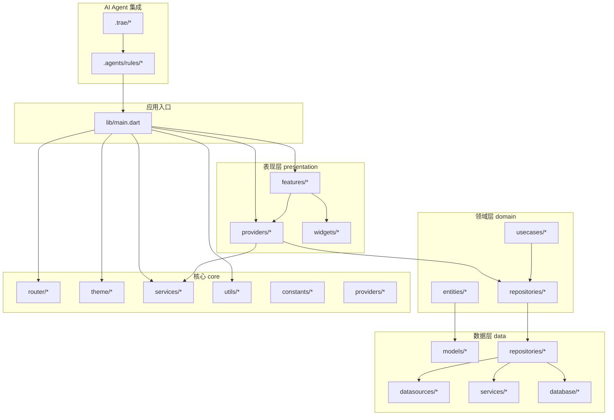
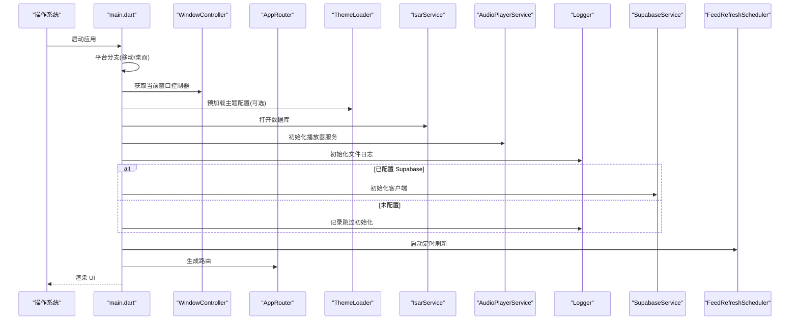
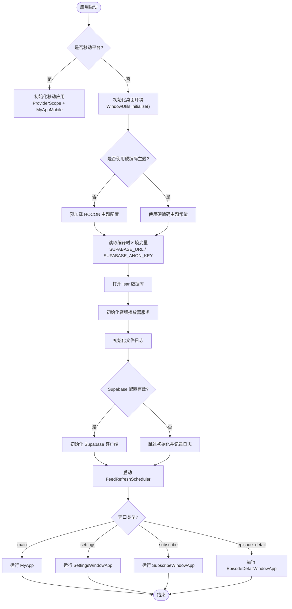
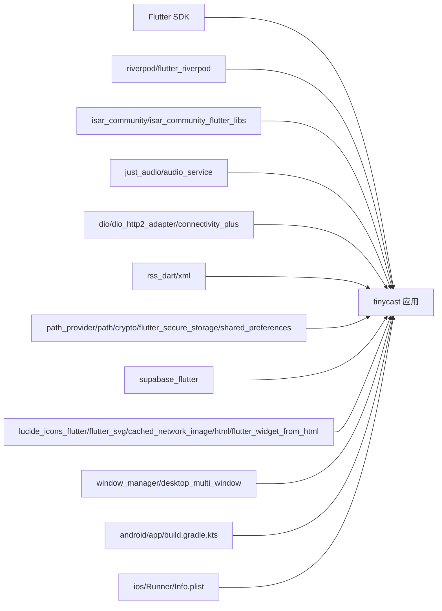

# 开发指南

<cite>
**本文引用的文件**   
- [README.md](file://README.md)
- [AGENTS.md](file://AGENTS.md)
- [pubspec.yaml](file://pubspec.yaml)
- [analysis_options.yaml](file://analysis_options.yaml)
- [run.sh](file://run.sh)
- [devtools_options.yaml](file://devtools_options.yaml)
- [lib/main.dart](file://lib/main.dart)
- [android/app/build.gradle.kts](file://android/app/build.gradle.kts)
- [ios/Runner/Info.plist](file://ios/Runner/Info.plist)
- [test/helpers/test_helpers.dart](file://test/helpers/test_helpers.dart)
- [.agents/rules/ai-rules-for-flutter-and-dart.md](file://.agents/rules/ai-rules-for-flutter-and-dart.md)
- [.agents/rules/cross-platform-compatibility.md](file://.agents/rules/cross-platform-compatibility.md)
</cite>

## 更新摘要
**变更内容**   
- 新增强制性交付前检查清单章节，详细说明 flutter analyze 和 flutter test 的执行要求
- 更新 CI 策略说明，明确项目不接入托管 CI 服务的决策
- 增强交付验收标准，强调零警告和完整测试套件的重要性
- 补充本地开发工作流中的质量检查流程

## 目录
1. [简介](#简介)
2. [项目结构](#项目结构)
3. [核心组件](#核心组件)
4. [架构总览](#架构总览)
5. [AI Agent 集成](#ai-agent-集成)
6. [详细组件分析](#详细组件分析)
7. [依赖分析](#依赖分析)
8. [性能考虑](#性能考虑)
9. [故障排查指南](#故障排查指南)
10. [结论](#结论)
11. [附录](#附录)

## 简介
本指南面向 TinyCast 的新贡献者，目标是帮助你在最短时间内完成环境搭建、理解代码结构与架构、掌握调试与测试方法、遵循代码规范与协作流程，并具备性能分析与优化能力。TinyCast 是一个跨平台（桌面与移动端）的播客应用，使用 Flutter 构建，采用 Riverpod 进行状态管理，Isar 作为本地数据库，Supabase 提供云服务集成，支持多窗口与后台音频播放。

**重要更新**：项目现已集成全面的 AI Agent 支持，通过 AGENTS.md 文件为 Claude Code、Gemini CLI、Windsurf 等工具提供统一的规则路由和跨 IDE 的 symlink 支持。同时建立了严格的交付前检查流程，确保代码质量和稳定性。

## 项目结构
项目采用分层架构：
- lib/core：通用能力（路由、主题、服务、工具、常量等）
- lib/data：数据层（模型、仓库实现、数据源、服务）
- lib/domain：领域层（实体、用例、接口）
- lib/presentation：表现层（页面、提供者、组件）
- android/ios/macos/windows/linux：各平台原生配置
- test：测试（单元、Widget、集成、性能、Mock 等）
- assets：静态资源（图片、图标、主题配置文件）
- docs：文档（权限、数据库、下载调试、Supabase 设置等）
- .agents/rules：AI Agent 开发规范和规则
- .trae：Trae IDE 特定配置和规范



图表来源 
- [lib/main.dart:106-177](file://lib/main.dart#L106-L177)
- [AGENTS.md:1-76](file://AGENTS.md#L1-L76)

章节来源
- [README.md:1-6](file://README.md#L1-L6)
- [pubspec.yaml:1-196](file://pubspec.yaml#L1-L196)

## 核心组件
- 应用启动与初始化：main.dart 负责根据平台选择运行路径，初始化 Isar、AudioPlayerService、Logger、Supabase，并注册生命周期观察者以调度 RSS 刷新任务。
- 多窗口支持：通过 desktop_multi_window 与 window_manager 实现主窗口、设置窗口、订阅窗口、节目详情窗口等。
- 主题系统：支持从 .conf 文件加载 HOCON 主题或硬编码主题，统一字体回退与文本样式。
- 状态管理：Riverpod ProviderScope 包裹应用，按功能划分 Providers。
- 网络与服务：Dio + HTTP/2 适配器、连接状态检测、RSS 解析、Supabase 客户端。
- 音频播放：just_audio + audio_service 支持锁屏控制、通知栏控制与后台播放。
- 本地存储：Isar 数据库 + shared_preferences + flutter_secure_storage。
- 资源与国际化：flutter_localizations、intl、cached_network_image、flutter_svg。

章节来源
- [lib/main.dart:106-194](file://lib/main.dart#L106-L194)
- [pubspec.yaml:18-144](file://pubspec.yaml#L18-L144)

## 架构总览
下图展示了从入口到各层的调用关系与关键依赖。



图表来源 
- [lib/main.dart:106-194](file://lib/main.dart#L106-L194)

## AI Agent 集成

### 统一入口与规则路由
TinyCast 项目通过 `AGENTS.md` 文件作为所有 AI Agent 工具的统一入口，支持 Claude Code、Gemini CLI、Windsurf 等工具的集成。该文件提供了项目约定与领域文档的路由索引，确保不同 IDE 和工具都能访问相同的开发规范。

### 支持的 AI 工具
- **Claude Code**：通过 `.claude/` 目录配置
- **Gemini CLI**：通过 `GEMINI.md` symlink 指向 AGENTS.md
- **Windsurf**：通过 `.windsurfrules` symlink 指向 AGENTS.md
- **Trae IDE**：通过 `.trae/` 目录下的专用配置

### 开发规则分类
项目将开发规则分为三个主要类别：

| 规则文件 | 适用场景 | 主要内容 |
|----------|----------|----------|
| ai-rules-for-flutter-and-dart.md | Flutter/Dart 编码规范 | 分层架构、Riverpod 状态管理、自定义导航、Isar 数据访问、json_serializable 序列化、命名约定与 SOLID 原则 |
| cross-platform-compatibility.md | 跨平台兼容性 | 文件名限制、换行符统一、路径长度控制、大小写敏感差异、IDE 临时文件处理 |
| settings_storage_rules.md | 设置存储策略 | shared_preferences 普通设置、flutter_secure_storage 敏感凭证、Riverpod 状态管理集成 |

### 关键约束速查
- **设置存储策略**：普通设置使用 `shared_preferences`，敏感凭证必须使用 `flutter_secure_storage`
- **状态管理**：全应用使用 Riverpod，根部包裹 `ProviderScope`
- **导航**：统一使用项目自定义 `AppRouter`，不使用第三方路由库
- **架构与命名**：Presentation / Domain / Data 分层，遵循 SOLID 原则
- **数据与序列化**：本地存储用 Isar，API 数据用 `json_serializable`
- **UI 设计**：自定义设计系统与 HOCON 主题，禁用 Material Design
- **跨平台兼容**：文件名禁止特殊字符，统一 LF 换行，注意 Linux 大小写敏感差异

### 项目文档索引
AGENTS.md 文件还提供了完整的文档索引，涵盖数据库、Supabase 配置、平台权限、下载调试、主题架构等领域文档的快速访问。

**Section sources**
- [AGENTS.md:1-76](file://AGENTS.md#L1-L76)
- [.agents/rules/ai-rules-for-flutter-and-dart.md:1-221](file://.agents/rules/ai-rules-for-flutter-and-dart.md#L1-L221)
- [.agents/rules/cross-platform-compatibility.md:1-241](file://.agents/rules/cross-platform-compatibility.md#L1-L241)

## 详细组件分析

### 应用入口与多窗口
- 入口逻辑：根据平台决定运行 Mobile 或 Desktop 应用；桌面端根据窗口参数路由到不同窗口应用。
- 窗口参数：支持 main、settings、subscribe、episode_detail 等类型，传递必要数据（如 episode、podcast）。
- 生命周期：注册 WidgetsBindingObserver，处理应用暂停/恢复/分离事件，协调 RSS 刷新调度器。



图表来源 
- [lib/main.dart:106-177](file://lib/main.dart#L106-L177)
- [lib/main.dart:179-194](file://lib/main.dart#L179-L194)

章节来源
- [lib/main.dart:23-39](file://lib/main.dart#L23-L39)
- [lib/main.dart:106-177](file://lib/main.dart#L106-L177)
- [lib/main.dart:179-194](file://lib/main.dart#L179-L194)

### 主题系统与配置
- 主题来源：可通过 .conf 文件（HOCON）动态加载，或启用硬编码主题常量。
- 文本样式：统一字体回退与默认文本样式，确保跨平台一致性。
- 运行时切换：在桌面端可预加载主题配置，提升首次渲染体验。

章节来源
- [lib/main.dart:119-124](file://lib/main.dart#L119-L124)
- [lib/main.dart:223-228](file://lib/main.dart#L223-L228)
- [pubspec.yaml:180-196](file://pubspec.yaml#L180-L196)

### 状态管理与提供者
- 使用 Riverpod 的 ProviderScope 管理全局状态。
- 按功能模块组织 Providers（如 podcast_provider、playback_provider、queue_provider 等）。
- 建议将业务逻辑下沉至 usecases，保持 UI 层简洁。

章节来源
- [lib/main.dart:136-141](file://lib/main.dart#L136-L141)
- [lib/presentation/providers/*.dart](file://lib/presentation/providers)

### 数据层与本地存储
- 模型与映射：models/*.dart 与 mappers/* 负责数据转换。
- 仓库实现：repositories/* 封装数据访问细节，暴露领域接口。
- 数据源：datasources/* 分别对接本地（Isar）与远程（Supabase/Dio）。
- 服务：services/* 包含音频下载、缓存清理、RSS 解析、搜索等。

章节来源
- [lib/data/models/*.dart](file://lib/data/models)
- [lib/data/repositories/*.dart](file://lib/data/repositories)
- [lib/data/datasources/*.dart](file://lib/data/datasources)
- [lib/data/services/*.dart](file://lib/data/services)

### 领域层与用例
- 实体：entities/* 定义领域对象（Episode、Podcast、SearchHistory 等）。
- 用例：usecases/* 封装具体业务操作（如订阅/取消订阅、队列管理、历史查询等）。
- 接口：repositories/* 定义仓库契约，便于替换实现与 Mock。

章节来源
- [lib/domain/entities/*.dart](file://lib/domain/entities)
- [lib/domain/usecases/*.dart](file://lib/domain/usecases)
- [lib/domain/repositories/*.dart](file://lib/domain/repositories)

### 表现层与组件
- 页面：presentation/features/* 按功能划分页面与子组件。
- 组件：presentation/widgets/* 原子/分子/有机体组件，提高复用性。
- 导航：core/router/* 统一管理路由与页面跳转。

章节来源
- [lib/presentation/features/*](file://lib/presentation/features)
- [lib/presentation/widgets/*](file://lib/presentation/widgets)
- [lib/core/router/*](file://lib/core/router)

## 依赖分析
- 核心依赖：Flutter SDK、Riverpod、Isar、just_audio、audio_service、dio、rss_dart、supabase_flutter。
- 平台相关：Android Gradle 插件、iOS Info.plist 背景模式、桌面端窗口管理。
- 开发依赖：flutter_lints、build_runner、mockito、test、isar_community_generator。



图表来源 
- [pubspec.yaml:18-144](file://pubspec.yaml#L18-L144)
- [android/app/build.gradle.kts:1-45](file://android/app/build.gradle.kts#L1-L45)
- [ios/Runner/Info.plist:27-31](file://ios/Runner/Info.plist#L27-L31)

章节来源
- [pubspec.yaml:148-176](file://pubspec.yaml#L148-L176)
- [android/app/build.gradle.kts:1-45](file://android/app/build.gradle.kts#L1-L45)
- [ios/Runner/Info.plist:1-76](file://ios/Runner/Info.plist#L1-L76)

## 性能考虑
- 音频播放：使用 just_audio 与 audio_service 确保后台播放与锁屏控制；避免在主线程执行耗时解码。
- 网络请求：启用 Dio HTTP/2 适配器，合理设置超时与重试策略；使用 connectivity_plus 检测网络状态。
- 图片缓存：cached_network_image 配合占位图与错误处理，减少重复下载。
- 数据库：Isar 轻量高效，注意索引设计与批量写入；定期清理缓存。
- 主题加载：预加载 HOCON 配置，避免首帧卡顿。
- 日志：文件日志仅在必要时开启，避免 I/O 瓶颈。

[本节为通用指导，不直接分析具体文件]

## 故障排查指南
- 启动失败：检查 run.sh 中的 .env 配置是否正确（SUPABASE_URL、SUPABASE_ANON_KEY、设备 ID）。
- Supabase 未初始化：确认环境变量非占位符；查看日志输出。
- 音频无法后台播放：检查 iOS Info.plist 的 UIBackgroundModes 是否包含 audio 与 fetch。
- 主题加载异常：确认 assets/themes/*.conf 存在且格式正确。
- 测试问题：使用 test/helpers/test_helpers.dart 提供的工具函数简化 Widget 测试。
- AI Agent 集成问题：检查 AGENTS.md 文件是否存在，确认 symlink 配置正确。

章节来源
- [run.sh:1-66](file://run.sh#L1-L66)
- [lib/main.dart:179-194](file://lib/main.dart#L179-L194)
- [ios/Runner/Info.plist:27-31](file://ios/Runner/Info.plist#L27-L31)
- [test/helpers/test_helpers.dart:1-202](file://test/helpers/test_helpers.dart#L1-L202)

## 结论
本指南提供了 TinyCast 的环境搭建、架构理解、组件分析、依赖关系、性能优化与故障排查的全面说明。遵循本文档的规范与实践，新开发者可以快速上手并高效贡献代码。建议在提交前运行分析器与测试，确保代码质量与稳定性。

**重要提示**：项目现已集成全面的 AI Agent 支持，所有开发者都应熟悉 AGENTS.md 文件中的开发规范和最佳实践，确保在不同 IDE 和工具间保持一致的开发体验。**特别强调**：交付前必须严格执行代码质量检查流程，确保代码的稳定性和可靠性。

[本节为总结，不直接分析具体文件]

## 附录

### 环境搭建步骤
- 安装 Flutter SDK（版本约束见 pubspec.yaml）
- 安装 IDE（推荐 VS Code 或 Android Studio），启用 Dart/Flutter 插件
- 克隆仓库并进入项目根目录
- 运行依赖安装：flutter pub get
- 配置 .env 文件（SUPABASE_URL、SUPABASE_ANON_KEY、Android_Device_ID）
- 运行脚本：./run.sh [platform]（默认 macOS/Linux/Windows 桌面，或指定 ios/android）

章节来源
- [pubspec.yaml:12-13](file://pubspec.yaml#L12-L13)
- [run.sh:1-66](file://run.sh#L1-L66)

### 代码规范与最佳实践
- 使用 analysis_options.yaml 中的 lint 规则，保持代码风格一致
- 命名约定：类 PascalCase，变量 camelCase，常量 UPPER_SNAKE_CASE
- 文件组织：按功能模块划分，避免单文件过大
- 错误处理：统一使用 core/utils/error_handler.dart 与 toast_utils.dart
- 日志记录：使用 core/utils/logger.dart 记录关键信息
- **AI Agent 规范**：遵循 .agents/rules 中的 Flutter/Dart 开发约定，使用 Riverpod 状态管理，自定义 AppRouter 导航，Isar 数据访问

章节来源
- [analysis_options.yaml:1-36](file://analysis_options.yaml#L1-L36)
- [lib/core/utils/logger.dart](file://lib/core/utils/logger.dart)
- [lib/core/utils/toast_utils.dart](file://lib/core/utils/toast_utils.dart)
- [.agents/rules/ai-rules-for-flutter-and-dart.md:1-221](file://.agents/rules/ai-rules-for-flutter-and-dart.md#L1-L221)

### 调试技巧与工具
- DevTools：使用 devtools_options.yaml 配置扩展
- 日志：启用文件日志，定位运行时问题
- 断点调试：IDE 中设置断点，结合日志输出
- 性能分析：使用 Flutter DevTools 的 Performance 与 Memory 面板

章节来源
- [devtools_options.yaml:1-4](file://devtools_options.yaml#L1-L4)
- [lib/main.dart:182](file://lib/main.dart#L182)

### 测试策略
- 单元测试：针对 usecases、services、utils 编写
- Widget 测试：针对 presentation/widgets 与 features 页面
- 集成测试：模拟用户交互与数据流
- 辅助工具：使用 test/helpers/test_helpers.dart 简化测试

章节来源
- [test/helpers/test_helpers.dart:1-202](file://test/helpers/test_helpers.dart#L1-L202)

### Git 工作流与协作规范
- 分支策略：main（稳定）、develop（开发）、feature/*（功能）、bugfix/*（修复）
- 提交信息：遵循 .trae/rules/git-commit-message.md 规范，包含 Agent-Task、Agent-Decision、Agent-Limitation 元数据
- 代码审查：Pull Request 需至少一名成员审查
- 冲突解决：先拉取最新代码，再合并变更
- **AI Agent 集成**：确保 AGENTS.md 文件同步更新，symlink 配置正确

章节来源
- [.trae/rules/git-commit-message.md:1-51](file://.trae/rules/git-commit-message.md#L1-L51)
- [AGENTS.md:68-76](file://AGENTS.md#L68-L76)

### 常用命令与脚本
- 运行应用：./run.sh [platform]
- 分析代码：flutter analyze
- 运行测试：flutter test
- 生成代码：dart run build_runner build --delete-conflicting-outputs
- 清理缓存：flutter clean && flutter pub get
- **交付前检查**：flutter analyze && flutter test

章节来源
- [run.sh:1-66](file://run.sh#L1-L66)
- [pubspec.yaml:148-176](file://pubspec.yaml#L148-L176)
- [AGENTS.md:68-76](file://AGENTS.md#L68-L76)

### AI Agent 集成配置
- **统一入口**：AGENTS.md 文件作为所有 AI 工具的统一配置
- **跨 IDE 支持**：Claude Code、Gemini CLI、Windsurf 通过 symlink 指向同一文件
- **规则分类**：Flutter/Dart 规范、跨平台兼容性、设置存储策略
- **文档索引**：快速访问数据库、Supabase、平台权限、下载调试等文档

章节来源
- [AGENTS.md:1-76](file://AGENTS.md#L1-L76)
- [.agents/rules/ai-rules-for-flutter-and-dart.md:1-221](file://.agents/rules/ai-rules-for-flutter-and-dart.md#L1-L221)
- [.agents/rules/cross-platform-compatibility.md:1-241](file://.agents/rules/cross-platform-compatibility.md#L1-L241)

### 交付前检查清单与CI策略

#### 强制性交付前检查
项目建立了严格的交付前检查流程，所有代码提交前必须通过以下验证：

**必需执行的命令：**
```bash
flutter analyze   # 静态分析，要求零警告
flutter test       # 全量测试套件
```

**检查要求：**
- `flutter analyze` 必须返回零警告和零错误
- `flutter test` 必须通过所有测试用例
- 任何失败的检查都阻止代码提交

#### CI策略决策
项目当前**不接入托管CI服务**（无 GitHub Actions / GitLab CI 流水线），交付验收以开发者本地手动执行上述两条命令为准。

**决策原因：**
- 项目处于早期迭代阶段
- 测试套件与多平台构建矩阵尚未完全稳定
- 强制CI门会引入过高维护成本

**未来规划：**
如未来接入CI，最小流水线应直接调用 `flutter analyze` 与 `flutter test` 两条命令作为通过条件。

#### 本地开发工作流
1. **开发阶段**：持续运行 `flutter analyze` 确保代码质量
2. **提交前检查**：执行完整的交付前检查清单
3. **测试验证**：确保所有测试用例通过
4. **代码审查**：提交PR前自行验证所有检查项

**Section sources**
- [README.md:14-28](file://README.md#L14-L28)
- [AGENTS.md:68-84](file://AGENTS.md#L68-L84)