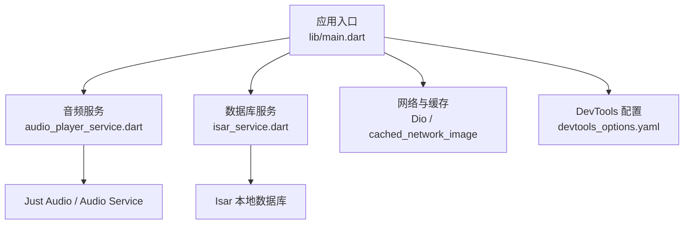
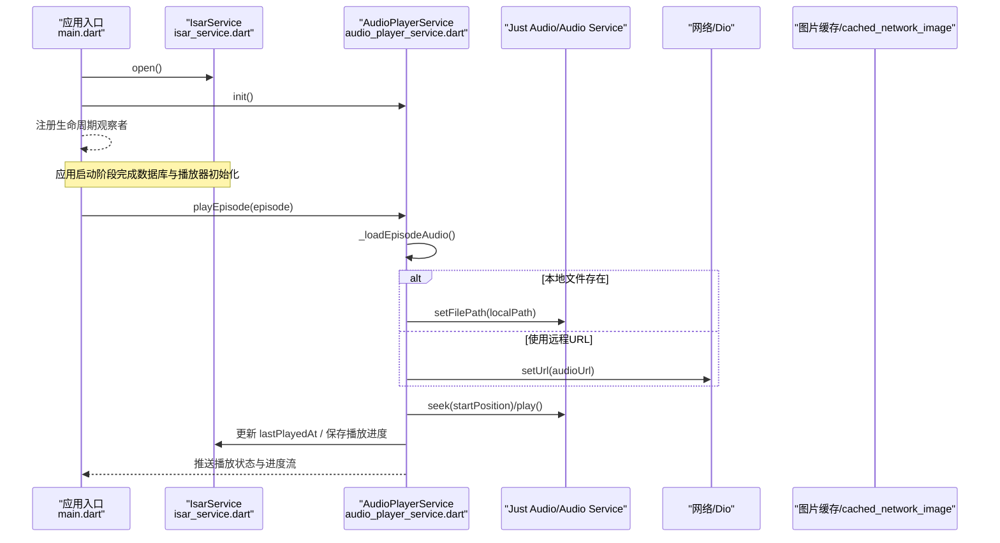
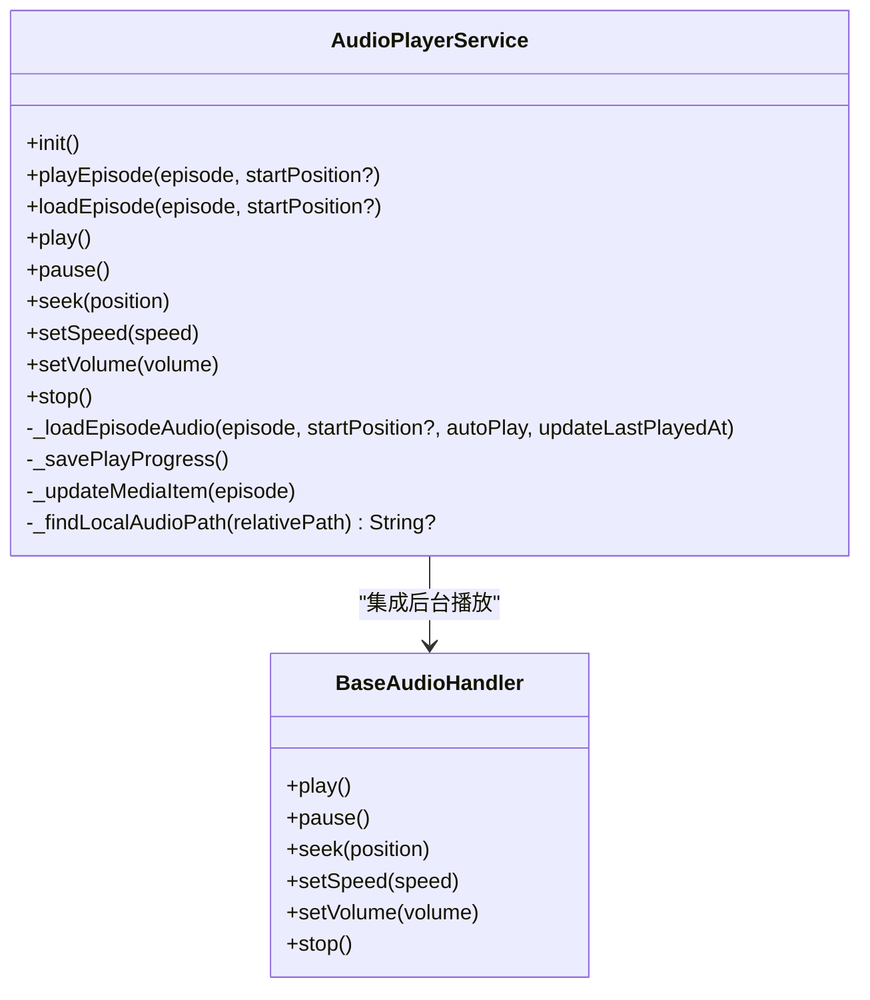
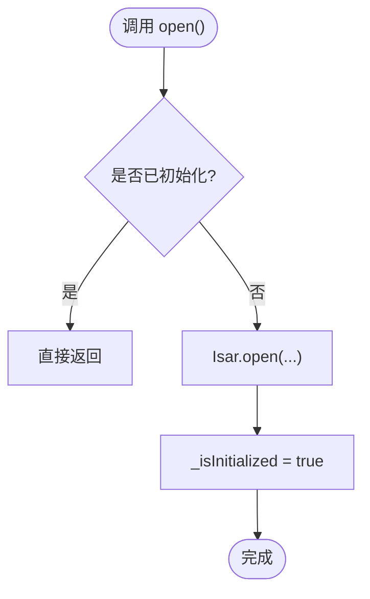
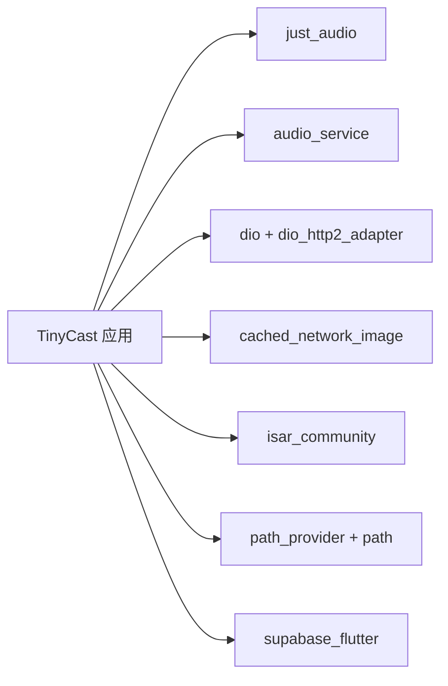

# 性能优化

<cite>
**本文引用的文件**   
- [pubspec.yaml](file://pubspec.yaml)
- [main.dart](file://lib/main.dart)
- [audio_player_service.dart](file://lib/data/services/audio_player_service.dart)
- [isar_service.dart](file://lib/data/database/isar_service.dart)
- [database.md](file://docs/database.md)
- [devtools_options.yaml](file://devtools_options.yaml)
- [download_queue_debug.md](file://docs/download_queue_debug.md)
- [audio_download_usage.md](file://docs/audio_download_usage.md)
</cite>

## 目录
1. [简介](#简介)
2. [项目结构](#项目结构)
3. [核心组件](#核心组件)
4. [架构总览](#架构总览)
5. [详细组件分析](#详细组件分析)
6. [依赖分析](#依赖分析)
7. [性能考量](#性能考量)
8. [故障排查指南](#故障排查指南)
9. [结论](#结论)
10. [附录](#附录)

## 简介
本指南面向 TinyCast（Flutter 播客应用）的性能优化，覆盖以下关键主题：
- 使用 Flutter DevTools 进行帧率监控、内存泄漏检测与 CPU 使用分析
- 音频播放性能优化：缓存策略、内存管理、后台播放
- 数据库查询优化：Isar 索引、批量操作、懒加载
- 图片加载与网络请求优化
- 应用启动速度与渲染性能优化
- 性能监控与基准测试的实施方法

## 项目结构
TinyCast 采用分层架构与模块化组织，关键路径包括：
- 入口与初始化：lib/main.dart
- 音频服务：lib/data/services/audio_player_service.dart
- 数据库服务：lib/data/database/isar_service.dart
- 文档与规范：docs/ 下的数据库、下载与调试说明
- 依赖与工具配置：pubspec.yaml、devtools_options.yaml

图表来源
- [main.dart:106-194](file://lib/main.dart#L106-L194)
- [audio_player_service.dart:100-134](file://lib/data/services/audio_player_service.dart#L100-L134)
- [isar_service.dart:38-59](file://lib/data/database/isar_service.dart#L38-L59)
- [devtools_options.yaml:1-4](file://devtools_options.yaml#L1-L4)

章节来源
- [pubspec.yaml:18-144](file://pubspec.yaml#L18-L144)
- [main.dart:106-194](file://lib/main.dart#L106-L194)

## 核心组件
- 音频播放服务：封装 Just Audio 与 Audio Service，提供播放、暂停、进度保存、媒体项更新、后台通知等能力。
- 数据库服务：封装 Isar 的打开、关闭、清理、版本管理与常用写入事务。
- 应用初始化：在 main 中完成 Isar、AudioPlayerService、日志与可选 Supabase 初始化，并注册生命周期观察者。

章节来源
- [audio_player_service.dart:31-134](file://lib/data/services/audio_player_service.dart#L31-L134)
- [isar_service.dart:14-59](file://lib/data/database/isar_service.dart#L14-L59)
- [main.dart:179-194](file://lib/main.dart#L179-L194)

## 架构总览
下图展示从应用启动到音频播放的关键流程，以及各层之间的交互关系。

图表来源
- [main.dart:179-194](file://lib/main.dart#L179-L194)
- [audio_player_service.dart:192-300](file://lib/data/services/audio_player_service.dart#L192-L300)
- [audio_player_service.dart:326-343](file://lib/data/services/audio_player_service.dart#L326-L343)
- [isar_service.dart:106-135](file://lib/data/database/isar_service.dart#L106-L135)

## 详细组件分析

### 音频播放服务（AudioPlayerService）
- 设计要点
  - 单例模式，集中管理播放器实例与订阅。
  - 通过 StreamController 广播播放状态、进度、速度、音量与当前节目。
  - 支持自动播放与仅加载两种模式，避免不必要的播放开销。
  - 优先尝试本地已下载音频，失败时回退到远程 URL。
  - 播放完成后发送事件，业务逻辑由上层处理，降低耦合。
- 性能优化点
  - 播放前停止当前播放器，避免状态不一致导致的卡顿或异常。
  - 仅在 autoPlay=true 时恢复播放进度与执行播放，减少无效 I/O。
  - 进度保存节流：在 pause/seek 时保存，避免频繁写盘。
  - 媒体项更新只在加载成功后执行，减少不必要的数据传输。
  - dispose 时统一释放订阅与控制器，防止内存泄漏。

图表来源
- [audio_player_service.dart:31-134](file://lib/data/services/audio_player_service.dart#L31-L134)
- [audio_player_service.dart:192-300](file://lib/data/services/audio_player_service.dart#L192-L300)
- [audio_player_service.dart:586-652](file://lib/data/services/audio_player_service.dart#L586-L652)

章节来源
- [audio_player_service.dart:100-134](file://lib/data/services/audio_player_service.dart#L100-L134)
- [audio_player_service.dart:192-300](file://lib/data/services/audio_player_service.dart#L192-L300)
- [audio_player_service.dart:469-507](file://lib/data/services/audio_player_service.dart#L469-L507)

### 数据库服务（IsarService）
- 设计要点
  - 单例管理 Isar 实例，提供 open/close/clear/deleteDatabase 等方法。
  - 所有写入操作在 writeTxn 中执行，保证原子性与一致性。
  - 提供更新 episode 下载状态的便捷方法，便于下载流程与 UI 同步。
- 性能优化点
  - 延迟初始化：仅在首次访问 isar 属性时抛出未初始化错误，避免误用。
  - 条件化 inspector：非产品模式下启用 inspector，便于开发期诊断。
  - 批量写入：将多次更新合并到同一事务，减少磁盘 IO。

图表来源
- [isar_service.dart:38-59](file://lib/data/database/isar_service.dart#L38-L59)

章节来源
- [isar_service.dart:14-59](file://lib/data/database/isar_service.dart#L14-L59)
- [isar_service.dart:106-135](file://lib/data/database/isar_service.dart#L106-L135)

### 应用初始化与生命周期
- 关键点
  - 移动端与桌面端分支初始化，确保平台相关资源正确准备。
  - 主题预加载、窗口控制器初始化、路由与 ProviderScope 设置。
  - 注册 FeedRefreshLifecycleObserver，处理应用生命周期变化。
- 性能优化点
  - 按需初始化 Supabase：若为占位配置则跳过，缩短启动时间。
  - 异步任务使用 unawaited 启动后台调度器，不阻塞主流程。

章节来源
- [main.dart:106-176](file://lib/main.dart#L106-L176)
- [main.dart:179-194](file://lib/main.dart#L179-L194)

## 依赖分析
- 音频与后台播放：just_audio、audio_service
- 网络与 HTTP/2：dio、dio_http2_adapter
- 图片缓存：cached_network_image
- 本地数据库：isar_community、isar_community_flutter_libs
- 路径与存储：path_provider、path
- 其他：supabase_flutter、flutter_secure_storage、intl、html、jni 等

图表来源
- [pubspec.yaml:18-144](file://pubspec.yaml#L18-L144)

章节来源
- [pubspec.yaml:18-144](file://pubspec.yaml#L18-L144)

## 性能考量

### 使用 Flutter DevTools 进行性能分析
- 帧率监控
  - 使用 Performance 面板观察 FPS 曲线，关注掉帧与卡顿时段。
  - 结合 Timeline 查看构建与绘制耗时，定位重绘热点。
- 内存泄漏检测
  - 使用 Memory 面板进行快照对比，检查对象增长趋势。
  - 重点排查 StreamSubscription、定时器、未释放的控制器。
- CPU 使用分析
  - 使用 CPU Profiler 分析热点函数，减少复杂计算在主线程执行。
  - 将密集任务下沉至 isolate 或后台任务。

实施建议
- 在 devtools_options.yaml 中启用所需扩展（如性能、内存、网络）。
- 在 profile 构建下运行，以获得更贴近生产的性能数据。

章节来源
- [devtools_options.yaml:1-4](file://devtools_options.yaml#L1-L4)

### 音频播放性能优化
- 缓存策略
  - 优先使用本地已下载音频，不存在时再回退到远程 URL。
  - 合理设置下载并发与断点续传，避免带宽拥塞。
- 内存管理
  - 播放前停止旧播放器实例，避免状态冲突。
  - 及时释放订阅与控制器，防止内存泄漏。
- 后台播放优化
  - 通过 Audio Service 保持后台播放与通知控制。
  - 更新媒体项信息，提升锁屏与系统通知体验。

章节来源
- [audio_player_service.dart:192-300](file://lib/data/services/audio_player_service.dart#L192-L300)
- [audio_player_service.dart:326-343](file://lib/data/services/audio_player_service.dart#L326-L343)
- [audio_download_usage.md:152-204](file://docs/audio_download_usage.md#L152-L204)

### 数据库查询优化（Isar）
- 索引优化
  - 对高频查询字段建立索引，如搜索时间、状态、更新时间等。
  - 利用 Isar 的 filter/sortBy 组合，减少全表扫描。
- 批量操作
  - 将多次写入合并到 writeTxn，减少事务开销。
  - 使用批量 put/get 接口，降低 IO 次数。
- 懒加载
  - 列表分页加载，避免一次性加载大量数据。
  - 按需加载详情与关联数据，减少内存占用。

章节来源
- [database.md:1-50](file://docs/database.md#L1-L50)
- [database.md:241-259](file://docs/database.md#L241-L259)
- [database.md:494-502](file://docs/database.md#L494-L502)

### 图片加载与网络请求优化
- 图片加载
  - 使用 cached_network_image 进行网络图片缓存，减少重复下载。
  - 设置合适的占位图与错误图，提升用户体验。
- 网络请求
  - 使用 Dio 的拦截器实现重试、缓存与日志记录。
  - 启用 HTTP/2 适配器，提升多路复用与连接复用效率。
  - 根据网络状态切换请求策略（WiFi/蜂窝/无网）。

章节来源
- [pubspec.yaml:68-98](file://pubspec.yaml#L68-L98)

### 应用启动速度与渲染性能优化
- 启动速度
  - 延迟非必要初始化（如 Supabase），仅在需要时初始化。
  - 使用 unawaited 启动后台任务，不阻塞主流程。
- 渲染性能
  - 减少不必要的 rebuild，合理使用 const 与 Selector。
  - 避免在 build 中进行耗时计算，使用 compute 或 isolate。
  - 使用 WidgetsApp 简化路由与样式配置，减少额外包装。

章节来源
- [main.dart:106-176](file://lib/main.dart#L106-L176)
- [main.dart:179-194](file://lib/main.dart#L179-L194)

### 性能监控与基准测试
- 监控指标
  - 帧率（FPS）、内存峰值、CPU 使用率、I/O 耗时。
  - 音频播放首帧时间、缓冲时长、网络请求成功率。
- 基准测试
  - 针对关键路径（如播放加载、数据库写入、图片缓存命中）编写基准测试。
  - 在不同设备与网络环境下进行对比，评估优化效果。

章节来源
- [download_queue_debug.md:68-138](file://docs/download_queue_debug.md#L68-L138)

## 故障排查指南
- 音频播放问题
  - 检查本地文件是否存在，必要时回退到远程 URL。
  - 确认播放器状态与订阅是否正确释放。
- 数据库问题
  - 确认 Isar 已正确初始化，避免未初始化访问。
  - 检查事务是否正确提交，避免数据不一致。
- 下载队列问题
  - 观察控制台日志关键词，快速定位问题环节。
  - 检查并发限制与任务出队逻辑。

章节来源
- [audio_player_service.dart:469-507](file://lib/data/services/audio_player_service.dart#L469-L507)
- [isar_service.dart:38-59](file://lib/data/database/isar_service.dart#L38-L59)
- [download_queue_debug.md:68-138](file://docs/download_queue_debug.md#L68-L138)

## 结论
通过对音频播放、数据库、图片与网络、启动与渲染等环节的系统性优化，并结合 DevTools 的持续监控与基准测试，可显著提升 TinyCast 的性能表现与用户体验。建议在生产环境中定期执行性能回归测试，确保优化成果稳定可靠。

## 附录
- 最佳实践清单
  - 音频：优先本地、及时释放、后台播放
  - 数据库：索引优化、批量写入、懒加载
  - 图片：缓存命中、占位图、错误处理
  - 网络：HTTP/2、重试机制、状态感知
  - 启动：延迟初始化、异步任务、精简构建
  - 监控：DevTools、基准测试、回归验证