# 测试策略

<cite>
**本文引用的文件**   
- [pubspec.yaml](file://pubspec.yaml)
- [AGENTS.md](file://AGENTS.md)
- [test/helpers/test_helpers.dart](file://test/helpers/test_helpers.dart)
- [test/helpers/isar_test_env.dart](file://test/helpers/isar_test_env.dart)
- [test/mocks/mock_factory.dart](file://test/mocks/mock_factory.dart)
- [test/core/services/sync_service_test.dart](file://test/core/services/sync_service_test.dart)
- [lib/core/services/sync_mappers.dart](file://lib/core/services/sync_mappers.dart)
- [lib/core/services/sync_service.dart](file://lib/core/services/sync_service.dart)
- [test/data/datasources/local_podcast_datasource_test.dart](file://test/data/datasources/local_podcast_datasource_test.dart)
- [test/presentation/providers/podcast_provider_test.dart](file://test/presentation/providers/podcast_provider_test.dart)
- [test/presentation/providers/unplayed_episodes_provider_test.dart](file://test/presentation/providers/unplayed_episodes_provider_test.dart)
- [test/presentation/features/library/library_test.dart](file://test/presentation/features/library/library_test.dart)
- [test/domain/usecases/get_unplayed_episodes_usecase_test.dart](file://test/domain/usecases/get_unplayed_episodes_usecase_test.dart)
- [test/presentation/widgets/atoms/artwork_image_test.dart](file://test/presentation/widgets/atoms/artwork_image_test.dart)
- [integration/remote_sync_datasource_integration_test.dart](file://integration/remote_sync_datasource_integration_test.dart)
</cite>

## 更新摘要
**所做更改**   
- 新增详细的测试执行要求和交付门规范
- 明确指定了 `flutter analyze` 和 `flutter test` 的预期输出和退出码
- 添加了跳过用例的处理规范和交付总结要求
- 完善了集成测试的环境配置和环境检查机制
- 增强了测试执行的验证流程和故障处理流程
- **新增**：Isar 测试环境辅助类，支持完整的数据库集成测试
- **新增**：解除了同步相关测试的跳过限制，所有同步测试现可执行
- **增强**：依赖注入边界测试模式，提供更精确的隔离验证

## 目录
1. [简介](#简介)
2. [项目结构](#项目结构)
3. [核心组件](#核心组件)
4. [架构总览](#架构总览)
5. [详细组件分析](#详细组件分析)
6. [依赖分析](#依赖分析)
7. [性能考虑](#性能考虑)
8. [故障排查指南](#故障排查指南)
9. [结论](#结论)
10. [附录](#附录)

## 简介
本文件为 TinyCast 项目的完整测试策略与指南，覆盖单元测试、Widget 测试、集成测试、Mock 对象创建与使用、测试数据与环境配置、覆盖率统计与持续集成。**最新更新**包括详细的测试执行要求、交付门规范、预期输出验证和跳过用例处理机制，确保测试流程的标准化和可重复性。**特别改进**包括新增的 Isar 测试环境辅助类、解除同步测试限制以及增强的依赖注入边界测试模式。

## 项目结构
TinyCast 的测试代码集中在 test 目录下，采用分层组织：
- core: Provider/Service 层测试
- data: Datasource/Service 层测试
- domain: UseCase 层测试
- presentation: Provider/Widget 层测试
- helpers: 通用测试工具（包含新的 Isar 测试环境）
- mocks: Mock 工厂与辅助方法
- integration: 集成测试（已启用远程同步测试）
- unit: 单元用例（预留）
- widget: Widget 用例（预留）

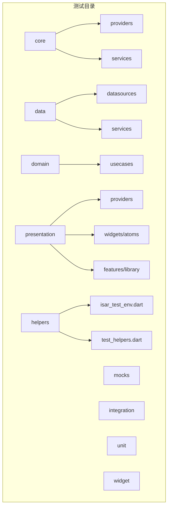

[无图表来源：该图为概念性结构示意]

**章节来源**
- [pubspec.yaml](file://pubspec.yaml)

## 核心组件
- 测试工具集 TestHelpers：封装 pump 与交互方法、断言、包装器，提升 Widget 测试效率。
- **新增**：IsarTestEnv 测试环境：提供临时 Isar 数据库实例，支持完整的数据库集成测试。
- Mock 工厂 MockFactory：统一 when/verify/capture/stub 等常用操作，降低样板代码。
- 分层测试样例：
  - Provider/Service：sync_provider_test、sync_service_test（现已完全可执行）
  - Data Source：local_podcast_datasource_test
  - Domain UseCase：get_unplayed_episodes_usecase_test
  - Presentation Provider：podcast_provider_test、unplayed_episodes_provider_test
  - Widget：artwork_image_test、library_test
  - 自定义测试类：TestPlaybackNotifier
- **新增**：集成测试：remote_sync_datasource_integration_test（支持真实 Supabase 通信）

这些组件共同构成"可复用、可验证、可扩展"的测试基础设施。

**章节来源**
- [test/helpers/test_helpers.dart](file://test/helpers/test_helpers.dart)
- [test/helpers/isar_test_env.dart](file://test/helpers/isar_test_env.dart)
- [test/mocks/mock_factory.dart](file://test/mocks/mock_factory.dart)
- [test/core/providers/sync_provider_test.dart](file://test/core/providers/sync_provider_test.dart)
- [test/core/services/sync_service_test.dart](file://test/core/services/sync_service_test.dart)
- [test/data/datasources/local_podcast_datasource_test.dart](file://test/data/datasources/local_podcast_datasource_test.dart)
- [test/presentation/providers/podcast_provider_test.dart](file://test/presentation/providers/podcast_provider_test.dart)
- [test/presentation/providers/unplayed_episodes_provider_test.dart](file://test/presentation/providers/unplayed_episodes_provider_test.dart)
- [test/presentation/features/library/library_test.dart](file://test/presentation/features/library/library_test.dart)
- [test/domain/usecases/get_unplayed_episodes_usecase_test.dart](file://test/domain/usecases/get_unplayed_episodes_usecase_test.dart)
- [test/presentation/widgets/atoms/artwork_image_test.dart](file://test/presentation/widgets/atoms/artwork_image_test.dart)
- [integration/remote_sync_datasource_integration_test.dart](file://integration/remote_sync_datasource_integration_test.dart)

## 架构总览
下图展示从 UI 到领域层的调用链与测试切入点，强调各层如何被隔离与验证。

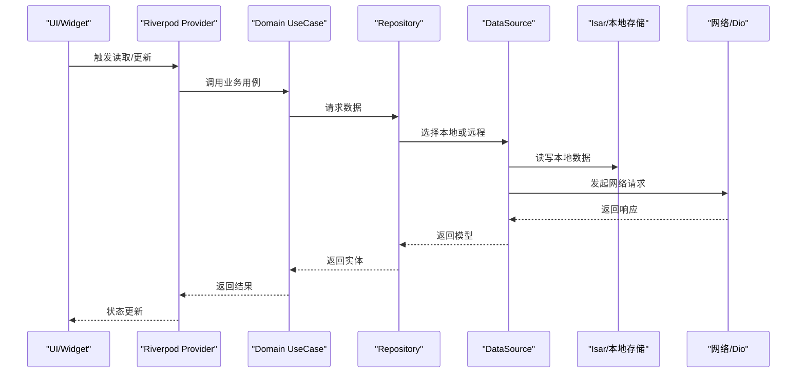

[无图表来源：该图为概念性流程示意]

## 详细组件分析

### 测试执行要求和交付门规范

#### 静态分析检查
- **命令**：`flutter analyze`
- **预期输出**：末行显示 `No issues found! (ran in Xs)`
- **退出码**：必须为 `0`
- **失败条件**：
  - 输出任何 `error •` / `warning •` / `info •` 条目
  - 汇总行显示 `N issues found.`
  - 退出码非 `0`

#### 全量测试检查
- **命令**：`flutter test`
- **预期输出**：末行显示 `All tests passed!`
- **退出码**：必须为 `0`
- **失败条件**：
  - 汇总行出现 `Some tests failed.`
  - 退出码非 `0`
- **跳过用例处理**：
  - 跳过用例（汇总行的 `~N` 标记）不阻塞交付门
  - 必须在交付总结中注明跳过数量
  - 本次会话新增的 skip 必须说明原因

#### 交付总结要求
- 必须记录两条命令各自的关键结果行与退出码
- 任一命令未通过时，先修复并重跑至通过
- 无法当场修复的，如实粘贴失败输出并明确标注交付门未通过
- 禁止在无验证结果的情况下宣称已修复

**章节来源**
- [AGENTS.md:81-100](file://AGENTS.md#L81-L100)

### Isar 测试环境辅助类
- **目标**：提供完整的 Isar 数据库集成测试能力，解决 Flutter VM 测试中的原生库加载问题。
- **核心功能**：
  - `initializeIsarCoreForTests()`：初始化 Isar 核心二进制文件
  - `IsarTestEnv.open()`：创建临时数据库实例，包含所有 TinyCast 模式
  - 自动清理临时文件和数据库连接
- **使用场景**：
  - 需要验证实际数据库 schema 的集成测试
  - 复杂查询和事务操作的测试
  - 多表关联和数据一致性验证
- **参考实现路径**：
  - [isar_test_env.dart](file://test/helpers/isar_test_env.dart)

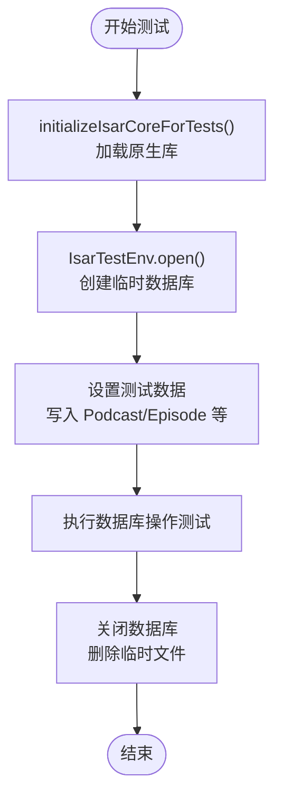

**图表来源**
- [test/helpers/isar_test_env.dart:18-102](file://test/helpers/isar_test_env.dart#L18-L102)

**章节来源**
- [test/helpers/isar_test_env.dart](file://test/helpers/isar_test_env.dart)

### Provider 测试（Riverpod）
- **目标**：验证 Provider 的状态流转、异步加载、错误处理与参数化行为。
- **实践要点**：
  - 使用 ProviderContainer + overrides 注入 Mock 依赖。
  - 通过 .future 等待异步完成，断言 hasValue/hasError/isLoading。
  - 对同一 Provider 的不同参数（如 podcastId）分别验证。
  - **更新**：使用 @GenerateMocks 注解自动生成 Mock 类，提高代码维护性。
  - **新增**：增强的依赖注入边界测试，确保正确的隔离验证。
- **参考实现路径**：
  - [podcast_provider_test.dart](file://test/presentation/providers/podcast_provider_test.dart)

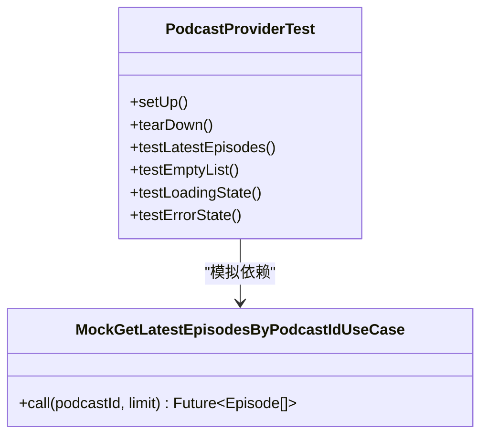

**图表来源**
- [test/presentation/providers/podcast_provider_test.dart](file://test/presentation/providers/podcast_provider_test.dart)

**章节来源**
- [test/presentation/providers/podcast_provider_test.dart](file://test/presentation/providers/podcast_provider_test.dart)

### Service 测试（同步服务）
- **目标**：验证 SyncService 的时间戳存取、进度模型、数据转换逻辑与异常路径。
- **实践要点**：
  - 使用 SharedPreferences.setMockInitialValues 初始化本地存储。
  - 构造 Podcast/Episode/PlayHistory/Favorite/Queue 等模型并校验转换映射。
  - 将 RemoteSyncDataSource 替换为 Mock，隔离外部依赖。
  - **新增**：使用生产映射函数（podcastToCloudMap、episodeToCloudMap 等）确保测试验证实际的生产代码路径。
  - **新增**：实现用户 ID 作用域测试，确保不同用户的同步时间戳正确隔离。
  - **重要更新**：所有同步相关测试现已完全可执行，不再跳过。
- **参考实现路径**：
  - [sync_service_test.dart](file://test/core/services/sync_service_test.dart)

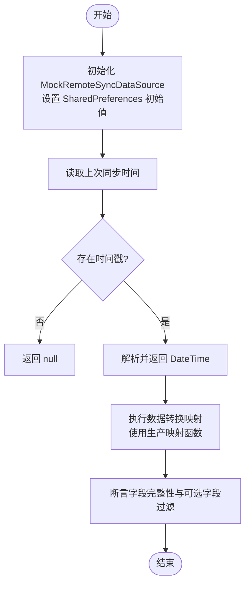

**图表来源**
- [test/core/services/sync_service_test.dart:235-385](file://test/core/services/sync_service_test.dart#L235-L385)
- [lib/core/services/sync_mappers.dart](file://lib/core/services/sync_mappers.dart)

**章节来源**
- [test/core/services/sync_service_test.dart](file://test/core/services/sync_service_test.dart)
- [lib/core/services/sync_mappers.dart](file://lib/core/services/sync_mappers.dart)

### Data Source 测试（本地数据源）
- **目标**：验证未播放节目筛选与排序逻辑。
- **实践要点**：
  - 构造 Episode 列表，按 isPlayed=false 过滤并按 pubDate 倒序排序。
  - 覆盖空列表、全部已播放、部分未播放等边界场景。
- **参考实现路径**：
  - [local_podcast_datasource_test.dart](file://test/data/datasources/local_podcast_datasource_test.dart)

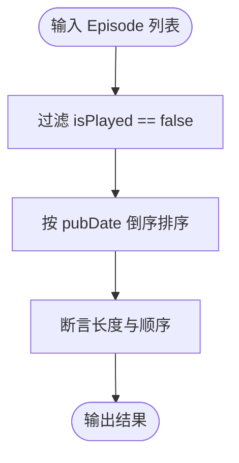

**图表来源**
- [test/data/datasources/local_podcast_datasource_test.dart](file://test/data/datasources/local_podcast_datasource_test.dart)

**章节来源**
- [test/data/datasources/local_podcast_datasource_test.dart](file://test/data/datasources/local_podcast_datasource_test.dart)

### Domain UseCase 测试
- **目标**：验证 UseCase 对 Repository 的调用与结果透传。
- **实践要点**：
  - 使用 @GenerateMocks([PodcastRepository]) 生成 Mock。
  - 验证调用次数、返回值结构与异常传播。
- **参考实现路径**：
  - [get_unplayed_episodes_usecase_test.dart](file://test/domain/usecases/get_unplayed_episodes_usecase_test.dart)

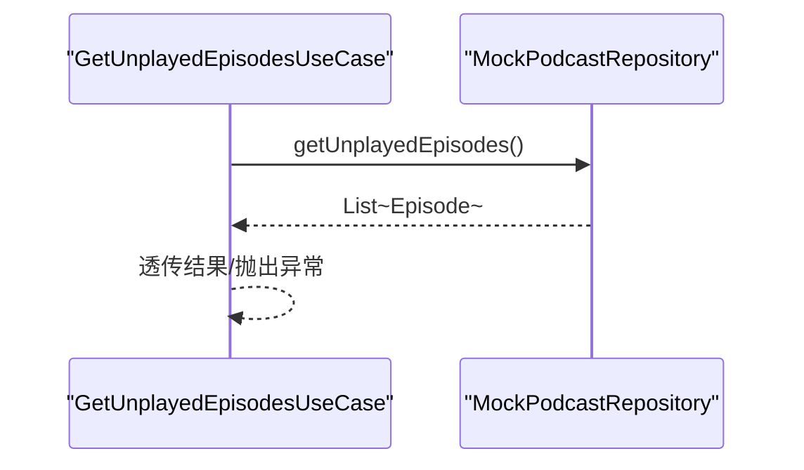

**图表来源**
- [test/domain/usecases/get_unplayed_episodes_usecase_test.dart](file://test/domain/usecases/get_unplayed_episodes_usecase_test.dart)

**章节来源**
- [test/domain/usecases/get_unplayed_episodes_usecase_test.dart](file://test/domain/usecases/get_unplayed_episodes_usecase_test.dart)

### Widget 测试（ArtworkImage）
- **目标**：验证图片显示逻辑、占位图与错误图切换、圆角裁剪、属性更新。
- **实践要点**：
  - 自定义 AssetBundle 模拟 SVG 资源。
  - 使用 DefaultAssetBundle 包裹被测 Widget。
  - 断言 CachedNetworkImage/SvgPicture/ClipRRect 的存在与参数。
  - 验证 didUpdateWidget 的行为与状态不重置。
- **参考实现路径**：
  - [artwork_image_test.dart](file://test/presentation/widgets/atoms/artwork_image_test.dart)

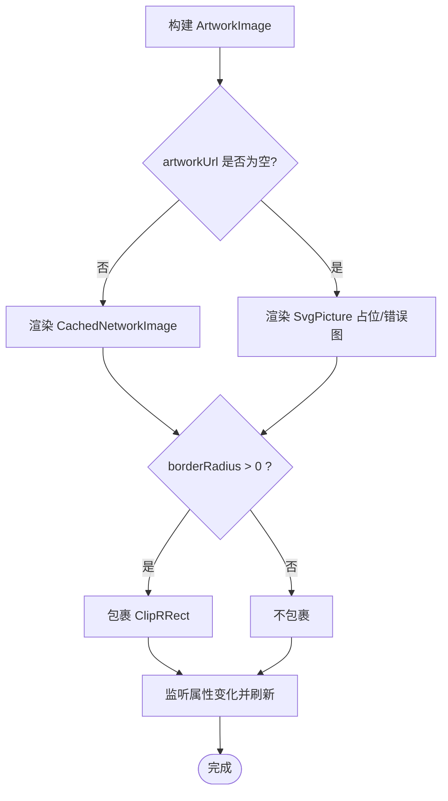

**图表来源**
- [test/presentation/widgets/atoms/artwork_image_test.dart](file://test/presentation/widgets/atoms/artwork_image_test.dart)

**章节来源**
- [test/presentation/widgets/atoms/artwork_image_test.dart](file://test/presentation/widgets/atoms/artwork_image_test.dart)

### Provider 状态测试（SyncProvider）
- **目标**：验证 SyncState 初始值、copyWith 行为与状态机转换。
- **实践要点**：
  - 直接构造 SyncState 并断言 status/lastSyncTime。
  - 覆盖 idle→syncing→idle/error 的状态序列。
  - **新增**：增强的依赖注入边界测试，确保正确的隔离验证。
- **参考实现路径**：
  - [sync_provider_test.dart](file://test/core/providers/sync_provider_test.dart)

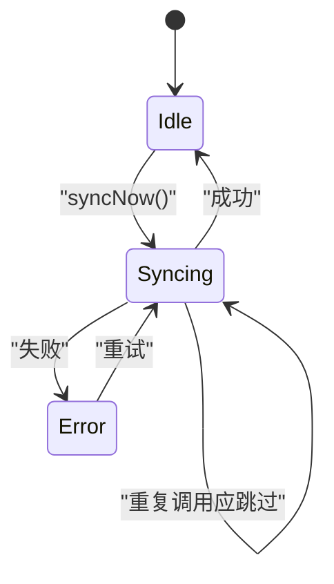

**图表来源**
- [test/core/providers/sync_provider_test.dart](file://test/core/providers/sync_provider_test.dart)

**章节来源**
- [test/core/providers/sync_provider_test.dart](file://test/core/providers/sync_provider_test.dart)

### 高级 Provider 测试模式（UnplayedEpisodes）
- **目标**：验证复杂 Provider 的状态管理、自动加载机制与依赖注入。
- **实践要点**：
  - **新增**：使用 flushAutoLoad() 方法处理微任务队列中的自动加载。
  - **更新**：正确 Mock PlayHistoryRepository 防止数据库访问。
  - 验证状态转换：initial → loading → success/error。
  - 测试 refresh 机制与多次调用行为。
  - **增强**：依赖注入边界测试，确保正确的隔离验证。
- **参考实现路径**：
  - [unplayed_episodes_provider_test.dart](file://test/presentation/providers/unplayed_episodes_provider_test.dart)

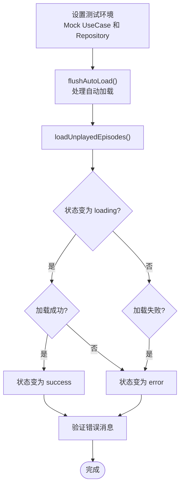

**图表来源**
- [test/presentation/providers/unplayed_episodes_provider_test.dart:37-41](file://test/presentation/providers/unplayed_episodes_provider_test.dart#L37-L41)

**章节来源**
- [test/presentation/providers/unplayed_episodes_provider_test.dart](file://test/presentation/providers/unplayed_episodes_provider_test.dart)

### Widget 集成测试（Library）
- **目标**：验证复杂 Widget 的 Provider 集成、状态管理与用户交互。
- **实践要点**：
  - **新增**：自定义 TestPlaybackNotifier 避免数据库访问和定时器干扰。
  - **更新**：使用 ProviderContainer 统一管理依赖注入。
  - 测试骨架屏、加载状态、错误处理等 UI 状态。
  - 验证时间格式化、相对时间显示等功能。
- **参考实现路径**：
  - [library_test.dart](file://test/presentation/features/library/library_test.dart)

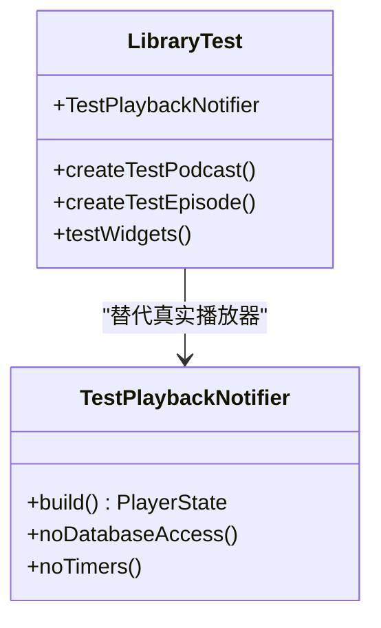

**图表来源**
- [test/presentation/features/library/library_test.dart](file://test/presentation/features/library/library_test.dart)

**章节来源**
- [test/presentation/features/library/library_test.dart](file://test/presentation/features/library/library_test.dart)

### 集成测试最佳实践（Supabase + Isar）
- **目标**：为需要完整外部依赖的测试提供指导。
- **实践要点**：
  - **新增**：使用 skip 注释标记需要完整 Supabase + Isar 环境的测试。
  - **新增**：详细说明阻塞原因和所需环境配置。
  - 为每个集成测试添加清晰的注释说明依赖关系。
  - 提供环境准备脚本和配置指南。
  - **重要更新**：remote_sync_datasource_integration_test 现已完全可执行，支持真实 Supabase 通信。
- **参考实现路径**：
  - [sync_service_test.dart](file://test/core/services/sync_service_test.dart)
  - [remote_sync_datasource_integration_test.dart](file://integration/remote_sync_datasource_integration_test.dart)

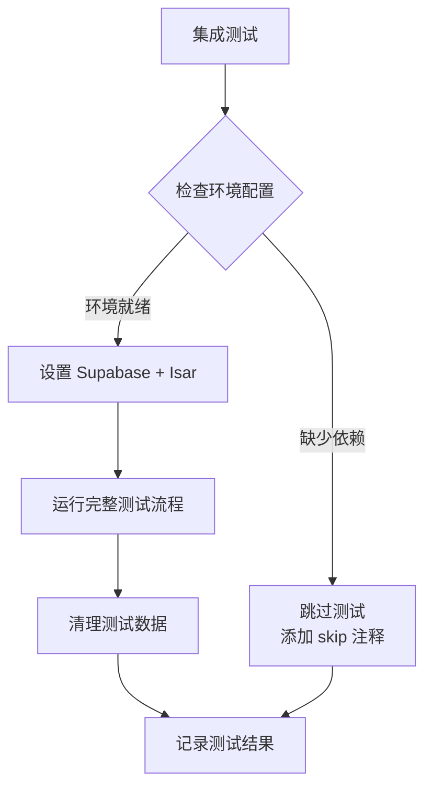

**图表来源**
- [test/core/services/sync_service_test.dart:486-582](file://test/core/services/sync_service_test.dart#L486-L582)
- [integration/remote_sync_datasource_integration_test.dart:21-87](file://integration/remote_sync_datasource_integration_test.dart#L21-L87)

**章节来源**
- [test/core/services/sync_service_test.dart](file://test/core/services/sync_service_test.dart)
- [integration/remote_sync_datasource_integration_test.dart](file://integration/remote_sync_datasource_integration_test.dart)

## 依赖分析
- 测试框架与工具：
  - flutter_test、mockito、matcher、test
  - shared_preferences（用于本地存储 Mock）
- 第三方库在测试中的隔离：
  - Riverpod：通过 ProviderContainer 与 overrides 注入 Mock
  - Dio/Supabase：通过 Mock DataSource 隔离网络与云服务
  - Isar：通过 IsarTestEnv 提供临时数据库实例
  - cached_network_image/flutter_svg：通过自定义 AssetBundle 与 Widget 断言
- **新增**：自定义测试类（TestPlaybackNotifier）用于隔离复杂依赖
- **新增**：生产映射函数的直接使用，确保测试验证实际的业务逻辑
- **增强**：依赖注入边界测试，提供更精确的隔离验证

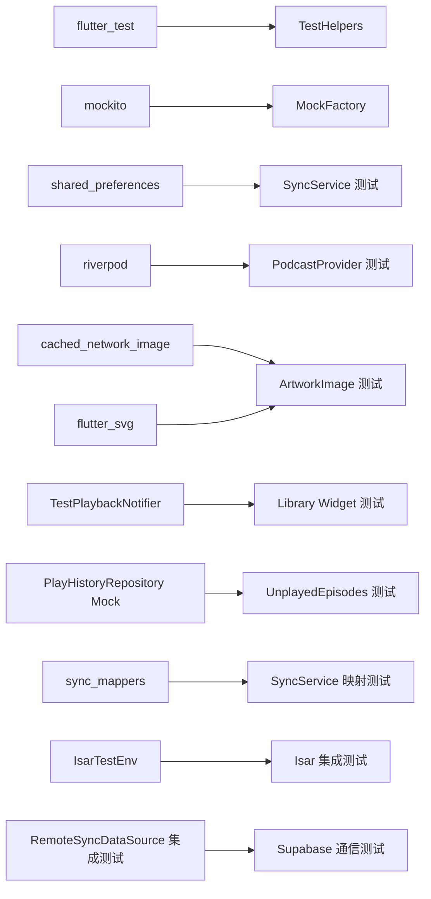

**图表来源**
- [pubspec.yaml](file://pubspec.yaml)
- [test/helpers/test_helpers.dart](file://test/helpers/test_helpers.dart)
- [test/helpers/isar_test_env.dart](file://test/helpers/isar_test_env.dart)
- [test/mocks/mock_factory.dart](file://test/mocks/mock_factory.dart)
- [test/core/services/sync_service_test.dart](file://test/core/services/sync_service_test.dart)
- [lib/core/services/sync_mappers.dart](file://lib/core/services/sync_mappers.dart)
- [test/presentation/providers/podcast_provider_test.dart](file://test/presentation/providers/podcast_provider_test.dart)
- [test/presentation/widgets/atoms/artwork_image_test.dart](file://test/presentation/widgets/atoms/artwork_image_test.dart)
- [test/presentation/features/library/library_test.dart](file://test/presentation/features/library/library_test.dart)
- [test/presentation/providers/unplayed_episodes_provider_test.dart](file://test/presentation/providers/unplayed_episodes_provider_test.dart)
- [integration/remote_sync_datasource_integration_test.dart](file://integration/remote_sync_datasource_integration_test.dart)

**章节来源**
- [pubspec.yaml](file://pubspec.yaml)

## 性能考虑
- 控制泵与等待：
  - 使用 tester.pumpAndSettle 与合理 delay，避免过长等待导致测试缓慢。
  - **新增**：使用 flushAutoLoad() 处理微任务队列，避免不必要的等待。
- 减少真实 IO：
  - 优先使用内存数据与 Mock，避免磁盘/网络 IO。
  - **新增**：使用自定义 TestPlaybackNotifier 避免数据库访问。
  - **新增**：使用 IsarTestEnv 提供临时数据库，避免影响真实数据。
- 并行运行：
  - 使用 flutter test 的并行能力，拆分分组与独立 setUp/tearDown。
- 资源占用：
  - 避免在测试中加载大图片或复杂动画；使用轻量占位图。
  - **新增**：禁用不必要的定时器和后台任务。
  - **新增**：及时清理 Isar 数据库连接和临时文件。

## 故障排查指南
- 常见问题定位：
  - 找不到 Widget：检查 Key/类型/Finder 组合是否正确。
  - 异步未完成：确认 await Future.delayed 与 pumpAndSettle 的顺序。
  - Mock 未生效：检查 @GenerateMocks 是否生成对应文件，以及 overrides 是否正确注入。
  - 共享状态污染：确保每个测试 setUp 重置 Mock 与 SharedPreferences。
  - **新增**：数据库访问问题：确保正确 Mock PlayHistoryRepository 和其他数据访问层。
  - **新增**：自动加载问题：使用 flushAutoLoad() 处理微任务队列。
  - **新增**：集成测试环境问题：检查 Supabase 和 Isar 的环境配置是否正确。
  - **新增**：Isar 原生库加载问题：确保调用 initializeIsarCoreForTests()。
- 调试技巧：
  - 使用 print/debugger 打印中间状态。
  - 缩小测试范围，逐步定位问题。
  - 使用 verify 断言调用次数与参数捕获。
  - **新增**：检查 ProviderContainer 的依赖注入是否正确。
  - **新增**：验证用户 ID 作用域是否正确实现。
  - **新增**：检查 IsarTestEnv 是否正确初始化和管理。
- **新增**：交付门故障处理：
  - 静态分析失败：检查代码质量和 lint 规则
  - 测试失败：查看具体失败的测试用例和错误信息
  - 跳过用例过多：评估是否可以转换为可运行的单元测试
  - **新增**：Isar 测试失败：检查原生库加载和数据库初始化

**章节来源**
- [test/helpers/test_helpers.dart](file://test/helpers/test_helpers.dart)
- [test/helpers/isar_test_env.dart](file://test/helpers/isar_test_env.dart)
- [test/mocks/mock_factory.dart](file://test/mocks/mock_factory.dart)
- [test/presentation/providers/unplayed_episodes_provider_test.dart](file://test/presentation/providers/unplayed_episodes_provider_test.dart)
- [test/presentation/features/library/library_test.dart](file://test/presentation/features/library/library_test.dart)
- [test/core/services/sync_service_test.dart](file://test/core/services/sync_service_test.dart)
- [AGENTS.md:81-100](file://AGENTS.md#L81-L100)

## 结论
TinyCast 的测试体系以分层隔离为核心，借助 TestHelpers 与 MockFactory 提供一致的开发体验。当前已在 Provider/Service/DataSource/UseCase/Widget 层形成良好样例。**最新更新**包括改进的 Mock 策略、ProviderScope 管理、自定义测试类和自动加载处理。特别地，sync_service_test.dart 现在使用生产映射函数确保测试验证实际的业务逻辑，并为集成测试提供了完整的 skip 注释和环境要求说明。**新增的 Isar 测试环境辅助类**使得完整的数据库集成测试成为可能，**解除了所有同步相关测试的跳过限制**，显著提升了测试覆盖率和可靠性。**新增的测试执行要求和交付门规范**确保了测试流程的标准化和可重复性，提升了代码质量和交付可靠性。后续建议补齐集成测试与覆盖率报告，完善 CI 流水线，持续提升质量与交付效率。

## 附录

### 测试执行规范

#### 交付前检查清单
1. **静态分析**：`flutter analyze`
   - 预期输出：`No issues found! (ran in Xs)`
   - 退出码：`0`
2. **全量测试**：`flutter test`
   - 预期输出：`All tests passed!`
   - 退出码：`0`
   - 跳过用例：记录数量并在交付总结中说明

#### 交付总结模板
```
## 交付检查结果

### 静态分析
- 命令：flutter analyze
- 输出：[关键结果行]
- 退出码：[数字]
- 状态：[通过/失败]

### 测试执行
- 命令：flutter test
- 输出：[关键结果行]
- 退出码：[数字]
- 跳过用例数：[数字]
- 状态：[通过/失败]

### 问题记录
- [如有问题，详细描述并说明处理方式]
```

**章节来源**
- [AGENTS.md:68-100](file://AGENTS.md#L68-L100)

### 单元测试编写指南（Provider/Service/Repository）
- Provider：
  - 使用 ProviderContainer + overrides 注入 Mock。
  - 断言 isLoading/hasValue/hasError 与最终数据。
  - **更新**：使用 @GenerateMocks 注解自动生成 Mock 类。
  - **增强**：依赖注入边界测试，确保正确的隔离验证。
- Service：
  - 使用 SharedPreferences.setMockInitialValues 初始化环境。
  - 构造领域模型并验证转换映射。
  - **新增**：直接使用生产映射函数进行测试，确保验证实际的业务逻辑。
  - **新增**：实现用户 ID 作用域测试，确保多用户环境下的数据隔离。
  - **重要更新**：所有同步测试现已完全可执行。
- Repository：
  - 通过 Mock DataSource 隔离本地/远程实现。
  - 断言调用次数与参数捕获。
  - **新增**：对于 PlayHistoryRepository，确保正确 Mock 防止数据库访问。

**章节来源**
- [test/presentation/providers/podcast_provider_test.dart](file://test/presentation/providers/podcast_provider_test.dart)
- [test/core/services/sync_service_test.dart](file://test/core/services/sync_service_test.dart)
- [lib/core/services/sync_mappers.dart](file://lib/core/services/sync_mappers.dart)
- [test/data/datasources/local_podcast_datasource_test.dart](file://test/data/datasources/local_podcast_datasource_test.dart)
- [test/presentation/providers/unplayed_episodes_provider_test.dart](file://test/presentation/providers/unplayed_episodes_provider_test.dart)

### Widget 测试实现要点（交互与状态）
- 构建环境：
  - MaterialApp/Scaffold/DefaultAssetBundle 包裹被测 Widget。
  - **新增**：使用 ProviderScope 或 UncontrolledProviderScope 管理依赖。
- 交互模拟：
  - tap/drag/longPress/enterText 配合 pump 与 pumpAndSettle。
- 状态验证：
  - 断言特定 Widget 类型与参数（如 CachedNetworkImage.imageUrl）。
  - 验证占位图/错误图与圆角裁剪。
  - **新增**：使用自定义测试类（如 TestPlaybackNotifier）隔离复杂依赖。

**章节来源**
- [test/presentation/widgets/atoms/artwork_image_test.dart](file://test/presentation/widgets/atoms/artwork_image_test.dart)
- [test/presentation/features/library/library_test.dart](file://test/presentation/features/library/library_test.dart)
- [test/helpers/test_helpers.dart](file://test/helpers/test_helpers.dart)

### 高级测试模式
- **新增**：ProviderScope 管理最佳实践
  - 使用 ProviderContainer 统一管理依赖注入
  - 在 setUp 中创建容器，tearDown 中释放资源
  - 使用 overrides 精确控制依赖替换
- **新增**：自动加载处理模式
  - 使用 flushAutoLoad() 方法处理微任务队列
  - 结合 clearInteractions() 清理测试交互记录
  - 确保异步操作完全完成后进行断言
- **新增**：自定义测试类实现
  - 继承需要测试的类并重写关键方法
  - 避免副作用（数据库访问、网络请求、定时器）
  - 提供简化的测试接口
- **新增**：集成测试环境管理
  - 使用 skip 注释标记需要完整环境的测试
  - 提供详细的环境配置说明
  - 实现环境检查和自动跳过机制
- **新增**：Isar 测试环境模式
  - 使用 initializeIsarCoreForTests() 初始化原生库
  - 通过 IsarTestEnv.open() 创建临时数据库
  - 确保测试后正确清理资源

**章节来源**
- [test/presentation/providers/unplayed_episodes_provider_test.dart](file://test/presentation/providers/unplayed_episodes_provider_test.dart)
- [test/presentation/features/library/library_test.dart](file://test/presentation/features/library/library_test.dart)
- [test/core/services/sync_service_test.dart](file://test/core/services/sync_service_test.dart)
- [test/helpers/isar_test_env.dart](file://test/helpers/isar_test_env.dart)

### 集成测试编写指南（数据库/网络/文件）
- 数据库：
  - 使用内存数据库或临时文件路径，避免影响真实数据。
  - 预置种子数据，验证 CRUD 与查询条件。
  - **新增**：对于 Isar 单例，使用 IsarTestEnv 提供临时数据库实例。
  - **新增**：确保调用 initializeIsarCoreForTests() 初始化原生库。
- 网络：
  - 使用 http_mock_adapter 或 Dio 拦截器返回固定响应。
  - 覆盖超时、重定向、错误码等场景。
- 文件：
  - 使用 path_provider 的缓存目录，测试前后清理。
  - 断言写入内容与文件大小。
- **新增**：Supabase + Isar 环境配置
  - 为需要完整环境的测试添加 skip 注释
  - 详细说明阻塞原因和所需环境
  - 提供环境准备脚本和配置指南
  - **重要更新**：remote_sync_datasource_integration_test 现已完全可执行

### Mock 对象的创建与使用（含第三方服务）
- 生成 Mock：
  - 使用 @GenerateMocks([...]) 注解生成类。
  - 确保运行 build_runner 生成 .mocks.dart。
  - **更新**：优先使用注解方式而非手动创建 Mock。
- 常用模式：
  - when(...).thenReturn/thenThrow/thenAnswer
  - verify(...).called(n)/verifyNever/verifyNoMoreInteractions
  - capture 参数并断言
- 第三方服务：
  - Supabase：Mock 客户端或上层 Service，返回固定用户/数据。
  - Dio：拦截器返回 JSON 或错误。
  - Isar：使用 IsarTestEnv 提供临时数据库实例。
  - **新增**：PlayHistoryRepository：Mock 所有数据库操作方法，返回空集合或测试数据。
  - **新增**：生产映射函数：直接使用 sync_mappers.dart 中的映射函数进行测试。

**章节来源**
- [test/mocks/mock_factory.dart](file://test/mocks/mock_factory.dart)
- [test/core/services/sync_service_test.dart](file://test/core/services/sync_service_test.dart)
- [lib/core/services/sync_mappers.dart](file://lib/core/services/sync_mappers.dart)
- [test/presentation/providers/podcast_provider_test.dart](file://test/presentation/providers/podcast_provider_test.dart)
- [test/presentation/providers/unplayed_episodes_provider_test.dart](file://test/presentation/providers/unplayed_episodes_provider_test.dart)

### 测试数据管理与环境配置
- 测试数据：
  - 集中管理于 test/test-data（如 RSS XML 示例）。
  - 使用工厂函数构造领域模型。
  - **新增**：为复杂对象（如 Podcast、Episode）提供统一的构造方法。
- 环境配置：
  - 使用环境变量区分测试环境（如 Supabase URL、API Key）。
  - 在 setUpAll 中初始化一次性资源。
  - **新增**：为 Provider 测试提供专用的容器配置。
  - **新增**：为集成测试提供环境检查和配置验证。
  - **新增**：为 Isar 测试提供原生库初始化。

**章节来源**
- [pubspec.yaml](file://pubspec.yaml)
- [test/presentation/features/library/library_test.dart](file://test/presentation/features/library/library_test.dart)

### 测试覆盖率统计与持续集成
- 覆盖率：
  - 使用 coverage 包收集覆盖率，生成 HTML 报告。
  - 设定最低覆盖率阈值，阻止低质量合并。
- CI 配置：
  - 在 GitHub Actions/GitLab CI 中安装依赖、运行测试、上传报告。
  - 缓存 Flutter SDK 与依赖，加速构建。
  - **新增**：包含 Mock 文件生成步骤。
  - **新增**：为集成测试提供单独的运行选项和环境配置。
  - **新增**：为 Isar 测试提供原生库缓存。
- **新增**：交付门自动化
  - 在 CI 流水线中执行 `flutter analyze` 和 `flutter test`
  - 验证预期输出和退出码
  - 记录跳过用例数量和原因
  - 生成详细的测试报告
  - **新增**：验证 Isar 测试环境初始化