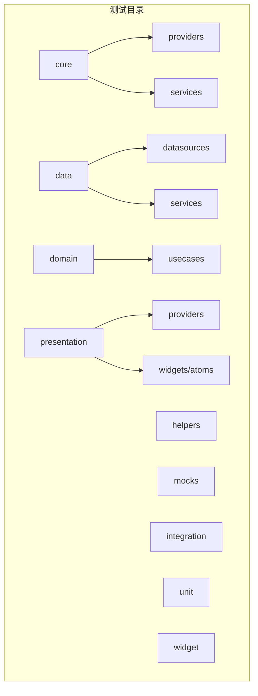
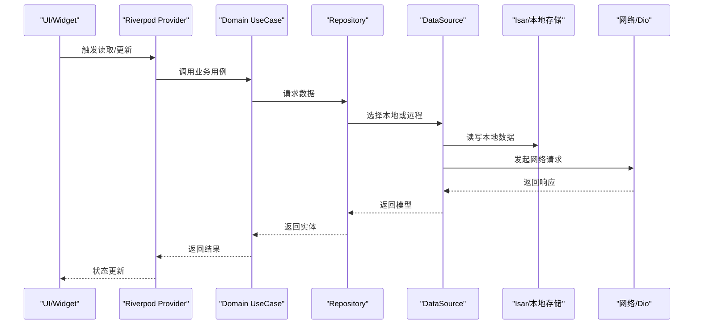
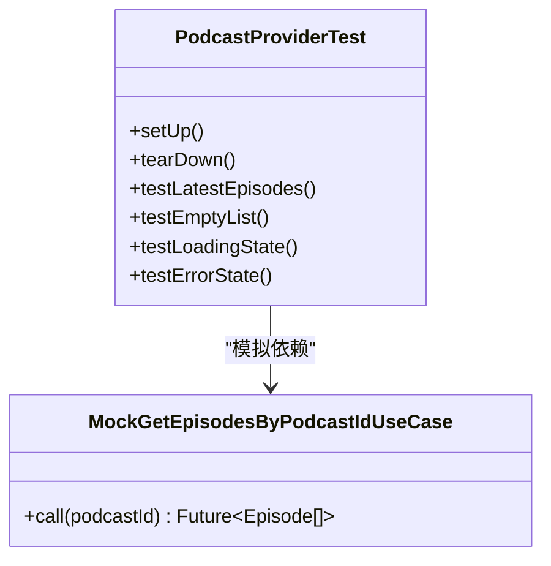
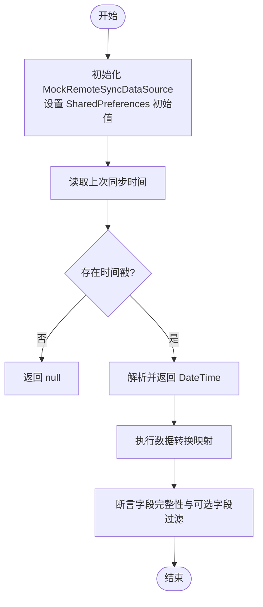
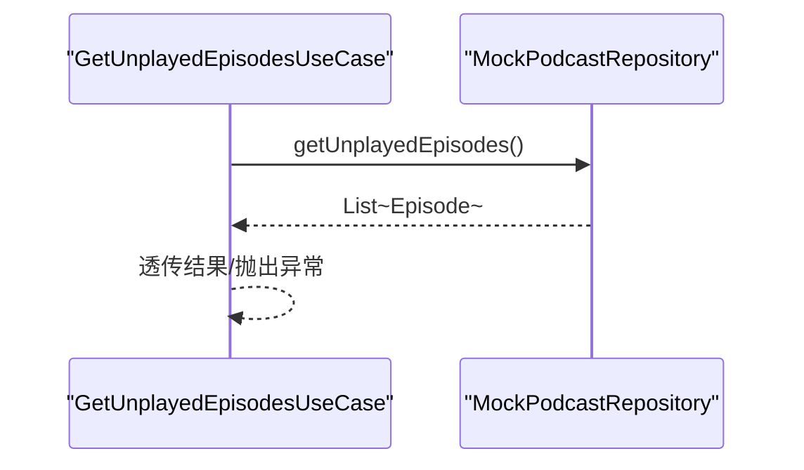
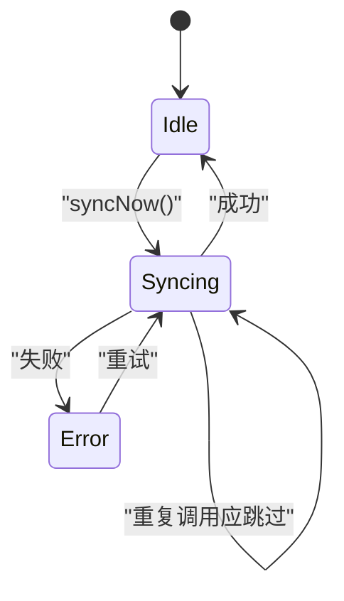
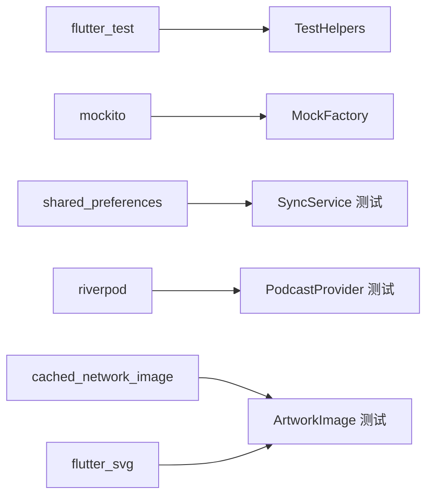

# 测试策略

<cite>
**本文引用的文件**   
- [pubspec.yaml](file://pubspec.yaml)
- [test/helpers/test_helpers.dart](file://test/helpers/test_helpers.dart)
- [test/mocks/mock_factory.dart](file://test/mocks/mock_factory.dart)
- [test/core/providers/sync_provider_test.dart](file://test/core/providers/sync_provider_test.dart)
- [test/core/services/sync_service_test.dart](file://test/core/services/sync_service_test.dart)
- [test/data/datasources/local_podcast_datasource_test.dart](file://test/data/datasources/local_podcast_datasource_test.dart)
- [test/presentation/providers/podcast_provider_test.dart](file://test/presentation/providers/podcast_provider_test.dart)
- [test/domain/usecases/get_unplayed_episodes_usecase_test.dart](file://test/domain/usecases/get_unplayed_episodes_usecase_test.dart)
- [test/presentation/widgets/atoms/artwork_image_test.dart](file://test/presentation/widgets/atoms/artwork_image_test.dart)
</cite>

## 目录
1. [简介](#简介)
2. [项目结构](#项目结构)
3. [核心组件](#核心组件)
4. [架构总览](#架构总览)
5. [详细组件分析](#详细组件分析)
6. [依赖分析](#依赖分析)
7. [性能考虑](#性能考虑)
8. [故障排查指南](#故障排查指南)
9. [结论](#结论)
10. [附录](#附录)

## 简介
本文件为 TinyCast 项目的完整测试策略与指南，覆盖单元测试、Widget 测试、集成测试、Mock 对象创建与使用、测试数据与环境配置、覆盖率统计与持续集成。文档基于仓库现有测试实现进行归纳与扩展建议，确保读者既能快速上手，也能按规范完善测试体系。

## 项目结构
TinyCast 的测试代码集中在 test 目录下，采用分层组织：
- core: Provider/Service 层测试
- data: Datasource/Service 层测试
- domain: UseCase 层测试
- presentation: Provider/Widget 层测试
- helpers: 通用测试工具
- mocks: Mock 工厂与辅助方法
- integration: 集成测试（预留）
- unit: 单元用例（预留）
- widget: Widget 用例（预留）

[无图表来源：该图为概念性结构示意]

**章节来源**
- [pubspec.yaml](file://pubspec.yaml)

## 核心组件
- 测试工具集 TestHelpers：封装 pump 与交互方法、断言、包装器，提升 Widget 测试效率。
- Mock 工厂 MockFactory：统一 when/verify/capture/stub 等常用操作，降低样板代码。
- 分层测试样例：
  - Provider/Service：sync_provider_test、sync_service_test
  - Data Source：local_podcast_datasource_test
  - Domain UseCase：get_unplayed_episodes_usecase_test
  - Presentation Provider：podcast_provider_test
  - Widget：artwork_image_test

这些组件共同构成“可复用、可验证、可扩展”的测试基础设施。

**章节来源**
- [test/helpers/test_helpers.dart](file://test/helpers/test_helpers.dart)
- [test/mocks/mock_factory.dart](file://test/mocks/mock_factory.dart)
- [test/core/providers/sync_provider_test.dart](file://test/core/providers/sync_provider_test.dart)
- [test/core/services/sync_service_test.dart](file://test/core/services/sync_service_test.dart)
- [test/data/datasources/local_podcast_datasource_test.dart](file://test/data/datasources/local_podcast_datasource_test.dart)
- [test/presentation/providers/podcast_provider_test.dart](file://test/presentation/providers/podcast_provider_test.dart)
- [test/domain/usecases/get_unplayed_episodes_usecase_test.dart](file://test/domain/usecases/get_unplayed_episodes_usecase_test.dart)
- [test/presentation/widgets/atoms/artwork_image_test.dart](file://test/presentation/widgets/atoms/artwork_image_test.dart)

## 架构总览
下图展示从 UI 到领域层的调用链与测试切入点，强调各层如何被隔离与验证。

[无图表来源：该图为概念性流程示意]

## 详细组件分析

### Provider 测试（Riverpod）
- 目标：验证 Provider 的状态流转、异步加载、错误处理与参数化行为。
- 实践要点：
  - 使用 ProviderContainer + overrides 注入 Mock 依赖。
  - 通过 .future 等待异步完成，断言 hasValue/hasError/isLoading。
  - 对同一 Provider 的不同参数（如 podcastId）分别验证。
- 参考实现路径：
  - [podcast_provider_test.dart](file://test/presentation/providers/podcast_provider_test.dart)

**图表来源**
- [test/presentation/providers/podcast_provider_test.dart](file://test/presentation/providers/podcast_provider_test.dart)

**章节来源**
- [test/presentation/providers/podcast_provider_test.dart](file://test/presentation/providers/podcast_provider_test.dart)

### Service 测试（同步服务）
- 目标：验证 SyncService 的时间戳存取、进度模型、数据转换逻辑与异常路径。
- 实践要点：
  - 使用 SharedPreferences.setMockInitialValues 初始化本地存储。
  - 构造 Podcast/Episode/PlayHistory/Favorite/Queue 等模型并校验转换映射。
  - 将 RemoteSyncDataSource 替换为 Mock，隔离外部依赖。
- 参考实现路径：
  - [sync_service_test.dart](file://test/core/services/sync_service_test.dart)

**图表来源**
- [test/core/services/sync_service_test.dart](file://test/core/services/sync_service_test.dart)

**章节来源**
- [test/core/services/sync_service_test.dart](file://test/core/services/sync_service_test.dart)

### Data Source 测试（本地数据源）
- 目标：验证未播放节目筛选与排序逻辑。
- 实践要点：
  - 构造 Episode 列表，按 isPlayed=false 过滤并按 pubDate 倒序排序。
  - 覆盖空列表、全部已播放、部分未播放等边界场景。
- 参考实现路径：
  - [local_podcast_datasource_test.dart](file://test/data/datasources/local_podcast_datasource_test.dart)

**图表来源**
- [test/data/datasources/local_podcast_datasource_test.dart](file://test/data/datasources/local_podcast_datasource_test.dart)

**章节来源**
- [test/data/datasources/local_podcast_datasource_test.dart](file://test/data/datasources/local_podcast_datasource_test.dart)

### Domain UseCase 测试
- 目标：验证 UseCase 对 Repository 的调用与结果透传。
- 实践要点：
  - 使用 @GenerateMocks([PodcastRepository]) 生成 Mock。
  - 验证调用次数、返回值结构与异常传播。
- 参考实现路径：
  - [get_unplayed_episodes_usecase_test.dart](file://test/domain/usecases/get_unplayed_episodes_usecase_test.dart)

**图表来源**
- [test/domain/usecases/get_unplayed_episodes_usecase_test.dart](file://test/domain/usecases/get_unplayed_episodes_usecase_test.dart)

**章节来源**
- [test/domain/usecases/get_unplayed_episodes_usecase_test.dart](file://test/domain/usecases/get_unplayed_episodes_usecase_test.dart)

### Widget 测试（ArtworkImage）
- 目标：验证图片显示逻辑、占位图与错误图切换、圆角裁剪、属性更新。
- 实践要点：
  - 自定义 AssetBundle 模拟 SVG 资源。
  - 使用 DefaultAssetBundle 包裹被测 Widget。
  - 断言 CachedNetworkImage/SvgPicture/ClipRRect 的存在与参数。
  - 验证 didUpdateWidget 的行为与状态不重置。
- 参考实现路径：
  - [artwork_image_test.dart](file://test/presentation/widgets/atoms/artwork_image_test.dart)

**图表来源**
- [test/presentation/widgets/atoms/artwork_image_test.dart](file://test/presentation/widgets/atoms/artwork_image_test.dart)

**章节来源**
- [test/presentation/widgets/atoms/artwork_image_test.dart](file://test/presentation/widgets/atoms/artwork_image_test.dart)

### Provider 状态测试（SyncProvider）
- 目标：验证 SyncState 初始值、copyWith 行为与状态机转换。
- 实践要点：
  - 直接构造 SyncState 并断言 status/lastSyncTime。
  - 覆盖 idle→syncing→idle/error 的状态序列。
- 参考实现路径：
  - [sync_provider_test.dart](file://test/core/providers/sync_provider_test.dart)

**图表来源**
- [test/core/providers/sync_provider_test.dart](file://test/core/providers/sync_provider_test.dart)

**章节来源**
- [test/core/providers/sync_provider_test.dart](file://test/core/providers/sync_provider_test.dart)

## 依赖分析
- 测试框架与工具：
  - flutter_test、mockito、matcher、test
  - shared_preferences（用于本地存储 Mock）
- 第三方库在测试中的隔离：
  - Riverpod：通过 ProviderContainer 与 overrides 注入 Mock
  - Dio/Supabase：通过 Mock DataSource 隔离网络与云服务
  - Isar：通过本地数据源测试与内存数据构造
  - cached_network_image/flutter_svg：通过自定义 AssetBundle 与 Widget 断言

**图表来源**
- [pubspec.yaml](file://pubspec.yaml)
- [test/helpers/test_helpers.dart](file://test/helpers/test_helpers.dart)
- [test/mocks/mock_factory.dart](file://test/mocks/mock_factory.dart)
- [test/core/services/sync_service_test.dart](file://test/core/services/sync_service_test.dart)
- [test/presentation/providers/podcast_provider_test.dart](file://test/presentation/providers/podcast_provider_test.dart)
- [test/presentation/widgets/atoms/artwork_image_test.dart](file://test/presentation/widgets/atoms/artwork_image_test.dart)

**章节来源**
- [pubspec.yaml](file://pubspec.yaml)

## 性能考虑
- 控制泵与等待：
  - 使用 tester.pumpAndSettle 与合理 delay，避免过长等待导致测试缓慢。
- 减少真实 IO：
  - 优先使用内存数据与 Mock，避免磁盘/网络 IO。
- 并行运行：
  - 使用 flutter test 的并行能力，拆分分组与独立 setUp/tearDown。
- 资源占用：
  - 避免在测试中加载大图片或复杂动画；使用轻量占位图。

[本节为通用指导，无需具体文件引用]

## 故障排查指南
- 常见问题定位：
  - 找不到 Widget：检查 Key/类型/Finder 组合是否正确。
  - 异步未完成：确认 await Future.delayed 与 pumpAndSettle 的顺序。
  - Mock 未生效：检查 @GenerateMocks 是否生成对应文件，以及 overrides 是否正确注入。
  - 共享状态污染：确保每个测试 setUp 重置 Mock 与 SharedPreferences。
- 调试技巧：
  - 使用 print/debugger 打印中间状态。
  - 缩小测试范围，逐步定位问题。
  - 使用 verify 断言调用次数与参数捕获。

**章节来源**
- [test/helpers/test_helpers.dart](file://test/helpers/test_helpers.dart)
- [test/mocks/mock_factory.dart](file://test/mocks/mock_factory.dart)

## 结论
TinyCast 的测试体系以分层隔离为核心，借助 TestHelpers 与 MockFactory 提供一致的开发体验。当前已在 Provider/Service/DataSource/UseCase/Widget 层形成良好样例。后续建议补齐集成测试与覆盖率报告，完善 CI 流水线，持续提升质量与交付效率。

[本节为总结性内容，无需具体文件引用]

## 附录

### 单元测试编写指南（Provider/Service/Repository）
- Provider：
  - 使用 ProviderContainer + overrides 注入 Mock。
  - 断言 isLoading/hasValue/hasError 与最终数据。
- Service：
  - 使用 SharedPreferences.setMockInitialValues 初始化环境。
  - 构造领域模型并验证转换映射。
- Repository：
  - 通过 Mock DataSource 隔离本地/远程实现。
  - 断言调用次数与参数捕获。

**章节来源**
- [test/presentation/providers/podcast_provider_test.dart](file://test/presentation/providers/podcast_provider_test.dart)
- [test/core/services/sync_service_test.dart](file://test/core/services/sync_service_test.dart)
- [test/data/datasources/local_podcast_datasource_test.dart](file://test/data/datasources/local_podcast_datasource_test.dart)

### Widget 测试实现要点（交互与状态）
- 构建环境：
  - MaterialApp/Scaffold/DefaultAssetBundle 包裹被测 Widget。
- 交互模拟：
  - tap/drag/longPress/enterText 配合 pump 与 pumpAndSettle。
- 状态验证：
  - 断言特定 Widget 类型与参数（如 CachedNetworkImage.imageUrl）。
  - 验证占位图/错误图与圆角裁剪。

**章节来源**
- [test/presentation/widgets/atoms/artwork_image_test.dart](file://test/presentation/widgets/atoms/artwork_image_test.dart)
- [test/helpers/test_helpers.dart](file://test/helpers/test_helpers.dart)

### 集成测试编写指南（数据库/网络/文件）
- 数据库：
  - 使用内存数据库或临时文件路径，避免影响真实数据。
  - 预置种子数据，验证 CRUD 与查询条件。
- 网络：
  - 使用 http_mock_adapter 或 Dio 拦截器返回固定响应。
  - 覆盖超时、重定向、错误码等场景。
- 文件：
  - 使用 path_provider 的缓存目录，测试前后清理。
  - 断言写入内容与文件大小。

[本节为通用指导，无需具体文件引用]

### Mock 对象的创建与使用（含第三方服务）
- 生成 Mock：
  - 使用 @GenerateMocks([...]) 注解生成类。
  - 确保运行 build_runner 生成 .mocks.dart。
- 常用模式：
  - when(...).thenReturn/thenThrow/thenAnswer
  - verify(...).called(n)/verifyNever/verifyNoMoreInteractions
  - capture 参数并断言
- 第三方服务：
  - Supabase：Mock 客户端或上层 Service，返回固定用户/数据。
  - Dio：拦截器返回 JSON 或错误。
  - Isar：内存实例或临时数据库。

**章节来源**
- [test/mocks/mock_factory.dart](file://test/mocks/mock_factory.dart)
- [test/core/services/sync_service_test.dart](file://test/core/services/sync_service_test.dart)
- [test/presentation/providers/podcast_provider_test.dart](file://test/presentation/providers/podcast_provider_test.dart)

### 测试数据管理与环境配置
- 测试数据：
  - 集中管理于 test/test-data（如 RSS XML 示例）。
  - 使用工厂函数构造领域模型。
- 环境配置：
  - 使用环境变量区分测试环境（如 Supabase URL、API Key）。
  - 在 setUpAll 中初始化一次性资源。

**章节来源**
- [pubspec.yaml](file://pubspec.yaml)

### 测试覆盖率统计与持续集成
- 覆盖率：
  - 使用 coverage 包收集覆盖率，生成 HTML 报告。
  - 设定最低覆盖率阈值，阻止低质量合并。
- CI 配置：
  - 在 GitHub Actions/GitLab CI 中安装依赖、运行测试、上传报告。
  - 缓存 Flutter SDK 与依赖，加速构建。

[本节为通用指导，无需具体文件引用]