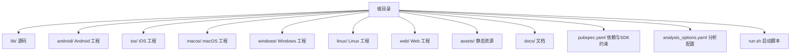
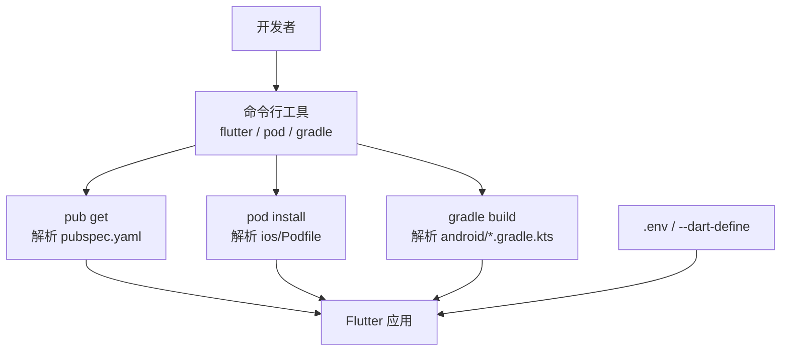
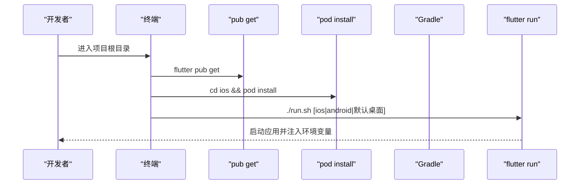
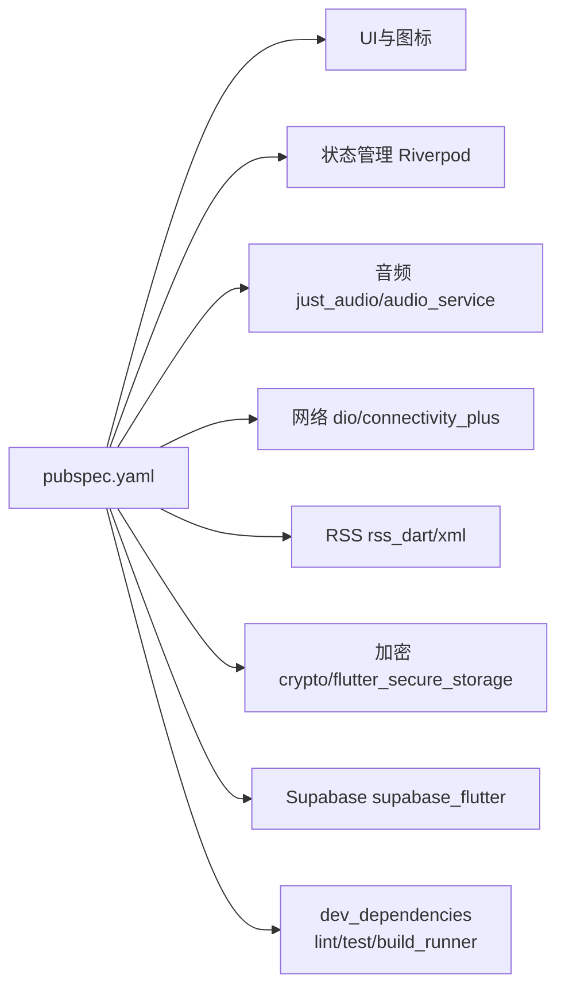

# 环境搭建

<cite>
**本文引用的文件**   
- [pubspec.yaml](file://pubspec.yaml)
- [analysis_options.yaml](file://analysis_options.yaml)
- [run.sh](file://run.sh)
- [README.md](file://README.md)
- [android/build.gradle.kts](file://android/build.gradle.kts)
- [android/app/build.gradle.kts](file://android/app/build.gradle.kts)
- [android/gradle.properties](file://android/gradle.properties)
- [android/local.properties](file://android/local.properties)
- [ios/Podfile](file://ios/Podfile)
- [ios/Runner/Info.plist](file://ios/Runner/Info.plist)
- [macos/Runner/Info.plist](file://macos/Runner/Info.plist)
- [docs/PLATFORM_PERMISSIONS.md](file://docs/PLATFORM_PERMISSIONS.md)
- [docs/supabase_setup.md](file://docs/supabase_setup.md)
</cite>

## 目录
1. [简介](#简介)
2. [项目结构](#项目结构)
3. [核心组件](#核心组件)
4. [架构总览](#架构总览)
5. [详细组件分析](#详细组件分析)
6. [依赖分析](#依赖分析)
7. [性能考虑](#性能考虑)
8. [故障排除指南](#故障排除指南)
9. [结论](#结论)
10. [附录](#附录)

## 简介
本指南面向首次接触 TinyCast 的开发者，提供从 Flutter SDK 安装、Dart 版本要求、IDE 配置到 Android/iOS 平台环境准备与依赖管理的完整步骤。同时包含常见问题的排查方法，确保在 macOS、Windows、Linux 上均可成功运行项目。

## 项目结构
TinyCast 是一个跨平台 Flutter 应用，支持 Android、iOS、macOS、Windows、Linux 和 Web。关键配置文件说明：
- pubspec.yaml：声明 Dart SDK 约束与所有依赖（含开发依赖）。
- analysis_options.yaml：代码分析与 Lint 规则。
- run.sh：本地调试启动脚本，自动加载 .env 并注入 Supabase 环境变量。
- android/*：Android 构建与 Gradle 配置。
- ios/Podfile：CocoaPods 配置，用于 iOS/macOS 原生依赖管理。
- docs/*：平台权限与 Supabase 配置文档。

**章节来源**
- [pubspec.yaml:12-13](file://pubspec.yaml#L12-L13)
- [analysis_options.yaml:1-36](file://analysis_options.yaml#L1-L36)
- [run.sh:1-66](file://run.sh#L1-L66)

## 核心组件
- Dart SDK 与 Flutter SDK：由 pubspec.yaml 的 environment.sdk 指定版本约束。
- 依赖管理：Flutter 使用 pub 管理 Dart 依赖；iOS/macOS 使用 CocoaPods 管理原生依赖。
- 平台构建：Android 使用 Gradle/Kotlin DSL；iOS/macOS 使用 Xcode/CocoaPods。
- 启动脚本：run.sh 统一加载 .env 并传入 Supabase 凭据。

**章节来源**
- [pubspec.yaml:12-13](file://pubspec.yaml#L12-L13)
- [pubspec.yaml:148-176](file://pubspec.yaml#L148-L176)
- [android/app/build.gradle.kts:1-45](file://android/app/build.gradle.kts#L1-L45)
- [ios/Podfile:1-44](file://ios/Podfile#L1-L44)
- [run.sh:1-66](file://run.sh#L1-L66)

## 架构总览
下图展示各平台构建与依赖管理的关键路径：Flutter 通过 pub 获取 Dart 依赖，Android 通过 Gradle 编译，iOS/macOS 通过 CocoaPods 安装 Pods，run.sh 负责注入运行时环境变量。

**图示来源**
- [pubspec.yaml:12-13](file://pubspec.yaml#L12-L13)
- [ios/Podfile:1-44](file://ios/Podfile#L1-L44)
- [android/app/build.gradle.kts:1-45](file://android/app/build.gradle.kts#L1-L45)
- [run.sh:1-66](file://run.sh#L1-L66)

## 详细组件分析

### Flutter SDK 与 Dart 版本要求
- Dart SDK 约束：^3.9.2（兼容 3.9.2 及以上但小于 4.0.0）。
- Flutter SDK：需安装与 Dart 约束匹配的 Flutter 版本，可通过 flutter doctor 检查。
- 建议：使用版本管理器（如 fvm）锁定 Flutter/Dart 版本，避免团队不一致。

**章节来源**
- [pubspec.yaml:12-13](file://pubspec.yaml#L12-L13)

### IDE 设置与插件推荐
- VS Code
  - 安装扩展：Flutter、Dart、Prettier（可选）、Error Lens（可选）。
  - 启用格式化与 Lint：analysis_options.yaml 已启用 flutter_lints。
- Android Studio
  - 安装 Flutter 与 Dart 插件。
  - 配置 Android SDK 与 NDK（Gradle 会读取 local.properties）。
- 通用
  - 启用热重载与断点调试。
  - 开启代码分析与错误提示。

**章节来源**
- [analysis_options.yaml:1-36](file://analysis_options.yaml#L1-L36)

### Android 开发环境配置
- 必需工具
  - JDK：项目使用 Java 11（compileOptions/kotlinOptions 指定）。
  - Android SDK：通过 local.properties 指向 sdk.dir。
  - Gradle：由 Flutter 管理 wrapper。
- 关键配置
  - android/app/build.gradle.kts：compileSdk、minSdk/targetSdk、Java 11 目标。
  - android/gradle.properties：内存与 AndroidX/Jetifier 开关。
- 运行
  - 连接设备或启动模拟器后执行 flutter run。
  - 如需指定设备 ID，可在 .env 中配置 Android_Device_ID 并通过 run.sh 启动。

**章节来源**
- [android/app/build.gradle.kts:1-45](file://android/app/build.gradle.kts#L1-L45)
- [android/gradle.properties:1-10](file://android/gradle.properties#L1-L10)
- [android/local.properties:1-5](file://android/local.properties#L1-L5)
- [run.sh:1-66](file://run.sh#L1-L66)

### iOS/macOS 开发环境配置
- 必需工具
  - Xcode：安装最新稳定版，并在终端执行 xcode-select --install。
  - CocoaPods：通过 gem 或 Homebrew 安装。
- 关键配置
  - ios/Podfile：定义 Flutter 根目录、use_frameworks!、post_install 钩子。
  - ios/Runner/Info.plist：基础应用信息与后台模式（音频、fetch）。
  - macos/Runner/Info.plist：URL Scheme 等基础信息。
- 运行
  - 打开 Runner.xcworkspace 进行调试，或通过 flutter run -d ios/macos。

**章节来源**
- [ios/Podfile:1-44](file://ios/Podfile#L1-L44)
- [ios/Runner/Info.plist:1-76](file://ios/Runner/Info.plist#L1-L76)
- [macos/Runner/Info.plist:1-46](file://macos/Runner/Info.plist#L1-L46)

### 依赖管理与初始化流程
- Dart 依赖：在项目根目录执行 flutter pub get。
- iOS/macOS 原生依赖：执行 cd ios && pod install（或 flutter build ios 自动触发）。
- Android 依赖：由 Gradle 自动处理，无需手动命令。
- 环境变量：run.sh 会从 .env 读取 SUPABASE_URL 与 SUPABASE_ANON_KEY，并通过 --dart-define 注入。

**图示来源**
- [pubspec.yaml:148-176](file://pubspec.yaml#L148-L176)
- [ios/Podfile:1-44](file://ios/Podfile#L1-L44)
- [run.sh:1-66](file://run.sh#L1-L66)

**章节来源**
- [pubspec.yaml:148-176](file://pubspec.yaml#L148-L176)
- [ios/Podfile:1-44](file://ios/Podfile#L1-L44)
- [run.sh:1-66](file://run.sh#L1-L66)

### 平台权限与文件访问
- 当前实现使用 path_provider 的应用沙盒目录，无需额外存储权限。
- 若未来需要访问外部存储（照片库、文档等），需按平台添加权限描述或 Entitlements。
- 参考文档：docs/PLATFORM_PERMISSIONS.md 提供了各平台现状与扩展建议。

**章节来源**
- [docs/PLATFORM_PERMISSIONS.md:1-133](file://docs/PLATFORM_PERMISSIONS.md#L1-L133)

### Supabase 云服务配置
- 必需环境变量：SUPABASE_URL、SUPABASE_ANON_KEY。
- 配置方式
  - 开发：创建 .env 文件并填入值，run.sh 会自动加载。
  - 发布：通过 --dart-define 在构建时注入。
- 安全注意：.env 不提交仓库；run.sh 会把值通过 --dart-define 编译进产物，不能放 service_role 等密钥。

**章节来源**
- [docs/supabase_setup.md:1-131](file://docs/supabase_setup.md#L1-L131)
- [run.sh:1-66](file://run.sh#L1-L66)

## 依赖分析
- Dart 依赖：由 pubspec.yaml 统一管理，包含 UI、状态管理、音频、网络、RSS、加密、国际化、JNI、SharedPreferences、Supabase 等。
- 开发依赖：测试框架、Lint、Isar 代码生成、build_runner、Mockito、test 等。
- 平台依赖：Android 通过 Gradle；iOS/macOS 通过 CocoaPods。

**图示来源**
- [pubspec.yaml:18-144](file://pubspec.yaml#L18-L144)
- [pubspec.yaml:148-176](file://pubspec.yaml#L148-L176)

**章节来源**
- [pubspec.yaml:18-144](file://pubspec.yaml#L18-L144)
- [pubspec.yaml:148-176](file://pubspec.yaml#L148-L176)

## 性能考虑
- Gradle JVM 参数：android/gradle.properties 已配置较大堆内存与元空间，有助于大型项目构建。
- CocoaPods：禁用统计以减少构建延迟（Podfile 中设置环境变量）。
- 依赖优化：按需引入依赖，避免不必要的包；合理使用缓存（图片、网络请求）。

**章节来源**
- [android/gradle.properties:1-10](file://android/gradle.properties#L1-L10)
- [ios/Podfile:1-10](file://ios/Podfile#L1-L10)

## 故障排除指南
- Flutter 环境检测
  - 执行 flutter doctor，修复列出的问题（如未安装 Android SDK、Xcode 命令行工具等）。
- Android 构建失败
  - 检查 local.properties 中的 sdk.dir 是否正确。
  - 确认 JDK 版本为 11（compileOptions/kotlinOptions）。
  - 清理构建缓存：./gradlew clean 后重试。
- iOS 构建失败
  - 确保已执行 pod install。
  - 检查 Xcode 命令行工具与 CocoaPods 版本。
  - 清理 Pods 与 DerivedData 后重试。
- 环境变量未生效
  - 确认 .env 存在且格式正确。
  - 使用 run.sh 启动以自动注入变量，或在构建命令中添加 --dart-define。
- 权限相关报错
  - 参考 docs/PLATFORM_PERMISSIONS.md，按需添加平台权限。

**章节来源**
- [android/local.properties:1-5](file://android/local.properties#L1-L5)
- [android/app/build.gradle.kts:1-45](file://android/app/build.gradle.kts#L1-L45)
- [ios/Podfile:1-44](file://ios/Podfile#L1-L44)
- [docs/PLATFORM_PERMISSIONS.md:1-133](file://docs/PLATFORM_PERMISSIONS.md#L1-L133)
- [docs/supabase_setup.md:1-131](file://docs/supabase_setup.md#L1-L131)
- [run.sh:1-66](file://run.sh#L1-L66)

## 结论
按照本指南完成 Flutter SDK、Dart 版本、IDE 与平台工具的安装配置后，执行依赖初始化与启动脚本即可在不同平台上运行 TinyCast。遇到问题时，优先检查 flutter doctor、local.properties、Podfile 与 .env 配置，并结合平台权限文档进行排查。

## 附录
- 快速开始
  - 安装 Flutter SDK 与 Dart（满足 ^3.9.2）。
  - 安装 Android Studio/Xcode 及必要工具。
  - 在项目根目录执行 flutter pub get。
  - 进入 ios 目录执行 pod install。
  - 创建 .env 并填写 Supabase 凭据。
  - 运行 ./run.sh 或 flutter run 选择目标设备。

**章节来源**
- [README.md:1-6](file://README.md#L1-L6)
- [pubspec.yaml:12-13](file://pubspec.yaml#L12-L13)
- [run.sh:1-66](file://run.sh#L1-L66)
- [docs/supabase_setup.md:1-131](file://docs/supabase_setup.md#L1-L131)