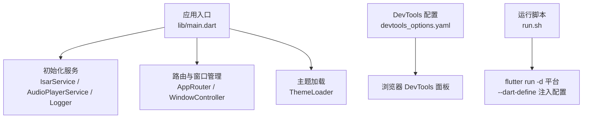
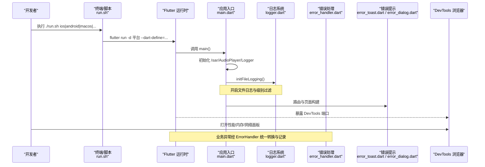
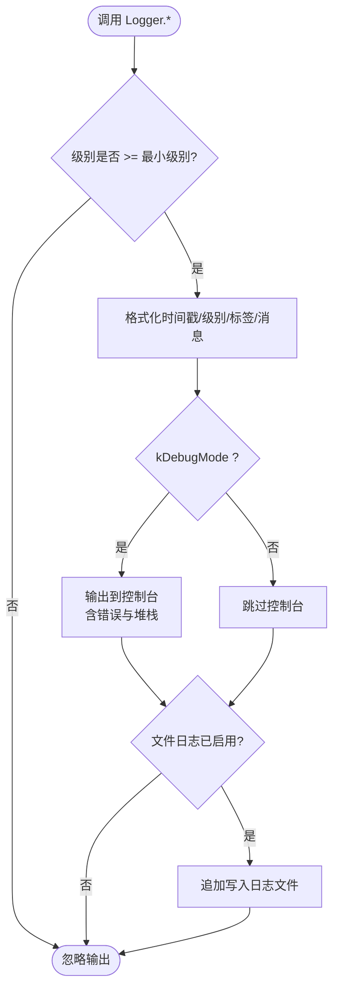
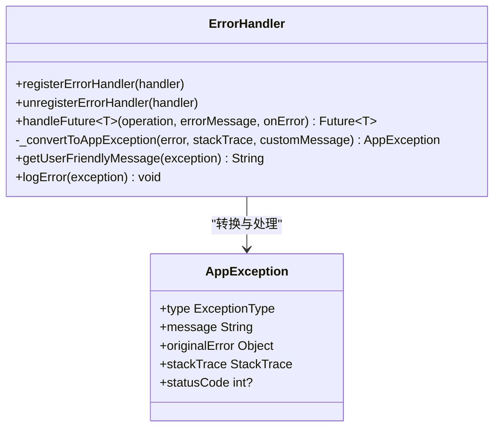
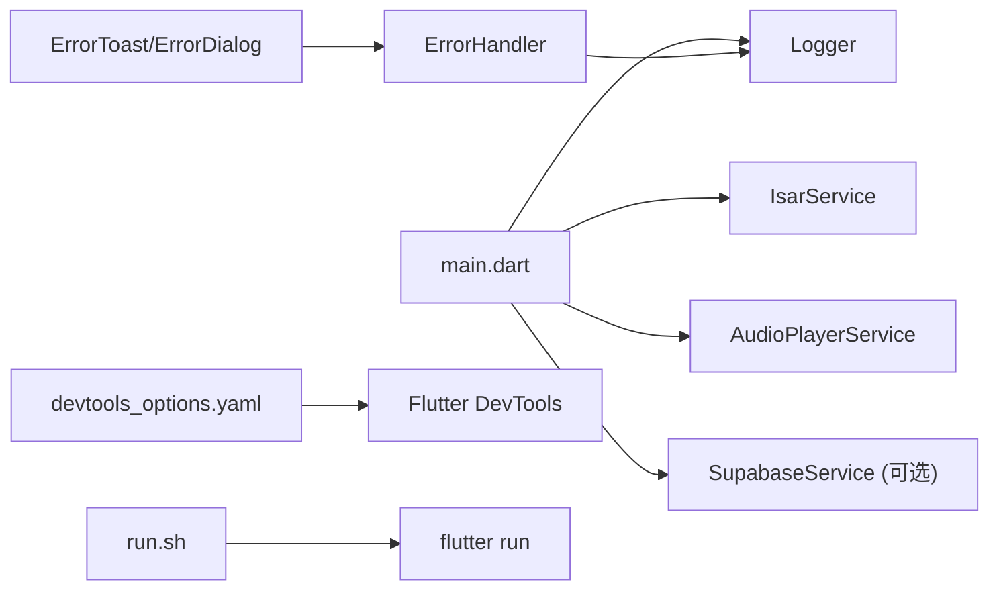

# 调试指南

<cite>
**本文引用的文件**   
- [main.dart](file://lib/main.dart)
- [devtools_options.yaml](file://devtools_options.yaml)
- [run.sh](file://run.sh)
- [logger.dart](file://lib/core/utils/logger.dart)
- [error_handler.dart](file://lib/core/utils/error_handler.dart)
- [error_toast.dart](file://lib/presentation/widgets/common/error_toast.dart)
- [error_dialog.dart](file://lib/presentation/widgets/common/error_dialog.dart)
- [download_debug_guide.md](file://docs/download_debug_guide.md)
- [download_queue_debug.md](file://docs/download_queue_debug.md)
- [AndroidManifest.xml（profile）](file://android/app/src/profile/AndroidManifest.xml)
- [flutter_lldb_helper.py](file://ios/Flutter/ephemeral/flutter_lldb_helper.py)
</cite>

## 目录
1. [简介](#简介)
2. [项目结构](#项目结构)
3. [核心组件](#核心组件)
4. [架构总览](#架构总览)
5. [详细组件分析](#详细组件分析)
6. [依赖关系分析](#依赖关系分析)
7. [性能与内存调试](#性能与内存调试)
8. [网络请求调试](#网络请求调试)
9. [日志系统配置与使用](#日志系统配置与使用)
10. [常见问题排查](#常见问题排查)
11. [断点、热重载与热重启](#断点热重载与热重启)
12. [移动端与桌面端特殊调试方法](#移动端与桌面端特殊调试方法)
13. [错误追踪与崩溃报告](#错误追踪与崩溃报告)
14. [结论](#结论)

## 简介
本指南面向 TinyCast 项目的开发与维护人员，系统化说明如何使用 Flutter DevTools 进行性能分析、内存检查与网络调试；如何配置和使用内置日志系统；如何定位音频播放、下载失败、数据库异常等常见问题；以及如何在移动端与桌面端进行高效调试。文档同时给出错误追踪与崩溃报告的落地方案建议。

## 项目结构
TinyCast 采用多平台 Flutter 工程结构，包含 Android、iOS、macOS、Windows、Linux 与 Web 目标。启动入口在 main.dart，DevTools 扩展配置位于 devtools_options.yaml，运行脚本 run.sh 用于跨平台快速启动并注入环境变量。

图表来源
- [main.dart:106-194](file://lib/main.dart#L106-L194)
- [devtools_options.yaml:1-4](file://devtools_options.yaml#L1-L4)
- [run.sh:11-65](file://run.sh#L11-L65)

章节来源
- [main.dart:106-194](file://lib/main.dart#L106-L194)
- [devtools_options.yaml:1-4](file://devtools_options.yaml#L1-L4)
- [run.sh:11-65](file://run.sh#L11-L65)

## 核心组件
- 应用初始化与生命周期：在 main.dart 中完成 Isar、AudioPlayer、Logger 的初始化，并根据平台选择桌面或移动 UI。
- 日志系统：统一的 Logger 工具类，支持级别过滤、控制台输出与文件落盘。
- 错误处理：ErrorHandler 将原始异常转换为 AppException，并提供用户友好消息与统一记录。
- 用户反馈：ErrorToast 与 ErrorDialog 提供 Toast 与对话框形式的错误提示。
- 下载与队列调试：文档 docs/download_debug_guide.md 与 docs/download_queue_debug.md 提供了详细的下载流程日志标识与问题定位步骤。

章节来源
- [main.dart:106-194](file://lib/main.dart#L106-L194)
- [logger.dart:1-139](file://lib/core/utils/logger.dart#L1-L139)
- [error_handler.dart:1-129](file://lib/core/utils/error_handler.dart#L1-L129)
- [error_toast.dart:1-212](file://lib/presentation/widgets/common/error_toast.dart#L1-L212)
- [error_dialog.dart:1-438](file://lib/presentation/widgets/common/error_dialog.dart#L1-L438)
- [download_debug_guide.md:1-269](file://docs/download_debug_guide.md#L1-L269)
- [download_queue_debug.md:1-277](file://docs/download_queue_debug.md#L1-L277)

## 架构总览
下图展示了应用启动、日志与错误处理的关键调用链，以及 DevTools 与运行脚本的集成点。

图表来源
- [run.sh:11-65](file://run.sh#L11-L65)
- [main.dart:106-194](file://lib/main.dart#L106-L194)
- [logger.dart:41-65](file://lib/core/utils/logger.dart#L41-L65)
- [error_handler.dart:27-57](file://lib/core/utils/error_handler.dart#L27-L57)
- [error_toast.dart:1-212](file://lib/presentation/widgets/common/error_toast.dart#L1-L212)
- [error_dialog.dart:1-438](file://lib/presentation/widgets/common/error_dialog.dart#L1-L438)

## 详细组件分析

### 日志系统（Logger）
- 功能要点
  - 支持 debug/info/warning/error 四级日志，默认在调试模式启用 info 及以上级别。
  - 可通过 setMinLevel 动态调整最小级别。
  - 支持文件日志：按日期生成日志文件，自动创建目录与文件，写入失败时关闭文件日志。
  - 在 kDebugMode 下输出到控制台，并附带错误与堆栈信息。
- 使用建议
  - 在应用启动时调用 initFileLogging，确保日志持久化。
  - 关键路径使用 info，异常路径使用 error 并传入 error 与 stackTrace。
  - 通过 tag 区分模块，便于过滤与检索。

图表来源
- [logger.dart:27-117](file://lib/core/utils/logger.dart#L27-L117)

章节来源
- [logger.dart:1-139](file://lib/core/utils/logger.dart#L1-L139)

### 错误处理（ErrorHandler）
- 功能要点
  - 提供 handleError<T> 包装异步操作，捕获异常并转换为 AppException。
  - 支持注册多个错误处理器，集中处理或上报。
  - 提供 getUserFriendlyMessage 将异常类型映射为用户可读消息。
  - 内部通过 Logger.error 记录错误与堆栈。
- 使用建议
  - 在网络、存储、解析等关键路径包裹 handleError。
  - 结合 ErrorToast/ErrorDialog 展示用户提示。

图表来源
- [error_handler.dart:10-129](file://lib/core/utils/error_handler.dart#L10-L129)

章节来源
- [error_handler.dart:1-129](file://lib/core/utils/error_handler.dart#L1-L129)

### 用户反馈（ErrorToast / ErrorDialog）
- ErrorToast
  - 提供 showError/showSuccess/showWarning 等便捷方法。
  - 支持根据 AppException.type 显示不同提示。
- ErrorDialog
  - 通用错误对话框，支持重试与关闭回调。
  - 针对网络、解析、存储等场景提供专用对话框。

章节来源
- [error_toast.dart:1-212](file://lib/presentation/widgets/common/error_toast.dart#L1-L212)
- [error_dialog.dart:1-438](file://lib/presentation/widgets/common/error_dialog.dart#L1-L438)

### 下载与队列调试
- 下载流程日志
  - 文档 download_debug_guide.md 定义了丰富的 emoji 标识，涵盖文件路径、音频操作、下载进度、成功/错误/警告等。
  - 典型场景包括订阅后自动下载、单个下载过程、音频目录内容检查。
- 队列问题定位
  - 文档 download_queue_debug.md 指出“任务入队但未执行”的根因，并通过新增日志定位 _processQueue 调用与出队逻辑。
  - 提供手动测试方法与文件系统检查命令。

章节来源
- [download_debug_guide.md:1-269](file://docs/download_debug_guide.md#L1-L269)
- [download_queue_debug.md:1-277](file://docs/download_queue_debug.md#L1-L277)

## 依赖关系分析
- 启动依赖
  - main.dart 依赖 IsarService、AudioPlayerService、Logger、SupabaseService（可选）。
  - 通过 run.sh 注入 SUPABASE_URL 与 SUPABASE_ANON_KEY。
- 日志与错误
  - ErrorHandler 依赖 Logger 进行错误记录。
  - UI 层依赖 ErrorToast/ErrorDialog 进行用户提示。
- DevTools
  - devtools_options.yaml 控制扩展启用状态，运行时由 Flutter 暴露 DevTools 端口。

图表来源
- [main.dart:106-194](file://lib/main.dart#L106-L194)
- [logger.dart:1-139](file://lib/core/utils/logger.dart#L1-L139)
- [error_handler.dart:1-129](file://lib/core/utils/error_handler.dart#L1-L129)
- [devtools_options.yaml:1-4](file://devtools_options.yaml#L1-L4)
- [run.sh:11-65](file://run.sh#L11-L65)

章节来源
- [main.dart:106-194](file://lib/main.dart#L106-L194)
- [logger.dart:1-139](file://lib/core/utils/logger.dart#L1-L139)
- [error_handler.dart:1-129](file://lib/core/utils/error_handler.dart#L1-L129)
- [devtools_options.yaml:1-4](file://devtools_options.yaml#L1-L4)
- [run.sh:11-65](file://run.sh#L11-L65)

## 性能与内存调试
- 使用 Flutter DevTools
  - 启动应用后在浏览器打开 DevTools，进入 Performance 面板录制帧率与耗时，定位卡顿与重绘热点。
  - 使用 Memory 面板查看对象分配、快照对比，识别内存泄漏与未释放资源。
- 常用技巧
  - 在关键渲染路径添加性能埋点（如 build 耗时），结合 Logger.info 输出时间戳。
  - 使用 isolate 监控 CPU 占用，避免阻塞主线程。
  - 对长列表与图片加载进行虚拟化与缓存优化。

[本节为通用指导，不直接分析具体文件]

## 网络请求调试
- 使用 DevTools Network 面板
  - 查看所有 HTTP 请求、响应体、耗时与错误码。
  - 过滤特定域名或路径，快速定位问题接口。
- 结合日志与错误提示
  - 在业务层使用 ErrorHandler.handleError 包装网络调用，统一捕获 DioException 等异常。
  - 通过 ErrorToast.showNetworkError 或 NetworkErrorDialog 提示用户。

章节来源
- [error_handler.dart:27-57](file://lib/core/utils/error_handler.dart#L27-L57)
- [error_toast.dart:43-53](file://lib/presentation/widgets/common/error_toast.dart#L43-L53)
- [error_dialog.dart:166-255](file://lib/presentation/widgets/common/error_dialog.dart#L166-L255)

## 日志系统配置与使用
- 初始化
  - 在 main.dart 的 _initializeApp 中调用 Logger.initFileLogging，确保日志文件可用。
- 级别控制
  - 默认调试模式最低级别为 info，可通过 Logger.setMinLevel 调整为 debug 以获取更详细信息。
- 文件日志
  - 日志文件按日期命名，保存在系统临时目录下的 tinycast/log 文件夹中。
- 使用建议
  - 关键路径使用 info，异常路径使用 error 并携带 error 与 stackTrace。
  - 使用 tag 区分模块，便于过滤。

章节来源
- [main.dart:179-194](file://lib/main.dart#L179-L194)
- [logger.dart:27-65](file://lib/core/utils/logger.dart#L27-L65)

## 常见问题排查

### 音频播放问题
- 症状
  - 无法播放、无声音、播放中断、进度恢复异常。
- 排查步骤
  - 确认播放器已初始化（AudioPlayerService.instance.init）。
  - 检查音频源是否为本地文件或有效 URL。
  - 观察播放状态流与错误提示（ErrorToast/ErrorDialog）。
  - 使用 DevTools Performance 面板检查主线程阻塞。
- 参考
  - 播放服务重构摘要中说明了 autoPlay 与 updateLastPlayedAt 的条件逻辑差异，有助于定位行为偏差。

章节来源
- [main.dart:179-194](file://lib/main.dart#L179-L194)
- [error_toast.dart:1-212](file://lib/presentation/widgets/common/error_toast.dart#L1-L212)
- [error_dialog.dart:1-438](file://lib/presentation/widgets/common/error_dialog.dart#L1-L438)

### 下载失败
- 症状
  - 任务入队但无下载日志、下载中断、文件缺失。
- 排查步骤
  - 查看 download_debug_guide.md 中的下载流程日志标识，搜索 ⬇️ 与 🌐 相关行。
  - 检查临时目录与音频目录权限与路径。
  - 使用 download_queue_debug.md 中的关键词定位队列处理与出队逻辑。
  - 验证网络连通性与 URL 有效性。
- 参考
  - 文档提供了常见问题的症状与排查步骤，以及手动触发下载的方法。

章节来源
- [download_debug_guide.md:121-236](file://docs/download_debug_guide.md#L121-L236)
- [download_queue_debug.md:100-176](file://docs/download_queue_debug.md#L100-L176)

### 数据库错误
- 症状
  - Isar 读写异常、事务失败、数据不一致。
- 排查步骤
  - 使用 ErrorHandler.handleError 包裹数据库操作，捕获并记录异常。
  - 检查数据库连接与版本迁移。
  - 通过 Logger.error 输出错误与堆栈，定位具体语句与参数。
- 参考
  - 错误处理与日志记录机制可覆盖数据库异常场景。

章节来源
- [error_handler.dart:27-57](file://lib/core/utils/error_handler.dart#L27-L57)
- [logger.dart:83-117](file://lib/core/utils/logger.dart#L83-L117)

## 断点、热重载与热重启
- 断点调试
  - 在 IDE 中设置断点，逐步执行关键逻辑（如下载、播放、数据库操作）。
  - iOS 平台可使用 LLDB 辅助调试，flutter_lldb_helper.py 提供 RX 页处理集成。
- 热重载与热重启
  - 开发阶段优先使用热重载（r）保持状态，必要时热重启（R）重置状态。
  - Android profile 清单包含 INTERNET 权限，保障调试通信。
- 推荐实践
  - 在复杂流程前后打印关键变量与状态，配合 DevTools 内存/性能面板交叉验证。

章节来源
- [flutter_lldb_helper.py:1-32](file://ios/Flutter/ephemeral/flutter_lldb_helper.py#L1-L32)
- [AndroidManifest.xml（profile）:1-7](file://android/app/src/profile/AndroidManifest.xml#L1-L7)

## 移动端与桌面端特殊调试方法
- 移动端（iOS/Android）
  - 使用 run.sh 指定设备 ID 与平台，自动注入 Supabase 配置。
  - 通过 DevTools 的 Mobile 视图与 Device Orientation 模拟不同屏幕尺寸。
  - iOS 使用 Xcode Instruments 进行性能与内存深度分析。
- 桌面端（macOS/Linux/Windows）
  - 使用 run.sh 自动检测操作系统并选择对应平台。
  - 利用 DevTools 的 Widget Inspector 与 Performance Overlay 检查布局与渲染。
  - 在 macOS 上使用 Activity Monitor 与 Instruments 辅助定位系统级问题。

章节来源
- [run.sh:11-65](file://run.sh#L11-L65)

## 错误追踪与崩溃报告
- 本地错误追踪
  - 使用 ErrorHandler 统一转换异常，并通过 Logger 输出错误与堆栈。
  - 结合 ErrorToast/ErrorDialog 向用户展示友好提示。
- 崩溃报告（建议）
  - 引入第三方崩溃收集 SDK（如 Sentry、Firebase Crashlytics），在 ErrorHandler 中上报异常详情。
  - 在 Logger 文件中保留关键上下文（用户操作、设备信息、网络状态）。
  - 生产环境降低日志级别，仅保留 warning 与 error，减少 I/O 开销。

章节来源
- [error_handler.dart:27-57](file://lib/core/utils/error_handler.dart#L27-L57)
- [logger.dart:27-65](file://lib/core/utils/logger.dart#L27-L65)

## 结论
通过 Flutter DevTools、统一的日志与错误处理体系，以及完善的下载与队列调试文档，TinyCast 项目在移动端与桌面端均具备高效的调试能力。建议在开发过程中充分利用 DevTools 的性能与内存面板，结合 Logger 的文件日志与 ErrorHandler 的统一异常处理，快速定位并解决问题。对于生产环境，建议引入崩溃报告与限级的日志策略，提升稳定性与可观测性。