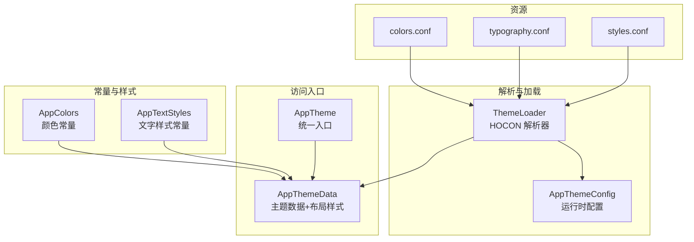
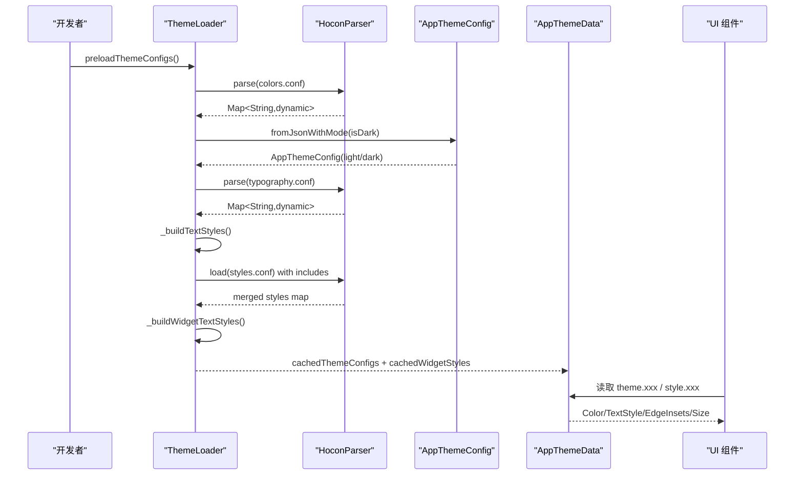
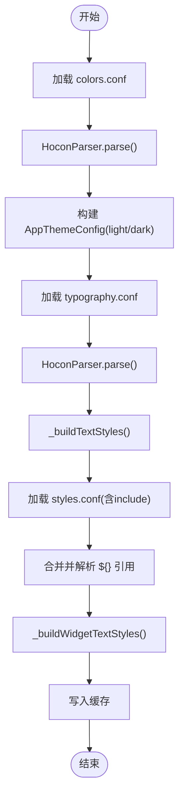
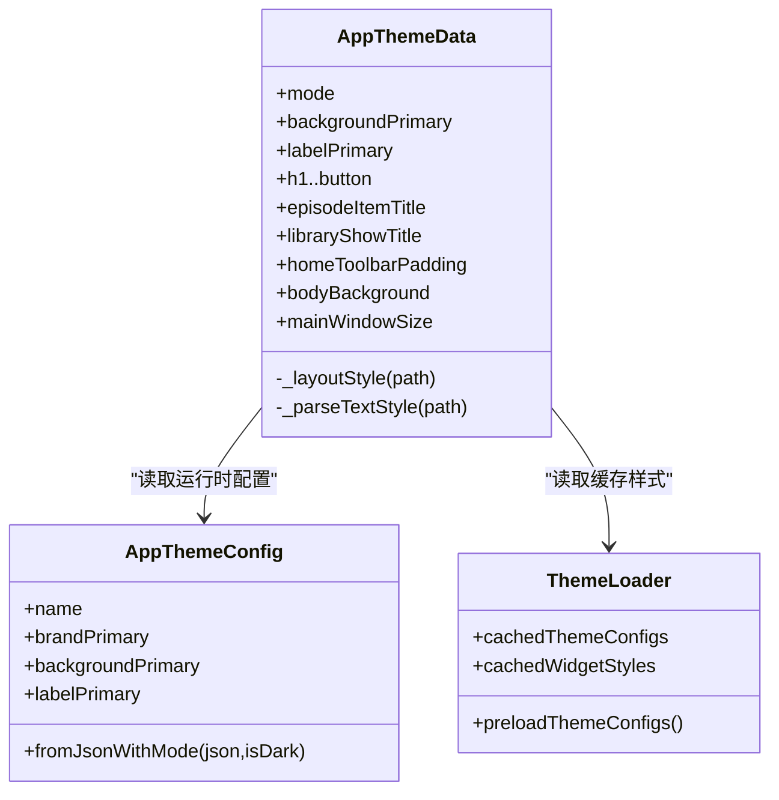
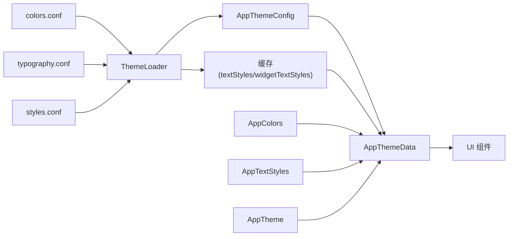

# 主题扩展开发

<cite>
**本文引用的文件**   
- [assets/themes/colors.conf](file://assets/themes/colors.conf)
- [assets/themes/typography.conf](file://assets/themes/typography.conf)
- [assets/themes/styles.conf](file://assets/themes/styles.conf)
- [lib/core/theme/app_theme.dart](file://lib/core/theme/app_theme.dart)
- [lib/core/theme/app_colors.dart](file://lib/core/theme/app_colors.dart)
- [lib/core/theme/app_text_styles.dart](file://lib/core/theme/app_text_styles.dart)
- [lib/core/theme/theme_data.dart](file://lib/core/theme/theme_data.dart)
- [lib/core/theme/theme_loader.dart](file://lib/core/theme/theme_loader.dart)
- [lib/core/theme/app_theme_config.dart](file://lib/core/theme/app_theme_config.dart)
- [docs/theme/overview.md](file://docs/theme/overview.md)
- [docs/theme/colors.md](file://docs/theme/colors.md)
- [docs/theme/typography.md](file://docs/theme/typography.md)
</cite>

## 目录
1. [简介](#简介)
2. [项目结构](#项目结构)
3. [核心组件](#核心组件)
4. [架构总览](#架构总览)
5. [详细组件分析](#详细组件分析)
6. [依赖关系分析](#依赖关系分析)
7. [性能考量](#性能考量)
8. [故障排查指南](#故障排查指南)
9. [结论](#结论)
10. [附录：完整主题开发流程与示例](#附录完整主题开发流程与示例)

## 简介
本指南面向 TinyCast 的主题扩展开发者，系统阐述基于 HOCON 的配置驱动主题体系。内容涵盖颜色定义规则、字体排版配置、样式整合、运行时加载机制以及动态换肤实现路径。通过“编译时常量 + 运行时解析”双模式，开发者可在保证性能的同时灵活定制应用外观并保持设计一致性。

## 项目结构
主题相关资源与代码按职责清晰分层：
- 资源层：assets/themes 下的 HOCON 配置文件（colors.conf、typography.conf、styles.conf）
- 解析与加载层：theme_loader.dart（HOCON 解析器与缓存）、app_theme_config.dart（运行时主题配置对象）
- 常量与样式层：app_colors.dart（颜色常量）、app_text_styles.dart（文字样式常量）
- 访问入口层：app_theme.dart（统一入口）、theme_data.dart（主题数据聚合与布局样式解析）

**图表来源** 
- [assets/themes/colors.conf:1-106](file://assets/themes/colors.conf#L1-L106)
- [assets/themes/typography.conf:1-136](file://assets/themes/typography.conf#L1-L136)
- [assets/themes/styles.conf:1-262](file://assets/themes/styles.conf#L1-L262)
- [lib/core/theme/theme_loader.dart:1-684](file://lib/core/theme/theme_loader.dart#L1-L684)
- [lib/core/theme/app_theme_config.dart:1-146](file://lib/core/theme/app_theme_config.dart#L1-L146)
- [lib/core/theme/app_colors.dart:1-48](file://lib/core/theme/app_colors.dart#L1-L48)
- [lib/core/theme/app_text_styles.dart:1-175](file://lib/core/theme/app_text_styles.dart#L1-L175)
- [lib/core/theme/app_theme.dart:1-21](file://lib/core/theme/app_theme.dart#L1-L21)
- [lib/core/theme/theme_data.dart:1-807](file://lib/core/theme/theme_data.dart#L1-L807)

**章节来源**
- [docs/theme/overview.md:1-154](file://docs/theme/overview.md#L1-L154)

## 核心组件
- AppTheme：提供 light/dark 静态访问与从亮度自动选择的能力，内部通过 ThemeSource 控制是否使用硬编码或运行时配置。
- AppThemeData：主题数据的统一访问点，聚合颜色、间距、圆角、阴影与 Widget/页面布局样式；支持从 HOCON 动态解析或回退到硬编码常量。
- ThemeLoader：轻量 HOCON 解析器，支持 include、${} 引用、注释与嵌套对象；负责加载 colors/typography/styles 并构建文本样式与 Widget 样式缓存。
- AppThemeConfig：运行时主题配置对象，封装所有调色板颜色，便于 JSON/HOCON 到 Dart 的映射。
- AppColors/AppTextStyles：编译时常量集合，确保高性能与 const 优化。

**章节来源**
- [lib/core/theme/app_theme.dart:1-21](file://lib/core/theme/app_theme.dart#L1-L21)
- [lib/core/theme/theme_data.dart:1-807](file://lib/core/theme/theme_data.dart#L1-L807)
- [lib/core/theme/theme_loader.dart:1-684](file://lib/core/theme/theme_loader.dart#L1-L684)
- [lib/core/theme/app_theme_config.dart:1-146](file://lib/core/theme/app_theme_config.dart#L1-L146)
- [lib/core/theme/app_colors.dart:1-48](file://lib/core/theme/app_colors.dart#L1-L48)
- [lib/core/theme/app_text_styles.dart:1-175](file://lib/core/theme/app_text_styles.dart#L1-L175)

## 架构总览
下图展示从 HOCON 配置到 UI 渲染的主题加载与使用流程。

**图表来源** 
- [lib/core/theme/theme_loader.dart:374-507](file://lib/core/theme/theme_loader.dart#L374-L507)
- [lib/core/theme/theme_loader.dart:598-684](file://lib/core/theme/theme_loader.dart#L598-L684)
- [lib/core/theme/theme_data.dart:63-108](file://lib/core/theme/theme_data.dart#L63-L108)
- [lib/core/theme/app_theme_config.dart:72-108](file://lib/core/theme/app_theme_config.dart#L72-L108)

## 详细组件分析

### HOCON 配置规范与约定
- colors.conf：定义 palettes 下各调色板的 light/dark 值，采用 #AARRGGBB 格式。
- typography.conf：定义 textstyles 下各样式的 fontsize/fontweight/lineheight/letterspacing/color，支持 desktop/tablet/mobile 响应式变体。
- styles.conf：整合 colors 与 typography，定义 widgets/page/window_container/multi_window 等布局与交互样式，支持 ${} 引用与 include。

关键约定：
- 颜色命名遵循 {调色板}{颜色名}{主题}，如 brandPrimaryLight。
- 文字样式 key 在 styles.conf 中引用 typography.conf 中的 textstyles.* 路径。
- 布局样式支持 padding/radius/background 等属性，部分 Widget 支持 background.hover/pressed/content_color.text 等状态色。

**章节来源**
- [assets/themes/colors.conf:1-106](file://assets/themes/colors.conf#L1-L106)
- [assets/themes/typography.conf:1-136](file://assets/themes/typography.conf#L1-L136)
- [assets/themes/styles.conf:1-262](file://assets/themes/styles.conf#L1-L262)
- [docs/theme/colors.md:1-307](file://docs/theme/colors.md#L1-L307)
- [docs/theme/typography.md:1-369](file://docs/theme/typography.md#L1-L369)

### ThemeLoader 与 HoconParser
- 支持 include、${} 引用、单行注释、嵌套对象语法与点号路径。
- 预加载时合并 styles.conf 与其 include 的文件，构建 textStyles 与 widgetTextStyles 缓存。
- 提供 clearCache 以支持运行时刷新主题。

**图表来源** 
- [lib/core/theme/theme_loader.dart:171-210](file://lib/core/theme/theme_loader.dart#L171-L210)
- [lib/core/theme/theme_loader.dart:374-507](file://lib/core/theme/theme_loader.dart#L374-L507)
- [lib/core/theme/theme_loader.dart:598-684](file://lib/core/theme/theme_loader.dart#L598-L684)

**章节来源**
- [lib/core/theme/theme_loader.dart:1-684](file://lib/core/theme/theme_loader.dart#L1-L684)

### AppThemeData：主题数据与布局样式
- 颜色与文字样式：优先从 HOCON 解析结果获取，否则回退到 AppColors/AppTextStyles 常量。
- 布局样式：通过路径解析 window_container、widgets、page 等节点，返回 EdgeInsets/BorderRadius/Color/TextStyle 等。
- 多窗口尺寸：multi_window.main_window/settings_window 的尺寸由样式配置决定。

**图表来源** 
- [lib/core/theme/theme_data.dart:48-108](file://lib/core/theme/theme_data.dart#L48-L108)
- [lib/core/theme/app_theme_config.dart:38-108](file://lib/core/theme/app_theme_config.dart#L38-L108)
- [lib/core/theme/theme_loader.dart:331-372](file://lib/core/theme/theme_loader.dart#L331-L372)

**章节来源**
- [lib/core/theme/theme_data.dart:1-807](file://lib/core/theme/theme_data.dart#L1-L807)

### AppTheme：统一入口
- 提供 light/dark 静态访问与 fromBrightness 自动选择。
- 通过 ThemeSource.useHardcoded 控制是否启用硬编码模式（当前默认关闭，使用 HOCON）。

**章节来源**
- [lib/core/theme/app_theme.dart:1-21](file://lib/core/theme/app_theme.dart#L1-L21)

### AppColors 与 AppTextStyles：编译时常量
- AppColors：集中管理所有调色板颜色的 const Color 常量。
- AppTextStyles：集中管理 h1/h2/h3/body/caption/button 等 TextStyle 常量，并维护字体族回退列表。

**章节来源**
- [lib/core/theme/app_colors.dart:1-48](file://lib/core/theme/app_colors.dart#L1-L48)
- [lib/core/theme/app_text_styles.dart:1-175](file://lib/core/theme/app_text_styles.dart#L1-L175)

## 依赖关系分析
- 资源文件被 ThemeLoader 解析后生成 AppThemeConfig 与样式缓存。
- AppThemeData 依赖 ThemeLoader 的缓存与 AppThemeConfig 的颜色字段。
- AppTheme 作为门面，将 AppThemeData 暴露给上层 UI。
- AppColors/AppTextStyles 作为回退常量，确保在无 HOCON 或解析失败时的可用性。

**图表来源** 
- [lib/core/theme/theme_loader.dart:331-372](file://lib/core/theme/theme_loader.dart#L331-L372)
- [lib/core/theme/theme_data.dart:63-108](file://lib/core/theme/theme_data.dart#L63-L108)
- [lib/core/theme/app_theme.dart:1-21](file://lib/core/theme/app_theme.dart#L1-L21)

**章节来源**
- [lib/core/theme/theme_loader.dart:1-684](file://lib/core/theme/theme_loader.dart#L1-L684)
- [lib/core/theme/theme_data.dart:1-807](file://lib/core/theme/theme_data.dart#L1-L807)

## 性能考量
- 编译时常量模式（需开启 useHardcoded）：使用 const Color/TextStyle，零运行时开销，支持 Widget 树 const 优化。
- 运行时解析模式：通过 ThemeLoader 预加载并缓存 JSON，避免重复 IO 与解析；首次加载后后续访问为 O(1)。
- 建议：
  - 日常开发优先使用 AppThemeData 的 getter，保持代码简洁与可维护性。
  - 当前没有运行时刷新机制；若要扩展动态换肤，可调用 ThemeLoader.clearCache() 后重新 preloadThemeConfigs()，并自行触发根组件重建。

[本节为通用指导，不直接分析具体文件]

## 故障排查指南
常见问题与定位要点：
- include 路径错误：检查 styles.conf 的 include 语句与相对路径是否正确。
- ${} 引用未解析：确认引用路径是否存在于合并后的根结构中，注意大小写与层级。
- 颜色格式错误：确保使用 #AARRGGBB 格式，且长度正确。
- Widget 样式未生效：确认 styles.conf 中对应节点包含 fontsize/color 等必要字段，且路径匹配。
- 缓存未更新：切换主题后调用 ThemeLoader.clearCache() 重新预加载。

**章节来源**
- [lib/core/theme/theme_loader.dart:171-210](file://lib/core/theme/theme_loader.dart#L171-L210)
- [lib/core/theme/theme_loader.dart:598-684](file://lib/core/theme/theme_loader.dart#L598-L684)

## 结论
TinyCast 的主题系统以 HOCON 为核心，结合编译时常量与运行时解析双模式，既保证了性能又提供了灵活的扩展能力。通过统一的 AppThemeData 访问入口，开发者可以便捷地定制颜色、文字样式与布局，实现一致的设计体验与高效的动态换肤。

[本节为总结性内容，不直接分析具体文件]

## 附录：完整主题开发流程与示例

### 新增调色板与颜色
步骤：
1. 在 assets/themes/colors.conf 中添加新调色板与颜色键（light/dark）。
2. 在 lib/core/theme/app_colors.dart 中新增对应的 const Color 常量。
3. 在 lib/core/theme/app_theme_config.dart 的 AppThemeConfig 中添加字段与解析逻辑。
4. 在 lib/core/theme/theme_data.dart 的 AppThemeData 中新增 getter，支持 HOCON 与常量回退。
5. 在 UI 中使用 theme.newColor 或 AppColors.newColorXxx。

参考路径：
- [assets/themes/colors.conf:1-106](file://assets/themes/colors.conf#L1-L106)
- [lib/core/theme/app_colors.dart:1-48](file://lib/core/theme/app_colors.dart#L1-L48)
- [lib/core/theme/app_theme_config.dart:38-108](file://lib/core/theme/app_theme_config.dart#L38-L108)
- [lib/core/theme/theme_data.dart:110-181](file://lib/core/theme/theme_data.dart#L110-L181)

### 新增文字样式
步骤：
1. 在 assets/themes/typography.conf 的 textstyles 下新增样式定义，必要时添加 desktop/tablet/mobile 变体。
2. 在 lib/core/theme/app_text_styles.dart 中新增 Light/Dark 两套 TextStyle 常量。
3. 在 lib/core/theme/theme_data.dart 的 AppThemeData 中新增 getter，优先从 HOCON 解析的 textStyles 获取，否则回退到常量。
4. 在 UI 中使用 theme.newTextStyle。

参考路径：
- [assets/themes/typography.conf:1-136](file://assets/themes/typography.conf#L1-L136)
- [lib/core/theme/app_text_styles.dart:1-175](file://lib/core/theme/app_text_styles.dart#L1-L175)
- [lib/core/theme/theme_data.dart:182-251](file://lib/core/theme/theme_data.dart#L182-L251)

### 新增 Widget/页面布局样式
步骤：
1. 在 assets/themes/styles.conf 中新增 widgets/page/window_container 等节点，定义 fontsize/fontweight/lineheight/letterspacing/color 及背景、内边距、圆角等。
2. 在 lib/core/theme/theme_loader.dart 的 _buildWidgetTextStyles/_processNode 中确保能解析新增节点并生成 light/dark 两套 TextStyle。
3. 在 lib/core/theme/theme_data.dart 中新增对应 getter，优先从缓存样式获取，否则回退到常量。
4. 在 UI 中通过 theme.xxxStyle 或布局属性访问。

参考路径：
- [assets/themes/styles.conf:1-262](file://assets/themes/styles.conf#L1-L262)
- [lib/core/theme/theme_loader.dart:509-596](file://lib/core/theme/theme_loader.dart#L509-L596)
- [lib/core/theme/theme_data.dart:253-337](file://lib/core/theme/theme_data.dart#L253-L337)

### 实现动态换肤
步骤：
1. 在应用启动时调用 ThemeLoader.preloadThemeConfigs() 预加载主题配置与样式。
2. 用户切换主题时，根据 isDark 重新加载并更新缓存。
3. 若需强制刷新，调用 ThemeLoader.clearCache() 后再次预加载。
4. UI 通过 AppTheme.fromBrightness(brightness) 获取当前主题实例；当前版本没有 themeProvider，实现运行时切换需自行加入刷新机制（如重建根组件）。

参考路径：
- [lib/core/theme/theme_loader.dart:471-507](file://lib/core/theme/theme_loader.dart#L471-L507)
- [lib/core/theme/theme_loader.dart:663-684](file://lib/core/theme/theme_loader.dart#L663-L684)
- [lib/core/theme/app_theme.dart:1-21](file://lib/core/theme/app_theme.dart#L1-L21)

### 多主题支持（扩展思路）
- 在 ThemeLoader 中增加多主题键（如 “light”, “dark”, “custom”），并为每个主题构建独立的 AppThemeConfig。
- 在 styles.conf 中通过 include 引入不同主题的资源片段，或使用 ${} 引用区分主题变量。
- 在 AppThemeData 中根据当前主题键选择对应配置与样式缓存。

参考路径：
- [lib/core/theme/theme_loader.dart:331-372](file://lib/core/theme/theme_loader.dart#L331-L372)
- [lib/core/theme/app_theme_config.dart:72-108](file://lib/core/theme/app_theme_config.dart#L72-L108)