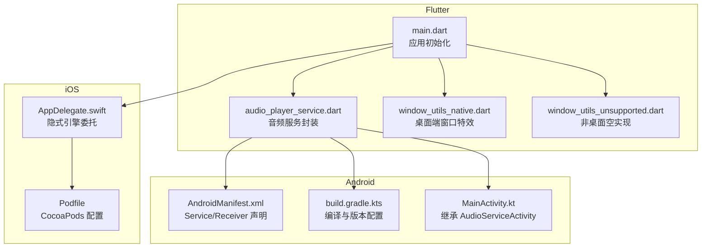
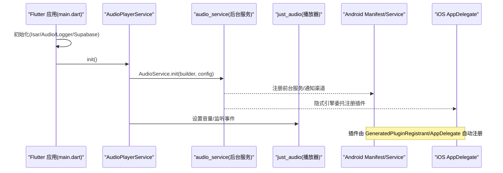
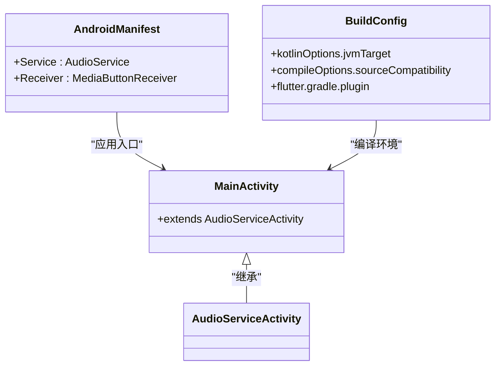
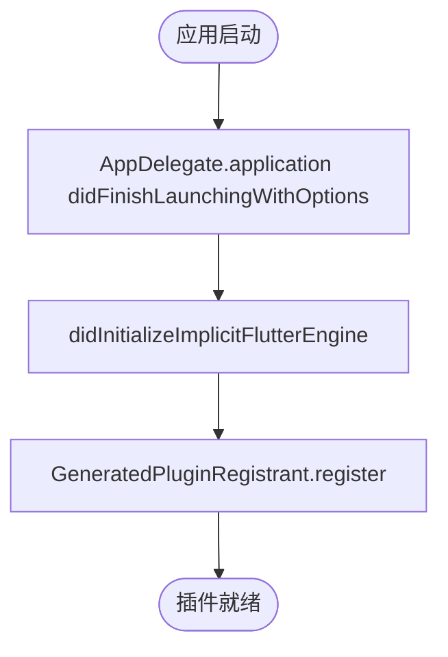
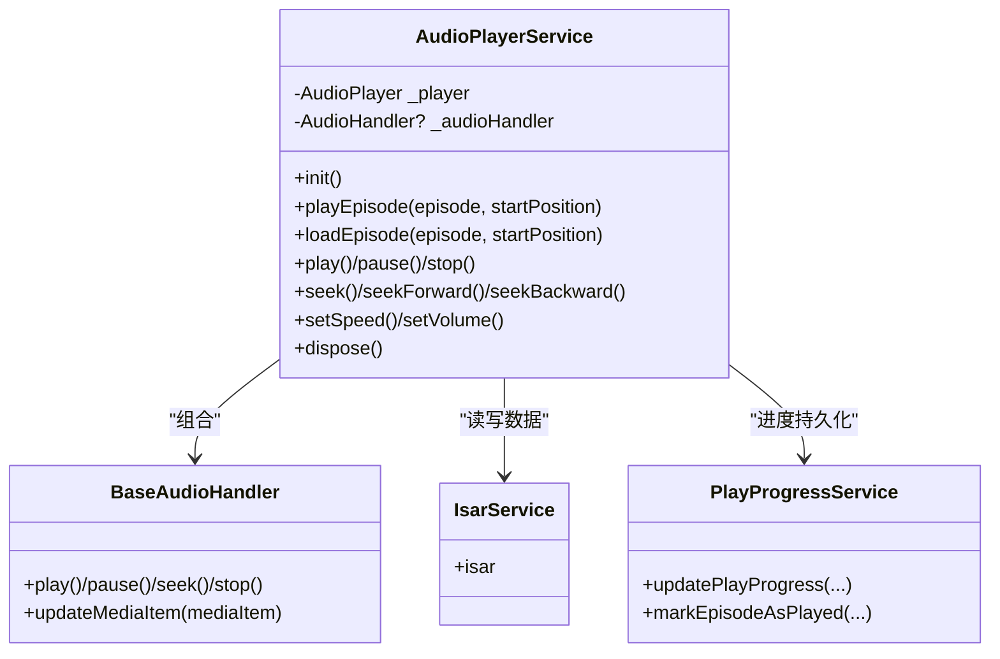
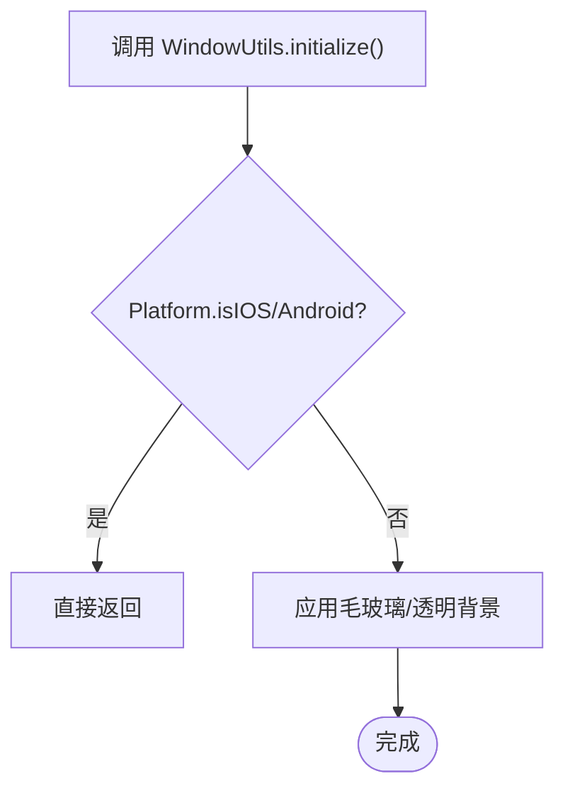
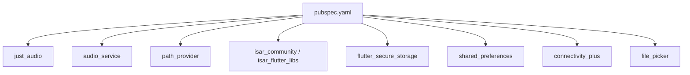

# 原生代码集成

<cite>
**本文引用的文件**   
- [android/app/src/main/kotlin/com/example/tinycast/MainActivity.kt](file://android/app/src/main/kotlin/com/example/tinycast/MainActivity.kt)
- [android/app/src/main/AndroidManifest.xml](file://android/app/src/main/AndroidManifest.xml)
- [android/app/build.gradle.kts](file://android/app/build.gradle.kts)
- [ios/Runner/AppDelegate.swift](file://ios/Runner/AppDelegate.swift)
- [ios/Podfile](file://ios/Podfile)
- [lib/main.dart](file://lib/main.dart)
- [lib/data/services/audio_player_service.dart](file://lib/data/services/audio_player_service.dart)
- [lib/src/window_utils_native.dart](file://lib/src/window_utils_native.dart)
- [lib/src/window_utils_unsupported.dart](file://lib/src/window_utils_unsupported.dart)
- [pubspec.yaml](file://pubspec.yaml)
</cite>

## 目录
1. [简介](#简介)
2. [项目结构](#项目结构)
3. [核心组件](#核心组件)
4. [架构总览](#架构总览)
5. [详细组件分析](#详细组件分析)
6. [依赖分析](#依赖分析)
7. [性能考虑](#性能考虑)
8. [故障排查指南](#故障排查指南)
9. [结论](#结论)
10. [附录](#附录)

## 简介
本指南面向 TinyCast 应用的 Flutter 与原生（Android Kotlin、iOS Swift）集成开发，重点说明：
- 如何在 Flutter 中通过方法通道与插件机制调用 Android/iOS 原生能力
- 原生模块的注册与调用流程、插件开发规范与错误处理机制
- 结合本项目现有实现，给出文件操作、通知系统、后台任务等系统级功能的参考路径与最佳实践
- 提供调试技巧、性能优化建议、内存管理与资源释放策略，确保扩展稳定高效

## 项目结构
TinyCast 采用标准 Flutter 工程结构，原生侧包含 Android 与 iOS 两个平台：
- Android：Kotlin Activity、Manifest 声明服务与接收器、Gradle 构建配置
- iOS：Swift AppDelegate、CocoaPods 管理第三方库
- Flutter：应用入口、音频播放服务、窗口工具抽象（跨平台兼容）

图表来源
- [lib/main.dart:106-177](file://lib/main.dart#L106-L177)
- [lib/data/services/audio_player_service.dart:100-134](file://lib/data/services/audio_player_service.dart#L100-L134)
- [android/app/src/main/AndroidManifest.xml:37-51](file://android/app/src/main/AndroidManifest.xml#L37-L51)
- [android/app/build.gradle.kts:8-31](file://android/app/build.gradle.kts#L8-L31)
- [android/app/src/main/kotlin/com/example/tinycast/MainActivity.kt:1-6](file://android/app/src/main/kotlin/com/example/tinycast/MainActivity.kt#L1-L6)
- [ios/Runner/AppDelegate.swift:1-17](file://ios/Runner/AppDelegate.swift#L1-L17)
- [ios/Podfile:1-44](file://ios/Podfile#L1-L44)

章节来源
- [lib/main.dart:106-177](file://lib/main.dart#L106-L177)
- [android/app/src/main/AndroidManifest.xml:37-51](file://android/app/src/main/AndroidManifest.xml#L37-L51)
- [android/app/build.gradle.kts:8-31](file://android/app/build.gradle.kts#L8-L31)
- [android/app/src/main/kotlin/com/example/tinycast/MainActivity.kt:1-6](file://android/app/src/main/kotlin/com/example/tinycast/MainActivity.kt#L1-L6)
- [ios/Runner/AppDelegate.swift:1-17](file://ios/Runner/AppDelegate.swift#L1-L17)
- [ios/Podfile:1-44](file://ios/Podfile#L1-L44)

## 核心组件
- 应用入口与生命周期管理：负责平台分支、服务初始化、订阅生命周期事件
- 音频播放服务：封装 just_audio 与 audio_service，统一播放状态、进度、媒体项更新与后台控制
- 窗口工具抽象：跨平台窗口特效与透明背景，移动端安全跳过桌面专属逻辑
- 原生注册与插件：Android 自动生成插件注册表；iOS 通过 AppDelegate 隐式引擎委托完成插件注册

章节来源
- [lib/main.dart:106-177](file://lib/main.dart#L106-L177)
- [lib/data/services/audio_player_service.dart:100-134](file://lib/data/services/audio_player_service.dart#L100-L134)
- [lib/src/window_utils_native.dart:6-20](file://lib/src/window_utils_native.dart#L6-L20)
- [lib/src/window_utils_unsupported.dart:1-31](file://lib/src/window_utils_unsupported.dart#L1-L31)

## 架构总览
下图展示 Flutter 层与 Android/iOS 原生层的交互关系，以及关键插件与服务在启动时的注册顺序。

图表来源
- [lib/main.dart:179-194](file://lib/main.dart#L179-L194)
- [lib/data/services/audio_player_service.dart:100-134](file://lib/data/services/audio_player_service.dart#L100-L134)
- [android/app/src/main/AndroidManifest.xml:37-51](file://android/app/src/main/AndroidManifest.xml#L37-L51)
- [ios/Runner/AppDelegate.swift:13-15](file://ios/Runner/AppDelegate.swift#L13-L15)

## 详细组件分析

### Android 原生集成要点
- MainActivity 继承 AudioServiceActivity，用于与 audio_service 协同工作
- AndroidManifest 声明前台服务与媒体按钮接收器，确保锁屏控制与通知栏可用
- build.gradle.kts 指定 Kotlin/Java 版本与 Flutter Gradle 插件，保证构建一致性

图表来源
- [android/app/src/main/kotlin/com/example/tinycast/MainActivity.kt:1-6](file://android/app/src/main/kotlin/com/example/tinycast/MainActivity.kt#L1-L6)
- [android/app/src/main/AndroidManifest.xml:37-51](file://android/app/src/main/AndroidManifest.xml#L37-L51)
- [android/app/build.gradle.kts:18-20](file://android/app/build.gradle.kts#L18-L20)

章节来源
- [android/app/src/main/kotlin/com/example/tinycast/MainActivity.kt:1-6](file://android/app/src/main/kotlin/com/example/tinycast/MainActivity.kt#L1-L6)
- [android/app/src/main/AndroidManifest.xml:37-51](file://android/app/src/main/AndroidManifest.xml#L37-L51)
- [android/app/build.gradle.kts:8-31](file://android/app/build.gradle.kts#L8-L31)

### iOS 原生集成要点
- AppDelegate 实现 FlutterImplicitEngineDelegate，在隐式引擎初始化时完成插件注册
- Podfile 使用 flutter_install_all_ios_pods 安装 Flutter 所需 Pods，并启用 use_frameworks!

图表来源
- [ios/Runner/AppDelegate.swift:6-15](file://ios/Runner/AppDelegate.swift#L6-L15)
- [ios/Podfile:30-36](file://ios/Podfile#L30-L36)

章节来源
- [ios/Runner/AppDelegate.swift:1-17](file://ios/Runner/AppDelegate.swift#L1-L17)
- [ios/Podfile:1-44](file://ios/Podfile#L1-L44)

### Flutter 音频播放服务（核心业务）
AudioPlayerService 封装了 just_audio 与 audio_service，提供统一的播放控制、状态流、进度持久化与媒体项更新。

图表来源
- [lib/data/services/audio_player_service.dart:31-134](file://lib/data/services/audio_player_service.dart#L31-L134)
- [lib/data/services/audio_player_service.dart:586-653](file://lib/data/services/audio_player_service.dart#L586-L653)

章节来源
- [lib/data/services/audio_player_service.dart:100-134](file://lib/data/services/audio_player_service.dart#L100-L134)
- [lib/data/services/audio_player_service.dart:302-324](file://lib/data/services/audio_player_service.dart#L302-L324)
- [lib/data/services/audio_player_service.dart:326-343](file://lib/data/services/audio_player_service.dart#L326-L343)
- [lib/data/services/audio_player_service.dart:469-507](file://lib/data/services/audio_player_service.dart#L469-L507)
- [lib/data/services/audio_player_service.dart:560-583](file://lib/data/services/audio_player_service.dart#L560-L583)

### 窗口工具抽象（跨平台兼容）
WindowUtils 在不同平台提供一致接口：桌面端使用 flutter_acrylic 实现毛玻璃效果，移动端直接返回避免调用不支持 API。

图表来源
- [lib/src/window_utils_native.dart:6-20](file://lib/src/window_utils_native.dart#L6-L20)
- [lib/src/window_utils_unsupported.dart:1-31](file://lib/src/window_utils_unsupported.dart#L1-L31)

章节来源
- [lib/src/window_utils_native.dart:6-20](file://lib/src/window_utils_native.dart#L6-L20)
- [lib/src/window_utils_unsupported.dart:1-31](file://lib/src/window_utils_unsupported.dart#L1-L31)

### 方法通道与插件机制（通用规范）
- Android：插件通过 GeneratedPluginRegistrant.java 自动注册到 FlutterEngine，Flutter 层通过 MethodChannel 调用插件暴露的方法
- iOS：AppDelegate 在隐式引擎初始化时调用 GeneratedPluginRegistrant.register，完成插件注册
- 自定义插件开发建议：
  - 定义清晰的 Dart API 与 MethodChannel 名称
  - 参数校验与错误码约定，统一返回格式
  - 线程安全：UI 线程与后台线程分离，避免阻塞主线程
  - 资源释放：在 dispose/close 中清理句柄、取消订阅、释放内存

章节来源
- [pubspec.yaml:123-128](file://pubspec.yaml#L123-L128)

## 依赖分析
TinyCast 的关键依赖包括音频播放、后台服务、文件系统、数据库与安全存储等。以下图展示了主要依赖及其职责。

图表来源
- [pubspec.yaml:60-143](file://pubspec.yaml#L60-L143)

章节来源
- [pubspec.yaml:60-143](file://pubspec.yaml#L60-L143)

## 性能考虑
- 音频播放
  - 合理设置默认音量与缓冲策略，避免频繁重建播放器实例
  - 使用广播 Stream 减少 UI 重绘压力，节流进度更新频率
  - 本地文件优先加载，网络回退需有超时与重试策略
- 后台任务
  - audio_service 前台服务类型设置为 mediaPlayback，确保锁屏控制与通知栏体验
  - 避免在主线程执行耗时 I/O，使用独立后台任务或协程
- 内存管理
  - 及时关闭 StreamController 与订阅，防止内存泄漏
  - 释放播放器资源（dispose），清理临时文件与缓存
- 构建与运行
  - Android NDK/Java/Kotlin 版本与 Flutter 插件兼容
  - iOS CocoaPods 使用 use_frameworks!，确保动态框架链接正确

[本节为通用指导，不直接分析具体文件]

## 故障排查指南
- 音频无法播放
  - 检查 AndroidManifest 是否声明前台服务与媒体按钮接收器
  - 确认 AudioPlayerService 已初始化且未重复创建
  - 查看日志输出，定位网络或本地文件路径问题
- 通知栏/锁屏控制无效
  - 验证 androidNotificationChannelId 与 channelName 配置
  - 检查前台服务类型与权限声明
- 插件注册失败
  - Android：查看 GeneratedPluginRegistrant 日志，确认插件类名与包名
  - iOS：确认 AppDelegate 的隐式引擎委托被调用，插件已注册
- 窗口特效异常
  - 移动端调用应直接返回，避免调用桌面专属 API
  - macOS/Windows 特效失败时回退到纯色背景

章节来源
- [lib/data/services/audio_player_service.dart:100-134](file://lib/data/services/audio_player_service.dart#L100-L134)
- [android/app/src/main/AndroidManifest.xml:37-51](file://android/app/src/main/AndroidManifest.xml#L37-L51)
- [lib/src/window_utils_native.dart:6-20](file://lib/src/window_utils_native.dart#L6-L20)

## 结论
TinyCast 的原生集成以插件与方法通道为核心，结合 audio_service 与 just_audio 实现了稳定的音频播放与后台控制。通过跨平台的窗口工具抽象与严格的资源管理，确保了多端一致性与稳定性。开发者可在此基础上扩展文件操作、通知系统与后台任务等系统级功能，遵循统一的插件开发与错误处理规范，保障应用质量与性能。

[本节为总结性内容，不直接分析具体文件]

## 附录
- 示例参考路径（不包含代码片段，仅指引位置）
  - 音频播放服务初始化与播放控制：[lib/data/services/audio_player_service.dart:100-134](file://lib/data/services/audio_player_service.dart#L100-L134)、[lib/data/services/audio_player_service.dart:302-324](file://lib/data/services/audio_player_service.dart#L302-L324)
  - 媒体项更新与后台控制：[lib/data/services/audio_player_service.dart:326-343](file://lib/data/services/audio_player_service.dart#L326-L343)、[lib/data/services/audio_player_service.dart:586-653](file://lib/data/services/audio_player_service.dart#L586-L653)
  - Android 前台服务与接收器声明：[android/app/src/main/AndroidManifest.xml:37-51](file://android/app/src/main/AndroidManifest.xml#L37-L51)
  - iOS 插件注册委托：[ios/Runner/AppDelegate.swift:13-15](file://ios/Runner/AppDelegate.swift#L13-L15)
  - 窗口工具跨平台适配：[lib/src/window_utils_native.dart:6-20](file://lib/src/window_utils_native.dart#L6-L20)、[lib/src/window_utils_unsupported.dart:1-31](file://lib/src/window_utils_unsupported.dart#L1-L31)

[本节为补充信息，不直接分析具体文件]