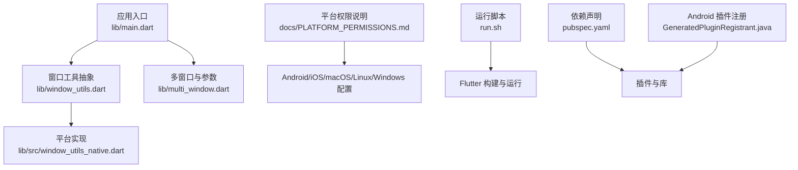
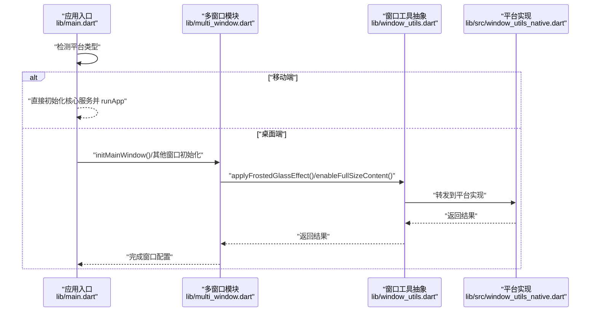
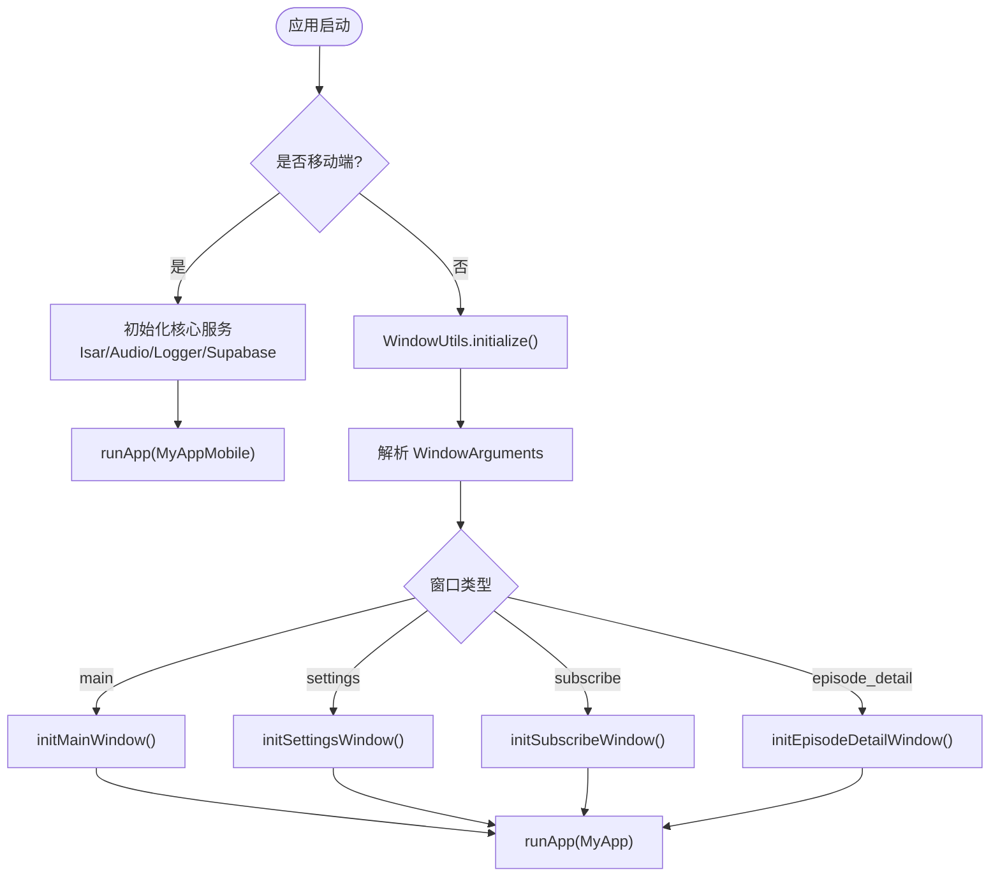
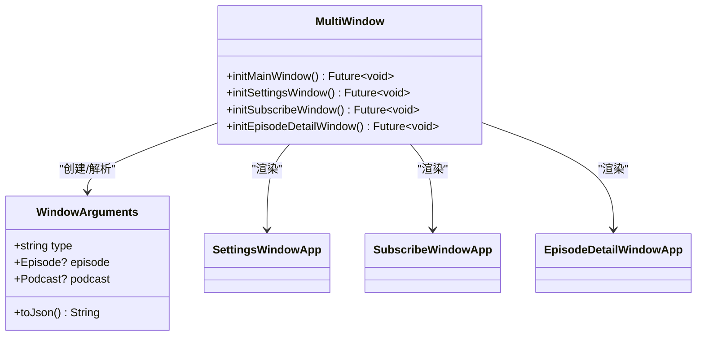
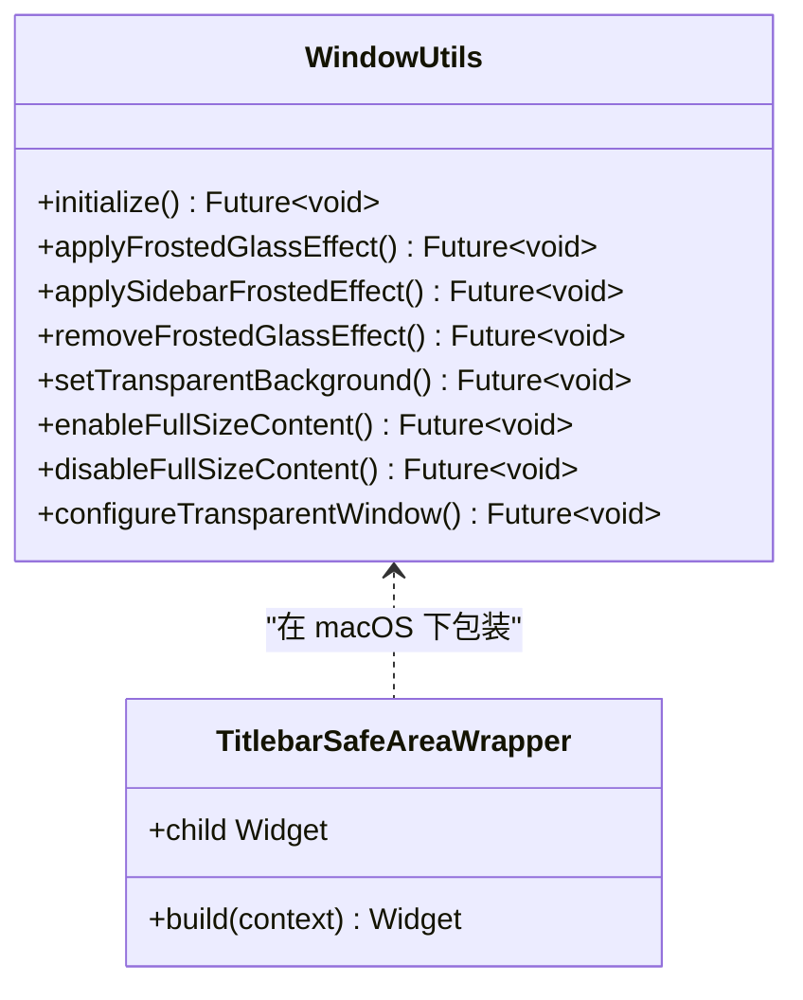
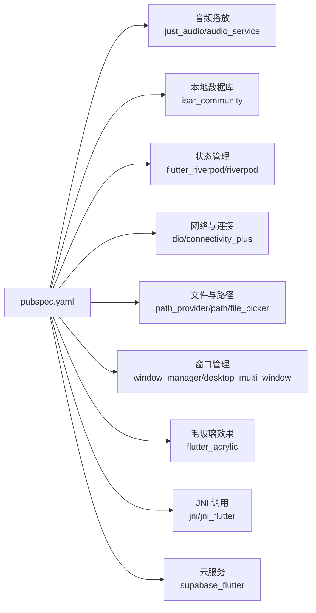

# 平台抽象层扩展

<cite>
**本文引用的文件**   
- [README.md](file://README.md)
- [pubspec.yaml](file://pubspec.yaml)
- [main.dart](file://lib/main.dart)
- [multi_window.dart](file://lib/multi_window.dart)
- [window_utils.dart](file://lib/window_utils.dart)
- [window_utils_native.dart](file://lib/src/window_utils_native.dart)
- [PLATFORM_PERMISSIONS.md](file://docs/PLATFORM_PERMISSIONS.md)
- [run.sh](file://run.sh)
- [mobile-platform-support/spec.md](file://.trae/specs/mobile-platform-support/spec.md)
- [mobile-platform-support/tasks.md](file://.trae/specs/mobile-platform-support/tasks.md)
- [macos-frosted-glass/spec.md](file://.trae/specs/macos-frosted-glass/spec.md)
- [GeneratedPluginRegistrant.java](file://android/app/src/main/java/io/flutter/plugins/GeneratedPluginRegistrant.java)
</cite>

## 目录
1. [简介](#简介)
2. [项目结构](#项目结构)
3. [核心组件](#核心组件)
4. [架构总览](#架构总览)
5. [详细组件分析](#详细组件分析)
6. [依赖关系分析](#依赖关系分析)
7. [性能考量](#性能考量)
8. [故障排查指南](#故障排查指南)
9. [结论](#结论)
10. [附录](#附录)

## 简介
本指南面向 TinyCast 应用的平台抽象层扩展，目标是帮助开发者在 Android、iOS、Windows、macOS 和 Linux 上实现一致的跨平台能力。文档围绕以下主题展开：
- 跨平台功能抽象的设计模式与实现方法
- 平台检测逻辑与差异处理策略
- 新增平台特定功能的完整流程（原生集成、权限管理、系统 API 调用）
- 典型场景示例（文件操作、通知系统、后台任务）
- 可维护性与可扩展性最佳实践

TinyCast 已具备桌面端多窗口与毛玻璃效果等能力，并通过条件导出与平台守卫实现了移动端兼容。我们将在此基础上提供系统化扩展指南。

## 项目结构
项目采用 Flutter 标准工程结构，核心入口与平台适配集中在 lib 目录，原生平台代码位于 android、ios、windows、macos、linux 子目录。关键文件职责如下：
- 应用启动与平台分支：lib/main.dart
- 桌面多窗口与参数解析：lib/multi_window.dart
- 窗口工具抽象与平台分发：lib/window_utils.dart 与 lib/src/window_utils_native.dart
- 平台权限说明：docs/PLATFORM_PERMISSIONS.md
- 运行脚本与平台选择：run.sh
- 依赖声明与插件清单：pubspec.yaml
- Android 插件注册：android/app/src/main/java/io/flutter/plugins/GeneratedPluginRegistrant.java

图表来源
- [main.dart:106-177](file://lib/main.dart#L106-L177)
- [window_utils.dart:1-6](file://lib/window_utils.dart#L1-L6)
- [window_utils_native.dart:1-125](file://lib/src/window_utils_native.dart#L1-L125)
- [multi_window.dart:188-303](file://lib/multi_window.dart#L188-L303)
- [PLATFORM_PERMISSIONS.md:1-116](file://docs/PLATFORM_PERMISSIONS.md#L1-L116)
- [run.sh:1-65](file://run.sh#L1-L65)
- [pubspec.yaml:1-196](file://pubspec.yaml#L1-L196)
- [GeneratedPluginRegistrant.java:36-85](file://android/app/src/main/java/io/flutter/plugins/GeneratedPluginRegistrant.java#L36-L85)

章节来源
- [README.md:1-6](file://README.md#L1-L6)
- [pubspec.yaml:1-196](file://pubspec.yaml#L1-L196)
- [main.dart:106-177](file://lib/main.dart#L106-L177)
- [multi_window.dart:188-303](file://lib/multi_window.dart#L188-L303)
- [window_utils.dart:1-6](file://lib/window_utils.dart#L1-L6)
- [window_utils_native.dart:1-125](file://lib/src/window_utils_native.dart#L1-L125)
- [PLATFORM_PERMISSIONS.md:1-116](file://docs/PLATFORM_PERMISSIONS.md#L1-L116)
- [run.sh:1-65](file://run.sh#L1-L65)

## 核心组件
- 应用入口与平台分支
  - main.dart 根据 Platform.isIOS / Platform.isAndroid 判断移动端，跳过桌面窗口初始化；桌面端使用 WindowController 和多窗口机制。
  - 统一初始化 IsarService、AudioPlayerService、Logger、Supabase（可选）。
- 多窗口与参数解析
  - multi_window.dart 定义 WindowArguments 并支持 JSON 序列化/反序列化，封装 initMainWindow/initSettingsWindow/initSubscribeWindow/initEpisodeDetailWindow 等平台守卫函数。
- 窗口工具抽象
  - window_utils.dart 通过条件导出将具体实现指向 window_utils_native.dart。
  - window_utils_native.dart 基于 flutter_acrylic 实现毛玻璃效果、透明背景、全屏内容等，并在各方法中增加平台守卫。

章节来源
- [main.dart:106-177](file://lib/main.dart#L106-L177)
- [multi_window.dart:18-182](file://lib/multi_window.dart#L18-L182)
- [multi_window.dart:188-303](file://lib/multi_window.dart#L188-L303)
- [window_utils.dart:1-6](file://lib/window_utils.dart#L1-L6)
- [window_utils_native.dart:1-125](file://lib/src/window_utils_native.dart#L1-L125)

## 架构总览
下图展示从应用启动到窗口初始化的调用链，以及平台抽象层的分发方式。

图表来源
- [main.dart:106-177](file://lib/main.dart#L106-L177)
- [multi_window.dart:188-303](file://lib/multi_window.dart#L188-L303)
- [window_utils.dart:1-6](file://lib/window_utils.dart#L1-L6)
- [window_utils_native.dart:1-125](file://lib/src/window_utils_native.dart#L1-L125)

## 详细组件分析

### 应用入口与平台分支（main.dart）
- 启动流程
  - 移动端：WidgetsFlutterBinding.ensureInitialized() -> _initializeApp() -> runApp(MyAppMobile)
  - 桌面端：WindowUtils.initialize() -> 解析 WindowController.arguments -> 按 type 路由到不同窗口应用
- 生命周期观察
  - FeedRefreshLifecycleObserver 监听 AppLifecycleState，协调 FeedRefreshScheduler
- 环境配置
  - AppConfig.fromEnvironment() 读取 SUPABASE_URL/SUPABASE_ANON_KEY，支持占位符检测

图表来源
- [main.dart:106-177](file://lib/main.dart#L106-L177)
- [main.dart:179-194](file://lib/main.dart#L179-L194)

章节来源
- [main.dart:106-177](file://lib/main.dart#L106-L177)
- [main.dart:179-194](file://lib/main.dart#L179-L194)

### 多窗口与参数解析（multi_window.dart）
- WindowArguments
  - 支持 type、episode、podcast 字段，toJson() 序列化为 JSON，parseArguments() 反序列化并容错
- 窗口初始化
  - init* 系列函数包含 Platform.isIOS/Android 守卫，避免移动端调用 window_manager
  - 统一设置窗口尺寸、标题栏样式、背景色，并调用 WindowUtils.applyFrostedGlassEffect() 与 enableFullSizeContent()
- 窗口应用组件
  - SettingsWindowApp、SubscribeWindowApp、EpisodeDetailWindowApp 使用 WidgetsApp 包裹页面，并在 Windows 平台显示 WindowControls

图表来源
- [multi_window.dart:18-182](file://lib/multi_window.dart#L18-L182)
- [multi_window.dart:188-303](file://lib/multi_window.dart#L188-L303)
- [multi_window.dart:309-453](file://lib/multi_window.dart#L309-L453)

章节来源
- [multi_window.dart:18-182](file://lib/multi_window.dart#L18-L182)
- [multi_window.dart:188-303](file://lib/multi_window.dart#L188-L303)
- [multi_window.dart:309-453](file://lib/multi_window.dart#L309-L453)

### 窗口工具抽象（window_utils.dart 与 window_utils_native.dart）
- 抽象层
  - window_utils.dart 仅做导出，暴露 WindowUtils 与 TitlebarSafeAreaWrapper
- 平台实现
  - window_utils_native.dart 基于 flutter_acrylic 实现毛玻璃、透明背景、全屏内容等
  - 所有方法均包含 Platform.isIOS/Android 守卫，确保移动端安全
  - macOS/Windows 分别调用对应效果，其他平台回退为纯色背景

图表来源
- [window_utils.dart:1-6](file://lib/window_utils.dart#L1-L6)
- [window_utils_native.dart:1-125](file://lib/src/window_utils_native.dart#L1-L125)

章节来源
- [window_utils.dart:1-6](file://lib/window_utils.dart#L1-L6)
- [window_utils_native.dart:1-125](file://lib/src/window_utils_native.dart#L1-L125)

### 平台权限与存储路径（PLATFORM_PERMISSIONS.md）
- iOS/macOS：应用沙盒内目录，默认无需额外权限；如需访问外部资源需添加相应描述或 entitlements
- Android：私有目录无需权限；如需外部存储则添加 READ/WRITE_EXTERNAL_STORAGE
- Linux：标准用户目录，未使用 Snap/Flatpak 时无需额外配置
- Windows：AppData 目录为标准数据存储位置，无需特殊权限

章节来源
- [PLATFORM_PERMISSIONS.md:1-116](file://docs/PLATFORM_PERMISSIONS.md#L1-L116)

### 运行脚本与平台选择（run.sh）
- 自动加载 .env 中的 Supabase 配置
- 支持传入平台参数（iOS/Android），未指定时根据操作系统自动选择桌面平台
- 通过 --dart-define 注入环境变量至 Flutter 运行时

章节来源
- [run.sh:1-65](file://run.sh#L1-L65)

### Android 插件注册（GeneratedPluginRegistrant.java）
- 自动注册 jni、jni_flutter、just_audio、shared_preferences 等插件
- 用于 JNI 调用、音频播放、本地存储等能力

章节来源
- [GeneratedPluginRegistrant.java:36-85](file://android/app/src/main/java/io/flutter/plugins/GeneratedPluginRegistrant.java#L36-L85)

## 依赖关系分析
- pubspec.yaml 集中声明依赖，包括 UI、数据库、状态管理、音频、网络、RSS、文件路径、图片缓存、加密与安全、国际化、HTML 处理、JNI、本地设置、云服务、窗口管理等
- 关键依赖与用途：
  - just_audio/audio_service：音频播放与后台服务
  - path_provider/path：平台目录与路径操作
  - isar_community/isar_community_flutter_libs：本地数据库
  - flutter_riverpod/riverpod：状态管理
  - dio/dio_http2_adapter/connectivity_plus：网络与连接状态
  - file_picker：文件选择器
  - window_manager/desktop_multi_window：桌面窗口管理
  - flutter_acrylic：毛玻璃效果
  - jni/jni_flutter：JNI 调用
  - supabase_flutter：云服务

图表来源
- [pubspec.yaml:1-196](file://pubspec.yaml#L1-L196)

章节来源
- [pubspec.yaml:1-196](file://pubspec.yaml#L1-L196)

## 性能考量
- 启动优化
  - 移动端跳过桌面窗口初始化，减少不必要的依赖加载
  - 按需初始化 Isar、Audio、Logger、Supabase，避免阻塞首屏
- 窗口特效
  - 毛玻璃效果在 macOS/Windows 分别调用最优实现，其他平台回退纯色背景，降低兼容性成本
- 音频与后台任务
  - audio_service 提供锁屏控制与通知栏控制，避免主线程阻塞
- 网络与缓存
  - cached_network_image 与 Dio 适配器提升图片与请求性能
- 日志与调试
  - Logger 文件日志便于问题定位，建议在发布版本关闭冗余输出

[本节为通用指导，不直接分析具体文件]

## 故障排查指南
- 移动端无法编译
  - 检查 main.dart 平台分支是否正确跳过桌面窗口初始化
  - 确认 window_utils.dart 的条件导出生效，移动端使用空实现
- 窗口特效异常
  - 查看 window_utils_native.dart 的 Platform 守卫与回退逻辑
  - macOS/Windows 分别验证 flutter_acrylic 调用是否成功
- 权限问题
  - 参考 PLATFORM_PERMISSIONS.md 添加必要权限或描述
  - iOS/macOS 检查 Info.plist 与 entitlements
  - Android 检查 AndroidManifest.xml 的存储权限
- 插件未注册
  - 检查 GeneratedPluginRegistrant.java 是否包含所需插件
  - 重新执行 flutter pub get 与构建

章节来源
- [PLATFORM_PERMISSIONS.md:1-116](file://docs/PLATFORM_PERMISSIONS.md#L1-L116)
- [GeneratedPluginRegistrant.java:36-85](file://android/app/src/main/java/io/flutter/plugins/GeneratedPluginRegistrant.java#L36-L85)
- [window_utils_native.dart:1-125](file://lib/src/window_utils_native.dart#L1-L125)
- [main.dart:106-177](file://lib/main.dart#L106-L177)

## 结论
TinyCast 的平台抽象层以“条件导出 + 平台守卫”为核心，结合多窗口管理与窗口特效封装，实现了桌面端与移动端的平滑兼容。遵循本文档的扩展流程与最佳实践，开发者可以高效地添加新的平台特定功能，保持代码的可维护性与一致性。

[本节为总结，不直接分析具体文件]

## 附录

### 平台抽象层扩展开发流程（建议）
- 明确需求与接口
  - 定义跨平台抽象接口（如文件操作、通知、后台任务）
  - 确定平台差异点与回退策略
- 实现平台守卫与条件导出
  - 在入口或工具类中添加 Platform.isXxx 守卫
  - 使用条件导出隔离平台特定实现
- 原生集成与权限管理
  - Android：修改 AndroidManifest.xml，必要时编写 Kotlin/Java 插件
  - iOS/macOS：修改 Info.plist/entitlements，必要时编写 Swift/Objective-C 插件
  - Windows/Linux：按平台规范配置权限与路径
- 测试与回归
  - 在各平台进行单元测试与集成测试
  - 验证权限、路径、API 调用与回退逻辑

[本节为概念性指导，不直接分析具体文件]

### 典型场景示例（文件操作、通知系统、后台任务）
- 文件操作
  - 使用 path_provider 获取平台目录，结合 path 进行路径拼接与解析
  - 需要外部存储时，按 PLATFORM_PERMISSIONS.md 添加权限
- 通知系统
  - 移动端使用 audio_service 或 platform_channel 调用原生通知 API
  - 桌面端使用 window_manager 或平台 SDK 发送通知
- 后台任务
  - 使用 audio_service 或 isolate 执行耗时任务
  - 注意生命周期与资源释放，避免内存泄漏

[本节为概念性指导，不直接分析具体文件]

### 相关规范与任务
- 移动端平台支持规范与任务
  - 规范：main.dart 平台检测与路由、multi_window.dart 桌面窗口初始化、window_utils.dart 条件导出、MobileHome 页面完善
  - 任务：修改入口、保护窗口初始化、更新导出、完善移动端布局
- macOS 毛玻璃效果规范
  - 使用 macos_window_utils 实现毛玻璃效果，集中管理窗口特效代码

章节来源
- [mobile-platform-support/spec.md:1-38](file://.trae/specs/mobile-platform-support/spec.md#L1-L38)
- [mobile-platform-support/tasks.md:1-24](file://.trae/specs/mobile-platform-support/tasks.md#L1-L24)
- [macos-frosted-glass/spec.md:1-29](file://.trae/specs/macos-frosted-glass/spec.md#L1-L29)