# 平台检测与适配

<cite>
**本文引用的文件**   
- [lib/main.dart](file://lib/main.dart)
- [lib/multi_window.dart](file://lib/multi_window.dart)
- [lib/window_utils.dart](file://lib/window_utils.dart)
- [lib/src/window_utils_native.dart](file://lib/src/window_utils_native.dart)
- [lib/src/window_utils_unsupported.dart](file://lib/src/window_utils_unsupported.dart)
- [android/app/src/main/kotlin/com/example/tinycast/MainActivity.kt](file://android/app/src/main/kotlin/com/example/tinycast/MainActivity.kt)
- [android/app/src/main/AndroidManifest.xml](file://android/app/src/main/AndroidManifest.xml)
- [ios/Runner/AppDelegate.swift](file://ios/Runner/AppDelegate.swift)
- [macos/Runner/AppDelegate.swift](file://macos/Runner/AppDelegate.swift)
- [linux/runner/my_application.cc](file://linux/runner/my_application.cc)
- [windows/runner/flutter_window.cpp](file://windows/runner/flutter_window.cpp)
- [run.sh](file://run.sh)
- [docs/PLATFORM_PERMISSIONS.md](file://docs/PLATFORM_PERMISSIONS.md)
</cite>

## 目录
1. [简介](#简介)
2. [项目结构](#项目结构)
3. [核心组件](#核心组件)
4. [架构总览](#架构总览)
5. [详细组件分析](#详细组件分析)
6. [依赖关系分析](#依赖关系分析)
7. [性能考量](#性能考量)
8. [故障排查指南](#故障排查指南)
9. [结论](#结论)
10. [附录](#附录)

## 简介
本指南聚焦于 TinyCast 的平台检测与适配机制，帮助开发者在不同运行平台（Android、iOS、Windows、macOS、Linux）上实现一致且可移植的代码。内容涵盖：
- 启动时的平台识别与分支逻辑
- 基于平台特性的条件渲染与功能调用
- 原生平台初始化流程与关键配置（Android MainActivity、iOS AppDelegate、macOS AppDelegate、Linux 应用入口、Windows FlutterWindow）
- 平台特定能力的封装（窗口特效、全屏内容、透明背景等）
- 文件系统访问、权限请求与系统 API 调用的跨平台策略
- 完整的代码示例路径与最佳实践，确保编写高可移植性的跨平台代码

## 项目结构
TinyCast 采用 Flutter 多平台工程结构，Dart 层通过 Platform 判断与条件导出实现跨平台行为；各平台原生入口负责插件注册与窗口管理。

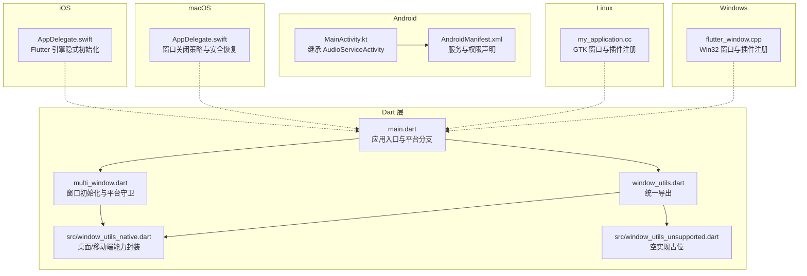

图表来源
- [lib/main.dart:106-177](file://lib/main.dart#L106-L177)
- [lib/multi_window.dart:188-303](file://lib/multi_window.dart#L188-L303)
- [lib/window_utils.dart:1-6](file://lib/window_utils.dart#L1-L6)
- [lib/src/window_utils_native.dart:1-125](file://lib/src/window_utils_native.dart#L1-L125)
- [lib/src/window_utils_unsupported.dart:1-31](file://lib/src/window_utils_unsupported.dart#L1-L31)
- [android/app/src/main/kotlin/com/example/tinycast/MainActivity.kt:1-6](file://android/app/src/main/kotlin/com/example/tinycast/MainActivity.kt#L1-L6)
- [android/app/src/main/AndroidManifest.xml:1-65](file://android/app/src/main/AndroidManifest.xml#L1-L65)
- [ios/Runner/AppDelegate.swift:1-17](file://ios/Runner/AppDelegate.swift#L1-L17)
- [macos/Runner/AppDelegate.swift:1-21](file://macos/Runner/AppDelegate.swift#L1-L21)
- [linux/runner/my_application.cc:1-145](file://linux/runner/my_application.cc#L1-L145)
- [windows/runner/flutter_window.cpp:1-72](file://windows/runner/flutter_window.cpp#L1-L72)

章节来源
- [lib/main.dart:106-177](file://lib/main.dart#L106-L177)
- [lib/multi_window.dart:188-303](file://lib/multi_window.dart#L188-L303)
- [lib/window_utils.dart:1-6](file://lib/window_utils.dart#L1-L6)
- [lib/src/window_utils_native.dart:1-125](file://lib/src/window_utils_native.dart#L1-L125)
- [lib/src/window_utils_unsupported.dart:1-31](file://lib/src/window_utils_unsupported.dart#L1-L31)
- [android/app/src/main/kotlin/com/example/tinycast/MainActivity.kt:1-6](file://android/app/src/main/kotlin/com/example/tinycast/MainActivity.kt#L1-L6)
- [android/app/src/main/AndroidManifest.xml:1-65](file://android/app/src/main/AndroidManifest.xml#L1-L65)
- [ios/Runner/AppDelegate.swift:1-17](file://ios/Runner/AppDelegate.swift#L1-L17)
- [macos/Runner/AppDelegate.swift:1-21](file://macos/Runner/AppDelegate.swift#L1-L21)
- [linux/runner/my_application.cc:1-145](file://linux/runner/my_application.cc#L1-L145)
- [windows/runner/flutter_window.cpp:1-72](file://windows/runner/flutter_window.cpp#L1-L72)

## 核心组件
- 应用入口与平台分支：在 main() 中根据 Platform.isIOS / Platform.isAndroid 选择移动端或桌面端初始化流程，并分别运行不同的根 Widget。
- 窗口管理与平台守卫：multi_window.dart 中的各 init*Window 函数在移动端直接返回，避免调用 window_manager 等桌面专属库。
- 窗口效果封装：window_utils.dart 统一导出 WindowUtils，实际实现位于 src/window_utils_native.dart（支持 macOS/Windows/Linux），移动端使用空实现占位。
- 原生平台初始化：Android MainActivity 继承音频服务 Activity；iOS/macOS AppDelegate 处理引擎与窗口生命周期；Linux/Windows 原生入口完成窗口创建与插件注册。

章节来源
- [lib/main.dart:106-177](file://lib/main.dart#L106-L177)
- [lib/multi_window.dart:188-303](file://lib/multi_window.dart#L188-L303)
- [lib/window_utils.dart:1-6](file://lib/window_utils.dart#L1-L6)
- [lib/src/window_utils_native.dart:1-125](file://lib/src/window_utils_native.dart#L1-L125)
- [android/app/src/main/kotlin/com/example/tinycast/MainActivity.kt:1-6](file://android/app/src/main/kotlin/com/example/tinycast/MainActivity.kt#L1-L6)
- [ios/Runner/AppDelegate.swift:1-17](file://ios/Runner/AppDelegate.swift#L1-L17)
- [macos/Runner/AppDelegate.swift:1-21](file://macos/Runner/AppDelegate.swift#L1-L21)
- [linux/runner/my_application.cc:1-145](file://linux/runner/my_application.cc#L1-L145)
- [windows/runner/flutter_window.cpp:1-72](file://windows/runner/flutter_window.cpp#L1-L72)

## 架构总览
下图展示了从应用启动到平台分支、窗口初始化与 UI 渲染的整体流程。

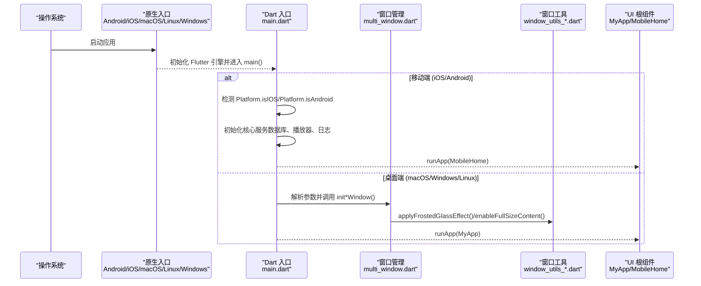

图表来源
- [lib/main.dart:106-177](file://lib/main.dart#L106-L177)
- [lib/multi_window.dart:188-303](file://lib/multi_window.dart#L188-L303)
- [lib/src/window_utils_native.dart:11-109](file://lib/src/window_utils_native.dart#L11-L109)

## 详细组件分析

### 应用入口与平台分支（main.dart）
- 移动端分支：跳过桌面窗口系统初始化，直接初始化 IsarService、AudioPlayerService、Logger，然后运行 MobileHome。
- 桌面端分支：初始化 WindowUtils，加载主题配置，解析窗口参数，按类型初始化主窗口/设置/订阅/详情窗口，再运行对应 MyApp。

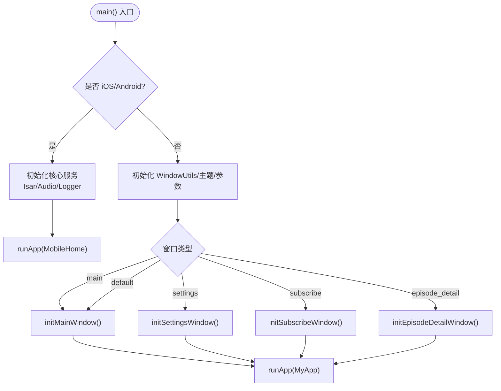

图表来源
- [lib/main.dart:106-177](file://lib/main.dart#L106-L177)

章节来源
- [lib/main.dart:106-177](file://lib/main.dart#L106-L177)

### 窗口管理与平台守卫（multi_window.dart）
- 所有 init*Window 方法在移动端直接 return，避免调用 window_manager。
- 桌面端通过 windowManager.ensureInitialized() 与 waitUntilReadyToShow() 控制窗口显示与焦点。
- 针对 Windows 平台设置背景色，其他平台使用透明背景。

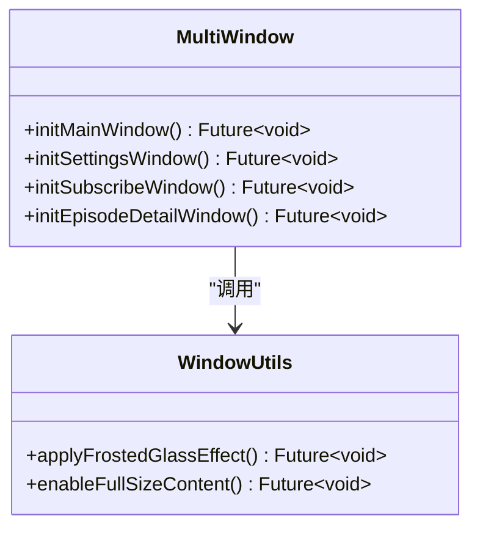

图表来源
- [lib/multi_window.dart:188-303](file://lib/multi_window.dart#L188-L303)
- [lib/src/window_utils_native.dart:11-109](file://lib/src/window_utils_native.dart#L11-L109)

章节来源
- [lib/multi_window.dart:188-303](file://lib/multi_window.dart#L188-L303)

### 窗口效果封装（window_utils.dart 与 src/window_utils_*.dart）
- window_utils.dart 统一导出 WindowUtils 与 TitlebarSafeAreaWrapper。
- src/window_utils_native.dart 提供具体实现：
  - initialize(): 仅在非移动端初始化底层窗口能力
  - applyFrostedGlassEffect(): 按平台选择毛玻璃/亚克力/纯色回退
  - enableFullSizeContent()/disableFullSizeContent(): macOS 下标题栏透明与全屏内容
  - setTransparentBackground(): macOS 透明背景，其他平台纯色回退
- src/window_utils_unsupported.dart 提供空实现，保证移动端编译通过且不执行任何操作。

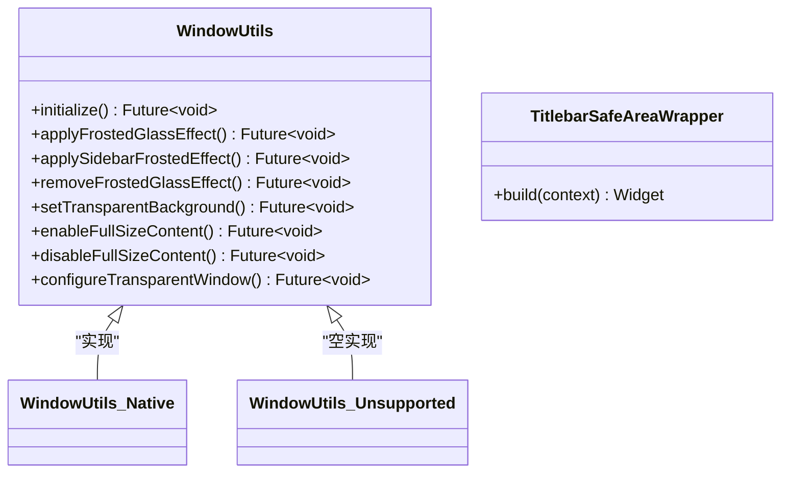

图表来源
- [lib/window_utils.dart:1-6](file://lib/window_utils.dart#L1-L6)
- [lib/src/window_utils_native.dart:1-125](file://lib/src/window_utils_native.dart#L1-L125)
- [lib/src/window_utils_unsupported.dart:1-31](file://lib/src/window_utils_unsupported.dart#L1-L31)

章节来源
- [lib/window_utils.dart:1-6](file://lib/window_utils.dart#L1-L6)
- [lib/src/window_utils_native.dart:1-125](file://lib/src/window_utils_native.dart#L1-L125)
- [lib/src/window_utils_unsupported.dart:1-31](file://lib/src/window_utils_unsupported.dart#L1-L31)

### Android 平台初始化与配置
- MainActivity 继承 AudioServiceActivity，用于后台播放与媒体通知。
- AndroidManifest.xml 声明网络、前台服务、媒体播放服务与按钮接收器，确保音频服务正常运行。

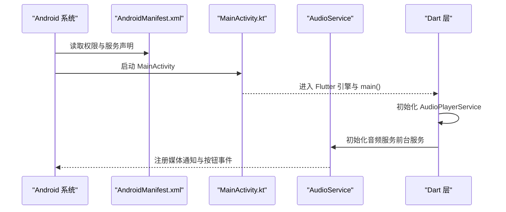

图表来源
- [android/app/src/main/kotlin/com/example/tinycast/MainActivity.kt:1-6](file://android/app/src/main/kotlin/com/example/tinycast/MainActivity.kt#L1-L6)
- [android/app/src/main/AndroidManifest.xml:1-65](file://android/app/src/main/AndroidManifest.xml#L1-L65)
- [lib/data/services/audio_player_service.dart:100-134](file://lib/data/services/audio_player_service.dart#L100-L134)

章节来源
- [android/app/src/main/kotlin/com/example/tinycast/MainActivity.kt:1-6](file://android/app/src/main/kotlin/com/example/tinycast/MainActivity.kt#L1-L6)
- [android/app/src/main/AndroidManifest.xml:1-65](file://android/app/src/main/AndroidManifest.xml#L1-L65)

### iOS 平台初始化与配置
- AppDelegate 实现 Flutter 隐式引擎初始化，并在隐式引擎创建时注册插件。
- 无需额外窗口管理，遵循 iOS 单窗口模型。

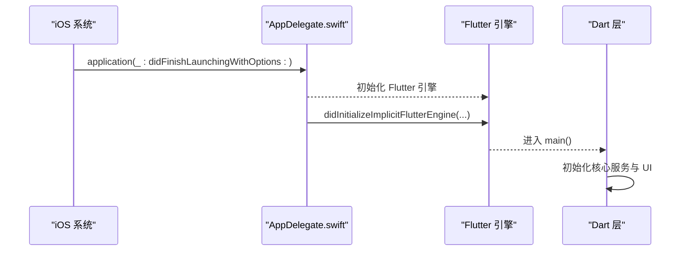

图表来源
- [ios/Runner/AppDelegate.swift:1-17](file://ios/Runner/AppDelegate.swift#L1-L17)
- [lib/main.dart:106-177](file://lib/main.dart#L106-L177)

章节来源
- [ios/Runner/AppDelegate.swift:1-17](file://ios/Runner/AppDelegate.swift#L1-L17)

### macOS 平台初始化与配置
- AppDelegate 设置应用退出策略与安全可恢复状态，并在启动时配置主窗口属性。
- 窗口毛玻璃效果由 WindowUtils 的 macOS 分支实现。

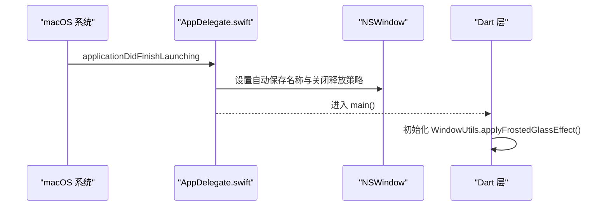

图表来源
- [macos/Runner/AppDelegate.swift:1-21](file://macos/Runner/AppDelegate.swift#L1-L21)
- [lib/src/window_utils_native.dart:22-28](file://lib/src/window_utils_native.dart#L22-L28)

章节来源
- [macos/Runner/AppDelegate.swift:1-21](file://macos/Runner/AppDelegate.swift#L1-L21)

### Linux 平台初始化与配置
- my_application.cc 创建 GTK 窗口，设置背景颜色，注册插件，并在首帧回调中显示窗口。
- 窗口大小与标题栏样式根据环境（GNOME/X11/Wayland）动态调整。

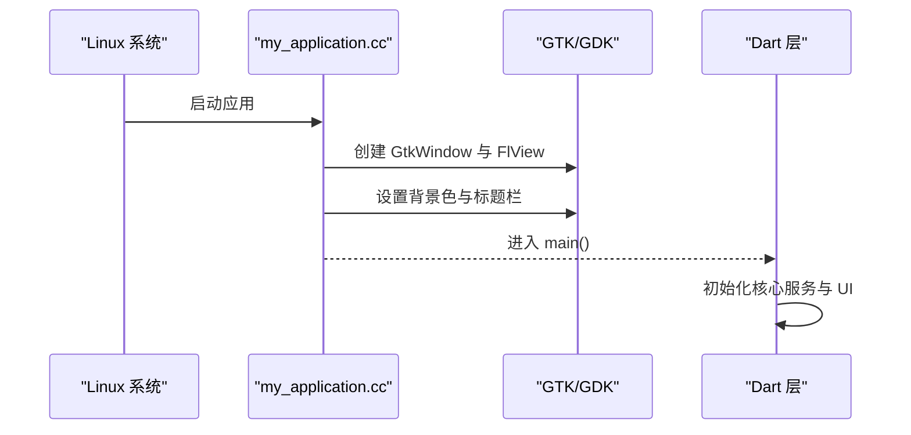

图表来源
- [linux/runner/my_application.cc:24-77](file://linux/runner/my_application.cc#L24-L77)
- [lib/main.dart:106-177](file://lib/main.dart#L106-L177)

章节来源
- [linux/runner/my_application.cc:24-77](file://linux/runner/my_application.cc#L24-L77)

### Windows 平台初始化与配置
- flutter_window.cpp 创建 Win32 窗口，注册 Flutter 控制器与插件，设置首帧回调显示窗口。
- 字体变更消息处理以刷新系统字体。

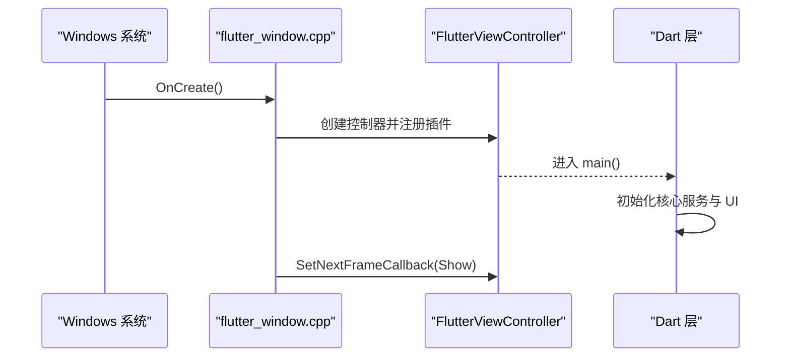

图表来源
- [windows/runner/flutter_window.cpp:12-40](file://windows/runner/flutter_window.cpp#L12-L40)
- [lib/main.dart:106-177](file://lib/main.dart#L106-L177)

章节来源
- [windows/runner/flutter_window.cpp:12-40](file://windows/runner/flutter_window.cpp#L12-L40)

### 文件系统访问与权限策略
- 使用 path_provider 的 getApplicationSupportDirectory() 获取应用沙盒目录，避免额外权限。
- 各平台默认无需额外权限；如需访问外部存储，需按平台添加相应权限声明。

章节来源
- [docs/PLATFORM_PERMISSIONS.md:1-133](file://docs/PLATFORM_PERMISSIONS.md#L1-L133)

### 运行脚本与平台选择
- run.sh 根据传入参数或当前操作系统自动选择目标平台设备，并注入 Supabase 环境变量。

章节来源
- [run.sh:1-65](file://run.sh#L1-L65)

## 依赖关系分析
- Dart 层通过 Platform 判断与条件导出实现跨平台行为，避免在移动端引入桌面专属库。
- 窗口相关能力集中在 window_utils_* 文件中，便于维护与扩展。
- 原生平台入口负责插件注册与窗口生命周期，Dart 层专注于业务逻辑与 UI。

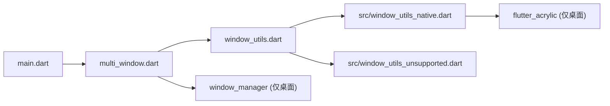

图表来源
- [lib/main.dart:106-177](file://lib/main.dart#L106-L177)
- [lib/multi_window.dart:188-303](file://lib/multi_window.dart#L188-L303)
- [lib/window_utils.dart:1-6](file://lib/window_utils.dart#L1-L6)
- [lib/src/window_utils_native.dart:1-125](file://lib/src/window_utils_native.dart#L1-L125)

章节来源
- [lib/main.dart:106-177](file://lib/main.dart#L106-L177)
- [lib/multi_window.dart:188-303](file://lib/multi_window.dart#L188-L303)
- [lib/window_utils.dart:1-6](file://lib/window_utils.dart#L1-L6)
- [lib/src/window_utils_native.dart:1-125](file://lib/src/window_utils_native.dart#L1-L125)

## 性能考量
- 避免在移动端调用桌面专属库（如 window_manager、flutter_acrylic），减少不必要的初始化开销。
- 窗口特效按需启用，优先使用平台原生能力（macOS sidebar/transparent，Windows acrylic/solid）。
- 音频服务初始化与流监听应尽早完成，避免首次播放延迟。

[本节为通用指导，不直接分析具体文件]

## 故障排查指南
- 移动端无法编译：检查 window_utils_unsupported.dart 的空实现是否正确导出，确保未引入桌面专属包。
- 桌面端窗口无毛玻璃效果：确认 applyFrostedGlassEffect() 被调用，且平台分支正确（macOS/sidebar，Windows/acrylic）。
- Android 后台播放异常：检查 AndroidManifest.xml 中服务与权限声明，以及 AudioPlayerService 初始化是否成功。
- iOS 插件未注册：确认 AppDelegate 的 didInitializeImplicitFlutterEngine 已调用 GeneratedPluginRegistrant.register。

章节来源
- [lib/src/window_utils_unsupported.dart:1-31](file://lib/src/window_utils_unsupported.dart#L1-L31)
- [lib/src/window_utils_native.dart:11-49](file://lib/src/window_utils_native.dart#L11-L49)
- [android/app/src/main/AndroidManifest.xml:37-52](file://android/app/src/main/AndroidManifest.xml#L37-L52)
- [ios/Runner/AppDelegate.swift:13-15](file://ios/Runner/AppDelegate.swift#L13-L15)

## 结论
TinyCast 通过清晰的平台检测与条件渲染机制，实现了 Android、iOS、Windows、macOS、Linux 的统一体验。Dart 层利用 Platform 判断与条件导出屏蔽平台差异，原生入口专注窗口与插件管理。遵循本指南的实践，开发者可以编写高可移植性的跨平台代码，并快速扩展新的平台特性。

[本节为总结性内容，不直接分析具体文件]

## 附录
- 平台权限参考：docs/PLATFORM_PERMISSIONS.md
- 运行脚本：run.sh（支持 iOS/Android/桌面平台自动选择）

章节来源
- [docs/PLATFORM_PERMISSIONS.md:1-133](file://docs/PLATFORM_PERMISSIONS.md#L1-L133)
- [run.sh:1-65](file://run.sh#L1-L65)