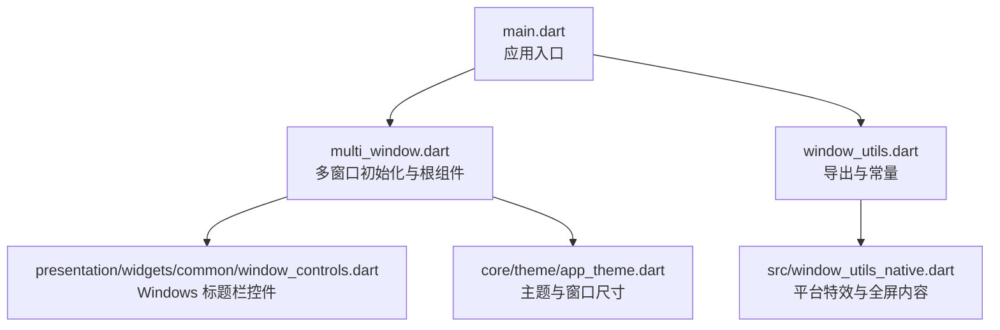
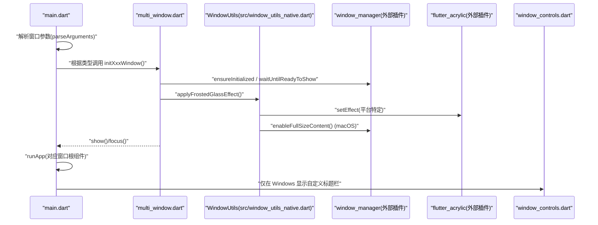
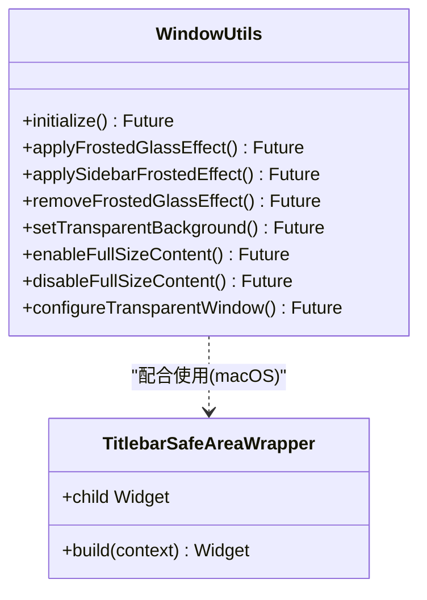
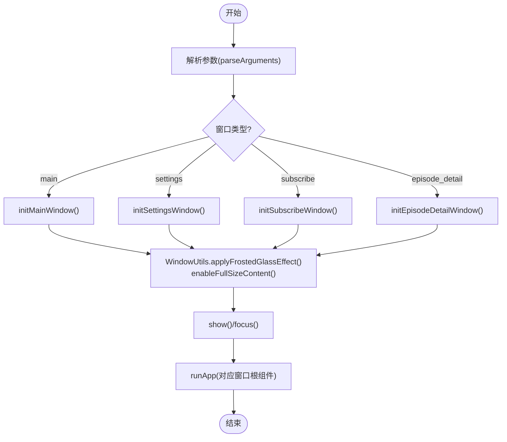
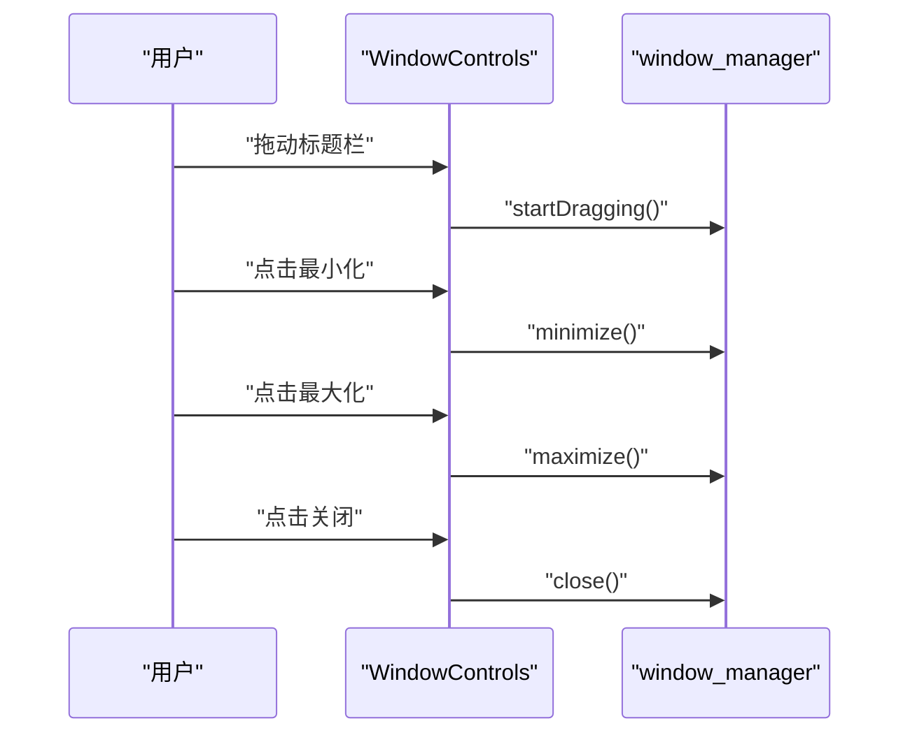
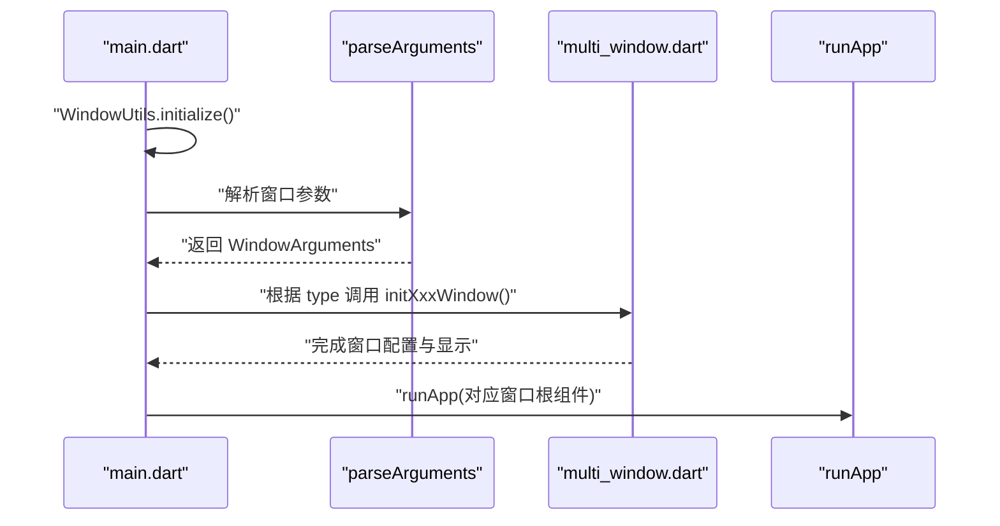
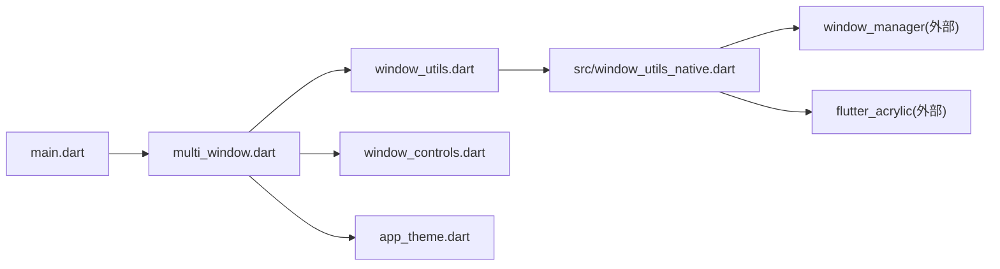

# 窗口管理抽象

<cite>
**本文引用的文件**   
- [lib/window_utils.dart](file://lib/window_utils.dart)
- [lib/src/window_utils_native.dart](file://lib/src/window_utils_native.dart)
- [lib/multi_window.dart](file://lib/multi_window.dart)
- [lib/presentation/widgets/common/window_controls.dart](file://lib/presentation/widgets/common/window_controls.dart)
- [lib/main.dart](file://lib/main.dart)
- [lib/core/theme/app_theme.dart](file://lib/core/theme/app_theme.dart)
</cite>

## 目录
1. [简介](#简介)
2. [项目结构](#项目结构)
3. [核心组件](#核心组件)
4. [架构总览](#架构总览)
5. [详细组件分析](#详细组件分析)
6. [依赖分析](#依赖分析)
7. [性能考虑](#性能考虑)
8. [故障排查指南](#故障排查指南)
9. [结论](#结论)
10. [附录](#附录)

## 简介
本文件为 TinyCast 应用的“窗口管理抽象层”提供系统化文档，覆盖跨平台（Windows、macOS、移动端）的窗口创建、销毁、大小调整与位置控制；详解 WindowUtils 类的使用方式（背景色设置、毛玻璃/亚克力效果、全屏内容视图、标题栏安全区域处理等）；并提供多窗口管理的最佳实践（窗口间通信、状态同步、生命周期管理），以及在不同平台上实现一致窗口行为的示例路径与事件处理建议。目标是帮助开发者快速扩展窗口功能并保持良好用户体验。

## 项目结构
TinyCast 的窗口管理相关代码主要分布在以下模块：
- lib/window_utils.dart：对外导出 WindowUtils 与 TitlebarSafeAreaWrapper，并定义窗口背景色常量
- lib/src/window_utils_native.dart：跨平台窗口效果与全屏内容视图的具体实现
- lib/multi_window.dart：多窗口初始化、参数解析与各窗口应用根组件
- lib/presentation/widgets/common/window_controls.dart：Windows 自定义标题栏控件
- lib/main.dart：应用入口，按窗口类型分发初始化流程
- lib/core/theme/app_theme.dart：主题数据源，提供窗口尺寸等主题配置

图表来源
- [lib/main.dart:106-177](file://lib/main.dart#L106-L177)
- [lib/multi_window.dart:184-303](file://lib/multi_window.dart#L184-L303)
- [lib/window_utils.dart:1-6](file://lib/window_utils.dart#L1-L6)
- [lib/src/window_utils_native.dart:1-109](file://lib/src/window_utils_native.dart#L1-L109)
- [lib/presentation/widgets/common/window_controls.dart:1-113](file://lib/presentation/widgets/common/window_controls.dart#L1-L113)
- [lib/core/theme/app_theme.dart:1-21](file://lib/core/theme/app_theme.dart#L1-L21)

章节来源
- [lib/main.dart:106-177](file://lib/main.dart#L106-L177)
- [lib/multi_window.dart:184-303](file://lib/multi_window.dart#L184-L303)
- [lib/window_utils.dart:1-6](file://lib/window_utils.dart#L1-L6)
- [lib/src/window_utils_native.dart:1-109](file://lib/src/window_utils_native.dart#L1-L109)
- [lib/presentation/widgets/common/window_controls.dart:1-113](file://lib/presentation/widgets/common/window_controls.dart#L1-L113)
- [lib/core/theme/app_theme.dart:1-21](file://lib/core/theme/app_theme.dart#L1-L21)

## 核心组件
- WindowUtils：封装跨平台的窗口效果与全屏内容视图能力，包括初始化、毛玻璃/亚克力效果、透明背景、启用/禁用全屏内容视图等
- TitlebarSafeAreaWrapper：在 macOS 上为标题栏提供安全区域包裹，确保内容不被系统标题栏遮挡
- multi_window 模块：负责各窗口的初始化流程、参数解析与根组件装配
- WindowControls：Windows 自定义标题栏，包含拖拽区域与最小化/最大化/关闭按钮
- main.dart：根据窗口类型（主窗口、设置、订阅、节目详情）选择对应初始化逻辑与应用根组件

章节来源
- [lib/src/window_utils_native.dart:5-109](file://lib/src/window_utils_native.dart#L5-L109)
- [lib/src/window_utils_native.dart:111-125](file://lib/src/window_utils_native.dart#L111-L125)
- [lib/multi_window.dart:15-182](file://lib/multi_window.dart#L15-L182)
- [lib/presentation/widgets/common/window_controls.dart:1-113](file://lib/presentation/widgets/common/window_controls.dart#L1-L113)
- [lib/main.dart:106-177](file://lib/main.dart#L106-L177)

## 架构总览
下图展示了从应用启动到窗口渲染的关键调用链，以及各平台特效与标题栏控制的交互关系。

图表来源
- [lib/main.dart:106-177](file://lib/main.dart#L106-L177)
- [lib/multi_window.dart:184-303](file://lib/multi_window.dart#L184-L303)
- [lib/src/window_utils_native.dart:11-49](file://lib/src/window_utils_native.dart#L11-L49)
- [lib/presentation/widgets/common/window_controls.dart:16-64](file://lib/presentation/widgets/common/window_controls.dart#L16-L64)

## 详细组件分析

### WindowUtils 与 TitlebarSafeAreaWrapper
- 初始化：initialize 用于在桌面端初始化 flutter_acrylic 库
- 毛玻璃/亚克力效果：applyFrostedGlassEffect 根据平台选择 sidebar/acrylic/solid/transparent 等效果
- 侧边栏毛玻璃：applySidebarFrostedEffect 针对 macOS 使用 windowBackground，其他平台回退为纯色
- 透明背景：setTransparentBackground 在 macOS 使用 transparent，其他平台回退为纯色
- 全屏内容视图：enableFullSizeContent/disableFullSizeContent 在 macOS 切换 full-size content view 与标题栏透明度
- 组合配置：configureTransparentWindow 同时应用毛玻璃与全屏内容视图
- 标题栏安全区域：TitlebarSafeAreaWrapper 在 macOS 包裹子组件以适配标题栏安全区域

图表来源
- [lib/src/window_utils_native.dart:5-109](file://lib/src/window_utils_native.dart#L5-L109)
- [lib/src/window_utils_native.dart:111-125](file://lib/src/window_utils_native.dart#L111-L125)

章节来源
- [lib/src/window_utils_native.dart:5-109](file://lib/src/window_utils_native.dart#L5-L109)
- [lib/src/window_utils_native.dart:111-125](file://lib/src/window_utils_native.dart#L111-L125)

### 多窗口管理与参数解析
- WindowArguments：统一序列化/反序列化窗口参数，支持主窗口、设置、订阅、节目详情等类型，并可携带 Episode/Podcast 数据
- parseArguments：将 JSON 字符串解析为 WindowArguments，失败时回退为主窗口
- 窗口初始化函数：initMainWindow/initSettingsWindow/initSubscribeWindow/initEpisodeDetailWindow 分别配置窗口尺寸、居中、背景色、隐藏标题栏样式，并调用 WindowUtils 应用效果与全屏内容视图
- 窗口根组件：SettingsWindowApp/SubscribeWindowApp/EpisodeDetailWindowApp 使用 WidgetsApp 构建各自页面，并在 Windows 平台嵌入自定义标题栏

图表来源
- [lib/multi_window.dart:15-182](file://lib/multi_window.dart#L15-L182)
- [lib/multi_window.dart:184-303](file://lib/multi_window.dart#L184-L303)
- [lib/multi_window.dart:309-453](file://lib/multi_window.dart#L309-L453)

章节来源
- [lib/multi_window.dart:15-182](file://lib/multi_window.dart#L15-L182)
- [lib/multi_window.dart:184-303](file://lib/multi_window.dart#L184-L303)
- [lib/multi_window.dart:309-453](file://lib/multi_window.dart#L309-L453)

### Windows 自定义标题栏控件
- WindowControls：仅在 Windows 平台显示，包含拖拽区域、标题文本或 leading 图标、最小化/最大化/关闭按钮
- 交互行为：通过 onPanStart 触发 windowManager.startDragging；按钮回调分别调用 minimize/maximize/close
- 视觉反馈：悬停变色，关闭按钮高亮红色

图表来源
- [lib/presentation/widgets/common/window_controls.dart:16-64](file://lib/presentation/widgets/common/window_controls.dart#L16-L64)

章节来源
- [lib/presentation/widgets/common/window_controls.dart:1-113](file://lib/presentation/widgets/common/window_controls.dart#L1-L113)

### 应用入口与窗口分发
- main.dart：在桌面端先初始化 WindowUtils，再根据窗口控制器参数解析结果分发到不同窗口初始化流程
- 主窗口：注册生命周期观察者，启动定时任务，运行 MyApp
- 子窗口：运行 SettingsWindowApp/SubscribeWindowApp/EpisodeDetailWindowApp，并传入必要数据

图表来源
- [lib/main.dart:106-177](file://lib/main.dart#L106-L177)
- [lib/multi_window.dart:184-303](file://lib/multi_window.dart#L184-L303)

章节来源
- [lib/main.dart:106-177](file://lib/main.dart#L106-L177)
- [lib/multi_window.dart:184-303](file://lib/multi_window.dart#L184-L303)

### 主题与窗口尺寸
- AppTheme：提供 light/dark 主题数据，供窗口尺寸等配置使用（例如主窗口与设置窗口尺寸来自主题）

章节来源
- [lib/core/theme/app_theme.dart:1-21](file://lib/core/theme/app_theme.dart#L1-L21)

## 依赖分析
- 外部依赖
  - window_manager：窗口管理器（初始化、显示、聚焦、拖拽、最小化/最大化/关闭）
  - flutter_acrylic：跨平台窗口效果（Acrylic/Solid/Transparent/Sidebar 等）
- 内部依赖
  - main.dart 依赖 multi_window.dart 进行窗口初始化与根组件装配
  - multi_window.dart 依赖 window_utils.dart 导出 WindowUtils 与 TitlebarSafeAreaWrapper
  - window_utils.dart 依赖 src/window_utils_native.dart 的平台实现
  - 各窗口根组件依赖 presentation/widgets/common/window_controls.dart（仅 Windows）

图表来源
- [lib/main.dart:106-177](file://lib/main.dart#L106-L177)
- [lib/multi_window.dart:184-303](file://lib/multi_window.dart#L184-L303)
- [lib/window_utils.dart:1-6](file://lib/window_utils.dart#L1-L6)
- [lib/src/window_utils_native.dart:1-109](file://lib/src/window_utils_native.dart#L1-L109)
- [lib/presentation/widgets/common/window_controls.dart:1-113](file://lib/presentation/widgets/common/window_controls.dart#L1-L113)
- [lib/core/theme/app_theme.dart:1-21](file://lib/core/theme/app_theme.dart#L1-L21)

章节来源
- [lib/main.dart:106-177](file://lib/main.dart#L106-L177)
- [lib/multi_window.dart:184-303](file://lib/multi_window.dart#L184-L303)
- [lib/window_utils.dart:1-6](file://lib/window_utils.dart#L1-L6)
- [lib/src/window_utils_native.dart:1-109](file://lib/src/window_utils_native.dart#L1-L109)
- [lib/presentation/widgets/common/window_controls.dart:1-113](file://lib/presentation/widgets/common/window_controls.dart#L1-L113)
- [lib/core/theme/app_theme.dart:1-21](file://lib/core/theme/app_theme.dart#L1-L21)

## 性能考虑
- 窗口效果选择：在 Windows 上优先尝试 Acrylic，失败则回退 Solid，避免异常导致的卡顿
- 平台判断前置：所有 WindowUtils 方法均对 iOS/Android 提前返回，减少不必要的桥接开销
- 全屏内容视图：仅在 macOS 启用，避免在其他平台产生额外绘制成本
- 窗口初始化顺序：先 ensureInitialized，再 waitUntilReadyToShow，最后 show/focus，保证渲染稳定
- 主题加载：按需预加载主题配置，避免首次渲染阻塞

[本节为通用指导，不直接分析具体文件]

## 故障排查指南
- 窗口背景色异常（Windows）
  - 检查 WindowOptions 中 backgroundColor 是否设置为 windowBackgroundColor
  - 确认 WindowUtils.applyFrostedGlassEffect 已调用且未抛出异常
- 标题栏遮挡内容（macOS）
  - 确认已调用 enableFullSizeContent 并使用 TitlebarSafeAreaWrapper 包裹内容
- 自定义标题栏不显示（Windows）
  - 确认在窗口根组件 builder 中添加了 WindowControls，且 Platform.isWindows 条件成立
- 窗口无法拖拽/最小化/最大化/关闭
  - 检查 WindowControls 的 GestureRecognizer 与 window_manager 方法是否正确绑定

章节来源
- [lib/multi_window.dart:184-303](file://lib/multi_window.dart#L184-L303)
- [lib/src/window_utils_native.dart:11-49](file://lib/src/window_utils_native.dart#L11-L49)
- [lib/presentation/widgets/common/window_controls.dart:16-64](file://lib/presentation/widgets/common/window_controls.dart#L16-L64)

## 结论
TinyCast 的窗口管理抽象层通过 WindowUtils 与 multi_window 模块实现了跨平台的窗口效果与生命周期管理，结合 Windows 自定义标题栏与 macOS 的安全区域处理，提供了统一的窗口体验。遵循本文的最佳实践，开发者可以便捷地扩展新窗口类型、实现一致的窗口行为，并确保良好的性能与用户体验。

[本节为总结性内容，不直接分析具体文件]

## 附录
- 多窗口通信与状态同步建议
  - 使用 desktop_multi_window 的 WindowController 传递参数（如 WindowArguments.toJson）
  - 通过全局服务或 Riverpod Provider 共享状态（音频播放状态、订阅列表等）
  - 在窗口生命周期变化时（如暂停/恢复）更新状态，保持各窗口一致性
- 窗口事件与用户交互
  - 拖拽：windowManager.startDragging
  - 窗口控制：minimize/maximize/close
  - 全屏内容视图：enableFullSizeContent/disableFullSizeContent（macOS）
  - 背景与效果：applyFrostedGlassEffect/setTransparentBackground/removeFrostedGlassEffect

[本节为概念性指导，不直接分析具体文件]