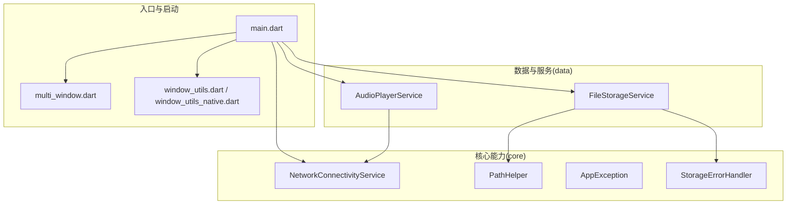
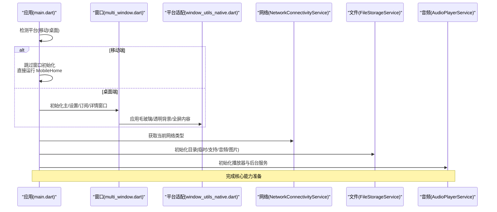
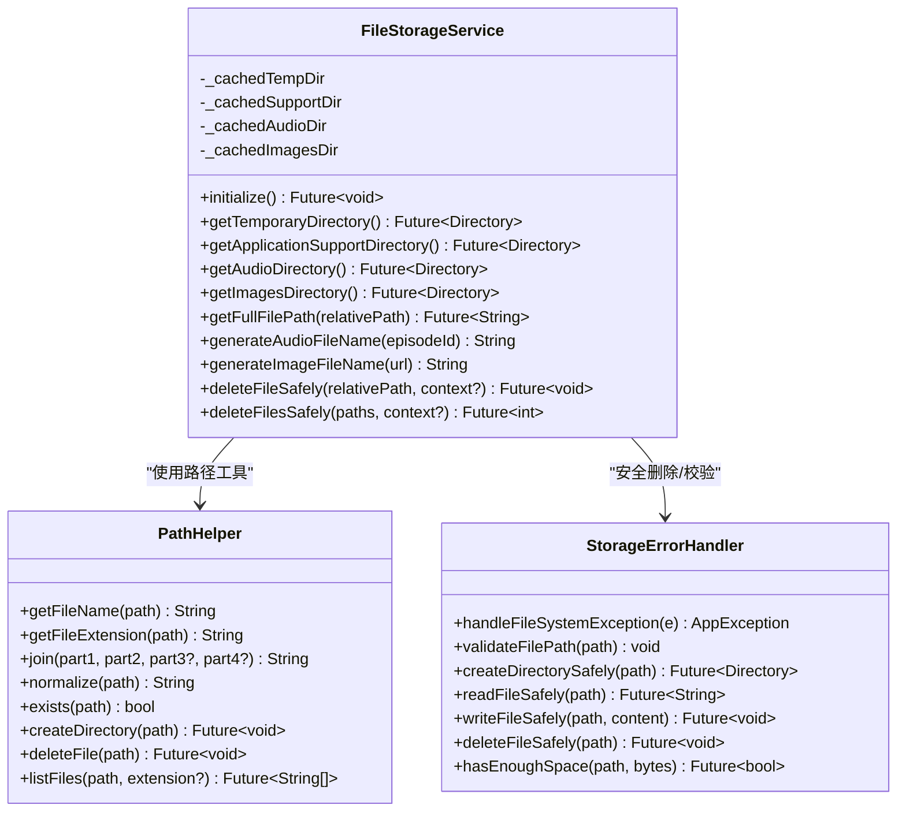
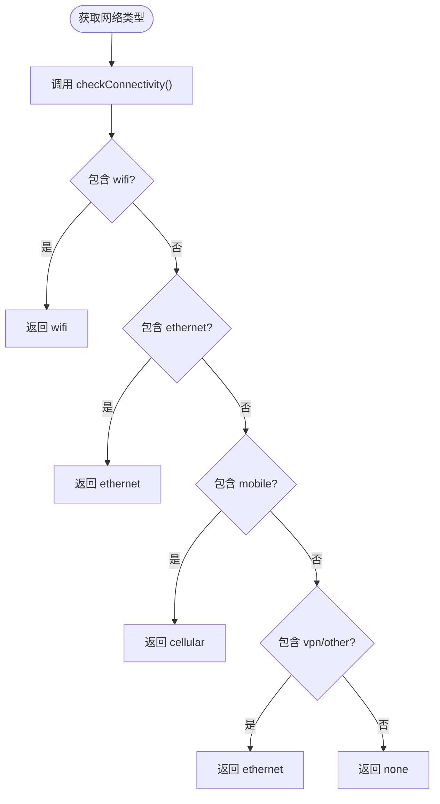
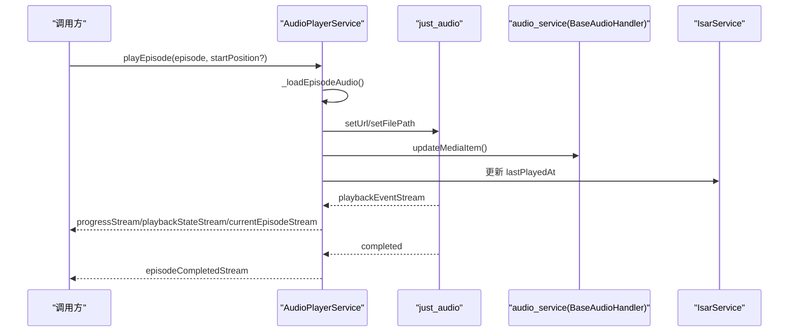
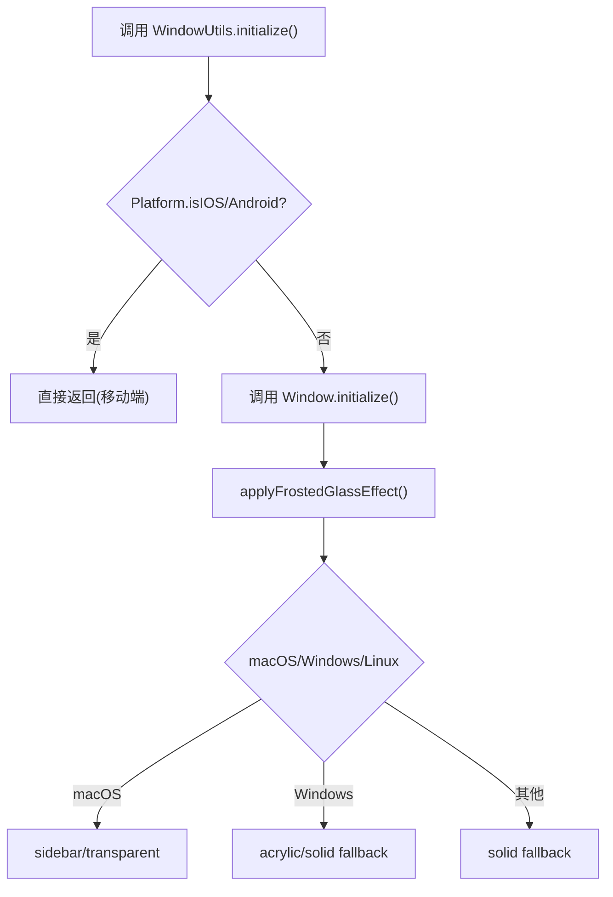
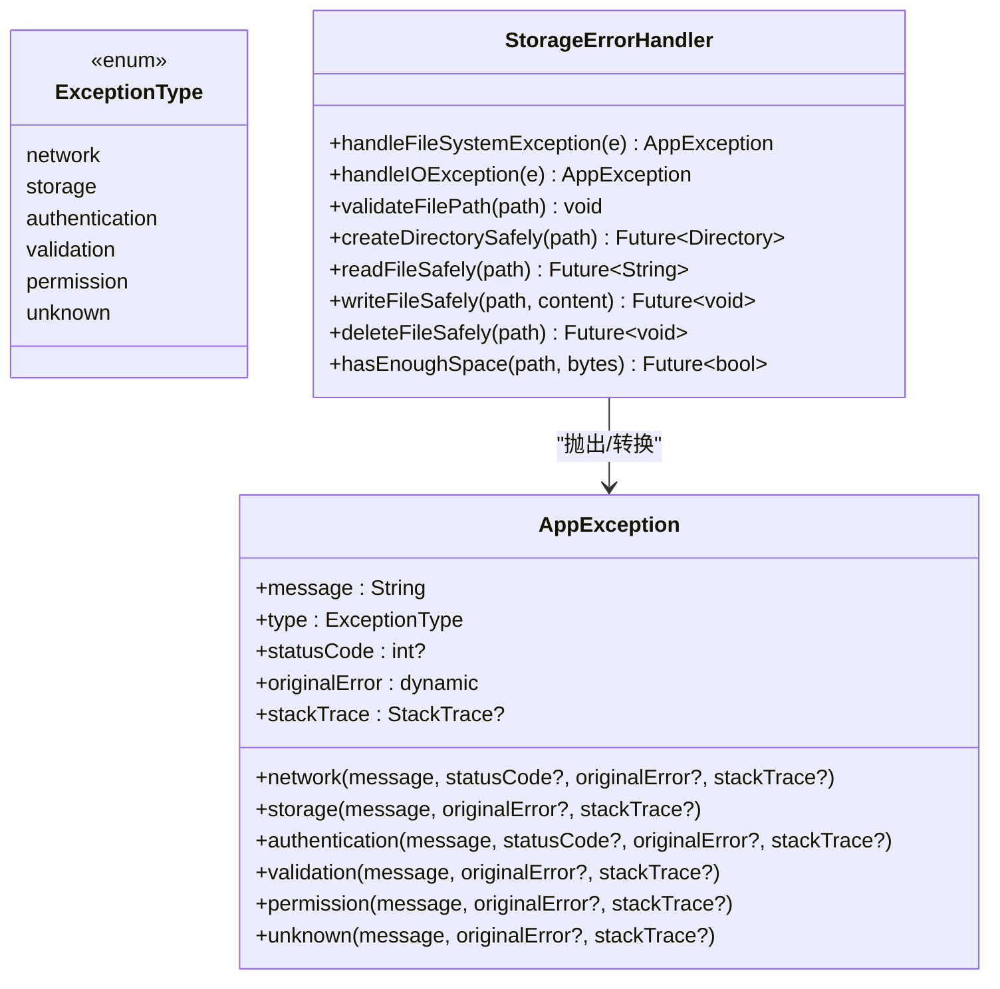
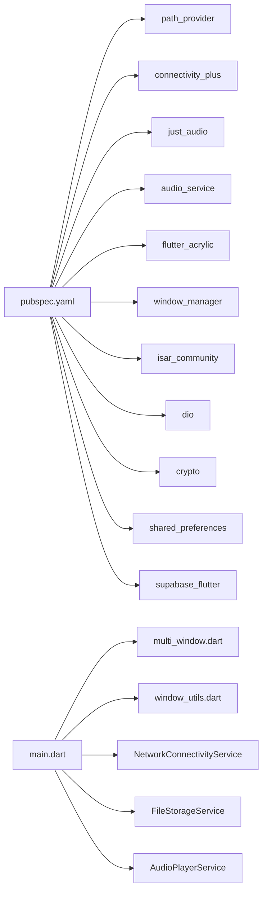

# 系统 API 封装

<cite>
**本文引用的文件**   
- [main.dart](file://lib/main.dart)
- [pubspec.yaml](file://pubspec.yaml)
- [path_helper.dart](file://lib/core/utils/path_helper.dart)
- [file_storage_service.dart](file://lib/data/services/file_storage_service.dart)
- [network_connectivity_service.dart](file://lib/core/services/network_connectivity_service.dart)
- [audio_player_service.dart](file://lib/data/services/audio_player_service.dart)
- [window_utils_native.dart](file://lib/src/window_utils_native.dart)
- [window_utils.dart](file://lib/window_utils.dart)
- [multi_window.dart](file://lib/multi_window.dart)
- [app_exception.dart](file://lib/core/utils/app_exception.dart)
- [storage_error_handler.dart](file://lib/core/utils/storage_error_handler.dart)
- [PLATFORM_PERMISSIONS.md](file://docs/PLATFORM_PERMISSIONS.md)
</cite>

## 目录
1. [简介](#简介)
2. [项目结构](#项目结构)
3. [核心组件](#核心组件)
4. [架构总览](#架构总览)
5. [详细组件分析](#详细组件分析)
6. [依赖关系分析](#依赖关系分析)
7. [性能考量](#性能考量)
8. [故障排查指南](#故障排查指南)
9. [结论](#结论)
10. [附录](#附录)

## 简介
本文件为 TinyCast 应用的“系统 API 封装”提供系统化文档，目标是说明如何将各平台的系统能力（文件、网络、存储、媒体等）统一封装为一致的 Dart 接口，并给出设计原则、命名规范、异步处理与错误码映射策略。同时提供跨平台调用示例（权限检查、用户交互、状态反馈）、版本管理与兼容性策略，以及单元测试与集成测试建议，帮助开发者以一致接口访问底层系统功能，提升可维护性与可测试性。

## 项目结构
TinyCast 采用分层组织：
- core：通用工具、服务、主题、路由、异常与日志
- data：数据源、模型、仓库、数据库与业务服务（音频下载、播放、缓存等）
- presentation：UI 层（页面、组件）
- main 入口负责应用初始化、平台分支与窗口管理

图表来源
- [main.dart:106-177](file://lib/main.dart#L106-L177)
- [multi_window.dart:188-303](file://lib/multi_window.dart#L188-L303)
- [window_utils_native.dart:6-109](file://lib/src/window_utils_native.dart#L6-L109)
- [network_connectivity_service.dart:6-62](file://lib/core/services/network_connectivity_service.dart#L6-L62)
- [path_helper.dart:7-239](file://lib/core/utils/path_helper.dart#L7-L239)
- [file_storage_service.dart:11-356](file://lib/data/services/file_storage_service.dart#L11-L356)
- [audio_player_service.dart:31-584](file://lib/data/services/audio_player_service.dart#L31-L584)

章节来源
- [main.dart:106-177](file://lib/main.dart#L106-L177)
- [pubspec.yaml:18-144](file://pubspec.yaml#L18-L144)

## 核心组件
- 路径与文件系统抽象：PathHelper、FileStorageService、StorageErrorHandler
- 网络能力：NetworkConnectivityService（连接类型判断、是否允许刷新）
- 媒体播放：AudioPlayerService（本地/网络音频、后台服务、进度持久化）
- 窗口与平台适配：WindowUtils（毛玻璃/透明背景/全屏内容），多窗口初始化（桌面端）
- 异常体系：AppException（统一异常类型与工厂方法）

章节来源
- [path_helper.dart:7-239](file://lib/core/utils/path_helper.dart#L7-L239)
- [file_storage_service.dart:11-356](file://lib/data/services/file_storage_service.dart#L11-L356)
- [storage_error_handler.dart:6-253](file://lib/core/utils/storage_error_handler.dart#L6-L253)
- [network_connectivity_service.dart:6-62](file://lib/core/services/network_connectivity_service.dart#L6-L62)
- [audio_player_service.dart:31-584](file://lib/data/services/audio_player_service.dart#L31-L584)
- [window_utils_native.dart:6-109](file://lib/src/window_utils_native.dart#L6-L109)
- [multi_window.dart:188-303](file://lib/multi_window.dart#L188-L303)
- [app_exception.dart:23-148](file://lib/core/utils/app_exception.dart#L23-L148)

## 架构总览
下图展示从应用启动到系统能力调用的整体流程，包括平台分支、窗口初始化、服务初始化与关键子系统协作。

图表来源
- [main.dart:106-177](file://lib/main.dart#L106-L177)
- [multi_window.dart:188-303](file://lib/multi_window.dart#L188-L303)
- [window_utils_native.dart:6-109](file://lib/src/window_utils_native.dart#L6-L109)
- [network_connectivity_service.dart:15-42](file://lib/core/services/network_connectivity_service.dart#L15-L42)
- [file_storage_service.dart:33-52](file://lib/data/services/file_storage_service.dart#L33-L52)
- [audio_player_service.dart:100-134](file://lib/data/services/audio_player_service.dart#L100-L134)

## 详细组件分析

### 文件与存储 API 封装
- PathHelper：对 path 库进行轻量封装，提供路径拼接、规范化、存在性检查、创建/删除目录、列出文件/子目录、格式化大小等。所有 IO 操作均捕获异常并记录日志。
- FileStorageService：单例服务，集中管理应用支持目录、临时目录、音频与图片目录的获取与缓存；提供相对路径转绝对路径、文件名生成（UUID/哈希）、安全删除、批量删除、文件大小查询等。
- StorageErrorHandler：将底层文件系统异常映射为统一的 AppException，区分不存在、无权限、磁盘空间不足等场景，并提供安全读写、校验与清理工具。

图表来源
- [path_helper.dart:7-239](file://lib/core/utils/path_helper.dart#L7-L239)
- [file_storage_service.dart:11-356](file://lib/data/services/file_storage_service.dart#L11-L356)
- [storage_error_handler.dart:6-253](file://lib/core/utils/storage_error_handler.dart#L6-L253)

章节来源
- [path_helper.dart:7-239](file://lib/core/utils/path_helper.dart#L7-L239)
- [file_storage_service.dart:11-356](file://lib/data/services/file_storage_service.dart#L11-L356)
- [storage_error_handler.dart:6-253](file://lib/core/utils/storage_error_handler.dart#L6-L253)

### 网络能力封装
- NetworkConnectivityService：基于 connectivity_plus 提供当前网络类型判断（WiFi/以太网/蜂窝/无网），并支持按配置决定是否允许在蜂窝网络下刷新。

图表来源
- [network_connectivity_service.dart:15-42](file://lib/core/services/network_connectivity_service.dart#L15-L42)

章节来源
- [network_connectivity_service.dart:6-62](file://lib/core/services/network_connectivity_service.dart#L6-L62)

### 媒体播放 API 封装
- AudioPlayerService：封装 just_audio 与 audio_service，提供播放/暂停/停止/跳转/倍速/音量控制、播放状态与进度流、后台通知与锁屏控制、播放完成事件、播放进度持久化（结合 PlayProgressService）。
- 播放源选择：优先尝试本地已下载音频（支持新旧目录兼容），失败回退至远程 URL。
- 状态广播：通过多个 StreamController 暴露播放状态、进度、速度、音量、当前节目与完成事件。

图表来源
- [audio_player_service.dart:192-300](file://lib/data/services/audio_player_service.dart#L192-L300)
- [audio_player_service.dart:326-343](file://lib/data/services/audio_player_service.dart#L326-L343)
- [audio_player_service.dart:586-652](file://lib/data/services/audio_player_service.dart#L586-L652)

章节来源
- [audio_player_service.dart:31-584](file://lib/data/services/audio_player_service.dart#L31-L584)

### 窗口与平台适配 API
- WindowUtils：封装 flutter_acrylic，提供毛玻璃效果、透明背景、全屏内容、标题栏透明等能力，并在移动端直接返回空实现。
- multi_window.dart：桌面端窗口初始化（主窗口、设置、订阅、详情），移动端跳过 window_manager 相关逻辑。
- window_utils.dart：条件导出 native 实现，确保移动端不编译桌面专属代码。

图表来源
- [window_utils_native.dart:6-109](file://lib/src/window_utils_native.dart#L6-L109)
- [multi_window.dart:188-303](file://lib/multi_window.dart#L188-L303)
- [window_utils.dart:1-6](file://lib/window_utils.dart#L1-L6)

章节来源
- [window_utils_native.dart:6-109](file://lib/src/window_utils_native.dart#L6-L109)
- [multi_window.dart:188-303](file://lib/multi_window.dart#L188-L303)
- [window_utils.dart:1-6](file://lib/window_utils.dart#L1-L6)

### 异常与错误码映射
- AppException：统一异常类型枚举（网络、存储、认证、验证、权限、未知），并提供工厂方法快速构造，携带 statusCode/originalError/stackTrace。
- StorageErrorHandler：将 FileSystemException/IOException 映射为 AppException，并按 OS error code 区分“不存在/无权限/磁盘空间不足”。

图表来源
- [app_exception.dart:23-148](file://lib/core/utils/app_exception.dart#L23-L148)
- [storage_error_handler.dart:6-253](file://lib/core/utils/storage_error_handler.dart#L6-L253)

章节来源
- [app_exception.dart:23-148](file://lib/core/utils/app_exception.dart#L23-L148)
- [storage_error_handler.dart:6-253](file://lib/core/utils/storage_error_handler.dart#L6-L253)

## 依赖关系分析
- 外部依赖（部分）：path_provider、connectivity_plus、just_audio、audio_service、flutter_acrylic、window_manager、isar_community、dio、crypto、shared_preferences、supabase_flutter 等
- 内部依赖：main 入口依赖 multi_window、window_utils、core services、data services；FileStorageService 依赖 PathHelper 与 StorageErrorHandler；AudioPlayerService 依赖 IsarService、PlayProgressService、audio_service、just_audio

图表来源
- [pubspec.yaml:18-144](file://pubspec.yaml#L18-L144)
- [main.dart:106-177](file://lib/main.dart#L106-L177)

章节来源
- [pubspec.yaml:18-144](file://pubspec.yaml#L18-L144)

## 性能考量
- 目录初始化并行化：FileStorageService 使用 Future.wait 并行加载临时/支持/音频/图片目录，减少启动耗时。
- 播放资源回退：AudioPlayerService 先尝试本地文件，失败再回退远程 URL，降低因文件缺失导致的播放失败。
- 流式状态更新：AudioPlayerService 通过 StreamController 推送播放状态与进度，避免频繁轮询。
- 网络类型判断：NetworkConnectivityService 快速判定网络类型，避免不必要的刷新或大流量操作。

[本节为通用指导，不直接分析具体文件]

## 故障排查指南
- 文件不存在/无权限/磁盘空间不足：StorageErrorHandler 会将底层异常转换为 AppException.storage 或 AppException.permission，上层可按 type 分类处理。
- 播放失败：AudioPlayerService 在加载失败时重置播放器状态并抛出异常，需检查本地文件是否存在、URL 是否可达。
- 网络不可用：NetworkConnectivityService 返回 none 时，应提示用户或延迟操作。
- 窗口效果异常：WindowUtils 在不同平台有 fallback 策略，若毛玻璃无效会回退为纯色背景。

章节来源
- [storage_error_handler.dart:10-40](file://lib/core/utils/storage_error_handler.dart#L10-L40)
- [audio_player_service.dart:282-299](file://lib/data/services/audio_player_service.dart#L282-L299)
- [network_connectivity_service.dart:34-42](file://lib/core/services/network_connectivity_service.dart#L34-L42)
- [window_utils_native.dart:30-49](file://lib/src/window_utils_native.dart#L30-L49)

## 结论
TinyCast 通过统一的服务层封装了文件、网络、媒体与窗口等平台能力，配合 AppException 统一异常体系与 StorageErrorHandler 的错误映射，实现了跨平台一致的 Dart 接口。该设计提升了可维护性与可测试性，并为后续扩展（如更多平台特性、插件替换）提供了清晰边界。

[本节为总结性内容，不直接分析具体文件]

## 附录

### API 设计原则与命名规范
- 一致性：所有系统能力通过 Service/Helper 类暴露，方法名采用动词+名词（如 createDirectory、deleteFile、getCurrentNetworkType）。
- 异步优先：对外接口一律返回 Future，便于上层 await 与错误处理。
- 错误归一：底层异常统一转换为 AppException，携带类型与原始错误信息。
- 幂等与安全：目录创建、文件删除等操作具备存在性检查与容错。
- 可观测性：关键操作记录日志，媒体播放通过 Stream 暴露状态变化。

[本节为通用指导，不直接分析具体文件]

### 异步操作处理与错误码映射
- 异步：Future 链式调用，必要时使用 unawaited 处理非阻塞任务。
- 错误码：AppException.type 区分领域（网络/存储/权限等），StorageErrorHandler 根据 OS error code 细化原因。
- 重试策略：可在上层根据 AppException.type 决定重试或降级（如网络失败切换离线模式）。

章节来源
- [app_exception.dart:23-148](file://lib/core/utils/app_exception.dart#L23-L148)
- [storage_error_handler.dart:10-40](file://lib/core/utils/storage_error_handler.dart#L10-L40)

### 跨平台系统功能调用示例（权限、交互、状态反馈）
- 权限检查：读取/写入应用沙盒目录无需额外权限；如需访问外部存储，参考 PLATFORM_PERMISSIONS.md 在各平台添加权限声明。
- 用户交互：AudioPlayerService 通过 audio_service 提供锁屏/通知栏控制；窗口操作由 WindowUtils 与 multi_window.dart 管理。
- 状态反馈：通过 Stream 推送播放状态与进度；网络状态可通过 NetworkConnectivityService 实时获取。

章节来源
- [PLATFORM_PERMISSIONS.md:1-133](file://docs/PLATFORM_PERMISSIONS.md#L1-L133)
- [audio_player_service.dart:586-652](file://lib/data/services/audio_player_service.dart#L586-L652)
- [window_utils_native.dart:6-109](file://lib/src/window_utils_native.dart#L6-L109)

### API 版本管理与兼容性处理策略
- 包版本约束：pubspec.yaml 中明确 SDK 与各依赖版本范围，保证构建稳定性。
- 平台分支：main.dart 与 multi_window.dart 针对移动端与桌面端分别处理，避免在不支持的平台上调用原生能力。
- 路径兼容：AudioPlayerService 在查找本地音频时支持新旧目录路径，保障历史数据可用。

章节来源
- [pubspec.yaml:12-14](file://pubspec.yaml#L12-L14)
- [pubspec.yaml:18-144](file://pubspec.yaml#L18-L144)
- [main.dart:106-177](file://lib/main.dart#L106-L177)
- [multi_window.dart:188-303](file://lib/multi_window.dart#L188-L303)
- [audio_player_service.dart:509-538](file://lib/data/services/audio_player_service.dart#L509-L538)

### 单元测试与集成测试建议
- 单元测试：
  - 对 PathHelper 的方法进行参数与边界用例覆盖（空路径、非法字符、超长路径）。
  - 对 StorageErrorHandler 的异常映射进行断言（不同 OS error code 对应不同 AppException）。
  - 对 NetworkConnectivityService 的网络类型判断进行模拟（mock connectivity_plus）。
  - 对 AudioPlayerService 的状态流与播放控制进行隔离测试（mock just_audio/audio_service）。
- 集成测试：
  - 验证应用启动流程（移动端/桌面端分支）、窗口初始化与效果应用。
  - 验证文件目录创建与读写、音频播放与进度保存。
  - 验证网络状态变化对刷新策略的影响。
- Mock 与测试工具：
  - 使用 mockito 生成依赖 Mock，隔离外部系统调用。
  - 使用 flutter_test 与 integration_test 框架编写 UI 与端到端用例。

[本节为通用指导，不直接分析具体文件]