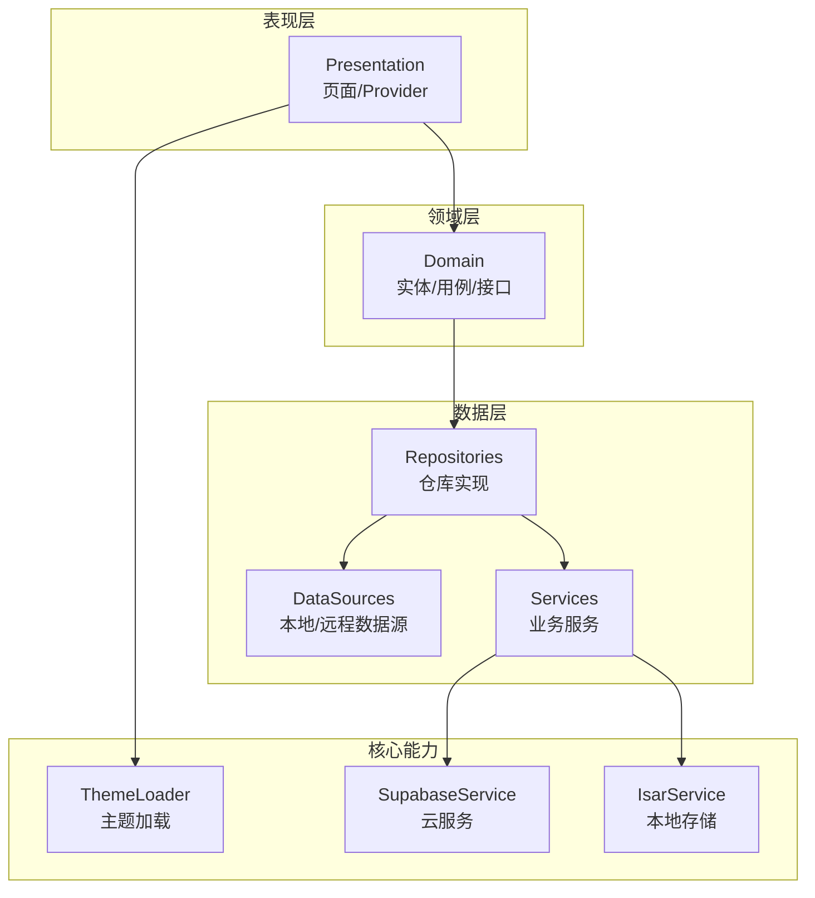
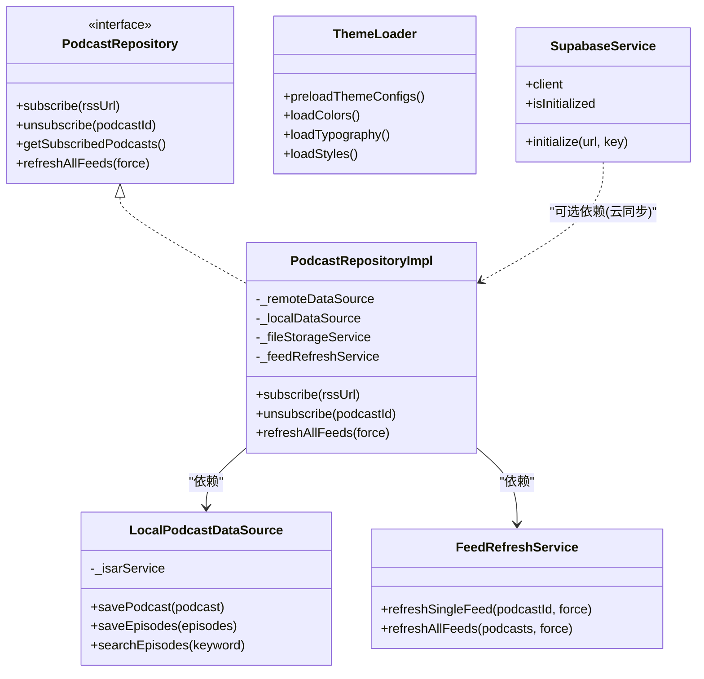
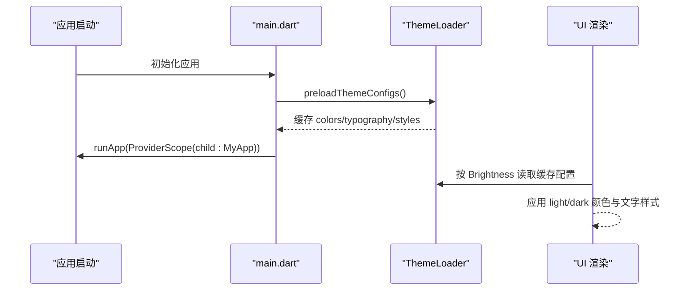
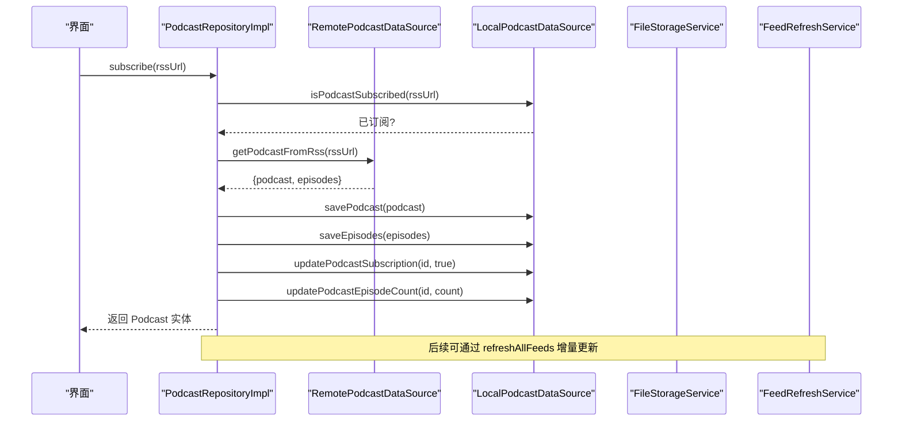
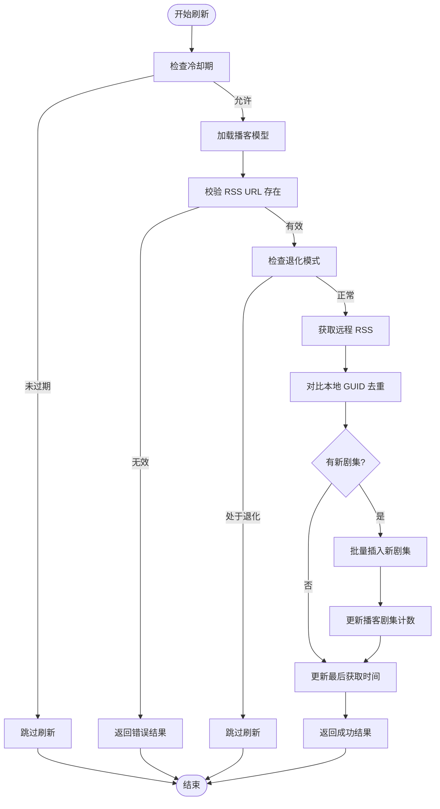
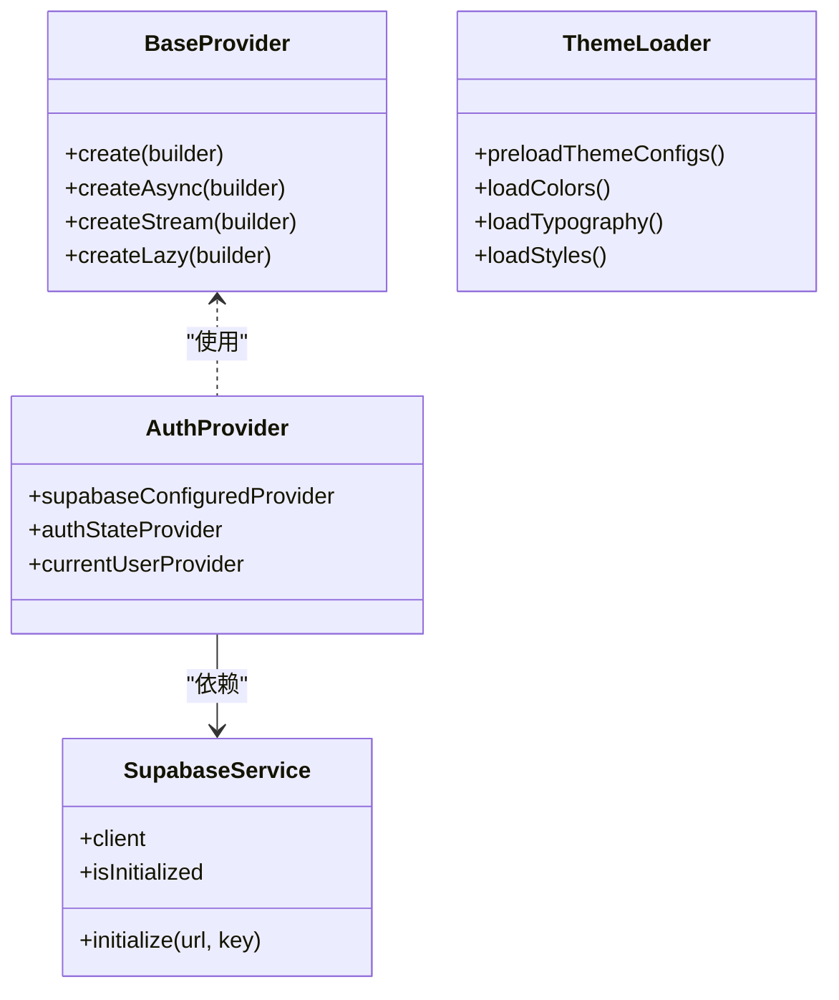
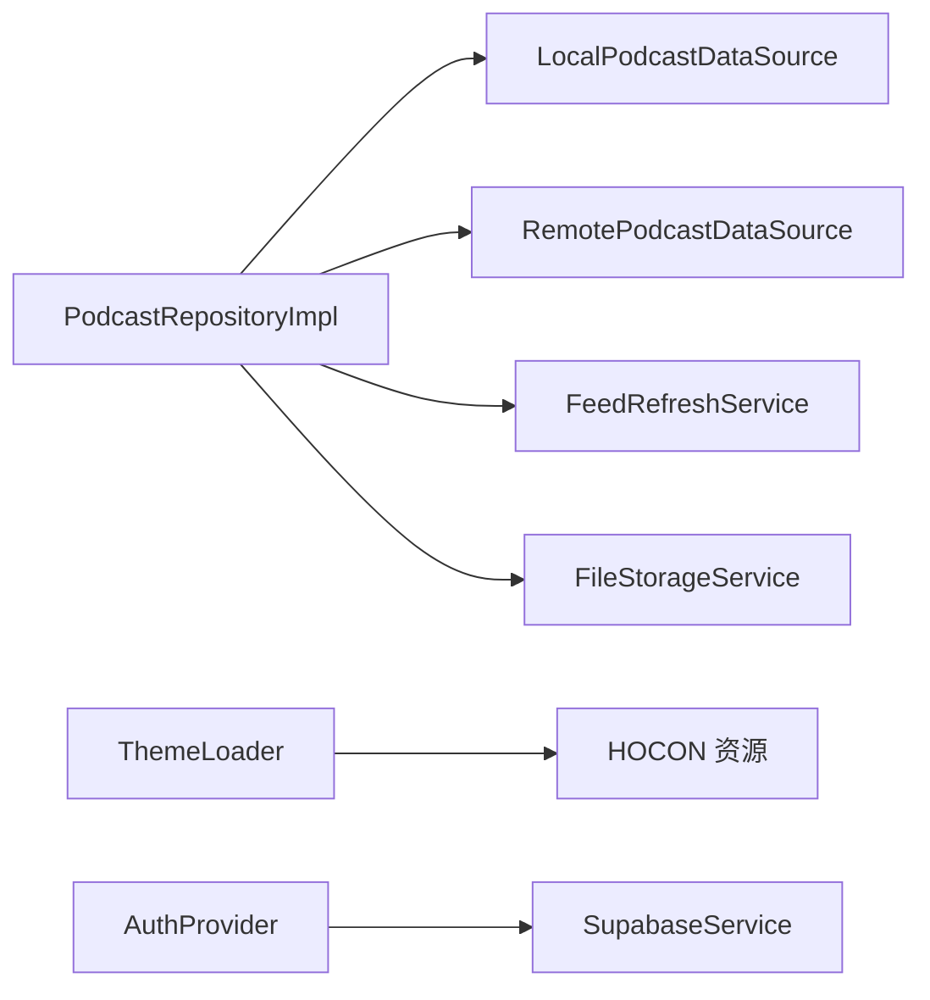

# 扩展开发

<cite>
**本文引用的文件**   
- [main.dart](file://lib/main.dart)
- [pubspec.yaml](file://pubspec.yaml)
- [theme_loader.dart](file://lib/core/theme/theme_loader.dart)
- [theme_loader.dart](file://lib/core/theme/theme_loader.dart)
- [podcast_repository_impl.dart](file://lib/data/repositories/podcast_repository_impl.dart)
- [podcast_repository.dart](file://lib/domain/repositories/podcast_repository.dart)
- [local_podcast_datasource.dart](file://lib/data/datasources/local_podcast_datasource.dart)
- [supabase_service.dart](file://lib/core/services/supabase_service.dart)
- [auth_provider.dart](file://lib/core/providers/auth_provider.dart)
- [base_provider.dart](file://lib/presentation/providers/base_provider.dart)
- [feed_refresh_service.dart](file://lib/data/services/feed_refresh_service.dart)
</cite>

## 目录
1. [简介](#简介)
2. [项目结构](#项目结构)
3. [核心组件](#核心组件)
4. [架构总览](#架构总览)
5. [详细组件分析](#详细组件分析)
6. [依赖分析](#依赖分析)
7. [性能考虑](#性能考虑)
8. [故障排查指南](#故障排查指南)
9. [结论](#结论)
10. [附录：扩展点与最佳实践](#附录扩展点与最佳实践)

## 简介
本指南面向希望为 TinyCast 应用进行扩展开发的工程师，围绕插件化架构、可插拔状态管理、可替换数据源实现、动态主题配置系统以及跨平台功能抽象层展开。文档将详细说明如何开发自定义 Provider、Repository 实现和主题配置，提供第三方集成方法与最佳实践，并记录扩展点的注册机制、生命周期管理与依赖注入方式，帮助开发者在保持代码质量的同时高效扩展应用功能。

## 项目结构
TinyCast 采用分层架构（presentation / domain / data）与 Riverpod 状态管理，结合 Isar 本地数据库、Supabase 云服务、HOCON 主题配置加载器，形成清晰的职责边界与可扩展的扩展点。

图表来源 
- [main.dart:106-177](file://lib/main.dart#L106-L177)
- [pubspec.yaml:18-144](file://pubspec.yaml#L18-L144)

章节来源
- [main.dart:106-177](file://lib/main.dart#L106-L177)
- [pubspec.yaml:18-144](file://pubspec.yaml#L18-L144)

## 核心组件
- 状态管理（Riverpod）
  - 主题加载：启动时由 ThemeLoader 预加载 HOCON 配置，不走 Riverpod；运行时按系统亮度读取。
  - 认证状态：基于 Supabase 的 auth 流，暴露当前用户与配置状态。
  - 基础 Provider 工具：封装常用 Provider 创建模式，便于统一风格。
- 数据访问（Repository + DataSource）
  - PodcastRepositoryImpl 聚合本地/远程数据源与多个服务，提供订阅、刷新、搜索等能力。
  - LocalPodcastDataSource 基于 Isar 提供高性能本地读写与复杂查询。
- 主题系统（HOCON）
  - ThemeLoader 解析 colors.conf、typography.conf、styles.conf，构建 AppThemeConfig 与 TextStyle。
- 云服务（Supabase）
  - SupabaseService 单例初始化客户端，暴露 client 供各模块使用。
- 后台刷新（FeedRefreshService）
  - 增量更新、冷却期、退化策略、并发控制，保证稳定高效的批量刷新。

章节来源
- [theme_loader.dart:1-92](file://lib/core/theme/theme_loader.dart#L1-L92)
- [auth_provider.dart:1-22](file://lib/core/providers/auth_provider.dart#L1-L22)
- [base_provider.dart:1-28](file://lib/presentation/providers/base_provider.dart#L1-L28)
- [podcast_repository_impl.dart:1-524](file://lib/data/repositories/podcast_repository_impl.dart#L1-L524)
- [local_podcast_datasource.dart:1-800](file://lib/data/datasources/local_podcast_datasource.dart#L1-L800)
- [theme_loader.dart:1-684](file://lib/core/theme/theme_loader.dart#L1-L684)
- [supabase_service.dart:1-55](file://lib/core/services/supabase_service.dart#L1-L55)
- [feed_refresh_service.dart:1-239](file://lib/data/services/feed_refresh_service.dart#L1-L239)

## 架构总览
TinyCast 的扩展点主要分布在以下位置：
- Provider 层：新增/替换状态逻辑（如认证、主题、播放进度）。
- Repository 层：替换数据源实现（如本地缓存策略、远程 API 适配）。
- Data Source 层：接入新的存储或网络后端。
- ThemeLoader：扩展主题配置格式或来源（如远程主题包）。
- Services：扩展业务编排（如下载队列、同步服务）。

图表来源 
- [podcast_repository.dart:1-42](file://lib/domain/repositories/podcast_repository.dart#L1-L42)
- [podcast_repository_impl.dart:1-524](file://lib/data/repositories/podcast_repository_impl.dart#L1-L524)
- [local_podcast_datasource.dart:1-800](file://lib/data/datasources/local_podcast_datasource.dart#L1-L800)
- [feed_refresh_service.dart:1-239](file://lib/data/services/feed_refresh_service.dart#L1-L239)
- [theme_loader.dart:1-92](file://lib/core/theme/theme_loader.dart#L1-L92)
- [theme_loader.dart:1-684](file://lib/core/theme/theme_loader.dart#L1-L684)
- [supabase_service.dart:1-55](file://lib/core/services/supabase_service.dart#L1-L55)

## 详细组件分析

### 主题系统与配置加载（ThemeLoader，无 Provider）
- 设计要点
  - 主题不经过 Riverpod：`main()` 在首帧前调用 `ThemeLoader.preloadThemeConfigs()`，把配置写入静态缓存。
  - ThemeLoader 解析 HOCON 配置文件，支持 include、引用、嵌套对象，生成颜色、字体样式与组件样式。
  - 运行时按系统亮度通过 `AppTheme.fromBrightness` 读取；解析失败时降级到硬编码常量。
- 扩展建议
  - 新增主题来源：可在 ThemeLoader 中增加远程加载逻辑（如从云端拉取 .conf），并在启动预加载阶段调用。
  - 新增样式维度：在 `_buildWidgetTextStyles` 中扩展更多组件样式键。
  - 修改 `.conf` 后需要重新构建/重启应用，当前没有文件监听或运行时热更新。
- 关键流程（序列图）

图表来源 
- [main.dart:119-124](file://lib/main.dart#L119-L124)
- [theme_loader.dart:471-507](file://lib/core/theme/theme_loader.dart#L471-L507)
- [theme_loader.dart:65-92](file://lib/core/theme/theme_loader.dart#L65-L92)

章节来源
- [theme_loader.dart:1-92](file://lib/core/theme/theme_loader.dart#L1-L92)
- [theme_loader.dart:1-684](file://lib/core/theme/theme_loader.dart#L1-L684)
- [main.dart:119-124](file://lib/main.dart#L119-L124)

### 播客仓库与数据源（PodcastRepositoryImpl + LocalPodcastDataSource）
- 设计要点
  - Repository 作为领域与数据层的桥梁，组合 Remote/Local DataSource 与 FileStorage、FeedRefresh 等服务。
  - LocalPodcastDataSource 基于 Isar 提供事务性写入、索引查询与批量操作。
  - 订阅流程包含去重检查、RSS 解析、持久化、iTunes 信息回填与计数更新。
- 扩展建议
  - 替换数据源：实现新的 RemotePodcastDataSource（例如切换至自有 RSS 代理或 GraphQL 接口）。
  - 增强本地策略：在 LocalPodcastDataSource 中增加缓存失效、压缩归档、分片存储等。
- 关键流程（序列图）

图表来源 
- [podcast_repository_impl.dart:39-141](file://lib/data/repositories/podcast_repository_impl.dart#L39-L141)
- [local_podcast_datasource.dart:89-127](file://lib/data/datasources/local_podcast_datasource.dart#L89-L127)

章节来源
- [podcast_repository_impl.dart:1-524](file://lib/data/repositories/podcast_repository_impl.dart#L1-L524)
- [local_podcast_datasource.dart:1-800](file://lib/data/datasources/local_podcast_datasource.dart#L1-L800)
- [podcast_repository.dart:1-42](file://lib/domain/repositories/podcast_repository.dart#L1-L42)

### 后台刷新服务（FeedRefreshService）
- 设计要点
  - 冷却期：同一播客短时间重复刷新将被跳过。
  - 退化模式：连续失败达到阈值后延长刷新间隔。
  - 并发控制：批量刷新按固定并发度分块执行。
  - 增量更新：基于 GUID 去重，仅插入新剧集并更新计数。
- 关键流程（流程图）

图表来源 
- [feed_refresh_service.dart:74-202](file://lib/data/services/feed_refresh_service.dart#L74-L202)

章节来源
- [feed_refresh_service.dart:1-239](file://lib/data/services/feed_refresh_service.dart#L1-L239)

### 状态管理与依赖注入（Riverpod）
- 主题加载：启动时由 ThemeLoader 预加载 HOCON，无主题 Provider。
- 认证 Provider：基于 Supabase 的 auth 流，暴露当前用户与配置状态。
- 基础 Provider：封装 create/createAsync/createStream/lazy 等工厂方法，统一创建风格。
- 依赖注入：通过 ProviderScope 提供全局依赖，Service 以单例形式暴露 client。

图表来源 
- [base_provider.dart:1-28](file://lib/presentation/providers/base_provider.dart#L1-L28)
- [theme_loader.dart:1-92](file://lib/core/theme/theme_loader.dart#L1-L92)
- [auth_provider.dart:1-22](file://lib/core/providers/auth_provider.dart#L1-L22)
- [supabase_service.dart:1-55](file://lib/core/services/supabase_service.dart#L1-L55)

章节来源
- [base_provider.dart:1-28](file://lib/presentation/providers/base_provider.dart#L1-L28)
- [theme_loader.dart:1-92](file://lib/core/theme/theme_loader.dart#L1-L92)
- [auth_provider.dart:1-22](file://lib/core/providers/auth_provider.dart#L1-L22)
- [supabase_service.dart:1-55](file://lib/core/services/supabase_service.dart#L1-L55)

## 依赖分析
- 组件耦合
  - PodcastRepositoryImpl 对 Local/Remote DataSource 与服务强依赖，适合通过构造函数注入替换。
  - ThemeLoader 依赖资源包与 HOCON 解析器，在启动阶段完成解析与缓存。
  - SupabaseService 被认证 Provider 与可能的云同步模块使用。
- 外部依赖
  - Riverpod：状态管理与依赖注入。
  - Isar：本地数据库。
  - Supabase：认证、数据库、存储。
  - Just Audio/Audio Service：音频播放与后台服务。
  - Dio/Connectivity：网络请求与连接状态。
  - HOCON：主题配置解析。

图表来源 
- [podcast_repository_impl.dart:1-524](file://lib/data/repositories/podcast_repository_impl.dart#L1-L524)
- [local_podcast_datasource.dart:1-800](file://lib/data/datasources/local_podcast_datasource.dart#L1-L800)
- [feed_refresh_service.dart:1-239](file://lib/data/services/feed_refresh_service.dart#L1-L239)
- [theme_loader.dart:1-92](file://lib/core/theme/theme_loader.dart#L1-L92)
- [theme_loader.dart:1-684](file://lib/core/theme/theme_loader.dart#L1-L684)
- [auth_provider.dart:1-22](file://lib/core/providers/auth_provider.dart#L1-L22)
- [supabase_service.dart:1-55](file://lib/core/services/supabase_service.dart#L1-L55)

章节来源
- [podcast_repository_impl.dart:1-524](file://lib/data/repositories/podcast_repository_impl.dart#L1-L524)
- [local_podcast_datasource.dart:1-800](file://lib/data/datasources/local_podcast_datasource.dart#L1-L800)
- [feed_refresh_service.dart:1-239](file://lib/data/services/feed_refresh_service.dart#L1-L239)
- [theme_loader.dart:1-92](file://lib/core/theme/theme_loader.dart#L1-L92)
- [theme_loader.dart:1-684](file://lib/core/theme/theme_loader.dart#L1-L684)
- [auth_provider.dart:1-22](file://lib/core/providers/auth_provider.dart#L1-L22)
- [supabase_service.dart:1-55](file://lib/core/services/supabase_service.dart#L1-L55)

## 性能考虑
- 主题加载
  - 启动时预加载 HOCON 配置，避免首次渲染卡顿；失败快速回退到硬编码常量。
- 数据访问
  - 使用 Isar 事务批量写入，减少 IO 开销；利用索引与排序优化查询。
- 刷新策略
  - 冷却期与退化模式降低频繁请求；并发分块控制避免过载。
- 网络与缓存
  - 合理使用缓存图片与离线内容；网络异常重试与超时控制。

[本节为通用指导，不直接分析具体文件]

## 故障排查指南
- 主题加载失败
  - 检查 assets/themes/*.conf 是否打包；确认 HOCON 语法正确；查看日志输出定位解析失败路径。
- 订阅失败
  - 检查 RSS URL 有效性；确认本地去重逻辑；查看 iTunes 信息回填是否成功。
- 刷新失败
  - 检查网络连接；观察冷却期与退化模式；查看 GUID 去重统计与批量插入结果。
- 认证问题
  - 确认 Supabase 初始化参数；检查 Session 持久化；验证 auth 流事件。

章节来源
- [theme_loader.dart:471-507](file://lib/core/theme/theme_loader.dart#L471-L507)
- [podcast_repository_impl.dart:39-141](file://lib/data/repositories/podcast_repository_impl.dart#L39-L141)
- [feed_refresh_service.dart:74-202](file://lib/data/services/feed_refresh_service.dart#L74-L202)
- [supabase_service.dart:18-47](file://lib/core/services/supabase_service.dart#L18-L47)

## 结论
TinyCast 的扩展体系以 Riverpod 状态管理、Repository 数据抽象、HOCON 主题系统与多服务编排为核心，提供了清晰且灵活的扩展点。通过遵循本文档的扩展指南与最佳实践，开发者可以安全地替换数据源、扩展主题配置、集成第三方服务，并保持代码质量与性能。

[本节为总结，不直接分析具体文件]

## 附录：扩展点与最佳实践

### 如何开发自定义 Provider
- 步骤
  - 定义状态类（如 SyncState、DownloadState），封装必要字段与便捷方法。
  - 使用 AsyncNotifierProvider/FutureProvider/StreamProvider 暴露状态。
  - 在 ProviderScope 中确保依赖可用（如 SupabaseService）。
- 示例参考
  - 同步 Provider：[sync_provider.dart](file://lib/presentation/providers/sync_provider.dart)
  - 认证 Provider：[auth_provider.dart:1-22](file://lib/core/providers/auth_provider.dart#L1-L22)
  - 基础 Provider 工具：[base_provider.dart:1-28](file://lib/presentation/providers/base_provider.dart#L1-L28)

章节来源
- [theme_loader.dart:1-92](file://lib/core/theme/theme_loader.dart#L1-L92)
- [auth_provider.dart:1-22](file://lib/core/providers/auth_provider.dart#L1-L22)
- [base_provider.dart:1-28](file://lib/presentation/providers/base_provider.dart#L1-L28)

### 如何开发自定义 Repository 实现
- 步骤
  - 定义领域接口（如 PodcastRepository）。
  - 实现 Repository，组合必要的 DataSource 与 Service。
  - 在应用入口或模块初始化处注入实现。
- 示例参考
  - 接口定义：[podcast_repository.dart:1-42](file://lib/domain/repositories/podcast_repository.dart#L1-L42)
  - 实现类：[podcast_repository_impl.dart:1-524](file://lib/data/repositories/podcast_repository_impl.dart#L1-L524)

章节来源
- [podcast_repository.dart:1-42](file://lib/domain/repositories/podcast_repository.dart#L1-L42)
- [podcast_repository_impl.dart:1-524](file://lib/data/repositories/podcast_repository_impl.dart#L1-L524)

### 如何开发自定义数据源（DataSource）
- 步骤
  - 针对本地/远程场景分别实现数据访问逻辑。
  - 使用 Isar 或 HTTP 客户端完成读写。
  - 在 Repository 中注入并替换默认实现。
- 示例参考
  - 本地数据源：[local_podcast_datasource.dart:1-800](file://lib/data/datasources/local_podcast_datasource.dart#L1-L800)

章节来源
- [local_podcast_datasource.dart:1-800](file://lib/data/datasources/local_podcast_datasource.dart#L1-L800)

### 如何扩展主题配置系统
- 步骤
  - 在 ThemeLoader 中增加新的配置来源（如远程 .conf）。
  - 在 `preloadThemeConfigs()` 的启动预加载流程中接入新来源并写入静态缓存。
  - 修改 `.conf` 或加载逻辑后重新构建/重启应用使其生效。
- 示例参考
  - 主题加载器：[theme_loader.dart:1-684](file://lib/core/theme/theme_loader.dart#L1-L684)
  - 主题入口：[app_theme.dart](file://lib/core/theme/app_theme.dart)

章节来源
- [theme_loader.dart:1-684](file://lib/core/theme/theme_loader.dart#L1-L684)
- [theme_loader.dart:1-92](file://lib/core/theme/theme_loader.dart#L1-L92)

### 第三方集成方法
- Supabase 集成
  - 在 main 中初始化 SupabaseService，传入环境变量配置。
  - 通过 supabaseClientProvider 获取客户端实例。
- 示例参考
  - 初始化与客户端：[supabase_service.dart:1-55](file://lib/core/services/supabase_service.dart#L1-L55)
  - 应用入口初始化：[main.dart:179-194](file://lib/main.dart#L179-L194)

章节来源
- [supabase_service.dart:1-55](file://lib/core/services/supabase_service.dart#L1-L55)
- [main.dart:179-194](file://lib/main.dart#L179-L194)

### 扩展点注册机制、生命周期管理与依赖注入
- 注册机制
  - Provider 通过 ProviderScope 注册与提供依赖。
  - Service 以单例形式暴露（如 SupabaseService、FeedRefreshService）。
- 生命周期管理
  - 应用启动时初始化数据库、播放器、日志与云服务。
  - 监听应用生命周期，处理暂停/恢复/退出时的清理。
- 依赖注入
  - 使用 Riverpod 的 Provider/AsyncNotifierProvider/StreamProvider 管理依赖。
  - 通过构造函数注入替换实现（如 Repository 的数据源）。

章节来源
- [main.dart:106-177](file://lib/main.dart#L106-L177)
- [supabase_service.dart:1-55](file://lib/core/services/supabase_service.dart#L1-L55)
- [feed_refresh_service.dart:1-239](file://lib/data/services/feed_refresh_service.dart#L1-L239)

### 最佳实践与性能优化建议
- 代码组织
  - 严格分层：presentation / domain / data，职责单一。
  - 接口先行：先定义领域接口，再实现数据层。
- 性能优化
  - 批量写入与事务；合理索引与分页；缓存热点数据。
  - 主题与配置预加载；网络请求重试与超时控制。
- 可测试性
  - 使用 Mock 替换数据源；Provider 独立测试；服务隔离测试。

[本节为通用指导，不直接分析具体文件]