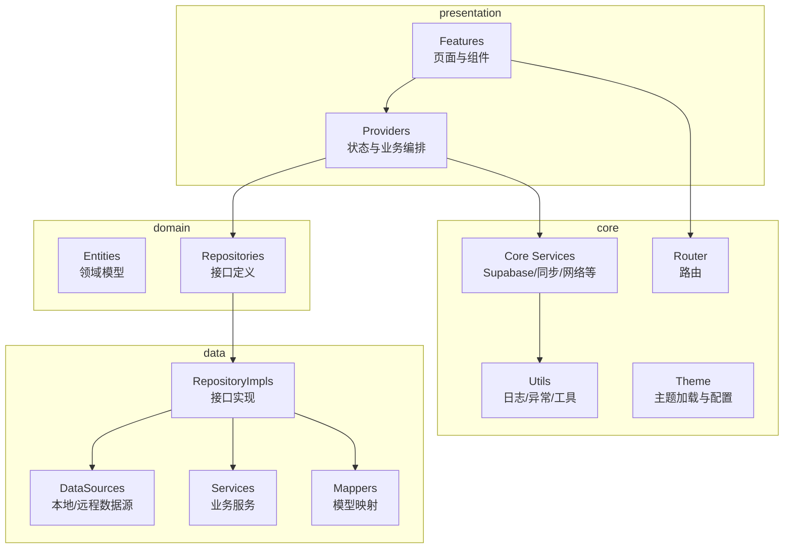
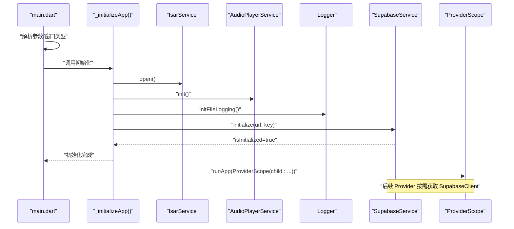
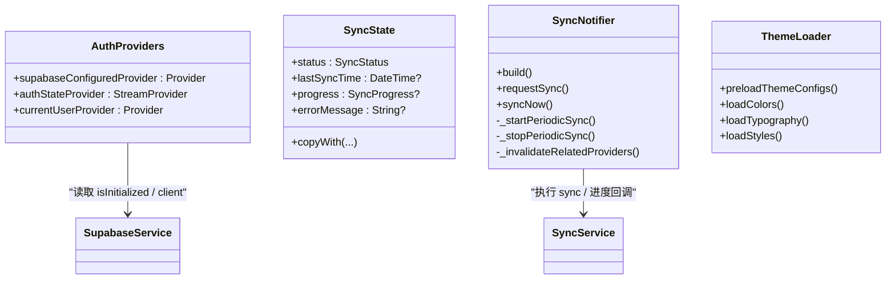
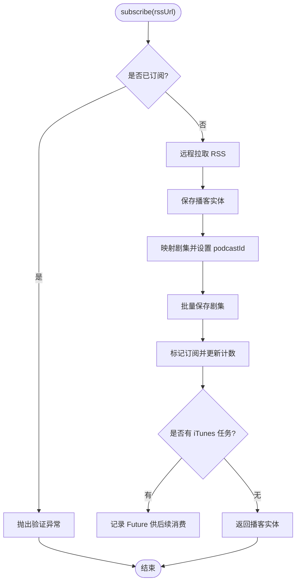
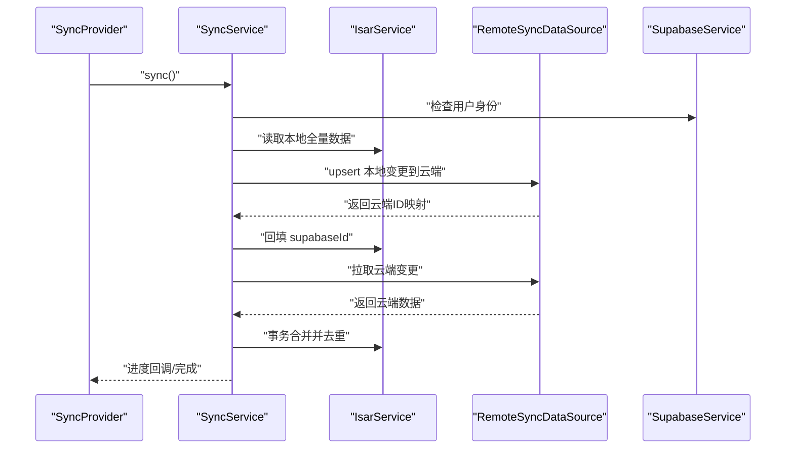
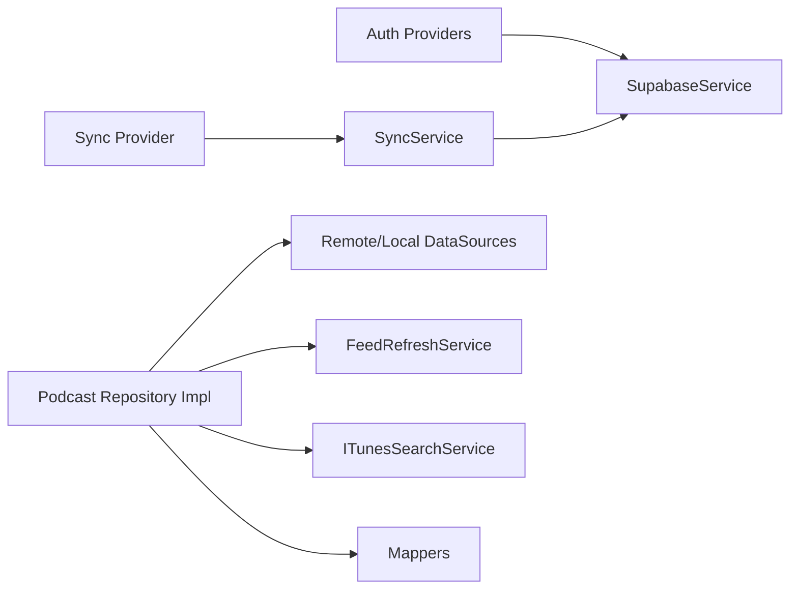

# 插件系统架构

<cite>
**本文引用的文件**   
- [pubspec.yaml](file://pubspec.yaml)
- [main.dart](file://lib/main.dart)
- [supabase_service.dart](file://lib/core/services/supabase_service.dart)
- [auth_provider.dart](file://lib/core/providers/auth_provider.dart)
- [sync_provider.dart](file://lib/presentation/providers/sync_provider.dart)
- [theme_loader.dart](file://lib/core/theme/theme_loader.dart)
- [podcast_repository.dart](file://lib/domain/repositories/podcast_repository.dart)
- [podcast_repository_impl.dart](file://lib/data/repositories/podcast_repository_impl.dart)
- [sync_service.dart](file://lib/core/services/sync_service.dart)
</cite>

## 目录
1. [引言](#引言)
2. [项目结构](#项目结构)
3. [核心组件](#核心组件)
4. [架构总览](#架构总览)
5. [详细组件分析](#详细组件分析)
6. [依赖关系分析](#依赖关系分析)
7. [性能与可扩展性](#性能与可扩展性)
8. [故障排查指南](#故障排查指南)
9. [结论](#结论)
10. [附录：扩展开发指南](#附录扩展开发指南)

## 引言
本文件面向 TinyCast 的插件系统架构，围绕可插拔组件设计模式展开，重点说明 Provider 扩展机制、Repository 接口抽象与依赖注入容器（Riverpod）的使用方式。文档将指导开发者如何开发自定义 Provider、实现 Repository 接口并注册新的服务组件，同时覆盖插件生命周期管理、状态管理与错误处理的完整方案，并提供具体代码示例路径，帮助开发者理解并扩展现有功能模块。

## 项目结构
TinyCast 采用分层架构：
- presentation：UI 与交互逻辑，包含页面与 Riverpod Provider
- domain：领域实体与 Repository 接口定义
- data：数据层实现，包括 DataSource、Service、Mapper、Model 与 Repository 实现
- core：跨层共享能力，如服务、工具、主题、路由等
- main：应用入口与初始化流程

图表来源
- [main.dart:106-177](file://lib/main.dart#L106-L177)
- [pubspec.yaml:18-144](file://pubspec.yaml#L18-L144)

章节来源
- [pubspec.yaml:1-196](file://pubspec.yaml#L1-L196)
- [main.dart:106-177](file://lib/main.dart#L106-L177)

## 核心组件
- Provider 扩展机制（Riverpod）
  - 使用 Provider/NotifierProvider/AsyncNotifierProvider 声明式暴露状态与服务
  - 通过 ref.watch/ref.listen 订阅与监听变化，支持自动失效与重建
- Repository 接口抽象
  - 在 domain 层定义统一接口，屏蔽数据源差异（本地 Isar、远程 Supabase）
  - 在 data 层提供具体实现，组合多个 Service/DataSource/Mapper
- 依赖注入容器（Riverpod）
  - 以 ProviderScope 为根容器，按需提供单例或作用域实例
  - 通过构造函数注入或 Provider 获取依赖，避免全局单例耦合

章节来源
- [auth_provider.dart:1-22](file://lib/core/providers/auth_provider.dart#L1-L22)
- [sync_provider.dart:1-168](file://lib/presentation/providers/sync_provider.dart#L1-L168)
- [theme_loader.dart:1-92](file://lib/core/theme/theme_loader.dart#L1-L92)
- [podcast_repository.dart:1-42](file://lib/domain/repositories/podcast_repository.dart#L1-L42)
- [podcast_repository_impl.dart:1-524](file://lib/data/repositories/podcast_repository_impl.dart#L1-L524)

## 架构总览
下图展示应用启动、服务初始化与 Provider 容器的装配关系，以及 Supabase 客户端的接入点。

图表来源
- [main.dart:179-194](file://lib/main.dart#L179-L194)
- [supabase_service.dart:18-47](file://lib/core/services/supabase_service.dart#L18-L47)

章节来源
- [main.dart:106-177](file://lib/main.dart#L106-L177)
- [supabase_service.dart:1-55](file://lib/core/services/supabase_service.dart#L1-L55)

## 详细组件分析

### Provider 扩展机制（Riverpod）
- 认证状态 Provider
  - supabaseConfiguredProvider：判断 Supabase 是否已配置
  - authStateProvider：监听认证状态流，返回当前用户或 null
  - currentUserProvider：直接读取当前用户
- 同步状态 Provider
  - SyncNotifier：基于 Notifier 管理同步状态（idle/syncing/error）、进度与最后同步时间
  - 周期性同步与防抖触发；登录态变化时启停定时器
  - 同步完成后失效相关 Provider，驱动 UI 刷新
- 主题（非 Provider 扩展点）
  - 启动时由 `main()` 调用 `ThemeLoader.preloadThemeConfigs()` 写入静态缓存，运行时按系统亮度读取
  - 没有 ThemeNotifier 或 themeProvider；修改 `.conf` 需重新构建/重启

图表来源
- [auth_provider.dart:1-22](file://lib/core/providers/auth_provider.dart#L1-L22)
- [sync_provider.dart:1-168](file://lib/presentation/providers/sync_provider.dart#L1-L168)
- [theme_loader.dart:1-92](file://lib/core/theme/theme_loader.dart#L1-L92)
- [supabase_service.dart:1-55](file://lib/core/services/supabase_service.dart#L1-L55)

章节来源
- [auth_provider.dart:1-22](file://lib/core/providers/auth_provider.dart#L1-L22)
- [sync_provider.dart:1-168](file://lib/presentation/providers/sync_provider.dart#L1-L168)
- [theme_loader.dart:1-92](file://lib/core/theme/theme_loader.dart#L1-L92)

### Repository 接口与实现（Podcast）
- 接口定义（domain）
  - PodcastRepository：订阅、取消订阅、查询节目与剧集、搜索、播放状态更新、Feed 刷新等
- 实现类（data）
  - PodcastRepositoryImpl：组合 Remote/Local DataSource、FileStorage、FeedRefresh、ITunesSearch、Mapper
  - 关键流程：
    - subscribe：校验重复 -> 拉取 RSS -> 保存播客与剧集 -> 标记订阅 -> 更新计数 -> 可选 iTunes 元数据
    - unsubscribe：删除本地文件 -> 清理剧集与播客记录
    - refreshAllFeeds：批量刷新订阅列表，统计结果
  - 错误处理：统一包装为 AppException，记录日志与堆栈

图表来源
- [podcast_repository.dart:1-42](file://lib/domain/repositories/podcast_repository.dart#L1-L42)
- [podcast_repository_impl.dart:39-141](file://lib/data/repositories/podcast_repository_impl.dart#L39-L141)

章节来源
- [podcast_repository.dart:1-42](file://lib/domain/repositories/podcast_repository.dart#L1-L42)
- [podcast_repository_impl.dart:1-524](file://lib/data/repositories/podcast_repository_impl.dart#L1-L524)

### 同步服务（SyncService）
- 职责
  - 协调本地 Isar 与云端 Supabase 的数据同步
  - 分阶段推送本地变更、拉取云端变更并合并
  - 维护 last_sync_timestamp，保证增量同步
  - 提供进度回调与步骤级错误隔离
- 关键流程
  - push_local_changes：推播客/剧集/订阅/播放历史/收藏/队列
  - pull_and_merge_cloud_changes：拉取并合并各表数据，按更新时间冲突解决
  - 成功后更新 last_sync_time，否则保留上次时间以保证重试一致性

图表来源
- [sync_service.dart:68-113](file://lib/core/services/sync_service.dart#L68-L113)
- [sync_service.dart:150-186](file://lib/core/services/sync_service.dart#L150-L186)
- [sync_service.dart:190-340](file://lib/core/services/sync_service.dart#L190-L340)

章节来源
- [sync_service.dart:1-800](file://lib/core/services/sync_service.dart#L1-L800)

### 应用初始化与多窗口
- main.dart 根据平台与窗口类型初始化不同应用壳
- 统一初始化 Isar、音频服务、日志、Supabase
- 注册生命周期观察者，控制 Feed 刷新调度器

章节来源
- [main.dart:106-177](file://lib/main.dart#L106-L177)
- [main.dart:179-194](file://lib/main.dart#L179-L194)

## 依赖关系分析
- Riverpod 作为依赖注入容器，贯穿 Presentation 与 Core 层
- SupabaseService 作为单例服务，被 Provider 与 SyncService 共同依赖
- PodcastRepositoryImpl 依赖多个 Data Source 与 Service，体现高内聚低耦合

图表来源
- [auth_provider.dart:1-22](file://lib/core/providers/auth_provider.dart#L1-L22)
- [sync_provider.dart:1-168](file://lib/presentation/providers/sync_provider.dart#L1-L168)
- [sync_service.dart:1-800](file://lib/core/services/sync_service.dart#L1-L800)
- [podcast_repository_impl.dart:1-524](file://lib/data/repositories/podcast_repository_impl.dart#L1-L524)

章节来源
- [pubspec.yaml:55-58](file://pubspec.yaml#L55-L58)
- [supabase_service.dart:1-55](file://lib/core/services/supabase_service.dart#L1-L55)

## 性能与可扩展性
- Riverpod 的响应式更新与自动失效减少不必要的重建，提升 UI 性能
- Repository 层对网络与本地操作进行批量化与事务化（如 Isar writeTxn），降低 IO 开销
- 同步服务分阶段推进，支持进度反馈与失败隔离，便于扩展新表或字段
- 主题在启动阶段预加载并缓存，解析失败回退硬编码常量，避免首帧阻塞

[本节为通用建议，不直接分析具体文件]

## 故障排查指南
- Supabase 未初始化
  - 现象：访问 client 抛 StateError
  - 排查：确认 _initializeApp 中 initialize 成功，且 isInitialized 为 true
- 同步失败
  - 现象：SyncStatus.error，errorMessage 非空
  - 排查：查看日志中的步骤名（push/pull 各表），定位失败阶段；检查网络连接与权限
- 订阅失败
  - 现象：AppException.validation 或 unknown
  - 排查：检查 RSS URL 有效性、重复订阅校验、网络请求与解析过程

章节来源
- [supabase_service.dart:35-47](file://lib/core/services/supabase_service.dart#L35-L47)
- [sync_provider.dart:110-141](file://lib/presentation/providers/sync_provider.dart#L110-L141)
- [podcast_repository_impl.dart:39-141](file://lib/data/repositories/podcast_repository_impl.dart#L39-L141)

## 结论
TinyCast 的插件系统以 Riverpod 为核心，结合 Repository 接口抽象与清晰的分层架构，实现了高内聚、低耦合的可插拔设计。通过 Provider 扩展机制与统一的错误处理、生命周期管理，开发者可以便捷地扩展新功能模块，并保持系统的稳定性与可维护性。

[本节为总结，不直接分析具体文件]

## 附录：扩展开发指南

### 如何开发自定义 Provider
- 选择合适类型：
  - Provider：简单值或对象
  - StreamProvider：流式状态（如认证状态）
  - NotifierProvider/AsyncNotifierProvider：复杂状态与异步逻辑
- 步骤
  - 定义状态类（如 SyncState、DownloadState）
  - 实现 Notifier/AsyncNotifier，编写 build 与操作方法
  - 在 ProviderScope 下通过 ref.watch/ref.listen 使用
- 参考路径
  - [sync_provider.dart:1-168](file://lib/presentation/providers/sync_provider.dart#L1-L168)
  - [theme_loader.dart:1-92](file://lib/core/theme/theme_loader.dart#L1-L92)
  - [auth_provider.dart:1-22](file://lib/core/providers/auth_provider.dart#L1-L22)

### 如何实现 Repository 接口
- 在 domain 层定义接口（如 PodcastRepository）
- 在 data 层实现接口，组合所需 Service/DataSource/Mapper
- 在 Provider 或 UseCase 中通过构造函数注入或 Provider 获取实现
- 参考路径
  - [podcast_repository.dart:1-42](file://lib/domain/repositories/podcast_repository.dart#L1-L42)
  - [podcast_repository_impl.dart:1-524](file://lib/data/repositories/podcast_repository_impl.dart#L1-L524)

### 如何注册新的服务组件
- 创建服务类（如 SupabaseService），提供初始化与访问方法
- 在 main 中统一初始化（_initializeApp）
- 通过 Provider 暴露服务实例，供其他模块依赖
- 参考路径
  - [supabase_service.dart:1-55](file://lib/core/services/supabase_service.dart#L1-L55)
  - [main.dart:179-194](file://lib/main.dart#L179-L194)

### 插件生命周期管理
- 应用生命周期
  - WidgetsBindingObserver 监听 paused/resumed/detached，控制后台任务（如 Feed 刷新）
- 组件生命周期
  - Notifier 的 onDispose 用于释放定时器与资源
- 参考路径
  - [main.dart:74-104](file://lib/main.dart#L74-L104)
  - [sync_provider.dart:68-74](file://lib/presentation/providers/sync_provider.dart#L68-L74)

### 状态管理与错误处理最佳实践
- 状态不可变更新：使用 copyWith 生成新状态
- 错误分类：区分业务异常与未知异常，统一包装与日志记录
- 进度反馈：长耗时操作提供进度回调，便于 UI 展示
- 参考路径
  - [sync_provider.dart:13-39](file://lib/presentation/providers/sync_provider.dart#L13-L39)
  - [podcast_repository_impl.dart:129-141](file://lib/data/repositories/podcast_repository_impl.dart#L129-L141)