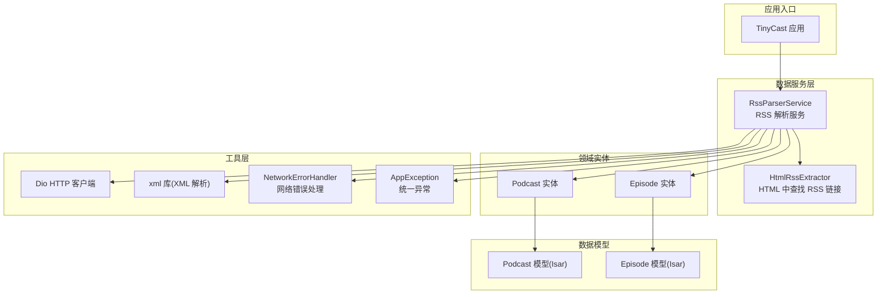
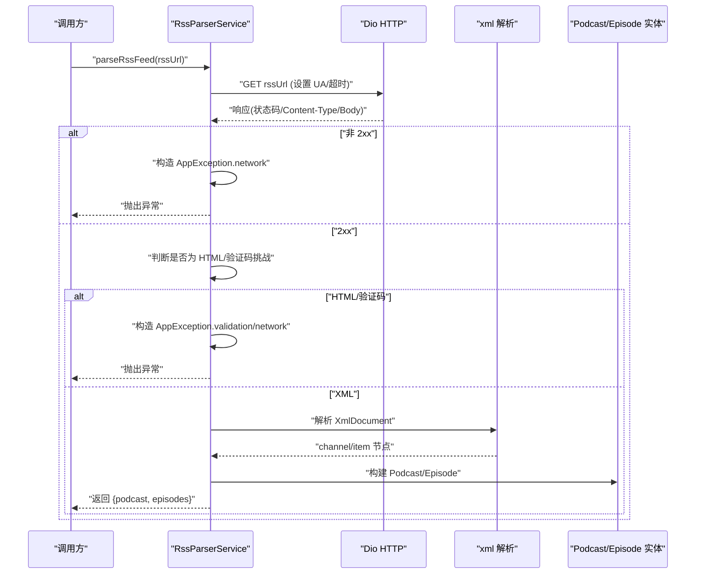
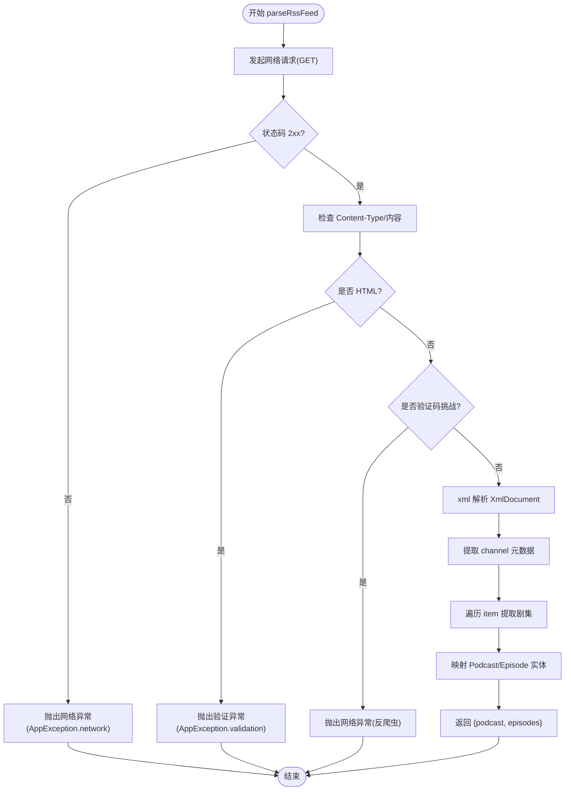
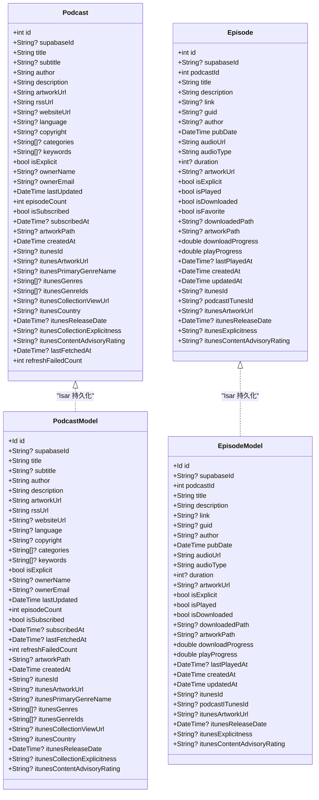
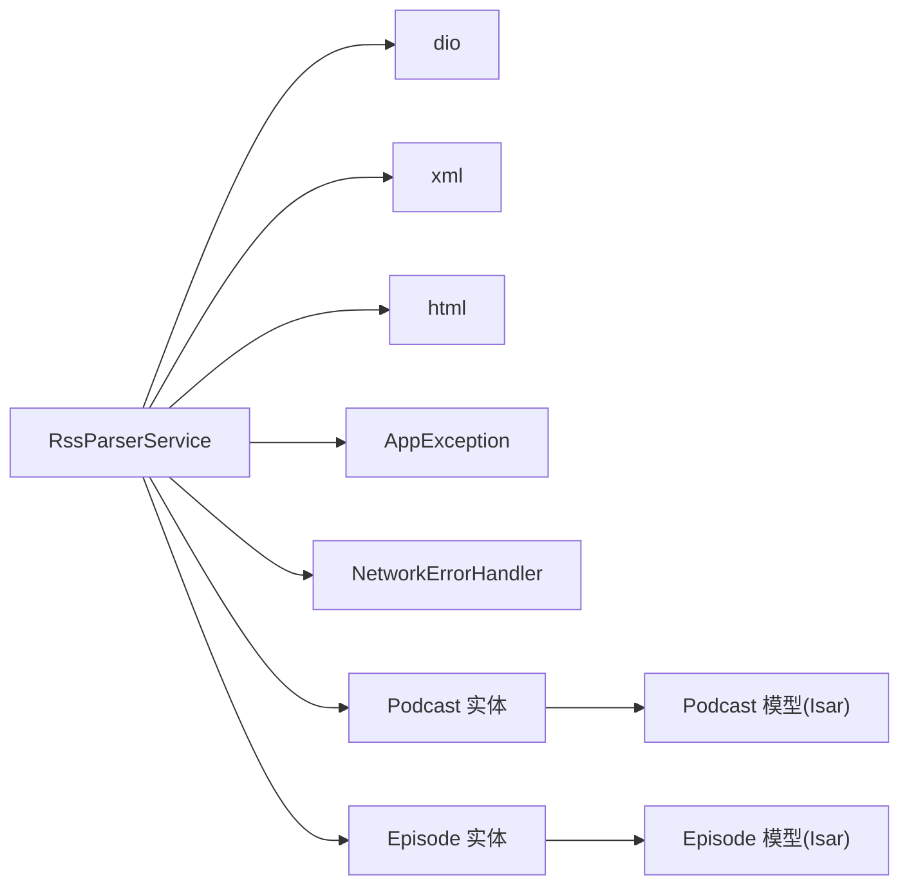

# RSS 解析器集成

<cite>
**本文引用的文件**   
- [pubspec.yaml](file://pubspec.yaml)
- [rss_parser_service.dart](file://lib/data/services/rss_parser_service.dart)
- [podcast.dart](file://lib/domain/entities/podcast.dart)
- [episode.dart](file://lib/domain/entities/episode.dart)
- [podcast_model.dart](file://lib/data/models/podcast_model.dart)
- [episode_model.dart](file://lib/data/models/episode_model.dart)
- [html_rss_extractor.dart](file://lib/core/utils/html_rss_extractor.dart)
- [app_exception.dart](file://lib/core/utils/app_exception.dart)
- [network_error_handler.dart](file://lib/core/utils/network_error_handler.dart)
</cite>

## 目录
1. [简介](#简介)
2. [项目结构](#项目结构)
3. [核心组件](#核心组件)
4. [架构总览](#架构总览)
5. [详细组件分析](#详细组件分析)
6. [依赖分析](#依赖分析)
7. [性能考虑](#性能考虑)
8. [故障排查指南](#故障排查指南)
9. [结论](#结论)
10. [附录](#附录)

## 简介
本文件为 TinyCast 应用的 RSS 解析器集成提供完整技术文档。内容涵盖 rss_dart 与 xml 库的使用策略、RSS feed 的获取与解析流程、数据模型映射（播客元数据与剧集信息）、网络请求封装、错误处理、缓存策略与增量更新机制，以及 iTunes 扩展字段处理、常见 RSS 格式兼容性与解析性能优化建议。同时给出编码问题解决方案与异常处理策略，帮助开发者快速理解并扩展 RSS 订阅能力。

## 项目结构
本项目采用分层架构：领域实体（domain/entities）定义数据结构；数据层（data/services, data/models）负责网络、解析与持久化；工具层（core/utils）提供通用能力如异常与网络错误处理。RSS 解析相关代码集中在 lib/data/services/rss_parser_service.dart，并通过 dio 发起网络请求、xml 库解析 XML，最终映射到 Podcast 与 Episode 实体。

图表来源
- [rss_parser_service.dart:1-459](file://lib/data/services/rss_parser_service.dart#L1-L459)
- [podcast.dart:1-74](file://lib/domain/entities/podcast.dart#L1-L74)
- [episode.dart:1-66](file://lib/domain/entities/episode.dart#L1-L66)
- [podcast_model.dart:1-78](file://lib/data/models/podcast_model.dart#L1-L78)
- [episode_model.dart:1-67](file://lib/data/models/episode_model.dart#L1-L67)
- [html_rss_extractor.dart:1-70](file://lib/core/utils/html_rss_extractor.dart#L1-L70)
- [network_error_handler.dart:1-188](file://lib/core/utils/network_error_handler.dart#L1-L188)
- [app_exception.dart:1-148](file://lib/core/utils/app_exception.dart#L1-L148)

章节来源
- [pubspec.yaml:78-84](file://pubspec.yaml#L78-L84)

## 核心组件
- RssParserService：基于 dio 进行网络请求，使用 xml 库直接解析 RSS XML，提取播客元数据与剧集列表，支持重试、反爬虫检测、HTML 响应回退等。
- HtmlRssExtractor：当目标 URL 返回 HTML 时，尝试从页面 <head> 或链接中提取 RSS/Atom 订阅地址。
- 数据模型与实体：Podcast 与 Episode 在 domain/entities 中定义业务语义，在 data/models 中通过 Isar 注解实现持久化。
- 错误处理：AppException 统一异常类型，NetworkErrorHandler 将 Dio 异常转换为应用级异常并提供重试/超时封装。

章节来源
- [rss_parser_service.dart:16-128](file://lib/data/services/rss_parser_service.dart#L16-L128)
- [html_rss_extractor.dart:4-22](file://lib/core/utils/html_rss_extractor.dart#L4-L22)
- [podcast.dart:1-74](file://lib/domain/entities/podcast.dart#L1-L74)
- [episode.dart:1-66](file://lib/domain/entities/episode.dart#L1-L66)
- [podcast_model.dart:5-78](file://lib/data/models/podcast_model.dart#L5-L78)
- [episode_model.dart:5-67](file://lib/data/models/episode_model.dart#L5-L67)
- [app_exception.dart:23-148](file://lib/core/utils/app_exception.dart#L23-L148)
- [network_error_handler.dart:11-124](file://lib/core/utils/network_error_handler.dart#L11-L124)

## 架构总览
下图展示 RSS 订阅解析的核心调用链：上层触发 parseRssFeed，内部通过 Dio 获取 XML，使用 xml 库解析 channel 与 item，映射到 Podcast/Episode 实体，并在失败路径上抛出 AppException 由上层处理。

图表来源
- [rss_parser_service.dart:40-128](file://lib/data/services/rss_parser_service.dart#L40-L128)
- [rss_parser_service.dart:139-187](file://lib/data/services/rss_parser_service.dart#L139-L187)
- [rss_parser_service.dart:190-267](file://lib/data/services/rss_parser_service.dart#L190-L267)
- [rss_parser_service.dart:409-457](file://lib/data/services/rss_parser_service.dart#L409-L457)

## 详细组件分析

### RssParserService：RSS 获取、解析与映射
- 网络请求封装
  - 使用 dio 发起 GET 请求，设置 responseType=plain，Accept 头包含多种 XML 类型，User-Agent 标识 TinyCast 版本。
  - 配置连接/接收/发送超时，默认值来自 AppConstants。
- 响应校验与容错
  - 检查状态码 2xx，否则抛出 AppException.network。
  - 检测 Content-Type 与内容前缀，识别 HTML 响应并提示通过网页查找订阅链接。
  - 检测反爬虫挑战（如 sg-captcha、meta refresh），抛出友好提示的网络异常。
- XML 解析
  - 使用 xml 库解析 XmlDocument，定位 channel 与 item 节点。
  - 标准字段：title、description、link、language、copyright、lastBuildDate、image/url 等。
  - iTunes 命名空间：subtitle、summary、author、explicit、category、keywords、owner(name/email)、image(href)、id 等。
  - Dublin Core 命名空间：creator、rights 等。
- 数据映射
  - Podcast：标题、副标题、作者、描述、封面图、RSS 地址、网站、语言、版权、分类、关键词、显式标记、所有者、更新时间、集数、订阅状态、创建时间、iTunes 扩展字段等。
  - Episode：标题、描述、链接、GUID、作者、发布时间、音频地址与类型、时长、封面图、显式标记、播放/下载进度、iTunes 扩展字段等。
  - GUID 缺失时的降级策略：优先使用 audioUrl 生成稳定标识，避免重复。
- 日期与时长解析
  - 支持 RFC 822 与 ISO 8601 日期格式，自动清理时区后缀。
  - 时长支持 HH:mm:ss、mm:ss 或纯秒数。
- 重试机制
  - 内置最大重试次数，指数退避延迟，捕获 Dio 异常并转为 AppException。

图表来源
- [rss_parser_service.dart:40-128](file://lib/data/services/rss_parser_service.dart#L40-L128)
- [rss_parser_service.dart:139-187](file://lib/data/services/rss_parser_service.dart#L139-L187)
- [rss_parser_service.dart:190-267](file://lib/data/services/rss_parser_service.dart#L190-L267)
- [rss_parser_service.dart:409-457](file://lib/data/services/rss_parser_service.dart#L409-L457)

章节来源
- [rss_parser_service.dart:16-128](file://lib/data/services/rss_parser_service.dart#L16-L128)
- [rss_parser_service.dart:139-187](file://lib/data/services/rss_parser_service.dart#L139-L187)
- [rss_parser_service.dart:190-267](file://lib/data/services/rss_parser_service.dart#L190-L267)
- [rss_parser_service.dart:277-314](file://lib/data/services/rss_parser_service.dart#L277-L314)
- [rss_parser_service.dart:316-358](file://lib/data/services/rss_parser_service.dart#L316-L358)
- [rss_parser_service.dart:360-407](file://lib/data/services/rss_parser_service.dart#L360-L407)
- [rss_parser_service.dart:409-457](file://lib/data/services/rss_parser_service.dart#L409-L457)

### HtmlRssExtractor：HTML 页面中的 RSS 链接提取
- 扫描 <head> 中 type="application/rss+xml" 的 link 标签。
- 若未找到，则扫描所有 a[href] 中包含 .xml 的链接作为备选。
- 自动解析相对 URL 为绝对地址，确保后续请求可用。

章节来源
- [html_rss_extractor.dart:7-22](file://lib/core/utils/html_rss_extractor.dart#L7-L22)
- [html_rss_extractor.dart:24-52](file://lib/core/utils/html_rss_extractor.dart#L24-L52)
- [html_rss_extractor.dart:54-68](file://lib/core/utils/html_rss_extractor.dart#L54-L68)

### 数据模型与实体映射
- 领域实体（Podcast/Episode）：定义业务语义与 iTunes 扩展字段，便于跨层传递。
- Isar 模型（Podcast/Episode）：用于本地持久化，包含索引与关联关系（如 podcastId）。
- 映射过程：RssParserService 直接从 XML 构建领域实体，随后可由 Mapper/Repository 层转换为 Isar 模型存储。

图表来源
- [podcast.dart:1-74](file://lib/domain/entities/podcast.dart#L1-L74)
- [episode.dart:1-66](file://lib/domain/entities/episode.dart#L1-L66)
- [podcast_model.dart:5-78](file://lib/data/models/podcast_model.dart#L5-L78)
- [episode_model.dart:5-67](file://lib/data/models/episode_model.dart#L5-L67)

章节来源
- [podcast.dart:1-74](file://lib/domain/entities/podcast.dart#L1-L74)
- [episode.dart:1-66](file://lib/domain/entities/episode.dart#L1-L66)
- [podcast_model.dart:5-78](file://lib/data/models/podcast_model.dart#L5-L78)
- [episode_model.dart:5-67](file://lib/data/models/episode_model.dart#L5-L67)

### 错误处理与异常策略
- 统一异常：AppException 提供 network/validation/authentication/permission/unknown 等类型，携带 statusCode 与原始错误。
- 网络错误处理：NetworkErrorHandler.handleDioException 将 DioException 映射为 AppException，并按状态码细化消息。
- RSS 解析异常：在网络失败、HTML 响应、验证码挑战、XML 解析失败等场景均抛出 AppException，便于上层统一处理与用户提示。

章节来源
- [app_exception.dart:23-148](file://lib/core/utils/app_exception.dart#L23-L148)
- [network_error_handler.dart:11-124](file://lib/core/utils/network_error_handler.dart#L11-L124)
- [rss_parser_service.dart:101-128](file://lib/data/services/rss_parser_service.dart#L101-L128)
- [rss_parser_service.dart:179-187](file://lib/data/services/rss_parser_service.dart#L179-L187)
- [rss_parser_service.dart:259-267](file://lib/data/services/rss_parser_service.dart#L259-L267)

## 依赖分析
- 外部依赖
  - dio：HTTP 客户端，支持拦截器、超时、重试等。
  - xml：XML 解析库，直接操作 DOM。
  - html：HTML 解析库，用于从网页中提取 RSS 链接。
  - isar_community：本地数据库，用于持久化 Podcast/Episode。
- 内部依赖
  - AppException、NetworkErrorHandler：统一异常与网络错误处理。
  - Podcast/Episode 实体与 Isar 模型：领域与持久化分离。

图表来源
- [pubspec.yaml:78-84](file://pubspec.yaml#L78-L84)
- [rss_parser_service.dart:1-11](file://lib/data/services/rss_parser_service.dart#L1-L11)
- [podcast.dart:1-74](file://lib/domain/entities/podcast.dart#L1-L74)
- [episode.dart:1-66](file://lib/domain/entities/episode.dart#L1-L66)
- [podcast_model.dart:5-78](file://lib/data/models/podcast_model.dart#L5-L78)
- [episode_model.dart:5-67](file://lib/data/models/episode_model.dart#L5-L67)

章节来源
- [pubspec.yaml:78-84](file://pubspec.yaml#L78-L84)

## 性能考虑
- 解析性能
  - 使用 xml 库直接解析，避免中间转换开销；对大型 feed 建议分批处理 item。
  - 减少不必要的字符串拼接与正则匹配，尽量复用已解析节点。
- 网络性能
  - 合理设置超时与重试间隔，避免频繁重试导致雪崩。
  - 启用 HTTP/2（dio_http2_adapter）提升并发与复用效率。
- 内存占用
  - 避免一次性加载超大 XML；必要时限制 item 数量或分页拉取。
  - 图片 URL 仅保存，不在解析阶段下载。
- 缓存策略（建议）
  - 对 RSS XML 结果做短期缓存（如 5-15 分钟），减少重复请求。
  - 对剧集音频 URL 与封面图使用图片缓存（cached_network_image）。
- 增量更新（建议）
  - 记录 lastUpdated 与每个 episode 的 pubDate/GUID，服务端或本地比较差异后只拉取新增项。
  - 结合 Isar 索引（pubDate、podcastId）加速查询与去重。

[本节为通用指导，不直接分析具体文件]

## 故障排查指南
- 常见问题
  - 服务器返回 HTML：检查 URL 是否正确指向 RSS/XML；可使用 HtmlRssExtractor 从页面提取订阅链接。
  - 反爬虫验证：检测到 sg-captcha 或 meta refresh 时，提示切换网络或稍后重试。
  - GUID 缺失：日志会警告自动生成 GUID，确保 audioUrl 唯一性以避免重复。
  - 日期解析失败：确认 feed 日期格式符合 RFC 822 或 ISO 8601。
- 调试步骤
  - 查看日志输出（Logger.info/warning/error/debug），定位失败阶段。
  - 检查 Dio 响应状态码与 Content-Type。
  - 使用 NetworkErrorHandler.withRetry/withTimeout 封装重试与超时。
- 异常处理
  - 捕获 AppException 并根据 type 区分网络/验证/认证等错误，向用户反馈友好提示。

章节来源
- [rss_parser_service.dart:69-93](file://lib/data/services/rss_parser_service.dart#L69-L93)
- [rss_parser_service.dart:254-258](file://lib/data/services/rss_parser_service.dart#L254-L258)
- [rss_parser_service.dart:409-457](file://lib/data/services/rss_parser_service.dart#L409-L457)
- [network_error_handler.dart:138-186](file://lib/core/utils/network_error_handler.dart#L138-L186)
- [app_exception.dart:23-148](file://lib/core/utils/app_exception.dart#L23-L148)

## 结论
TinyCast 的 RSS 解析器以 xml 库为核心，结合 dio 与完善的异常处理，实现了健壮、可扩展的 RSS 订阅能力。通过 iTunes/Dublin Core 命名空间支持与 HTML 回退逻辑，兼容多种 RSS 格式与异常源。建议在现有基础上引入短期缓存与增量更新机制，进一步提升性能与用户体验。

[本节为总结，不直接分析具体文件]

## 附录
- 依赖清单（RSS 相关）
  - rss_dart：^1.0.12（声明存在，当前实现使用 xml 直接解析）
  - xml：^6.6.1（主要解析库）
  - html：^0.15.4（HTML 解析）
  - dio：^5.9.2（HTTP 客户端）
  - isar_community：^3.3.2（本地数据库）

章节来源
- [pubspec.yaml:78-84](file://pubspec.yaml#L78-L84)