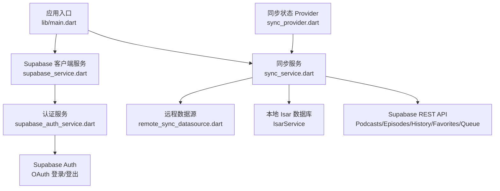
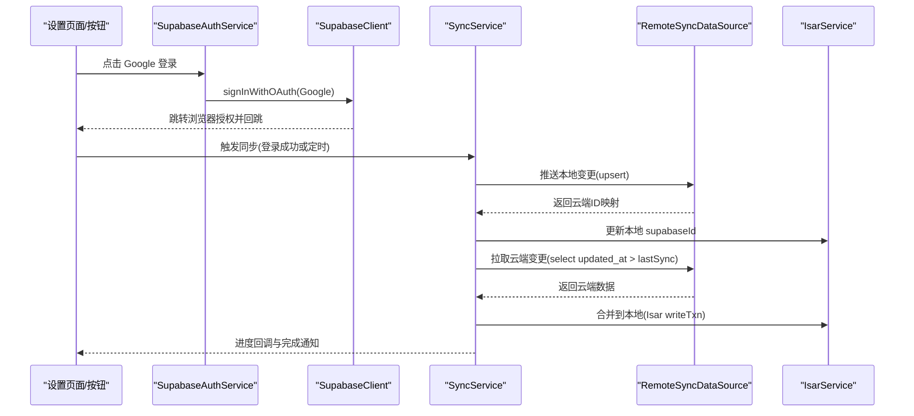
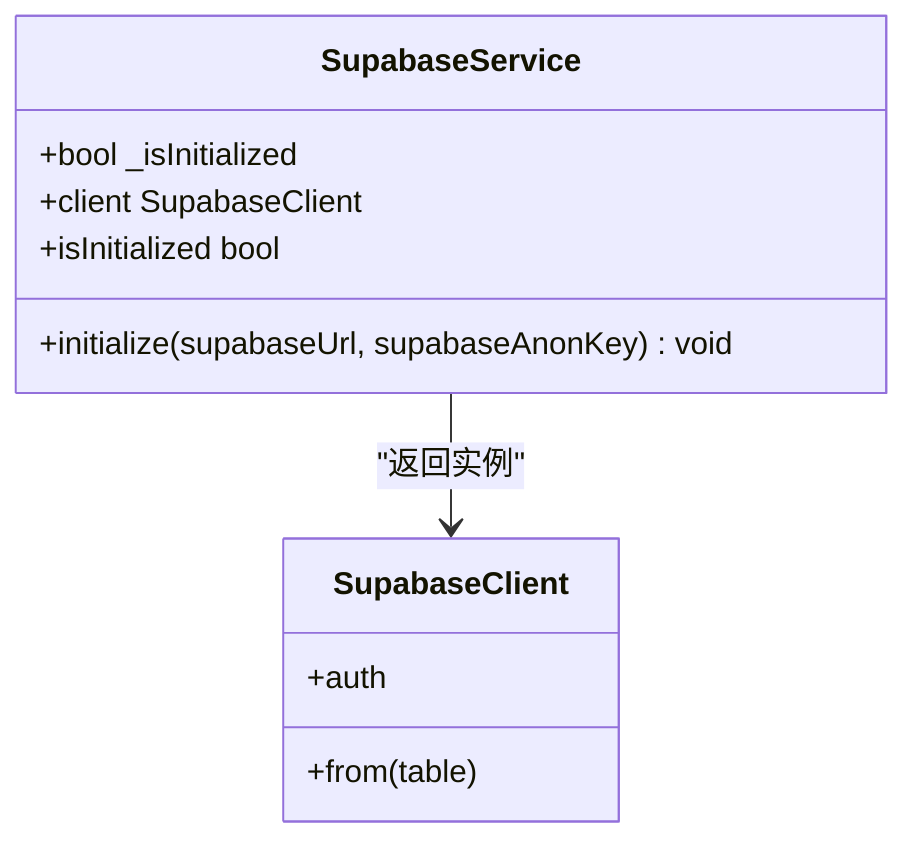
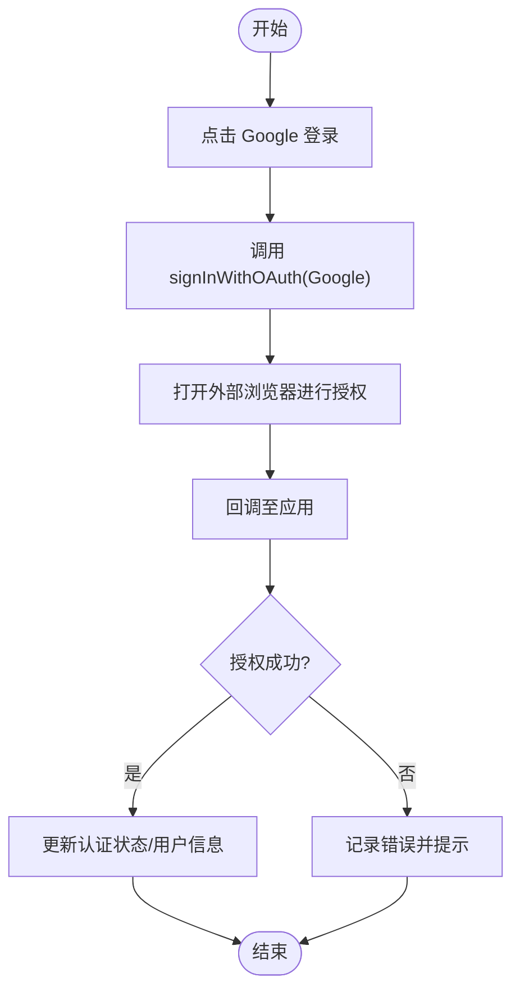
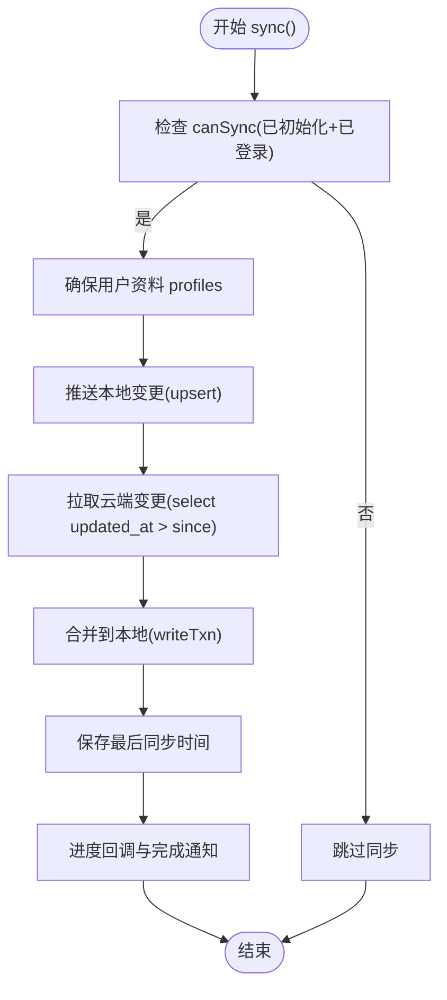
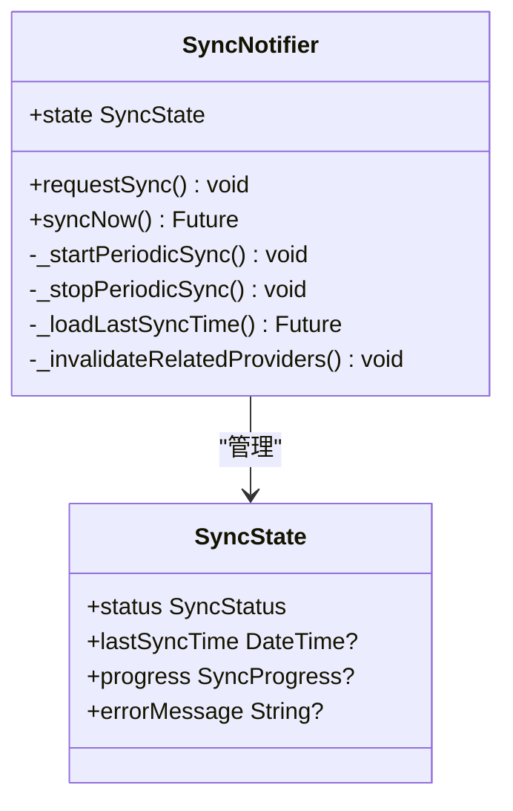
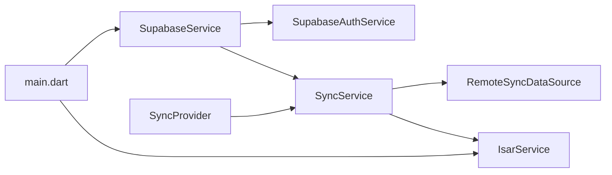

# Supabase 云服务集成

<cite>
**本文引用的文件**   
- [lib/main.dart](file://lib/main.dart)
- [lib/core/services/supabase_service.dart](file://lib/core/services/supabase_service.dart)
- [lib/core/services/supabase_auth_service.dart](file://lib/core/services/supabase_auth_service.dart)
- [lib/core/services/sync_service.dart](file://lib/core/services/sync_service.dart)
- [lib/core/providers/sync_provider.dart](file://lib/core/providers/sync_provider.dart)
- [lib/data/datasources/remote_sync_datasource.dart](file://lib/data/datasources/remote_sync_datasource.dart)
- [docs/supabase_setup.md](file://docs/supabase_setup.md)
- [docs/database.md](file://docs/database.md)
- [.trae/specs/implement-cloud-sync/tasks.md](file://.trae/specs/implement-cloud-sync/tasks.md)
- [.trae/specs/supabase-google-auth/spec.md](file://.trae/specs/supabase-google-auth/spec.md)
- [pubspec.yaml](file://pubspec.yaml)
- [integration/remote_sync_datasource_integration_test.dart](file://integration/remote_sync_datasource_integration_test.dart)
- [test/core/providers/sync_provider_test.dart](file://test/core/providers/sync_provider_test.dart)
</cite>

## 更新摘要
**所做更改**   
- 更新了 RemoteSyncDataSource 的客户端注入机制，支持测试环境自定义 Supabase 客户端
- 增强了 Provider 层架构，添加了 syncServiceProvider 工厂用于 Riverpod 测试覆盖
- 改进了依赖注入模式，提升可测试性和解耦程度
- 更新了测试策略和集成测试示例

## 目录
1. [简介](#简介)
2. [项目结构](#项目结构)
3. [核心组件](#核心组件)
4. [架构总览](#架构总览)
5. [详细组件分析](#详细组件分析)
6. [依赖关系分析](#依赖关系分析)
7. [性能与可靠性](#性能与可靠性)
8. [故障排查指南](#故障排查指南)
9. [结论](#结论)
10. [附录：配置与示例](#附录配置与示例)

## 简介
本文件面向 TinyCast 应用的 Supabase 云服务集成，覆盖以下主题：
- 项目初始化与环境变量配置
- 认证流程（Google OAuth）与状态管理
- 数据库表结构与 RLS 策略要点
- 数据同步机制（全量与增量）、冲突解决（Last Write Wins）
- 错误处理、重试与调试技巧
- 安全最佳实践与性能优化建议
- **新增**：增强的依赖注入机制和测试友好性改进

## 项目结构
TinyCast 的 Supabase 集成主要分布在以下位置：
- 应用启动与配置：lib/main.dart
- Supabase 客户端与服务：lib/core/services/supabase_service.dart
- 认证服务：lib/core/services/supabase_auth_service.dart
- 同步服务与 Provider：lib/core/services/sync_service.dart、lib/core/providers/sync_provider.dart
- 远程数据源封装：lib/data/datasources/remote_sync_datasource.dart
- 文档与规范：docs/supabase_setup.md、docs/database.md、.trae/specs/*

**图表来源**
- [lib/main.dart:179-194](file://lib/main.dart#L179-L194)
- [lib/core/services/supabase_service.dart:18-47](file://lib/core/services/supabase_service.dart#L18-L47)
- [lib/core/services/supabase_auth_service.dart:13-33](file://lib/core/services/supabase_auth_service.dart#L13-L33)
- [lib/core/services/sync_service.dart:68-113](file://lib/core/services/sync_service.dart#L68-L113)
- [lib/core/providers/sync_provider.dart:110-141](file://lib/core/providers/sync_provider.dart#L110-L141)

**章节来源**
- [lib/main.dart:179-194](file://lib/main.dart#L179-L194)
- [docs/supabase_setup.md:1-131](file://docs/supabase_setup.md#L1-L131)

## 核心组件
- SupabaseService：单例化初始化 Supabase 客户端，提供 client 访问点与初始化守卫。
- SupabaseAuthService：封装 Google OAuth 登录、登出与当前用户获取。
- SyncService：编排"推送本地变更 → 拉取云端变更 → 合并到本地"的完整同步流程，支持增量同步与 Last Write Wins 冲突解决。
- SyncProvider：基于 Riverpod 的同步状态管理，包含定时同步、进度回调与相关 Provider 失效刷新。
- RemoteSyncDataSource：封装对 Supabase REST API 的 upsert/select/delete 调用，**新增**支持通过 clientResolver 参数注入自定义客户端。

**章节来源**
- [lib/core/services/supabase_service.dart:1-55](file://lib/core/services/supabase_service.dart#L1-L55)
- [lib/core/services/supabase_auth_service.dart:1-39](file://lib/core/services/supabase_auth_service.dart#L1-L39)
- [lib/core/services/sync_service.dart:1-113](file://lib/core/services/sync_service.dart#L1-L113)
- [lib/core/providers/sync_provider.dart:1-168](file://lib/core/providers/sync_provider.dart#L1-L168)
- [lib/data/datasources/remote_sync_datasource.dart](file://lib/data/datasources/remote_sync_datasource.dart)

## 架构总览
下图展示了从 UI 到 Supabase 的关键调用链路与数据流向。

**图表来源**
- [lib/core/services/supabase_auth_service.dart:13-24](file://lib/core/services/supabase_auth_service.dart#L13-L24)
- [lib/core/services/sync_service.dart:68-113](file://lib/core/services/sync_service.dart#L68-L113)
- [lib/core/providers/sync_provider.dart:110-141](file://lib/core/providers/sync_provider.dart#L110-L141)

## 详细组件分析

### Supabase 客户端与服务
- 职责：在应用启动时根据环境变量初始化 Supabase；提供线程安全的 client 访问；未初始化时抛出明确错误。
- 关键点：
  - 单例模式避免重复初始化
  - 通过 isPlaceholder 判断是否跳过初始化（开发友好）
  - 暴露 supabaseClientProvider 供 Riverpod 使用

**图表来源**
- [lib/core/services/supabase_service.dart:18-47](file://lib/core/services/supabase_service.dart#L18-L47)

**章节来源**
- [lib/core/services/supabase_service.dart:1-55](file://lib/core/services/supabase_service.dart#L1-L55)
- [lib/main.dart:179-194](file://lib/main.dart#L179-L194)

### 认证流程（Google OAuth）
- 职责：封装 Google OAuth 登录、登出与当前用户读取；桌面端使用外部浏览器回调。
- 关键点：
  - 使用 OAuthProvider.google 与 redirectTo 回调 URL
  - 异常捕获与日志记录
  - 与 SupabaseService.client 解耦

**图表来源**
- [lib/core/services/supabase_auth_service.dart:13-24](file://lib/core/services/supabase_auth_service.dart#L13-L24)
- [.trae/specs/supabase-google-auth/spec.md:25-36](file://.trae/specs/supabase-google-auth/spec.md#L25-L36)

**章节来源**
- [lib/core/services/supabase_auth_service.dart:1-39](file://lib/core/services/supabase_auth_service.dart#L1-L39)
- [.trae/specs/supabase-google-auth/spec.md:25-36](file://.trae/specs/supabase-google-auth/spec.md#L25-L36)

### 同步服务（全量/增量与冲突解决）
- 职责：协调本地 Isar 与云端 Supabase 的数据同步，包括：
  - 首次全量同步
  - 基于 updated_at/last_update_time 的增量同步
  - 冲突解决采用 Last Write Wins（以时间戳较新者为准）
  - 推送本地变更（upsert），拉取云端变更（select），合并到本地（writeTxn）
  - 维护最后同步时间戳与进度回调
- 关键流程：
  - 前置检查：已初始化且已登录
  - 确保用户资料 profiles 存在
  - 推送订阅、播放历史、收藏、队列等
  - 拉取 Podcasts/Episodes/Subscriptions/PlaybackHistory/Favorites/QueueItems
  - 合并后更新本地 supabaseId 映射

**图表来源**
- [lib/core/services/sync_service.dart:68-113](file://lib/core/services/sync_service.dart#L68-L113)
- [lib/core/services/sync_service.dart:150-186](file://lib/core/services/sync_service.dart#L150-L186)
- [lib/core/services/sync_service.dart:190-340](file://lib/core/services/sync_service.dart#L190-L340)

**章节来源**
- [lib/core/services/sync_service.dart:1-113](file://lib/core/services/sync_service.dart#L1-L113)
- [.trae/specs/implement-cloud-sync/tasks.md:100-183](file://.trae/specs/implement-cloud-sync/tasks.md#L100-L183)

### 同步状态 Provider
- 职责：管理同步状态（idle/syncing/error）、最后同步时间、进度；监听认证状态变化自动启停定时同步；同步完成后失效相关 Provider 以刷新 UI。
- 关键点：
  - 每 5 分钟执行一次增量同步
  - 防抖请求（10 秒）
  - 登录时立即触发一次同步
  - **新增**：通过 syncServiceProvider 工厂支持测试覆盖

**图表来源**
- [lib/core/providers/sync_provider.dart:41-151](file://lib/core/providers/sync_provider.dart#L41-L151)

**章节来源**
- [lib/core/providers/sync_provider.dart:1-168](file://lib/core/providers/sync_provider.dart#L1-L168)

### 远程数据源（RemoteSyncDataSource）
- 职责：封装所有 Supabase REST API 调用，包括 upsert、select（含增量查询）、delete 等。
- **新增功能**：支持通过 `clientResolver` 参数注入自定义 Supabase 客户端，默认使用全局单例。
- 典型操作：
  - upsertPodcasts / fetchPodcastsUpdatedAfter
  - upsertEpisodes / fetchEpisodesUpdatedAfter
  - upsertUserPodcastSubscriptions / fetchUserPodcastSubscriptions / deleteUserPodcastSubscription
  - upsertPlaybackHistory / fetchPlaybackHistoryUpdatedAfter
  - upsertFavorites / fetchFavorites / deleteFavorite
  - upsertQueueItems / fetchQueueItems / deleteAllQueueItems

**更新** RemoteSyncDataSource 现在支持依赖注入模式，允许在测试环境中注入自定义客户端，提高可测试性。

**章节来源**
- [lib/data/datasources/remote_sync_datasource.dart](file://lib/data/datasources/remote_sync_datasource.dart)
- [.trae/specs/implement-cloud-sync/tasks.md:31-39](file://.trae/specs/implement-cloud-sync/tasks.md#L31-L39)

## 依赖关系分析
- 模块耦合：
  - main.dart 负责初始化 SupabaseService 与 Isar/AudioPlayer
  - SupabaseService 被 AuthService 和 SyncService 共同依赖
  - SyncService 依赖 RemoteSyncDataSource 与 IsarService
  - SyncProvider 依赖 SyncService 与认证状态 Provider
- 外部依赖：
  - supabase_flutter（认证、REST）
  - shared_preferences（保存最后同步时间）
  - isar_community（本地数据库）

**图表来源**
- [lib/main.dart:179-194](file://lib/main.dart#L179-L194)
- [lib/core/services/supabase_service.dart:18-47](file://lib/core/services/supabase_service.dart#L18-L47)
- [lib/core/services/sync_service.dart:68-113](file://lib/core/services/sync_service.dart#L68-L113)
- [lib/core/providers/sync_provider.dart:110-141](file://lib/core/providers/sync_provider.dart#L110-L141)

**章节来源**
- [pubspec.yaml:138-143](file://pubspec.yaml#L138-L143)

## 性能与可靠性
- 增量同步：基于 updated_at/last_update_time 字段减少网络传输与写入压力。
- 批量与事务：合并阶段使用 writeTxn 保证原子性，降低锁竞争。
- 进度反馈：每 N 条（N=5）上报进度，提升 UI 响应性。
- 幂等与去重：通过 supabaseId、itunes_id/guid 等唯一键避免重复记录。
- 失败保护：步骤级 try/catch 与 _safeStep 包装，部分失败不影响整体流程推进。
- **新增**：依赖注入模式提升测试覆盖率，支持模拟外部依赖。
- 建议：
  - 合理设置网络超时与重试策略（在 RemoteSyncDataSource 层实现）
  - 对大列表分页拉取，避免一次性加载过多数据
  - 使用索引优化查询（如 updated_at、guid、itunes_id）

## 故障排查指南
- 常见问题
  - 启动提示"Supabase 未配置，跳过初始化"：检查 .env 或 --dart-define 参数是否正确传入。
  - 登录失败：确认 Google OAuth 回调 URL 已在 Supabase Dashboard 中注册；检查网络与权限。
  - 不同步：确认已登录且 SupabaseService 已初始化；查看日志中的 [SYNC] 前缀。
- 调试技巧
  - 启用 Isar Inspector（开发模式默认开启）观察本地数据。
  - 查看 Logger 输出，定位具体失败步骤（如 push_subscriptions、pull_episodes）。
  - 手动触发一次同步（SyncProvider.requestSync）验证流程。
  - **新增**：使用依赖注入在测试中隔离外部依赖，便于单元测试。

**章节来源**
- [docs/supabase_setup.md:103-121](file://docs/supabase_setup.md#L103-L121)
- [lib/core/services/sync_service.dart:68-113](file://lib/core/services/sync_service.dart#L68-L113)

## 结论
TinyCast 的 Supabase 集成围绕"认证—同步—存储"三条主线展开：通过 SupabaseService 统一初始化客户端，SupabaseAuthService 提供 OAuth 能力，SyncService 与 RemoteSyncDataSource 协作实现可靠的全量/增量同步与冲突解决。**最新的改进**通过增强依赖注入机制和 Provider 层工厂方法，显著提升了测试友好性和系统解耦程度。配合 Riverpod 的状态管理与定时任务，形成稳定、可观测、可扩展的云同步体系。

## 附录：配置与示例

### 环境变量与初始化
- 必需变量：SUPABASE_URL、SUPABASE_ANON_KEY
- 配置方式：
  - 开发：.env 文件优先加载
  - 构建发布：--dart-define 注入编译时变量
- 初始化：在 _initializeApp 中根据 AppConfig.fromEnvironment() 判断是否为占位符，非占位则调用 SupabaseService().initialize(...)

**章节来源**
- [docs/supabase_setup.md:7-75](file://docs/supabase_setup.md#L7-L75)
- [lib/main.dart:47-72](file://lib/main.dart#L47-L72)
- [lib/main.dart:179-194](file://lib/main.dart#L179-L194)

### 认证流程示例（Google OAuth）
- 登录：调用 SupabaseAuthService.signInWithGoogle()，使用 OAuthProvider.google 与外部浏览器回调
- 登出：调用 signOut()
- 当前用户：getCurrentUser()

**章节来源**
- [lib/core/services/supabase_auth_service.dart:13-33](file://lib/core/services/supabase_auth_service.dart#L13-L33)
- [.trae/specs/supabase-google-auth/spec.md:25-36](file://.trae/specs/supabase-google-auth/spec.md#L25-L36)

### 数据库表结构与 RLS 策略要点
- 云侧表（参考规范）：
  - podcasts：包含 itunes_id 唯一键、rss_urls/text[]、itunes_genre_ids/text[] 等同步字段
  - episodes：包含 guid、podcast_itunes_id、(guid, podcast_id) 唯一约束
  - user_podcast_subscriptions：user_id FK、podcast_id FK、UNIQUE(user_id, podcast_id)
  - playback_history：包含 episode_guid、episode_itunes_id、is_played、last_played_position_ms、played_duration、status、UNIQUE(user_id, episode_id)
  - favorites：episode_guid、episode_itunes_id、UNIQUE(user_id, episode_id)
  - queue_items：episode_guid、episode_itunes_id、podcast_guid、podcast_itunes_id、position、UNIQUE(user_id, episode_id)
- RLS 策略：
  - 用户只能访问自己的数据（user_* 表）
  - podcasts/episodes 公共只读，认证用户可写
- 本地 Isar 模型：
  - 各模型均新增 supabaseId 字段用于关联云端记录
  - PlayHistory 作为播放状态的单一事实来源，Episode.isPlayed 仅缓存

**章节来源**
- [.trae/specs/implement-cloud-sync/tasks.md:3-12](file://.trae/specs/implement-cloud-sync/tasks.md#L3-L12)
- [docs/database.md:1-502](file://docs/database.md#L1-L502)

### 同步策略与冲突解决
- 全量同步：首次登录无 lastSyncTime 时执行
- 增量同步：基于 updated_at/last_update_time 拉取变更
- 冲突解决：Last Write Wins，比较时间戳决定保留版本
- 推送顺序：先推送本地变更（upsert），再拉取云端变更（select），最后合并到本地（writeTxn）

**章节来源**
- [lib/core/services/sync_service.dart:68-113](file://lib/core/services/sync_service.dart#L68-L113)
- [lib/core/services/sync_service.dart:150-186](file://lib/core/services/sync_service.dart#L150-L186)
- [.trae/specs/implement-cloud-sync/tasks.md:128-143](file://.trae/specs/implement-cloud-sync/tasks.md#L128-L143)

### 错误处理与重试建议
- 在 RemoteSyncDataSource 层实现网络重试（指数退避）与超时控制
- 对关键步骤使用 _safeStep 包装，记录错误但不中断整体流程
- 在 SyncProvider 中捕获异常并更新 errorMessage，便于 UI 提示

**章节来源**
- [lib/core/services/sync_service.dart:68-113](file://lib/core/services/sync_service.dart#L68-L113)
- [lib/core/providers/sync_provider.dart:110-141](file://lib/core/providers/sync_provider.dart#L110-L141)

### 依赖注入与测试策略（新增）
- **RemoteSyncDataSource 客户端注入**：通过 `clientResolver` 参数支持测试环境自定义 Supabase 客户端
- **Provider 层工厂方法**：`syncServiceProvider` 提供统一的 SyncService 创建接口，支持测试覆盖
- **集成测试示例**：展示如何在真实 Supabase 环境中进行测试，同时避免依赖全局状态

**章节来源**
- [lib/data/datasources/remote_sync_datasource.dart:9-19](file://lib/data/datasources/remote_sync_datasource.dart#L9-L19)
- [lib/core/providers/sync_provider.dart:42-48](file://lib/core/providers/sync_provider.dart#L42-L48)
- [integration/remote_sync_datasource_integration_test.dart:36-42](file://integration/remote_sync_datasource_integration_test.dart#L36-L42)
- [test/core/providers/sync_provider_test.dart:295-304](file://test/core/providers/sync_provider_test.dart#L295-L304)