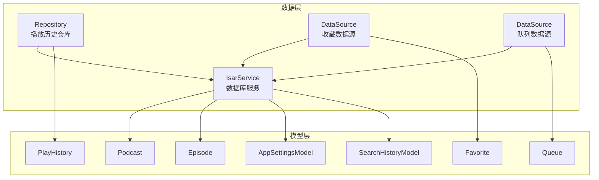
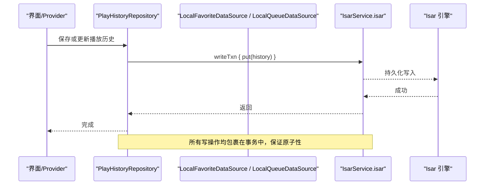
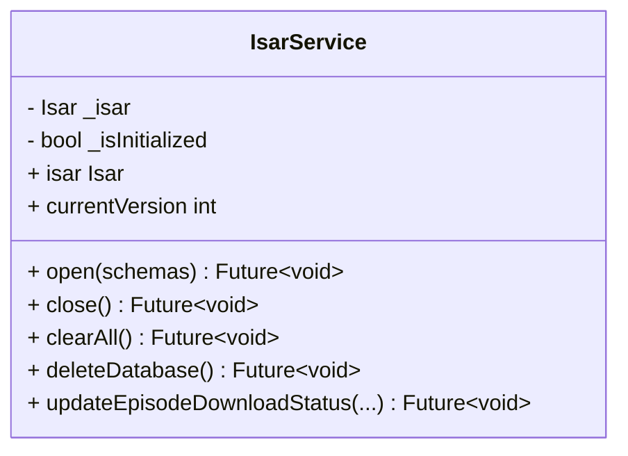
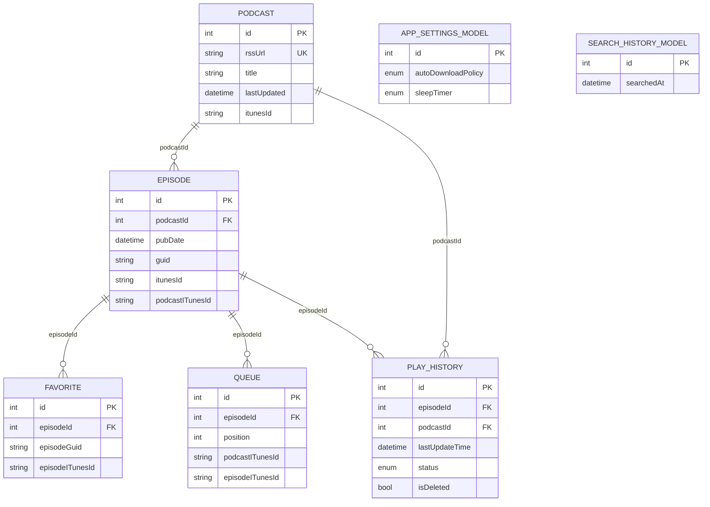
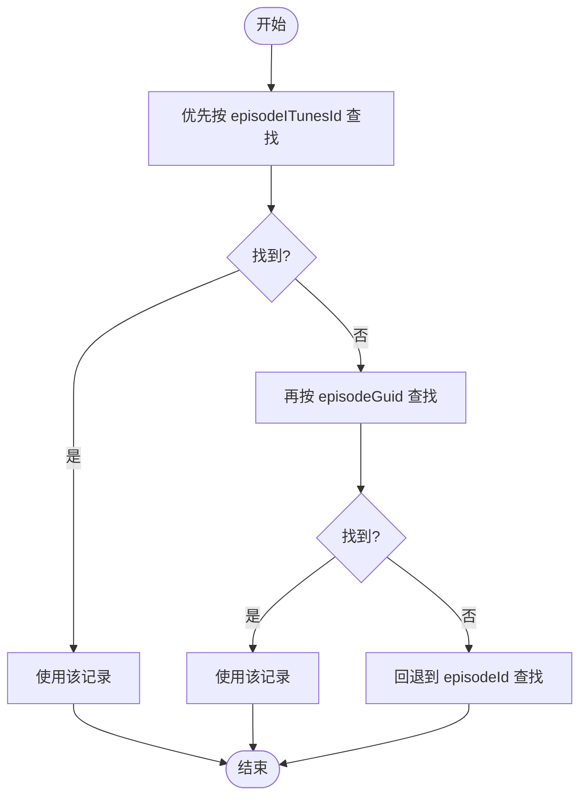
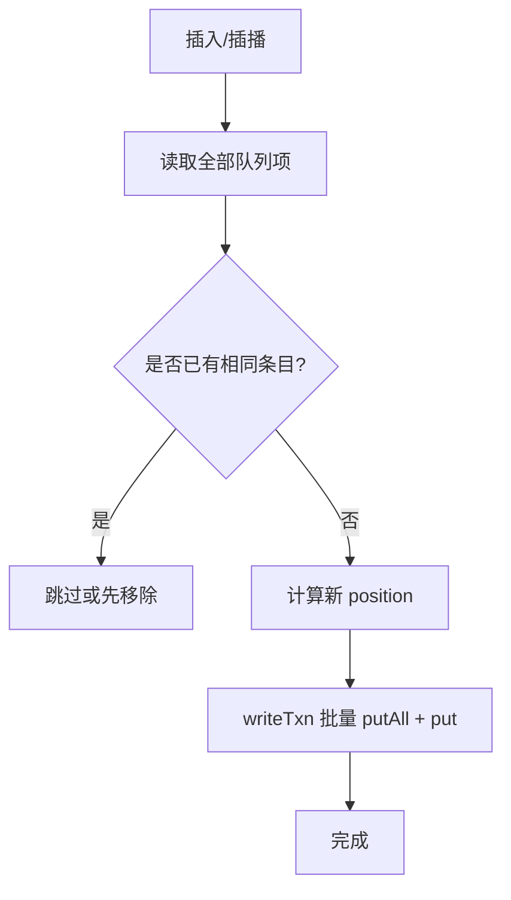
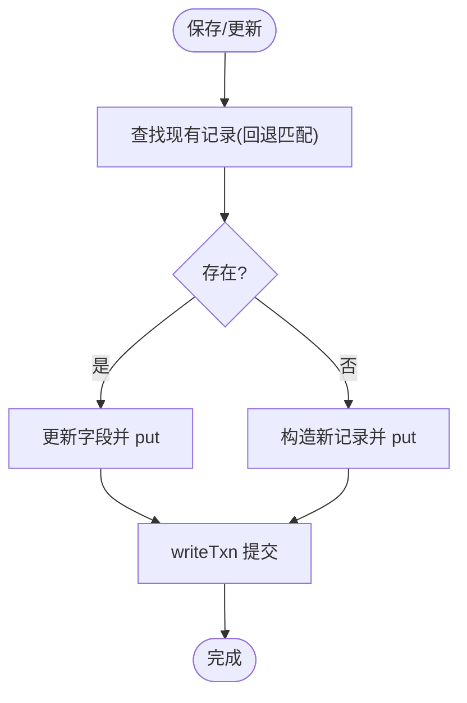
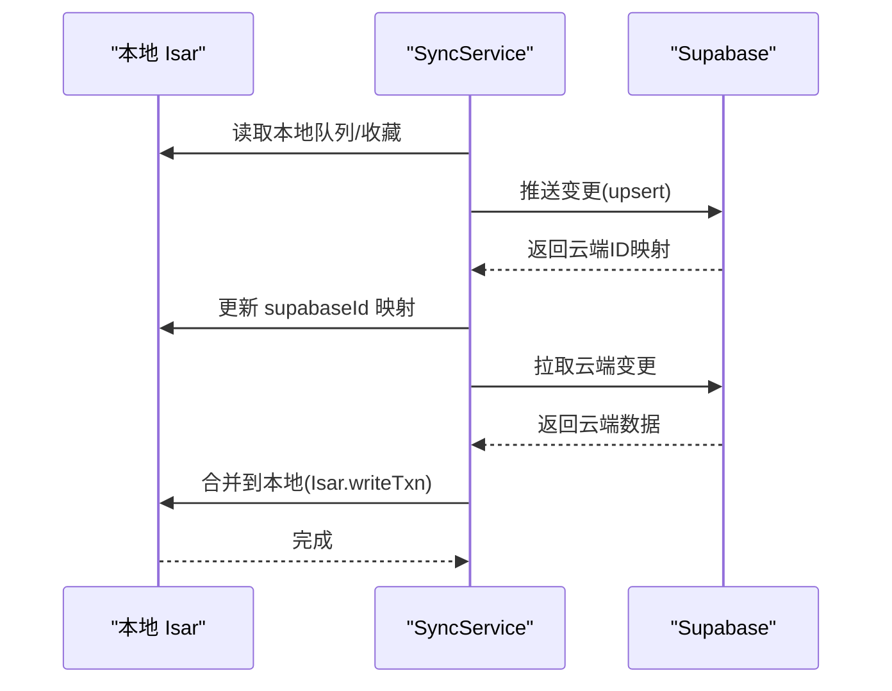
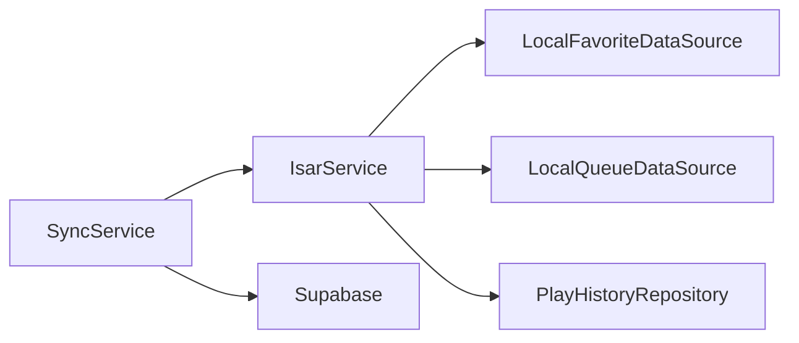

# 本地数据库集成

<cite>
**本文引用的文件**   
- [lib/data/database/isar_service.dart](file://lib/data/database/isar_service.dart)
- [lib/data/models/podcast_model.dart](file://lib/data/models/podcast_model.dart)
- [lib/data/models/episode_model.dart](file://lib/data/models/episode_model.dart)
- [lib/data/models/favorite_model.dart](file://lib/data/models/favorite_model.dart)
- [lib/data/models/queue_model.dart](file://lib/data/models/queue_model.dart)
- [lib/data/models/play_history_model.dart](file://lib/data/models/play_history_model.dart)
- [lib/data/models/app_settings_model.dart](file://lib/data/models/app_settings_model.dart)
- [lib/data/models/search_history_model.dart](file://lib/data/models/search_history_model.dart)
- [lib/data/datasources/local_favorite_datasource.dart](file://lib/data/datasources/local_favorite_datasource.dart)
- [lib/data/datasources/local_queue_datasource.dart](file://lib/data/datasources/local_queue_datasource.dart)
- [lib/data/repositories/play_history_repository.dart](file://lib/data/repositories/play_history_repository.dart)
- [lib/core/services/sync_service.dart](file://lib/core/services/sync_service.dart)
- [docs/database.md](file://docs/database.md)
</cite>

## 目录
1. [简介](#简介)
2. [项目结构](#项目结构)
3. [核心组件](#核心组件)
4. [架构总览](#架构总览)
5. [详细组件分析](#详细组件分析)
6. [依赖关系分析](#依赖关系分析)
7. [性能与并发](#性能与并发)
8. [数据迁移方案](#数据迁移方案)
9. [故障排查指南](#故障排查指南)
10. [结论](#结论)
11. [附录：索引与查询优化清单](#附录索引与查询优化清单)

## 简介
本文件为 TinyCast 应用的 Isar Community 3.x 本地数据库集成提供完整技术文档。内容涵盖初始化配置、数据模型定义、索引策略、事务与批量操作、复杂查询构建、关联数据操作、并发访问控制、内存与磁盘优化、数据迁移（版本升级、备份与恢复）、以及常见问题与调试方法。目标是帮助开发者快速理解并高效维护本地数据层，确保在 Flutter 多端环境下的稳定性与高性能。

## 项目结构
TinyCast 的数据层采用分层设计：Domain → Repository → DataSource → IsarService。Isar 作为嵌入式 NoSQL 数据库，通过代码生成 Schema 并在应用启动时打开。关键目录与职责如下：
- lib/data/database: Isar 服务与实例管理
- lib/data/models: 数据模型与注解（@collection、@Index、@Enumerated）
- lib/data/datasources: 具体数据源实现（收藏、队列等）
- lib/data/repositories: 仓库层封装业务逻辑与查询组合
- lib/core/services: 同步服务等跨域能力，涉及 Isar 读写

图表来源
- [lib/data/database/isar_service.dart:1-137](file://lib/data/database/isar_service.dart#L1-L137)
- [lib/data/models/podcast_model.dart:1-78](file://lib/data/models/podcast_model.dart#L1-L78)
- [lib/data/models/episode_model.dart:1-67](file://lib/data/models/episode_model.dart#L1-L67)
- [lib/data/models/favorite_model.dart:1-20](file://lib/data/models/favorite_model.dart#L1-L20)
- [lib/data/models/queue_model.dart:1-29](file://lib/data/models/queue_model.dart#L1-L29)
- [lib/data/models/play_history_model.dart:1-51](file://lib/data/models/play_history_model.dart#L1-L51)
- [lib/data/models/app_settings_model.dart:1-79](file://lib/data/models/app_settings_model.dart#L1-L79)
- [lib/data/models/search_history_model.dart:1-14](file://lib/data/models/search_history_model.dart#L1-L14)

章节来源
- [docs/database.md:1-502](file://docs/database.md#L1-L502)

## 核心组件
- IsarService：单例管理 Isar 实例，负责打开/关闭、清空、删除数据库文件，以及常用写入封装（如更新剧集下载状态）。支持 Inspector 开关，生产环境默认关闭。
- 数据模型：使用 @collection 注解声明集合；关键字段使用 @Index 提升查询性能；枚举字段使用 @Enumerated(EnumType.ordinal) 存储。
- 数据源与仓库：LocalFavoriteDataSource、LocalQueueDataSource 封装收藏与队列的增删查改；PlayHistoryRepository 封装播放历史的复杂查询与状态管理。
- 同步服务：SyncService 负责云端与本地的双向同步，包含合并、冲突处理与 supabaseId 映射更新。

章节来源
- [lib/data/database/isar_service.dart:1-137](file://lib/data/database/isar_service.dart#L1-L137)
- [lib/data/datasources/local_favorite_datasource.dart:1-134](file://lib/data/datasources/local_favorite_datasource.dart#L1-L134)
- [lib/data/datasources/local_queue_datasource.dart:1-323](file://lib/data/datasources/local_queue_datasource.dart#L1-L323)
- [lib/data/repositories/play_history_repository.dart:1-351](file://lib/data/repositories/play_history_repository.dart#L1-L351)
- [lib/core/services/sync_service.dart:368-834](file://lib/core/services/sync_service.dart#L368-L834)

## 架构总览
下图展示从上层调用到 Isar 的完整流程，包括事务、异常处理与日志记录。

图表来源
- [lib/data/repositories/play_history_repository.dart:77-89](file://lib/data/repositories/play_history_repository.dart#L77-L89)
- [lib/data/database/isar_service.dart:106-135](file://lib/data/database/isar_service.dart#L106-L135)

章节来源
- [docs/database.md:494-502](file://docs/database.md#L494-L502)

## 详细组件分析

### IsarService（数据库服务）
- 单例模式，延迟初始化，避免重复打开
- open() 注册所有 CollectionSchema，启用 inspector（非产品环境）
- close()/clearAll()/deleteDatabase() 提供生命周期与清理能力
- updateEpisodeDownloadStatus() 演示了典型的事务写入与异常封装

图表来源
- [lib/data/database/isar_service.dart:14-137](file://lib/data/database/isar_service.dart#L14-L137)

章节来源
- [lib/data/database/isar_service.dart:1-137](file://lib/data/database/isar_service.dart#L1-L137)

### 数据模型与索引策略
- Podcast：标题、rssUrl、lastUpdated 建立索引；rssUrl 唯一约束
- Episode：podcastId、pubDate 建立索引；itunesId 用于多区域匹配
- Favorite：episodeId 索引；支持 episodeGuid、episodeITunesId 回退匹配
- Queue：episodeId、position 索引；支持 podcastITunesId + episodeITunesId 回退匹配
- PlayHistory：episodeId、podcastId、lastUpdateTime 索引；status 枚举按序存储；isDeleted 软删除标记
- AppSettingsModel：单例 id=0；枚举字段使用 ordinal 存储
- SearchHistoryModel：searchedAt 索引

图表来源
- [lib/data/models/podcast_model.dart:1-78](file://lib/data/models/podcast_model.dart#L1-L78)
- [lib/data/models/episode_model.dart:1-67](file://lib/data/models/episode_model.dart#L1-L67)
- [lib/data/models/favorite_model.dart:1-20](file://lib/data/models/favorite_model.dart#L1-L20)
- [lib/data/models/queue_model.dart:1-29](file://lib/data/models/queue_model.dart#L1-L29)
- [lib/data/models/play_history_model.dart:1-51](file://lib/data/models/play_history_model.dart#L1-L51)
- [lib/data/models/app_settings_model.dart:1-79](file://lib/data/models/app_settings_model.dart#L1-L79)
- [lib/data/models/search_history_model.dart:1-14](file://lib/data/models/search_history_model.dart#L1-L14)

章节来源
- [docs/database.md:58-322](file://docs/database.md#L58-L322)

### 收藏数据源（LocalFavoriteDataSource）
- 支持三阶段回退匹配：itunesId → guid → episodeId
- 所有写操作在 writeTxn 中执行，统一异常封装为 AppException
- 提供添加、移除、检查、列表获取等方法

图表来源
- [lib/data/datasources/local_favorite_datasource.dart:14-37](file://lib/data/datasources/local_favorite_datasource.dart#L14-L37)

章节来源
- [lib/data/datasources/local_favorite_datasource.dart:1-134](file://lib/data/datasources/local_favorite_datasource.dart#L1-L134)

### 队列数据源（LocalQueueDataSource）
- 插入与插播：计算最大 position，批量更新后续项位置
- 删除：删除后重新计算并批量更新后续项位置
- 批量清理：支持按 podcastId/podcastGuid/podcastITunesId 清理队列

图表来源
- [lib/data/datasources/local_queue_datasource.dart:66-103](file://lib/data/datasources/local_queue_datasource.dart#L66-L103)
- [lib/data/datasources/local_queue_datasource.dart:105-148](file://lib/data/datasources/local_queue_datasource.dart#L105-L148)

章节来源
- [lib/data/datasources/local_queue_datasource.dart:1-323](file://lib/data/datasources/local_queue_datasource.dart#L1-L323)

### 播放历史仓库（PlayHistoryRepository）
- 回退匹配：itunesId → guid → episodeId，且过滤 isDeleted=false
- 进度更新：同时维护 lastPlayedPositionMs 与 playProgress
- 已播放标记：创建或更新记录，设置 status=completed，并更新时间戳
- 软删除：将 isDeleted=true，便于恢复与审计

图表来源
- [lib/data/repositories/play_history_repository.dart:77-89](file://lib/data/repositories/play_history_repository.dart#L77-L89)
- [lib/data/repositories/play_history_repository.dart:135-207](file://lib/data/repositories/play_history_repository.dart#L135-L207)

章节来源
- [lib/data/repositories/play_history_repository.dart:1-351](file://lib/data/repositories/play_history_repository.dart#L1-L351)

### 同步服务（SyncService）
- 推送本地变更到云端，拉取云端变更并合并到本地 Isar
- 使用 supabaseId 进行云地映射，失败时回退到 itunesId/guid/id
- 队列与收藏等表在合并过程中保持一致性

图表来源
- [lib/core/services/sync_service.dart:368-834](file://lib/core/services/sync_service.dart#L368-L834)

章节来源
- [lib/core/services/sync_service.dart:120-166](file://lib/core/services/sync_service.dart#L120-L166)
- [lib/core/services/sync_service.dart:368-834](file://lib/core/services/sync_service.dart#L368-L834)

## 依赖关系分析
- IsarService 被各数据源与仓库直接依赖，提供统一的 Isar 实例
- 数据源依赖 IsarService，仓库依赖数据源或直接访问 Isar（如 PlayHistoryRepository）
- 同步服务依赖 IsarService 与云端数据源，协调云地数据一致性

图表来源
- [lib/data/database/isar_service.dart:1-137](file://lib/data/database/isar_service.dart#L1-L137)
- [lib/data/datasources/local_favorite_datasource.dart:1-134](file://lib/data/datasources/local_favorite_datasource.dart#L1-L134)
- [lib/data/datasources/local_queue_datasource.dart:1-323](file://lib/data/datasources/local_queue_datasource.dart#L1-L323)
- [lib/data/repositories/play_history_repository.dart:1-351](file://lib/data/repositories/play_history_repository.dart#L1-L351)
- [lib/core/services/sync_service.dart:368-834](file://lib/core/services/sync_service.dart#L368-L834)

章节来源
- [docs/database.md:399-439](file://docs/database.md#L399-L439)

## 性能与并发
- 事务与批量写入
  - 所有写操作使用 writeTxn，确保原子性与一致性
  - 批量更新使用 putAll，减少 IO 次数（如队列位置重算）
- 索引与查询优化
  - 高频查询字段建立索引（如 podcastId、pubDate、position、lastUpdateTime）
  - 使用 filter().and().or() 组合条件，避免全表扫描
- 并发访问控制
  - Isar 内部线程安全，但应避免同一时刻大量并发写导致锁竞争
  - 建议对热点写路径加限流或合并写入（如播放进度节流）
- 内存与磁盘优化
  - 合理分页与限制查询结果集大小
  - 定期清理无用数据（如已完成的历史记录软删除）
  - 关闭 Inspector 以减少开发期开销（生产环境默认关闭）

章节来源
- [lib/data/datasources/local_queue_datasource.dart:119-138](file://lib/data/datasources/local_queue_datasource.dart#L119-L138)
- [lib/data/repositories/play_history_repository.dart:37-56](file://lib/data/repositories/play_history_repository.dart#L37-L56)
- [lib/data/database/isar_service.dart:46-51](file://lib/data/database/isar_service.dart#L46-L51)

## 数据迁移方案
- 版本管理
  - IsarService.currentVersion 固定为 1；新增字段由 Isar 自动处理默认值
  - 修改字段需重新运行 build_runner 生成新的 schema
- 首次启动迁移
  - 若本地无设置数据，可从 SharedPreferences 迁移到 AppSettingsModel（id=0）
  - 迁移完成后标记不再重复迁移
- 备份与恢复
  - 备份：复制 tinycast.isar 文件与应用相关扩展文件
  - 恢复：覆盖原文件后重启应用，或通过 IsarService.deleteDatabase() 重建
- 增量升级
  - 新增集合或字段时，确保向后兼容（默认值与非空约束）
  - 对历史数据进行一次性清洗（如补全缺失字段）

章节来源
- [docs/database.md:442-466](file://docs/database.md#L442-L466)
- [docs/database.md:468-492](file://docs/database.md#L468-L492)
- [lib/data/database/isar_service.dart:104-104](file://lib/data/database/isar_service.dart#L104-L104)

## 故障排查指南
- 常见错误
  - 未初始化 Isar：调用 isar 前必须 open()
  - 文件系统异常：无法访问数据库目录
  - 唯一约束冲突：rssUrl 等唯一字段重复
- 定位与调试
  - 使用 Logger 输出详细日志（含 emoji 前缀区分类型）
  - 开发环境启用 Inspector，浏览器查看实时数据库状态
  - 打印关键查询结果与状态（如播放历史总数、状态分布）
- 修复建议
  - 清理数据库后重试（clearAll/deleteDatabase）
  - 检查索引与查询条件是否正确
  - 校验业务唯一标识（guid/iTunesId）一致性

章节来源
- [lib/data/database/isar_service.dart:31-36](file://lib/data/database/isar_service.dart#L31-L36)
- [lib/data/database/isar_service.dart:54-58](file://lib/data/database/isar_service.dart#L54-L58)
- [docs/database.md:488-492](file://docs/database.md#L488-L492)
- [lib/data/repositories/play_history_repository.dart:37-56](file://lib/data/repositories/play_history_repository.dart#L37-L56)

## 结论
TinyCast 的 Isar 集成以清晰的层次结构与严格的索引策略为基础，结合事务与批量操作保障数据一致性与性能。通过回退关联机制与软删除策略，系统具备较强的鲁棒性与可恢复性。建议在后续迭代中持续优化查询路径、监控性能指标，并完善迁移脚本与自动化测试，以确保长期稳定运行。

## 附录：索引与查询优化清单
- 索引建议
  - Podcast：title、rssUrl(unique)、lastUpdated
  - Episode：podcastId、pubDate
  - Favorite：episodeId
  - Queue：episodeId、position
  - PlayHistory：episodeId、podcastId、lastUpdateTime
- 查询优化
  - 使用 filter().and().or() 精确条件
  - 排序字段尽量命中索引（如 sortByPubDateDesc）
  - 避免 N+1 查询，使用批量 putAll 与 where().findAll()
- 最佳实践
  - 所有写操作使用 writeTxn
  - 统一异常封装为 AppException
  - 使用业务唯一标识（guid/iTunesId）优先匹配，回退到自增 ID

章节来源
- [docs/database.md:58-322](file://docs/database.md#L58-L322)
- [docs/database.md:494-502](file://docs/database.md#L494-L502)