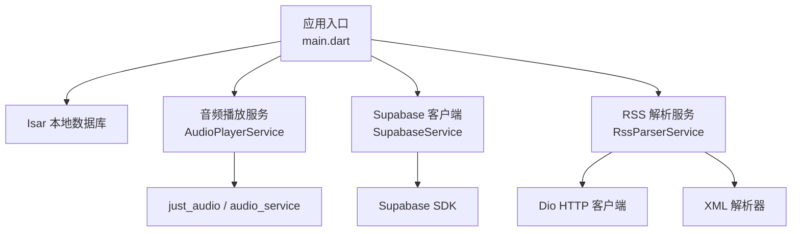
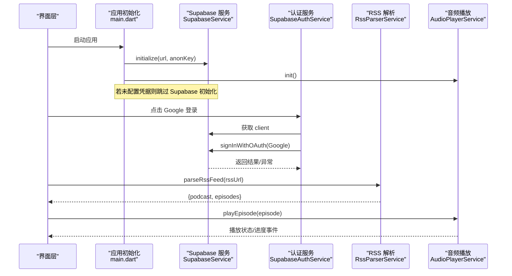
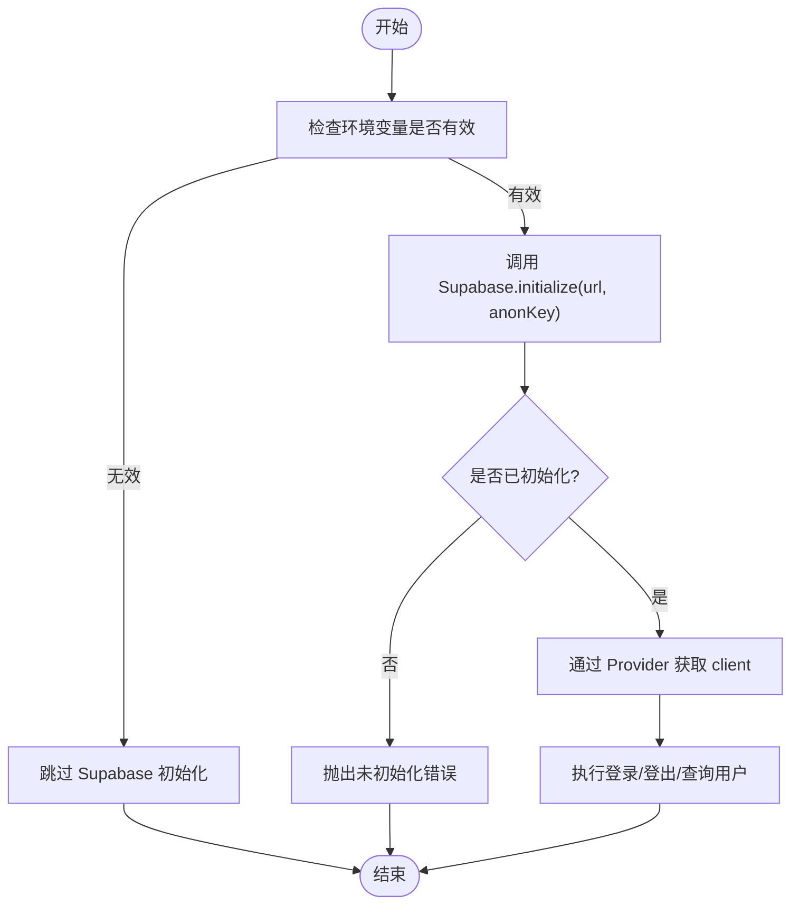
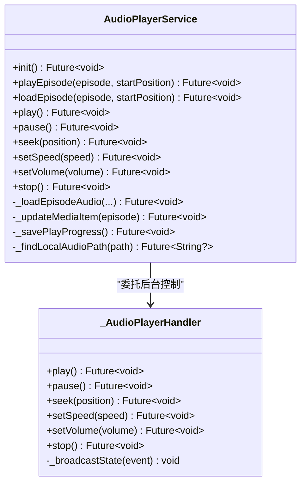
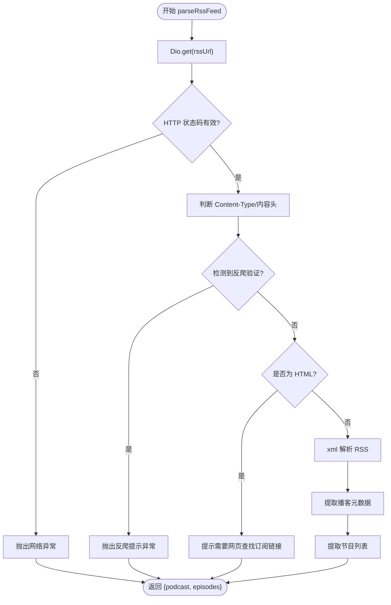
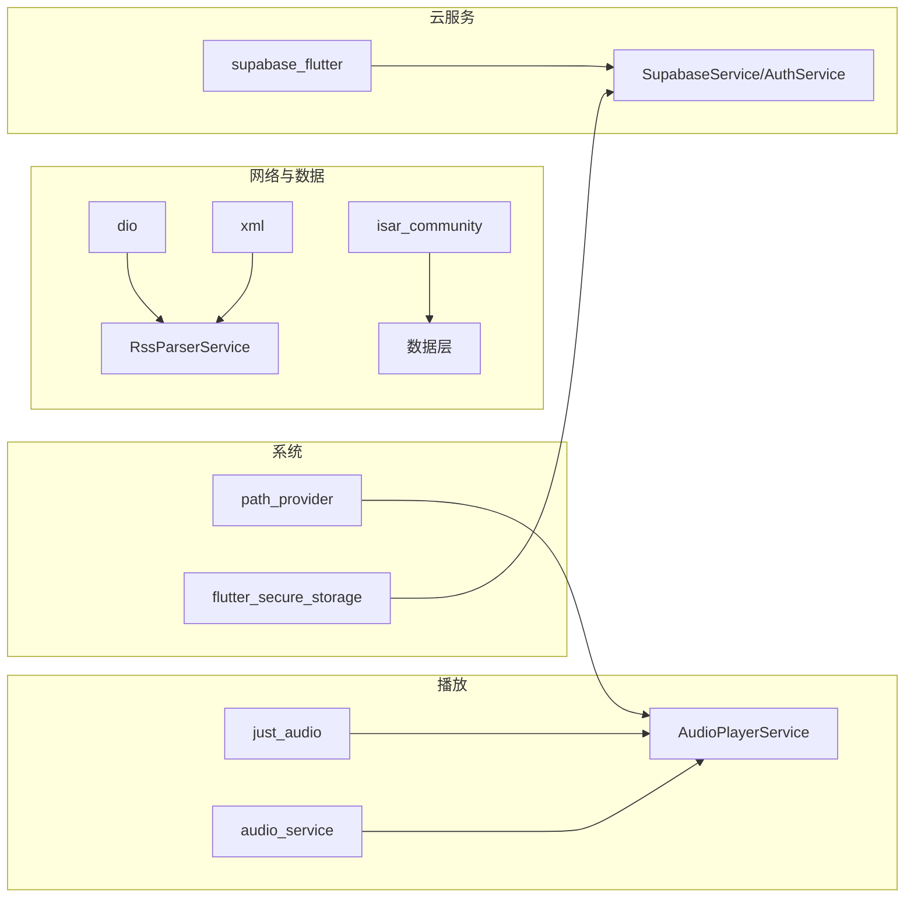

# 第三方集成指南

<cite>
**本文引用的文件**   
- [pubspec.yaml](file://pubspec.yaml)
- [README.md](file://README.md)
- [supabase_setup.md](file://docs/supabase_setup.md)
- [main.dart](file://lib/main.dart)
- [supabase_service.dart](file://lib/core/services/supabase_service.dart)
- [supabase_auth_service.dart](file://lib/core/services/supabase_auth_service.dart)
- [rss_parser_service.dart](file://lib/data/services/rss_parser_service.dart)
- [audio_player_service.dart](file://lib/data/services/audio_player_service.dart)
- [app_constants.dart](file://lib/core/utils/app_constants.dart)
- [network_error_handler.dart](file://lib/core/utils/network_error_handler.dart)
</cite>

## 目录
1. [简介](#简介)
2. [项目结构](#项目结构)
3. [核心组件](#核心组件)
4. [架构总览](#架构总览)
5. [详细组件分析](#详细组件分析)
6. [依赖分析](#依赖分析)
7. [性能考虑](#性能考虑)
8. [故障排查指南](#故障排查指南)
9. [结论](#结论)
10. [附录](#附录)

## 简介
本指南面向 TinyCast 的第三方集成，聚焦以下外部依赖与能力：
- Supabase 云服务（认证、云同步）
- 音频播放库（just_audio + audio_service）
- RSS 解析器（dio + xml）

文档涵盖配置方法、认证流程、错误处理与性能优化策略，并提供完整的集成示例路径（以源码引用代替代码片段），帮助开发者快速、稳定地完成集成。

## 项目结构
TinyCast 采用分层组织：
- core：服务、工具、主题、路由、Provider
- data：数据模型、仓库、数据源、服务（RSS/下载/播放器等）
- domain：实体、用例、领域仓库接口
- presentation：界面层（不在本指南重点）

关键入口与初始化在 main.dart 中完成，包括 Isar、AudioPlayerService、日志与 Supabase 的启动顺序。

图表来源
- [main.dart:106-194](file://lib/main.dart#L106-L194)
- [audio_player_service.dart:100-134](file://lib/data/services/audio_player_service.dart#L100-L134)
- [supabase_service.dart:18-47](file://lib/core/services/supabase_service.dart#L18-L47)
- [rss_parser_service.dart:24-33](file://lib/data/services/rss_parser_service.dart#L24-L33)

章节来源
- [main.dart:106-194](file://lib/main.dart#L106-L194)
- [pubspec.yaml:18-144](file://pubspec.yaml#L18-L144)

## 核心组件
- Supabase 服务：单例封装初始化与客户端获取，提供 Riverpod Provider。
- Supabase 认证服务：Google OAuth 登录、登出、当前用户查询。
- RSS 解析服务：基于 Dio 拉取 XML/RSS，使用 xml 解析并映射为 Podcast/Episode。
- 音频播放服务：封装 just_audio 与 audio_service，统一播放状态、进度、媒体项更新与后台控制。

章节来源
- [supabase_service.dart:1-55](file://lib/core/services/supabase_service.dart#L1-L55)
- [supabase_auth_service.dart:1-39](file://lib/core/services/supabase_auth_service.dart#L1-L39)
- [rss_parser_service.dart:16-128](file://lib/data/services/rss_parser_service.dart#L16-L128)
- [audio_player_service.dart:31-134](file://lib/data/services/audio_player_service.dart#L31-L134)

## 架构总览
下图展示第三方服务的调用关系与数据流：

图表来源
- [main.dart:179-194](file://lib/main.dart#L179-L194)
- [supabase_service.dart:18-47](file://lib/core/services/supabase_service.dart#L18-L47)
- [supabase_auth_service.dart:13-24](file://lib/core/services/supabase_auth_service.dart#L13-L24)
- [rss_parser_service.dart:40-128](file://lib/data/services/rss_parser_service.dart#L40-L128)
- [audio_player_service.dart:302-324](file://lib/data/services/audio_player_service.dart#L302-L324)

## 详细组件分析

### Supabase 云服务集成
- 配置与环境变量
  - 必需变量：SUPABASE_URL、SUPABASE_ANON_KEY
  - 支持 .env 与 --dart-define 两种方式；优先级：.env > 编译参数
  - 占位符检测：当值为默认占位或空时，跳过初始化
- 初始化流程
  - 在应用启动阶段调用 SupabaseService.initialize
  - 通过 Riverpod Provider 暴露 SupabaseClient
- 认证流程
  - Google OAuth：设置重定向 URL，使用 externalApplication 模式打开浏览器
  - 登出：调用 signOut
  - 当前用户：读取 currentUser

图表来源
- [main.dart:47-72](file://lib/main.dart#L47-L72)
- [main.dart:179-194](file://lib/main.dart#L179-L194)
- [supabase_service.dart:18-47](file://lib/core/services/supabase_service.dart#L18-L47)
- [supabase_auth_service.dart:13-24](file://lib/core/services/supabase_auth_service.dart#L13-L24)

章节来源
- [supabase_setup.md:1-131](file://docs/supabase_setup.md#L1-L131)
- [main.dart:47-72](file://lib/main.dart#L47-L72)
- [main.dart:179-194](file://lib/main.dart#L179-L194)
- [supabase_service.dart:1-55](file://lib/core/services/supabase_service.dart#L1-L55)
- [supabase_auth_service.dart:1-39](file://lib/core/services/supabase_auth_service.dart#L1-L39)

### 音频播放库集成
- 初始化
  - 使用 AudioService.init 创建后台处理器，绑定 just_audio
  - 订阅播放事件、状态变化与位置更新
- 播放逻辑
  - 优先尝试本地文件（支持目录与兼容旧路径），失败回退到远程 URL
  - 自动恢复上次播放进度，完成后触发事件
- 媒体项与后台控制
  - 更新 MediaItem（标题、艺术家、封面、时长）
  - 暴露系统控制（播放/暂停、快进/后退、变速、音量）

图表来源
- [audio_player_service.dart:31-134](file://lib/data/services/audio_player_service.dart#L31-L134)
- [audio_player_service.dart:302-324](file://lib/data/services/audio_player_service.dart#L302-L324)
- [audio_player_service.dart:586-653](file://lib/data/services/audio_player_service.dart#L586-L653)

章节来源
- [audio_player_service.dart:100-134](file://lib/data/services/audio_player_service.dart#L100-L134)
- [audio_player_service.dart:192-300](file://lib/data/services/audio_player_service.dart#L192-L300)
- [audio_player_service.dart:326-343](file://lib/data/services/audio_player_service.dart#L326-L343)
- [audio_player_service.dart:469-507](file://lib/data/services/audio_player_service.dart#L469-L507)
- [audio_player_service.dart:509-538](file://lib/data/services/audio_player_service.dart#L509-L538)

### RSS 解析器集成
- 网络请求
  - 使用 Dio 发起 GET，设置超时与 User-Agent
  - 支持重试与指数退避
- 内容识别
  - 判断 Content-Type 与响应体，区分 HTML/XML/RSS
  - 检测反爬虫挑战（如 SG-Captcha）
- 数据提取
  - 解析 channel 元数据与 item 列表
  - 兼容 iTunes/Dublin Core 命名空间
  - 缺失 GUID 时生成稳定标识

图表来源
- [rss_parser_service.dart:40-128](file://lib/data/services/rss_parser_service.dart#L40-L128)
- [rss_parser_service.dart:139-187](file://lib/data/services/rss_parser_service.dart#L139-L187)
- [rss_parser_service.dart:190-267](file://lib/data/services/rss_parser_service.dart#L190-L267)
- [rss_parser_service.dart:409-457](file://lib/data/services/rss_parser_service.dart#L409-L457)

章节来源
- [rss_parser_service.dart:24-33](file://lib/data/services/rss_parser_service.dart#L24-L33)
- [rss_parser_service.dart:40-128](file://lib/data/services/rss_parser_service.dart#L40-L128)
- [rss_parser_service.dart:139-187](file://lib/data/services/rss_parser_service.dart#L139-L187)
- [rss_parser_service.dart:190-267](file://lib/data/services/rss_parser_service.dart#L190-L267)
- [rss_parser_service.dart:409-457](file://lib/data/services/rss_parser_service.dart#L409-L457)

### 网络请求封装与错误处理
- Dio 配置
  - 统一连接/发送/接收超时
  - 可注入自定义 Dio 实例便于测试
- 错误分类
  - 连接超时、发送/接收超时、证书错误、取消、未知错误
  - 根据 HTTP 状态码映射为 AppException（校验/认证/权限/网络）
- 重试与超时
  - withRetry：带延迟的重试封装
  - withTimeout：统一超时包装

章节来源
- [rss_parser_service.dart:24-33](file://lib/data/services/rss_parser_service.dart#L24-L33)
- [network_error_handler.dart:11-60](file://lib/core/utils/network_error_handler.dart#L11-L60)
- [network_error_handler.dart:63-124](file://lib/core/utils/network_error_handler.dart#L63-L124)
- [network_error_handler.dart:138-186](file://lib/core/utils/network_error_handler.dart#L138-L186)

### 数据模型映射与本地缓存策略
- 模型映射
  - RSS 解析产出 Podcast/Episode，字段覆盖标准与扩展（iTunes/dc）
  - Episode 包含播放进度、下载状态、GUID 等
- 本地缓存
  - Isar 持久化播放历史、收藏、队列、搜索历史等
  - 音频文件存储于应用支持目录，兼容旧文档目录路径
  - 播放进度定期保存，超过阈值标记为已播放

章节来源
- [rss_parser_service.dart:139-187](file://lib/data/services/rss_parser_service.dart#L139-L187)
- [rss_parser_service.dart:190-267](file://lib/data/services/rss_parser_service.dart#L190-L267)
- [audio_player_service.dart:469-507](file://lib/data/services/audio_player_service.dart#L469-L507)
- [audio_player_service.dart:509-538](file://lib/data/services/audio_player_service.dart#L509-L538)

## 依赖分析
TinyCast 的关键第三方依赖与职责：
- supabase_flutter：认证、数据库、存储
- just_audio：音频解码与播放
- audio_service：后台播放与系统控制
- dio：HTTP 客户端（含 HTTP/2 适配器）
- xml：RSS/Atom XML 解析
- isar_community：高性能本地数据库
- path_provider：平台目录访问
- flutter_secure_storage：安全存储（用于会话/敏感信息）

图表来源
- [pubspec.yaml:46-144](file://pubspec.yaml#L46-L144)
- [rss_parser_service.dart:24-33](file://lib/data/services/rss_parser_service.dart#L24-L33)
- [audio_player_service.dart:100-134](file://lib/data/services/audio_player_service.dart#L100-L134)
- [supabase_service.dart:18-47](file://lib/core/services/supabase_service.dart#L18-L47)

章节来源
- [pubspec.yaml:18-144](file://pubspec.yaml#L18-L144)

## 性能考虑
- 网络
  - 合理设置超时与重试次数，避免雪崩
  - 对 RSS 大文档进行增量解析与分页加载（按需）
  - 启用 HTTP/2 提升并发效率
- 音频
  - 优先本地文件播放，减少网络抖动
  - 使用 bufferedPosition 预估缓冲进度，优化 UI 反馈
  - 后台播放保持最小资源占用
- 存储
  - Isar 写入批量事务，减少频繁 IO
  - 清理过期缓存与临时文件，控制磁盘增长
- 初始化
  - 非关键服务（如 Supabase）可延迟或条件初始化，缩短冷启动时间

[本节为通用建议，不直接分析具体文件]

## 故障排查指南
- Supabase 未初始化
  - 现象：启动日志显示“未配置，跳过初始化”
  - 排查：检查 .env 或 --dart-define 是否传入正确值；确认占位符未被误用
- Google 登录失败
  - 现象：OAuth 回调失败或无响应
  - 排查：确认重定向 URL 已在 Supabase Dashboard 注册；检查网络与浏览器拦截
- RSS 解析失败
  - 现象：HTML 响应或反爬挑战
  - 排查：更换网络环境；使用其他订阅地址；检查 Content-Type 与响应体
- 音频无法播放
  - 现象：本地文件找不到或远程 URL 不可达
  - 排查：确认 downloadedPath 存在且路径正确；检查网络权限与 URL 可达性
- 播放进度丢失
  - 现象：重启后进度未恢复
  - 排查：检查 PlayProgressService 写入是否成功；确认 Isar 事务提交

章节来源
- [supabase_setup.md:103-131](file://docs/supabase_setup.md#L103-L131)
- [rss_parser_service.dart:409-457](file://lib/data/services/rss_parser_service.dart#L409-L457)
- [audio_player_service.dart:509-538](file://lib/data/services/audio_player_service.dart#L509-L538)
- [audio_player_service.dart:469-507](file://lib/data/services/audio_player_service.dart#L469-L507)

## 结论
通过 Supabase、音频播放库与 RSS 解析器的系统化集成，TinyCast 实现了稳定的云端认证、流畅的播放体验与健壮的订阅源解析。遵循本文的配置、错误处理与性能优化建议，开发者可以快速落地并持续迭代。

[本节为总结，不直接分析具体文件]

## 附录
- 环境变量模板与说明参见 Supabase 配置文档
- 各服务初始化与使用路径参考对应源码文件

章节来源
- [supabase_setup.md:1-76](file://docs/supabase_setup.md#L1-L76)
- [main.dart:179-194](file://lib/main.dart#L179-L194)
- [supabase_service.dart:18-47](file://lib/core/services/supabase_service.dart#L18-L47)
- [rss_parser_service.dart:24-33](file://lib/data/services/rss_parser_service.dart#L24-L33)
- [audio_player_service.dart:100-134](file://lib/data/services/audio_player_service.dart#L100-L134)