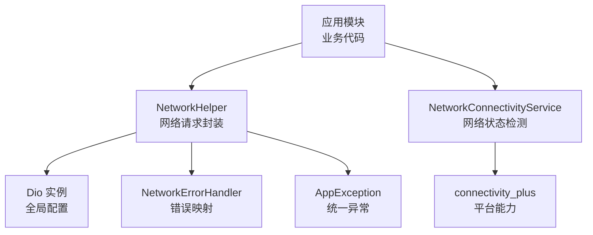
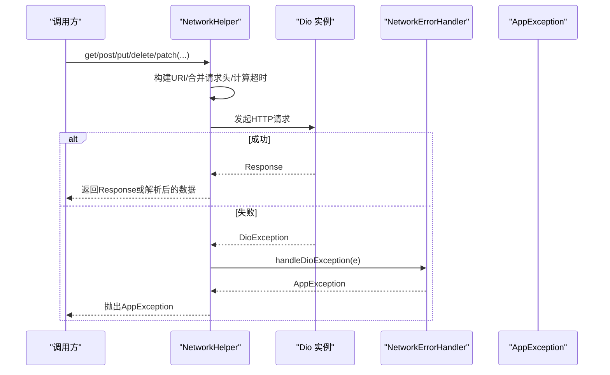
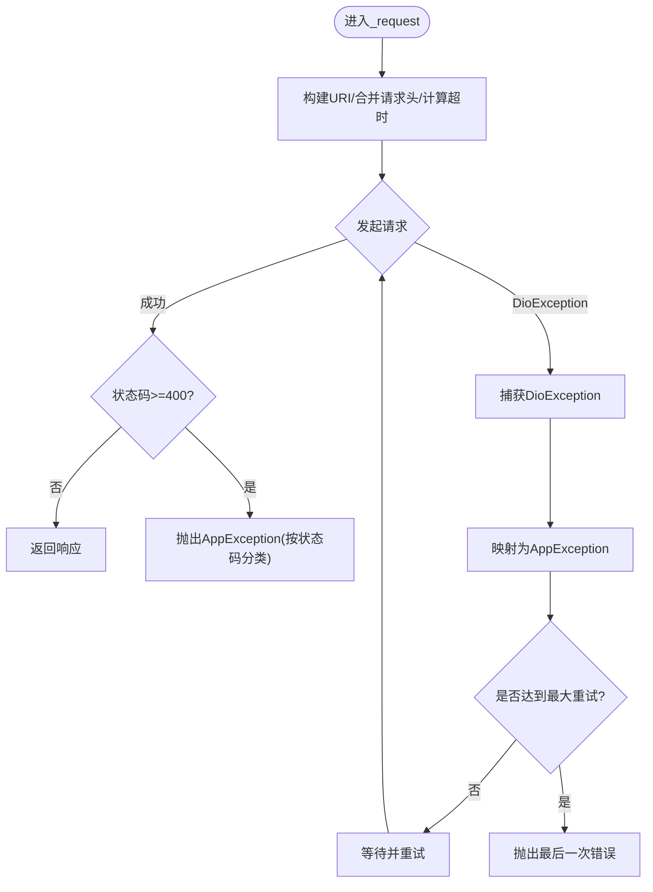
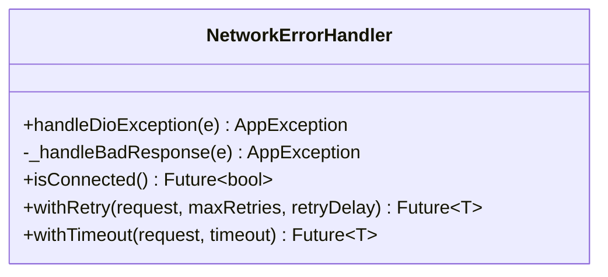
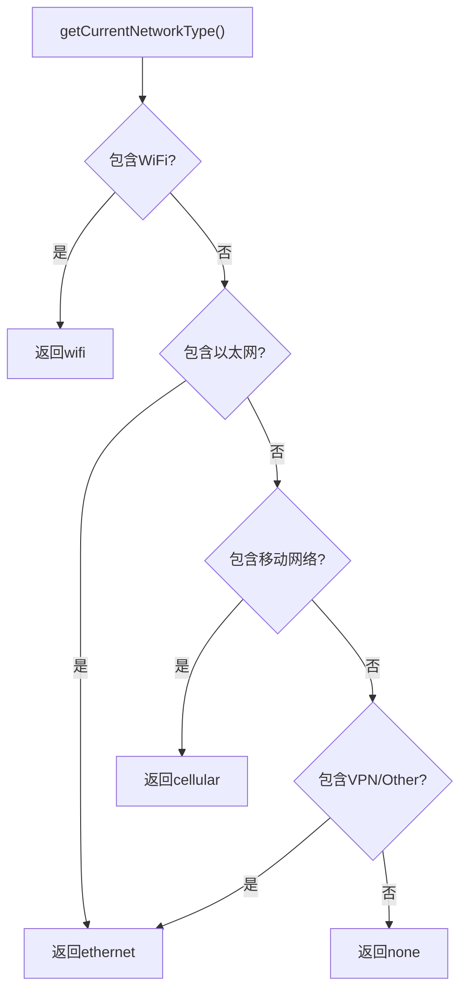
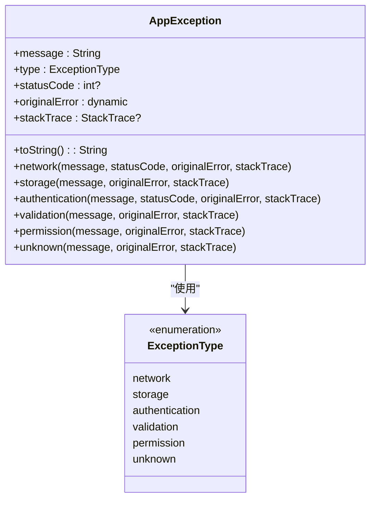
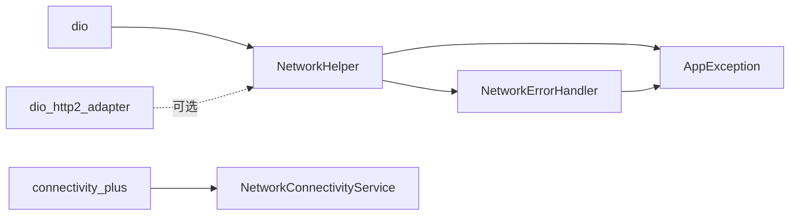

# 网络 HTTP 客户端集成

<cite>
**本文引用的文件**   
- [pubspec.yaml](file://pubspec.yaml)
- [network_helper.dart](file://lib/core/utils/network_helper.dart)
- [network_error_handler.dart](file://lib/core/utils/network_error_handler.dart)
- [network_connectivity_service.dart](file://lib/core/services/network_connectivity_service.dart)
- [app_constants.dart](file://lib/core/utils/app_constants.dart)
- [app_exception.dart](file://lib/core/utils/app_exception.dart)
</cite>

## 目录
1. [简介](#简介)
2. [项目结构](#项目结构)
3. [核心组件](#核心组件)
4. [架构总览](#架构总览)
5. [详细组件分析](#详细组件分析)
6. [依赖关系分析](#依赖关系分析)
7. [性能考虑](#性能考虑)
8. [故障排查指南](#故障排查指南)
9. [结论](#结论)
10. [附录](#附录)

## 简介
本文件面向 TinyCast 应用的 Dio HTTP 客户端集成，系统化说明以下主题：
- Dio 配置选项与默认行为（基础 URL、超时、请求头）
- 拦截器使用建议与扩展点
- 请求/响应处理封装（GET/POST/PUT/DELETE/PATCH、JSON 解析、错误分类）
- 网络请求的封装方法（重试机制、超时设置、错误处理策略）
- API 调用示例（GET/POST、文件上传/下载、流式数据传输）
- 网络状态监听、缓存策略与离线支持
- HTTPS 配置、证书验证与安全传输最佳实践
- 网络性能优化技巧与常见问题排查

## 项目结构
TinyCast 的网络层围绕三个核心文件组织：
- 网络工具类：统一封装 Dio 实例、请求方法与重试逻辑
- 错误处理工具：将 Dio 异常映射为应用级异常类型
- 网络连通性服务：基于 connectivity_plus 提供网络类型判断与刷新策略

图表来源 
- [network_helper.dart:1-487](file://lib/core/utils/network_helper.dart#L1-L487)
- [network_error_handler.dart:1-188](file://lib/core/utils/network_error_handler.dart#L1-L188)
- [network_connectivity_service.dart:1-63](file://lib/core/services/network_connectivity_service.dart#L1-L63)
- [app_exception.dart:1-148](file://lib/core/utils/app_exception.dart#L1-L148)

章节来源
- [pubspec.yaml:68-77](file://pubspec.yaml#L68-L77)
- [network_helper.dart:1-487](file://lib/core/utils/network_helper.dart#L1-L487)
- [network_error_handler.dart:1-188](file://lib/core/utils/network_error_handler.dart#L1-L188)
- [network_connectivity_service.dart:1-63](file://lib/core/services/network_connectivity_service.dart#L1-L63)
- [app_constants.dart:1-82](file://lib/core/utils/app_constants.dart#L1-L82)
- [app_exception.dart:1-148](file://lib/core/utils/app_exception.dart#L1-L148)

## 核心组件
- NetworkHelper：集中管理 Dio 实例、默认基础 URL、超时、请求头；提供 GET/POST/PUT/DELETE/PATCH、JSON 解析、文件上传/下载；内置重试与错误处理。
- NetworkErrorHandler：将 DioException 转换为 AppException，按错误类型给出用户友好提示，并提供 withRetry/withTimeout 通用包装。
- NetworkConnectivityService：基于 connectivity_plus 获取当前网络类型（WiFi/以太网/蜂窝/无），并决定是否允许刷新。
- AppConstants：定义默认超时时间、最大重试次数等常量。
- AppException：统一异常模型，包含类型、消息、状态码、原始错误与堆栈。

章节来源
- [network_helper.dart:1-487](file://lib/core/utils/network_helper.dart#L1-L487)
- [network_error_handler.dart:1-188](file://lib/core/utils/network_error_handler.dart#L1-L188)
- [network_connectivity_service.dart:1-63](file://lib/core/services/network_connectivity_service.dart#L1-L63)
- [app_constants.dart:1-82](file://lib/core/utils/app_constants.dart#L1-L82)
- [app_exception.dart:1-148](file://lib/core/utils/app_exception.dart#L1-L148)

## 架构总览
下图展示从业务调用到网络层的完整流程，包括重试、错误映射与结果返回。

图表来源 
- [network_helper.dart:270-395](file://lib/core/utils/network_helper.dart#L270-L395)
- [network_error_handler.dart:10-60](file://lib/core/utils/network_error_handler.dart#L10-L60)
- [app_exception.dart:22-58](file://lib/core/utils/app_exception.dart#L22-L58)

## 详细组件分析

### NetworkHelper：请求封装与重试
- 配置项
  - 基础 URL：setBaseUrl
  - 超时：setTimeout（连接/接收超时）
  - 默认请求头：setDefaultHeaders
  - 最大重试次数：setMaxRetryCount
- 请求方法
  - get/post/put/delete/patch：内部统一走 _request
  - getJson/postJson：在请求后执行 JSON 解析
- 文件操作
  - downloadFile：支持进度回调 onReceiveProgress
  - uploadFile：multipart/form-data 上传，支持自定义字段与头部
- 重试与错误
  - _request 内循环重试，指数退避（按尝试次数递增延迟）
  - 对 HTTP >= 400 的错误进行语义化分类（认证/校验/网络）
  - 统一抛出自定义 AppException

图表来源 
- [network_helper.dart:270-395](file://lib/core/utils/network_helper.dart#L270-L395)
- [network_helper.dart:416-453](file://lib/core/utils/network_helper.dart#L416-L453)

章节来源
- [network_helper.dart:1-487](file://lib/core/utils/network_helper.dart#L1-L487)
- [app_constants.dart:16-21](file://lib/core/utils/app_constants.dart#L16-L21)

### NetworkErrorHandler：错误映射与通用包装
- 错误映射：根据 DioExceptionType 与 HTTP 状态码，生成 AppException（网络/认证/权限/校验/未知）
- 通用包装
  - withRetry：带重试次数的异步请求包装
  - withTimeout：带超时的异步请求包装
- 连接检查占位：isConnected（可结合 connectivity_plus 实现）

图表来源 
- [network_error_handler.dart:10-124](file://lib/core/utils/network_error_handler.dart#L10-L124)
- [network_error_handler.dart:138-186](file://lib/core/utils/network_error_handler.dart#L138-L186)

章节来源
- [network_error_handler.dart:1-188](file://lib/core/utils/network_error_handler.dart#L1-L188)

### NetworkConnectivityService：网络状态监听
- 获取当前网络类型：wifi/ethernet/cellular/none
- isWifi：判断是否为 WiFi/以太网
- canRefresh：根据网络类型与是否允许蜂窝刷新决定是否可以拉取数据

图表来源 
- [network_connectivity_service.dart:15-42](file://lib/core/services/network_connectivity_service.dart#L15-L42)

章节来源
- [network_connectivity_service.dart:1-63](file://lib/core/services/network_connectivity_service.dart#L1-L63)

### AppException：统一异常模型
- 类型枚举：network/storage/authentication/validation/permission/unknown
- 工厂方法：便于快速构造不同场景的异常
- toString：输出包含状态码、原始错误与堆栈的可读信息

图表来源 
- [app_exception.dart:1-148](file://lib/core/utils/app_exception.dart#L1-L148)

章节来源
- [app_exception.dart:1-148](file://lib/core/utils/app_exception.dart#L1-L148)

## 依赖关系分析
- 外部依赖
  - dio：HTTP 客户端核心
  - dio_http2_adapter：HTTP/2 适配器（可选，用于性能优化）
  - connectivity_plus：网络类型检测
- 内部依赖
  - NetworkHelper 依赖 Dio、Logger、AppConstants、AppException
  - NetworkErrorHandler 依赖 Dio、AppException、Logger
  - NetworkConnectivityService 依赖 connectivity_plus、Logger

图表来源 
- [pubspec.yaml:68-77](file://pubspec.yaml#L68-L77)
- [network_helper.dart:1-487](file://lib/core/utils/network_helper.dart#L1-L487)
- [network_error_handler.dart:1-188](file://lib/core/utils/network_error_handler.dart#L1-L188)
- [network_connectivity_service.dart:1-63](file://lib/core/services/network_connectivity_service.dart#L1-L63)

章节来源
- [pubspec.yaml:68-77](file://pubspec.yaml#L68-L77)

## 性能考虑
- 启用 HTTP/2：通过 dio_http2_adapter 提升多路复用与头部压缩效果（需服务端支持）
- 合理超时：根据接口特性设置 connect/receive/send 超时，避免长时间阻塞
- 重试策略：对幂等请求（如 GET）采用有限重试与指数退避，避免雪崩
- 并发控制：限制并发请求数，避免同时触发过多网络 IO
- 缓存策略：对静态资源使用浏览器/系统缓存；图片可使用 cached_network_image
- 流式传输：大文件下载/上传使用流式接口，减少内存占用
- 连接池：复用 Dio 实例，避免频繁创建销毁底层连接

[本节为通用指导，不直接分析具体文件]

## 故障排查指南
- 常见错误分类
  - 连接超时/发送超时/接收超时：检查网络环境与服务器可达性
  - 证书错误：检查 HTTPS 证书链与设备信任根
  - 401/403：检查 Token 有效性、权限配置
  - 404：检查路径与参数
  - 5xx：服务端问题，配合日志与重试策略
- 定位步骤
  - 查看 NetworkHelper 日志输出（请求/响应/错误）
  - 使用 NetworkErrorHandler.withRetry 包裹关键请求，观察重试次数与延迟
  - 使用 NetworkConnectivityService.canRefresh 判断是否因网络类型导致拒绝刷新
  - 检查 AppException 的 message/statusCode/originalError 定位根因

章节来源
- [network_error_handler.dart:10-124](file://lib/core/utils/network_error_handler.dart#L10-L124)
- [network_helper.dart:362-395](file://lib/core/utils/network_helper.dart#L362-L395)
- [network_connectivity_service.dart:49-61](file://lib/core/services/network_connectivity_service.dart#L49-L61)

## 结论
TinyCast 的网络层以 NetworkHelper 为核心，结合 NetworkErrorHandler 与 NetworkConnectivityService，形成“请求封装—错误映射—状态感知”的闭环。通过统一的 AppException 与 AppConstants，实现了可配置、可观测、可扩展的网络能力。建议在后续迭代中补充拦截器（鉴权、日志、缓存）、完善离线队列与断点续传，并结合 HTTP/2 与连接池进一步优化性能。

[本节为总结，不直接分析具体文件]

## 附录

### Dio 配置与拦截器使用建议
- 基础配置
  - setBaseUrl：统一域名前缀
  - setTimeout：统一超时
  - setDefaultHeaders：统一 Content-Type/Accept/Authorization 等
- 拦截器扩展点
  - 鉴权拦截器：自动注入 Token、刷新 Token 逻辑
  - 日志拦截器：记录请求/响应体与耗时
  - 缓存拦截器：对 GET 请求做本地缓存（内存/磁盘）
  - 重试拦截器：替代 _request 中的重试逻辑，便于复用
- 注意
  - 拦截器顺序影响最终行为，应谨慎设计
  - 避免在拦截器中进行阻塞 I/O

[本节为通用指导，不直接分析具体文件]

### API 调用示例（概念性）
- GET 请求
  - 使用 NetworkHelper.get(endpoint, queryParameters, headers, timeout)
  - 使用 NetworkHelper.getJson<T>(endpoint, parser) 直接解析为类型
- POST 请求
  - 使用 NetworkHelper.post(endpoint, body, headers, queryParameters, timeout)
  - 使用 NetworkHelper.postJson<T>(endpoint, body, parser)
- 文件上传
  - 使用 NetworkHelper.uploadFile(endpoint, file, fieldName, fields, headers, timeout)
- 文件下载
  - 使用 NetworkHelper.downloadFile(url, savePath, onProgress)
- 流式数据传输
  - 使用 Dio 的 Stream 接口（例如 response.data.asStream()）进行分块处理

[本节为概念性示例，不直接分析具体文件]

### 网络状态监听、缓存与离线支持
- 网络状态监听
  - 使用 NetworkConnectivityService.getCurrentNetworkType/isWifi/canRefresh
  - 结合 connectivity_plus 的 Stream 订阅实时变化
- 缓存策略
  - 短时效：内存缓存（Provider/State）
  - 长时效：本地数据库/文件系统（Isar/SQLite/文件）
  - 图片缓存：cached_network_image
- 离线支持
  - 优先读取本地缓存
  - 网络恢复后增量同步
  - 失败任务入队，后台重试

[本节为通用指导，不直接分析具体文件]

### HTTPS 配置与安全传输最佳实践
- 强制 HTTPS：禁用明文传输
- 证书校验：生产环境启用严格校验，禁止随意跳过验证
- 安全存储：敏感信息（Token、密钥）使用安全存储
- 防重放：必要时添加随机数/时间戳签名
- 最小权限：仅申请必要网络与文件权限

[本节为通用指导，不直接分析具体文件]

### 性能优化技巧
- 启用 HTTP/2（dio_http2_adapter）
- 合理设置超时与重试
- 限制并发与批量请求
- 使用流式下载/上传
- 图片与静态资源缓存
- 连接池复用

[本节为通用指导，不直接分析具体文件]